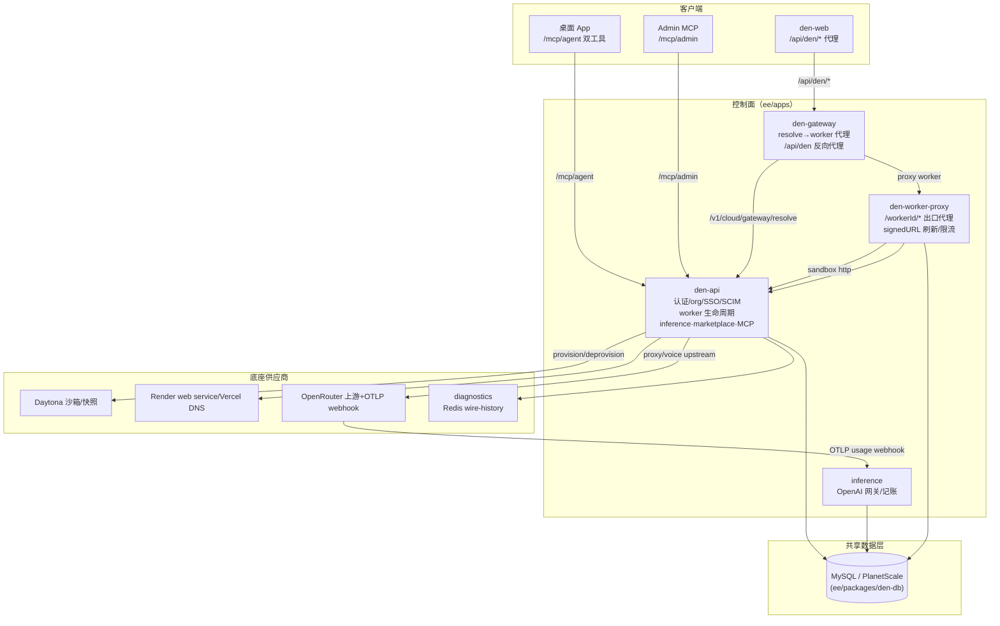
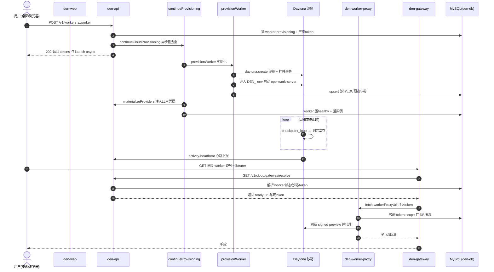

# OpenWork Den 企业控制平面服务架构

> 承接「代理运行时 + Server API 层」如何构成本地数据面。本模块讲：当需要团队/组织级管理时，Den 控制平面如何叠加成多云可部署的控制面，并为「MCP 双工具注入 + marketplace/SSO/inference」的部署与服务骨架铺路。
>
> 源码根：`ee/apps`（对齐仓库根），`ee/packages/den-db` 作为共享数据层。

## 架构总览



> 图例略去了部分真实连接。关键点是：**三处读写共享 DB（den-api 写、inference 读+扣、worker-proxy 读），一条 SaaS 流量主链（WEB→GATE→resolve→WPROXY→沙箱），一条模型结算闭环（proxy→OpenRouter→OTLP→webhook→bucket）**。

## 在项目中的角色

一句话根因：**单机版 OpenWork（一个 openwork-server 进程 + 本地工作区）没有「组织边界」**——无法多人共享、无法统一管理 worker、无法中心化配推理/SSO，也没有一处多租户的控制面把 agent 实例编排起来。Den 就是叠加在 OpenWork 之上的企业级控制平面，把 worker 从「本机进程」抽象成「可跨云、可复活、可代理托管」的远程实例。去掉它，产品退回单人单机工具。

Den 由多个独立服务组成，全部在 `ee/apps/`：

| 服务 | 定位 | 一句话职责 |
|------|------|-----------|
| `den-api` | 控制面核心 | 认证(Better Auth)、org/member/team/role、SSO/SCIM、worker 生命周期(provision→wake→recycle→stop→deprovision)、inference 目录、marketplace、MCP 注入 `/mcp`、`/mcp/agent`、`/mcp/admin` |
| `den-web` | 控制台 | Next.js 前端，经 `/api/den/*` 代理到 den-api |
| `den-gateway` | 实例路由网关 | 用当前用户 Bearer 解析其 cloud worker，代理到 worker 实例或静态托管 SPA；`/api/den` 反向代理 |
| `den-worker-proxy` | worker 出口代理 | 以 `/workerId/*`、host/client token 认证、DB 限流，刷新 Daytona signed preview URL 并代理到沙箱内 openwork-server |
| `den-worker-runtime` | Worker 渲染镜像 | Dockerfile 构建目录 + opencode 安装脚本，供 Render/Daytona 渲染工作镜像 |
| `inference` | 推理代理服务 | OpenAI 兼容网关：认 `ow_inf_*` key、改写模型别名、走 org 的 OpenRouter 上游 key、额度桶限流、usage webhook 结算 |
| `diagnostics` | 连接诊断 | 记录与可回放的 wire-history（debug proxy / auth 模拟），Redis 持久化、本地内存回退 |
| `enterprise-mock-lab` / `landing` | 辅助 | 企业模拟实验台 / 落地页 |
| `den-controller` | 已废弃 | 唯一残留是 README，声明被 `den-api` 取代并合并 |

这些服务通过一份**共享 MySQL schema**（`ee/packages/den-db`）和一堆**互指 ENV** 胶合。

## 解决什么问题、根因

单机 OpenWork 本质只有"一个用户 + 一个进程 + 本地文件"。转向团队/企业，四类问题立即出现：

1. **多租户与身份**：多人需要组织边界、成员/角色/团队模型，以及企业必备的 SSO（OIDC/SAML）与 SCIM（目录同步）。
2. **远程 worker 的可编排性**：agent 实例在用户本机是"进程"，在组织里要变成可被控制面创建、唤醒、休眠、回收、销毁的云端资源，且用户断网/换机器后工作区可找回（需持久化）。
3. **实例路由与安全边界**：SaaS 不能让用户直连任意沙箱，需要一个统一入口把"当前会话 → 具体 worker 实例"解析出来，并注入正确的 client/host token。
4. **模型与企业数据合规**：企业要统一管 LLM（推理目录/多模型）、统一限额计费、统一审计/诊断。

根因落在现代云应用的典型张力：**多租户要共享（DB/控制面）、实例要隔离（沙箱）、身份要中心化（SSO/SCIM）、模型要治理（inference 网关）**。

## 设计思路

### 方案总览：控制面 = 一组按"请求 IO 画像"切分的微服务，共享一份 MySQL 状态库

Den 不是单进程，而是把「企业的状态机」与「请求加工」拆成多个可独立扩容、部署的服务。核心拆分逻辑不是按功能域，而是按**请求的本质差异**：

- **长生命周期、幂等、面向数据库的状态操作**（建 worker、改成员、发 token）→ `den-api`，几乎唯一写数据库的控制面大脑。
- **高 QPS、跟随 bearer 令牌翻译成上游 URL 的转发** → `den-gateway`，无状态数据面分流器，只 resolve + 代理，不碰数据库（除缓存）。
- **输出端口到沙箱、刷新短期 signed URL、按 IP 限流** → `den-worker-proxy`，实例出口专用代理，直读 `daytona_sandbox` 与 `worker_token` 表。
- **纯转发 + 额度记账的服务化模型网关** → `inference`，只认 `ow_inf_*` key，不透传 org 上游密钥。
- **记录/回放调试流量** → `diagnostics`，用独立 Redis。

`den-api` 之外的服务**只读**共享 DB 的少数几张表。这体现了「Server-consumption first」不变式：**服务消费控制面造好的状态，不自己发明平行行为。**

worker-proxy 启动即直连共享库（[ee/apps/den-worker-proxy/src/app.ts:9-13]()）：

<!-- snippet-base64:Y29uc3QgeyBkYiB9ID0gY3JlYXRlRGVuRGIoewogIGRhdGFiYXNlVXJsOiBlbnYuZGF0YWJhc2VVcmwsCiAgbW9kZTogZW52LmRiTW9kZSwKICBwbGFuZXRzY2FsZTogZW52LnBsYW5ldHNjYWxlLAp9KQ== -->

```ts
const { db } = createDenDb({ databaseUrl: env.databaseUrl, mode: env.dbMode, planetscale: env.planetscale })
```

`den-db/src/client.ts` 的 `createDenDb` 统一支持 MySQL 与 PlanetScale，且内置"只读查询瞬时断连重试一次"的韧性。

### 关键抽象一：`worker` 状态机 + 三类 token

worker 是控制面核心资源，表 `worker` 上有 `status ∈ {provisioning, healthy, failed, stopped}`、`destination ∈ {local, cloud}`、`TokenScope ∈ {client, host, activity}`。三个枚举由 Drizzle `mysqlEnum` 直接约束到表列（[ee/packages/den-db/src/schema/workers.ts:4-6]()）：

<!-- snippet: export const WorkerDestination = ["local", "cloud"] as const
export const WorkerStatus = ["provisioning", "healthy", "failed", "stopped"] as const
export const TokenScope = ["client", "host", "activity"] as const -->

- **local worker**：本机进程，创建即 `healthy`。
- **cloud worker**：远端沙箱生命周期，控制面异步编排，创建时标 `provisioning`。

三类 token 把数据面/管理面/遥测面在凭据层直接拆开，是安全分级的第一道闸：

- `client`：agent/浏览器对 worker 的普通访问（读）令牌。
- `host`：控制面/管理面访问 worker 的特权令牌，能触发写操作。
- `activity`：worker 回连控制面上报心跳的专用令牌。

### 关键抽象二：worker 生命周期 = 可重入的"状态机推进"函数

Den 不常用一个常驻 orchestrator 守护 worker 状态，而是用**一组推进状态机的函数**（provision/adopt/wake/recycle/stop/deprovision），加上**多个入口**（路由、reconcile 循环、自愈）触发同一套推进逻辑，以「数据库条件更新时间 + 进程内 in-flight Map」保证多副本安全、单副本高效：

```ts
// routes/workers/shared.ts:444-445
// Conditional updates are the multi-replica safety; this in-process map is
// single-replica efficiency shared by routes, reconcilers, and self-heals.
```

### 关键抽象三：`provisionerMode` 可插拔 —— 「ejectable / 多云可部署」的落地

`den-api` 的 worker provisioning 抽象为 `provisionWorker`/`deprovisionWorker`，按 `PROVISIONER_MODE` 分发（render / daytona / stub）。分派发生在统一的 `provisionWorker` 入口，用 `env.provisionerMode` 分支到三家提供商实现（[ee/apps/den-api/src/workers/provisioner.ts:352-360]()），默认值在 [ee/apps/den-api/src/env.ts:527-527]() 取 `stub`：

<!-- snippet: export async function provisionWorker(
  input: ProvisionInput,
): Promise<ProvisionedInstance> {
  if (env.provisionerMode === "render") {
    return provisionWorkerOnRender(input)
  }
  if (env.provisionerMode === "daytona") {
    return provisionWorkerOnDaytona(input)
  } -->

```text
env.provisionerMode === "render"  → provisionWorkerOnRender  (Render API 建 web service)
env.provisionerMode === "daytona" → provisionWorkerOnDaytona (@daytonaio/sdk 建沙箱/快照)
默认 stub                          → 占位 URL（无底座自托管/评测）
```

**不把供应商固有行为硬编码，而是以环境变量切换，正是 ejectable 不变式的直接证据**。

Render 调 Render API 建 web service、Daytona 用 `@daytonaio/sdk` 建沙箱/装镜像/快照、stub 仅返回占位 URL（默认，用于无底座自托管/评测）。**不把供应商固有行为硬编码，而是以环境变量切换，正是 ejectable 不变式的直接证据**。

### 关键抽象四：checkpoint 持久化 —— worker 的"状态可迁移"

Daytona 沙箱的容器 overlay 不持久，engine 会话（SQLite `opencode.db`）落在容器上，worker recycle 就丢会话。Den 的方案（`den-api/src/workers/daytona.ts`）：

- 沙箱内跑 `checkpoint_loop` shell，周期性用 `tar` 把 `$OPENWORK_STATE_MANIFEST`（engine 状态 + workspace + runtime data）打到共享 volume 的 `checkpointDir`；`checkpoint_changed` 用 `find ... -newer $LAST_FLUSH_MARKER` 判断是否有变更，无变更跳过；`prune_checkpoints` 只留 `DEN_CKPT_KEEP` 份。
- 每次 flush 前先 `PRAGMA wal_checkpoint(TRUNCATE)` 收敛 SQLite WAL，保证拷贝出的库自洽且小（[ee/apps/den-api/src/workers/daytona.ts:399-399]()）。

<!-- snippet:     node -e 'const{DatabaseSync}=require("node:sqlite");const db=new DatabaseSync(process.argv[1]);db.exec("PRAGMA wal_checkpoint(TRUNCATE)");db.close()' "$ENGINE_STATE_PATH/opencode.db" >/dev/null 2>&1 || true -->

- **刻意不持久化** `auth.json` 与 `log`，因为凭据每次启动会重新物化下发、日志是噪音（[ee/apps/den-api/src/workers/daytona.ts:402-402]()）。
- 沙箱启动脚本在 `state_dirs_pristine`（无数据且无 RESTORE_MARKER）时 `hydrate_checkpoint` 解出最新 `ckpt-*.tar`，并写 `RESTORE_MARKER` 防重复恢复（`den-api/src/workers/daytona.ts:350,480,506`）。
- 终止（TERM/INT）时 `trap on_term` 先 flush 再 kill server。

### 关键抽象五：凭据物化（provider materialization）

worker 是通用底座，不该自带组织 LLM 凭据。cloud worker 变 `healthy` 后，`den-api` 调 `materializeCloudWorkerProviders` 把 org 的 LLM provider 配置、模型与密钥**以 env 写进 worker 实例**（经 `X-OpenWork-Host-Token` 打实例的 `/env` 端点）。

**关键 bug 教训**：物化缓存最初只以 `workerId` 为键——recycle 换新 sandbox 后新实例 env 是空的（仅共享卷上有 runtime config），den-api 仍答"cached"，导致每个 provider 报"API key is missing"但 picker 里仍有其名。修复改为 **workerId×instanceUrl 双键**（[ee/apps/den-api/src/llm/cloud-provider-materialization.ts:102-111]()）：

```ts
 * Keying by worker alone was a bug: a recycle onto a new snapshot replaces the
 * sandbox, and the new instance starts with an empty env store ... With a worker-only
 * key den-api kept answering "cached" and never wrote the credential into the new instance
```

这印证了本模块核心张力：**只要实例可被重建，控制面就必须"每次证明自己的物化仍有效"，缓存失效策略必须紧跟实例取代语义。**

## 关键数据结构（服务间共享的 payload）

### `ResolvePayload`（den-api → den-gateway）

`/v1/cloud/gateway/resolve` 的返回，是 gateway 把"用户 bearer"翻译成"worker 上游"的契约（[ee/apps/den-gateway/src/app.ts:12-22]()）：

<!-- snippet: type ResolvePayload = {
  status: InstanceStatus
  url: string | null
  clientToken: string | null
  hostToken: string | null
}

type InstanceResolution =
  | { kind: "ready"; url: string; clientToken: string; hostToken: string }
  | { kind: "not_ready"; status: NonReadyStatus }
  | { kind: "error"; statusCode: number; error: string } -->

```ts
type ResolvePayload = { status: InstanceStatus; url: string | null; clientToken: string | null; hostToken: string | null }
type InstanceResolution =
  | { kind: "ready"; url: string; clientToken: string; hostToken: string }
  | { kind: "not_ready"; status: NonReadyStatus }
  | { kind: "error"; ... }
```

`status=ready` → 携 `url`+双 token 可代理；`not_ready`（provisioning/waking/failed）→ gateway 返回状态不代理；异常 → 502。gateway 对 ready 结果缓存 `resolveTtlMs`。**缓存键是 bearer（不是 user/worker）**，登出换令牌即失效。

### `TokenScope` 校验（den-worker-proxy 读）

`den-worker-proxy` 用 scope + 方法组合决定放行，读（GET/HEAD）允许 `client` 或 `host`、写仅允许 `host`（[ee/apps/den-worker-proxy/src/app.ts:205-205]()，调用点在 `:388`）：

<!-- snippet: export function isProxyTokenAuthorized(method: string, tokenScope: WorkerTokenScope | "invalid" | null): tokenScope is WorkerTokenScope { -->

- "数据面读、运维面写"的令牌语义被出口代理独立校验。

## 核心流程：worker 从申请到被 agent 访问

以最完整的 **cloud worker（Daytona）** 为例：



> 两个关键观察：**(1)** 编排路径只发生在"申请/唤醒/回收"这些低频时刻，由 `continueCloudProvisioning`/`wakeCloudWorker` 推进；**(2)** 常态访问路径是"gateway 解析一次（TTL 缓存）→ 长驻 proxy 转发"，请求不回到状态机。低频写状态机 + 高频无状态转发，是 Den 吞吐的关键前提。

## 与其他模块的协同

- **与 `den-db`（共享数据层）**：这是"微服务共享单库"的典型。den-api、inference、den-worker-proxy 都 `import` 同一 `den-db` 的 `createDenDb` 连同一库。因此**迁移/加表必须三服务齐步**——这正是 den-db 独立成 package 的原因：Drizzle schema 单一来源，避免各服务复制 schema 漂移。`den-db/test/migration-schema-parity.test.ts` 暗示对 schema 漂移敏感。
- **与 `apps/server` 数据面**（跨模块结论，主 agent 已在 [`agent-runtime-opencode.md`](agent-runtime-opencode.md) 补全）：worker runtime 通过 `DEN_RUNTIME_PROVIDER`/`DEN_WORKER_ID` 等 env 识别自己是"Den 管理的云 worker"，以 `activity-heartbeat` 上报；控制面以 host/client token 访问其 `/workspaces`、`/runtime/*`、`/env` 端点。
- **与 `inference`（按共享 key/bucket 协同）**：den-api 开启 inference 时为每个 member 造 `ow_inf_*` key、把 org 的 OpenRouter 上游 key 存好；inference 服务认 key、限流、扣桶、接收 OpenRouter OTLP webhook 入账。整个推理治理闭环（创建→认证→限流→结算）被控制在 `den-api` 的开关（`setInferenceEnabled`）下，符合"控制面是唯一写面"。
- **与 `den-web`/`den-gateway`**：den-web 只读消费方（经 `/api/den/*` 反向代理到 den-api），gateway 是"会话→实例"翻译器。二者不写业务状态，典型的 consumer-first 服务。

## 关键设计决策

### 决策一：为何拆这么多服务，而不是一个大单体

权衡核心在"写面"与"读面"的分离：

- **若做成单体**：认证/org/SCIM（写面，低频）、高 QPS 流量代理（gateway）、实例出口限流（worker-proxy）、模型网关（inference）全挤一个进程。任一抖动（worker 代理风暴）都会拖垮 SSO 或 marketplace；推理网关若带 Den 全部权限模型，风险面太大。
- **选微服务**：把"需要写事务/org 上下文"的**唯一重型写面**（den-api）与"只需读少量表"的转发面剥开，转发面各自只持最小 DB 读集，天然降权。
- **为何不再拆**：org/SCIM/inference/marketplace 留在 den-api，因为它们的操作需要同一事务与同一 org 上下文，硬拆只引入分布式事务。**边界恰好停在"要不要共享一个事务/上下文"上。**

### 决策二：快照版本 → sandbox recycle 的"无感更新"

Daytona worker 一旦存在沙箱，镜像（snapshot）无法原地热替换。Den 在版本不一致时对 stopped 沙箱整体 recycle（[ee/apps/den-api/src/workers/daytona.ts:1153-1156]()、`1202-1225`）：新 snapshot 建新沙箱 → 启动 → `verifyRestoreMarker` 确认 checkpoint 已恢复 → 删旧沙箱；失败则回退"唤醒旧沙箱"。**权衡**：不做 recycle 就只能停服/迁移、用户会话因镜像升级丢失；做了 recycle 则版本升级无感，但要求 checkpoint 机制严格正确（RESTORE_MARKER 防误恢复 + 物化缓存按 instance 失效）。

### 决策三：`den-controller` 废弃并入 `den-api` 的教训

`ee/apps/den-controller/README.md` 仅剩迁移存根，声明被 `den-api` 取代（[ee/apps/den-controller/README.md:1-3]()）：

<!-- snippet-base64:IyBEZXByZWNhdGVkOiBgZGVuLWNvbnRyb2xsZXJgCgpgZWUvYXBwcy9kZW4tY29udHJvbGxlcmAgaGFzIGJlZW4gcmVwbGFjZWQgYnkgYGVlL2FwcHMvZGVuLWFwaWAgKGBkZW4tYXBpYCwgZm9ybWVybHkgYGRlbi1jb250cm9sbGVyYCku -->

教训：控制面的"认证 + 组织 + worker 生命周期"天然共享同一会话/org 上下文与同一事务边界，最初拆出 controller 反而制造"两个进程读同一 org 会话状态"的耦合。合并回 den-api = 承认**控制面脑子（写面）本质是一个进程**，剩下只有读壁的服务值得拆。这是"微服务边界不在领域而在事务/上下文"的实证。

### 决策四：token/min-port 约定的代价

Den 靠强约定 + ENV 串接服务：固定端口（den-api 8790 / gateway 8788 / worker-proxy 8789 / inference 8791）、`DEN_API_BASE`、共享 `DEN_GATEWAY_KEY`、`INFERENCE_PROXY_BASE_URL`、DB 双模式等。**好处**：本地起齐四服务无需服务发现。**代价**：任何端口/token/URL 变化要跨服务同步，生产拓扑隐式写死在默认值——"ejectable 相对脆弱的点"。

## 亮点与问题

### 亮点

- **"低频写状态机 + 高频无状态转发"分层**：网关/代理不写业务表，控制面把编排收敛到一进程，吞吐与安全边界干净。
- **checkpoint 机制**：把"容器不可持久"变成"状态可迁移"，支撑无感升级/复活，工程取舍写得很清楚（WAL 收敛、凭据不落卷、RESTORE_MARKER 防重复恢复）。
- **唯一写面 + 只读消费者的共享库**：`den-db` 单一 Drizzle schema，三服务共用，控制面永是唯一写源。
- **自带韧性**：`createDenDb` 只读查询瞬时断连自动重试一次，gateway 解析失败/上游失败逐级降级（502/not_ready），编排多处"尽力而退"。
- **物化缓存双键**：workerId×instanceUrl 紧跟实例取代语义，直面"实例可重建"的信任边界。

### 问题 / 风险

- **共享单库的演进成本**：三服务直接 import 同一 schema，跑 migration 必须齐步、顺序部署，否则一旧一新即字段漂移。`migration-schema-parity` 测试是补丁，未消除"部署编排必须原子"的约束。
- **服务间强约定脆弱**：固定端口 + ENV 串接免服务发现，但自托管端口/URL 冲突时排查成本高；ejectable 并不彻底——云供应商细节开关化了，服务间拓扑约定仍写死在默认值。
- **上下文扩 ad 一致窗口**：worker 状态机推进靠"条件更新 + 进程内并发去重"，扩 den-api 多副本而未做租约时，内存去重失效（仅剩 DB 条件兜底），是"当前够用、横向扩容即暴露"的隐患。去重 Map 定义在唤醒与供应两个入口（[ee/apps/den-api/src/workers/cloud-lifecycle.ts:53-53]()、[ee/apps/den-api/src/routes/workers/shared.ts:84-84]()）：

<!-- snippet: const wakeInFlight = new Map<WorkerId, Promise<void>>() -->

<!-- snippet: const cloudProvisioningInFlight = new Map<WorkerId, Promise<void>>() -->
- **物化与 checkpoint 的一致性前提**：RESTORE_MARKER 仅是本卷文件标记，多人共享卷若无线索锁，并发 hydrate/recycle 可能互相踩。当前依赖"同一 org 单 worker 语义"规避，属隐含假设。

## 待办

- `den-api/src/mcp/{index.ts,invoke.ts,native-capabilities.ts,marketplace-capabilities.ts}` 可补充"双工具如何经同一 catalog 分发"的字节级证据（见 [`mcp-injection.md`](mcp-injection.md)）。
- `den-worker-proxy` 的 `refreshPromises` 并发刷新去重用例可在审计时补充。
- 数据面 `apps/server` 侧 `/env`、`/workspaces`、`/runtime/*` 实现已由 [`agent-runtime-opencode.md`](agent-runtime-opencode.md) / [`server-proxy-api.md`](server-proxy-api.md) 补全。
