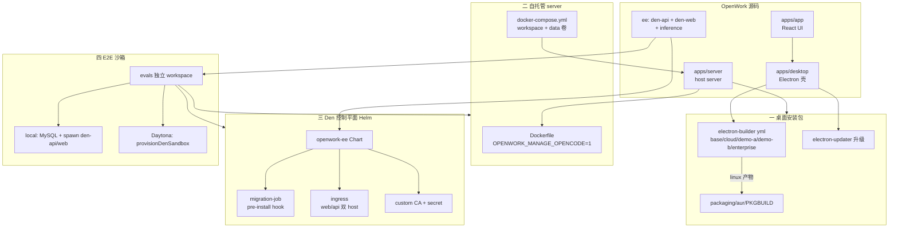
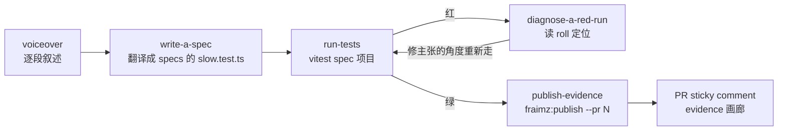

# 部署形态 + 测试与质量体系

> 定位：本模块收尾地讲两件事——OpenWork 怎么被部署起来、以及它如何用一套自研的证据驱动测试体系自证「改对了」。前者落在桌面安装包、自托管 server、Den 云控制平面三种形态；后者以 `evals/` 独立 workspace 承载「voiceover → spec → run → publish-evidence」的 demo driven development 闭环。

## 这个模块的角色：部署多样性 + 测试自证，支撑「可拆离」哲学

OpenWork 的项目自述强调「ejectable（可拆离）」：桌面壳可选、Den 控制平面既可自托管也可云化。本模块的两个关注面恰好各执一端地兑现了这句宣言：

- **部署形态的分层**是「可拆离性」的可运行证明。同一个产品被编排成几种边界清晰的交付：Electron 桌面安装包（单机最薄面）、自托管 server（docker-compose 一把拉起）、Den 控制平面 Helm 云部署（K8s 企业面）、以及 E2E 测试沙箱（既是被测对象、又是测试自身的运行环境）。桌面的 appId/productName 与不同发行通道是同一套代码用不同 electron-builder 配置切出来的，而不是分叉代码。
- **测试体系的独立性**是「高质量交付」的自证机器。`evals/` 被刻意建成独立的 pnpm workspace（`evals/pnpm-workspace.yaml` 只包 `packages/*`），README 首页第一句话就写明让它的工具链无法影响产品安装或镜像构建。

一句话根因：一个既要端到端真跑（驱动 Electron/Den）、又要面对多云部署的 AI 工作流产品，「改了没改坏」无法靠单元测试自证，必须有一套能把「用户可见行为 + 愿景模型视觉判断」固化成语料、并贴回 PR 的证据机器。

## 它解决什么问题、根因在哪

### 部署侧：同一产品，几种「物理边界」的契约

| 部署形态 | 交付物 | 强调的边界 |
| --- | --- | --- |
| 桌面安装包 | electron-builder 产物（dmg/zip/AppImage/tar.gz/nsis）+ AUR | 单机、离线、分发升级（electron-updater）、企业品牌 |
| 自托管 server | `Dockerfile` + `docker-compose.yml`，暴露 `8787` | 自己机器上的共享 host server、历史数据路径兼容 |
| Den 控制平面 | `packaging/helm/openwork-ee` Chart（den-api/den-web/inference） | 企业 K8s、多租、SSO/SCIM、custom CA、observability |
| E2E 沙箱 | `evals/` 的 local/Daytona 资源 | 测试自身的隔离、可销毁性 |

根因是：**产品形态越多样，回归验证的成本与「证明」的形态就越不同**。桌面能离线跑，但升级链路（electron-updater、AUR）、企业品牌（enterprise/demo 分发）、证书信任（custom CA）只能在真实安装形态里验证；云端 Den 的 SSO、租户、SCIM 必须真连一次控制平面。单靠「编译通过 + 单元测试」无法交付这种多形态产品。

### 测试侧：回归测试的两个致命痛点

1. **纯 DOM/单测断言覆盖不到「用户感知的正确」**。产品很依赖 UI 渲染、菜单弹出、愿景模型视觉判断；传统 screenshot 快照断言会因为一行 CSS 改动全挂、又告诉不了人「是不是真的错了」。
2. **「跑过一次没挂」≠「可证明地对了」**。一个测试如果只是 `await` 然后没报错，只证明「进程没崩」，证明不了「看到的确实是用户要的」。这就要求**每个 claim 都要有可观察断言**——这条铁律写在 [evals/README.md:89-89]()。

## 设计思路（方案、核心模式）

### 部署：配置模板化，`extends` 继承机制

桌面侧核心模式是 **electron-builder 的 `extends` 配置继承**：`electron-builder.base.yml` 定义全部通用打包细节（asar、sidecar 二进制、图标、目标平台、publish entitlement），对外配置只做极小覆盖。`demo-a.yml` 仅 10 行就切出一个新分发——这是「可拆离性」在 CD 侧的工程化表达。

Den 云侧核心模式是 **Helm values 把策略性决定全部参数化**：租户模式、SSO、custom CA、MCP SSRF 开关、observability 后端、provisioner（stub/render/daytona）、installer 分发通道，全部下沉为 values，使同一个 Chart 自托管单租户、云化多租户只靠配置切换。

### 测试：双层「依赖注入 + 断言分级」模式

`evals/` 的设计不是「一个测试框架」，而是**把一个可证明 E2E 覆盖拆成四个正交层**（分派表见 [evals/README.md:61-71]()）：

1. **`@openwork/testkit`（规格夹具）**：`needs() → server() → app()` 的依赖序注入，统一给每条测试注入 `place`（资源落点）与 `evidence`（证据卷轴）。
2. **`@openwork/behaviors` / `@openwork/matchers`（无副作用动作与纯断言）**：behaviors 是「框架无关、在窄句柄上动作和观测」；matchers 被明确定义为「在事实上的纯函数断言、无任何 I/O」。这一层不依赖测试上下文，故可被独立诊断脚本复用（`node evals/scripts/diagnose.mts <url>`）。
3. **`@openwork/fraimz`（证据卷轴）**：当前内部截图捕获与 ambient-tape 实现，被 testkit 使用；不是流作者面。
4. **`@openwork/evidence`（扫描、渲染、PR 发布）**：读已完成 tape 的 `roll.json`。

模式上最关键的是**断言分级**：一条 spec 里既有确定性编程断言（`expect(...).toBeDefined()` 这类，决定 Fail），又有愿景模型分级断言（`expectFrame(seen)` 把视觉判断计入 Passed），两者通过同一个 `roll.json` 汇入 tape。

## 部署形态详解

几种形态不是彼此孤立，而是同一套源码在不同「物理边界」下的投影。关系图如下：

### 一 桌面安装包（多套 electron-builder 配置 + AUR）

**配置组织：继承链。** `electron-builder.base.yml` 是一切的根，声明了 sidecar 二进制 `opencode`（按平台各一份）、`extraResources` 把 `apps/app/dist` 拷成 `app-dist`、`asarUnpack node-pty`、`afterPack`/`afterSign` 钩子、GitHub releases 发布源：`directories.output: dist-electron`、`afterPack: scripts/electron-after-pack.cjs`、`publish: provider github / repo openwork`（[apps/desktop/electron-builder.base.yml:1-34]()）。

真正体现「可拆离哲学」的是各平级子配置对 `extends` 的极端复用：

- `electron-builder.yml`（默认，`appId: com.differentai.openwork`）只补 name、protocol scheme `openwork`、artifactName 模板（[apps/desktop/electron-builder.yml:1-10]()）。
- `electron-builder.cloud.yml` 通过 `extraMetadata.openworkDistribution: cloud` 注入分发品牌，并把 GitHub publish channel 指到 `cloud`——同一二进制的不同分销由这条配置决定、不改代码（[apps/desktop/electron-builder.cloud.yml:4-15]()）。
- `electron-builder.enterprise.yml` 同理注入 `enterprise` flavor + `channel: enterprise`（[apps/desktop/electron-builder.enterprise.yml:4-15]()）。
- `demo-a.yml`/`demo-b.yml` 是最薄的两张——只改 `appId`/`productName`、`protocols: []`、mac 只在 `dir` 目录产出（无签名收件），是给管理端/消费端 demo 隔离用的（[apps/desktop/electron-builder.demo-a.yml:1-10]()）。

这个 `openworkDistribution` 不是摆设：[apps/desktop/electron/main.mjs:99-99]() 运行时读成 `packageFlavor`，并在 `enterpriseActivation`、命令行放行等能力点按 flavor 分支（`apps/desktop/electron/main.mjs:1027,1998,2536`）。

**AUR 打包**：`packaging/aur/PKGBUILD` 把 electron-builder 的 tar.gz 产物收进 Arch 生态。一个值得写的环境陷阱细节是 `chmod 4755 .../chrome-sandbox`——Electron 沙箱在 Linux 上没有 setuid 位就拒绝启动，这是桌面安装形态特有（`packaging/aur/PKGBUILD:58`）。

### 二 自托管 server（Docker）

`packaging/docker/Dockerfile`（无后缀）是「host server + 托管 opencode」的形态，根因句在启动 CMD：
<!-- snippet: plugin_dir="$(npm root -g)/openwork-server/dist/opencode-plugins"; test -d "$plugin_dir"; export OPENWORK_MANAGE_OPENCODE=1 OPENWORK_OPENCODE_BIN=/usr/local/bin/opencode OPENWORK_EXTENSIONS_PLUGIN_DIR="$plugin_dir"; exec openwork-server -->

即 server 内部管理 opencode binary（`OPENWORK_MANAGE_OPENCODE=1`）、把插件目录指向全局安装的 `openwork-server`（`packaging/docker/Dockerfile:52-56`）。两个值得写的权衡：

- **历史数据路径保留**：`OPENWORK_DATA_DIR=/data/openwork-orchestrator` 这个「orchestrator」目录名是刻意保留的历史名——注释明确说「改名会让既有部署静默丢状态」，这是「部署兼容性优先于命名整洁」的取舍（`packaging/docker/Dockerfile:37-43`）。
- **默认开放**：`--host 0.0.0.0` + `--cors *`，注释强调这是有意为之、把「共享」当默认而非安全选项（`packaging/docker/Dockerfile:53-55`）。

`docker-compose.yml` 把 `./workspace` 与 `./data` 两个卷映射出来，对应上面两个 env（[packaging/docker/docker-compose.yml:22-26]()）。

### 三 Den 控制平面（Helm Chart）

`packaging/helm/openwork-ee/Chart.yaml` 是 `type: application`、`appVersion: "0.1.0"` 的 Chart：den-api（8788）+ den-web（3005）+ optional inference（8791），共享 ConfigMap/Secret 模板、可选 Ingress、pre-install/pre-upgrade 迁移 Job（[packaging/helm/openwork-ee/README.md:3-10]()）。

**迁移 Job 的 hook 设计**是关键运维点。`templates/migration-job.yaml` 默认以 `helm.sh/hook: pre-install,pre-upgrade` + `hook-weight: -5` 注册成 hook Job，跑 `node /app/ee/packages/den-db/dist/scripts/bootstrap.js`；它在 `secret.create: true` 时把 `DATABASE_URL` 与 `DEN_DB_ENCRYPTION_KEY` 直接渲染进 Job env（`packaging/helm/openwork-ee/templates/migration-job.yaml:9-16,53-70`）。所以 README 反复警告「不要把 hook Job 的 describe 输出张贴到共享工单，需先脱敏」。

**多形态单 Chart**：`values.yaml` 默认 `tenancy.mode: single_org`（私有自托管默认），README 明示「Hosted OpenWork Cloud should set multi_org explicitly」，SSO 在单 org 上走 single_org 路径（[packaging/helm/openwork-ee/README.md:522-555]()）。这正是「云化或自托管只靠 values 切换」的证据。

**安全面**：`config.public.allowPrivateMcpUrls` 默认留空以保留 External MCP URL 的 SSRF 防护；`config.auth.passwordBreachScreeningEnabled` 默认 false 让隔离网环境不依赖 Have I Been Pwned 外部 API（[packaging/helm/openwork-ee/README.md:660-690]()）。custom CA 通过 `NODE_EXTRA_CA_CERTS` 挂 `/etc/openwork/custom-ca/ca-bundle.pem`，且 Helm 在 customCa 开启时显式拒绝重复设置各 workoad 的 `NODE_EXTRA_CA_CERTS`（[packaging/helm/openwork-ee/README.md:202-208]()）。

**Observability**：`observability.backend` 默认 `none`，切 `otel`/`sentry` 才注入对应运行时 env；OTLP 仅支持 http/protobuf（4318），`4317` gRPC 不可用（[packaging/helm/openwork-ee/README.md:400-405]()）。Sentry source-map 上传被刻意定为 build-time 而非 runtime（Helm 只配 DSN，上游 Dockerfile 用 BuildKit secret 承载）。

**多云 guide**：`docs/aws-eks-helm.md` / `azure-aks-helm.md` / `gcp-gke-helm.md` 各讲一套推荐路径，透着一个共同权衡：**云厂商推荐路径 ≠ 统一 Ingress**。
<!-- snippet: The recommended first AWS path is EKS Auto Mode plus `LoadBalancer` Services, which provisions AWS Network Load Balancers without installing an ingress controller. -->
AWS 走 Auto Mode + Service LoadBalancer（NLB 直出、不装 ingress controller）；Azure/GCP 则方向相反——明确「不要用裸 Service LoadBalancer」，要走 NGINX/GKE Ingress 提供 HTTP(S) host 路由与 SSO 所需稳定 origin（[docs/aws-eks-helm.md:6-11]()、[docs/azure-aks-helm.md:19-22]()）。三份 guide 都留下「Gateway API 是未来工程项」的硬性注记（Azure/GCP 明确 L7 正迁移到 Gateway API），说明这套资源当前刻意只发 Ingress 而不装 controller。

### 四 E2E 沙箱（local / Daytona 双落点）

测试自身的「部署」由 `evals/` 独立 workspace 承担，分两种落点：

- **local**：`resolvePlace` 在未设 `OPENWORK_EVAL_DAYTONA=1` 时返回 `LocalPlace`，依赖本机 MySQL（`127.0.0.1:3306`），由 `server()` 协程 `spawn("pnpm", ["dev:den:api"]|"dev:den:web")` 各自起 den-api/den-web，并分配随机空闲端口（[evals/packages/testkit/src/place.ts:247-253]()、[evals/packages/testkit/src/server.ts:536-545]()）。
- **Daytona**：设 `OPENWORK_EVAL_DAYTONA=1` 时 `DaytonaPlace` 为每个 app surface 按需 `provisionDesktopSandbox` 单独起隔离沙箱，测试结束 `deleteSandboxes` 销毁（[evals/packages/testkit/src/place.ts:147-213]()）。

这个「双落点」是测试基建里最值得讲的设计：**同一份 spec 不感知它跑在哪**，只有 `place` 代理了「资源落点」这件事（`place.kind: "local" | "daytona"`），资源自己不再查环境，对应注释是一句设计意图（[evals/packages/testkit/src/place.ts:246-246]()）：

<!-- snippet-base64:LyoqIFJlc29sdmUgcGxhY2VtZW50IG9uY2U7IHJlc291cmNlcyBuZXZlciBpbnNwZWN0IHBsYWNlbWVudCBlbnZpcm9ubWVudCBhZ2Fpbi4gKi8= -->

<!-- snippet: Resolve placement once; resources never inspect placement environment again. -->

## 测试证据卷轴体系

`evals/` 是「demo driven development」的工程化。入口是先 `/voiceover`（`.opencode/commands/voiceover.md`），经 `write-a-spec → run-tests → diagnose-a-red-run → publish-evidence` 的官方路径（[evals/README.md:9-21]()）。

### demo-driven development 主路径

铁律是「先批准叙述、后建 code worktree」，把 voiceover 的段落逐段平移成 `evals/specs/<slug>.slow.test.ts`，而不是另造叙述或 legacy-flow 载体（[evals/README.md:18-21]()）。

### 测试项目分层与「不驱动 app」的默认

`evals/vitest.config.ts` 定义两个项目（project）：`pr`（默认、不装 Electron/Den，拉 `**/*.test.ts`、排 `**/*.slow.test.ts`）与 `stack`（可拉 `.slow`，驱动真 UI，超时放宽到 600s）。命名约定是 `.slow.test.ts` 才驱动 Electron/Den、按需跑；其他 spec 必须 app-less（[evals/vitest.config.ts:12-31]()）。这正是测试成本分层：PR 项目快而便宜，stack 项目慢而真。

### testkit 的依赖注入与断言分级

**依赖注入链 `needs() → server() → app()`** 定义在 authoring contract：
[evals/README.md:49-49]()

<!-- snippet: - Acquire resources in dependency order with `needs()` → `server()` → `app()`. -->

先声明外部需求 `needs({ optIn: ["OPENWORK_EVAL_APP_SPECS"] })`，缺依赖就以具名原因 skip；`server()` 起 Den（内含 admin/members/mocks/显式数据库与端口）；`app()` 再在该 Den 上起桌面并签到具体成员（[evals/packages/testkit/src/app.ts:19-41]()）。

`needs()` 的实现兜住了「缺外部依赖就优雅 skip 而非炸红」：走 `unmetNeeds` 收集缺失项并抛 `SkipError`，而 `testkit/src/index.ts` 用 Proxy 包住 test API 把 `SkipError` 转成 `ctx.skip()`，保证缺少 env 导致的是 Incomplete/命名 skip、不是 Failed（[evals/packages/testkit/src/index.ts:18-44]()、[evals/packages/testkit/src/needs.ts:42-49]()）。

**断言分级**的体现：
- 编程断言：`skill-grant-access.test.ts` 这种 app-less spec 用原生 `expect` 驱动 API/DB 副作用断言，甚至断言权限负向——`expect(reshared.response.status).toBe(403)`，证明 recipient 不能 re-share（[evals/specs/skill-grant-access.test.ts:259-259]()）。
- 视觉断言：app-driving spec 用 `validate(shot, expectations)` 把期望交给愿景模型，产出 `SeenFacts`，再 `expectFrame(seen)` 只把 `seen.ok===true` 当作 Passed。

### fraimz：证据卷轴（evidence tape）核心

「证据卷轴」不是测试库，是一套**把「截图 + 愿景判断」固化成可回放证据**的协议，核心产物是 `roll.json` + 自包含 `index.html`（`evals/packages/fraimz/src/tape.ts`）。

- `tape.recordTake(shot)` 存原始截图 `NN-<caption>.png`（caption 默认取第一个 expectation）；`claim(hash, seen)` 把某张截图的像素哈希绑定到愿景判断过的 claims（[evals/packages/fraimz/src/tape.ts:152-202]()）。`.claim()` 有个防误绑：同一像素哈希如果已被不同 claim 引用，会直接抛错（[evals/packages/fraimz/src/tape.ts:178-188]()）。
- `fact(claim, evidence, passed)` 允许纯事实断言（无截图）入 frame，统一并入 summary（[evals/packages/fraimz/src/tape.ts:203-222]()）。
- `close()` 写入 `roll.json`（含 gitSha、branch、summary、frames）与自包含 `index.html`（内联 CSS 的 photo-roll 画廊，逐条 PASS/FAIL）（[evals/packages/fraimz/src/tape.ts:110-148]()）。`gitSha` 是后文「防 stale 证据」的关键。

**ambient tape**：现代用法不是手工 `photoRoll`（已废弃并打 `console.warn`，见 [evals/packages/fraimz/src/photo-roll.ts:14-19]()），而是 vitest fixture 自动在每个 test 开闭一个 tape：`@openwork/fraimz/vitest` 用 `test.extend` 提供 auto fixture `evidence`，进 test 开 `openTape`、出 test `tape.close()`（[evals/packages/fraimz/src/vitest.ts:11-22]()）。截图 `screenshot()` 内部就调 `currentTape()?.recordTake(shot)` 自动收进当前 tape（[evals/packages/fraimz/src/screenshot.ts:35-35]()），所以 spec 作者不需要创建或传 roll handle：
[evals/README.md:87-87]()

<!-- snippet: Do not create, pass, or manage a roll handle. -->

**愿景断言 `validate()`** 是「可证明 E2E」的核心：它做**两次独立模型请求**——先求「无事先判断的客观描述」，再把「描述 + 期望」交给第二个请求做按 claim 的 PASS/FAIL，防止愿景模型被 prompt 暗示；结果带 `model` 字段落盘缓存（sha256(shot.hash + expectations + model) 作键），同图同期望命中缓存不再计费（[evals/packages/fraimz/src/validate.ts:217-235]()）。

**Passed 铁律**：`expectFrame(seen)` 即 `expect(seen.ok, seen.why).toBe(true)`（[evals/packages/fraimz/src/vitest.ts:24-25]()）——只有愿景判 `ok`、即每个 claim 都有可观察断言，整个 spec 才 Passed。README 把这句话写到显眼处：
[evals/README.md:89-89]()

<!-- snippet: Report `Passed` only when every claim has an observable assertion in the tape. -->

### publish-evidence：把 tape 贴回 PR

`evals/packages/evidence/bin/publish-pr.mjs` 是发布器，设计权衡在 `publish-pr.ts`：

- **拒绝 stale 证据**：发布前提是 `roll.json` 的 `gitSha` 与 PR head SHA 一致；不一致且无 `--force` 直接抛错——保证 PR 上只能展示跟当前 head 对得上的证据（[evals/packages/evidence/src/publish-pr.ts:217-224]()）。
- **Blob 上传降级**：PNG 经 Vercel Blob 上传（`BLOB_READ_WRITE_TOKEN`，Infisical 兜底）；没 token 就只发 verdicts-only 并在 comment 里明说没上图（[evals/packages/evidence/src/publish-pr.ts:229-240]()）。
- **单条 sticky comment 就地编辑**：用 `<!-- photo-roll -->` marker 找到既有评论 PATCH 而非反复发新，控制 PR 噪音（[evals/packages/evidence/src/publish-pr.ts:177-193]()）。
- **发布器只读不重跑**：`publish-evidence`/`fraimz:publish` 被明确标注「发布已存在的 tape、从不重跑测试」，且要求每个上传 PNG 能归因到 roll（[prds/evidence-roll/evidence-roll-program.md:73-74]()）。

## 与其他模块的协同

本模块与项目其他关注面正交，四个明确关联点（跨模块标(见 [server-proxy-api.md](server-proxy-api.md) 与 [agent-runtime-opencode.md](agent-runtime-opencode.md) 的协同说明)）：

- **与技能分享（skill-sharing）协同**：`evals/specs/skill-grant-access.test.ts` 是对 `prds/skill-sharing/grant-native-skill-sharing.md` 描述的「grant-native skill」能力的背书——用 MCP `search_capabilities`/`execute_capability` 断言 creator 可见、其他成员默认不可见、share 后可见、recipient 不能 re-share，把能力写成「副作用可观测 + 权限负向」spec 的样例。（跨模块视角：spec 与该 PRD 的对应关系可对照 `prds/skill-sharing/`）
- **与鉴权/SCIM（scim prds）协同**：Helm 单 org / SSO 路径依赖 `prds/scim/` 规划的 SSO/SCIM 能力在 den-api 落地后才成立；README 反复把「After SAML/OIDC SSO is configured」作为部署前置。（跨模块视角：SSO/SCIM 的落地见 [`mcp-injection.md`](mcp-injection.md) 与 [`den-control-plane.md`](den-control-plane.md)）
- **与 agent runtime（模块 01）协同**：`packaging/docker/Dockerfile` 的 `OPENWORK_MANAGE_OPENCODE=1` + `OPENWORK_OPENCODE_BIN` 直接连接「server 托管 opencode binary」这条 agent runtime 链路；`apps/server/src/worker-activity-heartbeat.test.ts` 等 server 单测与 testkit 的 server 编排共同覆盖同一 server 进程。(跨模块视角：server 单测与 testkit 编排的覆盖边界)
- **与 Den 控制平面模块协同**：testkit 的整段 Den 编排（`server.ts` 起 api/web、建 org、加 member、销毁）把 Den 当作可编程可销毁的测试资源；Den 的 docker-compose.den-dev 与 Helm 是同一套 Den 的「开发/生产」两面，关键 env（`DEN_ORG_MODE`、`DEN_DB_ENCRYPTION_KEY`、`BETTER_AUTH_SECRET`）在 testkit 与 compose/Helm 间共享同一命名。（跨模块视角：这些公共 env 的权威定义见 [`den-control-plane.md`](den-control-plane.md)）

## 关键设计决策（三个权衡）

### 决策一：为什么 `evals/` 孤立成独立 pnpm workspace、且冻结旧语料

- **决策**：`evals/` 不放进根 workspace 的安装闭环，它有自己的 `pnpm-workspace.yaml`（只 `packages/*`）。
- **权衡**：换来的隔离 = 测试工具链依赖（vitest、CDP、愿景模型）永不污染产品 install 或 Docker BuildKit 的依赖解析；也让 Dockerfile.den 能在 `pnpm install --frozen-lockfile` 时只 COPY 它需要的那些 evaluator helpers 的 package.json（[packaging/docker/Dockerfile.den:19-28]()），即便不构建其源码。代价是 spec 依赖的 behaviors/matchers 需要重复存在、不能直接复用根 workspace 的依赖提升。
- **为何冻结 `flows/`**：legacy 语料是「已冻结的兼容覆盖，不是作者路径」。README 四条禁令「增改抄重命名都禁、只有删允许」把语料做成只减不增的词典，逼着新覆盖走 specs/testkit（[evals/README.md:155-176]()）。代价是历史 flow 产物（`evals/runner/*`）仍需维护兼容入口；项目选「冻结而非即删」，因为 `prds/evidence-roll` 明确 flow lane 的 runner 已废弃、其 `runner/reporters/pr.ts` 的知识是「搬运而非引用」。

### 决策二：为什么桌面维护 5+ 张 electron-builder 配置而不是一份

- **决策**：`base + 默认 + cloud + enterprise + demo-a + demo-b`，通过 `extends` 继承。
- **权衡**：不拆则每个分销（flavor、GitHub release channel、品牌名、demo 无签名 dir）都要在单文件里用大量 if/branch 表达，且 `--set`/env 穿透复杂；拆成平级配置让「一个分销一次 `pnpm package:electron:<flavor>`」可独立触发、独立产物目录、独立发布通道。代价是要维护一份继承链的语义（`extends` 覆盖优先级、`extraMetadata` 拼进 package.json 的时机），并需 `apps/desktop/electron/electron-builder-config.test.mjs` 这类专门测试守护配置正确性。
- **替代方案**：运行时读 env 走单配置——被否，因为 electron-builder 的 `channel`/`artifactName`/`extraMetadata` 不适合全动态注入，且 CI 需要确定性产物名与确定发布通道。

### 决策三：为什么用「愿景分级 + 证据卷轴」而非传统 screenshot 快照断言

- **决策**：不做像素 diff 快照，而是「截图 + 两次独立愿景模型请求判 claim + 落 roll.json/index.html 证据」。
- **权衡**：传统快照（pixel-diff）对预期的每一点视觉变化都脆，一行字体/主题/布局改动就让整挂红，又不区分「真错 vs 预期改」；愿景分级断言以语义 claim（如 "A ready OpenWork workspace composer ... is on screen"，[evals/specs/app-smoke.slow.test.ts:25-27]()）判断，更贴近用户话术、容忍合理重构。代价是引入模型幻觉风险 + 每次视觉判断都要花钱/花时间，于是项目用「两次独立请求防暗示」「sha256 缓存免重复计费」「gitSha 绑定防 stale 证据」三重机制对冲。而 roll.json 的自包含 index.html（内联 CSS 画廊 + 逐条 PASS/FAIL + 原始 PNG）使证据可离线复核——它的产物同时是测试产物和人类可读的验收报告，这是传统 CI 截图上传比不上的。

## 亮点与问题

### 亮点

- **「可拆离性」的直接工程化**：同一套代码用 extends 配置切出多个分发、用一份 values 切出单租户自托管与多云多租户，是「哲学到交付」最直接的落地路径。(跨模块视角：各 flavor 的完整行为矩阵)
- **把「证明」做成一级公民**：Passed 的定义、`expectFrame` 强制 `seen.ok`、ambient tape 自动开闭、失效时以 `gitSha` 拒绝发布——「功能没坏」不再是口头承诺而是可回放证据链。
- **依赖注入边界干净**：needs/server/app 注入、place「一次解析、资源不再查环境」的落点抽离、behaviors/matchers「无测试上下文可复用」，三层解耦使同一条 spec 能在 local 与 Daytona 双落点跑且无感知。
- **多云 guide 的反共识取舍**：AWS 走 NLB、Azure/GCP 走 Ingress 的差异化路径 + 对未来 Gateway API 的显式注记，说明部署文档真按云边界论证过而非一份抄到底。

### 问题 / 风险（依源码陈述、未做价值判断）

- **迁移 Job 把 DB secret 渲染进 hook Job env**（[packaging/helm/openwork-ee/templates/migration-job.yaml:53-70]()）是「功能换取易用」的张力区：README 反复告警脱敏，但构造上 pre-install hook 先于正常资源、无法用 secretRef，共享 describe 输出有泄露面。
- **愿景断言的成本与稳定性**：`validate()` 依赖外部愿景模型（默认 `gpt-5.6`/`claude-sonnet-4-6`，[evals/packages/fraimz/src/validate.ts:13-14]()），网络/额度/模型行为变化会直接把视觉 spec 拖进 Flaky 或 Incomplete，靠缓存与两次独立请求缓解、但没有离线兜底。
- **双测试语言并存的过渡期**：`photoRoll`（已 deprecate + warn）与 ambient `evidence` 并行，`app-smoke.slow.test.ts` 仍用旧 photoRoll 而 testkit 系用新 ambient，混用期有双轨维护成本。
- **eval 只覆盖当前 head**：publish 的 stale 守卫以 head 为准，意味着 PR 外的分支、历史版本证据无法从这套管线发布，是「保证可信、牺牲覆盖」的取舍。
