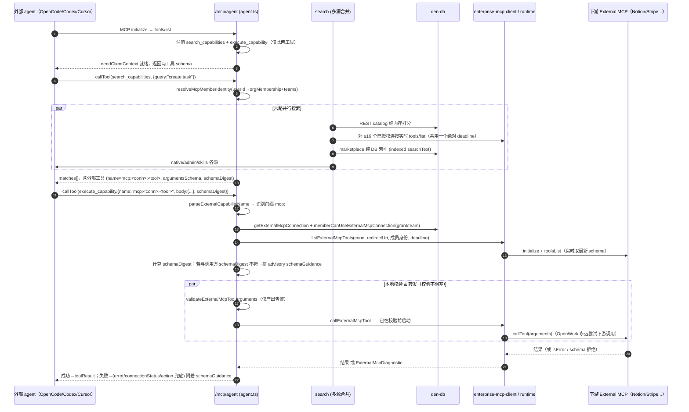
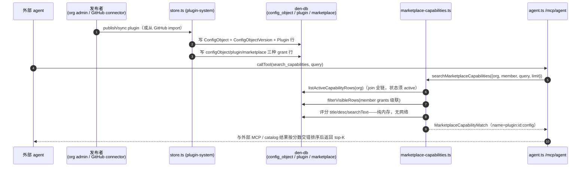

# MCP 双工具注入 + 企业能力（marketplace / SSO / SCIM / inference）

> 本篇承接《Den 控制平面服务架构 + den-db 数据模型》。现在聚焦：能力如何被**描述**、如何被**注入**到外部 agent，以及组织如何**治理**这些能力（身份/市场/推理）。这是"把同一套 skills / MCP / 连接服务复用到任意 agent"这一产品定位的**落地机制**。

> 核心机制：系统经 `/mcp/agent` 端点只暴露两个伞工具 `search_capabilities` + `execute_capability`，一切能力（REST catalog、External MCP、marketplace、原生能力）都并入这两个工具，工具面永不增长。

---

## 在项目中的角色：产品复用的唯一落地点

OpenWork 的核心主张是"同一份信任与能力，放进任何一个 agent harness（Codex / Claude Code / Cursor / OpenCode）都能用"。这个主张在代码里**没有一个"能力库"对象**，而是一个**恒定的 MCP 端点**：`/mcp/agent`。

这个端点只注册两个工具 `search_capabilities` + `execute_capability`，工具面**永不增长**。所有真实能力——Den 的 REST 目录（catalog）、External MCP 连接、原生 Google Workspace 能力、 marketplace 插件能力——都被并进这两个伞工具。这就是贯穿全模块的**Two-tool MCP rail contract**。

去掉它会怎样：失去跨 agent 复用。每个 harness 就要各自定义清单、各自分发凭据、各自维护 schema 同步，能力一旦发布就无法"一点回收"；前端桌面把开关关掉、组织把 grant 撤掉，也不会同步影响已接线的 agent。`/mcp/agent` 是能力注入的**单一关口**，也是回滚/治理的**单一杠杆**。

这个中枢的自我描述在 [ee/apps/den-api/src/mcp/agent.ts:337-354]() 的注释里写得最直白：

<!-- snippet-base64:LyoqCiAqIFRoZSBtaW5pbWFsLCBoYXJuZXNzLWZhY2luZyBNQ1Agc3VyZmFjZTogZXhhY3RseSB0d28gdG9vbHMsIGZ1bGwgc3RvcC4KICoKICogYC9tY3BgIChpbmRleC50cykgc3RheXMgZXhhY3RseSBhcyBpdCBpcyDigJQgZXZlcnkgY2F0YWxvZyBvcGVyYXRpb24KICogaW5kaXZpZHVhbGx5IHJlZ2lzdGVyZWQsIH4xMjkgdG9vbHMgdG9kYXkuIFRoYXQncyB1bmNoYW5nZWQgYW5kIHN0aWxsCiAqIHVzZWZ1bCBmb3Igc2NyaXB0cy9hZG1pbiB0b29saW5nIHRoYXQgd2FudCB0byBjYWxsIGEga25vd24gb3BlcmF0aW9uIGJ5CiAqIG5hbWUgZGlyZWN0bHkuCiAqCiAqIGAvbWNwL2FnZW50YCBpcyBhICpkaWZmZXJlbnQqIGVuZHBvaW50IGZvciBhICpkaWZmZXJlbnQqIGNvbnN1bWVyOiB0aGUKICogZGVza3RvcCBhcHAncyAiT3BlbldvcmsgQ2xvdWQgQ29udHJvbCIgY29ubmVjdGlvbiwgd2hpY2ggaXMgd2hhdCBhbgogKiBPcGVuQ29kZS9DbGF1ZGUgQ29kZS9Db2RleC1zdHlsZSBoYXJuZXNzIGFjdHVhbGx5IHNlZXMuIEl0IHJlZ2lzdGVycyBvbmx5CiAqIGBzZWFyY2hfY2FwYWJpbGl0aWVzYCBhbmQgYGV4ZWN1dGVfY2FwYWJpbGl0eWAsIGJvdGggYmFja2VkIGJ5IHRoZSBleGFjdAogKiBzYW1lIGNhdGFsb2cgYW5kIHRoZSBleGFjdCBzYW1lIGBpbnZva2VNY3BPcGVyYXRpb25gIGV4ZWN1dGUgcGF0aCB1c2VkIGJ5CiAqIHRoZSByaWNoIGVuZHBvaW50IOKAlCBubyBuZXcgYXV0aCwgbm8gbmV3IHBvbGljeSwgbm8gbmV3IGV4ZWN1dGlvbiBsb2dpYy4KICogQSBoYXJuZXNzIGNvbm5lY3RlZCBoZXJlIGNhbiBvbmx5IGRpc2NvdmVyIGFuZCBjYWxsIGNhcGFiaWxpdGllcyB0aHJvdWdoCiAqIHRoZXNlIHR3byB0b29sczsgdGhlIG90aGVyIH4xMjcgb3BlcmF0aW9ucyBhcmUgbm90IGluZGl2aWR1YWxseSBjYWxsYWJsZQogKiBvbiB0aGlzIGVuZHBvaW50LgogKi8K -->
```ts
/**
 * The minimal, harness-facing MCP surface: exactly two tools, full stop.
 *
 * `/mcp` (index.ts) stays exactly as it is — every catalog operation
 * individually registered, ~129 tools today.
 */
```

关键事实：系统里**有两套 MCP 端点并存**，这是理解整套架构的钥匙：

| 端点 | 消费者 | 工具数 | 角色 |
|---|---|---|---|
| `/mcp`（rich，`index.ts`） | 脚本 / admin 工具，按名直呼已知操作 | ~129 个 catalog 操作 + search 伞 | 向后兼容的"富目录" |
| `/mcp/agent`（minimal，`agent.ts`） | 桌面 "OpenWork Cloud Control" 连接，即 OpenCode/Claude Code/Codex 真正看到的 | 恰好 2 个伞工具 | 面向 harness 的能力面 |

`/mcp/agent` 不新建认证、不新建策略、不新建执行逻辑——它复用与富端点**完全相同的** `getCatalog` 和 `invokeMcpOperation`（见 [ee/apps/den-api/src/mcp/agent.ts:349-353]() 注释）。差异只在"暴露多少"。

[ee/apps/den-api/src/mcp/index.ts:59-63]() 同时为两个端点都注册了 OAuth protected-resource 元数据，但只在 `/mcp/agent` 接受公开 JWT（见 [ee/apps/den-api/src/mcp/index.ts:42-46]() 注释），这正是为"任意 harness 都能拿公开签名 token 接入"铺路。

---

## 解决什么问题、根因：为何用"两工具契约"而非"每能力一 MCP"

### 根因：能力数量不可控

Naive 的做法是把每个 REST 操作都映射成一个独立 MCP 工具——`/mcp` 端点就是这样做的（约 129 个）。这在"能力是有限的、预先声明的"世界里没问题；但在 OpenWork 里能力是**运行时动态生长**的：

- 一个 org 连上 Notion / Linear / Stripe，其 `tools/list` 实时返回几十个工具（`external-capabilities.ts`）。
- 一个 org 发布到 marketplace 的每个 plugin 的每个 config object 都是一个可执行单元（`marketplace-capabilities.ts`）。
- 原生 Google Workspace 能力又叠一层（`native-capabilities.ts`）。

如果把这三者都平铺成独立工具，**工具总数线性爆炸**，而且每个 harness 的 token 窗口、模型 tool-selection 召回都扛不住。更糟的是，External MCP 的工具数量在运行时才知道，根本没法提前注册。

根因总结：**能力是"动态目录 + 数据"而非"静态清单"**，静态注册的模型必然崩。破局点是：把"描述能力"和"调用能力"拆成两个协议原语，用**一个搜索伞 + 一个执行伞**覆盖任意规模的能力。

文档 [docs/marketplace-capabilities-architecture.md:40-40]() 给出设计铁律：

<!-- snippet-base64:VGhlIE1DUCB0b29sIHN1cmZhY2UgZG9lcyBub3QgZ3Jvdy4gVGhlIHJhaWwgc3RpbGwgZXhwb3NlcyBleGFjdGx5IHR3byB0b29sczogYHNlYXJjaF9jYXBhYmlsaXRpZXNgIGFuZCBgZXhlY3V0ZV9jYXBhYmlsaXR5YC4K -->
```
The MCP tool surface does not grow. The rail still exposes exactly two tools: `search_capabilities` and `execute_capability`.
```

### 放弃了什么替代方案

1. **每能力注册一个 MCP 工具**（rich 端点路径）：工具数爆炸，运行时能力无法预注册，且每次新连接都要重新协商工具清单。弃用，保留为 `/mcp` 的兼容富目录。
2. **多 MCP server，各管一类能力**（如 `memory-mcp`、`marketplace-mcp`）：外部 agent harness 各自实现的 MCP 配置拼接逻辑不同，多 server 会显著抬高接入门槛，破坏"单行配置接入"。文档 [docs/mcp-ui-control-profile.md:15-15]() 反而强调"一行配置搞定"。
3. **把能力数据直接硬编码进 agent 的 SKILL.md/工具里**：无法治理、无法撤销、无法做 grant 过滤，与"组织共享"相悖。

两工具契约的代价也很明确：**可发现性转移到了模型身上**——模型必须先调 `search_capabilities` 才能知道能调什么，多一次往返。为此 agent 指令里反复强调"先 search，再 execute，别猜名字"，见 [ee/apps/den-api/src/mcp/agent.ts:120-120]()。

---

## 设计思路：核心模式

三个贯穿性模式：

### 伞工具 + 命名空间分派（namespace dispatch）

所有外部能力都以**带前缀的名字**出现在搜索结果为执行参数里，execute 时按前缀分派：

- REST catalog 操作：无前缀，直接用缩短后的工具名（`catalog.ts`）
- External MCP：`mcp:<connectionId>:<toolName>`（[ee/apps/den-api/src/mcp/external-capabilities.ts:64-77]()）
- Native 原生连接：`native:<connectionId>:<toolName>`（[ee/apps/den-api/src/mcp/native-capabilities.ts:14-27]()）
- Marketplace：`plugin:<pluginId>:<configObjectId>`（[ee/apps/den-api/src/mcp/marketplace-capabilities.ts:210-223]()）

这些名字不是 MCP 注册工具名（所以无视 64 字符工具名长度限制），而是 execute 的**路由键**。execute 处理器（[ee/apps/den-api/src/mcp/agent.ts:517-616]()）按 `parseXxxCapabilityName` 依次试分派。

[ee/apps/den-api/src/mcp/external-capabilities.ts:42-48]() 注释说明命名空间的意义：

<!-- snippet-base64:ICogTWVyZ2VzIG9yZy1sZXZlbCBFeHRlcm5hbCBNQ1AgQ29ubmVjdGlvbnMgKGNhcGFiaWxpdHktc291cmNlcy8pIGludG8gdGhlCiAqIHNhbWUgc2VhcmNoX2NhcGFiaWxpdGllcy9leGVjdXRlX2NhcGFiaWxpdHkgc3VyZmFjZSBhcyB0aGUgUkVTVC1kZXJpdmVkCiAqIGNhdGFsb2cgKGNhdGFsb2cudHMpLCB3aXRob3V0IHRvdWNoaW5nIHRoYXQgY2F0YWxvZyBvciB0aGUgcmljaCBgL21jcGAKICogZW5kcG9pbnQgYXQgYWxsLiBBIGNvbm5lY3RlZCBleHRlcm5hbCB0b29sIGlzIG5hbWVzcGFjZWQKICogYG1jcDo8Y29ubmVjdGlvbklkPjo8dG9vbE5hbWU+YCBzbyBleGVjdXRlX2NhcGFiaWxpdHkgY2FuIHRlbGwgaXQgYXBhcnQKICogZnJvbSBhIFJFU1Qgb3BlcmF0aW9uIG5hbWUgYW5kIGRpc3BhdGNoIHRvIHRoZSByZWFsIE1DUCBjbGllbnQKICogKGV4dGVybmFsLW1jcC1jbGllbnQudHMpIGluc3RlYWQgb2YgaW52b2tlTWNwT3BlcmF0aW9uLgo= -->
```
 * Merges org-level External MCP Connections (capability-sources/) into the
 * same search_capabilities/execute_capability surface as the REST-derived
 * catalog (catalog.ts) ... A connected external tool is namespaced
 * `mcp:<connectionId>:<toolName>` so execute_capability can tell it apart
 * from a REST operation name and dispatch to the real MCP client
 * (external-mcp-client.ts) instead of invokeMcpOperation.
```

### 搜索 = 多源 top-K 合并（search is a bounded fan-out）

`search_capabilities` 的实现（[ee/apps/den-api/src/mcp/agent.ts:443-494]()）并行查询六个来源后按分数合并、截断：

- REST catalog（`searchCapabilities`，DB-free 纯内存打分）
- Native Google 能力（`searchNativeCapabilities`）
- Admin 能力（仅 allowlist 平台 admin，`searchAvailableAdminCapabilities`）
- 内置 skills（`searchBuiltinSkillCapabilities`）
- External MCP（`searchExternalCapabilities`，**实时 tools/list 探测**）
- Marketplace（`searchMarketplaceCapabilities`，**纯 DB 无网络**）

[ee/apps/den-api/src/mcp/agent.ts:490-492]() 是合并核心：

<!-- snippet-base64:ICAgICAgICBjb25zdCBtYXRjaGVzID0gWy4uLnJlc3RNYXRjaGVzLCAuLi5uYXRpdmVNYXRjaGVzLCAuLi5hZG1pbk1hdGNoZXMsIC4uLmJ1aWx0aW5Ta2lsbE1hdGNoZXMsIC4uLmV4dGVybmFsTWF0Y2hlcywgLi4ubWFya2V0cGxhY2VNYXRjaGVzXQogICAgICAgICAgLnNvcnQoY29tcGFyZUNhcGFiaWxpdHlNYXRjaGVzKQogICAgICAgICAgLnNsaWNlKDAsIGJvdW5kZWRMaW1pdCkK -->
```ts
        const matches = [...restMatches, ...nativeMatches, ...adminMatches, ...builtinSkillMatches, ...externalMatches, ...marketplaceMatches]
          .sort(compareCapabilityMatches)
          .slice(0, boundedLimit)
        return capabilitySearchToolResult(matches, externalCoverageHint)
```

这是刻意的不均质设计：**搜索 External MCP 是实时探测**（每搜一次要对最多 16 个连接做 `tools/list`），而 marketplace 是纯 DB 索引。文档 [docs/marketplace-capabilities-architecture.md:176-180]() 点出对比：

<!-- snippet-base64:U2VhcmNoIGlzIERCLW9ubHksIGJvdW5kZWQgYnkgYGxpbWl0YCwgYW5kIG1ha2VzIG5vIGxpdmUgbmV0d29yayBjYWxscy4gVGhpcyBjb250cmFzdHMgd2l0aCBFeHRlcm5hbCBNQ1AgQ29ubmVjdGlvbnMsIHdoZXJlIHNlYXJjaCBtYXkgY2FsbCBgdG9vbHMvbGlzdGAgdGhyb3VnaCBgZWUvYXBwcy9kZW4tYXBpL3NyYy9jYXBhYmlsaXR5LXNvdXJjZXMvZXh0ZXJuYWwtbWNwLWNsaWVudC50c2AuCgpEZWR1cGUgYWdhaW5zdCBsb2NhbGx5IGluc3RhbGxlZCBjb3BpZXMgaXMgTk9UIHNlcnZlci1zaWRlIHBvc3NpYmxlIGluIFBoYXNlIDEuIERlbiBkb2VzIG5vdCBrbm93IHdoYXQgYSBkZXNrdG9wIGNvcGllZCBpbnRvIGAub3BlbmNvZGUvYC4gRGVmZXIgZGVkdXBlOyBtYWtlIGR1cGxpY2F0ZXMgZGlzdGluZ3Vpc2hhYmxlIHdpdGggbWFya2V0cGxhY2UvcGx1Z2luIHByb3ZlbmFuY2UgaW4gc3VtbWFyaWVzIGFuZCBleGVjdXRlIHBheWxvYWRzLgoKLS0tCg== -->
```
Search is DB-only, bounded by `limit`, and makes no live network calls.
This contrasts with External MCP Connections, where search may call `tools/list`
```

### 能力者身份 = member（不是 org）

关键设计：搜索/执行 External MCP 与 marketplace 能力时，权限作用域是**调用者 member**（grants + per-member credentials），不只是 org。原因：per_member 模式下每个成员用自己的 OAuth 账户连不同的 provider，agent 必须"以成员身份"执行。

[ee/apps/den-api/src/mcp/external-capabilities.ts:50-57]() 注释点出：

<!-- snippet-base64:ICogRXZlcnl0aGluZyBoZXJlIGlzIHNjb3BlZCB0byB0aGUgQ0FMTElORyBNRU1CRVIsIG5vdCBqdXN0IHRoZSBvcmc6CiAqIC0gT25seSBjb25uZWN0aW9ucyB0aGUgbWVtYmVyIGhhcyBiZWVuIGdyYW50ZWQgKG9yZy13aWRlLCBkaXJlY3QsIG9yIHZpYQogKiAgIGEgdGVhbSkgYXJlIHNlYXJjaGFibGUvZXhlY3V0YWJsZS4gQWNjZXNzIGlzIG5ldmVyIGltcGxpY2l0LgogKiAtIEZvciBjcmVkZW50aWFsTW9kZSAicGVyX21lbWJlciIgY29ubmVjdGlvbnMsIGNhbGxzIHJ1biB3aXRoIHRoZQogKiAgIG1lbWJlcidzIG93biBjb25uZWN0ZWQgYWNjb3VudDsgaWYgdGhleSBoYXZlbid0IGNvbm5lY3RlZCBvbmUgeWV0LAogKiAgIHNlYXJjaCBzdXJmYWNlcyB0aGUgY29ubmVjdGlvbiBhcyBuZWVkc19jb25uZWN0aW9uIChzbyB0aGUgYWdlbnQgY2FuCiAqICAgdGVsbCB0aGUgaHVtYW4gd2hhdCB0byBkbykgaW5zdGVhZCBvZiBzaWxlbnRseSBoaWRpbmcgaXQuCiAqLwo= -->
```
 * Everything here is scoped to the CALLING MEMBER, not just the org:
 * - Only connections the member has been granted (org-wide, direct, or via
 *   a team) are searchable/executable. Access is never implicit.
 * - For credentialMode "per_member" connections, calls run with the
 *   member's own connected account; if they haven't connected one yet,
 *   search surfaces the connection as needs_connection ...
```

这个模式贯穿三处：External 执行（[ee/apps/den-api/src/mcp/external-capabilities.ts:950-993]() 先查 `memberCanUseExternalMcpConnection`）、marketplace 可见性（[ee/apps/den-api/src/mcp/marketplace-capabilities.ts:579-611]() 的 `filterVisibleRows`）、native 能力。

---

## 关键数据结构：两个工具 + explore 上下文

### `search_capabilities`

输入（[ee/apps/den-api/src/mcp/agent.ts:436-440]()）：
- `query: string`（必填，关键词）
- `limit?: number`（1-20，默认 5）
- `type?: "all"|"api"|"admin"|"mcp"|"marketplace"|"skills"`（来源过滤）

输出（`capabilityMatchOutputSchema`，[ee/apps/den-api/src/mcp/agent.ts:70-87]()）每条 match 携带足够的"调用形状"，让外部 agent 无需猜就能构造 `execute_capability`。核心字段 `CapabilityMatch`（[ee/apps/den-api/src/mcp/search.ts:22-40]()）：

<!-- snippet-base64:Y29uc3QgY2FwYWJpbGl0eU1hdGNoT3V0cHV0U2NoZW1hID0gei5vYmplY3QoewogIG5hbWU6IHouc3RyaW5nKCksCiAgbWV0aG9kOiB6LnN0cmluZygpLAogIHBhdGg6IHouc3RyaW5nKCksCiAgc2NvcmU6IHoubnVtYmVyKCksCiAgc3VtbWFyeTogei5zdHJpbmcoKSwKICBwYXRoUGFyYW1zOiB6LmFycmF5KHouc3RyaW5nKCkpLAogIHF1ZXJ5UGFyYW1zOiB6LmFycmF5KHouc3RyaW5nKCkpLAogIGhhc0JvZHk6IHouYm9vbGVhbigpLAogIGJvZHlTY2hlbWE6IHoudW5rbm93bigpLm9wdGlvbmFsKCksCiAgYXJndW1lbnRzU2NoZW1hOiB6LnVua25vd24oKS5vcHRpb25hbCgpLAogIHNjaGVtYURpZ2VzdDogei5zdHJpbmcoKS5vcHRpb25hbCgpLAogIGludm9jYXRpb246IHoub2JqZWN0KHsgYXJndW1lbnRzRmllbGQ6IHoubGl0ZXJhbCgiYm9keSIpIH0pLm9wdGlvbmFsKCksCiAga2luZDogei5zdHJpbmcoKS5vcHRpb25hbCgpLAogIHN0YXR1czogei5zdHJpbmcoKS5vcHRpb25hbCgpLAogIGhpbnQ6IHouc3RyaW5nKCkub3B0aW9uYWwoKSwKICBjb25uZWN0aW9uU3RhdHVzOiBjb25uZWN0aW9uU3RhdHVzT3V0cHV0U2NoZW1hLm9wdGlvbmFsKCksCn0pLnBhc3N0aHJvdWdoKCkKCg== -->
```ts
export type CapabilityMatch = {
  name: string
  method: string
  path: string
  score: number
  summary: string
  pathParams: string[]      // e.g. ["workerId"] —— execute 时放进 path
  queryParams: string[]     // execute 时放进 query
  hasBody: boolean          // 是否要 JSON body
  bodySchema?: unknown      // 原生 REST JSON mutation 的精确 schema
  argumentsSchema?: unknown // External MCP 返回的实时工具参数 schema
  invocation?: { argumentsField: "body" } // 告诉执行者 MCP 参数要放进 body
}
```

`search_capabilities` 的注解（[ee/apps/den-api/src/mcp/agent.ts:38-43]()）声明为只读、幂等、安全，让模型可放心重复调用：

<!-- snippet-base64:ZXhwb3J0IGNvbnN0IFNFQVJDSF9DQVBBQklMSVRJRVNfQU5OT1RBVElPTlM6IFRvb2xBbm5vdGF0aW9ucyA9IHsKICByZWFkT25seUhpbnQ6IHRydWUsCiAgZGVzdHJ1Y3RpdmVIaW50OiBmYWxzZSwKICBpZGVtcG90ZW50SGludDogdHJ1ZSwKICBvcGVuV29ybGRIaW50OiB0cnVlLAp9Cg== -->
```ts
export const SEARCH_CAPABILITIES_ANNOTATIONS: ToolAnnotations = {
  readOnlyHint: true,
  destructiveHint: false,
  idempotentHint: true,
  openWorldHint: true,
}
```

### `execute_capability`

输入（[ee/apps/den-api/src/mcp/agent.ts:509-515]()）：`name`（必填，search 返回的精确名）、`schemaDigest?`（External MCP schema 摘要，用于漂移检测）、`path/query/body`。注解（[ee/apps/den-api/src/mcp/agent.ts:44-49]()）标记为可能破坏性、非幂等——语义上接近"任意写操作"。

### 兜底 schema：编目名缩短（catalog.ts）

REST 目录的工具名是从 OpenAPI operationId 生成的，受 AWS Bedrock 64 字符工具名硬限制。`catalog.ts` 用**结构化缩短**（去 `V1` 版本标记、去 `By<Param>Id` 路径参数重述）加 FNV-1a 稳定 hash 去冲突（[ee/apps/den-api/src/mcp/catalog.ts:49-64]()）。不能靠截断硬塞——超长就直接在构建期 throw，防止坏名字上线（[ee/apps/den-api/src/mcp/catalog.ts:325-331]()）。

[ee/apps/den-api/src/mcp/catalog.ts:11-14]() 记录约束来源：

<!-- snippet-base64:Ly8gdW5kZXIgNjQgc28gdGhlIHByZWZpeGVkIG5hbWUgc3RpbGwgdmFsaWRhdGVzIG9uIEJlZHJvY2suCmV4cG9ydCBjb25zdCBCRURST0NLX01BWF9UT09MX05BTUVfTEVOR1RIID0gNjQKZXhwb3J0IGNvbnN0IE1BWF9DTElFTlRfUFJFRklYID0gIm9wZW53b3JrLWNsb3VkXyIubGVuZ3RoIC8vIDE1CmV4cG9ydCBjb25zdCBNQVhfVE9PTF9OQU1FX0xFTkdUSCA9IEJFRFJPQ0tfTUFYX1RPT0xfTkFNRV9MRU5HVEggLSBNQVhfQ0xJRU5UX1BSRUZJWCAvLyA0OQo= -->
```ts
export const BEDROCK_MAX_TOOL_NAME_LENGTH = 64
export const MAX_CLIENT_PREFIX = "openwork-cloud_".length // 15
export const MAX_TOOL_NAME_LENGTH = BEDROCK_MAX_TOOL_NAME_LENGTH - MAX_CLIENT_PREFIX // 49
```

### 受控能力清单：policy.ts（哪些 REST 操作能上 rail）

不是所有 Den 操作都暴露给 MCP。`policy.ts` 用三层拦截：`BLOCKED_TAGS`（Admin/Authentication/System/Webhooks 全拒）、`SAFE_INCLUDED_TAGS`（白名单）、`BLOCKED_OPERATION_IDS`（黑名单，如 `postApiKeys`、`deleteOrg`，见 [ee/apps/den-api/src/mcp/policy.ts:25-37]()）。`x-mcp` 显式标注可覆盖默认推导（[ee/apps/den-api/src/mcp/policy.ts:55-79]()）。

[ee/apps/den-api/src/mcp/policy.ts:50-79]() 决策顺序：

<!-- snippet-base64:ZXhwb3J0IGZ1bmN0aW9uIGlzTWNwT3BlcmF0aW9uQWxsb3dlZChpbnB1dDogewogIG1ldGhvZDogc3RyaW5nCiAgcGF0aDogc3RyaW5nCiAgb3BlcmF0aW9uOiBPcGVuQXBpT3BlcmF0aW9uCn0pIHsKICBjb25zdCBleHBsaWNpdCA9IGlucHV0Lm9wZXJhdGlvblsieC1tY3AiXQogIGlmIChleHBsaWNpdCA9PT0gZmFsc2UgfHwgZXhwbGljaXQgPT09ICJmYWxzZSIpIHsKICAgIHJldHVybiBmYWxzZQogIH0KCiAgY29uc3Qgb3BlcmF0aW9uSWQgPSBpbnB1dC5vcGVyYXRpb24ub3BlcmF0aW9uSWQKICBpZiAoIW9wZXJhdGlvbklkIHx8IEJMT0NLRURfT1BFUkFUSU9OX0lEUy5oYXMob3BlcmF0aW9uSWQpKSB7CiAgICByZXR1cm4gZmFsc2UKICB9CgogIGlmIChpbnB1dC5wYXRoLnN0YXJ0c1dpdGgoIi9hcGkvYXV0aCIpIHx8IGlucHV0LnBhdGguaW5jbHVkZXMoIi93ZWJob29rcyIpIHx8IGlucHV0LnBhdGguaW5jbHVkZXMoIi9hZG1pbiIpKSB7CiAgICByZXR1cm4gZmFsc2UKICB9CgogIGNvbnN0IHRhZ3MgPSBpbnB1dC5vcGVyYXRpb24udGFncyA/PyBbXQogIGlmICh0YWdzLnNvbWUoKHRhZykgPT4gQkxPQ0tFRF9UQUdTLmhhcyh0YWcpKSkgewogICAgcmV0dXJuIGZhbHNlCiAgfQoKICBpZiAoZXhwbGljaXQgPT09IHRydWUgfHwgZXhwbGljaXQgPT09ICJ0cnVlIikgewogICAgcmV0dXJuIHRydWUKICB9CgogIHJldHVybiB0YWdzLnNvbWUoKHRhZykgPT4gU0FGRV9JTkNMVURFRF9UQUdTLmhhcyh0YWcpKQp9Cg== -->
```ts
  const explicit = input.operation["x-mcp"]
  if (explicit === false || explicit === "false") return false
  const operationId = input.operation.operationId
  if (!operationId || BLOCKED_OPERATION_IDS.has(operationId)) return false
  if (input.path.startsWith("/api/auth") || input.path.includes("/webhooks") || input.path.includes("/admin")) return false
  const tags = input.operation.tags ?? []
  if (tags.some((tag) => BLOCKED_TAGS.has(tag))) return false
  if (explicit === true || explicit === "true") return true
  return tags.some((tag) => SAFE_INCLUDED_TAGS.has(tag))
```

**这是伞工具攻击面收窄的关键机制**：伞工具本身"什么都能调"，但它背后调用的 catalog 已经在构建期被 `isMcpOperationAllowed` 过滤过——写/删/凭证类操作天然上不了 rail。

---

## 核心流程

### 全链路：外部 agent → search → execute → 转发到 External MCP

这是整个模块的心脏。外部 agent（如 OpenCode）连上 `/mcp/agent`，先 `search_capabilities` 找到能力，再 `execute_capability` 触发；若目标是 External MCP 连接，Den 会用 enterprise-mcp-client 去下游 provider 实时 `tools/list`、`callTool`，并做成员身份授权、schema 漂移提示、连接状态兜底。



### 关键时序细节：schema 先服务后校验，网络故障不污染

`agent.ts` 的 execute 里，对 External MCP 是**先发起 provider 调用，再做本地 schema 校验**，校验失败只产生 advisory 警告而不断言（[ee/apps/den-api/src/mcp/external-capabilities.ts:1082-1111]()）：

<!-- snippet-base64:ICAgIC8vIE1DUCB0b29sIGFyZ3VtZW50cyBhcmUgYWx3YXlzIGFuIG9iamVjdCBhdCB0aGUgcHJvdG9jb2wgYm91bmRhcnkuIFN0YXJ0CiAgICAvLyB0aGUgcHJvdmlkZXIgY2FsbCBiZWZvcmUgYWR2aXNvcnkgdmFsaWRhdGlvbiBzbyBhIHByb3ZpZGVyIHdpdGggYW4KICAgIC8vIGluYWNjdXJhdGUgb3IgdW5zdXBwb3J0ZWQgYWR2ZXJ0aXNlZCBzY2hlbWEgc3RpbGwgZ2V0cyB0aGUgcmVxdWVzdC4KICAgIGNvbnN0IGZvcndhcmRlZEFyZ3VtZW50cyA9IGlzUmVjb3JkKGlucHV0LmFyZ3MpID8gaW5wdXQuYXJncyA6IHt9CiAgICBjb25zdCBwcm92aWRlckNhbGwgPSBjYWxsRXh0ZXJuYWxNY3BUb29sKHsKICAgICAgY29ubmVjdGlvbiwKICAgICAgcmVkaXJlY3RVcmksCiAgICAgIHRvb2xOYW1lOiBpbnB1dC50b29sTmFtZSwKICAgICAgYXJnczogZm9yd2FyZGVkQXJndW1lbnRzLAogICAgICBtZW1iZXIsCiAgICAgIGxpZmVjeWNsZURlYWRsaW5lOiBkZWFkbGluZSwKICAgIH0pCgogICAgY29uc3QgdmFsaWRhdGlvbiA9IHZhbGlkYXRlRXh0ZXJuYWxNY3BUb29sQXJndW1lbnRzKHRvb2wuaW5wdXRTY2hlbWEsIGlucHV0LmFyZ3MpCiAgICBpZiAoIXZhbGlkYXRpb24ub2sgJiYgdmFsaWRhdGlvbi5lcnJvciA9PT0gImludmFsaWRfYXJndW1lbnRzIikgewogICAgICBzY2hlbWFXYXJuaW5ncy5wdXNoKHsKICAgICAgICBjb2RlOiAiYXJndW1lbnRzX3NjaGVtYV9taXNtYXRjaCIsCiAgICAgICAgbWVzc2FnZTogIlRoZSBhcmd1bWVudHMgZG8gbm90IG1hdGNoIHRoZSBwcm92aWRlcidzIGFkdmVydGlzZWQgYXJndW1lbnRzU2NoZW1hLCBidXQgT3Blbldvcmsgc3RpbGwgZm9yd2FyZGVkIHRoZSBjYWxsIGJlY2F1c2UgdGhlIHByb3ZpZGVyIG1heSBhY2NlcHQgdGhlbS4iLAogICAgICAgIGlzc3VlczogdmFsaWRhdGlvbi5pc3N1ZXMsCiAgICAgICAgc3VnZ2VzdGVkQWN0aW9uOiAiSWYgdGhlIHByb3ZpZGVyIGNhbGwgZmFpbGVkLCBjb3JyZWN0IHRoZSBsaXN0ZWQgaXNzdWVzIGFuZCByZXRyeSB3aXRoIGNoYW5nZWQgYXJndW1lbnRzLiBEbyBub3QgcmV0cnkgc29sZWx5IGJlY2F1c2Ugb2YgdGhpcyB3YXJuaW5nIHdoZW4gdGhlIHByb3ZpZGVyIGNhbGwgc3VjY2VlZGVkLiIsCiAgICAgIH0pCiAgICB9IGVsc2UgaWYgKCF2YWxpZGF0aW9uLm9rKSB7CiAgICAgIHNjaGVtYVdhcm5pbmdzLnB1c2goewogICAgICAgIGNvZGU6ICJhcmd1bWVudHNfc2NoZW1hX3VuYXZhaWxhYmxlIiwKICAgICAgICBtZXNzYWdlOiB2YWxpZGF0aW9uLm1lc3NhZ2UsCiAgICAgICAgc3VnZ2VzdGVkQWN0aW9uOiAiVXNlIHRoZSBwcm92aWRlciByZXN1bHQgYXMgdGhlIHNvdXJjZSBvZiB0cnV0aC4gSWYgdGhlIGNhbGwgZmFpbGVkLCB0aGUgcHJvdmlkZXIgYWRtaW5pc3RyYXRvciBtYXkgbmVlZCB0byByZXBhaXIgdGhlIGFkdmVydGlzZWQgaW5wdXRTY2hlbWEuIiwKICAgICAgfSkKICAgIH0KCiAgICBzY2hlbWFHdWlkYW5jZSA9IGFkdmlzb3J5U2NoZW1hR3VpZGFuY2Uoc2NoZW1hV2FybmluZ3MpCg== -->
```ts
    // MCP tool arguments are always an object at the protocol boundary. Start
    // the provider call before advisory validation so a provider with an
    // inaccurate or unsupported advertised schema still gets the request.
    const forwardedArguments = isRecord(input.args) ? input.args : {}
    const providerCall = callExternalMcpTool({ ... })
    ...
    const validation = validateExternalMcpToolArguments(tool.inputSchema, input.args)
```

这是刻意的容错权衡：provider 可能 schema 失真，OpenWork 选择"尽力转发 + 结果为主"而不是教条式拒绝。若 provider 返回 `invalid_capability_arguments`，才用 `invalidCapabilityArguments` 让 agent 修正后**带改动**重试一次（[ee/apps/den-api/src/mcp/external-capabilities.ts:1133-1140]()），并 `sameArgumentsRetryable: false` 防止空转。

### marketplace 能力如何进入可搜索目录

marketplace 能力**没有自己的 MCP server**，它只是又一个"数据源"被并入 `search_capabilities`。进入方式是**实时 DB join**（非拷贝注册）：



[ee/apps/den-api/src/mcp/marketplace-capabilities.ts:335-376]() 的 `listActiveMarketplaceRows` 是核心 join；而**身份可见性**由 `filterVisibleRows`（[ee/apps/den-api/src/mcp/marketplace-capabilities.ts:579-611]()）完成，它按 configObject → plugin → marketplace 三级 grant 级联过滤，命中任一级即可见。

值得注意：marketplace 搜索**不打本地安装的插件**，无法服务端去重（文档 [docs/marketplace-capabilities-architecture.md:178-178]() 承认此限制），只用 provenance 区分。

---

## 与其他模块的协同

### 与 den-db / den-control-plane(见 [server-proxy-api.md](server-proxy-api.md) 与 [agent-runtime-opencode.md](agent-runtime-opencode.md) 的协同说明)

- **grants 是复用**：marketplace 可见性与 External MCP 授权都调用 `resolvePluginArchGrantRole({grants, memberId, teamIds})`（[ee/apps/den-api/src/mcp/marketplace-capabilities.ts:250-256]()；文档 [docs/marketplace-capabilities-architecture.md:163-163]()），同 den 控制平面的 grant 模型。**不新增权限表**——文档明确 Phase 1 无 schema 变更（[docs/marketplace-capabilities-architecture.md:234-234]()）。
- **encryptedTextColumn**：marketplace 执行 payload 的 `rawSourceText`/`normalizedPayloadJson` 走既有加密列透明解密（文档 [docs/marketplace-capabilities-architecture.md:196-196]()），与 den-db 加密机制复用。
- **den-control-plane 的一致性**：`/mcp/agent` 用 `memberFacingMcpConnectionsEnabled`（org metadata kill switch）做开关，与 External MCP 同一切换层（[ee/apps/den-api/src/mcp/agent.ts:396-396]()，文档 §7）。开关关闭时 execute 返回 `unknown_capability`——**关掉的组织与不存在在字节上等价**，避免信息泄漏。

### 与 enterprise-mcp-client（External MCP 转发客户端）

`/mcp/agent` 只是 facade，真正的下游调用在 `packages/enterprise-mcp-client`。[ee/apps/den-api/src/mcp/external-capabilities.ts:701-709]() 通过 runtime 胶水调到 enterprise-mcp-client 的 `listTools`/`callTool`，并把 provider 的 OAuth 状态机、生命周期 deadline、凭据持久化全部委托给它。

[ee/apps/den-api/src/mcp/external-capabilities.ts:41-49]() 注释把分层说清楚：

<!-- snippet-base64:LyoqCiAqIE1lcmdlcyBvcmctbGV2ZWwgRXh0ZXJuYWwgTUNQIENvbm5lY3Rpb25zIChjYXBhYmlsaXR5LXNvdXJjZXMvKSBpbnRvIHRoZQogKiBzYW1lIHNlYXJjaF9jYXBhYmlsaXRpZXMvZXhlY3V0ZV9jYXBhYmlsaXR5IHN1cmZhY2UgYXMgdGhlIFJFU1QtZGVyaXZlZAogKiBjYXRhbG9nIChjYXRhbG9nLnRzKSwgd2l0aG91dCB0b3VjaGluZyB0aGF0IGNhdGFsb2cgb3IgdGhlIHJpY2ggYC9tY3BgCiAqIGVuZHBvaW50IGF0IGFsbC4gQSBjb25uZWN0ZWQgZXh0ZXJuYWwgdG9vbCBpcyBuYW1lc3BhY2VkCiAqIGBtY3A6PGNvbm5lY3Rpb25JZD46PHRvb2xOYW1lPmAgc28gZXhlY3V0ZV9jYXBhYmlsaXR5IGNhbiB0ZWxsIGl0IGFwYXJ0CiAqIGZyb20gYSBSRVNUIG9wZXJhdGlvbiBuYW1lIGFuZCBkaXNwYXRjaCB0byB0aGUgcmVhbCBNQ1AgY2xpZW50CiAqIChleHRlcm5hbC1tY3AtY2xpZW50LnRzKSBpbnN0ZWFkIG9mIGludm9rZU1jcE9wZXJhdGlvbi4KICoK -->
```
 * Merges org-level External MCP Connections (capability-sources/) into the
 * same search_capabilities/execute_capability surface as the REST-derived
 * catalog ..., without touching that catalog or the rich `/mcp`
 * endpoint at all.
```

### 与 desktop/server 侧注入（openwork-runtime-config / cloud-plugins）

桌面侧（apps/server）与云端 rail 是两个并行注入面：

- **云端能力面**：`/mcp/agent`（本模块），能力在 Den 侧，harness 通过 `execute_capability` 远程用。
- **桌面本地注入**：`openwork-runtime-config.ts` 把 OpenCode agent 定义、plugins、MCP 写入 `OPENCODE_CONFIG` 文件；`cloud-plugins.ts` 把 marketplace 插件**拷贝进 `.opencode/`**（`installCloudPlugin`，[apps/server/src/cloud-plugins.ts:536-647]()）。

文档 [docs/marketplace-capabilities-architecture.md:17-17]() 把两者定位成互补而非替代：

<!-- snippet-base64:SW5zdGFsbGF0aW9uLCBtZWFuaW5nIGNvcHlpbmcgZmlsZXMgaW50byBgLm9wZW5jb2RlL2AsIGJlY29tZXMgYW4gb3B0aW1pemF0aW9uIGZvciBvZmZsaW5lIHVzZSBhbmQgcGlubmluZywgbm90IGEgcmVxdWlyZW1lbnQgZm9yIHVzaW5nIG9yZy1wdWJsaXNoZWQgY29udGVudC4K -->
```
Installation, meaning copying files into `.opencode/`, becomes an optimization for offline use and pinning, not a requirement for using org-published content.
```

cloud-plugins 把 Claude Code 的 `plugin.json + .mcp.json + skills/` 解析成统一的 `CloudPluginResolved`，从而复用同一套 install 管线（[apps/server/src/claude-plugin-bundle.ts:1-12]() 注释；落地见 `installCloudPlugin`）。这是"一套语义、双端落地"的关键桥梁。

---

## 关键设计决策：权衡与替代代价

### 两工具契约 vs 一能力一工具的攻击面 / 可发现性权衡

这是整个模块的第一性决策。

**两工具契约（采纳）**：工具面恒定，能力动态生长（External MCP tools 运行时才知道、marketplace 插件无限增长）都不会让 harness 重新协商工具清单。攻击面和配置成本被钉死在两个工具上。**代价**：① 可发现性从"平台静态列出"转移到"模型动态搜索"，多一次往返、依赖模型的搜索能力；② **伞 = 放大镜**——一旦 `execute_capability` 或 `search_capabilities` 本身出漏洞，攻击者可触及所有能力源（详见 §8 安全问题）。每个执行分支都得在 [ee/apps/den-api/src/mcp/agent.ts:517-616]() 内做独立授权利检查。

**一能力一 MCP（放弃，rich 端点是残留）**：可发现性最好（tools/list 直接给全）、模型召回最准。但能力爆炸、运行时能力无法提前注册、每次新 External MCP 都要重握手，且对任意新 harness 的接入成本非线性上升。OpenWork 保留 `/mcp` 富目录供脚本/admin 直呼已知操作（[ee/apps/den-api/src/mcp/index.ts:108-124]()），同时在 `/mcp/agent` 收敛到两工具——**两种模式并存**是用"两套端点"缓解"两种世界不可调和"的手段，见 [ee/apps/den-api/src/mcp/agent.ts:337-354]() 注释。

### SSO/SCIM 兼容层的取舍：站在 better-auth 之上而非自研协议引擎

SSO 没有自研 SAML/OIDC 协议栈，而是把 `better-auth` 的 provider 能力封装成 org 维度的连接对象（[ee/apps/den-api/src/sso.ts:1-130]()）：路由只做 schema 校验、entitlement 校验、审计、域名验证 token（`routes/org/sso.ts`），真正的 SAML SP / OIDC 回调转发给 `auth.api`（如 `sso.ts` 的 `getSsoAcUrl`/`getSsoMetadataUrl`，[ee/apps/den-api/src/sso.ts:63-73]()）。SCIM 侧也在 better-auth 之上存"provider"（`scim.ts`），并加了自己的 token 哈希持久化（[ee/apps/den-api/src/scim-token-storage.ts:6-17]()，`SHA-256 + timingSafeEqual`）。

取舍：**能秒级复用成熟协议实现（better-auth 的 server 已处理断言签名、续期、发现），把工程弹性留给业务连接层**（域名验证、组→团队映射 `scim-groups.ts`、drift reconciliation）。代价是**受制于 better-auth 的能力边界**（如 SCIM group mapping 的 `metadata_only` vs `create_teams` 由上层自实现，[ee/apps/den-api/src/scim.ts:43-43]()）；以及新协议特性若 better-auth 不支持就得等或绕。文档 `microsoft-entra-sso-scim.md` 的存在说明这是"接 IdP 而非造 IdP"的产品取态。

### 推理 supply：按成员签发 key + 上游反向计费

OpenWork Models（inference）的取舍在于**信任与计费边界**：

- 上游用 OpenRouter 的 manage API 为每个 org **签发一个 org 级 upstream key**（[ee/apps/den-api/src/inference.ts:400-438]()，`createOpenRouterOrgApiKey`），把计费锚在 org。
- 每个成员又拿一个内部 key（`ow_inf_<random>`，[ee/apps/den-api/src/inference.ts:39-41]()），库只存 `sha256` 哈希（[ee/apps/inference/src/keys.ts:3-9]()、[ee/apps/den-api/src/inference.ts:35-37]()），无法明文找回。
- **限额 = 按 tier × 成员数**的用量桶（[ee/apps/inference/src/limits.ts:50-52]()、[ee/apps/den-api/src/inference.ts:347-347]()），按 five_hour/weekly/monthly 三窗口锚定；proxy 每次请求前 `ensureUsableBuckets` 校验（[ee/apps/inference/src/proxy.ts:49-52]()）。
- 成员被删/换 org 时**自动 revoke 其 key 并删其 OpenWork provider 行**（`repairMemberInferenceAccessIfNeeded`、`syncInferenceAfterMemberChange`，[ee/apps/den-api/src/inference.ts:241-314]()），避免孤儿 key。

代价：**签发、吊销、限额、上游 key 生命周期是一整套自建状态机**，绑定 OpenRouter 作为唯一上游（`buildOpenWorkProviderConfig` 里 `npm: "@openrouter/ai-sdk-provider"`，[ee/apps/den-api/src/inference.ts:96-108]()），换上游 provider 得重做。这是"功能优先、单一上游"的道德代价——换来的是**成员 key 可独立吊销、限额可按成员数伸缩、计费可归因到 org**。

---

## 亮点与问题（含安全）

### 亮点

1. **单一治理杠杆**：所有能力（REST/External/native/marketplace/skills）都从 `/mcp/agent` 注入，org 关掉 `capabilities.mcpConnections` 即全域停用，且关闭与不存在字节等价（`external-mcp-rollout` kill switch；[ee/apps/den-api/src/mcp/agent.ts:396-396]()），不泄漏黑盒是否存在能力。
2. **成员身份 + grant 级联**：External 与 marketplace 都按调用成员授权，per_member 凭据让"以用户自己身份连 provider"成为可能（[ee/apps/den-api/src/mcp/external-capabilities.ts:56-56]()；[ee/apps/den-api/src/mcp/marketplace-capabilities.ts:579-611]()）。
3. **拓扑防爆**：External MCP 搜索被 `selectExternalMcpSearchConnections` + worker pool + 唯一 deadline 限幅（[ee/apps/den-api/src/mcp/external-capabilities.ts:142-156]()、`collectBoundedExternalMcpSearchMatches:562-608`），一个不可达 provider 不会拖垮全部；搜索被裁剪时返回 coverage hint 让 agent 知道结果可能不全（[ee/apps/den-api/src/mcp/external-capabilities.ts:616-619]()）。
4. **schema 漂移的软处理**：先转发后校验，schemaDigest 只做 advisory，provider 结果为准（[ee/apps/den-api/src/mcp/external-capabilities.ts:1082-1111]()）。这承认了 MCP 动态 schema 的不可靠，避免了"因本地 schema 过时而误杀真实 provider"。
5. **双端并行的注入面**：云端 `execute_capability` 玩法 + 桌面 `installCloudPlugin` 本地拷贝玩法，走同一套 marketplace 语义与 grants，覆盖"联网即用"与"离线 pin 定"两种使用（§6.3）。

### 问题与安全隐患

1. **伞 = 单一缺口放大**（最重）。`execute_capability` 是一个能路由到 REST/IAM/native/External/marketplace 的万能执行闸。任何一处分支的授权疏忽（grant 判断、member 解析、catalog 过滤漏网）都会同时放大到所有源。缓解依赖多层自检：catalog 构建期 `isMcpOperationAllowed`、execute 期每个分支独立 `parse+授权`、policy 黑名单。但这是"一条链"——单点设计缺陷会横向放大。文档 [docs/marketplace-capabilities-architecture.md:318-323]() 承认 marketplace 内容本质是第三方文本，是指令注入面，仅靠 provenance 框架和"agent 不自动打开工具输出 URL"缓解。
2. **搜索结果不可缓存**：External MCP 每搜必实时 `tools/list`（有 bounds 但仍有网络成本），反复搜索是高成本操作；无结果缓存（`external-capabilities.ts` 无缓存层）。文档把 marketplace 设计成 DB-only 就是对这种高成本源的"对仗替代"。
3. **去重缺失**：marketplace 搜索不打本地安装副本，同一 skill 云端与本地可能重复出现，靠 provenance 字符串区分（文档 [docs/marketplace-capabilities-architecture.md:178-178]()）。作为 MVP 诚实的限制，但对用户体验是噪音。
4. **`execute_capability` 的攻击语义**：其注解 `destructiveHint` + `openWorldHint`（[ee/apps/den-api/src/mcp/agent.ts:44-49]()）意味着"可写、可跨世界"，agent 的 tools.deny 无法识别伞内的"所有能力"——这是为什么 `mcp.ts` 需要专门诊断 openwork-cloud 工具的 deny（[apps/server/src/mcp.ts:26-29]()，`OPENWORK_CLOUD_DIAGNOSTIC_TOOL_IDS`）并把"工具被 deny"作为 health 检查项（[apps/server/src/cloud-mcp-health.ts:81-81]() `cloud_tools_denied`）。安全模型从"细粒度工具权限"退化为"两个工具的宽度权限"，治理粒度粗。
5. **OAuth callbacks / 凭据的生命周期复杂度**：External MCP OAuth 的 shared vs per-member 回调、issuer 变更要清 token、authorization transaction TTL（[packages/enterprise-mcp-client/src/oauth-provider.ts:293-350]() 的 `saveCodeVerifier`/`codeVerifier`），状态机很重，容易被误配而把凭据发给错 issuer（为此每次 issuer 变更清 client 注册，`inference`/[docs/external-mcp-oauth.md:74-76]()）。
