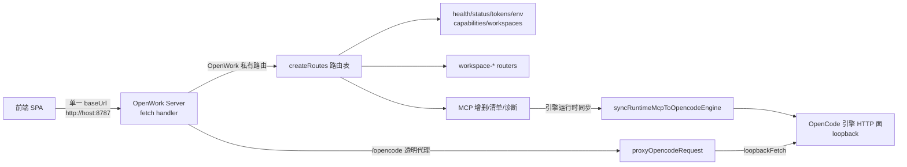
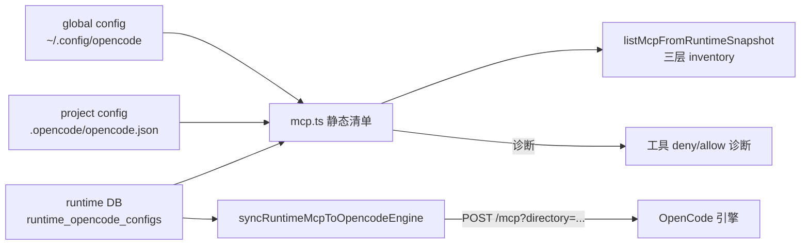
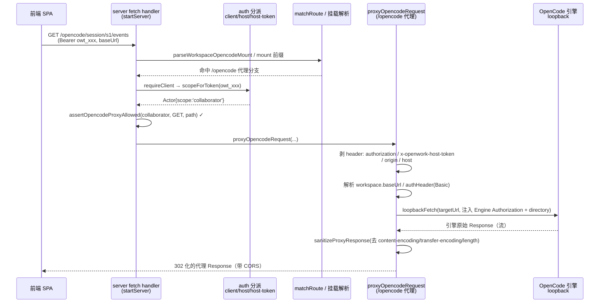
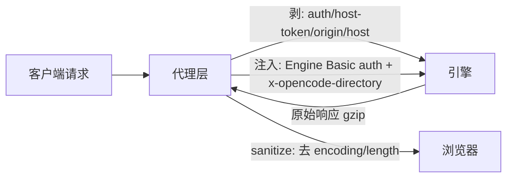

# OpenWork Server API 层与「单一 baseUrl 透明代理」深度解读

> 模块定位：OpenWork 开源 AI 工作流分享桌面应用（Claude Cowork / Codex 开源替代，本地优先、云端就绪）的 OpenWork Server。本模块是整条后台链路的数据面/代理面——引擎在上一个模块被封装成统一 HTTP 面之后，"所有能力如何通过一个 baseUrl 被安全、透明地暴露出来，并由控制面（Den）进一步编排"。本解读从叙事栈上接「代理运行时把引擎跑起来」，为后续「Den 企业控制平面」作铺垫（Den 是控制面，本模块是数据面/代理面）。
>
> 真源根：`/Users/morehao/Documents/study/ai/agent-product/openwork/apps/server`（下文统一以仓库根 `apps/server` 起算的相对路径标注；其他包如 `@opencode-ai/sdk` 为引擎官方 SDK）。

---

## 项目中的角色

`apps/server` 是 OpenWork 桌面应用里独立成包的 Node 后端（monorepo `apps/server`，其余为 `apps/app`、`apps/desktop`、`apps/ui-demo`）。它在 Electron 主进程内以 `node:http` 方式运行，暴露一个 HTTP 服务，前端（SPA）通过**一个 `baseUrl`** 同时访问两种能力：

- **OpenWork 私有 API**（`/workspace/:id/*`、`/w/:id/*`、`/health`、`/status`、`/tokens`、`/env`、`/runtime/*`、`/capabilities` 等）——由 server 自己实现，负责工作区编排、token 管理、MCP/skill/plugin 清单、审批、审计等。
- **`/opencode` 引擎代理**（透明转发）——把 OpenCode 引擎的 HTTP 面原样转发给真实引擎进程，SPA 可以直接调用引擎的一切能力（开会话、跑命令、读事件流、调 MCP），而无须感知引擎真实地址。

去掉它会怎样：前端就失去统一的入口。要么前端分别维护引擎地址与私有 API 地址（破坏"单一 baseUrl"不变式，控件面无法统一鉴权/审计/审批），要么把 MCP、skills、workspace、approval 等能力全部硬塞进引擎面（引擎不该承载平台级编排）。它承载了「平台与引擎的解耦边界」：引擎只管干活，平台管安全/编排/审计。

---

## 解决什么问题、根因

**根因：一个 AI 工作流平台里，「谁来把引擎做成可共享的多租户服务」是核心架构问题。** 引擎（OpenCode）本身是一个面向单机单进程的工具，它自己暴露的是「局域网内裸地址 + 无鉴权」的 HTTP 面。OpenWork 要实现"本地优先、云端就绪"，就需要一个**受控的中介层**，把引擎的裸能力改造成：

1. **统一寻址**：客户端只认一个 `baseUrl`，不必知道引擎在哪个 loopback 端口、哪个 `directory`。
2. **鉴权注入**：引擎本身不验客户端是谁；中介层负责把"谁来、什么权限"翻译成引擎能接受的形式（必要时注入 Basic auth），并把客户端的平台 token 与发给引擎的凭据**隔离**。
3. **权限分层**：owner / collaborator / viewer 三种 scope 决定"这个客户端对引擎和平台各能干到哪一级"。
4. **运行时配置同步**：平台侧新增的 MCP、插件、provider 要实时推给运行中的引擎，而不是等引擎重启。
5. **可观测与安全剥离**：把宿主敏感头（host-token、origin、host）在过代理时剥掉，杜绝宿主凭据经由代理泄露给前端/引擎。

一句话根因：**"引擎是一个无鉴权的本地 HTTP 进程，而平台要把它变成一个带鉴权、带权限分层、带实时配置同步、可统一审计的共享服务，且不破坏前端的单一入口心智。"**

---

## 设计思路

### 方案取舍：单一 baseUrl vs 多端口

- **选中方案（单一 baseUrl + 路径前缀分派）**：所有请求先进同一个 `fetch handler`，按 `url.pathname` 的前缀分派——`/w/:id` 或 `/workspace/:id` 挂载私有 API，`/opencode` 前缀走引擎代理，其余走 `matchRoute` 路由表。好处是：CORS 配置一处、鉴权入口收敛、日志统一带 `auth` 与 `proxy` 标注、前端只持一个地址（这点对"把 baseUrl 当 config 传给远端/云/Den"至关重要）。
- **放弃方案（双端口或多基址）**：引擎开 8788、平台开 8787 或让前端直接打引擎端口。代价是：① 前端要维护两套 baseUrl，`config.baseUrl` 无法作为一个整体随工作区跨机器迁移（remote workspace 就是把 baseUrl 存进平台）；② 引擎端口裸奔，无法统一鉴权与审计；③ CORS / 登录态要处理两份。

### 鉴权多态：none / client / host / host-token

每一条路由在注册时声明一个 `AuthMode`，`fetch` 依此在进入 handler 前解析出 `Actor`：

- `none`：免鉴权（`/health`、`/dev/log` 有意为之）。
- `client`：验 `Authorization: Bearer <owt_...>` 或平台 `config.token`，得到带 `scope` 的远程 Actor（owner/collaborator/viewer）。
- `host`：接受宿主 token（`x-openwork-host-token`），也接受 owner 级 bearer——服务于"本机宿主进程可直接操作"。
- `host-token`：**只**认 `x-openwork-host-token`（`/env` 用户级环境变量面板用这个，刻意不放开给 owner bearer，因为 env 是"用户私域"）。

为什么不只做一种"全权 token"：三种 scope 让"分享"成为可能——给 collaborator 可读写、给 viewer 只读，且通过 `requireClientScope` 对重点写操作二次收口。若只要一种 token，就退化成"全有或全无"，无法支持公开分享工作区（只读查看）。

### Token 体系三层粒度

`TokenService` 管理一组 `owt_` 前缀 token，落盘到 `tokens.json`（只存哈希，不存明文）。

- 生成时 `owt_${shortId().replace(/-/g,"")}`（`glob: true` 前缀设计，见 tokens.ts:113）。
- 存储只写 `hash`（`sha` 由 `hashToken` 计算），`list()` 永远不返回明文，杜绝意外泄露到前端。
- `config.token` 被视作一个特殊 collaborator scope（`scopeForToken` 里 `token === this.config.token` 直接返回 `"collaborator"`），保持与旧式单一 token 的向后兼容。

### MCP 三层静态配置 + 引擎运行时同步

MCP 来源有三层：global（`~/.config/opencode/themes` 级 config）、project、runtime（平台私有 DB）。其中 **runtime 层是 OpenWork 主动管理、能脱离用户配置文件独立增删的**（`runtime-opencode-config-store.ts` 用 `runtime_opencode_configs` 表按 workspace 存 JSON）。关键设计：**静态配置只在引擎重启时被读到，restart 之外的变更靠"动态推送到引擎 /mcp" 实时生效**（`syncRuntimeMcpToOpencodeEngine`），保证 MCP 增删/启用不打断当前会话。

---

## 关键数据结构（精简）

- **路由注册**：`[method, regex, keys, auth, handler]`，`auth: AuthMode = "none"|"client"|"host"|"host-token"`（[apps/server/src/routes/registry.ts:6-6]()、[apps/server/src/routes/registry.ts:19-19]()）。实际匹配靠 `pathToRegex` 把 `:param` 编译成正则，性能够用（路由规模 < 数十条）。
- **挂载解析**：`/w/:id<restPath>` 与 `/workspace/:id<restPath>` 两种挂载形态，restPath 决定是私有 API 资源还是 `opencode` 代理（[apps/server/src/server.ts:778-778]()、[apps/server/src/server.ts:792-792]()）。
- **TokenScope**：`"owner" | "collaborator" | "viewer"`，配 `scopeRank`（viewer=1/collaborator=2/owner=3）比较大小（[apps/server/src/types.ts:9-9]()、[apps/server/src/server.ts:2970-2970]()）。
- **Actor**：`{ type: "remote"|"host"; clientId?; tokenHash?; scope? }`（[apps/server/src/types.ts:201-201]()）。
- **Capabilities.proxy**：`{ opencode: boolean }` 唯一标记代理面是否就绪（[apps/server/src/types.ts:120-120]()、[apps/server/src/server.ts:1288-1288]()）。

---

## 核心流程：一个客户端请求的完整链路

以「前端拿到 `baseUrl`，调用引擎开会话/读事件流」为主线，走透明代理：

关键分派点在 `startServer` 的 `fetch`：
- 先挡 OPTIONS（CORS 预检，[apps/server/src/server.ts:915-915]()）；
- 再命中 `parseWorkspaceOpencodeMount`（`/workspace/:id/opencode`）或 `parseWorkspaceMount` 的 `/opencode` restPath（[apps/server/src/server.ts:919-919]()~`927`）；
- 支持**挂载 baseUrl 的嵌套单工作区心智**：`/w/:id/workspace/<nestedId>/*` 强制 nestedId === :id，否则 404（[apps/server/src/server.ts:936-936]()）；
- 顶层 `url.pathname` 直接以 `/opencode` 开头则代理到 `config.workspaces[0]`（[apps/server/src/server.ts:946-946]()），这是"单工作区直连"形态;
- 最后落到 `matchRoute` 私有 API（[apps/server/src/server.ts:964-964]()），并按 `route.auth` 做对应鉴权后进 handler。

**代理时宿主 token 如何剥离**（安全关键，见下文「决策三」）。

---

## 与其他模块的协同

- **引擎封装（前序模块）**：`createWorkspaceOpencodeClient`（[apps/server/src/server.ts:1079-1079]()）基于 `@opencode-ai/sdk/v2/client`，把引擎封成类型化 client 供私有 API 内部调用；而 `/opencode` 代理则直接走裸 `loopbackFetch` 保持"透明转发、支持任意引擎端点/事件流"。两者共享 `resolveWorkspaceOpencodeConnection`（[apps/server/src/opencode-connection.ts:12-12]()）得到 `baseUrl` + `authHeader`。
- **runtime DB / 工作区 KV**：runtime MCP 与全局 runtime 配置落 `runtime_opencode_configs`（[apps/server/src/runtime-opencode-config-store.ts:54-54]()），并保证主工作区的引擎可读 runtime 配置文件刷新（[apps/server/src/openwork-runtime-config.ts:180-180]()）。这条链路正是「聚合 schema -> 引擎动态 MCP」的闭环。
- **审批/审计**：原生写路径过 `requireApproval` + `recordAudit`，引擎代理路径靠 `assertOpencodeProxyAllowed` 收口权限，两者共同构成"可控变更"。
- **reload 事件网**：`emitReloadEvent` + `reloadEvents`（events.ts）把 MCP/plugin/skill 变更广播给订阅者，且 MCP 变更还会额外触发 `syncRuntimeMcpToOpencodeEngine` 热推。
- **Den 控制面（后续模块）**：(见 [server-proxy-api.md](server-proxy-api.md) 与 [agent-runtime-opencode.md](agent-runtime-opencode.md) 的协同说明)本模块是"数据面/代理面"，Den 作为控制面需要透过本 baseUrl 编排这些能力——"单一 baseUrl + 可整体透传"正是 Den 能跨机器指到同一个工作区的先决条件。

---

## 关键设计决策

### 决策一：单一 baseUrl + 透明代理边界

**权衡**：把引擎接到平台手里、但保持"透明"，意味着平台既要能中途做安全/审计，又不能破坏引擎的流式语义（事件滴流、SSE）。

- 实现上，上游 `Response` 会带回 `content-encoding: gzip` 等 hop-by-hop 头，而 `node:http` 已经替你解码过 body；若不剥掉这些头，浏览器会因 `ERR_CONTENT_DECODING_FAILED` 直接断链（[apps/server/src/server.ts:1172-1172]() 上方长注释说明了这段历史），所以 `sanitizeProxyResponse` 会删掉 `content-encoding / transfer-encoding / content-length`（[apps/server/src/server.ts:1179-1179]()）。
- 请求侧同理：代理把 `Authorization`/`x-openwork-host-token`/`origin`/`host` 剥掉（[apps/server/src/server.ts:1128-1128]()），避免把**客户端的平台 token 或宿主凭据**转发给引擎、也避免引擎看到伪 origin。
- 替代方案代价：若不透明（把引擎逻辑复刻进平台），平台就背上了引擎全部 API 的兼容负担，引擎一发版就全崩；若全透明不剥头，又会在浏览器端产生解码失败、平台 token 泄露两个不可接受的 bug。选中"形态透明 + 关键头剥离"是二者之间最省代价的折中。

附关键片段指纹：
（[apps/server/src/server.ts:1128-1133]()）

<!-- snippet: const headers = new Headers(input.request.headers);
  headers.delete("authorization");
  headers.delete("x-openwork-host-token");
  headers.delete("x-openwork-client-id");
  headers.delete("host");
  headers.delete("origin"); -->

（[apps/server/src/server.ts:1180-1183]()）

<!-- snippet: const headers = new Headers(response.headers);
  headers.delete("content-encoding");
  headers.delete("transfer-encoding");
  headers.delete("content-length"); -->

### 决策二：鉴权多态（none/client/host/host-token）+ scope 分层

**权衡**：一条链路几种调用方——无鉴权探活、远程 SPA、本机宿主、宿主环境面板。若只给一套 token，要么探活必经鉴权（健康检查变慢），要么赋权过度；于是把鉴权粒度拆成 4 档，路由声明自己要哪档。

- `host-token` 单给 `/env`（[apps/server/src/server.ts:460-460]()），刻意**不放行 owner bearer**：env 是"宿主用户私域"，不能因为某人持一台工作区的 owner token 就读取用户全部环境变量面板。
- `scopeRank` + `requireClientScope` 做二次收口：即使路由声明 `client`，仍可在 handler 内要求 `collaborator` 起步（如 `/workspace/:id/mcp` 的增删改走 `requireClientScope(ctx,"collaborator")`，[apps/server/src/server.ts:2525-2525]()）。
- 引擎代理路径也按 scope 收口：`assertOpencodeProxyAllowed` 拒绝 viewer 的一切非 GET/HEAD，并特别防止 viewer 自批准引擎`/permission/:id/reply`（[apps/server/src/server.ts:812-812]()）。
- 替代方案：若完全放开引擎代理给所有 token，等于让 viewer token 也能跑写命令/自批准工具，破坏只读隔离。这个 gate 是"引擎代理这条捷径也不能绕开授权"的关键。

（[apps/server/src/server.ts:816-818]()）

<!-- snippet: if (scope === "viewer" && m !== "GET" && m !== "HEAD") {
    throw new ApiError(403, "forbidden", "Viewer tokens are read-only");
  } -->

（[apps/server/src/server.ts:2970-2974]()）

<!-- snippet: function scopeRank(scope: TokenScope): number {
  if (scope === "viewer") return 1;
  if (scope === "collaborator") return 2;
  return 3;
} -->

### 决策三：宿主 token 的剥离与引擎认证注入

**权衡**：平台上两套凭据体系——客户的平台 token（owt_*）与引擎侧（可能配置的 Basic auth）。代理必须保证：**客户 token 绝不进引擎**（否则引擎能冒充客户后续请求），**引擎的真是凭据只由平台掌控并注入**。

- `proxyOpencodeRequest` 第一件事就是 `headers.delete("authorization")` 清掉客户 Bearer，然后从 workspace 连接对象取引擎的 `authHeader` 重新 set `Authorization: Basic ...`（[apps/server/src/server.ts:1140-1140]()）。
- 引擎进程本身在 loopback 上跑、不加 CA 校验，所以代理走 `loopbackFetch`（[apps/server/src/server-fetch.ts:41-41]()），语义是"只允许 127.0.0.1/localhost/managed 引擎"。
- 文件级别还立了规则注释：外发走 `externalFetch`（可选 Electron `net.fetch`），同一地址回环走 `loopbackFetch`，**裸 `globalThis.fetch` 在 `apps/server/src` 被禁**（[apps/server/src/server-fetch.ts:38-38]()），从源头杜绝"某条路由不小心绕过 CA/代理/隔离管道直接外发"。
- 替代方案代价：若把客户 token 原样转发引擎，等于建了一个"横冲直撞的越权通道"；若不注入引擎凭据，则配了 Basic 的引擎会让所有代理请求 401。两个方向都要做对，缺一即整体不成立。

（[apps/server/src/server.ts:1140-1143]()）

<!-- snippet: const auth = workspace ? resolveWorkspaceOpencodeConnection(input.config, workspace).authHeader ?? null : null;
  if (auth) {
    headers.set("Authorization", auth);
  } -->

（[apps/server/src/server-fetch.ts:39-39]()）

<!-- snippet:  * Use loopbackFetch only for 127.0.0.1, localhost, and managed OpenCode engine traffic where CA trust is irrelevant and streaming performance matters. -->

---

## 亮点与问题

### 亮点
- **透明代理 + 关键头剥离**兼顾流式兼容与安全，且有历史 bug 注释背书（Bun/Node fetch 差异导致的 `content-encoding` 陷阱也被主动规避）。
- **鉴权 4 档 + scope 分层 + 路由级 `requireClientScope` 双重收口**，把"探活无鉴权"与"写操作需 collaborator"这两种诉求都干净承载，且引擎代理捷径也不能绕开 viewer 限制。
- **三层 MCP 静态配置 + 引擎运行时动态同步**：静态只影响引擎重启基线，动态靠 `POST /mcp?directory=` 热推，MCP 增删/启用/云 reconcile 都能"即刻生效"（[apps/server/src/server.ts:2523-2523]() 热添加、[apps/server/src/server.ts:2603-2603]() 热启用），同时保留"dispose 重建时归位磁盘配置、非主工作区补推"的对账逻辑（[apps/server/src/server.ts:3341-3341]()）。
- **`loopbackFetch` vs `externalFetch` 二分**在文件规则层立了"禁止裸 fetch"约束，从工程纪律上封死外发路径。
- **多工作区挂载形态**（`/w/:id` 与 `/workspace/:id`）兼容"单工作区直连"与"URL 式多工作区寻址"，并强制 nested id 一致以保住单工作区心智。

### 问题与风险
- **单起点路由规模耦合**：所有鉴权、代理、CORS、日志都在 `startServer` 的一个 `fetch` 里 if-elif 展开（[apps/server/src/server.ts:871-871]()~`1019`），随着工作区/诊断/云插件路由增多，函数体越来越大（4582 行的汇聚点），可测性依赖 `route` 结构抽象，但分派逻辑仍未拆成中间件链。
- **引擎代理的流式边界由注释约定而非运行时强制**：`isSessionCommandProxyRequest` 对 `POST /session/:id/command` 走"投递后立即 200 + 靠事件流反馈"的火枪方式（[apps/server/src/server.ts:835-835]()、[apps/server/src/server.ts:1153-1153]()），命令失败只能靠引擎事件流感知，缺少同步错误返回——这是纯约定，换了不守约的调用方会丢失直接错误反馈。
- **`assertOpencodeProxyAllowed` 对 viewer 只拦非 GET/HEAD**，对 GET 类的"读"不设白名单，viewer token 可读引擎几乎所有只读面（决策权衡，可接受但需知晓）。
- **宿主 token 剥离依赖工程师记得 delete**：剥头逻辑集中在 `proxyOpencodeRequest` 一处，尚无测试级兜底保证未来新增代理路径必然剥 `authorization`（`opencode-proxy-gate.test.ts` 主要覆盖 scope 判断，未覆盖剥头）。
