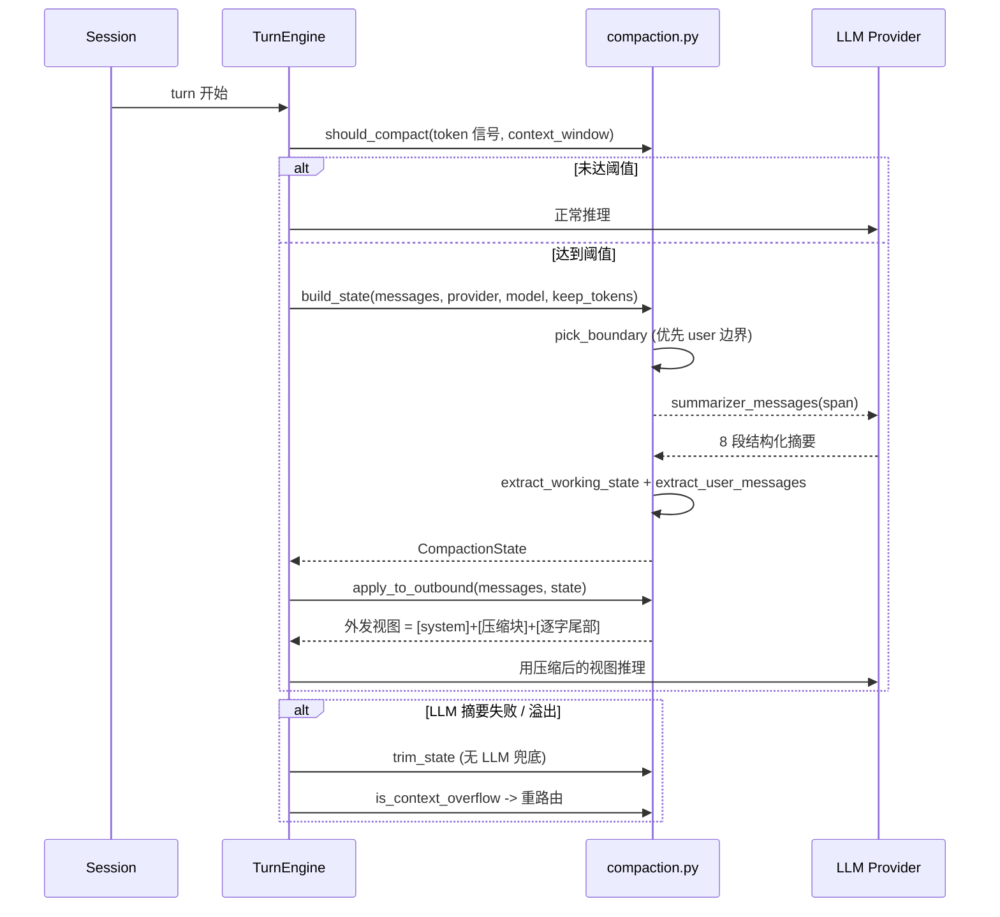

# OpenWorker 上下文自动压缩（Compaction）深度分析

> OPE-27。当外发历史接近模型上下文上限时，把**外发视图**的老旧部分替换为 (a) LLM 生成的结构化摘要 + (b) 机械提取的状态。持久化 transcript 永不被修改——只改**发给模型的东西**。设计文档 `docs/auto-compaction-spec.md`（2026-07-28 批准）。

## 1. 定位与核心思想

长会话是 agent 应用的普遍痛点：历史无限增长会撑爆上下文窗口，而简单截断会丢失关键决策、约束和用户意图。

OpenWorker 的压缩设计有一系列关键取舍：

| 取舍 | 说明 |
|------|------|
| **只改外发视图** | 压缩只影响"发给模型的消息"，持久化的 transcript 原样保留（用户仍能回看完整历史） |
| **两层提取** | (a) LLM 写结构化摘要 + (b) **机械提取**状态/用户消息。机械层零幻觉，是意图的 ground truth |
| **保真用户消息** | 用户的话经过机械提取、按时间顺序、逐字保留（仅裁剪粘贴的重复内容）——意图审计线索不依赖 LLM 记得收录 |
| **纯函数 + 注入** | 模块全是纯函数 + 一个 dataclass；引擎拥有"何时压缩"（run loop）和"用什么 provider/model"（注入）。这让所有策略无需 provider 也能测试 |
| **无摘要降级** | LLM 摘要失败或有溢出时，回退到无 LLM 的 `trim_state`（机械块仍可用） |

**文件:** `coworker/compaction.py`（561 行）

---

## 2. 触发条件

### 2.1 触发阈值

```
trigger_tokens = min(threshold_pct × context_window, cap_tokens)
```

| 参数 | 默认值 | 说明 |
|------|--------|------|
| `threshold_pct` | `0.8` | 上下文窗口的触发比例 |
| `cap_tokens` | `250_000` | 硬上限。让 1M 窗口模型**提前**压缩——质量和延迟早在名义上限前就退化 |
| `context_window` | `128_000` | 无矩阵记录时的回退值 |

```python
def should_compact(signal, context_window, *, threshold_pct=0.8, cap_tokens=250_000):
    return signal >= min(int(threshold_pct * (context_window or 128_000)), int(cap_tokens))
```

### 2.2 溢出兜底

`is_context_overflow`（`compaction.py:557`）通过模式匹配识别主模型抛出的 context-overflow 400（如 `context_length_exceeded`、`"maximum context length"` 等），把它路由进压缩策略而不是直接抛给用户——覆盖压缩对 token 预估失误的情形。

---

## 3. 边界选取（pick_boundary）

**文件:** `compaction.py:147`

压缩不是任意截断，而是挑一个"合适的切分点"——边界之后的消息原样保留，之前进入压缩块。

```python
def pick_boundary(messages, *, keep_tokens):
    # 优先 user 消息边界；不够则回退到 assistant（迭代）边界
    users, assistants = _turn_starts(messages, start=start)
    boundary = _fit(users)
    ...
```

**规则：**

- 候选边界**绝不能是 `tool` 消息**（工具结果不能作为外发视图的开头）
- 优先 **user 边界**（turn 起点）：最早——尽量多保留能塞进 keep 预算的原样内容
- 若最新的 user turn 单独就超出预算（一个巨大的工具循环），则在它**内部**选迭代边界，至少保留最近的 assistant 步骤
- 无意义的边界（在首个真实消息之前）返回 `None`，表示无可压缩内容

---

## 4. 状态：CompactionState

**文件:** `compaction.py:85`

```python
@dataclass
class CompactionState:
    boundary_index: int      # canonical 消息列表索引：之前→压缩块；之后→逐字发送
    summary_text: str        # LLM 结构化摘要
    working_state: str       # 机械提取的工作状态
    user_messages: list[str]  # 保真用户消息
    user_messages_dropped: int  # 超上限被丢弃的旧用户消息数（累计计数）
    created_at: float
    model_used: str
    trimmed: bool            # 是否来自无摘要的 trim 兜底
```

带 `as_dict()` / `from_dict()`（`compaction.py:102`），随会话持久化，**reload 时保持视图一致**。

---

## 5. 机械提取（零幻觉）

### 5.1 工作状态 `extract_working_state`

**文件:** `compaction.py:219`

从 span 的工具调用记录机械提取，追加到摘要之后——这是 CODE Agent 的加载项。提取四类信号：

```python
# 写文件/产物启发
_WRITE_HINTS = ("write", "edit", "append", "save", "create", "patch")
_ARTIFACT_HINTS = ("artifact", "publish", "deploy")
```

| 信号 | 来源 | 处理 |
|------|------|------|
| **写入/编辑的文件** | `args.path` / `args.file_path` + 写启发词 | 去重按最近优先，上限 20 |
| **最近 Shell 命令** | `run_shell` + `args.command` | 取最近 10 条 + 退出状态（从结果 JSON 的 `exit_code` 解读） |
| **产生的产物** | `args.url` / `path` / `title` + 产物启发词 | 去重，上限 10 |
| **用到的工具** | 工具名去重 | 全量排序列出 |

### 5.2 用户消息 `extract_user_messages`

**文件:** `compaction.py:284`

span 内每个 user 消息按时间顺序、裁剪粘贴的冗余后逐字保留（`clip` 600 字符）。`_cap_user_messages`（`compaction.py:301`）把列表封顶到最近 `_USER_MESSAGES_MAX`（40）条，并累计永远被丢弃的数目——否则块会反复回收它释放的窗口，越滚越长。

> 注：LLM 摘要器同样被要求列出用户消息，但**用户的话是意图的 ground truth**，绝不能依赖 LLM 记得收录——故机械层双重保底。

---

## 6. LLM 摘要器

### 6.1 系统提示词 8 段结构

**文件:** `compaction.py:312`（`SUMMARY_SYSTEM_PROMPT`）

摘要必须是**有载荷的记忆**，按序输出以下 markdown 标题段：

1. **Primary request and intent** — 用户要达成什么，含任何时刻声明的常驻约束（"未经我批准绝不发送"）。约束比表述它们的 turn 活得更久
2. **Key concepts and decisions** — 领域事实、技术选型与理由。包含 WHY 而非仅 what——无理由的决策会被重议
3. **Artifacts and files** — 仍重要的每个文件/交付物：路径、角色、关键内容摘录
4. **Errors and fixes** — 遇到的问题与解决方式，含用户纠错（"不，这么做"）——这是有持久力的反馈
5. **All user messages** — 按时间顺序列举所有用户消息（裁剪粘贴的冗余）
6. **Pending tasks** — 未完成项、承诺的跟进、用户说"回头再说"的事
7. **Current work** — 当前精确状态：哪一步、哪个文件、什么状态
8. **Next step** — 紧接的下一步动作，以用户请求为据

**规则**：不把完整文件内容当真相（记"读/写了某文件"，需要时再重读——过时的文件记忆比没有更糟）；要具体（路径、名称、命令、ID）。

### 6.2 续接契约

摘要块以 `CONTINUATION_CONTRACT`（`compaction.py:330`）结尾，命令模型无缝接续：

> 从离开处继续：按描述的当前工作和下一步精确接续。不要重问已回答的问题、不要回顾、不要提到上下文被压缩过。如需上面提及的文件内容，请重读。

### 6.3 span 渲染与复用

- `_render_span`（`compaction.py:337`）把 span 渲染为紧凑文本；工具结果第一个被硬裁剪（`_SPAN_TOOL_RESULT_CLIP = 400`），超预算时丢最旧行
- 重复压缩时，`summarizer_messages`（`compaction.py:373`）把**上一次摘要作为新 span 的第零条消息**，与新 turn 一起被总结——形成摘要的递归折叠

```python
body = "[previous compaction summary — fold its still-relevant content into the new summary]\n"
      + prior_summary + "\n\n[conversation since]\n" + body
```

---

## 7. 构建与应用压缩

### 7.1 构建 `build_state`

**文件:** `compaction.py:417`

1. 挑边界（拒绝无意义：`boundary <= prior.boundary_index` 跳过）
2. 取 span（`prior.boundary_index` 之后到 boundary）
3. 调 LLM 摘要（禁用工具，`max_tokens` ≤ 3000）
4. 机械提取工作状态 + 保真用户消息（含累计 dropped）
5. 返回新 `CompactionState`

摘要失败或无内容时**抛异常**，由调用方决定重试/降级策略。

### 7.2 无摘要降级 `trim_state`

**文件:** `compaction.py:455`

无 LLM 兜底：把边界推进约 `fraction`（0.1）的外发消息。**没有摘要**，但机械块和用户消息列表（按 spec 永不被裁掉）仍然免费可得——模型依然拿到确定性的状态。

```python
summary = (prior.summary_text if prior else "") + (
    "(Older turns were trimmed to fit the context window; no summary is available ...)"
)
```

`trimmed=True` 标记来源。

### 7.3 输出块 `compacted_block`

**文件:** `compaction.py:501`

压缩状态渲染成**单条 user 消息**，结构为：

```
<compacted-history>
Earlier turns of this session were compacted. The summary below is your memory of them.

<summary_text>

## Working state (extracted mechanically...)      ← 机械块（若有）
## User messages in the compacted span (...)        ← 保真用户消息（若有）
  (N earlier user messages omitted ...)
CONTINUATION_CONTRACT
</compacted-history>
```

### 7.4 应用到外发视图 `apply_to_outbound`

**文件:** `compaction.py:524`

```
外发视图 = [system?] + [压缩块（作为 user 消息）] + 边界后的逐字尾部
```

canonical 历史不被触碰；被压缩 span 里的 provider 私有 sidecar 随之消失（replay 链在压缩点后合法重启）。无状态或状态过期时是 no-op。

---

## 8. 架构总览



---

## 9. 关键数字

| 参数 | 默认值 | 位置 |
|------|--------|------|
| `threshold_pct` | `0.8` | `compaction.py:23` |
| `cap_tokens` | `250_000` | `compaction.py:24` |
| `context_window`（回退） | `128_000` | `compaction.py:26` |
| `KEEP_RECENT_FRACTION` | `0.25` | `compaction.py:29` |
| `SUMMARY_MAX_TOKENS` | `3_000` | `compaction.py:31` |
| 工具结果裁剪 `_SPAN_TOOL_RESULT_CLIP` | `400` | `compaction.py:34` |
| 渲染预算 `_SPAN_BUDGET_CHARS` | `400_000` | `compaction.py:35` |
| 用户消息裁剪 `_USER_MESSAGE_CLIP` | `600` | `compaction.py:40` |
| 用户消息上限 `_USER_MESSAGES_MAX` | `40` | `compaction.py:41` |
| trim 比例 `_TRIM_FRACTION` | `0.10` | `compaction.py:42` |

---

## 10. 代码索引

| 想了解什么 | 看哪个文件 |
|-----------|-----------|
| token 预估（chars/4 回退信号） | `coworker/compaction.py:48` |
| 触发阈值计算 | `coworker/compaction.py:60` |
| `should_compact` 判定 | `coworker/compaction.py:70` |
| `CompactionState` 结构 | `coworker/compaction.py:85` |
| 边界选取 | `coworker/compaction.py:147` |
| 工作状态机械提取 | `coworker/compaction.py:219` |
| 用户消息保真提取 | `coworker/compaction.py:284` |
| 摘要器系统提示（8 段） | `coworker/compaction.py:312` |
| 续接契约 | `coworker/compaction.py:330` |
| span 渲染与裁剪 | `coworker/compaction.py:337` |
| 摘要器消息组装（复用前一摘要） | `coworker/compaction.py:373` |
| 一次摘要 round-trip | `coworker/compaction.py:391` |
| 构建压缩状态 | `coworker/compaction.py:417` |
| 无 LLM trim 兜底 | `coworker/compaction.py:455` |
| 压缩块渲染 | `coworker/compaction.py:501` |
| 应用到外发视图 | `coworker/compaction.py:524` |
| 溢出检测 | `coworker/compaction.py:557` |
