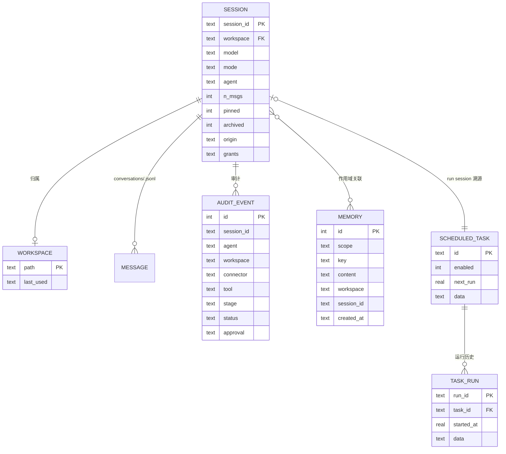
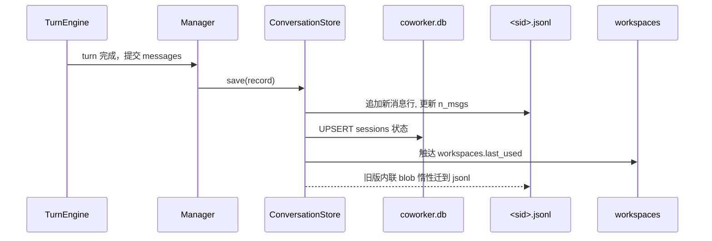
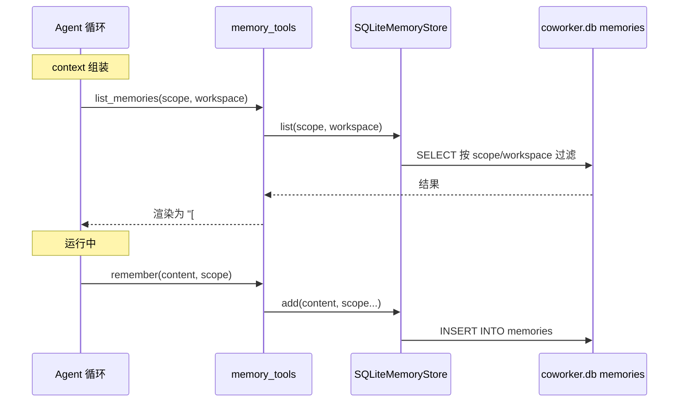

# OpenWorker 数据模型深度分析

> OpenWorker 是本地优先应用，持久化层采用 **SQLite 索引 + JSON/JSONL 文件** 的混合形态，**没有独立数据库引擎、没有迁移工具、没有 models 实体目录**。所有 schema 都内联在以 `CREATE TABLE` 建表的 Store 类里。本文依据源码 HEAD（01b6f83），覆盖数据模型关注面的五要素。

## 1. 数据模型总览

数据落在**两个状态根目录**，由 `state_dir()` 决定（[coworker/secrets.py:27-43]()）：

| 目录 | 判定 | 路径 |
|------|------|------|
| 全局状态 | `$COWORKER_STATE_DIR` 或平台目录 | macOS/Linux `~/.config/coworker`；Windows `%APPDATA%\coworker` |
| 工作区数据 | 传入 `data_dir` 或 `workspace` 时 | `<workspace>/.coworker` |

`SessionManager.__init__` 的 `base` 即数据根（[coworker/server/manager.py:130-135]()），所有存储都相对它装配。
<!-- snippet: if data_dir is not None:
            base = Path(data_dir).expanduser()
        elif self.default_workspace is not None:
            base = Path(self.default_workspace) / ".coworker"
        else:
            base = state_dir() -->

**持久化形态分三层**：

| 形态 | 承载 | 说明 |
|------|------|------|
| **SQLite 索引** | `coworker.db`（记忆/会话/工作区/审计）+ `automation.db`（定时任务） | 结构化、可索引、跨线程（`check_same_thread=False` + RLock） |
| **JSON 配置 store** | `personas/inbox/wakes/connections/...` 等约 18 个 `.json` | 每个 store 一个文件，键值结构化 |
| **JSONL 正文 / 文件夹** | `conversations/<sid>.jsonl` + skills 文件夹 | 会话消息 append-only；技能以 `SKILL.md` 文件夹存在 |

### 实体关系总览

> **说明**：`MESSAGE` 不是独立表，而是 `conversations/<session_id>.jsonl` 的逐行消息；`MEMORY` 通过 `workspace`/`session_id`/`scope` 与会话和工作区松散关联（无外键约束，纯 SQLite 弱关系）。`grants`/`compaction` 等复杂状态以 JSON 文本存入会话行。

## 2. 存储选型与理由

OpenWorker 没有引入独立 DBMS（MySQL/Postgres 均无），也没有用对象存储。三处关键取舍：

| 取舍 | 选择 | 为什么 / 代价 |
|------|------|--------------|
| **SQLite 做索引而不是做整库** | 仅存会话/工作区/记忆/审计/定时任务的索引列，消息正文放 JSONL 文件 | 正文是 append-only、只读回放、量级可观的流式数据；塞进关系表既拖慢也难做增量。SQLite 单文件免运维、天然本地优先（[coworker/conversations.py:11-15]()） |
| **JSON 文件做配置 store** | 每个语义对象一个 `.json`（inbox/personas/wakes/connections…） | 读写频率低、结构随版本演进快，JSON blob 免迁移成本（新增字段即加即用）。代价：无统一查询，靠各自 Store 类序列化/反序列化 |
| **`0600` 权限 + 接口隔离管秘密** | `secrets.json` 靠 OS 文件权限保护，界面背后可换 Keychain/age 后端 | 密钥**永不进模型上下文/提示词/追踪**（[coworker/secrets.py:3-5]()）；v1 用 0600 JSON 而非加密，是为了可替换性——调用方只依赖接口（[coworker/secrets.py:7-8]()）。代价是明文落盘，依赖文件系统权限 |

共性原则：**全部数据本地、无单点云依赖**。这与"本地优先 + 云可选"的整体哲学一致（见 [`README.md`](./README.md) 五、设计亮点 4）。

## 3. 核心表设计

> 字段表是对真实建表的"结构化叙述"，非 SQL 原型照搬；每张表指向真实 `CREATE TABLE` 位置。

### 3.1 `memories` — 持久记忆（[coworker/memory/sqlite_store.py:24-32]()）
<!-- snippet: CREATE TABLE IF NOT EXISTS memories (
                id INTEGER PRIMARY KEY AUTOINCREMENT,
                scope TEXT NOT NULL,
                key TEXT,
                content TEXT NOT NULL,
                workspace TEXT,
                session_id TEXT,
                created_at TEXT DEFAULT CURRENT_TIMESTAMP
            ) -->

记忆是 agent 的持久上下文，双/三作用域（`Scope.GLOBAL/WORKSPACE/SESSION`，[coworker/memory/base.py:16-19]()）。

| 字段 | 类型 | 约束 | 说明 |
|------|------|------|------|
| `id` | INTEGER | PK 自增 | 记忆条目 ID |
| `scope` | TEXT | NOT NULL | `global` / `workspace` / `session` |
| `key` | TEXT | 可空 | 记忆键（可检索） |
| `content` | TEXT | NOT NULL | 记忆正文 |
| `workspace` | TEXT | 可空 | 关联工作区（workspace 作用域用） |
| `session_id` | TEXT | 可空 | 关联会话（session 作用域用） |
| `created_at` | TEXT | 默认 `CURRENT_TIMESTAMP` | 创建时间 |

**设计要点**：弱关联（无 FK）换取灵活——`list()` 按 `scope/workspace/session_id` 组合过滤（[coworker/memory/sqlite_store.py:64-85]()），是记忆"按作用域隔离"的数据基础（见 [`engine-and-agent.md`](./engine-and-agent.md) 记忆系统）。

### 3.2 `sessions` + `workspaces` — 会话索引（[coworker/conversations.py:74-84]()）
<!-- snippet: CREATE TABLE IF NOT EXISTS sessions (
                session_id TEXT PRIMARY KEY, workspace TEXT, model TEXT, mode TEXT,
                title TEXT, agent TEXT DEFAULT 'code', n_msgs INTEGER DEFAULT 0, messages TEXT,
                extra_roots TEXT, pinned INTEGER DEFAULT 0, archived INTEGER DEFAULT 0,
                origin TEXT, origin_label TEXT,
                auto_title TEXT, renamed INTEGER DEFAULT 0,
                updated_at TEXT DEFAULT CURRENT_TIMESTAMP
            );
            CREATE TABLE IF NOT EXISTS workspaces (
                path TEXT PRIMARY KEY, last_used TEXT DEFAULT CURRENT_TIMESTAMP
            ); -->

会话的**索引行**与**消息正文**分离。索引行存定位/展示信息，正文在 JSONL。

`sessions` 表（消息本体在 `conversations/<sid>.jsonl`）：

| 字段 | 类型 | 约束 | 说明 |
|------|------|------|------|
| `session_id` | TEXT | PK | 会话 ID |
| `workspace` | TEXT | — | 归属工作区 |
| `model` / `mode` | TEXT | — | 模型与权限模式 |
| `title` | TEXT | — | 优先手动标题 |
| `auto_title` | TEXT | — | LLM 生成标题（手动重命名优先于它，`_display_title`） |
| `renamed` | INTEGER | 默认 0 | 手动重命名标记 |
| `agent` | TEXT | 默认 `code` | Agent 类型 |
| `n_msgs` | INTEGER | 默认 0 | 消息计数（JSONL 行数） |
| `pinned` / `archived` | INTEGER | 默认 0 | 置顶/归档标记 |
| `origin` / `origin_label` | TEXT | — | 派生活会话来源（§31） |
| `grants` / `compaction` | TEXT | — | 会话授权（JSON）与压缩状态（JSON） |

`workspaces` 表：

| 字段 | 类型 | 约束 | 说明 |
|------|------|------|------|
| `path` | TEXT | PK | 工作区路径（`realpath` 规范化） |
| `last_used` | TEXT | 默认 `CURRENT_TIMESTAMP` | 最近使用时间 |

**设计要点**：`sessions.save()` 对正文做 **append-only 追加**（`len(record.messages) > existing` 时只写新消息，[coworker/conversations.py:184-190]()），崩溃安全；`workspaces` 记录最近工作区供快速切换。`canonicalize_workspaces()` 用 `realpath` 折叠 `/tmp` vs `/private/tmp` 等重复路径（[coworker/conversations.py:313-337]()）。

### 3.3 `audit_events` — 审计日志（[coworker/audit.py:33-48]()）
<!-- snippet: CREATE TABLE IF NOT EXISTS audit_events (
                id INTEGER PRIMARY KEY AUTOINCREMENT,
                timestamp TEXT DEFAULT CURRENT_TIMESTAMP,
                session_id TEXT,
                agent TEXT,
                workspace TEXT,
                connector TEXT,
                tool TEXT,
                stage TEXT,
                status TEXT,
                approval TEXT,
                args TEXT,
                result_preview TEXT,
                reason TEXT,
                resource TEXT
            ) -->

| 字段 | 类型 | 说明 |
|------|------|------|
| `id` | INTEGER PK | 自增 |
| `timestamp` | TEXT 默认 `CURRENT_TIMESTAMP` | 时间 |
| `session_id` / `agent` / `workspace` | TEXT | 归属 |
| `connector` / `tool` | TEXT | 操作主体 |
| `stage` | TEXT | proposed/started/approval_requested/approval_resolved/finished/… |
| `status` / `approval` | TEXT | 结果状态 + `ApprovalOutcome` 值 |
| `args` | TEXT | **脱敏后的参数 JSON**（`_sanitize_args`，[coworker/audit.py:123-137]()） |
| `result_preview` / `reason` / `resource` | TEXT | 摘要/原因/定位资源 |

**设计要点**：脱敏是双向防御（键名命中 + body 键命中），`resource` 从 url/owner/repo/issue_key 等参数提炼（[coworker/audit.py:152-169]()）。详见 [`permission-and-safety.md`](./permission-and-safety.md) 第 5 节。

### 3.4 `scheduled_tasks` + `task_runs` — 自动化（[coworker/automation/store.py:76-87]()）
<!-- snippet: CREATE TABLE IF NOT EXISTS scheduled_tasks (
                    id TEXT PRIMARY KEY,
                    enabled INTEGER NOT NULL DEFAULT 1,
                    next_run REAL,
                    data TEXT NOT NULL
                );
                CREATE TABLE IF NOT EXISTS task_runs (
                    run_id TEXT PRIMARY KEY,
                    task_id TEXT NOT NULL,
                    started_at REAL NOT NULL,
                    data TEXT NOT NULL
                ); -->

| 表 | 字段 | 类型 | 说明 |
|----|------|------|------|
| `scheduled_tasks` | `id` | TEXT PK | 任务 ID |
| | `enabled` | INTEGER 默认 1 | 启停 |
| | `next_run` | REAL | 下次触发（epoch 秒，`compute_next_run` 用 croniter + 时区算） |
| | `data` | TEXT NOT NULL | **完整任务对象 JSON blob**（schedule/run_count 等） |
| `task_runs` | `run_id` | TEXT PK | 运行 ID |
| | `task_id` | TEXT NOT NULL | 外键到任务 |
| | `started_at` | REAL NOT NULL | 启动时间 |
| | `data` | TEXT NOT NULL | 运行详情 JSON |

**设计要点**："JSON blob + 少数索引列"——`run_count`、schedule、timezone 全在 `data` JSON 里，只把 `enabled`/`next_run` 提为列，让调度器 `due()` 廉价查"到期的"（[coworker/automation/store.py:132-139]()）。`idx_runs_task(task_id, started_at DESC)` 支撑按任务回放运行历史。

## 4. Schema 演进策略

OpenWorker **没有迁移框架**，演进靠两招：

1. **内联惰性 ALTER**：`ConversationStore.__init__` 的 `CREATE TABLE IF NOT EXISTS` 之后，对新增列逐条 `ALTER TABLE sessions ADD COLUMN ...`，用 `try/except sqlite3.OperationalError` 跳过已存在的列（[coworker/conversations.py:86-103]()）——幂等，重启时自动补列。
2. **JSON 文本承载半结构化状态**：`sessions.grants`、`sessions.compaction`、`scheduled_tasks.data` 都是 JSON 字符串，新增内部字段无需改表结构（读时用 `_load_grants` 容错解析，[coworker/conversations.py:33-40]()）。

此外有一次性**数据迁移**逻辑：`_backfill_counts()` 把旧版"内联 messages 列"懒惰迁移到 `.jsonl`（[coworker/conversations.py:134-165]()），`save()` 里也做同样的惰性回流（[coworker/conversations.py:170-183]()）。这是"无迁移层时如何保证演进安全"的实现——靠幂等 DDL + 容错解析 + 惰性数据重整，而非版本化迁移脚本。

## 5. 读写路径

### 5.1 会话写入（append-only 主链路）

要点：正文只追加、索引 UPSERT、工作区 last_used 触达（[coworker/conversations.py:168-218]()）。

### 5.2 记忆读写（agent 视角）

记忆的读写都经 `memory/tools.py` 的三个工具（remember / memory_update / memory_forget，risk `low`），多线程安全靠 `RLock` + `check_same_thread=False`（[coworker/memory/sqlite_store.py:20-21]()）。

## 6. 与整体设计哲学的关联

这套"SQLite 索引 + JSON 配置 + JSONL 正文 + 文件夹技能"的数据分层，不是随手为之，而是**从头贯彻本地优先 + 模块自治**：

- 记忆/审计/会话共用单文件 `coworker.db`，避免多进程 / 多连接一致性负担；自动化独立 `automation.db` 保证调度器不会被会话写放大拖慢。
- JSON store 的"一个语义一份文件"让 inbox、wakes、connections 等功能彼此零耦合，与连接器 Adapter 化（见 [`connectors-and-providers.md`](./connectors-and-providers.md)）、技能文件夹即真相（见 [`skills-system.md`](./skills-system.md)）同出一辙。
- 会话正文 append-only + 索引分离，直接支撑了 [`compaction.md`](./compaction.md) 的"只改外发视图、绝不改持久化 transcript"铁律——正文是回放唯一真相，压缩只影响发送前视图。
