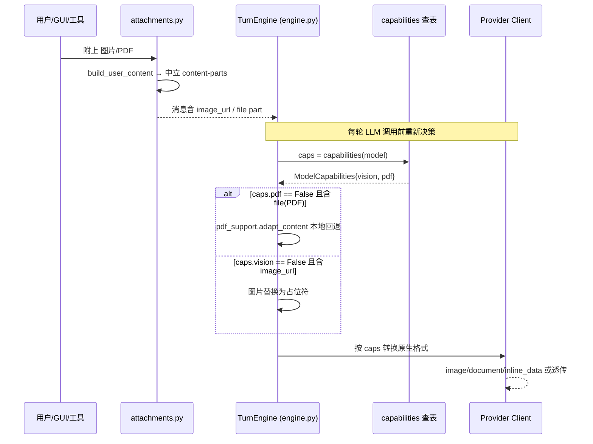

# OpenWorker 多模态处理与决策机制深度分析

> OpenWorker 是**消费端**多模态：模型负责"读"图片和 PDF，不负责"生成"图片。核心设计是把多模态输入以**厂商中立的 OpenAI content-parts** 存入历史，每次 LLM 调用前按**当前激活模型的能力**动态转换成各厂商原生格式或本地降级。本文重点讲清"何时使用多模态模型"的**决策机制**。

## 1. 一句话总结决策机制

OpenWorker **从不"决策"何时使用多模态模型**——没有"这个任务需要看图 → 自动切 vision 模型"的主动路由逻辑。它做的是**能力驱动的被动适配**：

> 每轮 LLM 调用，按**当前模型**的 `vision`/`pdf` 能力查表，决定消息里的图片/PDF 是**原样发送**（模型有能力）还是**本地降级**（无能力）。多模态是否真正参与，由**"用户是否附上图片/PDF" + "当前所选模型是否有对应能力"** 共同决定，不涉及任何模型切换。

---

## 2. 决策链路总览



---

## 3. 第一级：中立存储 — attachments.py

**文件:** `coworker/attachments.py`

用户消息 + 附件经 `build_user_content`（`attachments.py:31`）组装成 OpenAI content-parts：

| 附件类型 | 存储形式（厂商中立） |
|---------|---------------------|
| **图片** | `{"type":"image_url","image_url":{"url": <data URL>}}` |
| **PDF** | `{"type":"file","file":{"filename","file_data"}}`（data URL） |
| **文本文件** | `{"type":"text", ...}`（截断内联） |

**大小/数量上限**（超限跳过，不让 turn 崩掉）：

| 限制 | 值 | 说明 |
|------|-----|------|
| `MAX_ATTACHMENTS` | 8 | 每 turn 附件数 |
| `MAX_IMAGE_CHARS` | 12,000,000 | data URL 上限（约 8–9MB 解码） |
| `MAX_PDF_CHARS` | 15,000,000 | data URL 上限（约 10MB，GUI 选取上限） |
| `MAX_TEXT_CHARS` | 200,000 | 单文本文件内联上限 |

**关键**：所有图片/PDF 都内联为 **base64 data URL**，不设云端文件引用（`attachments.py:4`）。多模态输入的来源是**用户显式附件**，不是 agent 自主决策。

**输入校验**（`server/app.py:1935`）：`/v1/sessions/{id}/messages` 收到附件时校验 kind ∈ {image,pdf,text}、data URL 前缀、大小。

---

## 4. 第二级：能力查表 — capabilities.py + matrix.py

**决策的"输入"**：模型能力，来自 `provider.capabilities(model)` → `capabilities_for(model)`（`router.py:117`）。这是**纯函数查表**，只依赖模型字符串，不依赖输入内容。

`ModelCapabilities`（`providers/base.py:81`）：

```python
class ModelCapabilities:
    tools: bool = True
    vision: bool = False    # 能否看图
    pdf: bool = False       # 能否原生读 PDF（OpenAI file / Anthropic document / Gemini inline_data）
    parallel_tool_calls: bool = True
    streaming: bool = True
```

**三来源命中**（`capabilities.py:12`）：

1. **精确矩阵表 `matrix.py`**（full-id 精确匹配，含转售商 id）
2. **前缀启发表 `capabilities.py`**（按 provider/模型名前缀）
3. **保守默认**（unknown → 无 vision/PDF）

### 4.1 关键能力分布

| 模型族 | vision | 原生 PDF | 依据 |
|--------|:------:|:--------:|------|
| Claude / Gemini / GPT-4/5（原生三巨头） | ✅ | ✅ | `capabilities.py:48-57`，`matrix.py:36` |
| Vertex/Bedrock 上的 Claude/Gemini | ✅ | ✅ | `capabilities.py:38` |
| Ollama / 大多数 OpenAI-compat（DeepSeek/GLM/Kimi/MiniMax/Qwen/Grok/Mistral） | ❌（保守） | ❌ | `capabilities.py:27-44,68-73` |
| Kimi K3 via Together / Muse Spark | ✅ | ❌（经 compat 面，PDF 未经认证） | `matrix.py:95,120` |

矩阵注释明确结论（`matrix.py:35`）：**原生三巨头直接吃 PDF；所有 OpenAI-compat 厂商和转售商都不行**（其 chat API 无内联 file part，2026-07-17 验证）。

---

## 5. 第三级：出站降级决策 — engine.py

**文件:** `coworker/engine.py:1056-1115`

这是决策的**执行点**。每次组装外发消息时，对每条消息的 content 检查是否含多模态 part，然后按**当前模型能力**就地改写（历史不变）。

### 5.1 PDF 分支（`engine.py:1060-1080`）

```python
if any(p.get("type") == "file" for msg in out if list for p in msg["content"]):
    caps = self.provider.capabilities(self.model)
    if not getattr(caps, "pdf", False):
        out = [ {... "content": pdf_support.adapt_content(msg["content"], caps)} ... ]
```

- `caps.pdf == True` → **不改**，把真实 PDF 原样交给 provider
- `caps.pdf == False` → 调 `pdf_support.adapt_content` 本地回退

### 5.2 图片分支（`engine.py:1085-1115`）

```python
if any(p.get("type") == "image_url" for msg in out if list for p in msg["content"]):
    caps = self.provider.capabilities(self.model)
    if not getattr(caps, "vision", False):
        placeholder = {"type": "text",
                       "text": "[image attachment — not viewable by this model]"}
        out = [ {... 把 image_url 替换为 placeholder ...} ]
```

- `caps.vision == True` → **不改**，图片原样交给 provider
- `caps.vision == False` → 用一个**可见占位符**替换图片（用文字说明而非丢弃，模型也不会收到会拒绝的 payload）

### 5.3 关键性质：**每次调用都重新决策**

```python
# engine.py:1056 — "so a mid-session model switch always re-decides"
```

不是引擎构建期的快照，而是每轮外发前重查。因此会话中途从 vision 模型切到 text 模型（或反之）**永远正确**：文本模型下次看图→占位符；切回 vision→恢复原图。历史从未被降级污染。

---

## 6. 第四级：PDF 本地回退 — pdf_support.py

**文件:** `coworker/pdf_support.py`（251 行）

无原生 PDF 能力时，`adapt_content`（`pdf_support.py:200`）按用户预置回退模式处理 `file` part：

| 回退模式 | 机制 | 适用 |
|---------|------|------|
| **text**（默认） | `pypdf` 本地提取内嵌文本 → 内联为 text part（上限 200k 字符） | 通用（含无 vision 模型） |
| **images** | `pypdfium2` 每页渲染 PNG（~144dpi，上限 100 页）→ `image_url` parts | 仅当模型有 vision，否则降级回 text |

```python
# pdf_support.py:216 — images 模式需要 vision
if fallback_mode() == "images" and getattr(caps, "vision", False):
    images = rasterize(file_data)
    ...  # 追加为 image_url parts
text = extract_text(file_data)   # 否则走 text
```

**关键工程取舍：**

- **全部本地处理**：文档绝不发给任何厂商"文件抽取"端点（`pdf_support.py:14`）
- **手写 PNG 编码器** `_encode_png`（`pdf_support.py:131`）：刻意**不引入 Pillow**（打包体积、签名面）
- **按内容 hash 缓存**（`pdf_support.py:52`）：历史每轮重放，10MB PDF 抽帧昂贵，缓存命中避免重复处理
- **绝不静默消失**：提取失败/无文字时给出可见文字说明，标注"可能需要原生 PDF 模型"（`pdf_support.py:205,246`）

---

## 7. 第五级：厂商原生格式转换

能力为真时，provider 把中立 parts 转成自家格式（`engine.py` 不改则按此交给 SDK）：

| Provider | `image_url` → | `file`(PDF) → | 位置 |
|----------|---------------|---------------|------|
| **Anthropic** | `image` block（base64 或 http URL；data URL 一律 base64） | `document` block（含 title） | `anthropic_provider.py:169,187` |
| **Gemini** | `inline_data` part | `inline_data`(application/pdf) | `gemini_provider.py:119,130` |
| **OpenAI** | 原样透传 | `file` part 原生 | openai 透传 |

```python
# anthropic_provider.py:187 — 原生 PDF 走 document block
def _document_block(part):
    return {
        "type": "document",
        "source": {"type": "base64", "media_type": "application/pdf", "data": ...},
        "title": name,
    }
```

---

## 8. 决策机制再确认：无主动路由

多轮搜索确认，OpenWorker **不存在**以下任何机制：

- ❌ 无"输入含图片 → 自动把任务路由/切换到 vision 模型"的逻辑
- ❌ 无"图生文/文生图"能力
- ❌ 无按能力过滤模型列表的 UI 逻辑（模型选择完全由用户手工指定模型字符串）

> "何时使用多模态模型"的唯一决定因素链条是：**① 用户把图片/PDF 加进 turn → ② 当前所选模型字符串对应的 `caps` 判定能否原生处理 → ③ 能则原样发，不能则本地降级/占位。**

这与其他 Agent 平台"自动为视觉任务挑多模态模型"的方案形成鲜明对比——OpenWorker 选择**透明、可预期、无需隐式切换**的降级策略。

---

## 9. 代码索引

| 想了解什么 | 看哪个文件 |
|-----------|-----------|
| 组装中立 content-parts | `coworker/attachments.py:31` |
| 附件大小/数量上限 | `coworker/attachments.py:17-20` |
| 附件输入校验 | `coworker/server/app.py:1935` |
| `ModelCapabilities` 定义 | `coworker/providers/base.py:81` |
| 能力查表入口（纯函数） | `coworker/providers/capabilities.py:12` |
| Router 能力透传 | `coworker/providers/router.py:117` |
| 能力矩阵 | `coworker/providers/matrix.py` |
| PDF 降级决策 | `coworker/engine.py:1060-1080` |
| 图片降级决策 | `coworker/engine.py:1085-1115` |
| PDF 本地回退 | `coworker/pdf_support.py:200` |
| PDF 提取/光栅化 | `coworker/pdf_support.py:102,164` |
| Anthropic 图片/文档块 | `coworker/providers/anthropic_provider.py:169,187` |
| Gemini inline_data | `coworker/providers/gemini_provider.py:119,130` |
| 浏览器截图（data:image 来源） | `coworker/connectors/browser_automation.py:183` |
