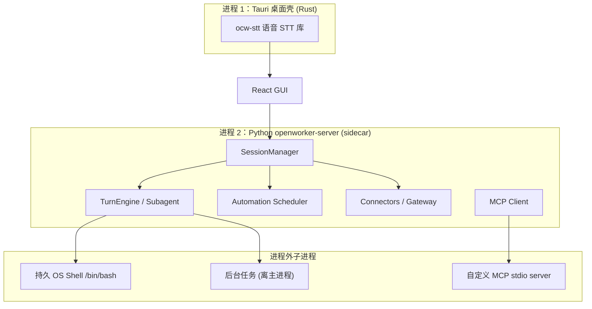

# OpenWorker 进程拓扑与隔离模型深度分析

> 本文回答两个问题：OpenWorker 是否有"worker 角色"？是否采用沙箱或独立进程隔离？结论是——**所有 Agent 引擎都跑在同一个 Python 进程内**（无独立 worker 池），**没有真正的沙箱**，但 Shell 工具通过 `Executor` 抽象为未来容器/VM 沙箱预留了扩展点。隔离策略是"权限门控 + 工作区边界"，而非系统级隔离。

## 1. 进程拓扑总览

OpenWorker 桌面应用是**三进程拓扑**：Tauri 壳（Rust 主进程）托管拉起 Python 后端 sidecar，后端再派生独立的 OS Shell 子进程。



**图外补叙**：`TC→W` 是原生窗口/托盘；`W→M` 是通过 localhost 端口 + per-launch token 的通信（见 §2）。

**关键点**：GUI 不直接调用后端 API 细节，而是通过选定的 localhost 端口 + per-launch token 通信（见 §2）。右侧进程外部分只有三种：Shell 子进程、后台任务进程、自定义 MCP stdio 服务器。

---

## 2. 桌面壳与后端的关系（Tauri sidecar）

**文件:** `surfaces/gui/src-tauri/src/lib.rs`

Tauri 壳（Rust 主进程）的核心职责（`lib.rs:3`）：

1. **选择空闲端口**：`free_port()` 绑定 `127.0.0.1:0` 拿到系统分配端口（失败回退 8765），避免与手动启动的 server 冲突（`lib.rs:39`）
2. **托管拉起 Python 后端**：以 sidecar 子进程方式启动 `openworker-server`，注入 HTTP/WS 地址 + 每次启动的认证 token `launch_token()`（`lib.rs:46`，双重 UUID）
3. **常驻托盘**：关闭窗口只隐藏不退出——保持 MyHelper、消息收件箱、自动化 Scheduler 持续运行；**只有托盘 → Quit 才真正停掉 sidecar**（`lib.rs:8`）
4. **生命周期绑定**：`ServerProcess(Mutex<Option<Child>>)` 管理该子进程，Tauri 退出时杀死它——防止孤立的后端进程残留（`lib.rs:33`）

```rust
// lib.rs:4
//! Tauri is a thin native window over the existing React SPA. It:
//!   1. picks a free localhost port and starts the Python `openworker-server` as a managed
//!      sidecar on that port (so it never clashes with a hand-run server on 8765);
//!   2. injects the sidecar HTTP/WS addresses and per-launch authentication token
```

另外两个原生命令（`lib.rs:10`）：

| 命令 | 说明 |
|------|------|
| **keep-awake** | 调 `caffeinate`（macOS）保系统不眠，保证定时任务在 Mac 闲置时也能触发 |
| **autostart** | 开机自启（open-at-login） |

**环境变量透传**：sidecar 继承壳进程环境。shell 启动的 `npm run tauri dev` 会透传 `OPENAI_API_KEY`；Finder 启动的应用没有 shell 环境，密钥改从 SecretStore 读取（`lib.rs:13`）。

---

## 3. Worker / Subagent 形态：全部同进程

OpenWorker 有几种"干活的角色"，但**没有一个跑在独立进程或独立 worker 池**——全部在 Python sidecar 进程内，靠 asyncio 协程并发。

| 形态 | 触发方式 | 是否独立进程 | 隔离/边界机制 |
|------|---------|------------|--------------|
| **主 Agent**（Code/Cowork/Chat/MyHelper） | 用户会话 | ❌ 同进程 | 权限门控 + roots |
| **Subagent**（`explore` 工具） | 主 Agent 调用 | ❌ 同进程 | 独立上下文窗口 + 只读工具 + PLAN 模式 |
| **定时/无人值守任务** | Scheduler cron 触发 | ❌ 同进程 | asyncio 任务 + overlap 守卫 |

### 3.1 Subagent（子代理）

**文件:** `coworker/tools/subagent.py`

`explore` 工具为解决宽泛调研问题（"重试逻辑在哪？"）而生——这种问题会让主会话上下文被几十次文件读取烧掉。它调用 `build_explorer_engine()` 生成一个**子 TurnEngine**（`subagent.py:42`），在**同一工作区**但**全新上下文**下运行，只读工具，最终只把报告返回给调用者。

```python
# subagent.py:67 — 子代理强制 PLAN 模式
permissions = PermissionEngine(workspace_root=Path(ws), mode=Mode.PLAN)
return TurnEngine(
    provider=provider, registry=registry, permissions=permissions,
    ... instructions=EXPLORER_INSTRUCTIONS, max_iterations=max_iterations)
```

**线程模型**（`subagent.py:117`）：工具在 worker 线程中执行（无运行中事件循环），故用 `asyncio.run(_run())` 安全启动子引擎的独立事件循环——**仍是同进程内的新协程/新线程，不是新进程**。

**无递归**：子引擎的工具注册表里不含 `explore`（`subagent.py:10`），避免无限递归。

### 3.2 定时/无人值守任务

**文件:** `coworker/automation/scheduler.py`，`coworker/server/manager.py:2719`

`Scheduler` 是常驻 server 内的 asyncio 循环（`scheduler.py:23`）。到期的任务经 `run_task` → `_build_task_engine` 创建**新的 TurnEngine**（`manager.py:2719`）并 `asyncio.create_task` 跑起来。

```python
# scheduler.py:77 — Spawn, don't await: 一个被审批卡住的自动化任务
# 绝不能阻塞调度循环 / 其它到期任务 / self-wake 恢复
spawned = asyncio.create_task(self.run_task(task, trigger=trigger))
```

**控制策略**（`scheduler.py:2`）：
- **run-once-catch-up**：宕机期间错过的任务，启动时补跑一次再正常调度
- **skip-on-overlap**：`_running_ids` 守卫，前一 run 未结束就不叠加新 run

---

## 4. 沙箱：现状与预留

### 4.1 事实：没有真正的沙箱

OpenWorker **不采用** docker / nsjail / cgroups / seccomp / VM 等方式对 Agent 或 Shell 做系统级隔离。Shell 命令直接在本机 OS shell 上执行，AI 的全部工具（文件、网络、连接器）都在 Python 后端进程内运行。

### 4.2 但有一个为沙箱预留的扩展点：Executor

**文件:** `coworker/tools/shell.py:1-10`

这是全项目最直接回答"是否沙箱"的证据——`Executor` 抽象明确标注为未来 `ContainerExecutor` / `VMExecutor` 预留，且剥离给引擎无需改动内核：

```python
"""Persistent shell behind an `Executor` boundary.

`LocalExecutor` keeps one long-lived shell process, so `cd`, `export`, activated venvs,
etc. persist across `run_shell` calls (unlike a per-call `subprocess.run`). The `Executor`
interface is the hedge for a future `ContainerExecutor`/`VMExecutor` (sandboxing) without
touching the engine.

Safety here is permission-gating (high-risk tool → approval) + per-command timeout +
best-effort non-interactive enforcement.
"""

class Executor(ABC):                          # shell.py:55
    @abstractmethod
    def run(self, command, timeout=None) -> dict: ...
    def run_background(self, command) -> dict: ...   # 后代默认不支持
```

**结论**：项目当前靠 `LocalExecutor`（本机 shell），没有启用进程/容器隔离；`Executor` 接口是接入容器化沙箱的预留接缝。

---

## 5. 真正独立的进程（非 Agent 引擎）

虽然 Agent 引擎不独立进程，但项目里确有几处**进程外执行**：

| 进程外组件 | 机制 | 说明 |
|-----------|------|------|
| **持久 OS Shell** | `subprocess.Popen`（`shell.py:191`） | POSIX `/bin/bash`（`start_new_session=True`）；Windows PowerShell（`CREATE_NEW_PROCESS_GROUP`）。**长生命周期**，跨 `run_shell` 调用保留 `cd`/`export`/venv 状态 |
| **后台任务** | `run_in_background` 专用进程（`shell.py:17-20`） | 独立脱离进程（非持久 shell），让 dev server 跑着而会话继续；`close()` 不主动杀它 |
| **自定义 MCP stdio server** | `stdio_client`（`mcp/client.py:127`） | 按用户在 MCP 配置里给定的 command/args 托管子进程 |
| **STT 语音** | Tauri 进程内 Rust 库（见下） | 非独立二进制，而是 `ocw-stt` crate 内联 |

### 5.1 Shell 工具进程

- **前台命令**：在持久 shell 里执行，加入标记协议 `{marker} {exit_code} {cwd}` 解析输出（`shell.py:10`）；超时用 SIGINT（POSIX 前景子进程）/ Ctrl-Break（Windows 子进程组）中断，shell 存活保住会话状态（`shell.py:12-15`）
- **进程组隔离**：`start_new_session` / `CREATE_NEW_PROCESS_GROUP` 让超时中断只作用于子进程，不误伤 Python 后端自身（`shell.py:182-189`）
- **超时范围**：默认 120s，模型请求的上限 600s（`shell.py:41-44`）；并注入 `_NONINTERACTIVE_ENV` 阻止阻塞式交互提示（`shell.py:47`）

### 5.2 STT 语音：in-process，非边车进程

**文件:** `surfaces/gui/src-tauri/src/lib.rs:279`

语音的麦克风/模型代码在 Tauri 进程内以 **Rust 库 crate**（`ocw-stt`，`stt/` 目录）方式运行，而不是独立的语音二进制：

```rust
// lib.rs:279  —  mic/model 代码在 Tauri-free 的 ocw-stt crate；桌面壳只负责状态
use ocw_stt::{Dictation, DownloadProgress};
```

调用经 `tauri::async_runtime::spawn_blocking` 包裹并话到 worker 线程（`lib.rs:411`），不阻塞 UI。严格说 STT 是"壳进程的库级组件"，不是独立进程。

---

## 6. 并发与线程模型

由于一切 Agent 引擎都挤在单一 Python 进程，并发管理依赖 asyncio + 线程池：

| 场景 | 策略 | 位置 |
|------|------|------|
| 多工具并行（读/搜索） | `asyncio.to_thread` 并发 | `engine.py:637` |
| 单轮写/Shell 工具 | 顺序执行 | `engine.py:648` |
| Provider/Tool 阻塞调用 | `asyncio.to_thread` 包装 | `engine.py` 全篇 |
| 子代理 | `asyncio.run()` 起独立协程任务 | `subagent.py:117` |
| 定时任务 | `asyncio.create_task` 派生 | `scheduler.py:82` |
| 各 Store 并发保护 | `threading.Lock` / `RLock` | `memory/sqlite_store.py:20`、`audit.py:29`、`secrets.py` |

额外的线程守护进程：Shell 输出读取线程（`shell.py:203` `_reader` daemon thread）。

---

## 7. 当前安全边界 vs 沙箱差距

OpenWorker 的隔离模型是"**权限门控 + 作用域边界**"，而非系统级进程/容器隔离。三层正交机制：

| 边界 | 手段 | 文件 |
|------|------|------|
| **操作级** | `PermissionEngine` 按 `RiskClass` 门控（read/write_local/exec/external），纯读放行、其余审批；写工具路径须在可写 root 内 | `permissions.py`, `risk.py` |
| **文件系统级** | `roots` 限定会话可触碰的目录 | `roots.py:1` |
| **命令级** | `workspace_trust`：repo 提供的命令允许需用户信任该 workspace 根路径 | `workspace_trust.py:1` |
| **网络级** | URL 守卫阻断 SSRF（loopback/CGNAT/逐跳校验） | `web/guard.py` |

**与真正沙箱的差距**：

- 所有 Agent 引擎、连接器、密钥管理、记忆库**共享同一 Python 进程与内存**——一个工具的越界（如恶意提示劫持）可触及同一进程内其它组件
- Shell 是 OS 原生进程，无容器/资源限制（无 cgroups 内存/CPU 限额、无 seccomp）
- 隔离完全依赖**审批链路**的正确性：一旦用户设了 Auto 模式或审批被放行，写/Shell 即直通
- 预留的出路是 `Executor`：未来接入 `ContainerExecutor`/`VMExecutor` 可在不改引擎的前提下给 Shell 套上系统级隔离

---

## 8. 代码索引

| 想了解什么 | 看哪个文件 |
|-----------|-----------|
| Tauri 壳拉起后端 sidecar | `surfaces/gui/src-tauri/src/lib.rs:4` |
| sidecar 端口/token 注入 | `surfaces/gui/src-tauri/src/lib.rs:39,46` |
| 托盘常驻与退出语义 | `surfaces/gui/src-tauri/src/lib.rs:8` |
| sidecar 生命周期绑定（杀子进程） | `surfaces/gui/src-tauri/src/lib.rs:33` |
| keep-awake / autostart | `surfaces/gui/src-tauri/src/lib.rs:10` |
| STT in-process Rust 库 | `surfaces/gui/src-tauri/src/lib.rs:279` |
| Subagent 子引擎（PLAN 模式） | `coworker/tools/subagent.py:42,67` |
| Subagent 线程模型 | `coworker/tools/subagent.py:117` |
| Executor 抽象（沙箱预留） | `coworker/tools/shell.py:55` |
| LocalExecutor（本机 shell） | `coworker/tools/shell.py:137` |
| Shell 进程派生（Popen） | `coworker/tools/shell.py:191` |
| 后台任务独立进程 | `coworker/tools/shell.py:17-20` |
| 定时任务同进程派生 | `coworker/automation/scheduler.py:82` |
| 定时任务引擎装配 | `coworker/server/manager.py:2719` |
| MCP stdio 子进程 | `coworker/mcp/client.py:127` |
| 工具并发（to_thread） | `coworker/engine.py:637` |
| 工作区 roots 边界 | `coworker/roots.py:1` |
| 工作区信任 | `coworker/workspace_trust.py:1` |
| URL 守卫（防 SSRF） | `coworker/web/guard.py` |
