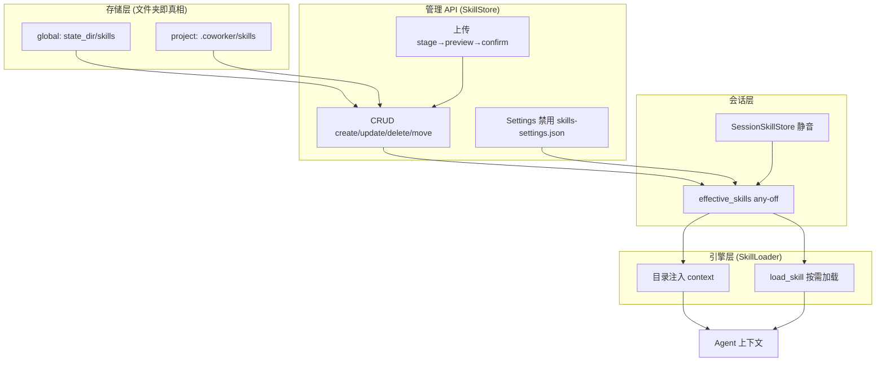

# OpenWorker 技能（Skills）系统深度分析

> 技能系统在 2026-08-01 的 PR #391（"Add support for Skills"）中经历了从加载器到完整管理体系的升级。本文基于升级后的代码，覆盖技能从**发现 → 加载 → 管理 → 产生**的完整链路。关联文档：[核心引擎与 Agent 体系](./engine-and-agent.md)。

## 1. 定位与设计原则

技能（Skill）是**可重用的能力包**，遵循 Anthropic `SKILL.md` 格式。它把"如何做某类事"的指令固化下来，让 AI 在需要时按需加载，而非每次把全部指令塞进上下文。

核心设计取舍：

| 原则 | 实现方式 |
|------|---------|
| **渐进式暴露** | 会话开始时只注入技能目录（name + description），完整正文通过 `load_skill` 按需加载 |
| **文件夹即真相** | 每个技能是一个文件夹，内含 `SKILL.md`（YAML frontmatter + markdown 正文）+ 可选资源/脚本。没有数据库 |
| **Git 友好** | 项目技能存于 `<workspace>/.coworker/skills`，随仓库一起版本化、可共享 |
| **禁用状态隔离** | 禁用标记放在个人 `state_dir()/skills-settings.json`，而不是技能文件夹内——避免一个用户的禁用被提交给队友 |
| **上传可审查** | 上传走分阶段流程（stage → preview → confirm），落盘前用户永远有机会预览最终内容 |

---

## 2. 目录结构

```
coworker/skills/
├── __init__.py     ← 模块导出
├── base.py         ← SkillLoader（渐进式加载 + load_skill 工具）145 行
└── store.py        ← SkillStore / SessionSkillStore（CRUD + 静音 + 上传）620 行
```

`base.py` 面向**引擎**（怎么把技能变成工具喂给 LLM），`store.py` 面向**管理**（怎么增删改查技能本身）。

---

## 3. 加载层：SkillLoader（base.py）

**文件:** `coworker/skills/base.py`

`SkillLoader` 负责从技能目录发现技能并对外提供目录/加载能力。

### 3.1 数据模型

```python
@dataclass
class Skill:
    name: str          # 技能名（== 文件夹名）
    description: str   # 一句话说明，作为目录条目
    instructions: str  # 完整正文 —— 按需加载
    path: str          # 技能文件夹路径
    allowed_tools: list[str]  # 可选：允许的工具白名单
```

### 3.2 发现与解析

`_parse_skill` 解析 `SKILL.md` 的 YAML frontmatter（`name` / `description` / `allowed-tools`），正文作为 `instructions`。目录遍历时只认 `SKILL.md` 文件（`base.py:42`）。

### 3.3 目录快照 vs 按需加载

会话引擎构建时，`catalog()` 只返回 `[{name, description}]` 列表并注入上下文（`base.py:57`）；`load_skill` 工具在相关时才被调用，返回完整指令 + 资源路径（`base.py:119`）。

**关键容错**：`load_skill` 在未命中时会先 `rescan()` 再查一次（`base.py:124`），保证"会话启动后才创建"的技能仍然可加载——目录行在每个会话内是静态的，但用户显式请求的技能不能 404。

```python
def load_skill(name: str) -> dict:
    skill = loader.get(name)
    if skill is None:
        loader.rescan()  # created after this session started? pick it up now
        skill = loader.get(name)
    ...
    return {"name": ..., "instructions": skill.instructions,
            "resources_path": skill.path}
```

---

## 4. 管理层：SkillStore（store.py）

**文件:** `coworker/skills/store.py`

`SkillStore` 是技能 CRUD 的核心，采用"文件夹即真相"的存储模型。

### 4.1 双作用域

| 作用域 | 位置 | 生命周期 | 场景 |
|--------|------|---------|------|
| **global** | `state_dir()/skills/` | 所有项目共享 | 个人通用技能 |
| **project** | `<workspace>/.coworker/skills/` | 随仓库版本化 | 团队共享技能 |

同名冲突时 **project 优先**（`store.py:169`——project 副本 shadow 掉 global），镜像引擎加载器的碰撞优先级。

### 4.2 安全防护（`_folder_of`）

技能名会成为文件夹名，因此：

- **命名校验** `validate_name`：正则 `^[A-Za-z0-9][A-Za-z0-9._-]*$`，拒绝 `..`、`/`、`\`，上限 64 字符（`store.py:39`）
- **符号链接逃逸防护** `_folder_of`：把目标文件夹 `resolve()` 后校验仍落在作用域目录内，防止 symlink 指向任意机器路径（`store.py:108`）

```python
def _folder_of(self, base: Path, name: str) -> Path:
    folder = base / name
    resolved = folder.resolve()
    base_resolved = base.resolve()
    if base_resolved not in resolved.parents and resolved != base_resolved / name:
        raise ValueError(f"Skill folder escapes its scope: {name}")
    return folder
```

### 4.3 CRUD 操作

| 操作 | 方法 | 说明 |
|------|------|------|
| 创建 | `create` | 校验名字/说明/正文后写 `SKILL.md`，重名报错 |
| 更新 | `update` | 原地重写字段，不动兄弟资源文件 |
| 删除 | `delete` | symlink 直接 unlink，否则 `shutil.rmtree` |
| 迁移 | `move` | 在 global/project 作用域间移动 |
| 查询 | `find` / `rows` | `find` 返回 (路径, 作用域)；`rows` 返回 Settings 用的富信息列表 |

`rows()` 额外统计 `bundled` 资源文件数（§6，供 Settings 以文件数标识区分"富技能"与单文件技能），并通过 `_frontmatter_source` 读取 `source:` 键区分 `uploaded` / `local`。

### 4.4 启用 / 禁用（`effective_skills`）

三层启用逻辑，**any-off 优于 any-on**：

```
技能 → 在 Settings 被禁用? ──是──▶ 排除（无法被覆盖复活）
        │否
        ▼
     会话被静音? ──是──▶ 排除
        │否
        ▼
     启用（缺省为开）
```

`effective_skills`（`store.py:459`）是会话技能菜单的单一决策来源。禁用状态持久化在个人 `skills-settings.json`，**不含于（且不会被写入）技能文件夹**。

---

## 5. 会话级静音：SessionSkillStore

**文件:** `coworker/skills/store.py`（`SessionSkillStore`）

按会话记录 `{skill: bool}` 的静音状态，结构镜像 `SessionConnectionStore`：

```python
# {session_id: {skill: bool}} —— 仅记覆盖项；缺省继承 Settings
def get(self, session_id, ...): ...
def set(self, session_id, skill, enabled): ...
def clear(self, session_id, skill): ...      # 静音随会话一起销毁
def remove_session(self, session_id): ...
```

**要点**：一个会话的静音在其生命周期内有效，会话销毁时同步清理（`manager.py:3727`）。缺省（无记录）表示继承 Settings 的启用状态。

---

## 6. 上传：stage → preview → confirm

上传采用分阶段流程，保证**落盘前用户预览**。支持两种输入（`store.py:280`）：

| 输入 | 说明 |
|------|------|
| **`.zip`** | 文件夹技能（可含资源）。`.skill` 文件是改名的 zip，同样解包 |
| **裸 `SKILL.md`** | 需带 YAML frontmatter（含 name，因为无文件夹可回退） |

**zip 路径的安全清洗**（`store.py:289`）：

1. 剥离 macOS Finder "Compress" 注入的 `__MACOSX/` shadow 项、`._*`、`.DS_Store`
2. 拒绝绝对路径、`..`、`:`（Windows 盘符）等不安全条目
3. 要求恰好含一个 `SKILL.md`（根下或唯一顶层文件夹内）
4. `SKILL.md` 至少提供一个根级 `.md` frontmatter name

stage 结果保存到 `state_dir()/skills-staged/<token>`，返回 preview（name/description/instructions/files）；用户确认后 `confirm_upload` 才把它 `shutil.move` 到目标作用域并打上 `source: uploaded` 溯源标记（`store.py:372`）。未确认的可用 `discard_upload` 丢弃。

---

## 7. Worker 自建技能：save_skill 工具（§5.2）

**文件:** `coworker/skills/store.py`（`save_skill_tool`）

SkillStore 还开放了 **worker 面向的入口**——`save_skill` 工具让 AI 在对话中"提出"把当前成果存为技能。设计要点：

- **`requires_approval=True`**：每个调用都走标准审批卡；**工具参数本身就是审查面**——schema 携带完整指令和文件清单（`store.py:480`）
- **文件捆绑白名单**：可捆绑的文件必须落在会话的 roots（`allowed_dirs`）内，worker 绝不能把任意机器路径编进技能（`store.py:572`）
- **SKILL.md 去重**：模型常在工作区起草一个 `SKILL.md` 再捆绑它——此时静默跳过，因为 `instructions` 参数本就会变成 `SKILL.md`（`store.py:577`）
- **落点固定 global**：worker 自建技能永远落 global 作用域，避免存进一次性 scratch 目录（`store.py:584`）

```python
save_skill.__aisuite_tool_metadata__ = ai.ToolMetadata(
    name="save_skill", category="skills", risk_level="medium",
    capabilities=["save_skill"], requires_approval=True,
)
```

---

## 8. API 层

**文件:** `coworker/server/app.py`，`coworker/server/manager.py`

| 方法 | 路径 | 说明 |
|------|------|------|
| GET | `/v1/skills` | 列技能（可省 workspace） |
| POST | `/v1/skills` | 创建技能 |
| PATCH | `/v1/skills/{name}` | 更新技能 |
| DELETE | `/v1/skills/{name}` | 删除技能 |
| POST | `/v1/skills/{name}/move` | 迁移作用域 |
| POST | `/v1/skills/{name}/reveal` | 打开技能文件夹（§6 本地 OS 文件管理器） |
| GET | `/v1/sessions/{id}/skills` | 会话技能菜单 + 静音状态 |
| POST | `/v1/sessions/{id}/skills` | 设置/清除某技能在本会话的静音 |

**Manager 集成**（`manager.py:236`）：

```python
self.skill_store = SkillStore()
self.session_skills = SessionSkillStore(base / "session_skills.json")
```

`effective_skill_names` 是引擎技能目录、rail 列表、composer 弹窗的**统一决策器**（`manager.py:3842`）。引擎构建时传入一个 `skill_filter` **可调用体**（`manager.py:467`），使 Settings 禁用和新建技能对**在线会话立即生效**（而非构建时的快照）。

另有 `_scratch_workspace_error` 后端隘口：拒绝把技能写入 per-conversation scratch 目录（技能会困在一次性文件夹里）——覆盖 UI / REST / 未来 import 全入口（`manager.py:3884`）。

---

## 9. 架构总览



---

## 10. 代码索引

| 想了解什么 | 看哪个文件 |
|-----------|-----------|
| 技能数据模型 + 解析 | `coworker/skills/base.py:19` |
| 渐进式加载 | `coworker/skills/base.py:28` |
| `_parse_skill` frontmatter 解析 | `coworker/skills/base.py:64` |
| `load_skill` 工具（含 rescan 容错） | `coworker/skills/base.py:110` |
| 命名校验（防逃逸） | `coworker/skills/store.py:39` |
| 符号链接逃逸防护 | `coworker/skills/store.py:108` |
| CRUD 核心 | `coworker/skills/store.py:177` |
| 上传 stage → confirm | `coworker/skills/store.py:280` |
| 会话静音 | `coworker/skills/store.py:406` |
| 三层启用决策 | `coworker/skills/store.py:459` |
| `save_skill` worker 工具 | `coworker/skills/store.py:524` |
| 技能 REST API 路由 | `coworker/server/app.py:582` |
| 会话技能静音路由 | `coworker/server/app.py:393` |
| 统一技能决策器 | `coworker/server/manager.py:3842` |
| 技能 CRUD 管理方法 | `coworker/server/manager.py:3803` |
