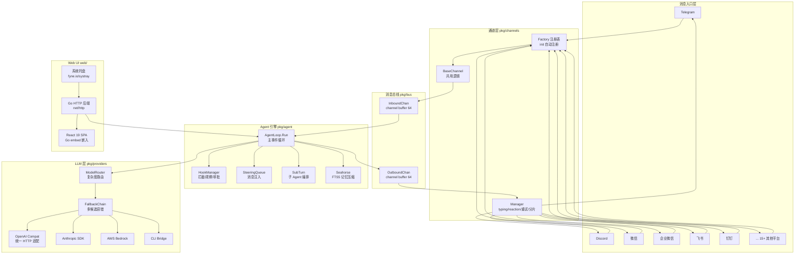
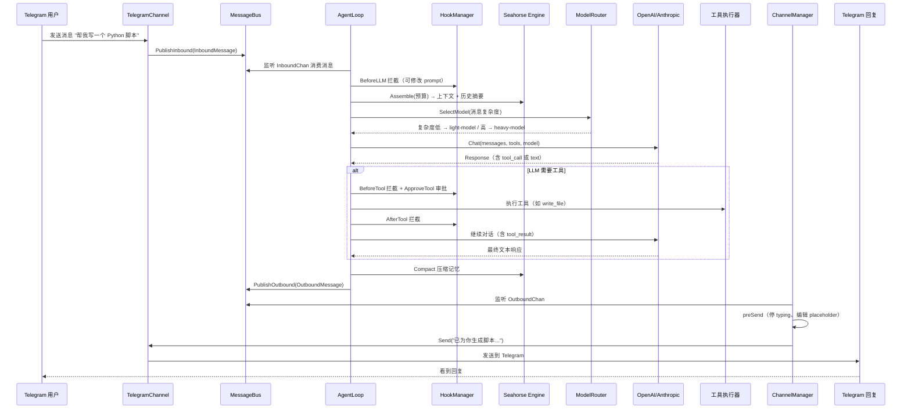

# PicoClaw — 极致轻量的 Go 原生 AI Agent 网关深度分析

> **仓库:** https://github.com/sipeed/picoclaw
> **公司:** 矽速科技 [Sipeed](https://sipeed.com)
> **许可证:** MIT
> **网站:** https://picoclaw.io

## 第一部分：快速概览

### 这是什么

PicoClaw 是一个用纯 Go 从零编写的超轻量级 AI 助手基础架构。它并非 OpenClaw 或 NanoBot 的分支，而是经历了"Sipeed 团队需求定义 + AI Agent 驱动代码生成 + 人工审查打磨"的自举式开发过程。

核心定位：**在 10 美元硬件上，用 10MB 内存运行一个完整的 AI Agent 网关**。它能接入 30+ LLM 供应商，连接到 20+ 聊天平台，支持 MCP 协议，提供 Web UI 管理面板——所有这些都是一个几十 MB 的独立二进制。

### 解决的痛点

- **Agent 运行时太"重"**——OpenClaw 需要 >1GB 内存和 Node.js 运行时，无法跑在廉价嵌入式设备上
- **边缘 AI 代理的市场空白**——开发者想在 50 元的 RISC-V 开发板上运行 AI Agent，现有方案根本装不上
- **平台碎片化**——不同 IM 平台（微信、飞书、Telegram）各自一套 SDK，缺乏统一的 Agent 接入抽象
- **AI 供应商锁定**——30+ LLM 供应商各有协议差异，切换成本高

### 适用场景

- 在树莓派/RISC-V 开发板/NanoKVM/MaixCAM 等低功耗设备上部署 24/7 AI 助手
- 老旧 Android 手机再利用——安装 APK 即可变成家庭 AI 中枢
- 为 Telegram/微信/企业微信/飞书/Discord 等 20+ IM 平台快速创建统一 AI Bot
- 本地开发和运维场景——嵌入式部署作为远程服务器运维助手

### 核心能力清单

| 能力 | 说明 |
|------|------|
| **极致轻量** | 核心 <10MB 内存，<1 秒冷启动（0.6GHz 单核），单二进制部署 |
| **多架构** | x86_64、ARM64、ARMv7、RISC-V、MIPS、LoongArch——一个 Makefile 全编译 |
| **Agent 引擎** | Hook 拦截器、Steering 消息注入、SubTurn 子 Agent、FTS5 上下文压缩、模型路由 |
| **LLM 供应商** | 30+ 供应商适配，统一 OpenAI-compatible 协议，智能 fallback 链 + cooldown 熔断 |
| **IM 通道** | 20+ 通道——Telegram、Discord、微信、企微、飞书、钉钉、QQ、Slack、LINE、WhatsApp 等 |
| **MCP 集成** | 完整 MCP 支持——stdio/SSE/HTTP 传输，Web UI/CLI 管理，隔离沙箱运行 |
| **工具系统** | Shell 执行、文件操作、web 搜索（8 种引擎）、定时任务、代码执行 |
| **Web UI** | Vite+React 19 前端嵌入 Go 二进制，系统托盘、Dashboard、聊天、配置管理 |
| **安全** | 沙箱进程隔离（Linux bwrap/Windows Job Object）、敏感数据过滤、凭证加密、密钥分离存储 |
| **多 Agent** | Agent Registry、按渠道/账号/空间维度路由分发、并发子任务编排 |
| **Android** | APK 一键安装，Termux 命令行模式，ARM64 原生编译 |
| **技能市场** | ClawHub 远程安装、GitHub 注册中心、`picoclaw skills install` |
| **自进化** | Evolution 模块——分析交互模式、自动优化 prompt/skills、草稿-审核-应用流程 |

### 技术栈一览

| 层面 | 技术 |
|------|------|
| **语言** | Go 1.25，零 CGo（macOS 系统托盘除外） |
| **数据库** | SQLite（modernc.org/sqlite，纯 Go）+ JSONL（记忆存储） |
| **HTTP** | 标准库 net/http，无第三方框架 |
| **WebSocket** | gorilla/websocket（频道适配） |
| **进程隔离** | Linux bwrap + IPC namespace / Windows Restricted Token + Job Object |
| **日志** | 自研结构化 logger（pkg/logger），支持 panic 捕获 |
| **定时任务** | adhocore/gronx + robfig/cron |
| **前端** | React 19 + TypeScript 5 + Vite 8 + Tailwind CSS 4 |
| **前端数据** | @tanstack/react-query + Jotai + i18next |
| **前端 UI** | Radix UI + shadcn/ui + react-markdown + highlight.js |
| **桌面** | fyne.io/systray（系统托盘），Go embed 嵌入前端 |
| **分发包** | GitHub Releases 预编译二进制、Docker、APK、Homebrew |

---

## 第二部分：架构深读

### 架构总览

PicoClaw 是单体 Go 进程架构，通过消息总线（MessageBus）将 20+ 通道、Agent 引擎、工具系统解耦为一个协调的整体。



### 双进程模式

PicoClaw 有两套运行时模式，适用于不同场景：

| 模式 | 命令 | 适用场景 | 前端 |
|------|------|---------|------|
| **Gateway** | `picoclaw gateway` | 生产部署、无头运行、Docker | 无 |
| **Launcher** | `picoclaw-launcher` | 桌面使用、开发调试 | Browser Dashboard |

**Launcher 模式下的双进程架构：**

```
picoclaw-launcher          ← Go 后端（web/backend/main.go）
    ├── HTTP Server :18800  ← Dashboard API + 嵌入 SPA
    ├── 系统托盘            ← 启动/停止/重启 Gateway
    │
    └── 管理子进程:
        picoclaw gateway    ← Agent 核心进程（cmd/picoclaw/main.go）
            ├── HTTP :18790  ← 通道 Webhook 入口
            ├── AgentLoop    ← 消息消费 + LLM 调用
            └── Channel Mgr  ← 20+ 通道生命周期
```

Launcher 通过 `app_runtime.go` 管理 Gateway 子进程的启停，Web UI 通过 REST API 操作配置、模型、通道、工具等，Gateway 持续在线处理消息。

### 核心请求链路：从 IM 消息到 LLM 响应

以 Telegram 用户发送"帮我写一个 Python 脚本"为例，完整的端到端链路：



### 启动流程详解

`picoclaw gateway` 的完整启动链：

```
Run()
 ├── 1. logger 初始化（panic log + 文件日志轮转）
 ├── 2. LoadConfig(path)        
 │    ├── 检测 version 字段 → 按版本迁移（V0→V1→V2→V3）
 │    ├── 加载 config.json + .security.yml 合并
 │    ├── env.Parse 环境变量覆盖
 │    ├── expandMultiKeyModels() 多 Key 展开
 │    └── Validates
 ├── 3. openGatewayListeners(host, port)
 │    └── netbind → 共享 TCP Listener
 ├── 4. pid.WritePidFile() → 单例进程锁
 ├── 5. createStartupProvider(cfg) → LLM Provider
 ├── 6. bus.NewMessageBus() → 消息总线
 ├── 7. agent.NewAgentLoop(cfg, bus, provider) → Agent 核心
 ├── 8. setupAndStartServices()
 │    ├── CronService   ← 定时任务
 │    ├── HeartbeatService ← 心跳
 │    ├── MediaStore    ← 媒体文件管理
 │    ├── channels.Manager ← 初始化 20+ 通道
 │    │   └── SetupHTTPServerListeners() ← Webhook 挂载
 │    ├── ChannelManager.StartAll() ← 启动所有通道
 │    ├── VoiceAgent    ← ASR 语音
 │    └── DeviceService ← 硬件设备
 ├── 9. agentLoop.Run(ctx) ← 后台 goroutine，主事件循环
 ├── 10. 配置热重载（2s 轮询 + /reload 端点）
 └── 11. 等待 SIGINT/SIGTERM → 优雅关闭
```

---

## 第三部分：Agent 引擎详解

### 核心结构

Agent 引擎的核心是 `AgentLoop` 结构体（`pkg/agent/agent.go:34`），持有消息总线、配置、Hook 管理器、上下文管理器、Provider 工厂等全部依赖。它不创建 goroutine 池——每个 Session 的 turn 独立执行，通过 `workerSem` 信号量限制全局并发。

### Pipeline 管道

每个 turn 的 LLM 交互被建模为分阶段管道（`pkg/agent/pipeline.go`）：

```
SetupTurn → PreLLM(Hook) → CallLLM → ProcessResponse → ExecuteTools → 循环
  │           │              │            │                  │
  │           │              │            │                  ├─ BeforeTool(Hook)
  │           │              │            │                  ├─ execute(Tool)
  │           │              │            │                  └─ AfterTool(Hook)
  │           │              │            │
  │           │              │            └─ 解析 tool_calls
  │           │              │
  │           │              └─ 调用 LLM Provider
  │           │
  │           └─ BeforeLLM interceptor（可修改消息/工具定义）
  │
  └─ 构建上下文（Seahorse budget-aware assemble + tool definitions）
```

每个阶段独立为函数，Pipeline 本身是一个依赖容器，持有 `hookManager`、`providerFactory`、`contextManager`、`cmdRegistry` 等引用。

### Hook 系统

Hook 是 PicoClaw 的"可编程中间件"系统（`pkg/agent/hooks.go`），支持四种角色：

| 接口 | 方法 | 触发时机 | 超时 |
|------|------|---------|------|
| `RuntimeEventObserver` | `OnRuntimeEvent(evt)` | 任意运行时事件 | 500ms |
| `LLMInterceptor` | `BeforeLLM(req)` / `AfterLLM(resp)` | LLM 调用前后 | 5s |
| `ToolInterceptor` | `BeforeTool(call)` / `AfterTool(result)` | 工具执行前后 | 5s |
| `ToolApprover` | `ApproveTool(req)` | 工具执行前审批 | 60s |

**决策 Action 枚举：**

```go
HookActionContinue  ｜ 继续执行
HookActionModify    ｜ 修改请求后继续
HookActionRespond   ｜ 跳过后续流程，直接返回结果
HookActionDenyTool  ｜ 拒绝工具调用
HookActionAbortTurn ｜ 中止当前 turn
HookActionHardAbort ｜ 硬中止
```

**安全设计：** `BeforeLLM` 中禁止 Hook 修改 system prompt 和 tool definitions（`hooks.go:388`），防止注入攻击。

**进程外 Hook：** 支持通过 JSON-RPC stdin/stdout 连接外部 Hook 进程（`hook_process.go`），实现跨语言扩展。

### Steering 消息注入

当 Agent 正在处理一个 Session 的 turn 时，如果同一 Session 又有新消息到达，Steering 机制负责把这些消息排队注入到下一轮 LLM 对话中。

```go
steeringQueue {
    queues map[string][]Message  // scope → 消息队列
    mode   SteeringMode          // "one-at-a-time" | "all"
    MaxQueueSize = 10            // 每 scope 最多排队 10 条
}
```

工作流程（`pkg/agent/steering.go` + `agent_steering.go`）：

1. 主循环发现 Session 已有活跃 turn → 调用 `enqueueSteeringMessage()` 入队
2. turn 的每次迭代开头 → `dequeueSteeringMessagesForScope()` 取出一条（或全部）
3. 初始 turn 完成后 → `drainQueuedSteeringContinuations()` 逐条处理剩余 steering 消息
4. 每次 steering 注入会触发新的 LLM 对话迭代，确保上下文连贯

### SubTurn 子 Agent 编排

SubTurn 允许 Agent 在执行过程中启动独立的子 Agent（`pkg/agent/subturn.go`）：

- **最大深度 3 层**——防止无限递归
- **最大并发 5 个**——`concurrencySem` 信号量控制
- **异步/同步两种模式**——Async=true 时结果通过 channel 投递到父 turn
- **独立上下文**——使用 `context.Background` 创建子上下文，不绑定父 turn 生命周期
- **指定 Agent**——可通过 `TargetAgentID` 将子任务路由到特定 Agent 实例

### Seahorse 记忆压缩引擎

传统 Agent 使用滑动窗口截断历史消息，Seahorse 改用基于 SQLite 的**分层归纳 (Hierarchical Summarization)**（`pkg/seahorse/`）：

```
原始消息树:
  msg1 → msg2 → msg3 → msg4 → msg5 → msg6 → msg7 → msg8 → (新消息)

Leaf Compaction (每个 turn 同步执行):
  leaf1(msgs 1-2)  leaf2(msgs 3-4)  leaf3(msgs 5-6)  msg7  msg8

Condensed Compaction (token 超阈值时异步触发):
  condensed(leaf1 + leaf2)  leaf3  msg7  msg8
```

**预算感知上下文组装** (`short_assembler.go:38`)：

1. 获取所有 summary + raw message 作为候选
2. 分割为 evictable prefix + protected fresh tail（后 N 条受保护）
3. 从新到旧遍历 evictable，挑选能放入剩余 token 预算的最多内容
4. 返回组装后的消息列表 + XML 格式摘要（注入 system prompt）

**FTS5 全文检索**——messages 和 summaries 各建一个 FTS5 虚拟表，使用 trigram 分词，支持工具调用时的语义检索。

---

## 第四部分：通道与消息总线

### 通道系统架构

PicoClaw 的通道系统基于两个核心抽象：**Factory 注册模式** + **可选能力接口**。

**BaseChannel 接口** (`pkg/channels/base.go`)：

```go
type Channel interface {
    Name() string
    Start(ctx context.Context) error
    Stop(ctx context.Context) error
    Send(ctx context.Context, msg bus.OutboundMessage) ([]string, error)
    IsRunning() bool
    IsAllowed(senderID string) bool
    IsAllowedSender(sender bus.SenderInfo) bool
}
```

只需要实现 7 个方法即可完成一个新通道。`BaseChannel` 作为嵌入结构体提供共用逻辑：
- **`HandleMessageWithContext()`**——从平台收到消息后的统一入口，构建 `InboundMessage`，自动触发 typing/reaction/placeholder，发布到总线
- **`ShouldRespondInGroup()`**——统一的群聊触发过滤（@提及 / 关键词匹配）
- **白名单控制**——`IsAllowed`/`IsAllowedSender`

**Factory 注册** (`pkg/channels/registry.go`)：

每个通道子包在 `init()` 中通过 `RegisterFactory()` 注册构造函数，Manager 初始化时遍历 `config.channel_list`，查表创建实例：

```go
// telegram/init.go
func init() {
    channels.RegisterFactory(config.ChannelTelegram, func(...) (Channel, error) {
        return NewTelegramChannel(bc, settings, b)
    })
}
```

**可选能力接口** (`pkg/channels/interfaces.go`)——通道按需实现即可获得对应功能：

| 接口 | 能力 |
|------|------|
| `TypingCapable` | 显示"正在输入…" |
| `ReactionCapable` | 消息 Reaction（如 👀） |
| `PlaceholderCapable` | 发送"思考中…"占位消息 |
| `MessageEditor` | 编辑已发送消息（用最终回答替换占位） |
| `MessageDeleter` | 删除消息 |
| `StreamingCapable` | 流式输出 |
| `CommandRegistrarCapable` | 向平台注册斜杠命令菜单 |
| `MediaSender` | 发送媒体附件 |
| `WebhookHandler` | 通过 HTTP webhook 接收消息 |
| `VoiceCapabilityProvider` | 声明 ASR/TTS 能力 |

### 消息总线

`pkg/bus/` 是一个进程内**发布/订阅**总线，用 Go channel 实现：

```go
MessageBus {
    inbound       chan InboundMessage       // buffer 64
    outbound      chan OutboundMessage      // buffer 64
    outboundMedia chan OutboundMediaMessage  // buffer 64
    audioChunks   chan AudioChunk           // buffer 256（非关键流有 150ms 超时丢弃）
}
```

**消息结构：**

```go
InboundMessage {
    Context    InboundContext  // Channel, ChatID, SenderID, MessageID, TopicID
    Sender     SenderInfo      // 归一化发送者信息
    Content    string
    Media      []string        // media:// 引用
    SessionKey string
}

OutboundMessage {
    Context    InboundContext  // 原路返回
    Content    string
    ReplyToMessageID string
    ContextUsage *ContextUsage  // token 使用情况
}
```

**出站处理流程**（`pkg/channels/manager.go`）：

1. Manager 启动 `dispatchOutbound()` goroutine 监听 `OutboundChan`
2. 根据 `msg.Context.Channel` 路由到对应通道的独占 worker goroutine
3. **preSend 预处理**：停止 typing → 撤销 reaction → 编辑 placeholder 为最终回答 / 删除 placeholder
4. 消息分片（按通道 `MaxMessageLength` 拆分超长内容）+ 语义分片（按 `SplitByMarker` 分段）
5. 速率限制（`golang.org/x/time/rate`）+ 最多 3 次重试（指数退避）

---

## 第五部分：LLM 供应商层

### 协议抽象

PicoClaw 将所有 LLM 交互抽象为一个极简接口（`pkg/providers/types.go`）：

```go
type LLMProvider interface {
    Chat(ctx context.Context, messages []Message, tools []ToolDefinition,
         model string, options map[string]any) (*LLMResponse, error)
    GetDefaultModel() string
}
```

流式传输、思考模式、原生搜索等功能通过**可选接口**按需检测：

```go
type StreamingProvider interface { ChatStream(...) }
type ThinkingCapable interface { SupportsThinking() bool }
type NativeSearchCapable interface { SupportsNativeSearch() bool }
```

### Provider 工厂

`CreateProviderFromConfig()` 是统一的创建入口（`pkg/providers/factory_provider.go`），从 `ModelConfig.Model` 字段解析 `protocol/model` 格式，按 protocol 分发：

| Protocol | Provider 实现 |
|----------|-------------|
| `openai` + 多数协议 | `openai_compat.Provider`（HTTP OpenAI 兼容） |
| `anthropic` | `anthropic.Provider`（原生 SDK） |
| `azure` | `azure.Provider`（Azure SDK） |
| `bedrock` | `bedrock.Provider`（AWS SDK，需 build tag） |
| `ollama`/`vllm`/`litellm` | 同上 HTTP Provider（本地部署） |
| `claude-cli`/`codex-cli` | CLI 桥接 Provider |

**Key Design Decisions：**
- 所有 HTTP-based Provider（DeepSeek、Groq、OpenRouter、Zhipu 等 20+ 个）共享同一个 `openai_compat.Provider`，通过 `ModelConfig` 差异化配置
- `buildRequestBody()` 中根据 Provider 名称做细粒度适配——如 DeepSeek 需要 `thinking: {type: "enabled"}`，Qwen 需要 `enable_thinking: false`
- 多 Key 自动展开——`api_keys` 包含多个 Key 时生成虚拟 Model（`model__key_1`），通过 fallback 链串联

### 智能路由

两层路由系统，分别在 `pkg/routing/` 和 `pkg/providers/`：

**Agent 分发路由** (`routing/route.go`)——根据 Channel/Account/Space/Chat/Sender 将入站消息路由到不同 Agent 实例：

```go
type DispatchRule struct {
    Channel, Account, Space, Chat, Topic, Sender string
    Agent string  // 目标 Agent
}
type RouteResolver struct { cfg *config.Config }
```

**模型复杂度路由** (`routing/router.go`)——根据消息复杂度在轻量/重量模型间自动选择：

- 特征提取：token 数、代码块数、历史 tool call 密度、附件、会话深度
- 纯结构化计算，零外部依赖
- 阈值 0.35——纯问候走轻量模型（省钱），代码/附件走重量模型（保证质量）

### Fallback 链与容错

`FallbackChain` 实现多候选容错（`pkg/providers/fallback.go`）：

```
Primary → Fallback[0] → Fallback[1] → ...
```

每次尝试前：
1. **Cooldown 检查**——最近失败过的 Provider 跳过（标准错误退避: 1min→5min→25min→1h cap）
2. **RateLimit (RPM)**——通过 `rate.Limiter` 令牌桶限流
3. **错误分类**——40+ 种正则模式分类（auth/billing/rate_limit/timeout/network/format），不可重试错误直接返回

---

## 第六部分：安全与隔离

### 进程沙箱

PicoClaw 对 exec 工具、CLI Provider、进程 Hook、MCP stdio 服务器等所有子进程施加沙箱隔离（`pkg/isolation/`）。

**Linux (bwrap)：**

```bash
bwrap --die-with-parent --unshare-ipc --proc /proc --dev /dev \
      --ro-bind /usr /usr \
      --ro-bind /bin /bin \
      --ro-bind /lib /lib \
      --bind /tmp/picoclaw-sandbox /home \
      --chdir /tmp/workdir -- /path/to/exec [args...]
```

- `--die-with-parent`：Agent 退出时自动杀死所有子进程
- `--unshare-ipc`：独立 IPC 命名空间
- 默认只读映射 18 条系统路径，配和 `expose_paths` 可扩展

**Windows (Restricted Token + Job Object)：**

- 通过 `advapi32.CreateRestrictedToken` 移除管理员权限
- `SetTokenInformation(TokenIntegrityLevel, WinLowLabelSid)` 降到低完整性级别
- Job Object 挂接子进程（`JOB_OBJECT_LIMIT_KILL_ON_JOB_CLOSE`）

**Fail-closed 设计**——Linux 上 `bwrap` 不可用时直接报错，不做自动回退。

### 凭证安全

**密钥分离存储** (`pkg/config/` )：

| 文件 | 内容 | 权限 |
|------|------|------|
| `config.json` | 非敏感配置（可提交版本控制） | 644 |
| `.security.yml` | 加密的 API Key/Token/Secret | 600 |

- `SecureString` 类型在 JSON 序列化时输出 `"[NOT_HERE]"`，YAML 序列化时输出 `enc://...` 加密值
- 加载时自动合并 `config.json` + `.security.yml`
- `Config.FilterSensitiveData()` 在发送给 LLM 前替换敏感值为 `[FILTERED]`

### 配置版本迁移

配置从 V0 到 V3，共经历 3 次大版本迁移（`pkg/config/migration.go`）：

- **V0→V1**: 旧 `providers` 映射 → `model_list` 数组
- **V1→V2**: `mention_only` → `group_trigger.mention_only`，推断 `enabled`
- **V2→V3**: `channels` → `channel_list`，扁平格式 → 嵌套格式（`type` + `settings`）

每次迁移自动创建 `.YYYYMMDD.bak` 备份文件。

---

## 第七部分：部署与 Web UI

### 单二进制哲学

PicoClaw 构建产物是**一个可执行文件**：

- 前端 SPA 通过 Vite 构建到 `web/backend/dist/`，Go embed 嵌入二进制
- 无数据库依赖——SQLite（纯 Go CGo-free）+ JSONL
- 无运行时依赖——静态链接，Go 1.25 原生编译
- macOS `.app` Bundle——`make build-macos-app` 生成带系统托盘的独立应用

### Launcher Dashboard

Web UI 通过 Launcher 进程提供（`web/backend/`）：

| 页面 | 功能 |
|------|------|
| Chat | WebSocket 实时对话，代码高亮，Markdown 渲染 |
| Models | 30+ 供应商模型配置，可视化添加/编辑 |
| Credentials | API Key 管理，OAuth 登录流程 |
| Channels | 20+ 通道配置——可视化选择类型、填写参数 |
| Skills | 浏览/安装/管理技能 |
| Tools | 工具启用/禁用/权限策略配置 |
| MCP | MCP 服务器添加/测试/删除 |
| Config | 原始 JSON 编辑器 + 高级配置 |
| Logs | Gateway 实时日志查看 |
| System | 版本信息、更新检查 |

**安全特性**：密码认证（bcrypt）、CIDR 访问控制、HttpOnly session cookie、Referrer-Policy 头。

### 配置热重载

Gateway 支持运行时热重载（每 2 秒轮询 + `/reload` 手动端点）：

1. 检测 `config.json` 修改时间和大小变化
2. 重新加载配置、重建 Provider、重启服务
3. 失败时回滚到旧 Provider

### 优雅关闭

三重保障（`pkg/agent/agent.go`）：

1. 停止入站消费——不再从 `InboundChan` 取消息
2. 等待活跃 turn 完成——`sync.Cond` + `activeReqCount` 计数
3. 释放资源——MCP 连接、Hook 进程、Media 临时文件

---

## 第八部分：同类对比

| 维度 | PicoClaw | OpenClaw | NanoBot | Leros | OpenBee |
|------|----------|-----------|---------|-------|---------|
| **语言** | Go | TypeScript | Python | Go | Go+TS |
| **内存占用** | <10MB | >1GB | >100MB | 上百MB | 几十MB |
| **冷启动** | <1s/0.6GHz | >500s | >30s | 秒级 | 秒级 |
| **最低硬件** | $10 RISC-V | Mac Mini $599 | $50 开发板 | 服务器 | 树莓派 |
| **运行架构** | 单体进程 | Node.js 进程 | Python 进程 | Server+Worker 分离 | Bee+Worker |
| **LLM 供应商** | 30+ | 少数 | 少数 | 5+ | 3 (Claude Code/Codex/Pi) |
| **IM 通道** | 20+ | 无原生 | ~10 | 2-3 | 7 |
| **Agent 模型** | 直接对话 | 直接对话 | 直接对话 | 四平面架构 | 蜂后-工蜂 |
| **内存管理** | FTS5 分层归纳 | 截断 | 截断 | 截断 | 截断 |
| **多 Agent** | 注册表+路由+SubTurn | 无 | 无 | Worker 分离 | 蜂后分发 |
| **进程隔离** | bwrap+Job Object | 无 | 无 | 无 | 无 |
| **MCP 协议** | 完整支持 | 有限 | 有限 | 无 | 无 |
| **Web UI** | 完整 Dashboard | 无 | 基础 | 管理后台 | 完整控制台 |
| **Android** | APK+Termux | 无 | 无 | 无 | 无 |
| **许可证** | MIT | AGPL-3.0 | MIT | Apache-2.0 | MIT |
| **GitHub Stars** | 26K+ | ~10K | ~5K | <1K | <1K |

**PicoClaw 的独特优势：**
- 轻量级到能运行在 $10 硬件上，这是其他项目无法比拟的
- 在轻量级的前提下，没有牺牲功能完整性——20+ 通道、30+ 供应商、MCP、Web UI 一应俱全
- 代码全部使用 Go 编写，单二进制部署无运行时依赖
- 通道系统的可选能力接口设计，添加新平台只需实现最少 7 个方法
- 安全特性（沙箱、凭证加密、敏感数据过滤）在同类项目中最完整

**PicoClaw 的局限性：**
- 不适合需要复杂分布式架构的大型部署——单体进程难以横向扩展
- AI 自举开发模式导致代码风格不完全统一（由 AI 生成，人工审查）
- 团队规模相对较小，长期维护的可持续性待观察

---

## 附录：项目统计

| 指标 | 数值 |
|------|------|
| GitHub Stars | ~26K |
| 核心 Go 源代码文件 | ~950+ |
| 一级模块（pkg/） | 37 个 |
| LLM 供应商 | 30+ |
| IM 通道 | 20+ |
| Go 外部依赖 | ~100+ |
| 前端依赖 | 30 个 |
| 首个版本发布时间 | 2025-02-09 |
| 最新版本 | v0.2.9 (2026-05-28) |
| 开发模式 | AI 自举——95% 核心代码由 Agent 生成 |
