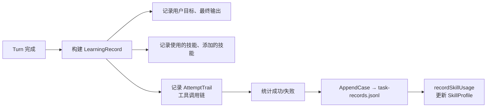
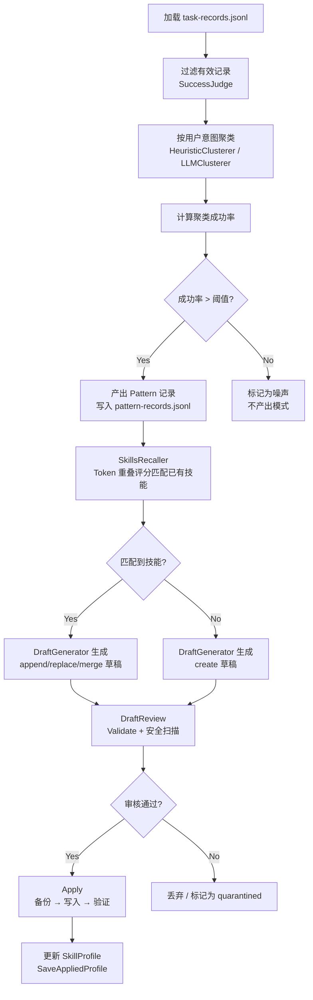

# PicoClaw 记忆子系统深度分析

> 本文是 [PicoClaw 深度架构分析](README.md)的专项补充，聚焦于**短期对话记忆**（Seahorse 引擎）、**长期记忆**（JSONL 存储）、**会话管理**（Session 分配）和**Agent 自进化系统**（Evolution）四个维度的实现细节。

## 第一部分：记忆体系总览

### 四层记忆模型

PicoClaw 将记忆拆分为四个层级，每层有不同的存储介质、生命周期和访问方式：

| 层级 | 名称 | 存储 | 生命周期 | 访问方式 |
|------|------|------|---------|---------|
| L1 | 上下文窗口 | Agent 调用时的临时组装 | 单次 LLM 调用 | Seahorse.Assemble() 预算感知组装 |
| L2 | 短期记忆 | SQLite（FTS5 索引） | 会话存续期 | Seahorse Engine CRUD + 检索工具 |
| L3 | 长期记忆 | JSONL 文件 | 持久化（跨会话） | memory.Store 接口（JSONLBackend） |
| L4 | 技能记忆 | SKILL.md 文件 | 持久化 | Evolution 自进化系统管理 |

整体数据流：

```mermaid
graph TB
    subgraph "对话层"
        MSG[用户消息] --> INGEST[Seahorse.Ingest]
    end

    subgraph "L1 上下文窗口"
        ASSEMBLE[Seahorse.Assemble<br/>预算感知组装]
        ASSEMBLE --> PROMPT[构建 LLM Prompt<br/>Messages + Summary XML]
    end

    subgraph "L2 短期记忆 SQLite"
        INGEST --> RAW[(messages 表)]
        COMPACT[Seahorse.Compact<br/>分层归纳压缩] --> LEAF[(leaf summaries)]
        COMPACT --> COND[(condensed summaries)]
        RAW --> CONTEXT[(context_items 表)]
        LEAF --> CONTEXT
        COND --> CONTEXT
        CONTEXT --> ASSEMBLE
        FTS[(FTS5 全文索引<br/>trigram tokenizer)] --> RETRIEVAL[检索工具<br/>Grep / Expand]
    end

    subgraph "L3 长期记忆 JSONL"
        SESSION_HIST[(session/{key}.jsonl)]
        SESSION_META[(session/{key}.meta.json)]
        SESSION_HIST --> BOOTSTRAP[Seahorse.Bootstrap<br/>冷启动加载]
        BOOTSTRAP --> RAW
    end

    subgraph "L4 技能记忆"
        TURNS[Agent Turn 完成] --> EVOLUTION[Evolution 热路径<br/>记录 LearningRecord]
        EVOLUTION --> CLUSTER[Evolution 冷路径<br/>模式聚类]
        CLUSTER --> DRAFT[草稿生成 → 审核 → 应用]
        DRAFT --> SKILL[(workspace/skills/{name}/SKILL.md)]
        SKILL --> AGENT[Agent 下次调用时可用]
    end

    RAW --> COMPACT
```

### 为什么需要四层记忆

传统 Agent（如 NanoBot、OpenClaw）只用简单的**滑动窗口截断**——历史消息积累到 token 上限后，直接丢弃最早的消息。问题在于：

- **信息丢失**：一次对话中的关键决策、用户偏好不会因为几十轮对话就过时
- **上下文碎片**：截断后的上下文缺少连贯性，LLM 无法理解中间事件
- **无法检索**：截断的消息彻底消失，无法回溯或搜索

PicoClaw 的解决思路：**用结构化存储替代简单截断，用分层归纳替代直接丢弃，用 FTS5 检索替代内存保留**。

---

## 第二部分：短期记忆引擎 SeaHorse

### 概述

Seahorse（`pkg/seahorse/`）是 PicoClaw 的核心记忆组件，一个基于 SQLite 的结构化短期记忆管理系统。它不是简单的"对话历史存储"，而是一个具备**分代压缩、预算感知组装、全文检索**能力的上下文管理引擎。

> **名称来源**：SeaHorse（海马体）——大脑中负责短期记忆向长期记忆转换的关键区域。暗示该引擎承担记忆编码、压缩、存储的核心功能。

### 存储模型

#### 表结构

Seahorse 使用 8 张 SQLite 表 + 2 张 FTS5 虚拟表：

```
conversations ──1:N── messages ──1:N── message_parts
     │                    │
     │                    └── M:N ── summary_messages
     │                              （摘要 → 源消息关联）
     │
     ├── 1:N ── summaries ── M:N ── summary_parents
     │         （leaf / condensed）   （摘要 DAG 边）
     │
     └── 1:N ── context_items
                （有序上下文窗口，ordinal 步长 100）
```

**核心设计决策：上下文窗口持久化在数据库里。**

传统做法是每次组装上下文时从原始消息计算，Seahorse 在每次 ingest/compact 操作后立即更新 `context_items` 表。`context_items` 中既有指向原始 messages 的条目，也有指向 summaries 的条目，统一按 `ordinal` 排序，`Assemble()` 只需扫描这张表而无需重新计算。

#### FTS5 全文搜索

使用 SQLite FTS5 的 **trigram tokenizer**（`fts5_sanitize.go`），而非标准的分词器：

```sql
CREATE VIRTUAL TABLE summaries_fts USING fts5(summary_id, content, tokenize="trigram");
CREATE VIRTUAL TABLE messages_fts USING fts5(message_id, content, tokenize="trigram");
```

Trigram 将文本拆分为三个字符一组（"hello" → "hel", "ell", "llo"），天然支持中文等 CJK 语言的无空格分词，同时避免了对特定分词器（如 jieba）的外部依赖。

FTS5 同步通过 SQL 触发器实现——insert/update/delete summaries/messages 时自动更新对应的 FTS5 表。检索结果按 BM25 排序（SQLite FTS5 内置的排名算法）。

### 分代压缩（核心创新）

Seahorse 的分代压缩机制是其区别于所有同类项目的关键创新。它受**垃圾回收的分代假说**启发——最近的消息最可能被引用，应尽量保持原始完整形态；较旧的消息可以安全地压缩为摘要。

#### 两级摘要

| 类型 | 深度 | 输入 | 目标 token | 触发时机 |
|------|------|------|-----------|---------|
| **Leaf** | 0 | 原始消息 | 1200 tokens | 每轮对话后同步执行 |
| **Condensed** | 1+ | 多个 Leaf/摘要 | 2000 tokens | token 超阈值时异步执行 |

#### 关键常量

```go
FreshTailCount    = 32   // 保护最近 32 条消息不被压缩
LeafMinFanout     = 8    // 每个 leaf 至少覆盖 8 条消息
LeafChunkTokens   = 20000 // leaf chunk 上限 token
LeafTargetTokens  = 1200  // leaf 摘要目标 token
CondensedMinFanout = 4   // 每个 condensed 至少覆盖 4 个摘要
MaxCompactIterations = 20 // 紧急压缩最大迭代次数
```

#### Leaf 压缩流程

```mermaid
flowchart TD
    A[Compact 触发] --> B{msgCount >= LeafMinFanout (8)?}
    B -- No --> C[跳过压缩]
    B -- Yes --> D[计算 freshTail 边界<br/>tailStart = len(items) - FreshTailCount (32)]
    D --> E[扫描 items[0..tailStart)<br/>找最旧连续消息块]
    E --> F[累积 tokens >= LeafChunkTokens (20000)?]
    F -- No --> G{到达非 message 条目?}
    G -- Yes, 块 >= LeafMinFanout --> H[准备压缩]
    G -- No --> C
    F -- Yes --> H
    H --> I[收集消息内容<br/>包含最近 2 个前置摘要做上下文]
    I --> J[调用 LLM 生成摘要]
    J --> K{成功?}
    K -- Yes --> L[插入 summary 记录<br/>创建 DAG 边 + 消息关联]
    K -- No, LLM 失败 --> M[降级 Level 2: 激进 prompt]
    M --> N{成功?}
    N -- Yes --> L
    N -- No --> O[降级 Level 3: 确定性截断]
    O --> P
    L --> P[ReplaceContextRangeWithSummary<br/>替换 context_items 中的消息范围]
```

**三级降级策略**（`short_compaction.go:572`）确保不因 LLM 不可用而阻塞压缩：

- **Level 1**：正常 LLM prompt，`target=min(1200, input*0.35)`，temperature=0.3
- **Level 2**：激进 LLM prompt，`target=min(640, input*0.20)`，temperature=0.3
- **Level 3**：确定性截断（取前 N 个字符作为摘要），不依赖 LLM

#### Condensed 压缩流程

Condensed 压缩在 token 总量超过上下文预算时异步启动（`runCondensedLoop`）：

1. 优先按 ordinal 顺序选择同一 depth 的连续 summaries → `selectOldestChunkAtDepth`
2. 回退按 depth 分组选择 → `selectShallowestCondensationCandidate`
3. 要求连续摘要总和 >= `CondensedMinFanout (4)`，不超过 `LeafChunkTokens (20000)`
4. 调用 LLM 合并为 condensed summary（depth = max(depth) + 1）
5. 更新 `summary_parents` DAG 边 → 新旧 summaries 形成有向无环图
6. 用 `ReplaceContextItemsWithSummary` 替换多项为一项

异步排重——使用 `condensing sync.Map` 记录正在压缩的会话 ID，防止同一会话并发触发多个 condensed 任务。

### 预算感知上下文组装

`Assemble()` 方法（`short_assembler.go:38`）是每次 LLM 调用的必经之路，负责从 SQLite 中挑选出能在 token 预算内**价值最高**的上下文：

```
输入: convID, Budget (token 预算)
输出: Messages[] + Summary XML

1. 读取 context_items 表 → 有序条目列表
2. 分割为 evictable prefix + protected fresh tail（后 32 条）
   ┌──────────────────────────────────────────────────┐
   │ evictable (可丢弃)    │   fresh tail (受保护)    │
   │   leaf1  leaf2 leaf3  │   msg93 ... msg124       │
   └───────────────────────┴──────────────────────────┘
   ←──────────── 可压缩/丢弃 ─────────→  ←── 保留原始形态 ──→

3. 如果 fresh tail 本身超预算 → trimFreshTailToSafeBudget()
   优先保留最新完整的 active turn（user→assistant 循环）
   切割到 provider-safe 边界（避免在 tool_use/tool_result 中间截断）

4. 计算剩余 budget: remaining = Budget - freshTailTokens

5. 从最新到最旧遍历 evictable：
   - 保留能放入 remaining 的条目
   - 优先保留 summaries（信息密度更高）

6. 组装 Messages[] + 生成 depth-aware Summary XML
```

**Depth-aware system prompt**——根据摘要的压缩深度生成不同级别的 system prompt：

```xml
<memory_summary>
  <summary depth="2">
    <!-- 高度压缩的记忆 → 提示 LLM 不要断言未经展开的具体事实 -->
    用户要求开发一个 REST API，涉及用户认证、项目管理和文件上传三个模块。
    ...
  </summary>
  <summary depth="0">
    <!-- 轻度压缩 → 提示 LLM 可以使用 expand 工具获取更多细节 -->
    用户反馈上传功能在 Chrome 浏览器上出现 CORS 错误。
  </summary>
</memory_summary>
```

### 检索工具

Seahorse 提供两个 LLM 可调用的检索工具（`tool_grep.go` + `tool_expand.go`）：

**GrepTool** — 关键词全文检索：

```
action: grep("pattern"="CORS error", "scope"="both", "last"="7d")
→ 匹配 summaries 和 messages 中包含 "CORS error" 的记录
→ 返回带 BM25 排名的摘要/片段列表
```

**ExpandTool** — 展开摘要详情：

```
action: expand("summary_id"="sum_xxx")
→ 返回该摘要的完整内容 + 源消息的原始 text
→ 用于在需要精确细节时从压缩态展开回全量
```

### ContextManager 适配

`pkg/agent/context_seahorse.go` 将 Seahorse Engine 封装为 Agent 使用的 `ContextManager` 接口：

```go
type ContextManager interface {
    Assemble(ctx, req *AssembleRequest) (*AssembleResponse, error)
    Ingest(ctx, req *IngestRequest) error
    Compact(ctx, req *CompactRequest) error
    Clear(ctx, sessionKey) error
}
```

**注册机制**——通过 `init()` 函数和构建标签实现条件编译：

```go
//go:build !mipsle && !netbsd && !(freebsd && arm)
func init() {
    RegisterContextManager("seahorse", newSeahorseContextManager)
}
```

某些低端架构（MIPS、NetBSD）不包含 Seahorse，而是回退到简单的 legacy ContextManager。

### 性能设计

| 特性 | 实现 |
|------|------|
| **Session 锁分片** | 256 个分片锁，FNV-1a 32-bit hash 映射 |
| **压缩隔离** | `compactionMu` 单会话互斥 + `condensing sync.Map` 全局排重 |
| **WAL 模式** | SQLite PRAGMA journal_mode=WAL，读写不阻塞 |
| **异步压缩** | Condensed 在后台 goroutine 执行，不阻塞主对话流程 |
| **迭代退避** | CompactUntilUnder 最大 20 次迭代，无进度时提前退出 |

---

## 第三部分：长期记忆系统

### JSONL 存储

`pkg/memory/jsonl.go` 实现了基于文件的长期记忆存储，每个 session 对应两个文件：

```
~/.picoclaw/workspace/sessions/
├── sk_v1_abc123def456.jsonl        # 消息记录（追加写入）
└── sk_v1_abc123def456.meta.json    # 元数据（原子写入）
```

**JSONL 格式**——每行一条 JSON 格式的 `providers.Message`，追加写入，天然适合日志式数据。

**SessionMeta 结构：**

```go
type SessionMeta struct {
    Key       string           // session key
    Summary   string           // 会话摘要
    Skip      int              // 逻辑截断偏移量（跳过前 N 行）
    Count     int              // 总行数
    Scope     json.RawMessage  // 会话作用域
    Aliases   []string         // 旧格式别名
}
```

### 逻辑截断 vs 物理截断

**关键设计决策**：截断历史时不做物理删除，只更新 `meta.json` 中的 `Skip` 偏移量。

```
截断前:
  jsonl: [msg1] [msg2] [msg3] [msg4] [msg5]
  meta:  {skip: 0, count: 5}

TruncateHistory(keepLast=3):
  jsonl: [msg1] [msg2] [msg3] [msg4] [msg5]  ← 文件不变！
  meta:  {skip: 2, count: 5}                  ← 只更新偏移

读历史时 readMessages() 从行 2 开始读:
  → msg3, msg4, msg5
```

优势：
- **写前崩溃安全**：即使截断操作中途崩溃，原始数据完整无损
- **性能好**：截断操作只有一次 meta.json 的原子写入（~1KB）
- **可恢复**：理论上 `Skip` 可以回退

代价：
- **文件只会增长**：JSONL 文件永不缩小
- **Compact() 物理回收**：先写 meta(Skip=0)，再重写 JSONL，崩溃时保留旧数据

### 冷启动恢复

当 Agent 处理一个已有历史的 Session 时，Seahorse 通过 `Bootstrap()` 从 JSONL 加载历史：

```
1. Agent 启动，收到某个 Session 的消息
2. ContextManager.Assemble() 调用 Seahorse Engine
3. Seahorse 发现该 Session 在 SQLite 中无上下文
4. 调用 Bootstrap 从 JSONL 文件读取历史
5. Ingest 到 SQLite（创建 conversation + messages + context_items）
6. 正常调用 Assemble() 组装上下文
```

---

## 第四部分：会话管理

### SessionKey 体系

PicoClaw 有两代 SessionKey，当前使用不透明的 `sk_v1_` 格式：

```go
// 新格式（v1）
sk_v1_{SHA256(canonicalScope)}  → "sk_v1_a1b2c3d4e5f6..."

// 旧格式（legacy）
agent:{agentID}:main            → "agent:my-agent:main"
agent:{agentID}:direct:{peerID} → "agent:my-agent:direct:user_123"
```

**规范化签名**（`key.go`）：

```
"v=1|agent=my-agent|channel=telegram|account=bot_main|chat=group:123"
```

### 会话维度

通过 `routing.SessionPolicy.Dimensions` 配置，会话可以按以下维度隔离：

| 维度 | 说明 | 典型 SessionKey 效果 |
|------|------|-------------------|
| `space` | 按空间隔离 | 不同空间互不影响历史 |
| `chat` | 按聊天隔离 | 群聊和私聊分开 |
| `topic` | 按话题隔离 | 群聊中不同话题分离（Telegram Topic） |
| `sender` | 按发送者隔离 | 每个用户独立记忆 |

例如 `dimensions: ["space", "chat"]` 会产生：
- 群聊 `group:123` + 空间 `space:default` → 独立 Session
- 私聊 `private:user_456` + 同上空间 → 独立 Session

### Scope 分配

```mermaid
flowchart LR
    A[入站消息] --> B[RouteResolver.ResolveRoute]
    B --> C[匹配 DispatchRule]
    C --> D[获取目标 AgentConfig]
    D --> E[构建 SessionScope<br/>根据 Dimensions]
    E --> F[BuildSessionKey<br/>SHA256(canonical signature)]
    F --> G{Seahorse 已有此会话?}
    G -- Yes --> H[继续对话]
    G -- No --> I[Bootstrap 从 JSONL 加载历史]
    I --> J[Ingest 到 SQLite]
    J --> H
```

---

## 第五部分：Agent 自进化系统（Evolution）

### 概述

Evolution 是 PicoClaw 最独特也最复杂的子系统。它从 Agent 的实际对话中学习模式，自动生成和优化 SKILL.md 文件，使 Agent 能根据历史交互不断改进自己的行为。

> **核心循环**：完成任务 → 记录 → 聚类模式 → 生成草稿 → 审核 → 应用 → 下次可用

### 存储结构

```
{workspace}/state/evolution/
├── task-records.jsonl       # 热路径：每次 turn 完成后的学习记录
├── pattern-records.jsonl    # 冷路径：聚类后产出的模式记录
├── drafts/                  # 草稿
│   └── {draftID}.json
├── skill-profiles/          # 技能生命周期档案
│   └── {skillName}.json
└── backups/                 # 回滚备份
    └── {skillName}/{timestamp}.md
```

### 热路径：记录每次交互

每次 turn 完成后，`Runtime.FinalizeTurn()` 被调用：



### 冷路径：模式聚类

按固定间隔（或空闲时）执行 `RunColdPathOnce()`：



**两种聚类器**（`pattern_clusterer.go`）：

| 类型 | 方法 | 优势 | 劣势 |
|------|------|------|------|
| **Heuristic** | 从前 5 个 token 提取 label，按 token 重叠聚类 | 无外部依赖，速度快 | 准确度有限 |
| **LLM** | 调用 LLM 分析并输出结构化的 JSON clusters | 准确度高，语义理解 | 依赖 LLM 可用性，失败时回退到 Heuristic |

### 草稿生命周期

| 状态 | 说明 |
|------|------|
| `candidate` | 草稿生成后初始状态，准备审核 |
| `quarantined` | 审核未通过（安全扫描发现危险内容或验证失败） |
| `accepted` | 审核通过，应用到 SKILL.md |

### 技能生命周期

Evolution 维护每个技能的 `SkillProfile`：

| 状态 | 触发条件 | 行为 |
|------|---------|------|
| `active` | 默认 | 正常使用 |
| `cold` | 90 天未使用 | 标记为冷技能，不再主动推荐 |
| `archived` | 180 天未使用 | 归档到 `{workspace}/skills-archive/` |
| `deleted` | 365 天未使用 | 永久删除 |

### 安全防护

`DraftReview.ValidateDraft()` + `scanDraftContent()` 执行：

- **密钥泄露检测**：扫描草稿正文是否包含常见 API Key 模式
- **路径遍历检测**：检测是否包含 `../`、`~` 等危险路径
- **格式验证**：检测 frontmatter（name/description）是否完整

---

## 第六部分：串联分析——一次完整对话的记忆生命周期

以用户第一次发送消息到进行第 50 轮对话为例：

```
第 1-3 轮（新鲜会话）:
  Ingest→SQLite → 正常 messages
  Assemble → 无需摘要，全部原始消息

第 4-10 轮（token 增长）:
  Compact → 发现 msgCount > 8 → leaf 压缩开始
  context_items 中最早的消息被 leaf summary 替换
  Assemble → 最后 32 条原始消息 + 1 个 leaf summary

第 10-30 轮（稳定阶段）:
  多轮 leaf 压缩 → 多个 leaf summaries
  condensed 尚不缺启动条件（每次压缩后释放了 budget）
  每次 Assemble: freshTail 32 条消息 + 前序 leaf summaries

第 30-50 轮（深度压缩）:
  token 总量接近 budget → condensed 异步触发
  leaf summaries 被合并为 condensed depth=1
  更早的部分 depth=1 摘要继续合并为 depth=2...
  分代压缩树继续生长

                                                     depth
  condensed ─── condensed ───── condensed             2+
      │            │                │
   leaf    leaf  leaf  leaf    leaf                    1
      │      │   │      │       │
  msg[0-8] msg[9-16] ... msg[30-37] msg[38-45]        0
  ──────────────────────────────────────────────
  ↑            evictable            ↑  freshTail (32) ↑
  (浓缩为 depth=2 摘要)             (保持原始消息)

  Assemble 输出:
    Messages: [condensed(depth=2), leaf, leaf, msg38, msg39, ..., msg50]
    Summary XML: <memory_summary>
      <summary depth="2">早期关于项目架构的讨论...</summary>
      <summary depth="0">最近关于日志格式的讨论...</summary>
    </memory_summary>

第 50 轮后（结束对话）:
  FinalizeTurn → 写入 task-records.jsonl（热路径）
  Evolution 冷路径周期触发 → 聚类 task records → 若发现重复模式：
    "用户经常询问如何配置 Telegram 通道" → 生成 skill 草稿
    审核通过 → 写入 SKILL.md → 下次 Agent 自动拥有此技能
```

---

## 第七部分：设计要点总结

### 与同类项目的对比

| 维度 | PicoClaw (Seahorse) | NanoBot | Leros | OpenBee |
|------|-------------------|---------|-------|---------|
| **短期记忆** | SQLite 分层归纳 + FTS5 | 截断 | 截断 | 截断 |
| **长期记忆** | JSONL 逻辑截断 | 截断 | 截断 | 截断 |
| **上下文压缩算法** | 分代压缩（Leaf→Condensed） | 无 | 无 | 无 |
| **摘要触发** | 异步 + 同步双模式 | 无 | 无 | 无 |
| **摘要降级策略** | 三级（LLM→激进LLM→截断） | 无 | 无 | 无 |
| **全文检索** | FTS5 trigram | 无 | 无 | 无 |
| **上下文组装** | 预算感知 + FreshTail 保护 | 滑动窗口 | 滑动窗口 | 滑动窗口 |
| **Session 体系** | 多维度 + 别名兼容 | 无 | 多租户项目 | 独立 |
| **自进化** | 模式聚类 → 技能草稿 → 应用 | 无 | 无 | 无 |
| **记忆迁移** | JSON→JSONL 迁移工具 | 无 | 无 | 无 |

### 值得借鉴的设计

1. **SQLite 作为短期记忆核心**——规避了 Go 生态中缺少成熟嵌入式 kv 的问题，利用 SQLite 的事务能力、FTS5 全文索引、纯 Go CGo-free 驱动，一举多得
2. **分代压缩假说**——借鉴 GC 设计思想到对话记忆管理，消息分代（fresh/leaf/condensed），频率和预算决定压缩策略
3. **context_items 持久化**——避免每次组装上下文时的全表扫描，压缩操作增量更新 context_items
4. **三级降级策略**——确保 LLM 不可用时记忆压缩不阻塞，从 LLM 到确定性截断逐步降级
5. **逻辑截断**——JSONL 的写前安全、截断不删数据的设计，生产环境可靠性好
6. **Conditions 构建标签**——Seahorse 在不支持的架构上自动禁用，回退到简单实现，保持了跨平台兼容性
