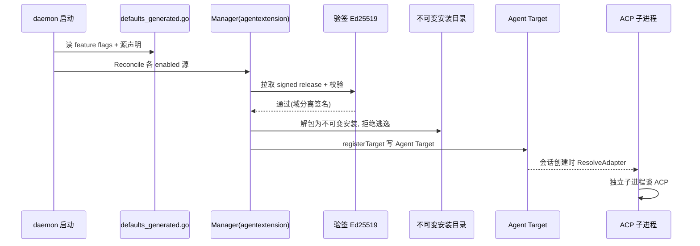

# Agent Extension：第三方 ACP 智能体的接入

> 本解读按 **agent 类型规格** 产出。
> 关注面：Tutti 如何让第三方 agent（Hermes、gemini、groq、kimi-code、codbuddy 等）作为一等公民接入，而不必把每个 provider 硬编码进主仓。对应 agent 类型规格里的"Skill/扩展体系 / Runtime / 通信机制"。

## 定位与根因

Tutti 内置了 Codex / Claude Code / Cursor / OpenClaw / Tutti-Agent 等 provider，但它们都是**编译期注册**的（写进 provider descriptor）。问题来了：第三方 agent 即使已经实现了 ACP（Agent Client Protocol），要接进来也得改主仓的 provider descriptor、OpenAPI 枚举、runtime adapter、图标、i18n——成本高、不可扩展。

Agent Extension 的解法是：**让第三方在独立仓库开发并发布一个"纯声明式扩展包"**，Tutti 主仓只登记扩展的 key、release index URL、功能开关、签名身份即可。

## 核心约束：扩展包"零代码"

扩展包是**纯声明式数据**：manifest + discovery/tool/capability/composer/auth 配置文件 + locale + 静态资源，**绝不携带可执行代码**——这是刻意为之的边界。Tutti 自己不动态加载 JS/React/Go plugin。真正的可执行运行时是 manifest 声明的 `install`/`launch` argv（如 `npm install @google/gemini-cli@0.50.0` 起一个独立进程），而**不是被 daemon 加载进内存的插件**。

**信任分发**：配置源声明在 `config/tutti.defaults.json`，生成到 `types/defaults_generated.go`，对每个支持的第三方钉住签名 URL 与 Ed25519 公钥。安装为**不可变**数据，存 `<state>/agent/extensions/<agentKey>/<version>/`，每次加载重验 Ed25519 + 摘要 + 内容指纹。

## 接入链路：从声明到能干活

[services/tuttid/types/defaults_generated.go:78]() 登记 `"hermes"` 扩展源（含 versions.json URL + 签名公钥）。
<!-- snippet: 				Key:                      "hermes", -->

关键步骤：

1. **源声明**：`defaults_generated.go` 登记扩展 key + release index URL + 签名公钥。
2. **daemon reconcile**：`manager.go:80-93` 的 `Reconcile` 读 feature flags，对 enabled 源拉取并校验签名 release。
3. **验证安装**：解包为不可变安装，拒绝路径穿越/符号链接/可执行文件/尺寸超限，写 `<state>/agent/extensions/<agentKey>/<version>/`。
4. **注册 Agent Target**：`registerTarget`（manager.go:498）写含 `agent_extension` launch ref 的 Target，图标以 data URL 内联。这样 renderer 无需为每个扩展加分支。
5. **运行时解析**：会话创建时，[services/tuttid/service/agentextension/runtime_resolver.go:46-48]() 要求 launch ref 必须是 `agent_extension`，否则拒绝；然后生成**标准的 ACP 适配器**。
<!-- snippet: 	if kind, _ := input.ProviderTargetRef["kind"].(string); kind != "agent_extension" {
		return nil, fmt.Errorf("dynamic provider %q requires an agent_extension target", input.Provider)
	} -->

[services/tuttid/service/agentextension/runtime_resolver.go:64-66]() 统一走 `NewStandardACPAdapter`，把任何第三方都收编为标准 ACP stdio 适配器：
<!-- snippet: func newRuntimeAdapter(binding RuntimeBinding, agentTargetID string, transport agentruntime.ProcessTransport, host agentruntime.HostMetadata) (agentruntime.Adapter, error) {
	return agentruntime.NewStandardACPAdapter(runtimeAdapterConfig(binding, agentTargetID), transport, host)
} -->

## 内建 vs 扩展

| 维度 | 内建 provider | Agent Extension |
|------|-----------|----------------|
| 注册方式 | 编译期写死 provider descriptor | 运行时从扩展包加载声明 |
| ACP 适配 | Codex 走专属 codex app-server；Claude Code/Cursor/OpenClaw 走标准 ACP | 一律标准 ACP stdio |
| 运行时清单 | 内置 | manifest 的 `install`/`launch` argv（独立进程） |
| 接入成本 | 作者硬编码 | 第三方独立仓库发布扩展包 |

界面上，扩展最终**落成一个普通 Agent Target**，renderer 看到的就是一个可选的 agent——用户无需区分内建还是扩展。

## 安全设计要点

- **零代码原则**：扩展包不带可执行代码，杜绝"上传一个即执行插件"的供应链风险。
- **签名 + 不可变安装 + 重验**：每次加载重验 Ed25519 + 摘要 + 内容指纹，防篡改。
- **launch 用 argv 而非 shell**：权限模式等以 argv 元素替换，绝不走 shell，避免注入。
- **密钥独立配置**：keyring 从 `TUTTI_CONNECTOR_MARKET_SIGNING_KEYRING_JSON` 类独立配置读取，可撤销。

## 可借鉴的设计

- **"声明式扩展包 + 独立运行时"**：平台不加载第三方代码，而是把 manifest 描述为"起哪个外部进程"，把扩展从"插件注入"降级为"协议适配"——这是安全与可扩展性之间最实用的折中。
- **把扩展抽象成与内建同构的 Target**：统一抽象，renderer/编排层完全不知道也不关心是内建还是扩展。
- **域分离签名 + 独立 keyring**：目录更新可吊销、防跨域重放。
