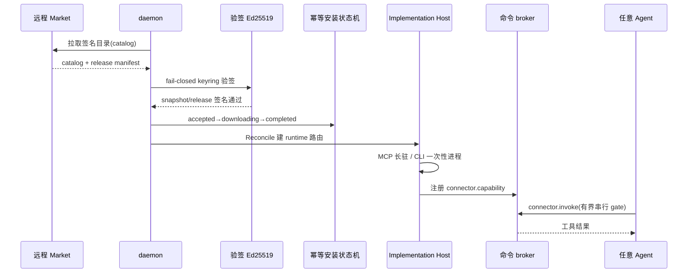

# Connector：连接器市场与外部能力接入

> 本解读按 **agent 类型规格** 产出。
> 关注面：Tutti 如何把"外部能力"（命令行 CLI / MCP server）接进 daemon，变成可以被任意 agent 调用的统一 capability。这是 README 自述 "Tutti's own app ecosystem" 之外的横向能力接入层。

## 定位：连接器 ≠ Agent 扩展

Tutti 有两条"接第三方"的机制，容易混淆：

- **Connector**：把某公司/产品的 **CLI 或 MCP server** 变成 daemon 管理的子进程，暴露为统一能力。接入的是"能力"。
- **Agent Extension**：把第三方 **ACP agent** 接入（见 `agent-extensions.md`）。接入的是"智能体"。

本文件讲 Connector。它对应 agent 类型规格里的"MCP / 外部能力接入"关注面。

## 双 API 架构

`connector-market.md` 明确分离远程与本地：

- **远程 Connector Market API**：发布 release、manifest、不可变 artifact 元数据。
- **本地 daemon API**：接收目录（accepted catalog）、安装、授权、兼容性、持久操作状态。

关键设计：**renderer 永不直接调远程市场**，本地 daemon 是 renderer 状态的唯一权威。

## 安全模型：fail-closed 验签

目录接受对**每个 daemon fail-closed**。签名 keyring 走 `TUTTI_CONNECTOR_MARKET_SIGNING_KEYRING_JSON`，用 `Ed25519-SHA256` 域分离快照与 release 签名验签。

[docs/architecture/connector-market.md:23-24]()：目录接受的独立性 + Ed25519-SHA256 域分离验签，是"哪些连接器可信"的唯一闸门。
<!-- snippet: Catalog acceptance is independently fail-closed in each daemon. Tutti reads a
versioned JSON keyring -->

## artifact 安装与运行时

### 连接器从安装到被 Agent 使用的路径

安装状态机为幂等：`accepted → downloading → prepared → activating → completed/failed`，至少一次执行、按 operation+release 幂等。

[docs/architecture/connector-market.md:212-212]() 的安装状态机保证下载/解包安全（无 tar 逃逸、尺寸比限制）。
<!-- snippet: accepted -> downloading -> prepared -> activating -> completed -->

**runtime 分两类**：

- **MCP server**：长驻子进程，经 `mcpservice.NewStdioClient` 起进程，发 `initialize`/`notifications/initialized`、`tools/list` 巡列工具，每个工具变成一个 `connector.<key>.mcp.<tool>` capability。
- **CLI**：每次调用起一次性进程；无 `commands` 映射时生成通用 `connector.<key>.cli.run` capability，参数由 Skill 提供。

通用 CLI 参数会做恶意参数拦截：

[services/tuttid/service/connectormarket/implementation_host.go:468-471]() 拒绝 `--yes`/`--force` 非交互覆盖（含 `\x00`），防止不受控的命令自动确认：
<!-- snippet-base64:CQlpZiBzdHJpbmdzLkNvbnRhaW5zUnVuZShhcmd1bWVudCwgJ1x4MDAnKSB8fCBhcmd1bWVudCA9PSAiLS15ZXMiIHx8IGFyZ3VtZW50ID09ICItLWZvcmNlIiB8fAoJCQlzdHJpbmdzLkhhc1ByZWZpeChhcmd1bWVudCwgIi0teWVzPSIpIHx8IHN0cmluZ3MuSGFzUHJlZml4KGFyZ3VtZW50LCAiLS1mb3JjZT0iKSB7CgkJCXJldHVybiBuaWwsIGVycm9ycy5OZXcoImNvbm5lY3RvciBDTEkgYXJncyBjb250YWluIGEgZm9yYmlkZGVuIG5vbi1pbnRlcmFjdGl2ZSBvdmVycmlkZSIpCgkJfQo= -->

## Agent 如何用连接器

连接器变成 daemon CLI capability，**对每个 Agent 和本地 Tutti CLI 可用**。`broker.go` 暴露 4 个命令：

[services/tuttid/service/connectormarket/broker.go:18-21]() 定义连接器能力面的 4 个命令：`connector.available`/`connector.skills`/`connector.skill.read`/`connector.invoke`：
<!-- snippet: 	connectorAvailableCommandID = "connector.available"
	connectorSkillsCommandID    = "connector.skills"
	connectorSkillReadCommandID = "connector.skill.read"
	connectorInvokeCommandID    = "connector.invoke" -->

调用有**有界串行 admission gate**：[services/tuttid/service/connectormarket/broker.go:36]() 定义 `connectorInvocationQueueLimit = 16`，满则返回 "Connector invocation queue is full"。
<!-- snippet: const connectorInvocationQueueLimit = 16 -->

[services/tuttid/service/connectormarket/broker.go:159-162]() 排队满时的显式拒绝，用 ServiceUnavailableError 立即可反馈：
<!-- snippet: 	if gate.waiters >= connectorInvocationQueueLimit {
		gate.mu.Unlock()
		return nil, cliservice.ServiceUnavailableError("Connector invocation queue is full", nil)
	} -->

**Skill 是"怎么用"的知识载体**：连接器 manifest 声明 `skills`（指向 `./dir/SKILL.md`），Skill frontmatter 需 name/description/一级标题；installed Skill 提供 CLI 参数与工作流，让 agent 知道"这个连接器怎么使"。

## 兼容性边界故意收窄

[docs/architecture/connector-market.md:342-343]() 只放行 `managed_stdio` + `authorizationKind=none` + 受支持平台。当前**无 credential broker**，需要凭据的连接器只可见不可装——这是把最难的凭据安全部分先排除在首版之外，换取安全可审查的接入面。
<!-- snippet: `managed_stdio`, authorization kind `none`, and platforms with the production
connector sandbox are installable. -->

## 可借鉴的设计

- **双 API 分离 + 本地 daemon 权威**：远程目录只管发布，所有状态/授权在本地 daemon fail-closed——避免 renderer 被远程内容反制。
- **Ed25519-SHA256 域分离签名**：keyring 独立配置，目录更新可吊销，签名域分离防跨域重放。
- **幂等安装状态机**：至少一次 + 按 operation×release 幂等，支撑崩溃恢复。
- **能力命名空间 + 有界 admission gate**：`connector.<key>.<kind>.<tool>` 的层级命名 + 有界串行队列，让治理和限流都简单可审计。
- **默认拒绝的边界**：明确"只接 managed_stdio + 无凭据 + 受支持平台"，把复杂安全面排除在首版外。
