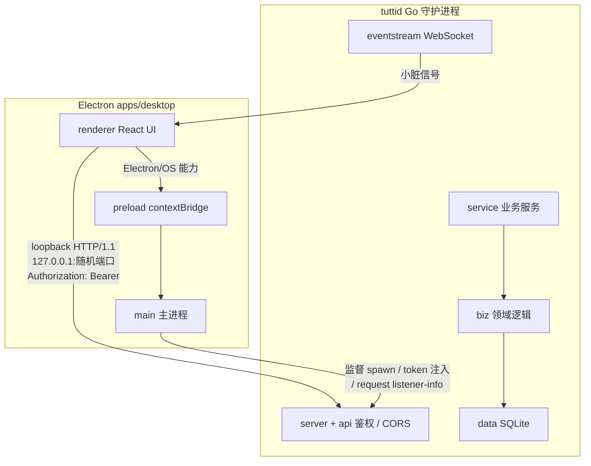

# 传输与安全边界：loopback 守门

> 本解读按 **agent 类型规格** 产出。
> 关注面：Electron 前端与 Go 守护进程之间如何通信、如何鉴权、可信边界怎么设计。这决定了一个本地多 agent 平台的安全底座。

## 总体架构：单一业务权威 + 多宿主通道

设计铁律：**`tuttid` 是唯一业务层**，桌面端只是宿主。文档声明 "`tuttid` is the only business layer in the local product"（[docs/architecture/desktop-transport.md:12]()）。所有业务状态、权威、持久化都在 daemon，Electron 壳层禁止承担业务逻辑。

## 双路径访问模型

不再把 main 当通用业务代理（relay），而是允许 renderer **直连 daemon**：

| 路径 | 用途 |
|------|------|
| `renderer → tuttid` | 业务能力 + 流式传输（WebSocket/SSE） |
| `renderer → preload → main` | 仅 Electron/OS 能力 |
| `renderer → main → tuttid` | 主进程辅助的复合流（极少数） |

设计权衡：放弃把 main 当业务中转，换取 renderer 能直接消费 WebSocket 流式能力。目标不是让 main 无关紧要，而是**停止把它当作大范围业务传输中继**。

## 通信协议：托管回环 HTTP/1.1 + 随机端口

默认绑定 `127.0.0.1:0`（随机端口），而非固定 public 端口。[apps/desktop/src/main/transport/paths.ts:21]() 的默认请求地址表明：地址优先随机环回口。
<!-- snippet:   const requestedAddr = process.env.TUTTID_ADDR?.trim() || "127.0.0.1:0"; -->
<!-- snippet:   const requestedAddr = process.env.TUTTID_ADDR?.trim() || "127.0.0.1:0"; -->

**刻意选 HTTP/1.1 而非 HTTP/2**：Chromium 的流式上传只走 HTTP/2/QUIC，而托管守护进程只服务 HTTP/1.1，所以 renderer 的 fetch wrapper 要"物化"body 预序列化。

## 端点握手：listener-info 文件

守护进程**不固定端口、不硬编码 token**，而是把实际绑定地址和每次运行的 bearer token 写进 `<state-dir>/run/tuttid.listener.json`，`0600` 权限、临时文件 + `os.Rename` 原子发布。

[services/tuttid/server/listenerinfo.go:13-17]() 定义 listener-info 结构：版本 / addr / auth(scheme=bearer 的 token)。
<!-- snippet: type listenerInfo struct {
	Version int              `json:"version"`
	Addr    string           `json:"addr"`
	Auth    listenerInfoAuth `json:"auth"`
} -->

desktop main 侧轮询该文件拿到实际 `boundAddr`，CLI 用户级入口也直接读它带 token 访问 daemon。

## 鉴权：per-run 随机 bearer token

- **签发**：[apps/desktop/src/main/transport/paths.ts:24]() 每次启动 `randomBytes(32).toString("base64url")` 生成随机 token。
  <!-- snippet:     accessToken: randomBytes(32).toString("base64url"), -->
- **下发**：desktop 把它作为 `TUTTID_ACCESS_TOKEN` 注入守护进程环境 + 写进 listener-info。
- **校验**：所有 HTTP/WS 请求过统一全局中间件，`Authorization: Bearer`，用 `subtle.ConstantTimeCompare` 恒定时间比较。

[services/tuttid/types/httputil.go:78-82]() 的全局鉴权：从 header 取 token，WS 升级时也从 query 取，用恒定时间比较防时序侧信道：
<!-- snippet: 		token, ok := bearerTokenFromHeader(r.Header.Get("Authorization"))
		if !ok && isWebSocketUpgrade(r) {
			token, ok = bearerTokenFromQuery(r)
		}
		authorized := ok && expectedToken != "" && subtle.ConstantTimeCompare([]byte(token), []byte(expectedToken)) == 1 -->

**WS 特例**：WebSocket 升级请求从 `?access_token=` query 取（因为浏览器 WebSocket API 不能设自定义头），见 [services/tuttid/types/httputil.go:130]()。

**非桌面启动必须显式提供 token**：`ListenerSpecFromEnv` 要求 `TUTTID_ACCESS_TOKEN` 否则报错；desktop 管理启动则自动生成注入。

## 二次授权：workspace app 受限 token

对 `/v1/workspaces/{ws}/apps/{app}/...` 子集路由，用 `AppServerToken(accessToken, workspaceID, appID)` 派生**按 workspace×app 受限** token，仍恒定时间比较（[services/tuttid/server/server.go:43-44]()）。这是对外部 app 面更窄的授权（详见 [`app-ecosystem.md`](app-ecosystem.md)）。
<!-- snippet: func authorizeWorkspaceAppServerToken(r *http.Request, token string, accessToken string) bool {
	segments := strings.Split(strings.Trim(r.URL.Path, "/"), "/") -->

## CORS：镜像而非隔离

`httputil.go` 的 `WithCORS` mirror 任意 Origin 并 `Allow-Credentials: true`。设计意图是"renderer 用标准 fetch，所以保留浏览器 CORS 行为"。**安全不靠 CORS，靠 loopback 绑定 + bearer token**。

## Electron 安全模型

- 主窗口：`contextIsolation: true`、`nodeIntegration: false`、`webviewTag: true`（`workspaceWindow.ts:162-169`）；其他窗口更严格 `sandbox: true`。
- **preload 刻意不用通用 `invoke(channel, payload)`**，而是暴露窄、全类型化的 `contextBridge.exposeInMainWorld("tutti", ...)` API，channel 有强类型映射表。
- **webview 隔离**：`installBrowserWebviewSecurity` 做 partition 白名单管控 + `setWindowOpenHandler` 拦截新窗口。
- 可信边界守则：只绑 loopback、随机端口、显式鉴权材料、把不可信 content 挡在 daemon 路径外、preload 表面保持窄。

## 事件流：signal-and-reconcile

WebSocket 只发**小脏信号**（如 `agent.activity.updated`），**不充当权威查询模型**；renderer 收到信号后通过常规 HTTP API 重新对账（`afterVersion` 增量读）。断线重连需重载 workspace/session 状态。

这是本项目最优雅的一致性问题解法：**事件是"脏了我"的提示，不是真值；真值永远在 SQLite，回 HTTP 读**。既拿到实时性，又不被事件乱序/重放污染状态。

## 可借鉴的设计

- **随机端口 + listener-info 文件握手**：无固定端口扫描面，token/地址随每次运行变化再原子发布，比固定端口 + 写死密码安全得多。
- **恒定时间比较 + loopback-only**：本地服务鉴权的最小充分集——不引证书、不引 OAuth，依赖"只有本机用户能碰 + 随机 token"。
- **双路径 + signal-and-reconcile**：renderer 直连拿流式能力，但状态权威始终回 HTTP 对账——实时性与一致性兼得。
- **窄类型化 contextBridge**：禁止通用 invoke 面是 Electron 安全的关键纪律，值得所有桌面应用借鉴。
