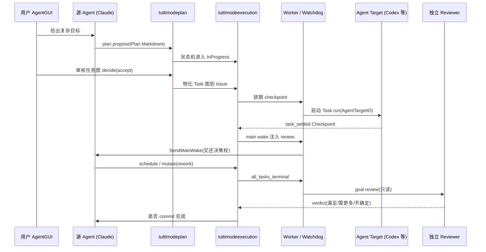

# Tutti Mode：多 Agent 编排与任务治理

> 本解读按 **agent 类型规格** 产出。
> 关注面：把一个复杂用户目标如何分派给多个 provider 的 agent、中间如何暂停人工/独立审核、如何防止多 Agent 写冲突。

## 设计哲学：以 SQLite 为真值、以 Checkpoint 为节拍的中心化仲裁

Tutti Mode 不是"一个服务"，而是**一条完全持久化在 SQLite 里的 Saga 流水线**，把"用户复杂目标"翻译成可以被不同 provider 的 agent（Claude / Codex / Hermes / acp:gemini…）执行的任务，并在每个决策点停下来做人审或独立审核。

它最本质的设计取舍，与普通"任务队列/DAG 引擎"相反：**任务图在执行时不是自推进的**。执行到 Checkpoint 就停住，把"下一步该让哪个 target 干活、要不要改图、要不要收工"的决策权交还给**源 agent**——而不是按拓扑自动往下放。

## 四层闭环

- **激活层 `tuttimodeactivation`**：模式是挂在 Agent Session 上的独立持久开关，不依赖 provider 协作状态推断。`Set` 带乐观并发 revision 冲突检测，且**每个 Turn 绑定激活快照**（first-write-wins），用户在 Turn 中途改徽章不会让已运行 Turn 语义漂移。

  [services/tuttid/service/tuttimodeactivation/service.go:198-199]() 注释写明 "BindTurnSnapshot is first-write-wins. A repeated call returns the original snapshot so retry races cannot rewrite the semantic input of a turn."（绑定快照是"先写者胜"，重复调用返回原快照，重试竞赛不会改写一个 Turn 的语义输入）。
  <!-- snippet: // BindTurnSnapshot is first-write-wins. A repeated call returns the original
// snapshot so retry races cannot rewrite the semantic input of a turn. -->
- **规划层 `tuttimodeplan`**：目标转成 immutable 的 Markdown `PlanDocument`（frontmatter 含 `Execution`/`Budget`/`Review`/`Tasks`）。`Workflow`/`PlanRevision`（SHA-256 校验，immutable）+ `WorkflowCheckpoint` 支撑多次 `Revise`。

  用户在 task-review checkpoint 上的决断由 `decisionTransition` 映射成明确的下一个动作（采纳→`NextActionCreateIssue` / 拒绝→`NextActionReviseTaskGraph`）。[services/tuttid/service/tuttimodeplan/transitions.go:90-96]() 中，Tutti Mode 的 task-review 采纳/拒绝分别落到 CreateIssue 与 ReviseTaskGraph，保证了"审核动作有唯一语义出口"。
  <!-- snippet: 	case workflowbiz.CheckpointKindTaskReview:
		switch decision {
		case workflowbiz.CheckpointStatusAccepted:
			return NextActionCreateIssue, workflowbiz.WorkflowStatusAccepted, workflowbiz.OperationKindCreateIssue, nil
		case workflowbiz.CheckpointStatusRejected:
			return NextActionReviseTaskGraph, workflowbiz.WorkflowStatusInProgress, workflowbiz.OperationKindCreateRevision, nil
		} -->
- **物化 + 执行层 `tuttimodeexecution`**：接受的 Plan revision 经 `issue_materializer.go` 物化成 Workspace Issue 的 Task（保留 `AgentTargetID`/`ModelPlanID`/`Model`/`ExecutionDirectory`/`DependencyTaskIDs`/`Parallelizable`/`AutoAccept`）。

  [services/tuttid/biz/tuttimodeexecution/model.go:87-92]()：Execution 在 `awaiting_schedule → running → awaiting_main → pending_goal_review → completed`（或 `orphaned_source`）之间流转，`pending_goal_review` 是"全部任务终态后等待独立审核"的专门状态。
  <!-- snippet: 	StatusAwaitingSchedule  Status = "awaiting_schedule"
	StatusRunning           Status = "running"
	StatusAwaitingMain      Status = "awaiting_main"
	StatusPendingGoalReview Status = "pending_goal_review"
	StatusOrphanedSource    Status = "orphaned_source"
	StatusCompleted         Status = "completed" -->

- **编排节拍 = Checkpoint**：[services/tuttid/biz/tuttimodeexecution/model.go:131-136]() 定义了一组 Checkpoint 类型：`initial_schedule`/`task_settled`/`task_failed`/`task_canceled`/`watchdog`/`all_tasks_terminal`。每个 Checkpoint 有 `RequiresGoalReview` 标志（model.go:197）与 revision 围栏，是一切编排动作的"出队条件"。
  <!-- snippet: 	CheckpointKindInitialSchedule  CheckpointKind = "initial_schedule"
	CheckpointKindTaskSettled      CheckpointKind = "task_settled"
	CheckpointKindTaskFailed       CheckpointKind = "task_failed"
	CheckpointKindTaskCanceled     CheckpointKind = "task_canceled"
	CheckpointKindWatchdog         CheckpointKind = "watchdog"
	CheckpointKindAllTasksTerminal CheckpointKind = "all_tasks_terminal" -->

## 三种回弹机制（闭环如何发生）

执行的推进不是靠轮询空转，而是靠三种"把控制权还出去"的机制协同：

1. **goal review（独立只读审核 agent）**：当 Issue 所有 task 都 terminal（`CheckpointKindAllTasksTerminal`），执行进入 `pending_goal_review`，daemon 经 `worker.go` 把一个**只读 reviewer session** 投递给独立 `AgentTargetID`。Reviewer 只能读 issue/run 并提交结构化 verdict。Reviewer 权限被裁到 read-only，若 verdict 非 satisfied 而主 agent 仍要 complete，必须带 `--disagreement-reason` 并被审计。

  [services/tuttid/service/tuttimodeexecution/worker.go:56-58]() 的 `RunWatchdog` "materializes every due durable watchdog operation before using the existing main-wake recovery path for bounded, idempotent delivery"（先把所有到期的持久化看门狗操作物化，再走已有的 main-wake 恢复路径做有界、幂等的投递），是投递审核的入口。
  <!-- snippet: // RunWatchdog materializes every due durable watchdog operation before using
// the existing main-wake recovery path for bounded, idempotent delivery.
func (service Service) RunWatchdog( -->
- **plan feedback dispatcher**：用户在 task-review 上 reject 时，plan 层把决策回投给源 agent 一个新 Turn 让它 `tutti plan revise`。[services/tuttid/tutti_mode_plan_feedback_dispatcher.go:42-47]() 明确 fire-and-forget（非同步时 `go d.dispatch(input)`），decision 已 commit 才 dispatch，失败可恢复。
  <!-- snippet: 	if d.Synchronous {
		d.dispatch(input)
		return nil
	}
	go d.dispatch(input)
	return nil -->
- **watchdog / main wake**：Worker 每 15s 扫描物化 due 的看门狗操作，然后经 **main wake** 机制把"你需要 review 这个 checkpoint"以 prompt 注入回源 agent session。核心权衡：**daemon 不自动 dispatch 后继者**，每个 checkpoint 都停住等源 agent 决策，避免多 agent 自行跳步冲突。

## 防多 Agent 写冲突的三道闸

多 agent 同一 workspace 协作最怕并发写坏状态。Tutti 用三重防护：

1. **`GraphRevision` CAS 围栏**：所有 mutation / acknowledge / complete 入口都校验 `ExpectedGraphRevision`，读写以版本号做乐观并发控制，防止旧图状态覆盖新图。
2. **Run 启动租约（lease）**：`ClaimRunLaunch`/`RenewRunLaunch`/`ReleaseRunLaunch` 保证同一 Run 只有一个 worker 真正触发 provider；崩溃后 `RequeueLeasedRunLaunches` 回收。[services/tuttid/service/tuttimodeexecution/service.go:362-364]()。
   <!-- snippet: func (service Service) ClaimRunLaunch(
	ctx context.Context,
	workspaceID string, -->
3. **source-session 忙检测**：main wake 投递前先 `ObserveSourceSession` 检查 `Busy`，且 **claim 之后复查一次**，避免"check-to-claim 窗口内刚变忙"的 session 收到重叠输入。

整体的哲学是**串行化回到源 agent**，而非让多个 worker 并发往多个 provider 会话塞东西。真正的并行只发生在 `Parallelizable + execution.mode=parallel` 控制的多个独立 task（各跑在自己的 `executionDirectory`，依赖不隔离则拒绝并行）。

## 事件流如何支撑实时感知

- **通用业务事件总线** `packages/events/stream-go`：进程内 pub/sub，缓冲 128 条、满则关闭 session 让客户端重连对齐；durable state 是权威，事件是**尽力而为的投影**。
- Tutti Mode 相关命题：`workspace.tuttimode.updated`、`workspace.workflow.updated`、`agent.collaboration.updated`。
- **关键分离**：daemon 与 provider 间的"实时反馈"不走通用事件总线，而是走 `RootTurnObserver` 回调扇出（`RootTurnObserverFanout`），把 turn settle 投影进执行与看门狗的"活动时钟"。对外 UI 走通用 WS 事件订阅。即"一条内部驱动编排、一条对外推送状态"。

## 可借鉴的设计

- **把"节点"从 DAG 引擎抽象成 Checkpoint + Run**：图是数据，推进是"停 → 人/agent 决断 → 再放"。避免了自动化 DAG 在真实多 agent 场景下不可控的副作用。
- **独立只读 reviewer + 强制 disagreement reason**：用第二个 agent 做质量门禁，且不满足时主 agent 的 complete 必须写明分歧理由，形成可审计闭环。
- **CAS 版本围栏 + 启动租约 + 忙检测**三件套：是"多写入者协作"场景下通用且克制的并发防护清单。
- **first-write-wins 的 Turn 激活快照**：防止运行中的 Turn 被中途偏好变更漂移。
