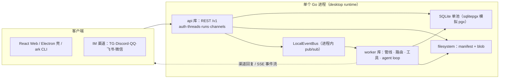

# Arkloop：本地优先的对话式 AI agent 平台

> 本解读按 **ai-agent 类规格**产出（覆盖 记忆机制 / 主 Agent 循环 / 工具调用 / Skill 体系 / MCP 接入 / Runtime / 会话状态 等关注面），并叠加多关注面大型仓库并行解读流程。
> 源码对象：GitHub [qqqqqf-q/Arkloop](https://github.com/qqqqqf-q/Arkloop)（本地快照，Go 后端非测试约 21 万行 + pnpm monorepo 前端约 13 万行），协议 Arkloop License（Apache-2.0 修改版）。

## 子文档索引

- [`architecture.md`](architecture.md) — 单进程嵌入式架构：api/worker 库化、sqlitepgx 方言改写、LocalEventBus、启动链路与单用户 token 认证
- [`pipeline.md`](pipeline.md) — RunMiddleware 有序中间件链：顺序即语义、rc 即契约、frontier 账本压缩
- [`agent-loop.md`](agent-loop.md) — 主循环与三类 executor、进程内 sub-agent 与快照恢复
- [`llm-routing.md`](llm-routing.md) — 多模型路由：Gateway 契约、per-run 动态装载、协议适配与 quirks 自学习
- [`tool-calling.md`](tool-calling.md) — 工具系统：schema 化工具、policy 把关、四层结果治理、localshell 状态机
- [`skills-mcp.md`](skills-mcp.md) — Persona/Skill/MCP 能力注入矩阵
- [`memory-system.md`](memory-system.md) — 记忆双子系统：本地 Notebook 与外部 Nowledge
- [`channels.md`](channels.md) — IM 渠道接入与 LLM Heartbeat 定时触发
- [`plugin-system.md`](plugin-system.md) — 插件系统、activity-record sidecar、LSP 与 CLI
- [`data-model.md`](data-model.md) — SQLite 94 表数据底座：pgx 仓储 + sqlitepgx 模拟层
- [`frontend.md`](frontend.md) — React web 会话实时渲染、turn 折叠状态机、Electron 壳

## 根因：让 agent 成为"本地常驻、用完不散"的对话伙伴

Arkloop 要解决的根本问题：**AI 聊天工具用完即散、各自为战**——对话只在网页标签页里存在，没有本地持久身份、不记得你、也无法融入日常 IM 流。个人用户需要的是一个**数据完全在自己机器上、开箱即用、可以被定时唤醒主动说话**的常驻 agent。

Arkloop 的选择不是做又一个 SaaS 聊天站，而是把整个 agent 运行时压成一个**桌面应用内嵌的单进程**：

- **零外部基础设施**：一个 Go 进程同时承载 API 与 Worker，SQLite 存全部状态，事件走进程内 bus——没有可部署的服务端，也就没有要运维的 Postgres/Redis/队列。
- **BYOK 多模型**：OpenAI/Anthropic/Gemini 与任意 OpenAI 兼容端点，凭据全在本地。
- **融入 IM 流**：Telegram/Discord/QQ/飞书/微信共享同一条 agent 管线，agent 还能按心跳定时"主动找你说话"。
- **本地记忆**：默认纯文本 Notebook，可选外部语义记忆 Nowledge，也可完全关掉。

> **一句对比锚点**：与把 AI 当"企业劳动力"来管理（[Lework](ai-agent/Lework/README.md)）、当"多用户 24/7 数字员工"（[OpenBee](ai-agent/openbee/README.md)）不同，Arkloop 锁定**单用户、本地优先、嵌入式单进程**——它的每一次架构决策（库化而非服务化、SQLite 而非 PG、进程内 bus 而非消息队列）都是这个产品假设的投影。

## 概览

Arkloop 是一个本地优先的对话式 AI agent 平台，产品形态三件套：**Electron 桌面应用**（主形态，内嵌整个后端）、**ark CLI**（headless 入口，`ark web` 即可起同一个运行时）、**React web**（聊天 UI，打包进桌面亦可独立 dev）。定位是个人（非团队）的常驻对话伙伴：聊天、工具调用、代码执行、记忆、IM 接入都要，但"干净"地要——无服务端、无多租户、无账号体系负担。

### 核心能力清单

| 能力 | 说明 |
|------|------|
| 单进程嵌入式后端 | api 与 worker 是"库"非服务，唯一入口 `desktop/cmd/desktop`；CLI 复用同一运行时 |
| 多模型路由 | BYOK，priority-based 路由；per-run 动态装载凭据（启动后配置立即可用） |
| Agent Runtime | RunMiddleware 有序管线 + 主循环；内置工具 / MCP servers / ClawHub skills / sub-agent / 定时 job |
| 自定义 Persona | persona.yaml 声明 system prompt、工具 allowlist、budget、executor_type、heartbeat |
| 记忆双子系统 | 默认纯文本 Notebook（本地 SQLite）；可选 Nowledge 语义记忆（外部）；可整体关闭 |
| IM Channels | Telegram / Discord / QQ / 飞书 / 微信共享同一 agent pipeline + heartbeat 主动发言 |
| 多端形态 | Electron 桌面（内嵌 runtime）/ `ark web` headless / Homebrew CLI / AUR |
| 单用户模型 | 固定 UUID 种子身份，local-only token 认证，无注册/邀请/团队/多账户 |

### 技术栈一览

| 层面 | 技术 |
|------|------|
| 后端 | Go 1.26（go.work 多模块：api / worker / desktop / cli / shared / activity-record） |
| 存储 | SQLite（sqlitepgx：pgx 签名仓储在 SQLite 上模拟）+ filesystem（manifest/blob sha256） |
| 事件 | 进程内 LocalEventBus（无 Redis/pg_notify） |
| LLM | OpenAI / Anthropic / Gemini / OpenAI 兼容 / Codex Responses API，自研 SDK+convert+parse 适配层 |
| 桌面壳 | Electron（主进程 + preload，sidecar 生命周期） |
| Web 前端 | React 19 / TypeScript 5.9 / Vite 7+ / Tailwind CSS 4 / React Router 7 |
| 工具/技能 | MCP client（stdio/HTTP）+ ClawHub/OpenClaw SKILL.md + 内置工具族 + 本地 shell 执行器 |
| 渠道 | Telegram / Discord / QQ(OneBot) / 飞书 / 微信 各 client 库 |

## 架构总览

Arkloop 的架构核心一句话：**一个 Go 进程 = 整个后端**。desktop runtime 以"库"形式同时嵌入 api（HTTP/认证/数据服务）与 worker（agent 执行），两者通过进程内 `LocalEventBus` 与共享 SQLite 单池协作，Electron 壳负责拉起/保活/回收这个 sidecar。

- 模块职责映射（`src/services/`，AGENTS.md 层级的代码落点）：
  - `desktop/` — 唯一后端入口：`cmd/desktop` → `runtime.Run`（token 引导 → api.StartDesktop → worker.StartDesktop，见 [architecture.md](architecture.md)）
  - `api/` — REST API 库（embedded 运行）：auth、channels、settings、runs、memory、catalog
  - `worker/` — agent 执行库：中间件管线、LLM 路由、工具调度、agent loop
  - `shared/` — 共享库：config、sqlitepgx/sqliteadapter、eventbus、objectstore、executionconfig
  - `cli/` — `ark` headless 入口（复用同一 desktop 后端）
  - `activity-record/` — 独立 sidecar（自包含 SQLite，录制外部活动）
- 多关注面详情见 [核心模块导读](#核心模块导读)。

### 启动链路

desktop runtime 的启动是一段**串行就绪 + 双常驻**流程：API 先起并完成 SQLite 迁移，worker 等 API 就绪后复用同一数据库池启动，30s 就绪门闩在 `WaitAPIReady`（[src/services/desktop/runtime/runtime.go:30-125]()）。完整时序见 [`architecture.md`](architecture.md)。
<!-- anchor: func Run(ctx context.Context, opts Options) error { … return firstErr -->

### 核心模块导读

| 模块 | 职责 | 深读 |
|------|------|------|
| 单进程嵌入式 runtime | api/worker 库化、共享 SQLite、进程内 bus、Electron sidecar | [`architecture.md`](architecture.md) |
| 中间件管线 | run 执行的 RunMiddleware 有序链（顺序承载语义） | [`pipeline.md`](pipeline.md) |
| Agent 主循环 | 三类 executor + 进程内 sub-agent（child run/快照/depth） | [`agent-loop.md`](agent-loop.md) |
| LLM 路由 | BYOK 多模型路由 + provider 协议适配 | [`llm-routing.md`](llm-routing.md) |
| 工具系统 | schema 化工具、策略、结果治理、本地 shell | [`tool-calling.md`](tool-calling.md) |
| Persona/Skill/MCP | 身份声明、技能三层管理、MCP 工具并入 | [`skills-mcp.md`](skills-mcp.md) |
| 记忆 | Notebook + Nowledge 双子系统与快照 | [`memory-system.md`](memory-system.md) |
| IM 渠道 + Heartbeat | 多渠道共享管线、定时主动发言 | [`channels.md`](channels.md) |
| 插件与扩展 | 插件系统、activity-record、LSP、审计 | [`plugin-system.md`](plugin-system.md) |
| 数据模型 | SQLite 94 表 + pgx 仓储 + sqlitepgx | [`data-model.md`](data-model.md) |
| 前端 | SSE 事件管线、turn 状态机、Electron 壳 | [`frontend.md`](frontend.md) |

## 值得借鉴的设计

- **"库而非服务"的嵌入式单进程哲学**：把两个"完整服务"降格为库、用进程内组合 + SQLite 单池替代微服务与消息队列——对个人/本地场景是彻底简化，代码却仍保留 pgx 签名仓储（可迁回 Postgres）。取舍见 [`architecture.md`](architecture.md)。
- **有序中间件链承载 run 语义**：后来的中间件依赖前序写入 `RunContext` 的状态，链的顺序就是执行契约；观测（stage 计时）、兜底（看门狗）都"包住整链"而非写进每个中间件。见 [`pipeline.md`](pipeline.md)。
- **上下文压缩用"frontier 遮蔽账本"而非删除**：历史消息不物理删，只写压缩账本（atom→chunk→replacement + supersession 边），多轮压缩、恢复、回溯全部可重建。见 [`pipeline.md`](pipeline.md)。
- **进程内 sub-agent = 另一条排队 run + 私有 thread + 血缘快照**：可恢复性来自"一切皆持久化"，而非内存状态——spawn 不阻塞父 run，可被 wait/resume。见 [`agent-loop.md`](agent-loop.md)。
- **工具结果四层治理**：先无损落盘保可捞回、再结构压缩、最后才花钱请 LLM 摘要、失败静默回退原结果——任何环节故障不丢结果。见 [`tool-calling.md`](tool-calling.md)。
- **让 SQLite "假装成 Postgres"**：pgx 签名仓储 + 白名单正则方言改写，几十个仓储不改一行跑 SQLite；未覆盖方言"大声失败"而非静默近似。见 [`data-model.md`](data-model.md)。

## 不足与风险

- **README/AGENTS 叙事与代码的偏差**：AGENTS.md 描述的记忆"热路径只读快照注入"与代码不符（Nowledge 是 contributor 每轮实时调外部，快照仅服务 UI/管理）；heartbeat 落库 `run_kind=Discuss` 而激活判定用 `runkind.Heartbeat`，命名双轨排障易踩坑。详见 [`memory-system.md`](memory-system.md) 与 [`channels.md`](channels.md)。
- **SaaS 时代遗留表**：94 张表里近 1/3 是单用户桌面用不到的"死表/半死表"（jobs/worker_registrations 等），schema 演进文档已列断档（迁移编号缺 00038/00039）。见 [`data-model.md`](data-model.md)。
- **工具系统技术债**：`read_file` 与 `localfs` 两套文件实现无装配引用；`SupportsProgressHeartbeat` 声明无消费方；ToolLoopDetector 疑似"装配未接线"。见 [`tool-calling.md`](tool-calling.md) / [`pipeline.md`](pipeline.md)。
- **web 前端复杂度**：Context+ref 双写体系单文件超千行、localStorage 与 IndexedDB 存储口径不一致——深度集中在"实时渲染正确性"的代价。见 [`frontend.md`](frontend.md)。
- **关于 ACP（Agent Client Protocol）**：GitHub topic 标注了 `acp`，但**当前源码未实现 ACP**；Arkloop 的外部互操作实际走 **MCP（客户端接入 + 对外能力）+ ClawHub/OpenClaw Skill + 进程内 sub-agent spawn**。sub-agent 与 ACP 式外部 agent 进程接入的对比见 [`agent-loop.md`](agent-loop.md)。

## 总结回扣根因

Arkloop 的每一层都在回答同一个问题：**"如何把对话式 agent 做成个人机器上开箱即用、用完不散的常驻伙伴"**。于是它放弃服务端（库化 + SQLite + 进程内 bus）、放弃多用户（单身份 token 种子）、放弃重后端调度（worker 内有序管线 + agent loop + 进程内 sub-agent），换来的是任何个人电脑上一键可跑的完整 agent runtime——并用 IM 渠道与 heartbeat 让这个"常驻"名副其实。若你觉得它的取舍（本地优先、单用户、嵌入式）与你的场景同频，这套 monorepo 是一份"如何在放弃分布式的情况下仍保持清晰分层"的优秀范本。
