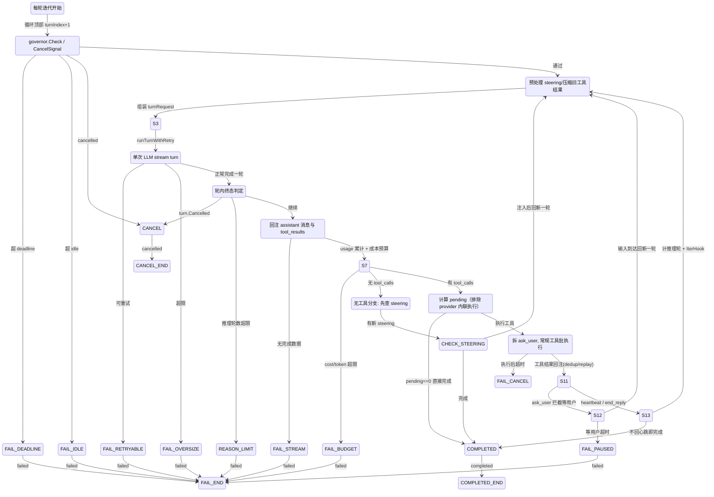
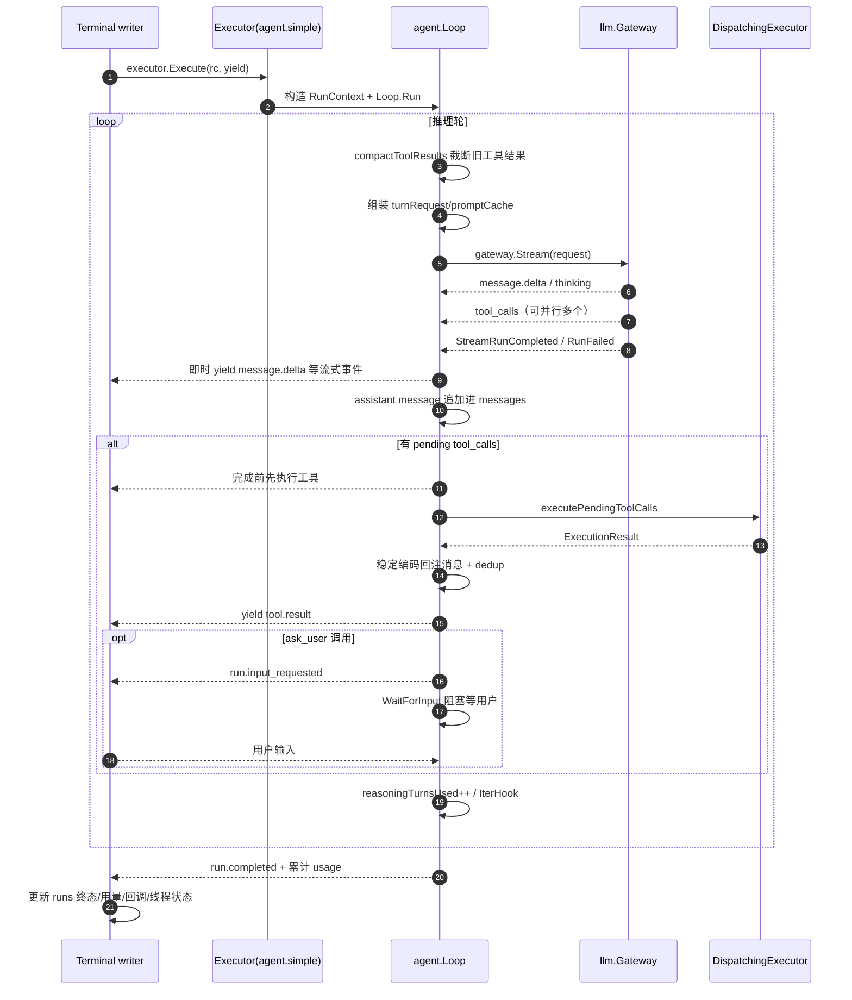
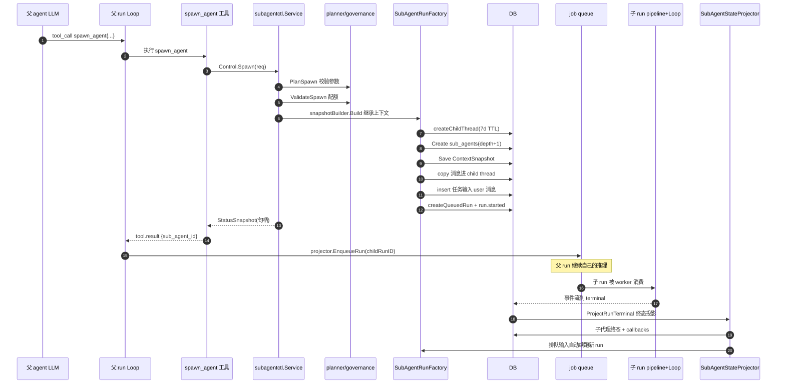

# Arkloop Agent 主循环与执行器解读

> 本文是 Arkloop（本地优先、单进程嵌入式 runtime 的对话式 AI agent 桌面平台）「主 Agent 循环与执行器 / sub-agent」模块解读。**本解读按 ai-agent 类规格产出。**
>
> 解读对象：`src/services/worker/internal/agent/loop.go` 主循环、executor 抽象与三类执行器（agent.simple / agent.interactive / task.classify_route）、进程内 sub-agent 机制（spawn_agent 工具族 + `subagentctl`）。所有引用按仓库相对路径 `src/...` 给出，源码根为 Arkloop 仓库。
>
> 定位：本文承接 pipeline 解读（一条 run 被中间件加工到 terminal 之后），回答两个问题：terminal 之后 agent 如何与 LLM 多轮对话、执行工具、自我循环直到停止；agent 如何 spawn 出子 agent 并行/嵌套地干活并把结果拿回来。

---

## 根因：把"跑完一条 run"变成可控、有界、可恢复的确定行为

一条 run 到达 terminal 时，系统已备好一切（人设 prompt、路由出的模型、绑定的工具集、历史消息）。剩下的核心问题是：**把"与一个非确定性 LLM 持续协作完成任务"这件事，变成可控、有界、可观察、可恢复的确定行为**。难点拆开看有五层：

1. **模型不会自己"做完就停"**——它可能输出 `tool_calls`（要执行工具），可能只输出文本（想结束），也可能两者都输出。循环必须区分"该停"与"该继续"，并识别工具已由 provider 端内联执行的情况（`pendingToolCalls` 剔除已含结果的调用）。
2. **循环必须有界**——没有预算的 agent loop 是无限花钱/耗时的黑洞，需要推理轮数、累计成本、累计输出 token、墙钟 deadline、空闲超时、用户取消等多把闸。
3. **上下文窗口是硬约束**——工具结果不断回注会把消息撑爆（provider 回 413 / context_length_exceeded）。循环必须自救：先压缩旧工具结果、再做请求级 rewrite、都失败则清晰失败而不是挂死或重试风暴。
4. **执行策略千人千面**——不同 persona 的"跑法"不同：自迭代跑完、每 N 轮让人把关、或一次性分类后单发（不迭代）。它们共享同一个 loop 内核但需要不同挂载点。
5. **任务可以超出单条 run**——长任务希望把子任务托付给**另一个独立 agent** 并行/异步跑，父 agent 不被阻塞、可投喂新输入、能等结果、能打断。

### 设计层面的三个根因决策

- **把"模型多轮调用"当作事件流的产生器**，而不是内聚的服务。`Loop` 通过 `emitter + yield` 把每个流式事件同步吐给 pipeline 的事件 writer，写库/投递/计数全部由外层接管——loop 本身无状态于 DB，可被任何 terminal writer 复用（pgx 版 `handler_agent_loop.go` 与 desktop SQLite 版 `desktopAgentLoop` 共用同一 executor/loop）。
- **把"多轮能力"与"执行策略"分离**。`Loop` 只认 `RunContext` + hooks 契约；executor 决定是否以及如何提供 hooks。
- **把"子任务"建模为另一条 run**（独立 thread + 独立 persona + 快照继承），而不是线程或进程：单进程 runtime 里并发执行靠 job queue 排队；"等子代理"就是轮询它的 DB 状态。这让"复活/恢复/续跑"天然落地——一切都有持久化记录。

### 为什么不是其它形态

- 不引入外部 agent 进程/ACP——单进程嵌入式哲学，避免进程编排、端口、协议开销；ACP topic 只是贴标，源码未实现 ACP。
- 不做"同一进程 goroutine 直接并发跑子任务"——会失去崩溃可恢复性与可观测性，也违反 worker 对 run 生命周期（状态机、预算、取消）的统一管理。

---

## 执行策略层：executor 注册表与三类执行器

terminal 收到"选好 persona/route/model、拼好 prompt、备好工具"的 `RunContext` 后，由 `rc.ExecutorBuilder.Build(executorType, executorConfig)` 决定"以什么策略跑完这条 run"——`persona.executor_type` 在这里被解析成具体执行器，缺省 `agent.simple`：

[src/services/worker/internal/pipeline/handler_agent_loop.go:115-124]()
<!-- anchor: executorType := "agent.simple" … exec, execBuildErr := rc.ExecutorBuilder.Build(executorType, executorConfig) -->

desktop（SQLite）路径同构：

[src/services/worker/internal/app/composition.go:3404-3413]()
<!-- anchor: executorType := "agent.simple" … exec, err := rc.ExecutorBuilder.Build(executorType, executorConfig) -->

注册表是**按 executor_type 键控的工厂注册表**，三种内置类型集中登记：

[src/services/worker/internal/executor/registry.go:46-53]()
<!-- anchor: func DefaultExecutorRegistry() *Registry { … return reg -->

未知类型 `Build` 返回描述性错误，terminal 直接写 `run.failed`（internal.error）：

[src/services/worker/internal/executor/registry.go:35-44]()
<!-- anchor: func (r *Registry) Build(executorType string, config map[string]any) (pipeline.AgentExecutor, error) { … return factory(config) -->

接口只定义在 pipeline 包、实现放在 executor 包，避免循环导入，且签名收敛到一行 `Execute`：

[src/services/worker/internal/pipeline/executor.go:9-18]()
<!-- anchor: // AgentExecutor 定义 Agent 执行策略接口。 … ) error -->

工厂类型由 config 构造出该接口实例：

[src/services/worker/internal/executor/interface.go:5-7]()
<!-- anchor: // Factory 根据 executor_config 构建 AgentExecutor 实例。 … type Factory func(config map[string]any) (pipeline.AgentExecutor, error) -->

### executor 薄、loop 厚：职责边界的 Why

`agent.Loop` 不是 executor，而是**被 executor 使用的库**：simple / interactive 都先构造 `agent.RunContext` 再 `agent.NewLoop(...).Run(...)`：

[src/services/worker/internal/executor/simple.go:94-95]()
<!-- anchor: loop := agent.NewLoop(rc.Gateway, rc.ToolExecutor) … return loop.Run(ctx, runCtx, agentRequest, emitter, yield) -->

职责切分：

- **executor** 拥有"要不要 hooks / hooks 是什么"的知识（interactive 提供 PreIter/Iter hooks），拥有"要不要 loop"的知识（classify_route 不用 loop）。
- **Loop** 拥有"一轮 turn 内部如何把流式事件变成消息、工具何时执行、预算怎么扣、何时算完成"的知识。
- 二者通过 `agent.RunContext`（纯内存上下文 + 若干函数字段）通信，不产生接口爆炸。

选"executor 薄、loop 厚"是因为：**多轮对话 + 工具执行的正确性（停止条件/预算/上下文）是所有 persona 共享的最大难点**，集中实现一次、吃透测试，比在每类 executor 复制更划算。executor 之间的差异点收敛为三类挂点，全部由 `RunContext` 上的函数字段表达：

- `IterHook`——每个消耗推理预算的 turn 完成后回调，可向 messages 注入 user 消息。
- `PreIterHook`——每轮迭代开始前回调。
- `WaitForInput`——ask_user 工具专用阻塞等待。
- `PollSteeringInput`——工具执行后非阻塞轮询用户 steering 消息。

[src/services/worker/internal/agent/loop.go:84-96]()
<!-- anchor: // IterHook 在每个消耗 reasoning 预算的 turn 完成后被调用。 … PollSteeringInput func(ctx context.Context) (string, bool) -->

### 一次 run 的三个执行形态

| executor_type | 走 Loop？ | 多轮工具循环？ | 人工介入 | 典型用途 |
|---|---|---|---|---|
| agent.simple | 是 | 是 | 无 | Lite/Pro 的普通会话/任务 |
| agent.interactive | 是 | 是 | 每 `check_in_every` 轮（默认 5）等用户 | Ultra 等 HITL persona |
| task.classify_route | 否 | 否 | 无 | 分类 + 按分支单发（摘要、意图分流、专用 task） |

各自工厂与结构定义：

[src/services/worker/internal/executor/simple.go:14-16]()
<!-- anchor: // SimpleExecutor 封装标准 agent.Loop 执行路径，供 Lite/Pro 使用。 … type SimpleExecutor struct{} -->

[src/services/worker/internal/executor/interactive.go:20-20]()
<!-- anchor: // InteractiveExecutor 在每 checkInEvery 轮迭代后暂停，等待用户注入消息后继续。 -->

[src/services/worker/internal/executor/classify_route.go:19-26]()
<!-- anchor: // ClassifyRouteExecutor 实现两阶段执行策略： … routes         map[string]RouteConfig -->

---

## 主循环状态机

`Loop.Run` 是唯一循环骨架：`for turnIndex := 1; ; turnIndex++`。一轮 = 一次 LLM stream 调用 +（可选）一次工具执行批次：

[src/services/worker/internal/agent/loop.go:181-193]()
<!-- anchor: for turnIndex := 1; ; turnIndex++ { … return yield(emitter.Emit("run.cancelled", completionTotals.Apply(map[string]any{"reason": "cancel_signal"}), nil, nil)) -->

每轮顶部先做：governor 查 deadline/idle → 查取消信号 → PreIterHook → 排空 steering + 压缩旧工具结果 + 组装 turnRequest：

[src/services/worker/internal/agent/loop.go:195-216]()
<!-- anchor: if runCtx.PreIterHook != nil { … prepareHeartbeatDecisionPhaseRequest(&turnRequest) -->

用状态图表达整轮判定顺序（图中编号指向判定代码；`run.failed/run.completed/run.cancelled` 即 pipeline 消费的终态事件）：

### 关键判定点的实现落点

- **轮内终态与取消**：`turn.Terminal` 直接收尾；`turn.Cancelled` 发 `run.cancelled`；非纯续跑且推理轮数到顶发 `run.failed`（reasoning）：

[src/services/worker/internal/agent/loop.go:358-375]()
<!-- anchor: if turn.Terminal { … return yield(emitter.Emit("run.failed", completionTotals.Apply(reasoningIterationsExceededError(runCtx.ReasoningIterations).ToJSON()), nil, stringPtr(ErrorClassAgentReasoningIterationsExceeded))) -->

- **流未给终态**：`turn.CompletedDataJSON == nil` 且无可恢复进度 → `InternalStreamEndedError` 失败；有部分文本/工具进度则升级为 retryable，交重试层处理：

[src/services/worker/internal/agent/loop.go:389-399]()
<!-- anchor: if turn.CompletedDataJSON == nil { … return yield(event) -->

- **usage 累计与终态事件带账**：每轮把 `CompletedDataJSON` 累进 `completionTotals`，随后 emit `llm.turn.completed`（本轮 usage + llm_call_id），终态事件上统一 `Apply` 累计账：

[src/services/worker/internal/agent/loop.go:400-417]()
<!-- anchor: completionTotals.Add(turn.CompletedDataJSON) … prevTurnUsage = copyMap(turn.CompletedDataJSON) -->

- **成本/输出 token 闸**：每轮 turn.completed 后查是否超 `MaxTotalOutputTokens` / `MaxCostMicros`：

[src/services/worker/internal/agent/loop.go:419-424]()
<!-- anchor: if msg, exceeded := costBudgetExceeded(completionTotals, runCtx.MaxCostMicros, runCtx.MaxTotalOutputTokens); exceeded { … return yield(emitter.Emit("run.failed", completionTotals.Apply(costBudgetExceededError(msg)), nil, stringPtr(llm.ErrorClassBudgetExceeded))) -->

- **无工具 → 结束前先查 steering**：没有 tool_calls 时，若还有排队的 steering 消息则注入后 `continue`，否则 `reasoningTurnsUsed++` 并发 `run.completed`：

[src/services/worker/internal/agent/loop.go:426-443]()
<!-- anchor: if len(turn.ToolCalls) == 0 { … return yield(emitter.Emit("run.completed", completionTotals.Apply(turn.CompletedDataJSON), nil, nil)) -->

- **有工具但 pending 为空**（provider 已内联执行完）→ 同样直接完成：

[src/services/worker/internal/agent/loop.go:445-453]()
<!-- anchor: pending := pendingToolCalls(turn.ToolCalls, turn.ToolResults) … return yield(emitter.Emit("run.completed", completionTotals.Apply(turn.CompletedDataJSON), nil, nil)) -->

### "推理轮数"与"循环轮数"两本账

- `turnIndex` 是纯计数，给日志 / segment 用。
- `reasoningTurnsUsed` 才是预算本账。关键：**纯 continuation turn（全部 tool_calls 是 continue_process）不消耗推理预算**——因为它只是推进一个既有进程会话、不产生新的推理分支：

[src/services/worker/internal/agent/loop.go:369-369]()
<!-- anchor: pureContinuationTurn := isPureContinuationTurn(turn.ToolCalls) -->

判定函数本身：

[src/services/worker/internal/agent/loop.go:1211-1220]()
<!-- anchor: func isPureContinuationTurn(toolCalls []llm.ToolCall) bool { … return true -->

被 continuation budget 拒绝的轮会反算为消耗推理预算，避免无限续跑空转：

[src/services/worker/internal/agent/loop.go:728-743]()
<!-- anchor: reasoningUsedThisTurn := !pureContinuationTurn || continuationRejected … injected, inject, hookErr := runCtx.IterHook(ctx, reasoningTurnsUsed) -->

---

## 一次带工具的完整循环时序

以 desktop 路径为例（terminal=desktopAgentLoop，把 loop 的每个事件经 `desktopEventWriter` 落 SQLite；desktop writer 特意"每事件一个短事务"以降低 SQLite 锁竞争）：

[src/services/worker/internal/app/composition.go:3436-3438]()
<!-- anchor: execErr := exec.Execute(execCtx, rc, rc.Emitter, func(ev events.RunEvent) error { … return w.append(execCtx, rc.Run.ID, ev, "") -->

### 事件的可见性与入库时机分离

`runSingleTurn` 内把**流式事件**（message.delta、tool.call.delta、llm.response.chunk、run.segment.*）即时 `yield` 给 writer（客户端边收边显示），而终态 / 工具结果等**非流式事件**先攒进 `eventsOut`，在 turn 判定处才统一 yield：

[src/services/worker/internal/agent/loop.go:1857-1872]()
<!-- anchor: streamingEventTypes := map[string]struct{}{ … eventsOut = append(eventsOut, ev) -->

`gateway.Stream` 回调内的 `message.delta` 即走这一可见通道：

[src/services/worker/internal/agent/loop.go:1959-1967]()
<!-- anchor: return yieldOrStop(emitter.Emit("message.delta", llm.StreamMessageDelta{ … return yieldOrStop(emitter.Emit("message.delta", typed.ToDataJSON(), nil, nil)) -->

desktop writer 的落库注释印证同一取舍（短事务、防锁竞争）：

[src/services/worker/internal/app/composition.go:3490-3491]()
<!-- anchor: // desktopEventWriter writes one event per transaction to keep SQLite locks short. … type desktopEventWriter struct { -->

pgx 版 `eventWriter` 则是"批提交 + 终态时更新 runs.status / DECR 并发计数 / 写 usage_records"：

[src/services/worker/internal/pipeline/handler_agent_loop.go:241-242]()
<!-- anchor: // eventWriter 批提交事件并在终态时更新 runs.status + DECR 并发计数 + 写入 usage_records。 … type eventWriter struct { -->

---

## 三类执行器的差异与选择

### agent.simple：标准循环

工厂零配置（`config` 无效），执行体只有四步：`planRequestFromRunContext` 装配全量 prompt 段 → 构造 `RunContext` → `NewLoop` → `Run`。没有 PreIter/Iter/WaitForInput hooks，纯"模型自己跑完"：

[src/services/worker/internal/executor/simple.go:18-29]()
<!-- anchor: func NewSimpleExecutor(_ map[string]any) (pipeline.AgentExecutor, error) { … planned := planRequestFromRunContext(rc, requestPlannerInput{ -->

选择信号：persona 无人工介入诉求（Lite/Pro），也是未声明 `executor_type` 时的默认值。

### agent.interactive：带 Human-in-the-loop 的循环

与 simple 的唯一差别是 hooks。工厂解析两个 `executor_config` 字段：

- `check_in_every`（默认 5）——每第 N 个"推理轮"触发一次 check-in。
- `max_wait_seconds`（默认 300）——等待用户输入上限，超时本轮被当作超时，不会永久阻塞 run。

[src/services/worker/internal/executor/interactive.go:27-54]()
<!-- anchor: // NewInteractiveExecutor 是 "agent.interactive" 的工厂函数。 … }, nil -->

执行时先暴露 `CheckInAt` 供外部观察，再在 RunContext 上挂两个 hook：

- **PreIterHook**（每个推理轮之间）发 `run.segment.start/end`（kind=planning_round，"第 N 轮规划"），给前端一个可折叠的过程分段：

[src/services/worker/internal/executor/interactive.go:132-132]()
<!-- anchor: PreIterHook: func(_ context.Context, iter int) error { -->

- **IterHook** 在达到 check-in 轮次时先 emit `input_requested`，再调 `rc.WaitForInput` 阻塞；返回文本作为 user message 注入下一轮：

[src/services/worker/internal/executor/interactive.go:155-175]()
<!-- anchor: IterHook: func(hookCtx context.Context, reasoningIter int) (string, bool, error) { … return text, ok, nil -->

选择信号：需要用户中途把关的 Ultra 级 persona。它对 loop 内核零侵入，只是"挂了一个每 N 轮打断的钩子"。

### task.classify_route：两段式单发（非循环）

设计意图是两阶段、单次发送、不进入工具循环：

1. **内部 classify call**：用 `classify_prompt` + 当前消息做一次 LLM 文本输出分类，**不 yield 任何事件**（对客户端不可见、不产生对外 message.delta）；失败时把 StreamRunFailed 转成 `run.failed`。
2. **按分类选 route 单发**：命中 `routes[category]`（可带 prompt_override / model_override），不命中回退 `default_route`；用分支 prompt 做 single-shot stream，把 message.delta 转发给客户端直至 `run.completed`。

[src/services/worker/internal/executor/classify_route.go:87-121]()
<!-- anchor: // classify 做内部分类 call，只收集文本输出；LLM 失败时返回 failed 事件数据。 … return strings.TrimSpace(strings.Join(chunks, "")), nil, nil -->

[src/services/worker/internal/executor/classify_route.go:136-192]()
<!-- anchor: // execute 用选定的 prompt_override 做 single-shot LLM call，通过 yield 发出事件。 … return yield(emitter.Emit("run.failed", internal.ToJSON(), nil, &internal.ErrorClass)) -->

Why：

- 分类决策**不应该是"对话的一部分"**——它更像内部路由，不应被用户看到思维过程、不应消耗工具循环预算。
- 每个分支只发一次、无工具回注，因此天然有界、可预测、便宜；classify 与 execute 两次调用的模型可用 `model_override` 分开（分类用小模型、正文用大模型）。
- 配置全部来自 `executor_config`（classify_prompt / routes / default_route），persona 作者可以不写代码就声明"这个 persona 是路由分发器"。

工厂解析整个 config：

[src/services/worker/internal/executor/classify_route.go:28-58]()
<!-- anchor: // NewClassifyRouteExecutor 是 "task.classify_route" 的 Factory 函数。 … }, nil -->

### 三者的 planning 差异

simple / interactive 都走 `planRequestFromRunContext`——全量 prompt 装配（前缀段 + 历史 + runtime tail），并产出 `PromptPlan` 与 cache-safe snapshot，为轮间 prompt cache 演进提供输入：

[src/services/worker/internal/executor/request_planner.go:46-75]()
<!-- anchor: func planRequestFromRunContext(rc *pipeline.RunContext, input requestPlannerInput) plannedRequest { … CacheSafeSnapshot: buildCacheSafeSnapshot(rc, baseMessages, req), -->

classify_route 不用这套——它只用裸 `rc.Messages` + 一段系统分类 prompt，不装配 persona 的全部 prompt 段（见上节 classify 函数内的 `llm.Request` 组装）。三者在 planning 深度上的差异，正是"轻量决策不污染主 prompt 体系"取舍的体现。

---

## 预算三闸与上下文耗尽自救

### 墙钟闸（LoopGovernor）

`WithRunTimeouts` 把 `RunDeadline` 变成 `context.WithTimeout`、`RunIdleTimeout` 变成带 idle 进度刷新的 cancel-cause 计时器：

[src/services/worker/internal/agent/loop_governor.go:86-86]()
<!-- anchor: func (g *LoopGovernor) WithRunTimeouts(parent context.Context) (context.Context, func()) { -->

`Check` 在每轮顶部判定 idle / deadline，并顺带做 idle heartbeat（长时间无产出时发 `run.idle_heartbeat` 保活信号）：

[src/services/worker/internal/agent/loop_governor.go:159-187]()
<!-- anchor: func (g *LoopGovernor) Check(ctx context.Context, emitter events.Emitter, yield func(events.RunEvent) error) (LoopTermination, error) { … return LoopTerminationNone, nil -->

超时终态事件：`run.deadline_exceeded` / `run.idle_timeout`：

[src/services/worker/internal/agent/loop.go:3435-3442]()
<!-- anchor: func yieldRunDeadlineExceeded(emitter events.Emitter, yield func(events.RunEvent) error, runCtx RunContext) error { … }, nil, stringPtr(ErrorClassRunDeadlineExceeded))) -->

[src/services/worker/internal/agent/loop.go:3445-3457]()
<!-- anchor: func yieldRunIdleTimeout(emitter events.Emitter, yield func(events.RunEvent) error, runCtx RunContext, governor *LoopGovernor) error { … }, nil, stringPtr(ErrorClassRunIdleTimeout))) -->

### 双保险预算：推理轮数 + 累计 usage

循环可能停的三个原因分属不同度量域，任一先到先停：

| 度量域 | 计什么 | 关键实现 |
|---|---|---|
| 推理轮数 | 模型"分支/新推理"次数（`reasoningTurnsUsed`） | 纯 continuation 轮豁免（见"两本账"） |
| 累计 output tokens / cost | 钱与量 | `completionTotals` 每轮累加，turn.completed 后查闸 |
| deadline / idle | 墙钟 | LoopGovernor |

`completionTotals.Add` 做多 provider 的 usage 字段归一（不同 provider 字段命名差异），并单列 cache_creation/cache_read 以便缓存成本可见：

[src/services/worker/internal/agent/loop.go:1299-1299]()
<!-- anchor: func (t *completionTotals) Add(completed map[string]any) { -->

查闸函数（cost 与 output token 双条件）：

[src/services/worker/internal/agent/loop.go:1260-1268]()
<!-- anchor: func costBudgetExceeded(totals *completionTotals, maxCostMicros *int64, maxTotalOutputTokens *int64) (string, bool) { … return "", false -->

为何双保险：只数轮数会被"一轮吐海量 token"骗过；只数 token 会被"无限小步循环"骗过；两者都没有时会话因工具无解而空转烧钱。

更细一层：**纯 continuation turn 不计入推理预算**（continue_process 只是在推进已开始的进程会话），否则一次 `exec_command` 长会话会被误杀；同时有独立的 `ToolContinuationBudget`（desktop 默认 32）与每 session 的 `MaxContinuations` 软限：

[src/services/worker/internal/agent/loop.go:788-790]()
<!-- anchor: type continuationBudgetState struct { … SessionCounts map[string]int -->

[src/services/worker/internal/agent/loop.go:1044-1044]()
<!-- anchor: func (l *Loop) executeContinuationToolCall( -->

desktop 默认装配：`AgentReasoningIterationsLimit=0`（不限推理轮数）、`ToolContinuationBudgetLimit=32`、`MaxParallelTasks=4`：

[src/services/worker/internal/app/composition.go:636-639]()
<!-- anchor: ThreadMessageHistoryLimit:     0, … MaxParallelTasks:              4, -->

### 上下文耗尽自救：先压缩、再 rewrite、最后清晰失败

**第 1 层：工具结果历史软上限 80KB。** `compactToolResultsWithState` 把最老的 tool 消息替换为仅保留 tool_call_id 的 stub（`{"result":{"compacted":true}}`）；"最近一轮 pending 的二进制/图片结果"受保护不压缩：

[src/services/worker/internal/agent/loop.go:2858-2865]()
<!-- anchor: var maxToolResultHistoryChars = 80_000 … return compactToolResultsWithState(messages, nil) -->

[src/services/worker/internal/agent/loop.go:2868-2868]()
<!-- anchor: func compactToolResultsWithState(messages []llm.Message, state *toolResultReplacementState) []llm.Message { -->

二进制/图片 pending 保护（压缩会破坏最近结果的可读性）：

[src/services/worker/internal/agent/loop.go:2905-2905]()
<!-- anchor: func pendingToolResultBinaryIndices(messages []llm.Message) map[int]struct{} { -->

stub 替换是**记忆化**的（`applyStoredToolResultReplacements` 从 state 直接换装，后续轮不再重复压缩已压缩消息）：

[src/services/worker/internal/agent/loop.go:2949-2949]()
<!-- anchor: func applyStoredToolResultReplacements(messages []llm.Message, state *toolResultReplacementState) []llm.Message { -->

**第 2 层：turn 前 preflight 估算。** 每次请求先由 provider 的 request 估算器估算 bytes，超限即调 `pipeline.RewriteOversizeRequestWithOptions`（canonical_chunks compact / 剥图等），最多 8 轮 rewrite：

[src/services/worker/internal/agent/loop.go:1404-1416]()
<!-- anchor: for attempt := 1; attempt <= maxAttempts; { … if !llm.RequestExceedsLimits(payloadBytes, estimatedTokens, contextWindowTokens) { -->

**第 3 层：provider 实际拒绝后的恢复。** 413 / context_length_exceeded symptom 命中 `isOversizeTurn`，再做一次 provider 侧 recovery rewrite（`providerRecoveryUsed` 防死循环）：

[src/services/worker/internal/agent/loop.go:1468-1505]()
<!-- anchor: if isOversizeTurn(turn) { … providerRecoveryUsed = true -->

`isOversizeTurn` 同时认 HTTP 413 与 symptom：

[src/services/worker/internal/agent/loop.go:1745-1758]()
<!-- anchor: func isOversizeTurn(turn turnResult) bool { … return llm.DetailsHaveSymptom(details, llm.SymptomContextLengthExceeded) -->

8 轮后仍超限 → `preflightOversizeTurnResult`（non_retryable 失败），避免重试风暴。与此同时，LLM 层只有 `provider.retryable` 失败才走带 full-jitter 的指数退避重试（封顶 60s），两种"失败"被严格区分、不互相污染：

[src/services/worker/internal/agent/loop.go:1525-1566]()
<!-- anchor: if turn.Terminal && attempt >= maxAttempts && isRetryableTurn(turn) { … attempt++ -->

[src/services/worker/internal/agent/loop.go:1806-1829]()
<!-- anchor: const maxRetryBackoffMs = 60_000 … return randIntN(capMs + 1) -->

### ask_user：loop 的一等公民

ask_user 若走普通工具 dispatcher，工具执行器无法"等到用户回复再返回"，交互语义（暂停 run / 接收 JSON 应答）会被工具超时机制破坏。所以 loop 把它从 pending 里拆出来单独处理——先从 pending 中分离 ask_user、其余常规工具先行：

[src/services/worker/internal/agent/loop.go:463-463]()
<!-- anchor: // 分离 ask_user 调用，先执行其他工具，最后处理 ask_user -->

随后单独 validate → emit `run.input_requested`（带 schema）→ `governor.WaitForUserInput`（带 PausedInputTimeout）→ 结构化应答回注：

[src/services/worker/internal/agent/loop.go:585-617]()
<!-- anchor: // ask_user 拦截：不走 dispatcher，直接 yield 事件并阻塞等待用户输入 … }, nil, nil)); err != nil { -->

[src/services/worker/internal/agent/loop.go:621-623]()
<!-- anchor: var answerResult llm.StreamToolResult … text, ok, timedOut, waitErr := governor.WaitForUserInput(ctx, emitter, yield, requestID, runCtx.WaitForInput) -->

超时被建模为带 `paused_waiting_user` 错误类的 tool_result（而不是挂死或取消整个 run）：

[src/services/worker/internal/agent/loop.go:651-651]()
<!-- anchor: if timedOut { -->

governor 侧发出 `run.paused` / `run.resumed` 生命周期事件，让 IM/桌面客户端可在 run 中途把人拉进来：

[src/services/worker/internal/agent/loop_governor.go:199-231]()
<!-- anchor: func (g *LoopGovernor) WaitForUserInput( … return text, true, false, nil -->

heartbeat / end_reply 是另两类"loop 特判"，与 ask_user 同源——reply 前抑制流式或直接以完成态收束 run：

[src/services/worker/internal/agent/loop.go:698-698]()
<!-- anchor: if heartbeatDecisionFinalized(runCtx) { -->

---

## 进程内 sub-agent：不是线程，是"另一条排队 run + 独立私有 thread"

一次 spawn 在 DB 事务里做一整串事：建 `is_private=TRUE` 且 7 天 TTL 的 child thread → 插 `sub_agents` 行（含 depth）→ 存上下文快照 → 把继承的父消息复制进 child thread → 写一条 user 消息（任务输入）→ 建一条 `parent_run_id=父 run` 的新 run（seq 锁 + run.started + 置 queued）：

[src/services/worker/internal/subagentctl/factory.go:27-92]()
<!-- anchor: func (f *SubAgentRunFactory) CreateSpawnRun( … return createdSubAgent, childRunID, nil -->

子 run 随后由 worker 的常规执行路径（routing → loop）消费，与父 run 共用同一套 pipeline——这就是"进程内 child run"的精确含义：**同一个 worker 进程、同一条 job queue、同一套 run 生命周期，只是多了血缘与快照**。

私有 thread 是 7 天 TTL 的：

[src/services/worker/internal/subagentctl/factory.go:16-16]()
<!-- anchor: const childThreadTTL = 7 * 24 * time.Hour -->

创建子线程的 SQL 明确 `is_private=TRUE` 并带 `expires_at`：

[src/services/worker/internal/subagentctl/factory.go:199-216]()
<!-- anchor: func (f *SubAgentRunFactory) createChildThread(ctx context.Context, tx pgx.Tx, parentRun data.Run) (uuid.UUID, error) { … return childThreadID, nil -->

排队 run 的落库（seq 锁 + run.started + TransitionToQueued）：

[src/services/worker/internal/subagentctl/factory.go:218-300]()
<!-- anchor: func (f *SubAgentRunFactory) createQueuedRun( … return childRunID, nil -->

血缘建模见 00068 迁移：`sub_agents` 表把"父 run"改为 `owner_thread_id + agent_thread_id + origin_run_id + parent_sub_agent_id + depth` 五元组（thread-scoped subagent 重构）：

[src/services/shared/database/sqliteadapter/migrations/00068_thread_scoped_subagents.sql:5-12]()
<!-- anchor: CREATE TABLE sub_agents ( … depth                 INTEGER NOT NULL CHECK (depth >= 0) -->

状态机枚举（created/queued/running/waiting_input/completed/failed/cancelled/closed/resumable）自 00026 起就是 `status IN (...)` 的 CHECK 约束：

[src/services/shared/database/sqliteadapter/migrations/00026_sub_agents.sql:18-18]()
<!-- anchor: status                TEXT NOT NULL CHECK ( -->

### spawn 生命周期全景

工具执行后由 `projector.EnqueueRun` 把 childRunID 投进 job queue：

[src/services/worker/internal/subagentctl/projector.go:67-73]()
<!-- anchor: func (p *SubAgentStateProjector) EnqueueRun(ctx context.Context, accountID uuid.UUID, runID uuid.UUID, traceID string, availableAt *time.Time, payload map[string]any) error { … return err -->

### 快照如何做到"可恢复、可接续"

**A. ContextSnapshot（静态继承，落库）**——多块快照：messages、environment（profile/workspace ref）、skills、routing（route/model）、runtime（tool allow/deny）、memory（scope 固定 `same_user`）、prompt cache snapshot：

[src/services/worker/internal/subagentctl/types.go:124-133]()
<!-- anchor: type ContextSnapshot struct { … PromptCache *PromptCacheSnapshot       `json:"prompt_cache,omitempty"` -->

memory scope 常量与 `fork_recent` 默认窗口（12 条）同文件定义：

[src/services/worker/internal/subagentctl/types.go:14-17]()
<!-- anchor: const ( … forkRecentMessageLimit = 12 -->

SnapshotBuilder 按 context_mode 取历史（fork_recent 12 条 / fork_thread 全取 / fork_selected 按 message_ids），并在继承 messages 时 clone prompt cache 快照：

[src/services/worker/internal/subagentctl/context_snapshot.go:98-137]()
<!-- anchor: func (b *SnapshotBuilder) Build(ctx context.Context, tx pgx.Tx, parentRun data.Run, req ResolvedSpawnRequest) (ContextSnapshot, error) { … return snapshot, nil -->

[src/services/worker/internal/subagentctl/context_snapshot.go:139-172]()
<!-- anchor: func (b *SnapshotBuilder) loadMessages(ctx context.Context, tx pgx.Tx, parentRun data.Run, req ResolvedSpawnRequest) ([]ContextSnapshotMessage, error) { … return repairUnclosedToolCalls(result), nil -->

子 run 启动后由中间件把 route/model 回填进 InputJSON、把 allowlist 与父的求交集、denylist 合并——子 run 走完全正常 routing 路径但被约束在父给的"路由域 + 工具权限域"内。pgx 版还会额外回填 `rc.InheritedPromptCacheSnapshot`（desktop 版缺这一行，见问题节）：

[src/services/worker/internal/pipeline/mw_subagent_context.go:11-43]()
<!-- anchor: func NewSubAgentContextMiddleware(storage *subagentctl.SnapshotStorage) RunMiddleware { … return next(ctx, rc) -->

desktop 版 `desktopSubAgentContext` 同构：

[src/services/worker/internal/app/composition.go:2924-2959]()
<!-- anchor: func desktopSubAgentContext(db data.DesktopDB, storage *subagentctl.SnapshotStorage) pipeline.RunMiddleware { … return next(ctx, rc) -->

**B. 消息"物化"而非"注入"**——继承的父消息不是塞进请求头，而是真的 insert 成 child thread 的历史消息，所以子 run 加载历史的方式与普通 run 完全一致，天然支持再 resume、再 compact：

[src/services/worker/internal/subagentctl/factory.go:303-313]()
<!-- anchor: func (f *SubAgentRunFactory) copySnapshotMessages(ctx context.Context, tx pgx.Tx, accountID uuid.UUID, threadID uuid.UUID, messages []ContextSnapshotMessage) error { … return nil -->

**C. 快照卫生**——fork 截断会产生孤儿 tool 消息与未闭合 tool_use：`trimLeadingOrphanToolMessages` 去掉开头的孤儿 tool 消息；`repairUnclosedToolCalls` 为未闭合 tool_use 合成 `[name: context forked before completion]` 闭包，避免子 run 遇到结构非法消息：

[src/services/worker/internal/subagentctl/context_snapshot.go:240-240]()
<!-- anchor: func trimLeadingOrphanToolMessages(msgs []ContextSnapshotMessage) []ContextSnapshotMessage { -->

[src/services/worker/internal/subagentctl/context_snapshot.go:251-341]()
<!-- anchor: // repairUnclosedToolCalls 确保 fork 出的消息历史中不存在未闭合的工具调用。 … return result -->

**D. Resume 双通道**——`resume_agent` 若带 blobStore，优先用 rollout 记录把上次 run 的**逐 assistant 消息重建**出来（Reconstruct），这比静态 snapshot 更接近"原样续聊"；失败回退 snapshot：

[src/services/worker/internal/subagentctl/control.go:424-424]()
<!-- anchor: var reconstructedMessages []ContextSnapshotMessage -->

这解释了 rollout recorder 在 loop 中逐 turn 写 RunMeta/TurnStart/AssistantMessage/ToolCall/ToolResult/TurnEnd/RunEnd 的动机——rollout 不只是可观测性，还是 sub-agent 可恢复性的数据源：

[src/services/worker/internal/agent/rollout_hook.go:26-26]()
<!-- anchor: // MakeTurnStart 创建 TurnStart RolloutItem -->

**E. Prompt-cache 链**——loop 每轮调用前刷新 `CacheSafeSnapshot`，工具执行时把它作为 `PromptCacheSnapshot` 注入工具上下文：

[src/services/worker/internal/agent/loop.go:2145-2145]()
<!-- anchor: func refreshCacheSafeSnapshot(runCtx *RunContext, baseMessages []llm.Message, request llm.Request) { -->

[src/services/worker/internal/agent/loop.go:1003-1009]()
<!-- anchor: PromptCacheSnapshot:              promptCacheSnapshotFromLoopContext(runCtx), … result := runCtx.ToolExecutor.Execute(ctx, call.ToolName, copyMap(call.ArgumentsJSON), execCtx, call.ToolCallID) -->

spawn 时它被 clone 进 `ContextSnapshot.PromptCache`。子 run 首轮规划时若快照的 persona/model/reasoning/max_tokens/temperature/tool_choice/tools/baseMessages 前缀与当前完全一致，可**直接复用父 run 已建好的 provider 端 prompt cache**：

[src/services/worker/internal/executor/prompt_cache_reuse.go:53-97]()
<!-- anchor: func inheritedPromptCacheRequest( … return request, buildCacheSafeSnapshot(rc, baseMessages, request), true -->

前缀不一致则整体重建并记录 reason 供调试（`LastInheritedReuseResult`）：

[src/services/worker/internal/executor/prompt_cache_reuse.go:106-146]()
<!-- anchor: func canReuseInheritedPromptCache( … return true, "" -->

fork / sub-agent 与 prompt cache 的缝合是本模块最精细的 token 成本优化点（也解释了为什么 interactive 的 segment 轮次要对齐 stable marker）。

### 六工具契约

工具 spec 与 LLM 侧 JSON schema 分开存放，注入时把 persona 白名单嵌进 description 帮助模型选择合法 persona：

[src/services/worker/internal/tools/builtin/spawn_agent/executor.go:143-143]()
<!-- anchor: func LlmSpecWithPersonas(personaKeys []string) llm.ToolSpec { -->

六工具统一走 `subagentctl.Control` 接口的薄 switch：

[src/services/worker/internal/tools/builtin/spawn_agent/executor.go:273-332]()
<!-- anchor: switch strings.TrimSpace(toolName) { … return tools.ExecutionResult{ResultJSON: snapshotJSON(snapshot), DurationMs: durationMs(started)} -->

| 工具 | 风险/副作用 | 返回 | 契约要点 |
|---|---|---|---|
| spawn_agent | Medium/有 | StatusSnapshot | 返回 sub_agent_id 句柄（`executor.go:274`） |
| send_input | Medium/有 | StatusSnapshot | interrupt=true 时发 cancel（`executor.go:283`） |
| wait_agent | Low/无 | StatusSnapshot | 多 ID 返回首个终态（`executor.go:289`） |
| resume_agent | Medium/有 | StatusSnapshot | 终态子代理再开一轮（`executor.go:295`） |
| close_agent | Medium/有 | StatusSnapshot | 关句柄，活跃时拒绝（`executor.go:301`） |
| interrupt_agent | Medium/有 | StatusSnapshot | 取消当前活跃 run（`executor.go:307`） |

wait 超时但有最新快照时返回 `timeout=true` 标记而不是硬错误，让 LLM 可据此决策：

[src/services/worker/internal/tools/builtin/spawn_agent/executor.go:320-320]()
<!-- anchor: // wait_agent 超时但有最新快照时，返回快照 + timeout 标记 -->

工具在 pipeline 中由 `NewSpawnAgentMiddleware` 在 `rc.SubAgentControl` 非空时把六工具的 spec + executor 注入 per-run 工具集，并预加载可用 persona ID 用于前置校验：

[src/services/worker/internal/pipeline/mw_tool_provider.go:259-259]()
<!-- anchor: // injectSpawnAgentTools 在 SubAgentControl 可用时，将 spawn_agent 系列工具注入到 per-run 工具集。 -->

### send_input 的两种语义

`PlanSendInput` 按子代理当前状态分流：

- 子在 **queued/running**：输入进 `sub_agent_pending_inputs` 排队；若 `interrupt=true`，同时向当前 run 追加 `run.cancel_requested`，让活跃 run 走取消路径。当该 run 到终态时，`ProjectRunTerminal` 会调 `CreateRunFromPendingInputs` 自动把排队输入合并成新 run 发出去——**这就是"投喂忙碌中的子代理不丢失输入"的实现**。
- 子已 **completed/failed/cancelled/resumable/waiting_input**：直接建新 run 携带输入。

[src/services/worker/internal/subagentctl/planner.go:74-74]()
<!-- anchor: func (p *ChildRunPlanner) PlanSendInput(record data.SubAgentRecord, req SendInputRequest) (childRunPlan, error) { -->

interrupt 分支在 control 层写 cancel_requested：

[src/services/worker/internal/subagentctl/control.go:227-231]()
<!-- anchor: if plan.InterruptActiveRun { … if _, err := (data.RunEventsRepository{}).AppendEvent(ctx, tx, *record.CurrentRunID, "run.cancel_requested", map[string]any{"run_id": record.CurrentRunID.String()}, nil, nil); err != nil { -->

终态投影自动续跑排队输入（同函数里还会插 `thread_subagent_callbacks` 供父侧唤醒）：

[src/services/worker/internal/subagentctl/projector.go:169-221]()
<!-- anchor: func (p *SubAgentStateProjector) ProjectRunTerminal( … return TerminalProjection{NextRunID: nextRunID, Callback: &callback}, nil -->

### 控制指令的落点与取消传播

- interrupt / send_input(interrupt) / 取消：都是往**子 run 的 run_events 表写 `run.cancel_requested`**（desktop terminal 与 pgx eventWriter 在 append 时查询该事件即走取消分支）。子 run 的 agent loop 侧通过 CancelSignal / context 感知。
- wait：150ms 轮询 GetStatus 直到终态，或等 ctx 超时：

[src/services/worker/internal/subagentctl/control.go:350-350]()
<!-- anchor: // waitOneByPoll 轮询等待单个子代理终态。 -->

- close：要求无活跃 run，把子代理置 closed，之后 send_input/resume 均被 planner 拒绝：

[src/services/worker/internal/subagentctl/control.go:465-491]()
<!-- anchor: func (s *Service) Close(ctx context.Context, req CloseRequest) (StatusSnapshot, error) { … return s.GetStatus(ctx, record.ID) -->

Interrupt 显式入口也走同一张 run_events 表：

[src/services/worker/internal/subagentctl/control.go:494-528]()
<!-- anchor: func (s *Service) Interrupt(ctx context.Context, req InterruptRequest) (StatusSnapshot, error) { … return s.GetStatus(ctx, record.ID) -->

desktop terminal 侧对 cancel_requested 的消费：先读已产出的可见输出作为草稿，`transitionCancelled` 更新终态，返回 `errDesktopStopProcessing` 中止 loop 事件流：

[src/services/worker/internal/app/composition.go:3648-3680]()
<!-- anchor: cancelTypes := []string{"run.cancel_requested", "run.cancelled"} … return errDesktopStopProcessing -->

### 治理（governance）与归属校验

限制全部按 **owner thread 维度** 计数（MaxDepth / MaxActivePerThread / MaxParallelChildrenPerThread / MaxDescendantsPerThread / MaxPendingPerThread），spawn 前逐一校验，超出即工具报错回 LLM：

[src/services/worker/internal/subagentctl/governance.go:13-18]()
<!-- anchor: type SubAgentLimits struct { … MaxPendingPerThread          int -->

[src/services/worker/internal/subagentctl/governance.go:54-91]()
<!-- anchor: func (g *SpawnGovernor) ValidateSpawn(ctx context.Context, tx pgx.Tx, ownerThreadID uuid.UUID, depth int) error { … return nil -->

backpressure 可配 queue 阈值触发（策略 serial/reject/pause，pause 时延迟 5s 入队）：

[src/services/worker/internal/subagentctl/governance.go:108-120]()
<!-- anchor: func (g *SpawnGovernor) EvaluateBackpressure(ctx context.Context, tx pgx.Tx, ownerThreadID uuid.UUID) (BackpressureResult, error) { … return BackpressureResult{Level: BackpressureNone}, nil -->

注意 **desktop 默认装配传的是空 `SubAgentLimits{}` + 空 `BackpressureConfig{}`，即默认不启用任何配额/背压**，只在配置了服务端部署（pgx）或显式注入时生效——启用是运维层决策而非库内置：

[src/services/worker/internal/app/composition.go:664-664]()
<!-- anchor: if e.jobQueue != nil && subAgentsEnabled { -->

归属校验：`mustLoadOwnedSubAgent` 要求子代理的 account + owner thread 与当前 run 一致，防"父 run 越权操控别人的子代理"：

[src/services/worker/internal/subagentctl/control.go:594-605]()
<!-- anchor: func (s *Service) mustLoadOwnedSubAgent(ctx context.Context, tx pgx.Tx, subAgentID uuid.UUID) (*data.SubAgentRecord, error) { … return record, nil -->

### 血缘查询与回调唤醒

`ListChildren` 按 owner thread 列全部后代。子代理终态插入的 callback 在父 run 还在等时于下一轮被消费；父已结束则由 `EnqueueCallbackRunIfIdle` 在 owner thread 空闲时自动发一条"结果汇报 run"——让"父子异步完成"仍能回到用户对话流：

[src/services/worker/internal/subagentctl/control.go:556-576]()
<!-- anchor: func (s *Service) ListChildren(ctx context.Context) ([]StatusSnapshot, error) { … return out, nil -->

[src/services/worker/internal/subagentctl/projector.go:279-281]()
<!-- anchor: func (p *SubAgentStateProjector) EnqueueCallbackRunIfIdle(ctx context.Context, callback data.ThreadSubAgentCallbackRecord, traceID string) error { … return p.enqueueCallbackRunIfIdle(ctx, callback, traceID, true) -->

---

## 与其他模块协同

- **pipeline**——Loop 不是 RunHandler，executor 才是；terminal 只是"把 executor 产出的每个事件写库"的 writer。中间件里对 loop 有意义的注入点：spawn_agent 工具集注入（执行前）、sub_agent_context 快照恢复（routing 前）。context_compact 的"压力锚"通过 `run.turn.completed` 回写 `SetContextCompactPressureAnchor` 供后续中间件/后续 run 决策：

[src/services/worker/internal/pipeline/context.go:540-540]()
<!-- anchor: // SetContextCompactPressureAnchor 记录当前 run 内最近一次真实 request 的 compact 压力锚点。 -->

plan mode 通过 enter_plan_mode / exit_plan_mode 工具改 `RunContext.IsPlanMode` + CollaborationMode + prompt 同步；loop 每轮把变化带进下一次请求；write 类工具据 `IsPlanModeActive` / `PlanModeWritePathAllowed` 只允许写计划文件：

[src/services/worker/internal/pipeline/context.go:347-347]()
<!-- anchor: // SetIsPlanMode implements tools/builtin/enter_plan_mode.PipelineBinding. -->

[src/services/worker/internal/pipeline/context.go:386-386]()
<!-- anchor: // PlanModeWritePathAllowed allows a new plan file before binding, then only that file. -->

- **llm.Gateway / routing**——loop 完全依赖 `gateway.Stream` 的统一事件流（message.delta / tool.call.delta / StreamToolResult / StreamRunFailed / StreamRunCompleted 等），模型能力由 llm-routing 文档覆盖；routing 产出的 SelectedRoute.Model 进入 executor 的 planRequestFromRunContext。
- **tools（含 ask_user / heartbeat / continue_process）**——Loop 对工具的编排要处理三类特例：ask_user（不让 dispatcher 走，直接阻塞等用户）、heartbeat_decision（reply 前抑制 streaming / 结果回放）、continue_process（续跑预算独立于推理预算）。普通工具经 `tools.ExecutionContext` 执行并拿 ExecutionResult。
- **memory**——runCtx 里携带 PendingWriteBuffer 注入执行上下文，loop 本身不读 memory；MemoryScope 默认 `same_user`：

[src/services/worker/internal/executor/simple.go:61-61]()
<!-- anchor: MemoryScope:                      "same_user", -->

与 sub-agent snapshot 的 memory scope 一致——子代理共享用户级记忆，不隔离用户身份。
- **conversation / summarize**——`conversation_search`/`conversation_context`/`thread_list`/`thread_messages`/`group_search` 是另一套"让 agent 主动检索会话历史"的工具，与 sub-agent 的"消息物化快照"是正交机制：前者靠工具查询、后者靠 run 血缘：

[src/services/worker/internal/tools/conversation/spec.go:11-11]()
<!-- anchor: var SearchAgentSpec = tools.AgentToolSpec{ -->

child thread 走 thread_persist_hook / title_summarizer 等标准中间件，因此也被纳入摘要/标题体系。
- **rollout / response draft**——loop 与 desktop writer 双向写：loop 写结构化 rollout（assistant/tool/turn），writer 把流式内容实时刷 responseDraft blob，崩溃后可恢复"草稿 + 终态"。

---

## 权衡与替代方案代价

### 决策一：进程内 child run（job queue 排队），而非外部进程 / ACP / goroutine

- **选择了什么**：子任务 = DB 里的血缘 run + 快照 + 私有 thread，经同一 job queue 消费；父子通过 run_events 的 `cancel_requested` 与 `sub_agent_events` 沟通。
- **为什么**：
  - 与"单进程嵌入式 + SQLite"哲学一致：没有第二个进程要管理生命周期，没有 RPC/ACP 握手。
  - 父子共享 worker 的预算/取消/看门狗机制，不需再造一套子进程监督。
  - 持久化天然完成"恢复"：resume = 再开一条 run；断电/崩溃后一切状态在 DB。
- **代价/权衡**：
  - 子 run 不是"同进程即时同步"——wait_agent 必须 150ms 轮询状态而不是拿 channel 等：以低延迟换可靠持久化。
  - 子 run 与父 run 竞争同一 worker 并发槽与治理配额，所以必须有 backpressure 与深度/并行 quota。
  - `fork_recent` 默认只带 12 条历史，防止把父长对话整体复制（token/DB 成本）；代价是子代理可能缺前文——由 context_mode=fork_thread / fork_selected 提供逃生门。

### 决策二：token/成本/时间三闸，而非单看某一项

推理轮数管"模型分支次数"，累计 output tokens / costMicros 管"钱与量"，deadline/idle 管墙钟，三者任一先到先停（详见"预算三闸"节）。只数轮数会被"一轮吐海量 token"骗过；只数 token 会被"无限小步循环"骗过。替代方案"只按 max output token 一刀切"会因多 provider 的 usage 字段命名差异误判，需 `completionTotals` 做多 key 兼容归一。

### 决策三：上下文耗尽 = 三层自救 + 清晰失败

不做预检直接发请求会浪费一次网络与 token（413 才反应）；无限 rewrite 会让 run 卡死；因此 8 轮后仍超限 → non_retryable 失败，避免重试风暴。同时 `provider.retryable` 才触发带 jitter 的指数退避重试，两种失败不互相污染（实现见"预算三闸"节对应代码）。

### 决策四：ask_user / heartbeat / end_reply 都是 loop 一等公民

这三类工具都涉及"控制流转折"，若全部走普通工具 dispatcher，会让"同步等用户、抑制流式"等语义被通用工具超时机制破坏。loop 对它们各自硬编码特判分支（ask_user 见上文），把暂停 run、收 JSON 应答、心跳 reply 前抑制流式这类交互语义留在循环内核里，让 IM/桌面客户端能在 run 中途把人拉进来。

---

## 亮点

1. **Executor 策略插件化 + Loop 内核单一**：接口一行 `Execute`、注册表三个工厂登记，就把"自迭代 / HITL / 单发分类"三种 persona 形态塞进同一条 pipeline 而 pipeline 无感知（见注册表与接口小节）。
2. **事件流双向解耦**：loop 不碰 DB；desktop/pgx 两个 writer 复用同一 executor；事件可见性（流式即时 yield）与持久性（终态批量）分离，客户端延迟与事务成本解耦。
3. **工具批处理的工程细节**：并行 semaphore + "失败即取消兄弟工具" + 串行化非并发安全工具 + provider 内联执行识别（`pendingToolCalls`）+ 同参同结果的 dedup 回注（web_search 剥 id 后签名字典），把多工具并发的坑基本踩平：

[src/services/worker/internal/agent/loop.go:3206-3234]()
<!-- anchor: func toolResultDedupKey(toolName string, args map[string]any, result llm.StreamToolResult) (string, string, bool) { … return toolName + ":" + argsHash, sig, true -->

4. **prompt cache 全链路**：loop 轮级（stable marker / 删 tool-result 引用 / cache edits）、executor 首轮装配（PromptPlan）、spawn 快照（cache-safe snapshot 随子 run 走）、子 run 首轮前缀复用（inheritedPromptCacheRequest），一条缓存链贯穿父子 run——这是本模块最见功力的地方。
5. **可恢复性不是事后想**：rollout 既做可观测（agent/rollout_hook.go）又被 resume 反刍成消息（control.go Reconstruct），单份数据两个用途。
6. **治理内建**：深度/并行/总量/pending/背压配额 + 归属校验，防"父 run 越权操控别人的子代理"，也防单线程 spawn 风暴。

---

## 问题与风险

1. **loop.go 3550 行单体**：单文件承载状态机、cache、compact、dedup、heartbeat、continuation、rollout、过滤、估算等十余个关注点，理解与维护成本高（已拆 loop_governor 分担超时，其余仍堆在 loop.go）。
2. **双 writer 重复实现**：`handler_agent_loop.go` 的 `eventWriter` 与 `composition.go` 的 `desktopEventWriter` 是同构的两次实现（pgx 版约 1200+ 行、desktop 版内嵌在 5131 行的 composition.go），两套实现漂移风险高。已观察到一处实质分叉：pgx 版会回填 `rc.InheritedPromptCacheSnapshot`（见下方 `mw_subagent_context.go:23` 引用），desktop 版 `desktopSubAgentContext` 不回填——desktop 子 run 首轮无法命中父 run 的 provider 端 prompt cache。是刻意关闭（desktop 子代理不带 blobStore 的池化分支）还是遗漏，需要上游确认：

[src/services/worker/internal/pipeline/mw_subagent_context.go:23-23]()
<!-- anchor: rc.InheritedPromptCacheSnapshot = subagentctl.ClonePromptCacheSnapshot(snapshot.PromptCache) -->

3. **fork_recent 仅 12 条**：默认继承窗口小，子任务需要前文时若模型不主动选 fork_thread/fork_selected 会缺上下文；依赖 LLM 正确选择 context_mode 属于"prompt 正确性依赖模型判断"的软肋。
4. **wait 轮询 150ms + 每轮读库**：wait_agent 阻塞占用 run 的 turn（LLM 轮次不推进但 run 槽被占），深度嵌套 wait 可能放大占用；治理里没有"等待中 run"的专属配额。
5. **resume 走 rollout 重建是 best-effort**：rollout 缺失时静默 fallback snapshot，子代理可能意识不到自己少了历史。
6. **取消的传播时延**：`cancel_requested` 写库后要等子 run 下一次 append 事件才观察到（依赖子 run 正在产事件）；若子 run 卡在长工具调用/LLM 流中，取消需要流回调或工具超时兜底，时间窗口取决于 RunIdleTimeout。

---

## 可借鉴的设计

- **把"是否用循环、循环内挂什么钩子"外置成 executor 插件**，让同一条 pipeline 承载"自迭代 / HITL / 单发分类"三种 persona，而 pipeline 与 loop 内核零改动——适合任何"执行策略随用户配置变化"的 agent 平台。
- **把预算拆成三个正交度量域（推理轮数 / token+成本 / 墙钟）**，各自独立判停、先到先停，避免单一指标被极端输入骗过。
- **纯 continuation 轮不消耗推理预算、续跑预算独立计数**，让 exec_command 这类长会话推进不误触推理上限。
- **sub-agent 用"另一条排队 run + 私有 thread + 血缘快照"建模而非外部进程**，恢复/续跑/审计全部复用 DB 持久化与既有 run 生命周期——取舍是 wait 靠轮询而非 channel。
- **rollout 一鱼两吃**：同一份逐 turn 记录既做可观测，又做 resume 时的消息重建数据源，避免为恢复单独再存一份。

---

## 总结回扣根因

Arkloop 用"executor 插件层 + 单一大 loop + 另一条 run"三个抽象，回答了"如何把与不确定 LLM 的多轮协作变成可控行为"：executor 层吸收执行策略差异、loop 内核吃透停止条件/预算/上下文/交互特判、sub-agent 把超长任务以持久化 run 的方式委托出去。三者合起来让一条 run 无论多绕，都收敛到有界、可观察、可恢复的终态——这正是本文开头那个根因问题的完整答案。
