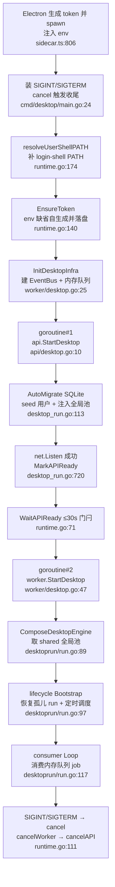

# Arkloop 架构解读：单进程嵌入式 agent runtime

> 本解读按 ai-agent 类规格产出。

本文是 Arkloop 整套解读的**架构总览子文档**，与 pipeline / agent-loop / 前端等子文档配套，由 `ai-agent/Arkloop/README.md` 索引。它回答一个根本问题：**"一个 Go 进程 = 整个后端"这句话在代码里到底对应什么形态，以及这套单进程嵌入式哲学如何从启动链路一路贯穿到 SQLite、事件总线与单用户认证。**

## 一句话定位

Arkloop 是一个**本地优先、单进程嵌入式 runtime** 的对话式 AI agent 桌面平台：Electron 壳负责进程管理，唯一后端入口是一个被当 sidecar 拉起的 Go 进程 `desktop`，它同时以"库"的形式嵌入了 `api` 与 `worker` 两个完整服务。README 的宣传口径 —— "One embedded Go process is the whole backend: API and worker are libraries, not separate services" —— 在代码层面对应的不是微服务、也不是独立可执行文件，而是一组**包级入口函数 + 一个单进程组合器**。

## 定位：api 与 worker 是"库"，组合发生在 desktop runtime

两个顶层服务各自只暴露薄薄的桌面入口，实际装配全部下沉到各自的 `internal/app`：

- `api` 顶层只有 `StartDesktop` / `StartDesktopTelegramPollWorker` 两个函数，前者一行转调 `app.RunDesktop`；真正干活的装配在 internal 包里，从不被外部二方包直接 import，只能通过这层薄壳进入 [src/services/api/desktop.go:9-17]()。 <!-- anchor: // StartDesktop 启动桌面模式 API 服务。阻塞直到 ctx 取消或出错。 … return app.StartTelegramDesktopPollWorker(ctx, pool) -->
- `worker` 顶层同样只有 `InitDesktopInfra` / `StartDesktop`，后者直接转调 `desktoprun.RunDesktop` [src/services/worker/desktop.go:46-49]()。 <!-- anchor: // StartDesktop 启动桌面模式 Worker 消费循环。阻塞直到 ctx 取消或出错。 … func StartDesktop(ctx context.Context) error { --> 桌面启动逻辑被刻意抽到独立包 `desktoprun`，包注释点明动机是避免 `consumer -> app -> consumer` 的循环依赖 [src/services/worker/internal/desktoprun/run.go:1-3]()。 <!-- anchor: // Package desktoprun 将 Worker 桌面模式的启动逻辑封装为可复用函数。 … // 独立包避免 consumer -> app -> consumer 循环依赖。 -->

**唯一的组合器是 `desktopruntime.Run`**：`desktop` 命令的 `main.go` 只做"装信号、起 context、cancel 后交还"，30 行内就把控制权整体交给 runtime [src/services/desktop/cmd/desktop/main.go:24-34]()。 <!-- anchor: sigCh := make(chan os.Signal, 1) … return desktopruntime.Run(ctx, desktopruntime.Options{ -->

`Run` 内部的顺序就是整篇解读的地图：补 login-shell PATH → `EnsureToken` → `worker.InitDesktopInfra` → goroutine 起 `api.StartDesktop` → 30s 内 `WaitAPIReady` → 再起 `worker.StartDesktop` → 两个 err channel 汇合决定退出 [src/services/desktop/runtime/runtime.go:30-126]()。 <!-- anchor: func Run(ctx context.Context, opts Options) error { … return firstErr -->

### 去掉这层会发生什么（角色倒推）

单进程组合层不是"又一层胶水"，而是整个产品形态的前提，去掉它系统会连锁塌掉：

1. **Electron 没有后端可连。** sidecar 进程本身就是要被拉起的那个 Go 二进制；没有 `Run`，spawn 出来的进程无事可做 [src/apps/desktop/src/main/sidecar.ts:806-811]()。 <!-- anchor: const child = spawn(binPath, [], { … ARKLOOP_DESKTOP_OS_USERNAME: desktopOsUsername(), -->
2. **api 与 worker 之间失去"进程内共享"通道。** `shared/desktop` 包注释直接说明 API 与 Worker 在同一进程内经此包共享 JobQueue 与 EventBus [src/services/shared/desktop/shared.go:1-3]()；这些状态既不在 api 也不在 worker，拆成两个进程后必须退化为「HTTP 轮询 DB 拿 job」或引入外部队列。 <!-- anchor: // Package desktop 提供桌面模式下跨模块共享资源的进程级全局状态。 … // API 和 Worker 在同一进程内运行时，通过此包共享 JobQueue 和 EventBus。 -->
3. **安全模型失去依据。** local-only token 的信任边界建立于"进程从 loopback 拉起、请求只可能来自本机用户"这一假设（详见后文「单用户认证模型」）。两个独立进程 + 一个公网端口会让这套 loopback 信任推断不成立 [src/services/api/internal/http/authapi/v1_local_session.go:175-192]()。 <!-- anchor: func localTrustRequestAllowed(r *nethttp.Request) bool { … return localTrustHeaderAllowed(r.Header.Get("Origin")) && -->

## 根因：本地优先个人 agent 的规模假设决定了"库"而不是"服务"

核心矛盾是：**给一个人用的常驻 agent，按多人微服务来搭建是结构性浪费，按纯客户端来搭又装不下 agent runtime**。拆开看：

- Arkloop 单用户：`account_id` 是全部业务表的关联键，身份只有一固定 UUID 种子，无租户、无隔离、无横向扩展需求 —— 这类"软件"最该有的形态是桌面 app 内嵌的 runtime。固定身份写在 `auth` 包的三个 UUID/角色常量里，注释自述"本机 local trust 会换取这个 owner 的正常 session" [src/services/api/internal/auth/desktop.go:10-15]()。 <!-- anchor: // 桌面模式固定标识：本机 local trust 会换取这个 owner 的正常 session。 … DesktopRole      = RolePlatformAdmin -->
- 但它需要常驻消费、需要 agent loop 完整跑 pipeline，本质是一个"有守护语义的后端"：掉线重连、定时唤醒、IM 渠道长轮询都要有人持续守着。Electron renderer 不适合守，于是需要一个真正长命的 Go 进程来守 —— 这个进程就是 desktop runtime。worker 的 `RunDesktop` 里能看到完整的长命编排：compose 引擎 → lifecycle 启动 → 进入 consumer 主循环直到 ctx 取消 [src/services/worker/internal/desktoprun/run.go:89-101]() [src/services/worker/internal/desktoprun/run.go:117-134]()。 <!-- anchor: engine, err := app.ComposeDesktopEngine(ctx, db, bus, executor.DefaultExecutorRegistry(), cq) … lifecycle.Start(ctx) --> <!-- anchor: loop, err := consumer.NewLoop( … return loop.Run(ctx) -->
- 「一个进程既能被桌面 GUI 拉起、也能被 `ark web` 无头拉起、还能让 CLI `ark` 当纯客户端复用」—— 这就是把 api/worker 做成**库**、把**启动编排做成可复用函数**的直接收益。`ark web` 的 `web.go` 里 headless 模式直接复用同一条 `desktopruntime.Run` 链路，零新后端代码 [src/services/cli/cmd/ark/web.go:124-127]()。 <!-- anchor: runtimeErr := make(chan error, 1) … Component: "headless-web", -->

结论一句话：**体积与语义都够格的"个人后端"，最优打包形态就是被桌面壳拉起的单进程内嵌 runtime；服务与库的边界从"部署单元"改写为"包内入口"。**

## 设计思路：被放弃的替代方案与各自代价

### 替代一：api / worker 拆两个进程（或 microservices）

代码里能找到"若拆开会怎样"的直接注释证据：SQLite 池以进程内全局状态共享，且谁负责最终 Close 由 `SetSidecarProcess` 标志区分 —— 整个关闭权柄只有一份，暗示系统从设计上不允许"两个各自持库的进程"共存 [src/services/shared/desktop/sqlite_lifecycle.go:15-24]()。 <!-- anchor: // SetSidecarProcess 由 desktop 侧car main 在 InitDesktopInfra 之后置为 true； … func SidecarProcess() bool { -->

拆双进程的代价是：要么两进程各自开 SQLite 文件互锁，要么引入 socket 通信 + 双端连接管理；而 Telegram 等渠道 poller 还需要 leader election —— 项目用进程内 `atomic` CAS 就解决了单实例互斥，两进程版本就要上分布式选主 [src/services/shared/desktop/telegram_poller_leader.go:5-9]()。这是一组"单进程白赚的简化"。 <!-- anchor: var telegramDesktopPollLeader uint32 … return atomic.CompareAndSwapUint32(&telegramDesktopPollLeader, 0, 1) -->

### 替代二：保留 Postgres + Redis + 外部消息队列

worker 内部 `queue.ChannelJobQueue` 包注释直接陈述：它是纯内存 JobQueue，语义对齐 PgQueue，专为"不想要 PostgreSQL 依赖"的场景存在 [src/services/worker/internal/queue/channel_queue.go:26-29]()。 <!-- anchor: // ChannelJobQueue is a pure in-memory JobQueue backed by a mutex-protected … // where a PostgreSQL dependency is undesirable. -->

单进程形态下丢弃 PG/Redis/MQ 的底气在于：**队列的唯一消费者就在隔壁进程**。API 侧在 run 创建事务的 `AfterCommit` 之后才把 job 推入内存队列，进程级 `pendingRunExecute` 集合做了 run 级去重 —— 这套"事务成功才可见 + 不重复入队"的数据库队列语义被原样搬进了进程内 [src/services/api/internal/data/jobs_repo_desktop.go:23-33]() [src/services/api/internal/data/jobs_repo_desktop.go:86-95]()。 <!-- anchor: func reservePendingRunExecute(runID uuid.UUID) bool { … return true --> <!-- anchor: ac.AfterCommit(func() { … return jobID, true, nil -->

### 替代三：数据放云端 / 多文件多进程

纯本地意味着存储必须能装进"一个目录、一把钥匙"。SQLite 文件、对象存储、密钥环、JWT secret 全部从 data dir 派生；这里的关键动作是：data dir 下**只打开一次** SQLite 并完成迁移（`AutoMigrate`），随后包成 sqlitepgx 池注入进程全局 [src/services/api/internal/app/desktop_run.go:113-138]()。 <!-- anchor: sqlitePath := filepath.Join(cfg.DataDir, "data.db") … desktop.SetSharedSQLitePool(pgxPool) -->

## 启动链路：串行分段 + 双 goroutine 常驻

启动被刻意设计成**串行分段 + 双 goroutine 常驻**的混合：早期初始化全部串行且失败即退，进入服务期后 api 与 worker 各自独立 goroutine 跑，任一 err channel 出错即触发对侧优雅收尾。

### 串行段为什么必须串行：就绪依赖是单向的

worker 消费循环启动前，SQLite 池必须已经迁移完毕并注入进程全局，`RunDesktop` 里对 `shared == nil` 直接报错："desktop worker requires shared sqlite pool; start it from the desktop sidecar" [src/services/worker/internal/desktoprun/run.go:81-84]()。 <!-- anchor: shared := desktop.GetSharedSQLitePool() … if shared == nil { -->

因此 runtime 用一次 **30 秒超时的 `WaitAPIReady` 门闩**把两段隔开：API goroutine 在 `net.Listen` 成功后才 `MarkAPIReady()`，而不是"进程起来了就算 ready" —— 就绪语义精确到 **HTTP listener 已 bind** [src/services/api/internal/app/desktop_run.go:708-721]()。 <!-- anchor: errCh := make(chan error, 1) … desktop.MarkAPIReady() -->

### 就绪门闩的实现：关闭即广播的 channel

`WaitAPIReady` 不是轮询而是一次 channel close：所有等待方（runtime 的 30s 门闩、`ark web` 的等待）共用同一把锁；channel 一旦 close 语义永久就绪，后续重复 `MarkAPIReady` 幂等不 panic [src/services/shared/desktop/shared.go:93-110]()。 <!-- anchor: // MarkAPIReady 由 API 在 migration + seed + HTTP listener 就绪后调用。 … return ctx.Err() -->

### 优雅关闭：反向的"先 worker 后 api"

关闭时 worker 先退、api 后关，顺序刻意与启动相反：先 `cancelWorker()` 并等 worker goroutine 返回，让**在途 run 有机会被中断/留痕**；再 `cancelAPI()` 让 HTTP 层走 `srv.Shutdown`。两个阶段各自在等返回时留了兜底 [src/services/desktop/runtime/runtime.go:111-125]()。 <!-- anchor: cancelWorker() … return firstErr -->

SQLite 的关闭被归到**且只归到** sidecar 主流程：API 侧只注册 close 回调，defer 里只有在 `SidecarProcess()==false`（单独跑 api cmd 调试）时才亲自关库，否则由 runtime 末尾统一收尾 [src/services/api/internal/app/desktop_run.go:118-124]()，避免双入口同文件时的"已关闭连接"竞争。 <!-- anchor: desktop.RegisterSQLiteCloser(func() error { … if err := desktop.CloseRegisteredSQLite(); err != nil { -->

## 单用户认证模型：一个随机 token + loopback 信任 + 固定身份

桌面模式认证是一条**三级链**，每一级解决一个不同的"谁是合法调用者"问题：

1. **进程环境级：随机 Bearer token。** Electron 每次会话生成 `arkloop-desktop-` + 24 字节随机数的 token，作为 env 传给 sidecar [src/apps/desktop/src/main/sidecar.ts:58-59]()，并落盘 `~/.arkloop/desktop.token`。Go 侧 `EnsureToken` 若发现 env 缺省则自生成同名格式 token 并写同一路径（0600）[src/services/desktop/runtime/runtime.go:140-160]() —— 两处实现互补而非竞争。token 路径由 `TokenPath()` 统一给出 `~/.arkloop/desktop.token` [src/services/desktop/runtime/runtime.go:166-172]()。 <!-- anchor: const desktopAccessToken = `arkloop-desktop-${randomBytes(24).toString('hex')}` … const DESKTOP_TOKEN_FILE = path.join(ARKLOOP_HOME, 'desktop.token') --> <!-- anchor: func EnsureToken() error { … if err := os.WriteFile(tokenPath, []byte(token), 0o600); err != nil { --> <!-- anchor: func TokenPath() (string, error) { … return filepath.Join(home, ".arkloop", "desktop.token"), nil -->

2. **身份级：固定 UUID 种子用户。** 首次启动 `SeedDesktopUser` 用 `ON CONFLICT DO NOTHING` 幂等写入固定 `DesktopUserID` / `DesktopAccountID` 与 `platform_admin` 成员关系，并写入 `work_enabled=true` 的平台级 feature flag —— 单用户模式下 work 开关直接在 seed 里摊平，不再走管理后台 [src/services/api/internal/auth/desktop_seed.go:12-71]()。用户名缺省 `desktop`，可被 `ARKLOOP_DESKTOP_OS_USERNAME` 覆盖为真实 OS 用户名 [src/services/api/internal/auth/desktop.go:17-22]()。 <!-- anchor: func SeedDesktopUser(ctx context.Context, q data.Querier) error { … return nil --> <!-- anchor: func DesktopPreferredUsername() string { … return "desktop" -->

3. **会话级：local-session 兑换短期 JWT。** 应用业务 API 不直接认 desktop token，而是用它 POST `/v1/auth/local-session`，换取一个短期 access token（桌面端缓存 45 分钟），后续全部业务请求带这个 JWT [src/apps/desktop/src/main/ipc.ts:946-961]()。`local-session` 端点先做 `localTrustRequestAllowed` 门控，再匹配 desktop token，最后为固定 `DesktopUserID` 签发令牌对 [src/services/api/internal/http/authapi/v1_local_session.go:32-45]()。 <!-- anchor: async function getDesktopSessionAccessToken(apiBaseUrl: string): Promise<string> { … desktopSessionAccessTokenExpiresAt = now + 45 * 60 * 1000 --> <!-- anchor: if !localTrustRequestAllowed(r) { … issued, err := authService.IssueTokenPairForUser(r.Context(), auth.DesktopUserID) -->

`local-session` 的信任判定是**组合条件**而非单点：Host 必须 loopback、RemoteAddr 必须 loopback、所有 forwarded 头只允许 loopback 值、Origin/Referer 也只放行 loopback [src/services/api/internal/http/authapi/v1_local_session.go:175-192]()。 <!-- anchor: func localTrustRequestAllowed(r *nethttp.Request) bool { … return localTrustHeaderAllowed(r.Header.Get("Origin")) && --> 直接掐死"来自本机之外、或经代理头伪装成本机"的请求。

desktop token 之外还有第二条**可选的 owner password 轨**（供 `ark web` 远端浏览器场景）：密码校验走 bcrypt、写 `user_credentials`，同一套 local-trust 前置，两条轨共用同一个种子用户会话签发、不产生第二身份 [src/services/api/internal/http/authapi/v1_local_session.go:104-113]() [src/services/api/internal/http/authapi/v1_local_session.go:128-141]()。 <!-- anchor: if err := setDesktopOwnerPasswordCredential(r.Context(), db, body.Username, body.Password); err != nil { … issued, err := authService.IssueTokenPairForUser(r.Context(), auth.DesktopUserID) --> <!-- anchor: hasher, err := auth.NewBcryptPasswordHasher(0) … defer func() { _ = tx.Rollback(ctx) }() -->

**权衡要点**：整个模型赌在"本机即用户"上 —— 无注册、无找回、无 rate-limit 后台；换取的是开箱即用（种子账号天然存在，无需 onboarding 建号）。代价是 token 一旦被本机其他进程读到即可完全接管，防御纵深只到文件权限（0600）与 loopback 判定。

## 共享层：把"单进程"从口头落到代码的七个关键库

共享层是嵌入式架构的**承重墙**：api 与 worker 是库、彼此不 import，它们交换状态只能经 `shared` 里的进程级注册表与抽象。下面按"为什么存在 → 设计取舍"讲每个关键库。

### desktop：进程级全局注册表（一切共享的汇聚点）

`shared/desktop` 是唯一允许存放"跨 api/worker 的进程级可变状态"的包，注释直说 API 与 Worker 同进程内靠它共享 JobQueue 与 EventBus [src/services/shared/desktop/shared.go:1-3]()。 <!-- anchor: // Package desktop 提供桌面模式下跨模块共享资源的进程级全局状态。 … // API 和 Worker 在同一进程内运行时，通过此包共享 JobQueue 和 EventBus。 --> 共享状态清单：`jobEnqueuer`（worker 内存队列句柄）、`eventBus`、`workNotifier`、`sharedSQLitePool`、两个就绪 channel、OneBot 端点 provider 等 [src/services/shared/desktop/shared.go:45-54]()。 <!-- anchor: jobEnqueuer   JobEnqueuer … onebotHTTPEndpointFn func() (addr string, token string) -->

设计取舍：全部 Set/Get 用 `sync.Mutex` 包住、读写都加锁，避免 init 阶段与运行阶段的竞态；但 bus/pool 等以弱类型（`any`）暴露，把"类型正确"的校验推迟到使用方 —— API 侧 `RunDesktop` 启动时做一次 `desktop.GetEventBus().(eventbus.EventBus)` 断言并优雅处理 [src/services/api/internal/app/desktop_run.go:570-573]()。 <!-- anchor: var desktopBus eventbus.EventBus … desktopBus = b -->

### eventbus：用进程内 pub/sub 顶替 Redis 广播

API 与 worker 之间"调度唤醒"需要一条轻量通知通道。云版本事件流经 DB/Redis，桌面版由 `LocalEventBus` 承接 —— 注释明示 intended for dev/test/single-process [src/services/shared/eventbus/local.go:10-11]()。topic 常量甚至沿用了历史 channel 命名，订阅方（heartbeat 调度、inbound burst runner 等）无需改动即可在两种传输间切换 [src/services/shared/eventbus/eventbus.go:5-10]()。 <!-- anchor: // LocalEventBus implements EventBus as an in-process pub/sub using Go channels. … // Intended for development, testing, and single-process (Desktop) deployments. --> <!-- anchor: // 跨模块唤醒 topic,经 EventBus 投递。字符串取值沿用历史 channel 名, … TopicInboundBurst  = "arkloop:inbound_burst" -->

`LocalEventBus` 的投递语义刻意对齐 Redis Pub/Sub：订阅者缓冲满时**非阻塞丢弃**（fire-and-forget），而不是阻塞发布方 [src/services/shared/eventbus/local.go:114-121]() —— 总线永远不拖慢 producer，代价是慢消费者会丢唤醒消息；唤醒类消息本就允许丢失（job 本身已落内存队列，bus 只是"踢一脚"）。 <!-- anchor: // send attempts a non-blocking send. If the subscriber's buffer is full … default: -->

### database / sqliteadapter / sqlitepgx：一张 SQLite 文件，两套方言外壳

`shared/database` 定义纯接口层（`DB`/`Tx`/`Querier`/`Row`/`Rows`），注释写明 PostgreSQL（pgxpool）与 SQLite 都要实现它 [src/services/shared/database/database.go:5-6]()。接口刻意做得最小：`Result` 省略 `LastInsertId`（PG 用 RETURNING），把两后端的语义差压到最小 [src/services/shared/database/database.go:49-52]()。 <!-- anchor: // DB abstracts a database connection pool. … // Both PostgreSQL (pgxpool.Pool) and SQLite can implement this interface. --> <!-- anchor: // LastInsertId is intentionally omitted; PostgreSQL uses RETURNING instead. … RowsAffected() int64 -->

关键架构事实：**代码里其实有两条"面向不同调用方"的 SQLite 外壳，都跑在同一个 data.db 上**：

- `sqliteadapter.Pool` 实现 `database.DB` 接口，`Open` 里默认 `SetMaxOpenConns(1)` 保持最保守的单连接语义（面向老式通用代码路径）[src/services/shared/database/sqliteadapter/adapter.go:75-81]()。 <!-- anchor: func Open(dataSourceName string) (*Pool, error) { … db.SetMaxOpenConns(1) -->
- `sqlitepgx.Pool` 模拟 **pgx 的 `Querier` 签名**，让几十个按 pgx 写的 repository 一行不改跑在 SQLite 上 [src/services/shared/database/sqlitepgx/pool.go:1-4]()。代价是每次 SQL 都要过 `rewriteSQL` 做 PG→SQLite 词法预处理（`now()`→`datetime('now')`、去类型强转、`jsonb_set`→`json_set`、`ILIKE`→`LIKE` 等）[src/services/shared/database/sqlitepgx/compat.go:52-54]()。 <!-- anchor: // Package sqlitepgx wraps database/sql with a SQLite backend to satisfy … package sqlitepgx --> <!-- anchor: // rewriteSQL performs lightweight PostgreSQL-to-SQLite SQL preprocessing. … func rewriteSQL(sql string) string { -->

这套"正则级 SQL 方言翻译"是很激进但务实的取舍：**不做 ORM、不做方言抽象层，直接用词法改写把 PG 写的业务 SQL 搬到 SQLite**；脆弱性由充分单测兜底。写入侧才是单进程 SQLite 的真正难点 —— SQLite 单写者，而 API handler、worker 并发消费、IM poller 会同时写。方案分两层：

- **进程级写令牌**：`SerialWriteExecutor` 用容量 1 的 channel 做互斥令牌，整段写事务持锁 [src/services/shared/database/sqlitepgx/write_executor.go:35-44]()。 <!-- anchor: // SerialWriteExecutor 提供进程级单写执行能力。 … func NewSerialWriteExecutor() *SerialWriteExecutor { -->
- **连接层兜底**：每条连接开 WAL、`busy_timeout=20000`（注释自述：单文件在并发 execute + Telegram poll 持写时 5s 不够）[src/services/shared/database/sqlitepgx/pool.go:32-39]()。 <!-- anchor: // busy_timeout: desktop shares one SQLite file across worker + API + poll; … "PRAGMA synchronous=NORMAL", -->

写令牌按**整段事务**持有意味着：一旦某次写事务里夹了慢操作（无超时的工具、LLM 调用），全进程写被冻结。项目为此配了 write-lock monitor：连续持锁超阈值就 dump 全部 goroutine 到临时文件并告警路径 [src/services/worker/internal/desktoprun/run.go:173-177]() —— 承认弱点是单写模型可接受的一部分，monitor 只是"定位持令牌者"的诊断手段。 <!-- anchor: // startWriteLockMonitor 周期检查 SQLite 全局写令牌是否被长时间持有。desktop 进程内所有写共享一个 … // 定位持令牌者。阈值由 ARKLOOP_WRITE_LOCK_MONITOR_SECONDS 控制，默认 15s，<=0 关闭。 -->

### objectstore：对象存储语义的文件系统 blob 库

artifact / message-attachment / environment / skill / rollout 五类大对象不进 SQLite，进 `objectstore`。它暴露 bucket 常量（`ArtifactBucket = "sandbox-artifacts"`、`RolloutBucket = "arkloop-rollouts"` 等）[src/services/shared/objectstore/store.go:5-9]()，桌面实现 `FilesystemStore`：每个 bucket 一个目录，下分 `objects/` 数据与 `.meta/` 元数据两个子目录 [src/services/shared/objectstore/filesystem.go:17-18]() [src/services/shared/objectstore/filesystem.go:255-268]()。 <!-- anchor: const ArtifactBucket = "sandbox-artifacts" … const RolloutBucket = "arkloop-rollouts" --> <!-- anchor: filesystemObjectsDir = "objects" … filesystemMetaDir    = ".meta" --> <!-- anchor: func (s *FilesystemStore) objectPaths(key string) (string, string, string, error) { … return dataPath, metadataPath, normalizedKey, nil -->

写用临时文件 + rename 原子提交（`atomicWriteFile`）[src/services/shared/objectstore/filesystem.go:346-367]()，ETag 用 sha256 内容摘要（`contentETag`）[src/services/shared/objectstore/filesystem.go:370-372]()，key/prefix 双重路径逃逸校验（`safeJoin` 拒绝 `..`、绝对路径）[src/services/shared/objectstore/filesystem.go:334-343]()。 <!-- anchor: func atomicWriteFile(path string, data []byte, perm fs.FileMode) error { … return os.Rename(tempPath, path) --> <!-- anchor: func contentETag(data []byte) string { … return hex.EncodeToString(sum[:]) --> <!-- anchor: func safeJoin(root, name string) (string, error) { … return joined, nil -->

取舍：blob 以原始路径 key 存放、用旁路 `.meta` 记录 content-type 等，换取对已存在代码完全透明的 `Get(key)`；"manifest+blob、sha256 寻址"的语义实际由上层 workspace 模块在 key 上自建，Store 只保证原子与可校验（ETag）。

### config：注册表 + 层级回退的运行时配置

运行时配置走 `config.Registry`（每个 key 声明类型/默认值/sensitive/scope），配合 `Resolver` 按 **env → project_db → platform_db → default** 的优先级回退 [src/services/shared/config/resolver.go:55-93]()；DB 层存于 `platform_settings` / `project_settings`。注册表共享同一 `DefaultRegistry()`（进程内 singleton，`sync.Once` 保护）[src/services/shared/config/default_registry.go:5-24]()。 <!-- anchor: func (r *ResolverImpl) ResolveWithSource(ctx context.Context, key string, scope Scope) (string, string, error) { … return entry.Default, "default", nil --> <!-- anchor: defaultRegistryOnce sync.Once … return defaultRegistry -->

桌面端的关键变体：Worker 用 `config.NewPGXStoreQuerier(db)` 把查询适配到 SQLite DesktopDB 上 [src/services/shared/config/store.go:34-41]() —— 配置系统只依赖一个带 `QueryRow` 的最小接口，所以能同时喂给 pgxpool 与 sqlitepgx，这是"接口最小化换后端无关"的又一例证。env 名有约定推导：key 转 `ARKLOOP_UPPER_SNAKE` [src/services/shared/config/resolver.go:207-210]()。 <!-- anchor: // NewPGXStoreQuerier 包装任意带 QueryRow 的实现（如 api data.DB、desktop DesktopDB）。 … return &PGXStore{q: q} --> <!-- anchor: func deriveEnvKey(key string) string { … return "ARKLOOP_" + normalized -->

### log / httputil / threadrunstate / runkind / schedulekind：小而专的共享惯例

- `log` 是 slog 的统一构造器，默认 Warn 级 [src/services/shared/log/logger.go:21-24]()；并尊重 `ARKLOOP_DESKTOP_QUIET_LOGS` —— Electron 以 quiet 模式跑时把输出直接 `io.Discard`，避免 GUI 内嵌进程刷屏 [src/services/shared/log/logger.go:54-55]()。 <!-- anchor: defaultLevel = slog.LevelWarn … logMode      = "pretty" --> <!-- anchor: if os.Getenv("ARKLOOP_DESKTOP_QUIET_LOGS") == "1" { … cfg.Output = io.Discard -->
- `httputil` 只含 `StatusRecorder`：包住 `ResponseWriter` 记状态码，供 API 的日志/审计在**不改 handler** 前提下拿到响应码（标准中间件惯例）[src/services/shared/httputil/status_recorder.go:5-12]()。 <!-- anchor: // StatusRecorder wraps http.ResponseWriter and captures the status code. … func (r *StatusRecorder) WriteHeader(statusCode int) { -->
- `threadrunstate`：把"某 thread 的 run 状态变了"编码成 eventbus 消息（`ChangedPayload{account_id, thread_id}`），发布方只需 `bus.Publish`，订阅方（web 端刷新）不必知道对方存在 [src/services/shared/threadrunstate/state.go:12-19]()。 <!-- anchor: const Topic = "arkloop:thread_run_state" … func Encode(accountID uuid.UUID, threadID uuid.UUID) string { -->
- `runkind` / `schedulekind`：前者是 run 语义类别常量（heartbeat/discuss/scheduled_job/impression/subagent_callback…，配默认 heartbeat 30 分钟与兜底 persona）[src/services/shared/runkind/runkind.go:3-16]()；后者是调度表达与校验：七种 kind 常量（interval/daily/monthly/weekdays/weekly/at/cron）+ `CalcNextFire` 统一计算下一次触发时间 [src/services/shared/schedulekind/schedulekind.go:12-20]() [src/services/shared/schedulekind/schedulekind.go:82-83]()。二者都是"无状态的类型/语义字典"，被 pipeline 与调度器 import 而永不 import 别人，是共享层里最不易腐化的部分。 <!-- anchor: const Heartbeat = "heartbeat" … const DefaultPersonaKey = "normal" --> <!-- anchor: Interval = "interval" … Cron     = "cron" --> <!-- anchor: // CalcNextFire 根据调度类型计算下一次触发时间。 … func CalcNextFire(kind string, intervalMin int, dailyTime string, monthlyDay int, monthlyTime string, weeklyDay int, fireAt time.Time, cronExpr string, tz string, now time.Time) (time.Time, error) { -->

## Electron 壳与 Go sidecar：拉起、保活、回收

Electron 主进程与 sidecar 的关系是"**监工与长工**"而非同构：壳负责找二进制、选端口、喂 token、监控健康、决定重启与回收；Go 进程只负责把自己跑成一个听话的 loopback 服务。

**拉起三要素**（端口、token、数据目录全由壳决定并以 env 注入）：spawn 时注入 `ARKLOOP_API_GO_ADDR=127.0.0.1:<port>`、`ARKLOOP_DESKTOP_TOKEN` 与 OS 用户名 env —— 壳**在进程外**完成了配置注入，sidecar 无需参数即可启动 [src/apps/desktop/src/main/sidecar.ts:806-811]()。 <!-- anchor: const child = spawn(binPath, [], { … ARKLOOP_DESKTOP_OS_USERNAME: desktopOsUsername(), --> token 同时落 `~/.arkloop/desktop.token`（0600），保证 CLI `ark`、headless `ark web` 能与正在运行的 sidecar 对上同一把钥匙 [src/apps/desktop/src/main/sidecar.ts:899-904]()。 <!-- anchor: export async function startSidecar(preferredPort: number, portMode: LocalPortMode = 'auto'): Promise<SidecarRuntime> { … fs.writeFileSync(DESKTOP_TOKEN_FILE, desktopAccessToken, { mode: 0o600 }) -->

**健康与端口**：健康判定是 HTTP `GET /healthz` 返回 200、2s 内无响应判失败 [src/apps/desktop/src/main/sidecar.ts:596-604]()；轮询节奏与超时由常量给出（500ms 轮询、30s 超时）[src/apps/desktop/src/main/sidecar.ts:47-51]()。端口默认从 preferred 起向后扫描 `AUTO_PORT_SCAN_WINDOW`(=20) 个候选 [src/apps/desktop/src/main/sidecar.ts:735-740]()；冲突则外层循环最多重试 `MAX_AUTO_PORT_RETRIES`(=6) 次后放弃。 <!-- anchor: function healthCheck(port: number): Promise<boolean> { … resolve(false) --> <!-- anchor: const HEALTH_POLL_MS = 500 … const AUTO_PORT_SCAN_WINDOW = 20 --> <!-- anchor: const start = Math.max(1, preferredPort) … if (await isTcpPortAvailable(candidate)) return candidate -->

**重启策略**：sidecar 若在健康后退出，壳在 `MAX_RESTARTS`(=3) 内自动重启（间隔 1s），超过则转入 `crashed` 状态交给 UI [src/apps/desktop/src/main/sidecar.ts:858-863]()。 <!-- anchor: if (restartCount < MAX_RESTARTS) { … }, 1000) -->

**回收顺序**：`before-quit` 拦截默认退出 → `stopSidecar()`（先 SIGTERM，5s 兜底 SIGKILL）→ 成功后才真正 `app.quit()` [src/apps/desktop/src/main/index.ts:572-593]()；stop 同时删除 token 文件 —— 退出即吊销本机信任凭据。窗口只负责渲染：main 把 desktop token 通过 preload 同步注入 renderer（`arkloop:config:get-sync`）[src/apps/desktop/src/main/ipc.ts:119-122]()，业务数据全走 `http://127.0.0.1:<port>/v1/*` 的 loopback HTTP —— Electron 扮演的是**进程管理与凭据托管**，不掺和后端数据逻辑。 <!-- anchor: app.on('before-quit', (e) => { … app.quit() --> <!-- anchor: ipcMain.on('arkloop:config:get-sync', (event) => { … desktopAccessToken: getDesktopAccessToken(), -->

## 关键设计决策

### 决策一：先让 API 把 SQLite 单池"造出来"，Worker 只认领不重开

`RunDesktop` 内完成唯一一次 migration，并把产物（`*sql.DB` → 包成 sqlitepgx.Pool）经进程全局注入 [src/services/api/internal/app/desktop_run.go:113-138]()； <!-- anchor: sqlitePath := filepath.Join(cfg.DataDir, "data.db") … desktop.SetSharedSQLitePool(pgxPool) --> Worker 启动时若发现全局池为空直接失败 [src/services/worker/internal/desktoprun/run.go:81-84]()。 <!-- anchor: shared := desktop.GetSharedSQLitePool() … if shared == nil { --> **整个进程只允许有一个 SQLite 打开点**，杜绝两库各开一文件互锁或两套迁移打架。代价：Worker 的启动被强制排在 API migration 之后（30s 门闩），且 Worker 无法脱离 API 单独以桌面模式跑 —— 这正是单进程的语义，不是缺陷。若改成各自开库，省掉等待却引入 SQLite 同文件双连接 + 双迁移版本漂移，得不偿失。

### 决策二：用"库内 process 全局 + afterCommit 投递"复刻数据库队列语义

run 创建链路在单进程里不再经过 DB 的 jobs 表轮询，而是 handler 事务成功后 `AfterCommit` 才把 job 推入内存 `ChannelJobQueue` [src/services/api/internal/data/jobs_repo_desktop.go:86-95]()； <!-- anchor: ac.AfterCommit(func() { … return jobID, true, nil --> 进程级 `pendingRunExecute` 集合充当"幂等去重"防同 run 双提交 [src/services/api/internal/data/jobs_repo_desktop.go:23-33]()。 <!-- anchor: func reservePendingRunExecute(runID uuid.UUID) bool { … return true --> 这保证"**队列可见性 = 事务提交点**"，与 PG 队列的 `INSERT INTO jobs` 在同一事务内提交是对齐的，只是载体从 DB 行换成内存 map。代价：job 状态不持久，进程崩溃即丢未执行 job —— 桌面单进程接受此风险，并以"崩溃后 worker 重启扫孤儿 run 恢复"兜底（`lifecycle.Bootstrap` 末尾的 `recoverRuns`）[src/services/worker/internal/desktoprun/lifecycle.go:72-85]()。 <!-- anchor: func (m *lifecycleManager) Bootstrap(ctx context.Context) error { … return m.recoverRuns(ctx) --> 对比替代方案：每请求写 jobs 表再让消费者轮询，单用户量级纯属浪费 DB 写放大。

### 决策三：SQL 方言用"正则改写"而非"方言抽象"

repository 代码按 pgx 写、直接跑 SQLite：每个 query 经 `rewriteSQL` 词法改写 + 参数类型归一 [src/services/shared/database/sqlitepgx/compat.go:52-54]()。 <!-- anchor: // rewriteSQL performs lightweight PostgreSQL-to-SQLite SQL preprocessing. … func rewriteSQL(sql string) string { --> 放弃的替代是给全部 SQL 建一层方言抽象（工作量巨大且侵蚀查询能力）或双写两套 SQL（维护爆炸）。词法改写 + 约千行单测是"用工程对冲魔法"的典型。风险是改写规则为白名单式启发，遇到未覆盖的 PG 语法会静默放过或直接 SQLite 报错 —— 这类 bug 只会在真 SQLite 路径上暴露。

## 亮点与问题

### 亮点

- **组合器与库的边界干净**：`desktopruntime.Run` 只编排不实现，api/worker 各自 internal 完整自洽；`ark web` 复用同一条 `Run` 得到 headless 桌面，零新后端代码 [src/services/cli/cmd/ark/web.go:124-127]()。 <!-- anchor: runtimeErr := make(chan error, 1) … Component: "headless-web", -->
- **"等到 listener 就绪才算 ready"** 的精确语义避免了连接池/端口竞态；30s 门闩把复杂时序约束收敛成一次 channel select。
- **共享层的接口最小化策略统一**：`database.DB` 省略 LastInsertId、config.Store 只依赖一个带 `QueryRow` 的最小面、eventbus 以 `any` 存储 —— 三处都在用"最小面"让 SQLite 与 PG 双实现成立。
- 嵌入式形态**白赚了海量简化**：无服务注册、无分布式选主（atomic CAS 即可）、无连接池风暴、无网络故障面。

### 问题与风险

- **全局可变注册表是脆的**：`SetEventBus(b any)` 用弱类型，把装配顺序错误推迟为运行时断言失败或静默 nil；一旦未来出现第二个组合器（如测试拉起两套实例）会互相污染。
- **正则方言改写长期是负债**：每加一条 PG 专属 SQL 都可能新增一条改写规则，且 lint/静态分析无法覆盖改写正确性；字符串字面量/注释内含 PG 语法时可能被误改写。
- **写令牌按整段事务持有**使单写模型对外部慢调用零容忍 —— monitor 只是诊断，不解决本质；超时工具与 LLM 调用若出现在事务中，写侧延迟会被放大（代码注释自己承认这点）。
- **token 生命周期与 UI 会话解耦**：desktop token 全局唯一且长期有效（文件方式），renderer 一旦注入即拥有本机全部权限的"兑换券"；IPC 桥面没有做最小权限分层。
- **`MarkReady`/`WaitReady` 一对当前只有生产者没有消费者**：`MarkReady` 仅在 `InitDesktopInfra` 末尾触发 [src/services/worker/desktop.go:25-38]()，而 `WaitReady` 在代码里没有等待方 —— runtime 与 `ark web` 真正等的是 API 侧的 `WaitAPIReady`（`apiReady` channel）。疑似历史遗留，需确认是否供未来入口使用。 <!-- anchor: // InitDesktopInfra 创建共享的 job queue 和 event bus，注册到全局状态。 … desktop.MarkReady() -->
- **线程级事件语义与历史命名脱节**：`eventbus` 的 topic 名沿用了历史 channel 命名，但桌面路径实际由 `LocalEventBus` 进程内承载，本仓库桌面侧未检索到 pg_notify/LISTEN 对应实现 —— 若云桌面差异路径存在该传输，需在对应文档自证。
