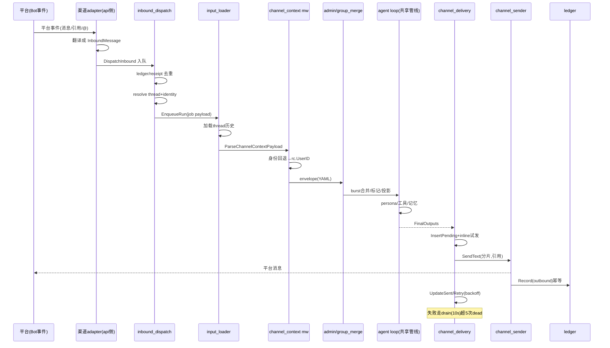
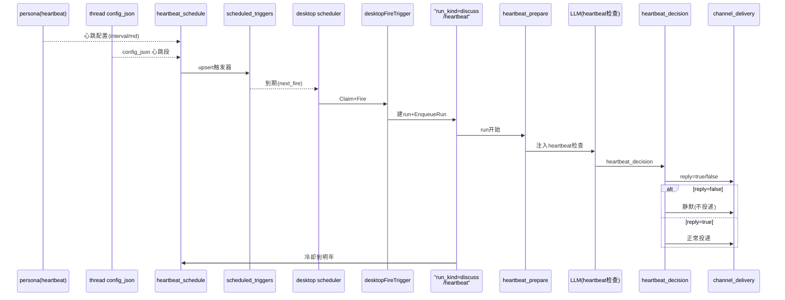

# Arkloop IM 渠道接入与 Heartbeat 定时触发解读

> 本文是 Arkloop（本地优先、单进程嵌入式 runtime 的对话式 AI agent 桌面平台）「IM 渠道接入与定时触发」关注面子文档。**本解读按 ai-agent 类规格产出。**
>
> 解读对象：多渠道（Telegram / Discord / QQ / 飞书 / 微信）的收包翻译与出站投递抽象、`channel_delivery_outbox` / `channel_message_ledger` / `receipts` 投递可靠性三件套、`channel_identity` 身份三层回退、以及 desktop 调度器驱动的 LLM Heartbeat 主动发言。所有引用按仓库相对路径 `src/...` 给出，源码根为 Arkloop 仓库。
>
> 定位：本文承接 agent-loop / pipeline 解读的**主循环之外两段**——run 被 IM 消息或定时触发器**驱动起来之前**（入队与身份注入），以及 run 跑完后**产物投回渠道**（outbox 投递）。表结构本身由数据模型文档覆盖，本文只讲读写路径与设计动机。

---

## 根因：agent 必须能住进 IM、并自己想起要说话

去掉这一层，Arkloop 的 agent 就退化为"只在 web/TUI 里等人发消息"的被动工具。它解决的是产品定位最外圈的两个问题：

1. **agent 能住进用户的日常 IM**：各 IM 平台的 bot 与桌面/web 共用同一条 agent pipeline，渠道只贡献"翻译点"，不复制 persona/记忆/工具。
2. **agent 能"自己想起要说话"**：按 persona 的心跳配置定时唤醒自己，评估此刻值不值得发言，而不是永远被动等输入。

群聊场景还额外引出一个单用户模型下独有的身份问题——**"群友不是平台用户"**：群友只有渠道维度身份、不落 user 表，其内容在记忆上并入 bot owner。这是本篇除"收/发链路"外的第二条主线。

### 一次"渠道对话"是两个正交维度

agent 的思考（persona/工具/记忆/模型）完全与平台无关；而消息的拉取、发送、引用、富媒体、限流是**各渠道差异巨大的平台协议**。若不分层，每接一个 IM 就要重写"上下文注入 + 群聊排版 + 投递"，persona/记忆/工具必然在渠道间漂移。Arkloop 把正交切在三个翻译点上：

- **api 收包侧**：各平台事件被翻译成统一 `InboundMessage`（带渠道、会话、是否 @ / 回复 / 命中关键词、回复目标等平台无关字段）。

  [src/services/api/internal/http/accountapi/channels_inbound_types.go:10-37]()
  <!-- anchor: type InboundMessage struct { … ChatType string -->

- **worker 入站侧**：job payload 里的 `channel_delivery` 被解析成 `ChannelContext`，注入"我是谁（SenderUserID/owner）、在哪个会话、被谁触发"。

  [src/services/worker/internal/pipeline/mw_channel_context.go:16-26]()
  <!-- anchor: type ChannelContext struct { … SenderChannelIdentityID uuid.UUID -->

- **worker 出站侧**：agent 产物被切段投回渠道，`ChannelSender` 是出站唯一平台相关面（统一签名 `SendText(target, text)`）。

  [src/services/worker/internal/pipeline/channel_refs.go:25-26]()
  <!-- anchor: type ChannelSender interface { -->

关键在第三个点后面那句——**入队 payload 与内存上下文是硬边界**：api 只负责"决定这条消息要不要产生 run、挂在哪个 thread、payload 里放什么"，入队 `channel_delivery` 后就不再反向查询平台；worker 只按 payload 干活。这样两边的失败与重试边界清晰。

### 常驻 agent 必须能主动开口（Heartbeat）

被动 bot 的循环是"等消息 → 跑 run → 回消息"。融入日常 IM 流的常驻 agent 需要：**没有新消息时按 persona 周期自检**。这要求两件事解耦——"调度器按 interval 生成 run"（确定性定时）与"run 内部决定要不要真说话"（LLM 判断）。没有前者 agent 永远是复读机；没有后者定时器只会定时烦人。

### 群友不是用户（身份与记忆归属必须解耦）

单用户产品里只有一个真实 user（固定种子 ID），而 bot 在群里收到的是几十个陌生人的消息：

[src/services/worker/internal/data/desktop_identity.go:5-8]()
<!-- anchor: // DesktopUserID 是 desktop 单用户模式下 bot owner 的固定用户 ID。 … var DesktopUserID = uuid.MustParse("00000000-0000-4000-8000-000000000001") -->

若把群友落成 user，账户/权限/隐私/配额全部要为陌生人重开，与"本地单机单用户"的产品本质冲突；若完全忽略身份，群聊上下文里所有人混成一个"user"，LLM 分不清谁说了什么。取舍结果是 **channel_identity 中间层**：陌生人只在渠道维度有稳定身份（不指向 user），记忆主体回退到 channel owner。

### IM 投递是跨进程外部副作用，必须可重试可审计

run 是一次昂贵计算，其产物投递是一次外部 HTTP 副作用：会失败、会超时、进程会崩。没有持久化簿记，"agent 生成了回复但用户没收到"就是不可查的静默丢失；失败即让整条 run 失败，则 IM 偶发抖动会浪费整次 agent 计算。所以需要 outbox（至少一次 + 断点续传）+ ledger（双向账本/去重）+ receipts（轻量去重）这套底座。

---

## 渠道收发抽象 vs 共享 pipeline 的边界

```text
平台协议             翻译点A(api收包)        共享语义               翻译点B(worker出站)
Telegram 长轮询  →  InboundMessage       →  ChannelContext     →  channel_sender.SendText
Discord         →  InboundMessage       →  rc.Messages/outbox  →  (分片+引用+进度)
QQ/OneBot       →  InboundMessage       →  ChannelToolSurface  →  sticker/artifact 段
飞书/微信        →  InboundMessage       →                      →  channel_delivery
```

- 每个渠道只需实现两件事：api 侧"把平台事件翻译成 `InboundMessage`"（文件按渠道拆分），与 worker 侧"把文本发给一个会话"（`channel_sender_*.go`）。
- 中间的 agent pipeline 完全平台无关：`rc.Messages` 是 llm.Message、记忆是 memory、工具是 tools，谁也不 import 平台概念。
- desktop 装配里能看到这条共享链路的全貌：`channel_context` → `discuss_mode` → `channel_admin_tag` → `channel_group_user_merge` → heartbeat/`channel_delivery` 全部串进同一条 run 中间件链，普通消息 run 与渠道 run 走完全相同的 pipeline。

  [src/services/worker/internal/app/composition.go:719-808]()
  <!-- anchor: middlewares := []pipeline.RunMiddleware{ … desktopChannelDelivery(e.db, e.messageAttachmentStore, e.artifactStore), -->

### 对比替代方案

| 备选 | 为何否决/代价 |
|---|---|
| 每渠道一条独立 pipeline | persona/记忆/工具复刻，能力必然漂移；新增渠道成本 ≈ 新写一套 agent |
| 定时器直接发固定话术 | 无法感知上下文，必然烦人；"值不值得说"必须是 LLM 判断 |
| 群友直接建 user | 击穿单用户模型；多租户复杂度全量回归 |
| 出站同步发送、失败即 run 失败 | IM 抖动浪费整次 agent 计算；无重试/审计 |
| 纯内存后台协程投递 | 崩溃即丢，无法对账 |

---

## 多渠道共享 agent 管线的消息链路



### 链路关键点

- **统一 dispatch**：入站去重、线程解析、创建 run、入队全部收敛在 `DispatchInbound`——锁线程行、查活跃 run（可投喂给进行中的 run）、过 agent 触发闸门、`BuildChannelDeliveryPayload` 组装 payload、`CreateRunWithStartedEvent` 建 run 后 `EnqueueRun`。

  [src/services/api/internal/http/accountapi/channels_inbound_dispatch.go:184-243]()
  <!-- anchor: dispatchMode := channelDispatchMode(req.Channel.ChannelType) … return result, nil -->

- **渠道 adapter 把消息正文包成 YAML envelope**：display-name / sender-ref / mentions-bot / time 等前置 YAML 头随消息进入 pipeline，worker 靠它区分说话人、判 @ 与回复。

  [src/services/api/internal/http/accountapi/channels_telegram_inbound.go:311-359]()
  <!-- anchor: func buildTelegramEnvelopeText(identityID uuid.UUID, incoming telegramIncomingMessage, displayName, body string, timeCtx inboundTimeContext) string { … lines = append(lines, fmt.Sprintf(`timezone: "%s"`, escapeTelegramEnvelopeValue(timeCtx.TimeZone))) -->

- **群聊上下文被合并压缩**：连续多条 user 消息（同一 burst）被压成一条紧凑时间线控制 token，`ThreadMessageIDs` 只保留 burst 末条 id。

  [src/services/worker/internal/pipeline/mw_channel_telegram_group_user_merge.go:35-79]()
  <!-- anchor: // mergeAllTelegramGroupUserBursts 遍历全部消息，对每一段连续 user 消息都做 compact。 … return outMsgs, outIDs -->

- **投递中间件统一接管产物**：run 结束后把输出组装成 outbox payload、`InsertPending` 落库、再按渠道 inline 试发（详见下一节可靠性设计）。

---

## 投递可靠性：outbox / ledger / receipts 三件套

三者分工的关键是**回答不同的问题**，不能互相替代：

- **outbox** 回答"发出去了没有"——出站任务队列，run 产物先落 pending（DB 优先），inline 试发，失败按 backoff 排 `next_retry_at`，后台 drain 兜底，超限转 dead。
- **ledger** 回答"这条平台消息是谁的、对应哪条会话消息"——双向消息账本，入站去重、出站幂等。
- **receipts** 回答"这条平台消息 ID 我见过没"——轻量簿记，部分渠道用它替代 ledger 判重。

### 三件套各自的落点

**ledger 双向账本**以 `direction` 区分 inbound / outbound，靠唯一键幂等（同一条平台消息只记一次）：

[src/services/worker/internal/data/channel_message_ledger_repo.go:22-24]()
<!-- anchor: const ( … ChannelMessageDirectionOutbound ChannelMessageDirection = "outbound" -->

**receipts 去重**与 **ledger 去重**在 api 入站 dispatch 中二选一：配了 ledger repo 就走 ledger 事务幂等记录，否则回落 receipts repo；`accepted=false` 即视为已见过、静默丢弃，避免平台重投造成重复 run：

[src/services/api/internal/http/accountapi/channels_inbound_dispatch.go:94-120]()
<!-- anchor: } else if req.LedgerRepo != nil { … return DispatchResult{}, false, nil -->

**outbox 的 at-least-once 语义在类型注释里就被明确承认**：分段发送时若在 HTTP 成功与状态更新之间崩溃，下一段从已确认的 `segments_sent` 继续，导致"已发出但未确认"的段可能重发：

[src/services/worker/internal/data/channel_delivery_outbox_repo_types.go:1-3]()
<!-- anchor: // Package data 提供 channel_delivery_outbox 的持久化操作。 … // 下一段会从已确认的 segments_sent 位置继续，导致该段可能重发。 -->

### outbox 生命周期

```text
run 完成 → buildOutboxPayload → InsertPending(pending)
  → inline 试发(逐段, segments_sent 记录已确认段)
      ├─ 成功 → RecordDelivery + ledger.Record(outbound) → UpdateProgress → UpdateSent
      └─ 失败 → 记 run.channel_delivery_failed 事件 → 交给后台 drain 重试
后台 drain(每10s, 租约挑行): ListPendingForDrain → 逐段发送 → UpdateSent
清理: sent/dead 按 retention 常量定期清理
```

- **DB 优先 + inline 试发**：产物先 `InsertPending` 再立即 inline 试发（按渠道分发），inline 失败只写事件、不阻塞 run 结束，交给 drain 兜底：

  [src/services/worker/internal/pipeline/mw_channel_delivery.go:293-328]()
  <!-- anchor: outboxRepo := data.ChannelDeliveryOutboxRepository{} … recordChannelDeliveryFailure(ctx, pool, rc.Run.ID, deliverErr) -->

- **租约与次数上限**：inline 首发与后台 drainer 共用 30s 租约；`OutboxMaxAttempts = 5`，超过转 dead：

  [src/services/worker/internal/data/channel_delivery_outbox_repo_types.go:28-32]()
  <!-- anchor: // OutboxLeaseDuration 是 inline 首发与后台 drainer 共用的租约时长。 … const OutboxMaxAttempts = 5 -->

- **断点续传**：每段成功后 `UpdateProgress` 把 `segments_sent` 前移，崩溃重启后从已确认段继续：

  [src/services/worker/internal/data/channel_delivery_outbox_repo_types.go:226-241]()
  <!-- anchor: // UpdateProgress updates segments_sent after a segment succeeds. … return nil -->

- **后台 drain 循环**：desktop 每 10s 挑一批 pending 逐条补发，攒够轮数再做一次 sent/dead 清理：

  [src/services/worker/internal/app/composition_desktop_drain.go:43-51]()
  <!-- anchor: ticker := time.NewTicker(10 * time.Second) … drainDesktopPendingWithStore(ctx, db, stickerStore, artifactStore) -->

  [src/services/worker/internal/app/composition_desktop_drain.go:93-105]()
  <!-- anchor: func runDesktopOutboxCleanup(ctx context.Context, db data.DesktopDB) { -->

- **段间节流**：长文本按渠道上限切段后，段间默认 sleep 50ms 防限流（可用环境变量覆盖）：

  [src/services/worker/internal/pipeline/mw_channel_delivery.go:1588-1592]()
  <!-- anchor: func resolveSegmentDelay() time.Duration { … return 50 * time.Millisecond -->

### 失败分层

- inline 失败不阻塞 run 结束，只记事件并留给 drain——代价是"多一次写库 + 双写事务"与"极端情况下可能重发"，换来 run 产物不因 IM 抖动丢失、投递进度可审计、崩溃后重启 drain 即恢复。
- 各渠道的分片上限与回复策略不同：Discord 按 2000 上限切段、每条可带 `message_reference` 回原消息；OneBot 群聊在第一段前插 reply 段；飞书首段对回复消息走 `ReplyText` 线程内回复：

  [src/services/worker/internal/pipeline/channel_sender_discord.go:73-74]()
  <!-- anchor: if target.ReplyTo != nil && strings.TrimSpace(target.ReplyTo.MessageID) != "" { -->

  [src/services/worker/internal/pipeline/channel_sender_onebot.go:40-43]()
  <!-- anchor: // 群聊第一段消息插入 reply 引用 -->

  [src/services/worker/internal/pipeline/channel_sender_feishu.go:85-86]()
  <!-- anchor: case idx == 0 && replyID != "": … sent, err = s.client.ReplyText(ctx, replyID, segment, true, uuid.NewString()) -->

- Telegram 富媒体走独立发送：sticker 先按 account 查 `account_stickers` 映射到真实字节再发；artifact 校验 key 带 account 前缀防越权，再按 content-type 走 `SendPhoto` / `SendDocument`：

  [src/services/worker/internal/pipeline/channel_delivery_sticker.go:18-40]()
  <!-- anchor: func SendTelegramStickerByID( … blob, err := store.Get(ctx, sticker.StorageKey) -->

  [src/services/worker/internal/pipeline/channel_delivery_artifact.go:36-38]()
  <!-- anchor: if accountID == uuid.Nil || !strings.HasPrefix(key, accountID.String()+"/") { … return nil, fmt.Errorf("artifact %q is outside the current account", key) -->

- Telegram 私聊专属 UX：typing 指示 + 进度消息（progress 消息同段编辑更新）。进度跟踪器按 web COP 视图同款分段序维护，只是每个 Telegram 段各自拥有自己的消息：

  [src/services/worker/internal/pipeline/telegram_progress.go:52-53]()
  <!-- anchor: // TelegramProgressTracker keeps Telegram progress in the same segment-based order … // as the web COP view, while each Telegram segment owns its own message. -->

  [src/services/worker/internal/pipeline/mw_channel_delivery.go:1486-1490]()
  <!-- anchor: func ShouldShowTelegramProgress(rc *RunContext) bool { … return isPrivateChannelConversation(rc.ChannelContext.ConversationType) -->

---

## 渠道身份与记忆归属：群友不是用户，但也不能是一团浆糊

### 身份三层回退解析顺序

`ChannelContext.SenderUserID` 的注入顺序（server 版与 desktop 版逻辑镜像），从"能绑就绑"到"绑不上就归 owner"：

```text
platform sender → channel_identity(platform_subject_id, user_id 可空)
                    │
  ① identity.user_id 非空 → 就用它(该陌生人已绑定真实账号)
  ② 否则 → 回退 channel.owner_user_id(记忆归属 bot owner)
  ③ 再否则 → rc.UserID = nil → memory 静默跳过
```

- ① 查 `channel_identities` 拿 `user_id`，非空即用之：

  [src/services/worker/internal/pipeline/mw_channel_context.go:49-57]()
  <!-- anchor: if pool != nil && channelCtx.SenderChannelIdentityID != uuid.Nil { … channelCtx.SenderUserID = identity.UserID -->

- ② 为空则回退 owner（注释明写：channel 场景下 memory 归属 owner）：

  [src/services/worker/internal/pipeline/mw_channel_context.go:58-64]()
  <!-- anchor: // channel 场景下 bot 的 memory 归属于 channel owner … channelCtx.SenderUserID = ownerID -->

desktop 版是同一逻辑的 SQLite 镜像（`loadDesktopChannelIdentity` / `loadDesktopChannelOwner`）：

[src/services/worker/internal/app/composition.go:1359-1375]()
<!-- anchor: if db != nil && channelCtx.SenderChannelIdentityID != uuid.Nil { … channelCtx.SenderUserID = ownerID -->

api 侧则把"identity ↔ user_id（可空）+ 是否 owner"的绑定查询固化：`GetBinding` 的 SQL 同时带出 `ci.user_id` 与 `is_owner`（`user_id = owner_user_id` 判定），群友在渠道层即被标记归属：

[src/services/api/internal/data/channel_identity_links_repo.go:87-125]()
<!-- anchor: func (r *ChannelIdentityLinksRepository) GetBinding( … return &item, nil -->

### UserID == nil → 跳过记忆

memory hook 在 `rc.UserID == nil` 时直接短路返回空态，不读不写——解析不到身份归属的极端情形下宁可无记忆，也不写错账：

[src/services/worker/internal/pipeline/hook_nowledge.go:70-72]()
<!-- anchor: if c == nil || c.provider == nil || rc == nil || rc.UserID == nil { … return nowledgePromptState{}, nil -->

### 群友区分与 admin 标记

- 每条入站消息正文前缀的 YAML envelope 带 `display-name / sender-ref / is-reply-to-bot / mentions-bot` 等，是区分说话人的唯一依据（见上节 `buildTelegramEnvelopeText`）。
- `channel_admin_tag` 把 identity → user → `account_memberships` 判 admin 并注入 `admin: true`，**必须在 group_user_merge 之前**——merge 会把 envelope 拍扁成紧凑文本，错过时机就再难标记：

  [src/services/worker/internal/pipeline/mw_channel_admin_tag.go:14-33]()
  <!-- anchor: // NewChannelAdminTagMiddleware 扫描 rc.Messages 中的 sender-ref， … return next(ctx, rc) -->

  [src/services/worker/internal/pipeline/mw_channel_admin_tag.go:89-122]()
  <!-- anchor: func queryAdminIdentities(ctx context.Context, db data.DB, accountID uuid.UUID, identityIDs []uuid.UUID) map[string]struct{} { … return result -->

- 压缩 speaker 时**同名消歧**：同 display-name 有多人时保留 sender-ref（截断到 8 字符）拼进 speaker；是 admin 再加 `[admin]` 后缀：

  [src/services/worker/internal/pipeline/mw_channel_telegram_group_user_merge.go:550-569]()
  <!-- anchor: func compactTelegramBurstSpeaker(meta map[string]string, duplicateDisplay bool) string { … return speaker -->

---

## LLM Heartbeat：让"定时"不等于"打扰"

被动 bot 的"定时提醒"要做对，关键是把三条职责拆开：**谁负责到点生成 run**（desktop scheduler）、**谁负责决定说不说**（LLM + `heartbeat_decision` 工具）、**谁负责冷却到别重复打扰**（scheduled_triggers 状态机）。整条链路：



### A. 写侧收敛：每轮 run 结束后 upsert / 删除触发器

`NewHeartbeatScheduleMiddleware` 在**普通（非 heartbeat）run** 结束后执行：读 thread 的 `config_json` 取 persona heartbeat 配置 → 写进 `scheduled_triggers` 行；persona 或 thread 配置关闭则**删**触发器，间隔变化则**重排 next_fire**。触发器真正落库时 `trigger_kind` 一律记 `runkind.Discuss`：

[src/services/worker/internal/pipeline/mw_heartbeat_schedule.go:20-135]()
<!-- anchor: func NewHeartbeatScheduleMiddleware(db data.DB) RunMiddleware { … slog.DebugContext(ctx, "heartbeat_schedule: trigger unchanged", "identity_id", identityID) -->

[src/services/worker/internal/data/scheduled_triggers_repo.go:76-95]()
<!-- anchor: INSERT INTO scheduled_triggers … runkind.Discuss, -->

**heartbeat 自己的 run 不再 upsert 自己**（防止无限循环），而是进入冷却分支 `updateHeartbeatCooldown`：

[src/services/worker/internal/pipeline/mw_heartbeat_schedule.go:263-299]()
<!-- anchor: func updateHeartbeatCooldown(ctx context.Context, db data.DB, rc *RunContext, repo data.ScheduledTriggersRepository) error { … notifyHeartbeatScheduler(ctx, rc) -->

### B. 读侧占位 + 入队：desktop scheduler 到期触发

desktop scheduler 循环 `GetEarliestDue` 查最近到期行 → 睡到点 → `ClaimDueTriggers` 认领（先把 next_fire 推到未来，at-most-once，崩溃也不重复 fire）：

[src/services/worker/internal/desktoprun/llm_heartbeat_scheduler.go:40-79]()
<!-- anchor: dueAt, err := data.ScheduledTriggersRepository{}.GetEarliestDue(ctx, db) … desktopTriggerTick(ctx, db, q) -->

[src/services/worker/internal/desktoprun/llm_heartbeat_scheduler.go:144-155]()
<!-- anchor: rows, err := repo.ClaimDueTriggers(ctx, db, 8) … desktopFireTrigger(ctx, db, q, row) -->

`desktopFireTrigger` 解析线程与模型、开事务 `InsertHeartbeatRunInTx` 建 run；**thread 忙则 `ErrThreadBusy` 把触发器顺延一个 interval**：

[src/services/worker/internal/desktoprun/llm_heartbeat_scheduler.go:212-217]()
<!-- anchor: if errors.Is(err, data.ErrThreadBusy) { … _ = repo.PostponeTrigger(ctx, db, row.ID, time.Duration(delayMin)*time.Minute) -->

### C. run 内"说还是不说"由 LLM 自决

`heartbeat_prepare` 只为 heartbeat run 做三件事：注册 `heartbeat_decision` 工具并把它放进 allowlist；注入 **volatile** 的 `[SYSTEM_HEARTBEAT_CHECK]` tail（含 `time_utc / interval_minutes / new_user_messages` + persona.md），`CacheEligible: false` 避免污染长会话 prompt cache：

[src/services/worker/internal/pipeline/mw_llm_heartbeat.go:85-160]()
<!-- anchor: func NewHeartbeatPrepareMiddleware() RunMiddleware { … return next(ctx, rc) -->

模型通过工具调用答 `reply`，executor 只做一件事——把 reply bool 写回 outcome（并校验只能在 heartbeat run 内调用）：

[src/services/worker/internal/tools/builtin/heartbeat_decision/executor.go:23-60]()
<!-- anchor: func (executor) Execute( … DurationMs: int(time.Since(started).Milliseconds()), -->

spec 让模型承诺语义：`true = speak now…message will be sent` / `false = skip this check`：

[src/services/worker/internal/tools/builtin/heartbeat_decision/spec.go:23-30]()
<!-- anchor: JSONSchema: map[string]any{ -->

run 终态据此抑制输出：assistant 文本为空 / `HEARTBEAT_OK` / `reply=false` 都不外发：

[src/services/worker/internal/pipeline/handler_agent_loop.go:1307-1322]()
<!-- anchor: func ShouldSuppressAssistantOutput(rc *RunContext, output string) bool { … return true -->

### 冷却（cooldown）语义——为什么"定时"不会真的每小时都打扰

触发器状态机不是简单 interval，而是 **cooldown_level + burst 检测**：

- heartbeat run 跑完后把 next_fire 推到 `now + 1 年`（`suspendHeartbeatUntilNextMessage`）——"这次心跳已经看过、安静等新消息"，从根上避免无人回应时的循环打扰：

  [src/services/worker/internal/pipeline/mw_heartbeat_schedule.go:301-302]()
  <!-- anchor: func suspendHeartbeatUntilNextMessage(now time.Time) time.Time { … return now.AddDate(1, 0, 0) -->

- 当**真实用户消息**到达，api inbound 走 `resetGroupHeartbeatCooldownForMessage`：把 cooldown 清零并重排一个"几秒到十几秒后"的短触发——间隔按 burst 窗口内递减（15s 起线性收窄、下限 3s），让 bot 能在用户刚开口的窗口跟话：

  [src/services/api/internal/http/accountapi/channels_inbound_dispatch.go:443-495]()
  <!-- anchor: func resetGroupHeartbeatCooldownForMessage( … return true, nil -->

- 并发保护：heartbeat 执行期间若来了新消息，`last_user_msg_at` 快照比对失败即放弃冷却更新（`ErrHeartbeatSnapshotStale`），避免覆盖新消息打开的窗口：

  [src/services/worker/internal/data/scheduled_triggers_repo.go:547-581]()
  <!-- anchor: func (ScheduledTriggersRepository) UpdateCooldownAfterHeartbeatForThread( … return ErrHeartbeatSnapshotStale -->

所以真正的产品语义是：**用户不说话时 bot 最多隔 interval 自检一次；自检完若没新消息就不再打扰；用户一开口 bot 又在 burst 窗口内可回应**——这就是"常驻但不烦人"的实现层。

### 命名双轨事实（重要，排障前必读）

heartbeat 与 discuss 是一套调度体系的两张脸，代码命名容易踩坑：

- 落库 `trigger_kind` 一律 `runkind.Discuss`；desktop scheduler 对 `discuss / heartbeat / ""` 三值统一走 `desktopFireTrigger`：

  [src/services/worker/internal/desktoprun/llm_heartbeat_scheduler.go:153-155]()
  <!-- anchor: switch row.TriggerKind { … desktopFireTrigger(ctx, db, q, row) -->

- fire 出的 job payload `run_kind = runkind.Discuss`：

  [src/services/worker/internal/desktoprun/llm_heartbeat_scheduler.go:241-243]()
  <!-- anchor: payload := map[string]any{ -->

- 但 pipeline 中真正激活 `heartbeat_decision` 的判定是 `run_kind == runkind.Heartbeat`：

  [src/services/worker/internal/pipeline/mw_llm_heartbeat.go:17-26]()
  <!-- anchor: // isHeartbeatRun checks whether run_kind=heartbeat is set in InputJSON or JobPayload. … return false -->

  [src/services/shared/runkind/runkind.go:3-4]()
  <!-- anchor: const Heartbeat = "heartbeat" … const Discuss = "discuss" -->

- 群聊场景真正的"外发闸门"是 `DiscussRun` + `speak` 工具（assistant 文本默认不外发，必须显式 speak）：

  [src/services/worker/internal/pipeline/mw_discuss.go:19-69]()
  <!-- anchor: func NewDiscussModeMiddleware() RunMiddleware { … return next(ctx, rc) -->

  抑制逻辑在出站可见文本判定的同一处收口——`DiscussRun` 且文本不可见、或 heartbeat run 且 `reply != true`，都直接判定"不可见文本"：

  [src/services/worker/internal/pipeline/mw_channel_delivery.go:1506-1511]()
  <!-- anchor: if rc.DiscussRun && !rc.DiscussTextVisible { … return false -->

含义：**群聊的主动发言走 speak（discuss 语义），直聊/心跳检查走 heartbeat_decision**。两条谱系共享同一调度器，只是 run_kind 与"外发闸门"不同。本文"LLM Heartbeat"叙述以调度体系为准，文内已标注二者。

---

## 关键设计决策

### 决策一：把"该不该主动说话"交给一次 LLM 工具调用，而不是规则

- 依据：`heartbeat_decision` 是普通工具，spec 让模型承诺 `reply` 语义，executor 只回写 outcome（见上文 C 节引用）。
- 权衡：每次心跳都付一次 LLM 调用；换来"是否打扰"成为 persona 语义的一部分（heartbeat_md 可定制语气），且 `new_user_messages` 让模型有依据判断"有没有人等我"。规则/纯定时替代方案的代价见"对比替代方案"表。

### 决策二：单用户 + channel_identity 隔离 + 记忆归 owner，而不是给群友建账号

- 依据：identity 带可空 `user_id`（`channel_identity_links` 绑定查询），worker 回退 owner（见身份回退节引用）。
- 权衡：群友没有独立长期记忆，其内容并入 owner 记忆库（隐私需产品层披露）；但保住了单进程单用户模型与"本地优先"的纯度。给群友建 user 会让多租户复杂度全量回归，与产品本质冲突。

### 决策三：投递 DB 优先 + inline 试发 + 后台 drain，at-least-once

- 依据：产物先落库再发，inline 失败靠 drain 兜底；断点续传靠 `segments_sent`（见可靠性节引用）。
- 权衡：多一次写库与双写事务、极端下可能重发；换来 run 产物不因 IM 抖动丢失、投递进度可审计、崩溃后重启 drain 即恢复。

---

## 亮点与风险

### 亮点

1. **一条 pipeline 打天下**：渠道差异被压缩到 2-3 个翻译点，agent 主循环零平台概念，新增渠道只需 adapter + sender。
2. **主动发言可审计**：heartbeat_decision 的 `reply` 落 outcome、speak 落事件，说/不说都可查。
3. **可靠性闭环完整**：outbox/ledger/receipts 各答各的问题、不重叠；cooldown + burst 让"定时"不变成"骚扰"。
4. **身份归属渐进回退**：identity → user → owner → nil（跳过记忆），畸形输入不崩、不错账。

### 问题与风险

1. **heartbeat/discuss 命名双轨**：落库与 fire 均用 `runkind.Discuss`，但 `heartbeat_decision` 只认 `run_kind == runkind.Heartbeat`；群聊真正闸门又是 `speak`。README/AGENTS 叙述的"heartbeat run 自带 run_kind=heartbeat"与代码命名存在偏差（详见"命名双轨事实"），排障容易踩坑——建议后续统一命名或在文档显式标注这一映射。
2. **群友内容并入 owner 记忆的隐私面**：拉进敏感群后对话会写入本地 owner 记忆库；当前未见"群级记忆开关/豁免"类配置，隐私边界完全靠产品层披露。
3. **thread 忙时心跳顺延 interval，无"错过即补"策略**：长任务线程可能让心跳长期滞后（`ErrThreadBusy` 直接把触发器推到下一个 interval，见 scheduler B 节引用），错过的时间窗不会补偿。
4. **at-least-once 的极端重复**：段间崩溃导致"已发出但未确认"段重发；平台不提供事务性回执时没有消重手段，仅靠 outbox 类型注释显式承认（见可靠性节引用）。
