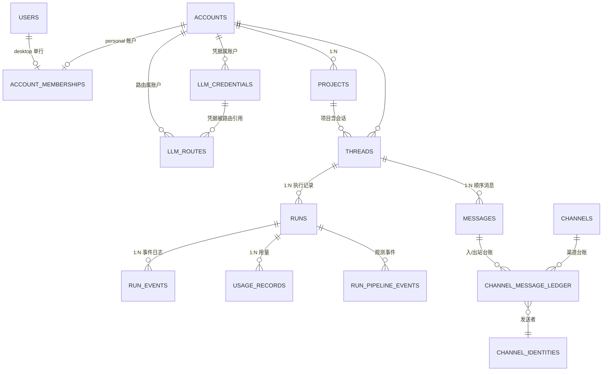
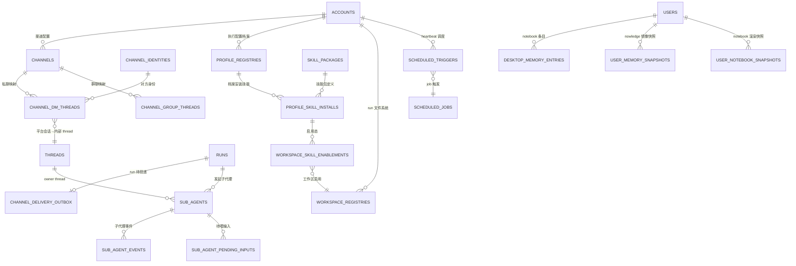
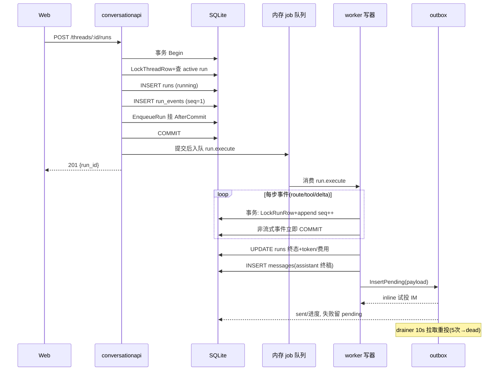
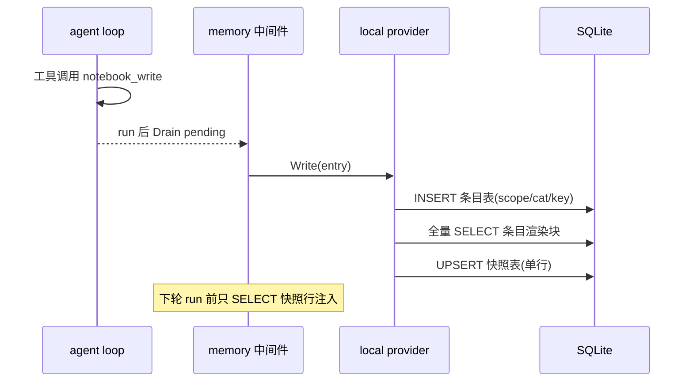

# Arkloop 数据底座解读：一个 SQLite 文件撑起整个 agent runtime

> 本文是 Arkloop（本地优先、单进程嵌入式 runtime 的对话式 AI agent 桌面平台）「数据模型」模块解读。**本解读按 ai-agent 类规格产出。**
>
> 解读对象：`docs/schema/sqlite.sql`（94 表权威 schema 快照）、`api`/`worker` 的 `internal/data`（pgx 签名仓储）、`shared/database`（`database.go` 窄接口 + `sqliteadapter` 迁移 + `sqlitepgx` 方言模拟层）、`shared/objectstore`（文件系统资产）与各读写的消费方。所有引用按仓库相对路径 `src/...` 给出，源码根为 Arkloop 仓库；表结构一律回 `docs/schema/sqlite.sql` 核对。
>
> 定位：本文是整套解读的**数据底座**，承接架构解读「一个 Go 进程 = 整个后端」落地到存储层的形态，也是 pipeline / agent-loop / llm-routing / channels / memory-system / skills-mcp 各子文档里一切"落库表"与"写入时机"的出处——路由命中率背后的 `llm_routes`、渠道 at-least-once 背后的 outbox、记忆回注背后的快照表，全部在这一层建模。

## 在项目中的角色：一个 SQLite 文件就是整套后端的地基

Arkloop 的存储层是「单进程嵌入式哲学」的直接产物：desktop 把整个后端（api + worker）塞进一个进程，数据层的所有决定都被同一个问题驱动——**如何让一套为"可水平扩展的 Postgres 服务"写的仓储代码，在一台个人电脑上以零外部依赖、零部署成本地跑起来，并且数据不丢、升级不出错**。

代码里能直接看到它的三明治结构：

- **仓储层按 pgx 签名编写，SQL 面向 PostgreSQL 方言**（`$1` 占位、`::jsonb`、`now()`、`FOR UPDATE`、`= ANY($n)`），api 与 worker 各自以 `Querier` 接口收口，形状与真 Postgres 的 `*pgxpool.Pool` 兼容，桌面态不换代码、只换注入的数据库句柄 [src/services/api/internal/data/querier.go:10-26]()。
<!-- anchor:type Querier interface { … TxStarter -->
- **`sqlitepgx` 是第二层**：把 `database/sql + modernc.org/sqlite` 包装成 pgx 形状的 `Pool/Tx/Rows`，在每条 SQL 执行前做正则方言改写，并把 `sql.ErrNoRows` 翻译回 `pgx.ErrNoRows`，让仓储里 `errors.Is(err, pgx.ErrNoRows)` 的判断原样成立 [src/services/shared/database/sqlitepgx/errors.go:12-19]()。
<!-- anchor:func translateError(err error) error { … return err -->
- **`sqliteadapter` 是第三层**：负责真正的连接、PRAGMA 与 schema 演进——`AutoMigrate` 是桌面模式的唯一入口，打开文件、应用待执行迁移、返回就绪的池 [src/services/shared/database/sqliteadapter/migrate.go:197-210]()。
<!-- anchor:// AutoMigrate opens a SQLite database, applies pending migrations, and returns … return pool, nil -->

这三层之外是**文件系统**：大量二进制/文本资产（workspace 文件、artifact、技能/插件包体）走 `objectstore` 的"bucket + 内容寻址 key"约定落在数据目录，SQLite 只存"指针与状态机"——如 workspace 清单的 `workspaces/{ref}/manifests/{rev}.json` 与内容 blob 路径就由仓储侧的 key 构造函数给出 [src/services/api/internal/http/accountapi/v1_workspace_files.go:128-134]()。
<!-- anchor:func workspaceManifestKey(workspaceRef, revision string) string { … return "workspaces/" + workspaceRef + "/blobs/" + sha256 -->

所以准确地说：**Arkloop 的存储 = SQLite 单文件（关系事实与状态机）+ filesystem（内容资产）**，二者由 `workspace_registries`/`profile_registries` 这类"注册表"在逻辑上缝合；后面「核心表设计」「Schema 演进」「读写路径」都围绕这套分工展开。

## 存储选型：为什么是 SQLite 单库，为什么仓储敢长 Postgres 的样子

### 根因：产品形态先于技术选型

桌面 app 要"开箱即用、零外部基础设施"，数据目录里只有一个 `data.db`。一旦引入 Postgres，desktop 用户必须本机装库、配连接、管备份——产品"下载即用"的承诺直接破裂。SQLite 提供事务性关系库的全部能力（ACID、外键、部分唯一索引、JSON 函数），却只是一个文件，天然满足"个人数据放本机、随 app 一起备份"的诉求。

代价同样直白：SQLite 是**单写者**模型（WAL 下多读者并行、写串行），一切并发设计都要围绕"进程内只有一个真正在写的人"展开。

### 单写者模型的两层进程级配套

Arkloop 在应用层做了两层配套：

1. **进程级单写令牌（WriteExecutor）**：desktop 全进程共享一个 `SerialWriteExecutor`——用一个容量为 1 的 channel 当令牌，写事务/写语句执行前先取令牌，持令牌期间其它写排队 [src/services/shared/database/sqlitepgx/write_executor.go:36-71]()。
<!-- anchor:type SerialWriteExecutor struct { … }, nil -->
SQLite 层再叠 `busy_timeout=20000` 兜底文件锁竞争；注释记录了教训——曾设 5s，当 `run.execute` 并发 >1 且 Telegram poll 持写时不够，才提到 20s [src/services/shared/database/sqlitepgx/pool.go:31-44]() [src/services/shared/database/sqlitepgx/pool.go:31-33]()。
<!-- anchor:// busy_timeout: desktop shares one SQLite file across worker + API + poll; … return nil, fmt.Errorf("sqlitepgx: pragma %q: %w", p, err) -->
<!-- anchor:// busy_timeout: desktop shares one SQLite file across worker + API + poll; … // 5s was too low when run.execute concurrency>1 and Telegram poll hold writes. -->
2. **把事务做短**：desktop agent loop 的事件写器明确注释 "writes one event per transaction to keep SQLite locks short"——每个 run 事件一个独立事务立即提交，宁可牺牲吞吐换"不长时间占住全库写锁" [src/services/worker/internal/app/composition.go:3490-3491]()。
<!-- anchor:// desktopEventWriter writes one event per transaction to keep SQLite locks shor … type desktopEventWriter struct { -->

这套"单写令牌 + 短事务"的代价是写吞吐被压到很低的水平（全进程串行），但对单用户桌面 agent 完全够用。真正要警惕的是"某个写事务里夹了慢操作（无超时的 LLM 调用、sandbox 命令）导致全进程写冻结"——为此 desktop 起了一个写锁监控：周期查令牌被连续持有的时长，超过阈值就把全部 goroutine dump 到临时文件并告警路径，用于定位持锁者 [src/services/worker/internal/desktoprun/run.go:173-213]()。
<!-- anchor:// startWriteLockMonitor 周期检查 SQLite 全局写令牌是否被长时间持有。desktop 进程内所有写共享一个 … "held_seconds", int(dur.Seconds()), "hold_seq", seq, "dump", path) -->

### 为什么仓储用 pgx 签名 + SQLite 模拟，而不是两套 SQL

选择这个方案而非"为 SQLite 另写一套仓储"，背后是**演进史**：这套仓储显然从"以 Postgres 为默认后端"的形态长出来（迁移文件 00001 还留着"创建 `_sequences` 模拟 Postgres 序列"的字样，表 `orgs` 几经改名成 `accounts`）。当产品收敛到"desktop 本地优先"后，把数百个已写好的 pgx 仓储推倒重写 SQLite 版本不现实；反向让 SQLite 模仿 pgx 接口 + 在 SQL 执行前做规则化改写，是"用一层适配器换掉整个后端"的最短路径。它的三个前提：

- **接口层代价已提前付清**：`database.DB` 抽象只暴露 `Exec/Query/QueryRow/Begin`，注释明说不暴露带事务选项的 `BeginTx`（100+ 调用点都用默认选项）[src/services/shared/database/database.go:8-15]()。
<!-- anchor:// NOTE: BeginTx with transaction options is not exposed; all 100+ call sites … Ping(ctx context.Context) error -->
`Result` 故意不提供 `LastInsertId`（Postgres 用 RETURNING，SQLite 3.35+ 同样支持 RETURNING）[src/services/shared/database/database.go:48-51]()——仓储在写第一行 SQL 时就被约束成"两种数据库都能执行"的形状。
<!-- anchor:// LastInsertId is intentionally omitted; PostgreSQL uses RETURNING instead. … RowsAffected() int64 -->
- **改写是"尽力而为的白名单正则层"，不是完整 SQL 翻译器**：`rewriteSQL` 只处理预先枚举的模式，且"检测到才改写"，未覆盖的 PG 语法在 SQLite 上会直接报错——设计意图是**宁在运行时大声失败，也不静默产生错误语义**（详见「sqlitepgx 深读」）。
- **进程内只有一份库句柄**：api 与 worker 在 desktop 下共享**同一个** `*sql.DB` 包装出的池，谁负责最终 Close 由 `SidecarProcess` 标志区分——系统从设计上就不允许"两个各自持库的进程"并存（详见架构解读）。

### 为什么不用 Postgres / 嵌入式 KV

- **不用 Postgres**：桌面形态无法要求用户安装维护数据库；Arkloop 是单用户、单进程，Postgres 的多进程共享、网络访问、独立服务器运维能力全部用不上，反而是负担。
- **不用嵌入式 KV（bbolt/Badger 等）**：agent runtime 的数据本质是**强关系**——thread 下有消息、run 挂在 thread 上、消息与渠道 ledger/outbox 交叉引用、skills/workspace 有三级启用关系。KV 要在应用层手工维护索引与一致性；SQLite 的关系、外键、部分唯一索引让约束直接落在引擎里（例如 messages 用 `json_extract(metadata_json,'$.client_message_id')` 的表达式索引做"每用户每 thread 客户端消息幂等" [docs/schema/sqlite.sql:364-370]()）。
<!-- anchor:CREATE UNIQUE INDEX uq_messages_thread_id_thread_seq ON messages(thread_id, thre … AND COALESCE(json_extract(metadata_json, '$.client_message_id'), '') <> ''; -->

值得补一句的代价：SQLite 单写 + 模拟层改写子集意味着**不适合高并发写、不适合跑重 JSON 分析**——这些都不是桌面单用户 agent 的瓶颈，选型是刻意的向下适配而非能力缺失。

## 实体关系总览

先看关键"坐标系"：94 张表里绝大多数业务表都带 `account_id` 且 `REFERENCES accounts(id) ON DELETE CASCADE`——单用户模式下它们全部指向同一个个人账户，外键的级联删除语义保留，但多租户生命周期不存在。两张 ER 图按领域归属把 94 张表收敛成"核心执行域"与"扩展能力域"两组。

### 身份与会话执行核心



核心读法：

- **User → Account → Project → Thread → Run → Event** 是纵向主干：用户发一条消息，落在某个 thread 的 messages 里，随即产生一个 run，run 的每一步推进都以 append-only 的 `run_events` 记录，`UNIQUE(run_id, seq)` 保证事件序唯一 [docs/schema/sqlite.sql:1129-1139]()。
<!-- anchor:CREATE TABLE run_events ( … UNIQUE (run_id, seq) -->
- `runs` 上挂着 `profile_ref`/`workspace_ref`（环境绑定）与 `parent_run_id`/`resume_from_run_id`（父子/续跑谱系），是 run 与"执行环境"及"另一个 run"的两类关联 [docs/schema/sqlite.sql:1152-1174]()。
<!-- anchor:CREATE TABLE runs ( … , updated_at TEXT); -->
- LLM 路由两表把"凭据（谁付钱）"与"路由（哪个模型、什么条件、什么成本）"解耦；`llm_routes` 可带 `project_id`（项目级覆盖），其余为账户级 [docs/schema/sqlite.sql:792-809]()。
<!-- anchor:CREATE TABLE llm_routes ( … , show_in_picker INTEGER NOT NULL DEFAULT 1); -->

### 扩展能力域：渠道 / 技能 / workspace / 记忆 / sub-agent / 调度



核心读法：

- **渠道域的三类映射**：
  - `channels` 是"一个平台的接入配置"，每 `account_id + channel_type` 唯一 [docs/schema/sqlite.sql:656-670]()。
<!-- anchor:CREATE TABLE channels ( … UNIQUE (account_id, channel_type) -->
  - `channel_dm_threads`/`channel_group_threads` 把"平台上的一个私聊/群"对应到内部一个 `thread_id`，让 IM 会话与 web 会话共用 thread/message 模型 [docs/schema/sqlite.sql:559-582]()。
<!-- anchor:CREATE TABLE channel_dm_threads ( … UNIQUE (thread_id) -->
  - `channel_message_ledger` 是**入/出站消息台账**，靠 `UNIQUE(channel_id, direction, platform_conversation_id, platform_message_id)` 幂等去重 [docs/schema/sqlite.sql:628-645]()。
<!-- anchor:CREATE TABLE channel_message_ledger ( … UNIQUE (channel_id, direction, platform_conversation_id, platform_message_id) -->
- **执行环境**是 `profile_registries`（"我是谁/带什么配置"）与 `workspace_registries`（"我在哪个文件系统里干活"）两张注册表，skill/mcp/plugin 都挂在它们的 `profile_ref`/`workspace_ref` 上；主键不是 UUID 而是确定性 ref 字符串（`pref_`/`wsref_` + sha256），同一用户/绑定的 ref 可复现。
- **sub-agent 是 thread/run 的交叉**：`sub_agents` 同时引用 `owner_thread_id`（主线程）与 `agent_thread_id`（子代理自己的执行线程），并由 `current_run_id` 指向正在跑的 run——一条 run 可以被投影成一个 sub-agent 的状态。
- **记忆归属**是所有记忆绑定 bot owner（User），同一 User 下所有 persona 共享；快照表以 identity 三元组 `(account_id, user_id, agent_id)` 为复合主键 [docs/schema/sqlite.sql:1595-1603]()。群聊里的"对方"只是 `channel_identities`（IM 身份），不产生新 user。
<!-- anchor:CREATE TABLE user_memory_snapshots ( … PRIMARY KEY (account_id, user_id, agent_id) -->

## 核心表设计

> 字段口径说明：以下字段表基于 `docs/schema/sqlite.sql`（1708 行、94 张表，由"迁移至最新后 dump"生成）。SQLite 列类型实际宽松（TEXT/INTEGER/REAL），表中"类型"列还原 DDL 声明意图；`id` 一律为 v4 UUID 文本主键，行数限制下不再逐行重复。各表职责以"服务哪个业务能力"为准，字段行序按设计要点而非建表顺序。

### 单用户身份三件套：users / accounts / account_memberships

职责：desktop 首次启动写入**固定 UUID 种子**的唯一 user + personal account + 单行 membership，是"本地信任换取正常 session"的锚点——api 侧 `DesktopUserID=...000000000001`、`DesktopAccountID=...000000000002` 就写死在 auth 包 [src/services/api/internal/auth/desktop.go:11-15]()。
<!-- anchor:DesktopUserID    = uuid.MustParse("00000000-0000-4000-8000-000000000001") … DesktopRole      = RolePlatformAdmin -->
种子语句全用 `ON CONFLICT DO NOTHING` 保证幂等 [src/services/api/internal/auth/desktop_seed.go:21-60]()。
<!-- anchor:_, err := q.Exec(ctx, ` … return fmt.Errorf("seed desktop membership: %w", err) -->
worker 无法 import api/internal，于是在 `data/desktop_identity.go` 单点重定义同一 ID，注释要求两处同步 [src/services/worker/internal/data/desktop_identity.go:5-8]()。
<!-- anchor:// DesktopUserID 是 desktop 单用户模式下 bot owner 的固定用户 ID。 … var DesktopUserID = uuid.MustParse("00000000-0000-4000-8000-000000000001") -->

**accounts**（[docs/schema/sqlite.sql:445-453]()）：
<!-- anchor:CREATE TABLE "accounts" ( … , country TEXT, timezone TEXT, logo_url TEXT, settings_json TEXT NOT NULL DEFAUL -->

| 字段 | 类型 | 约束 | 说明 |
|------|------|------|------|
| id | TEXT | PK | 固定 `...0002`（种子）；其余账户正常 v4 |
| slug | TEXT | UNIQUE NOT NULL | 种子值 `desktop` |
| name | TEXT | NOT NULL | 展示名 |
| type | TEXT | CHECK in (personal/workspace) | desktop 只用 personal |
| owner_user_id | TEXT | FK→users | 种子时反指 owner |
| status | TEXT | CHECK in (active/suspended) | 生命周期 |
| country/timezone/logo_url/settings_json | TEXT | settings_json DEFAULT '{}' | 后加列，desktop 基本不用 |
| deleted_at | TEXT | NULL | 软删（实际不留多账户） |

**users**（[docs/schema/sqlite.sql:1627-1639]()）与 **account_memberships**（[docs/schema/sqlite.sql:417-424]()）：user 有 `username/email/status/deleted_at` 与后加的 `tokens_invalid_before`（注销全部 token 的标尺）；membership 是 account↔user 关联 + role，`UNIQUE(account_id,user_id)`。desktop 三者各一行。
<!-- anchor:CREATE TABLE users ( … , tokens_invalid_before TEXT NOT NULL DEFAULT '1970-01-01T00:00:00Z', source TEX -->
<!-- anchor:CREATE TABLE "account_memberships" ( … UNIQUE (account_id, user_id) -->

### 会话归属与 fork 边界：projects / threads

职责：`projects` 是组织容器（desktop 有自动的 `is_default` 项目 [docs/schema/sqlite.sql:1063-1073]()），`threads` 是真正承载对话/工作状态的主体；`mode`/`collaboration_mode`/sidebar 状态/`next_message_seq` 这些扩展列都由迁移逐个 ADD COLUMN 追加（行 1502 一整行续列就是历史堆叠的证据）[docs/schema/sqlite.sql:1489-1504]()。
<!-- anchor:CREATE TABLE projects ( … , is_default INTEGER NOT NULL DEFAULT 0, updated_at TEXT); -->
<!-- anchor:CREATE TABLE "threads" ( … UNIQUE (id, account_id) -->

**threads**：

| 字段 | 类型 | 约束 | 说明 |
|------|------|------|------|
| id / account_id | TEXT | PK；FK→accounts CASCADE | 会话主键 + 归属 |
| created_by_user_id | TEXT | FK→users SET NULL | 发起人 |
| project_id | TEXT | 引用 projects（无 FK 声明） | 会话所属项目，查询时 join |
| title | TEXT | NULL | 标题由 summarize 中间件自动生成（title_locked 锁住） |
| parent_thread_id | TEXT | FK→threads SET NULL | 分支/子线程 |
| branched_from_message_id | TEXT | NULL | 从哪条消息 fork |
| mode | TEXT | CHECK in (chat/work) | 会话模式 |
| collaboration_mode | TEXT | CHECK in (default/plan) + revision | plan/默认协作模式与修订号 |
| next_message_seq | INTEGER | NOT NULL DEFAULT 1 | **消息序号发号器**（见读写路径） |
| deleted_at / expires_at | TEXT | NULL | 软删 / TTL |
| sidebar_pinned_at / sidebar_gtd_bucket | TEXT | 部分索引 | 侧栏固定/GTD 分类 |

### 顺序消息与客户端幂等：messages

职责：一个 thread 的对话事实源。每条消息带 `thread_seq`（由 `threads.next_message_seq` 发号），`hidden=1` 表示中间产物（tool call/中间思考）不进入正常 UI 但保留，`deleted_at` 软删；`metadata_json` 里埋 `run_id`/`client_message_id`，实现"消息↔run"关联与"客户端幂等"。表达式索引 `uq_messages_user_client_message_id` 直接以 `json_extract(metadata_json,'$.client_message_id')` 做"每个 (account,thread,user) 的客户端消息唯一"——这是 SQLite 表达式索引把业务约束落进引擎的例子 [docs/schema/sqlite.sql:364-370]()。
<!-- anchor:CREATE UNIQUE INDEX uq_messages_thread_id_thread_seq ON messages(thread_id, thre … AND COALESCE(json_extract(metadata_json, '$.client_message_id'), '') <> ''; -->

**messages**（[docs/schema/sqlite.sql:866-880]()）：
<!-- anchor:CREATE TABLE messages ( … created_at         TEXT NOT NULL DEFAULT (datetime('now')) -->

| 字段 | 类型 | 约束 | 说明 |
|------|------|------|------|
| id | TEXT | PK | v4 |
| thread_id | TEXT | FK→threads CASCADE NOT NULL | 所属会话 |
| account_id | TEXT | FK→accounts CASCADE | 冗余归属，便于账户级删除 |
| thread_seq | INTEGER | NOT NULL；UNIQUE(thread_id,thread_seq) | 顺序消息号 |
| created_by_user_id | TEXT | FK→users SET NULL | user 消息的作者；assistant 为 NULL |
| role | TEXT | NOT NULL | user/assistant/tool/system 等 |
| content | TEXT | NOT NULL | 纯文本主体 |
| content_json | TEXT | NULL | 结构化内容（富文本/分段） |
| metadata_json | TEXT | DEFAULT '{}' | `run_id`、`client_message_id` 等 |
| hidden | INTEGER | DEFAULT 0 | 中间产物标记 |
| token_count | INTEGER | NULL | 计费/压缩预算参考 |
| deleted_at | TEXT | NULL | 软删 |

### 执行聚合头：runs

职责：`runs` 是"一次 agent 执行"的**聚合快照头**——状态机、谱系、终态统计（token/费用/时长）集中在单行，方便列表页与看板查询；执行过程的全部细节由 `run_events` 承载。二者构成"聚合根 + 事件流"的经典 event-sourcing 形状，`runs.status` 等冗余字段可在崩溃后由事件重建。状态机在 DDL 层就限定为 `running/completed/failed/cancelled/cancelling/interrupted` 六态 [docs/schema/sqlite.sql:1152-1174]()。
<!-- anchor:CREATE TABLE runs ( … , updated_at TEXT); -->

**runs**：

| 字段 | 类型 | 约束 | 说明 |
|------|------|------|------|
| id / account_id | TEXT | PK；FK→accounts CASCADE | |
| thread_id | TEXT | FK→threads CASCADE NOT NULL | 挂在哪个会话 |
| created_by_user_id | TEXT | FK→users SET NULL | NULL=系统/渠道触发 |
| status | TEXT | CHECK 六态 | running→completed/failed/cancelled/interrupted/cancelling |
| parent_run_id | TEXT | FK→runs SET NULL | 子 run（sub-agent/续跑链） |
| resume_from_run_id | TEXT | FK→runs SET NULL | 从被中断的 run 续跑 |
| next_event_seq | INTEGER | DEFAULT 1 | 事件序号（与 run_events.seq 对应） |
| status_updated_at / completed_at / failed_at | TEXT | NULL | 生命周期时间戳 |
| duration_ms | INTEGER | NULL | 终态由 `julianday` 差算（见读写路径） |
| total_input/output_tokens、total_cost_usd | INTEGER/REAL | NULL | 终态聚合，来自 usage_records 汇总（schema 宽松声明为 TEXT） |
| model / persona_id | TEXT | NULL | 选中路由/人设（routing 中间件回填） |
| profile_ref / workspace_ref | TEXT | NULL | 环境绑定（environmentbindings 回填） |
| deleted_at | TEXT | NULL | 软删 |

### append-only 执行事件流：run_events

职责：run 从诞生到终态的全部可观测事件（`run.started`、`run.route.selected`、`tool.call/result`、`message.delta`、`run.completed`…）。`seq` 在事务内分配、`UNIQUE(run_id, seq)` 防重号；`data_json` 存任意结构化载荷。UI 的 SSE 进度、sub-agent 投影、memory 蒸馏、崩溃续跑全部读这张表。

**run_events**（[docs/schema/sqlite.sql:1129-1139]()）：
<!-- anchor:CREATE TABLE run_events ( … UNIQUE (run_id, seq) -->

| 字段 | 类型 | 约束 | 说明 |
|------|------|------|------|
| event_id | TEXT | PK | v4 |
| run_id | TEXT | FK→runs CASCADE NOT NULL | |
| seq | INTEGER | NOT NULL；UNIQUE(run_id,seq) | 每 run 连续事件序 |
| ts | TEXT | DEFAULT datetime('now') | 时间 |
| type | TEXT | NOT NULL | 事件类型（运行期枚举） |
| data_json | TEXT | DEFAULT '{}' | 事件载荷（route/工具调用/成本…） |
| tool_name | TEXT | NULL | 工具事件便于索引 |
| error_class | TEXT | NULL | 错误分类 |

`run_pipeline_events` 是旁路观测表，记录每个中间件阶段的耗时/成败，仅供调试并按时间清理（[docs/schema/sqlite.sql:1141-1150]()、[src/services/worker/internal/data/run_pipeline_events_repo.go:24-55]()）。
<!-- anchor:CREATE TABLE run_pipeline_events ( … created_at TEXT NOT NULL DEFAULT (strftime('%Y-%m-%dT%H:%M:%fZ', 'now')) -->
<!-- anchor:func (r *RunPipelineEventsRepository) InsertBatch(ctx context.Context, records [ … return tx.Commit(ctx) -->

### 凭据与路由的 1:N：llm_credentials / llm_routes

职责：`llm_credentials` 存"一家 provider 的一组可用凭据/接入参数"（key 明文不进库，引用 `secrets`，desktop 下由系统 keyring 加密）；`llm_routes` 定义"在什么条件下用哪个凭据的哪个模型、成本几何"。llm-routing 子文档详述路由加载与选择，这里只给表语义：名字唯一性按归属维度拆成两个部分唯一索引——`owner_kind='platform'` 时全局唯一，`owner_kind='user'` 时按 `(owner_user_id, name)` 唯一 [docs/schema/sqlite.sql:303-309]()。
<!-- anchor:CREATE UNIQUE INDEX llm_credentials_platform_name_idx … WHERE owner_kind = 'user' AND owner_user_id IS NOT NULL; -->

**llm_credentials**（[docs/schema/sqlite.sql:774-790]()）：
<!-- anchor:CREATE TABLE llm_credentials ( … owner_user_id   TEXT REFERENCES users(id) ON DELETE CASCADE -->

| 字段 | 类型 | 约束 | 说明 |
|------|------|------|------|
| id | TEXT | PK；account_id DEFAULT `...0002` | 账户级 |
| provider | TEXT | CHECK in (openai/anthropic/gemini/deepseek) | 可枚举 |
| name | TEXT | NOT NULL；平台全局唯一 / user 域内按 (owner_user_id,name) 唯一 | 展示/选择名 |
| secret_id / key_prefix | TEXT | FK→secrets SET NULL | API key 走 secrets |
| base_url / openai_api_mode | TEXT | NULL | 兼容端点/模式 |
| advanced_json | TEXT | DEFAULT '{}' | 扩展参数 |
| owner_kind / owner_user_id | TEXT | platform/user 二分 | 平台级 vs 用户级凭据 |
| revoked_at / last_used_at | TEXT | NULL | default 态被 route 取代后保留 |

**llm_routes**（[docs/schema/sqlite.sql:792-809]()）：
<!-- anchor:CREATE TABLE llm_routes ( … , show_in_picker INTEGER NOT NULL DEFAULT 1); -->
`credential_id` 决定"用谁付钱"、`project_id` 提供项目级覆盖（NULL=账户级）；`model` 与 `credential_id` 的组合在 schema 层唯一（`ux_llm_routes_credential_model`），`route_key` 是显式别名（`lower(route_key)` 部分唯一）[docs/schema/sqlite.sql:394-399]()。`when_json` 存触发条件、`priority` 排同名优先级、`cost_per_1k_*`/`multiplier` 供 usage 计成本、`show_in_picker` 控制 UI 模型选择器可见性。
<!-- anchor:CREATE UNIQUE INDEX ux_llm_routes_credential_model … WHERE route_key IS NOT NULL; -->

### IM 接入与幂等台账：channels / channel_message_ledger

职责：`channels` 保存每个 IM 平台（telegram/discord/qq/qqbot/weixin/feishu）的接入配置与 bot token 引用；`channel_identities` 是"平台上的一个对话方"（群/私聊对象）；`channel_message_ledger` 是**入出站消息台账与幂等键**。渠道族相关 12 张表的完整拆解见 channels 子文档，这里只列核心两张。

**channels**（[docs/schema/sqlite.sql:656-670]()）：
<!-- anchor:CREATE TABLE channels ( … UNIQUE (account_id, channel_type) -->

| 字段 | 类型 | 约束 | 说明 |
|------|------|------|------|
| id | TEXT | PK；UNIQUE(account_id, channel_type) | 每平台每账户一接入 |
| channel_type | TEXT | NOT NULL | telegram/discord/qq/… |
| persona_id | TEXT | FK→personas SET NULL | 默认人设 |
| credentials_id | TEXT | FK→secrets | bot token |
| owner_user_id | TEXT | FK→users | bot owner（记忆归属依据） |
| webhook_secret/url | TEXT | NULL | webhook 模式 |
| is_active | INTEGER | DEFAULT 0 | 启停 |
| config_json | TEXT | DEFAULT '{}' | 各平台特有配置 |

**channel_message_ledger**（[docs/schema/sqlite.sql:628-645]()）：任何经渠道进来的消息（方向 inbound）或发出去的消息（outbound）都记一行，`UNIQUE(channel_id, direction, platform_conversation_id, platform_message_id)` 是幂等键，`message_id` 与内部 `messages` 行的关联允许双向跳转，`run_id` 记录哪次 run 产生/消费了它。
<!-- anchor:CREATE TABLE channel_message_ledger ( … UNIQUE (channel_id, direction, platform_conversation_id, platform_message_id) -->

仓储插入路径先校验方向合法性再把平台消息 ID 落成行，重复投递由 schema 唯一键在事务内暴露（inbound dispatch 据此去重）[src/services/worker/internal/data/channel_message_ledger_repo.go:54-81]()。
<!-- anchor:if input.Direction != ChannelMessageDirectionInbound && input.Direction != Chann … input.ChannelID, -->

| 字段 | 类型 | 约束 | 说明 |
|------|------|------|------|
| id | TEXT | PK | |
| channel_id / channel_type | TEXT | FK→channels CASCADE | 渠道 |
| direction | TEXT | CHECK in (inbound/outbound) | 方向 |
| thread_id / run_id | TEXT | FK→threads/runs SET NULL | 关联内部对象 |
| platform_conversation_id | TEXT | NOT NULL | 平台会话 |
| platform_message_id | TEXT | NOT NULL | **幂等键组成** |
| platform_parent/thread_id | TEXT | NULL | 平台回复/线程结构 |
| sender_channel_identity_id | TEXT | FK→channel_identities SET NULL | 谁发的 |
| message_id | TEXT | FK→messages SET NULL | 内部消息行 |
| metadata_json | TEXT | DEFAULT '{}' | 平台载荷快照 |

### at-least-once 投递：channel_delivery_outbox

职责：**渠道外发的可靠投递**。run 产出的 assistant 回复不直接发 IM，先 `InsertPending` 一行 outbox，再由两条路径送出：run 尾部 inline 投递（立即试发）+ 后台 drainer 兜底（每 10s 拉取未投递重试，最多 5 次后转 dead）[src/services/worker/internal/data/channel_delivery_outbox_repo_types.go:24-50]()。`(run_id, kind)` 在非 dead 状态下唯一，保证"一次 run 至多一条待投记录、重复插入变幂等"。常量（租约时长 30s、最大尝试 5 次、退避阶梯）就在仓储类型文件顶部集中定义。
<!-- anchor:const ( … return 300 * time.Second -->

**channel_delivery_outbox**（[docs/schema/sqlite.sql:542-557]()）：
<!-- anchor:CREATE TABLE channel_delivery_outbox ( … updated_at      TEXT NOT NULL -->

| 字段 | 类型 | 约束 | 说明 |
|------|------|------|------|
| id | TEXT | PK | v4 |
| run_id | TEXT | NOT NULL；UNIQUE(run_id,kind) WHERE status<>'dead' | 与 run 绑定 |
| thread_id / channel_id / channel_type | TEXT | NOT NULL（FK 由代码保证） | 投递目标 |
| kind | TEXT | DEFAULT 'message' | 载荷类型 |
| status | TEXT | DEFAULT 'pending' | pending/sent/dead |
| payload_json | TEXT | DEFAULT '{}' | outputs/segments/回复目标等 |
| segments_sent | INTEGER | DEFAULT 0 | **分段进度断点** |
| attempts | INTEGER | DEFAULT 0 | 重试次数 |
| last_error / next_retry_at | TEXT | NULL / NOT NULL | 失败信息与下次重试 |
| created_at / updated_at | TEXT | NOT NULL | 索引见 outbox 三索引 |

索引设计是重点：`idx_outbox_drain (status, next_retry_at) WHERE status='pending'` 服务 drainer 拉取；`idx_outbox_cleanup (status, updated_at) WHERE status IN ('sent','dead')` 服务清理；`idx_outbox_run (run_id, kind) WHERE status != 'dead'` 就是上面那张幂等唯一键 [docs/schema/sqlite.sql:96-103]()。
<!-- anchor:CREATE INDEX idx_outbox_cleanup ON channel_delivery_outbox (status, updated_at) … WHERE status != 'dead'; -->

### 线程内子代理：sub_agents

职责：把"主 run 派生出的独立子代理执行"实体化。一个 sub-agent 有自己专属的 `agent_thread_id`（子线程），由 `origin_run_id`/`current_run_id` 与 run 世界对接。状态机**在仓储层 Go 代码里**维护（`created→queued→running→completed/failed/cancelled→closed/resumable` 等，非法迁移直接报错），不在 DDL 穷举；DDL 只给 CHECK 兜底 [src/services/worker/internal/data/sub_agents_repo.go:530-578]()、[docs/schema/sqlite.sql:1337-1371]()。
<!-- anchor:func validateSubAgentStatusTransition(from string, to string) error { … return nil -->
<!-- anchor:CREATE TABLE sub_agents ( … closed_at             TEXT -->

**sub_agents**：

| 字段 | 类型 | 约束 | 说明 |
|------|------|------|------|
| id | TEXT | PK；account_id FK | |
| owner_thread_id | TEXT | FK→threads CASCADE NOT NULL | 主线程 |
| agent_thread_id | TEXT | FK→threads CASCADE NOT NULL | 子代理自有的执行线程 |
| origin_run_id | TEXT | FK→runs CASCADE NOT NULL | 派生的那次 run |
| parent_sub_agent_id | TEXT | FK→sub_agents SET NULL | 嵌套层级 |
| depth | INTEGER | CHECK >=0 | 层级深度 |
| role / persona_id / nickname | TEXT | NULL | 人设 |
| source_type | TEXT | NOT NULL | thread_spawn/review/memory_consolidation/agent_job/… |
| context_mode | TEXT | NOT NULL | isolated/fork_recent/fork_thread/fork_selected/shared_workspace_only |
| status | TEXT | CHECK 九态 | created…resumable |
| current_run_id / last_completed_run_id | TEXT | FK→runs SET NULL | 正在跑/最后跑完的 run |
| last_output_ref / last_error | TEXT | NULL | 结果/错误 |
| created_at/started_at/completed_at/closed_at | TEXT | NULL | 生命周期 |

### 到点唤醒：scheduled_triggers / scheduled_jobs

职责：两条"到点唤醒 agent"的通道。`scheduled_triggers` 是 **channel identity 级 heartbeat/讨论调度**（IM 场景：多久没说话就主动触发一次 run，含 cooldown 与 burst 抑制），由 desktop scheduler 轮询 `next_fire_at` 到点创建 heartbeat run [src/services/worker/internal/desktoprun/llm_heartbeat_scheduler.go:41-77]()；`scheduled_jobs` 是**用户显式定时任务**（interval/at/cron/daily 等），到点经 `scheduled_triggers`（trigger_kind='job'）转成一个 run 执行 [src/services/shared/scheduledjobs/types.go:9-37]()。
<!-- anchor:dueAt, err := data.ScheduledTriggersRepository{}.GetEarliestDue(ctx, db) … desktopTriggerTick(ctx, db, q) -->
<!-- anchor:// ScheduledJob 是 scheduled_jobs 表的行。 … UpdatedAt       time.Time -->

**scheduled_triggers**（[docs/schema/sqlite.sql:1199-1216]()）：
<!-- anchor:CREATE TABLE "scheduled_triggers" ( … , resolve_model_at_runtime INTEGER NOT NULL DEFAULT 0); -->

| 字段 | 类型 | 约束 | 说明 |
|------|------|------|------|
| id | TEXT | PK | |
| channel_id / channel_identity_id | TEXT | NOT NULL | 目标 IM 身份 |
| thread_id | TEXT | FK→threads CASCADE | 有值=线程级调度；UNIQUE(thread_id) 部分 |
| persona_key / model | TEXT | NOT NULL / DEFAULT '' | 用哪个人设/模型 |
| account_id | TEXT | NOT NULL | 归属 |
| interval_min | INTEGER | DEFAULT 30 | 心跳间隔 |
| next_fire_at | TEXT | NOT NULL；索引 | 下次触发（scheduler 排序取最早） |
| trigger_kind | TEXT | DEFAULT 'heartbeat' | heartbeat/discuss/job |
| job_id | TEXT | FK→scheduled_jobs；UNIQUE | 指向定时任务 |
| cooldown_level / last_user_msg_at / burst_start_at | TEXT | NULL | burst/冷却抑制状态 |

**scheduled_jobs**（[docs/schema/sqlite.sql:1176-1197]()）：承载 `schedule_kind`（interval/at/daily/weekly/monthly/cron）、`prompt`、`workspace_ref/work_dir`、`thread_id`、`enabled`、`delete_after_run`、`timeout_seconds`、`reasoning_mode`。执行时若无 `thread_id` 则先找默认 project 并新建一个 work thread 再跑 [src/services/worker/internal/desktoprun/llm_heartbeat_scheduler.go:360-390]()。
<!-- anchor:CREATE TABLE scheduled_jobs ( … , weekly_day INTEGER, fire_at DATETIME, cron_expr TEXT NOT NULL DEFAULT '', dele -->
<!-- anchor:var threadID uuid.UUID … return -->

### run 执行环境注册表：workspace_registries / profile_registries

职责：这是"DB 与 filesystem 缝合"的关键两张表。`profile_registries` 主键 `profile_ref`（`pref_`+sha256，由 account+user 确定性生成 [src/services/shared/environmentref/refs.go:11-19]()）代表一套执行配置档案；`workspace_registries` 主键 `workspace_ref`（`wsref_`+sha256）代表一个 run 文件系统。两张表同构地保存：当前清单版本指针、存储位置、**flush 状态机（idle/pending/running/failed）与 flush 租约（lease_holder/lease_until）**——这是"多方可能抢着把同一注册表刷到文件系统"时的乐观并发控制；desktop 单进程下多数时候退化为直写（决策三详述）。
<!-- anchor:func BuildProfileRef(accountID uuid.UUID, userID *uuid.UUID) string { … return "pref_" + hex.EncodeToString(sum[:16]) -->

**workspace_registries**（[docs/schema/sqlite.sql:1677-1696]()）：
<!-- anchor:CREATE TABLE workspace_registries ( … CHECK ((lease_holder_id IS NULL AND lease_until IS NULL) OR (lease_holder_id IS  -->

| 字段 | 类型 | 约束 | 说明 |
|------|------|------|------|
| workspace_ref | TEXT | PK | `wsref_`+sha256 |
| account_id / owner_user_id / project_id | TEXT | FK 归属 | 谁的文件系统 |
| latest_manifest_rev | TEXT | NULL | 指向 `workspaces/{ref}/manifests/{rev}.json` |
| flush_state | TEXT | CHECK idle/pending/running/failed | 同步状态机 |
| flush_retry_count | TEXT | DEFAULT 0 | 失败重试 |
| lease_holder_id / lease_until | TEXT | CHECK 成对（同 NULL 或同 NOT NULL） | flush 租约（并发写保护） |
| default_shell_session_ref | TEXT | NULL | shell 会话恢复点 |
| store_key | TEXT | NULL | 对象存储位置 |
| last_used_at / last_flush_*_at | TEXT | NULL | 观测 |
| metadata_json | TEXT | DEFAULT '{}' | 启用技能等 |

profile_registries 与之镜像（多一列 `default_workspace_ref` 指向默认工作区）[docs/schema/sqlite.sql:1032-1050]()。
<!-- anchor:CREATE TABLE profile_registries ( … CHECK ((lease_holder_id IS NULL AND lease_until IS NULL) OR (lease_holder_id IS  -->

### 技能三层：skill_packages / profile_skill_installs / workspace_skill_enablements

职责：技能分三层管理——`skill_packages` 是**包定义**（`skill_key+version` 唯一，`account_id IS NULL` 表示平台内置，ClawHub registry 的字段冗余在此）；`profile_skill_installs` 是"用户级安装"（某 profile 装了哪些）；`workspace_skill_enablements` 是"工作区级启用"（某 workspace 里真正启用哪些）。查询时三重 JOIN 得到有效技能集 [src/services/worker/internal/data/skills_repo.go:43-74]()。完整启用关系与扫描治理见 skills-mcp 子文档。
<!-- anchor:const fullQuery = `SELECT skill_key, version, display_name, description, manifes … ORDER BY skill_key, version` -->

**skill_packages**（[docs/schema/sqlite.sql:1255-1287]()）：
<!-- anchor:CREATE TABLE "skill_packages" ( … updated_at            TEXT    NOT NULL DEFAULT (datetime('now')) -->

| 字段 | 类型 | 约束 | 说明 |
|------|------|------|------|
| id | TEXT | PK | |
| account_id | TEXT | NULL=平台内置；UNIQUE 二选一 | 归属维度 |
| skill_key / version | TEXT | NOT NULL；UNIQUE(account_id,key,ver) | 身份 |
| display_name / description | TEXT | NOT NULL/NULL | 元数据 |
| instruction_path / manifest_key / bundle_key / files_prefix | TEXT | DEFAULT '' | 内容寻址（SKILL.md/bundle/文件） |
| platforms | TEXT | DEFAULT '[]' | 可用平台 |
| registry_* | TEXT | NULL | ClawHub registry 快照 |
| scan_* / moderation_verdict | TEXT | NULL | 安全扫描结果 |
| content_hash | TEXT | NULL | 内容校验 |
| is_active / sync_mode | TEXT | DEFAULT 1/'none' | 启停与同步模式 |

### 记忆三表：条目 / 镜像 / 渲染快照

职责细节见 memory-system 子文档；存储侧的分工是：`desktop_memory_entries` 是 **notebook 的权威条目表**（每行一条笔记，scope/category/key 分类）；`user_notebook_snapshots` 是它的**渲染快照**（每次写后同步全量重建，注入侧只读单行 [src/services/worker/internal/memory/local/provider.go:221-261]()）；`user_memory_snapshots` 是 **nowledge（外部语义库）在本地留的镜像投影**，避免 UI/注入每次打外部服务 [src/services/worker/internal/pipeline/memory_snapshot_store_desktop.go:11-30]()。
<!-- anchor:// rebuildSnapshot reconstructs user_notebook_snapshots.notebook_block from all … return nil -->
<!-- anchor:type desktopMemorySnapshotStore struct { … return nil -->

**desktop_memory_entries**（[docs/schema/sqlite.sql:703-713]()）：
<!-- anchor:CREATE TABLE desktop_memory_entries ( … created_at TEXT NOT NULL DEFAULT (datetime('now')) -->

| 字段 | 类型 | 约束 | 说明 |
|------|------|------|------|
| id | TEXT | PK | |
| account_id / user_id | TEXT | NOT NULL | 归属 owner |
| agent_id | TEXT | DEFAULT 'default' | identity 第三元 |
| scope | TEXT | DEFAULT 'user' | 隔离级别（归档后归一 user） |
| category / entry_key | TEXT | DEFAULT 'general'/'' | 分类键 |
| content | TEXT | NOT NULL | 笔记正文 |
| created_at | TEXT | DEFAULT datetime('now') | 时间 |

**user_memory_snapshots / user_notebook_snapshots**（[docs/schema/sqlite.sql:1595-1603]()、[docs/schema/sqlite.sql:1605-1612]()）：复合主键 `(account_id,user_id,agent_id)`，一列存整块渲染文本（`memory_block` / `notebook_block`），memory 快照另带 `hits_json` 缓存命中片段。写路径见「读写路径」。
<!-- anchor:CREATE TABLE user_memory_snapshots ( … PRIMARY KEY (account_id, user_id, agent_id) -->
<!-- anchor:CREATE TABLE user_notebook_snapshots ( … PRIMARY KEY (account_id, user_id, agent_id) -->

## Schema 演进策略

### 自动迁移：goose + embed + AutoMigrate 一次推平

- **迁移文件嵌入二进制**：`sqliteadapter` 用 `//go:embed migrations/*.sql` 把全部版本化 SQL 打进包，`ExpectedVersion` 与文件数由文件名前缀推断（各取最大值/计数）[src/services/shared/database/sqliteadapter/migrate.go:16-23]()、[src/services/shared/database/sqliteadapter/migrate.go:33-64]()。
<!-- anchor://go:embed migrations/*.sql … var EmbeddedMigrationCount int = embeddedMigrationCount() -->
<!-- anchor:func expectedVersionFromEmbeddedMigrations() int64 { … return max -->
- **启动即升级**：desktop 唯一后端入口 `RunDesktop` 在启动早期调 `sqliteadapter.AutoMigrate(ctx, dataDir/data.db)`，之后把同一个 `*sql.DB` 包装成 sqlitepgx 池注入进程全局（api 与 worker 共享同一文件句柄池）[src/services/api/internal/app/desktop_run.go:113-138]()。CLI 的 headless web 模式复用它 [src/services/cli/cmd/ark/web.go:1095-1101]()。
<!-- anchor:sqlitePath := filepath.Join(cfg.DataDir, "data.db") … desktop.SetSharedSQLitePool(pgxPool) -->
<!-- anchor:sqlitePool, err := sqliteadapter.AutoMigrate(ctx, filepath.Join(dataDir, "data.d … pool := sqlitepgx.New(sqlitePool.Unwrap()) -->

迁移层用的是 goose（版本表 + 逐文件 SQL），`Up` 只应用比当前版本新的迁移；一次启动就把存量库推到最新。当前共有 **108 个迁移文件，版本号 00001..00110**，中间存在一处断档（00037 直接跳到 00040，00038/00039 缺失）——`expectedVersionFromEmbeddedMigrations` 只取文件名的最大值、**不校验版本连续性**，goose 按版本升序应用也天然容忍断号，这处断档因此无碍运行，但属于"开发期删过迁移又回填版本号"的历史痕迹。

### 迁移后的校验与缺列自愈

`Up` 成功且确有迁移执行时，先跑 `PRAGMA foreign_key_check`；随后跑 `repairMissingColumns`——用 `PRAGMA table_info` 探测某些"迁移被标记已应用但列没加成"的存量库，逐列补 `ALTER TABLE ADD COLUMN` [src/services/shared/database/sqliteadapter/migrate.go:99-118]()、[src/services/shared/database/sqliteadapter/migrate_repair.go:21-71]()。
<!-- anchor:// Up applies all pending migrations. … return results, nil -->
<!-- anchor:func repairMissingColumns(ctx context.Context, db *sql.DB) error { … return nil -->

这是桌面应用特有的务实兜底：desktop 用户可能从任意历史版本带库升级，本地库可能处于"迁移已标记、列缺失/字段口径不一致"的半应用态（specs 里注释点名了 00083、00086、00043/00092 这几个开发期被改过/合并过的版本）。与其报错让用户重装，不如用幂等的缺列修复 + 值修复（如 `collaboration_mode` 旧值、secrets 账户默认值、channel owner 回填）把库救回来。

### JSON blob 渐进：先宽松入 JSON，需要时提列/建索引

大量"形态仍在演化"的业务字段先以 `*_json` 列（TEXT）存储（`settings_json`/`config_json`/`advanced_json`/`metadata_json`/`budgets_json`），读取时 Go 侧解析成强类型；当某字段变成查询/约束维度时才升级为列或建**表达式索引**。两个实例：

- messages 的 `client_message_id`：业务需要"同客户端消息幂等"，于是直接在既有 JSON 上建 `json_extract` 部分唯一索引，而不是先做数据迁移拆列（该索引见 messages 小节）。
- jobs 的 `run_id`：job 去重需要"同一 run 只有一个活跃 run.execute"，用 `json_extract(payload_json,'$.run_id')` 的部分唯一索引表达 [docs/schema/sqlite.sql:390-392]()。
<!-- anchor:CREATE UNIQUE INDEX ux_jobs_run_execute_active_run … WHERE job_type = 'run.execute' AND status IN ('queued', 'leased'); -->

这种策略让列数保持稳定、schema 演进不打断旧数据：加新行为=先加 JSON 字段，稳定后再提列。迁移文件里大量 `ADD COLUMN ... DEFAULT '{}'`/`'[]'` 是证据——`threads` 的 sidebar 三列与 `collaboration_mode`、`scheduled_jobs` 的 `weekly_day/cron_expr` 等后置列都堆在各自 CREATE TABLE 的"尾巴"续列上（见 schema 里大量 `, xxx TEXT` 挂在末行的形态）。

### "改名不删表"与权威快照

schema 演进还留下两类痕迹值得点出：

- **"改名不删表"的中间态**：00014 把 `orgs` 改名 `accounts`、00056 把 `claw` 改 `work`，期间旧列以 `legacy_*` 或注释"not read by new app code"保留——asr_credentials 的 `api_key_legacy` 就明说为升级数据安全保留 [docs/schema/sqlite.sql:507-509]()。取舍是：宁可留无用列，不冒丢失历史数据的险。
<!-- anchor-base64:LS0gbGVnYWN5IGNvbHVtbiBrZXB0IGZvciBkYXRhIHNhZmV0eSBvbiB1cGdyYWRlOyBub3QgcmVhZCBieSBuZXcgYXBwIGNvZGUg4oCmIGFwaV9rZXlfbGVnYWN5IFRFWFQ= -->
- **`sqlite.sql` 是机器生成的权威快照**：文件头注明"Auto-generated from migration-to-latest on in-memory database. Do NOT edit manually" [docs/schema/sqlite.sql:1-3]()。它不代表手写 schema，而是"跑完所有迁移后的形状"；解读与开发都以它核对最终字段——正文所有字段表都以此为据。
<!-- anchor-base64:LS0gU1FMaXRlIHNjaGVtYSBzbmFwc2hvdCDigKYgLS0gRG8gTk9UIGVkaXQgbWFudWFsbHkuIFJlZ2VuZXJhdGUgYWZ0ZXIgYWRkaW5nIG1pZ3JhdGlvbnMu -->

### 演进安全性

desktop 没有"灰度/回滚窗口"——升级失败 = 用户打不开应用。演进安全性靠三条：迁移文件不可变（新改动只能新增版本）；迁移与修复逻辑幂等（可反复跑）；以及贯穿全仓的"失败大声报错不静默"，避免旧库在错误 schema 上继续运行产生脏数据。

## 读写路径

### 一条 run 的写入旅程

下面时序把"web 发消息 → run 事件流 → assistant 落库 → outbox 投递"的全写入路径串起来。关键机制：**run 的创建与 job 入队在同一事务**（handler 内 BeginTx → `CreateRootRunWithClaimAndResumeFrom` 插入 runs + run.started 事件并做 thread 占用检查 → 同一事务 `EnqueueRun` → Commit）[src/services/api/internal/http/conversationapi/v1_runs.go:339-435]()；桌面态下入队动作挂在事务的 `AfterCommit`（见下节），保证"run 行已提交才可能被消费" [src/services/api/internal/data/jobs_repo_desktop.go:78-99]()。
<!-- anchor:tx, err := pool.BeginTx(r.Context(), pgx.TxOptions{}) … if err := tx.Commit(r.Context()); err != nil { -->
<!-- anchor:if ac, ok := db.(afterCommitter); ok { … return jobID, true, err -->



几个值得单列的读写点：

- **消息序号来自 thread 行内发号器**：`threads.next_message_seq` 每取一批就在一条 `UPDATE ... SET next_message_seq = next_message_seq + $n RETURNING next_message_seq - $n` 里原子前进，保证并发写消息不重号 [src/services/worker/internal/data/message_seq.go:11-38]()。`messages.thread_seq` 因而在会话内连续。
<!-- anchor:func AllocateThreadSeqRange(ctx context.Context, tx pgx.Tx, accountID, threadID  … return start, nil -->
- **事件序号靠 MAX+1 在锁内推进**：Postgres 版仓储先 `SELECT ... FOR UPDATE` 锁 runs 行再 `COALESCE(MAX(seq),0)+1`（多 worker 竞争同一 run 的串行化）[src/services/worker/internal/data/run_events_repo.go:171-184]()；desktop 变体注释"single-writer 下安全"，省掉行锁直接 MAX+1 [src/services/worker/internal/data/run_events_repo_desktop.go:150-152]()。
<!-- anchor:// allocateSeq returns a gapless per-run sequence number. … return seq, err -->
<!-- anchor:// allocateSeq returns MAX(seq)+1 scoped to the run. Safe under SQLite single-wr … var seq int64 -->
- **assistant 终稿与中间产物分层落库**：流式过程只写 run_events（message.delta 拼接在内存）；到终态才把最终 assistant 消息写入 messages（role=assistant、metadata_json.run_id=runID）[src/services/worker/internal/data/messages_repo.go:35-102]()，而 tool call/结果等中间消息以 `hidden=1` 批量插入保留轨迹 [src/services/worker/internal/data/messages_repo.go:104-125]()。
<!-- anchor:func (MessagesRepository) InsertAssistantMessage( … return messageID, nil -->
<!-- anchor:func (MessagesRepository) InsertIntermediateMessage( … return id, nil -->
- **投递走 outbox 而非直发**：delivery 侧构造 payload → `InsertPending` → 按渠道 inline 试发；失败不滚事务，留待 drainer 重试（细节见 channels 子文档）。drainer 每 10s 拉取 pending，定期顺带清理 sent/dead；这里只强调表语义：`segments_sent` 是断点续传的游标 [src/services/worker/internal/app/composition_desktop_drain.go:40-55]()。
<!-- anchor:func desktopChannelDeliveryDrainLoop(ctx context.Context, db data.DesktopDB, sti … runDesktopOutboxCleanup(ctx, db) -->

### 快照重建：权威表 + 渲染快照

记忆注入在 run 前读快照单行、run 后写条目并重建快照（细节见 memory-system 子文档）。存储侧的形态是"权威条目表 + 渲染快照单行"：



重建是**同步全量**的：notebook 条目少、写频低、本地事务便宜，全量重建换取注入侧"只读一行"的简单；同理，nowledge 镜像快照在桌面态由内存 store 托底（db 为 nil 时 Get 恒未命中、Upsert 无操作），把"外部记忆服务不可用"从注入路径里摘掉（两处实现引用见「记忆三表」小节）。

## sqlitepgx 深读：让 SQLite 假装成 Postgres

这一节把模拟层"怎么工作、边界在哪、越界如何报错"讲透——它是整套解读里最激进也最值得抄作业的一层：**不是把 SQL 写两遍，而是让 SQLite 假装成 Postgres**。

### 形状对齐：三层都长 pgx 的样子

仓储只依赖一个窄接口（`Exec→CommandTag`、`Query→pgx.Rows`、`QueryRow→pgx.Row`、`BeginTx→pgx.Tx`），真 Postgres 的 `*pgxpool.Pool` 与 SQLite 的 `*sqlitepgx.Pool` 都能满足 [src/services/worker/internal/data/db.go:11-16]()。
<!-- anchor:type DB interface { … BeginTx(ctx context.Context, txOptions pgx.TxOptions) (pgx.Tx, error) -->
sqlitepgx 内部把 `*sql.DB` 包成 `Pool`、`*sql.Tx` 包成 `Tx`、`*sql.Rows/Row` 包成 `shimRows/shimRow`，三套 shim 都实现 pgx 接口方法——包括大量"永久不支持"的桩方法（见「边界与报错语义」）。

### 改写流水线与白名单边界

每次 Exec/Query 前走固定流水线：

```
rewriteSQL (正则方言改写)
   → expandAnyArgs ($n = ANY(...) 展开为 IN)
   → convertArgs (Go 类型→SQLite 可接受值: time/[]string/uuid/切片)
   → database/sql 执行
   → translateError (ErrNoRows→pgx.ErrNoRows)
```

`rewriteSQL` 只做"检测到才替换"，避免对纯 SQLite SQL 空转 [src/services/shared/database/sqlitepgx/compat.go:54-114]()。改写清单（正则即边界）：
<!-- anchor:func rewriteSQL(sql string) string { … return sql -->

| PG 写法 | SQLite 改写 | 动机 |
|---|---|---|
| `now()` | `datetime('now')` | 时间函数方言 |
| `::jsonb/::text/::uuid` 等 | 删除 cast | SQLite 无显式类型 cast |
| `ILIKE` | `LIKE` | 大小写语义近似 |
| `col #>> '{a,b}'` | `json_extract(col,'$.a.b')` | JSON 文本提取 |
| `jsonb_set(col,path,val,true)` | `json_set(...)` + 值包 `json()` | JSON 类型语义 |
| `interval '30 days'` + `datetime('now') + '...'` | `datetime('now','+30 days')` | 时间运算方言 |
| `FOR UPDATE` / `SKIP LOCKED` | 删除 | SQLite 单写，行锁无意义 |
| `LEFT JOIN LATERAL (…)` | 相关子查询 | SQLite 无 LATERAL |
| `GREATEST(a,b)` | `MAX(a,b)` | 函数名冲突 |
| `= ANY($n)` | `IN ($n...)` + 参数展开 | 数组参数模拟 |

`expandAnyArgs` 的难点在参数重编号：把 `$n` 展开成 N 个占位符后，后续所有 `$m` 都要平移，它用倒序扫描 + 逐段 `renumberParamsFrom` 实现 [src/services/shared/database/sqlitepgx/compat.go:148-191]()。
<!-- anchor:func expandAnyArgs(sql string, args []any) (string, []any) { … return sql, args -->

### 参数与结果的往返翻译

写方向由 `convertArgs` 负责：`[]string`/`[]uuid.UUID` 等切片自动序列化成 JSON 字符串、`time.Time` 转 UTC 文本（SQLite 无原生时间类型）[src/services/shared/database/sqlitepgx/pool.go:174-204]()。
<!-- anchor:func convertArgs(args []any) []any { … return v -->

### Scan 目标包装

pgx 仓储常见 `rows.Scan(&id, &createdAt, &tags []string, &meta json.RawMessage, &userID uuid.UUID)`，而 SQLite 驱动只会给 `string/[]byte/整数`。`wrapScanTargets` 用反射把 `*time.Time`/`**time.Time`/`*uuid.UUID`/`**uuid.UUID`/`*[]string`/`*json.RawMessage` 替换为专门 scanner：`timeScanner` 尝试 9 种时间格式解析 TEXT [src/services/shared/database/sqlitepgx/scan.go:12-23]()，`jsonSliceScanner` 反序列化 JSON 数组，`jsonRawScanner` 原样拷贝，`uuidScanner` 做 UUID 解析 [src/services/shared/database/sqlitepgx/scan.go:180-209]()。
<!-- anchor:// sqlite 常见时间格式 … "2006-01-02", -->
<!-- anchor:func wrapScanTargets(dest []any) []any { … return out -->
没有专门 scanner 的类型（如 `*float64`、`*int`）透传给 database/sql，靠 modernc 驱动的基础转换。

### 写串行与事务钩子：sqlitepgx 特有的两层

- **进程级单写令牌**：每个写 Exec/写事务先向全局 `SerialWriteExecutor` 申请令牌；`Tx` 在 Begin 时若非只读就持有令牌到 Commit/Rollback [src/services/shared/database/sqlitepgx/pool.go:265-284]()、[src/services/shared/database/sqlitepgx/tx.go:142-176]()。这把"SQLite 单写者"在应用层显式化：即使代码把事务开得很宽，也不会两个写事务同时落地。
<!-- anchor:func (p *Pool) acquireWriteGuard(ctx context.Context) (WriteGuard, error) { … return p.acquireWriteGuard(ctx) -->
<!-- anchor:func (t *Tx) releaseWriteGuard() { … return t.acquireExecWriteGuard(ctx) -->
- **AfterCommit/AfterRollback 钩子**：`sqlitepgx.Tx` 提供与 pgx 接口同款的钩子，commit 成功才逐个跑 AfterCommit——desktop 的"job 入内存队列"正是挂在 AfterCommit 上（配合 AfterRollback 释放 run 去重占位），保证队列入队与 DB 提交一致 [src/services/api/internal/data/jobs_repo_desktop.go:78-99]()。
<!-- anchor:if ac, ok := db.(afterCommitter); ok { … return jobID, true, err -->

### 边界与报错语义：宁失败不静默

- **不支持的 pgx.Tx 高级方法直接报错**：`Begin`（嵌套事务）、`CopyFrom`、`SendBatch`、`Prepare`、`LargeObjects` 全部返回 "not supported" 错误 [src/services/shared/database/sqlitepgx/tx.go:116-140]()；`shimRows` 的 pgx-only 方法（`Values/RawValues/Conn`）返回空 [src/services/shared/database/sqlitepgx/rows.go:42-79]()——仓储若碰这些即运行时暴露。
<!-- anchor-base64:Ly8gLS0gcGd4LlR4IGludGVyZmFjZSBzdHVicyAodW51c2VkIGluIGRlc2t0b3AgcGlwZWxpbmUpIC0tIOKApiByZXR1cm4gbmls -->
<!-- anchor:func (r *shimRows) CommandTag() pgconn.CommandTag { … return nil -->
- **只读事务里写**：`readOnly` 事务内的写 Exec 会被主动拦截报 "write exec in read-only transaction"，杜绝把只读路径悄悄变写 [src/services/shared/database/sqlitepgx/tx.go:33-40]()。
<!-- anchor:func (t *Tx) Exec(ctx context.Context, query string, args ...any) (pgconn.Comman … return pgconn.NewCommandTag(""), err -->
- **未覆盖的 PG 语法**：改写表之外的东西（`date_trunc`、`->` 运算符变体、窗口子句方言等）不会被翻译，SQLite 引擎直接报语法错误。AGENTS.md 把这条定为原则——pg_notify 等 PG 专属调用要**大声报错、不再被静默吞掉**。错误可见性优先于兼容面，任何未被显式建模的方言差异必须在开发期暴露，而不是生产期埋雷。

### 模拟层的代价（诚实清单）

1. 改写是白名单正则，新 SQL 若用了未登记 PG 特性会在桌面运行时炸——要求开发纪律：写完仓储 SQL 要在 SQLite 侧跑一遍测试，仓库里大量 `*_desktop_test.go` 正为此存在。
2. 性能：反射 Scan 包装、逐 SQL 正则改写、进程级写令牌，都比原生驱动慢一截；对桌面单用户量级可忽略。
3. 语义近似风险：`ILIKE→LIKE` 在 SQLite 只对 ASCII 大小写不敏感；`GREATEST→MAX` 标量语义等价但有边角差异；要双跑 Postgres/SQLite 的 SQL 必须刻意落在两方言交集里。

## 关键设计决策

### 决策一：一个 schema、两个后端——靠"模拟"而非"抽象"双写

- **选择**：仓储全部按 pgx/Postgres 方言编写，SQLite 侧用 sqlitepgx 伪装；不建"Postgres repository / SQLite repository"双接口树。
- **为什么**：仓储量大（api data 与 worker data 合计近 3 万行），双写会变成两个缓慢分叉的实现；而 pgx 方言 → SQLite 的改写面在实践里有限且可枚举（见改写清单表），用一个集中改写器维护成本低得多。
- **替代方案代价**：真双写 = 每改一个查询改两处、行为漂移靠测试补；上 ORM（gorm/ent）= 丢失手写 SQL 的精确控制与 pgx 生态（RETURNING 模式、`FOR UPDATE` 语义依赖都在）。sqlitepgx 本质是"把方言差异收敛到一个可测试的点"。
- **残余问题**：worker 侧仍存在按执行路径二分的仓储——`runs_repo.go`（Postgres 版，用 `EXTRACT(EPOCH…)` 算时长）与 `runs_repo_desktop.go`（desktop 版，用 `julianday` 专门写一版）并存 [src/services/worker/internal/data/runs_repo_desktop.go:97-121]()。也就是说：**模拟层覆盖大多数，少数"实在翻不动"的 SQL 走显式 desktop 变体**，这是务实的混合。
<!-- anchor:// UpdateRunTerminalStatus uses SQLite-compatible time arithmetic. … return nil -->

### 决策二：run = 聚合头 + append-only 事件流

- **选择**：`runs` 存状态机与终态统计，`run_events` 存全过程事件（可重放、可观测、可续跑）。
- **为什么**：agent 执行天然是"长、异步、随时可能崩/被取消/续跑"的流程。把每一步写成事件带来三样东西：① UI/SSE 进度有真实时间线；② 崩溃后能从"终态事件未出现 + 事件序"判断中断点并续跑——desktop 的 `tryAutoLoopResumeDesktopRun` 先查 `run.completed/failed/interrupted/cancelled` 任一是否已出现，没有才允许建 auto-continue run [src/services/worker/internal/desktoprun/run.go:366-411]()；③ sub-agent/记忆蒸馏等旁路逻辑订阅同一事件流而不侵入 executor。
<!-- anchor:func tryAutoLoopResumeDesktopRun( … return false, nil -->
- **替代方案代价**：只留 runs 一行、消息靠 messages 会丢中间轨迹（思考、工具调用顺序），续跑无从谈起；若纯事件溯源不冗余 runs，则列表页每查一次要聚合整条流。折中即"聚合头冗余 + 事件流权威"。

### 决策三：注册表 + flush 租约——把文件系统同步做成可并发的数据库状态机

- **选择**：workspace/profile 不直接把"磁盘上有什么"当事实，而是 DB 记 `latest_manifest_rev` + flush 状态 + 租约，文件写入走 manifest/blob 内容寻址。
- **为什么**：run 的文件系统可能被 API（写文件）与 worker（跑工具）多方触碰；把"同步动作"建模成数据库状态机——`acquireRegistryFlushLease` 用带条件 UPDATE 抢租约（`expectedBaseRevision` 匹配 + 租约空闲/过期才成功）[src/services/worker/internal/data/registries_repo.go:508-553]()，冲突由 `detectRegistryFlushConflict` 重读当前行比对暴露（`ErrFlushConflict`），而不是靠文件锁这种跨平台脆弱物 [src/services/worker/internal/data/registries_repo.go:654-684]()。
<!-- anchor:func acquireRegistryFlushLease(ctx context.Context, pool DB, table string, keyCo … return detectRegistryFlushConflict(ctx, pool, table, keyColumn, ref, holderID, e -->
<!-- anchor:func detectRegistryFlushConflict(ctx context.Context, pool DB, table string, key … return ErrFlushConflict -->
- **替代方案代价**：纯文件锁不支持优雅冲突检测/失败计数；纯内存重启即失忆。现方案牺牲一点复杂度和一次额外 DB 往返，换到"同步进度可观测、可恢复、可并发"。desktop 单进程下多数时候直写，这套状态机是为"未来可能多进程/多机"预留的闸门。

## 亮点与风险

### 亮点

1. **模拟层是工程智慧的集中体现**：pgx 接口 + 白名单改写 + 错误翻译 + Scan 反射包装，四件套让一个"Postgres 基因"的仓储层在 SQLite 上近乎无痛运行，且把方言差异收敛成一张可在测试里穷举的表；"检测到才改写"的空转优化也很克制。
2. **"大声失败"的边界哲学**：模拟层不追求万能翻译，未覆盖语法/不支持的 pgx 能力全部显式报错，比"静默给出近似结果"对数据完整性安全得多。
3. **聚合头 + 事件流 + 单写令牌**组合出可靠执行模型：崩溃续跑、取消、记忆蒸馏都有同一时间线可依据；单写令牌让"短事务优先"的并发纪律可以进代码审查。
4. **表达式索引直落业务约束**：`client_message_id` 幂等、jobs 去重都在引擎层保证，不用应用层加锁——schema 即契约。
5. **outbox 的 segments_sent 断点续投 + 部分唯一索引幂等**：渠道投递可靠性是表结构级的（channels 子文档的基底），值得单机应用抄作业。
6. **迁移自愈**：`repairMissingColumns` 对半应用迁移的存量库做幂等补列 + 值修复，是桌面应用（无法控制用户升级路径）特有的务实兜底。

### 问题与风险

1. **模拟层脆弱面在持续膨胀**：改写表依赖"每个新 PG 特性都要登记"，一旦仓储 SQL 用了未登记方言且只在 Postgres 路径测过，desktop 运行即炸。项目靠 desktop 专属测试缓解，但**没有编译期保证**——这是最大的长期维护税。
2. **schema 里 SaaS 时代遗留表仍占着迁移与索引空间**：94 张表中有团队/计费/邀请/订阅/注册/通知家族的约 20 张（`teams`、`team_memberships`、`plans`、`plan_entitlements`、`entitlements`、`credits`/`credit_transactions`、`subscriptions`、`invite_codes`、`redemption_codes`、`referrals`、`smtp_providers`、`worker_registrations`，以及 desktop 用内存队列后不再写库的 `jobs`），desktop 单用户主路径永不触碰。以 `credits`、`subscriptions` 为例它们的列还保留着计费期/流水语义 [docs/schema/sqlite.sql:684-688]()、[docs/schema/sqlite.sql:1373-1381]()——这些表没有随"收敛到单用户"一起裁剪，属于"演进不彻底"的可见债务：阅读 schema 时要花精力辨认主路径，也占着每次 dump 与索引维护的空间。
<!-- anchor:CREATE TABLE credits ( … updated_at TEXT NOT NULL DEFAULT (datetime('now')) -->
<!-- anchor:CREATE TABLE subscriptions ( … , current_period_start TEXT NOT NULL DEFAULT (datetime('now')), current_period_e -->
3. **迁移版本存在断档与"半应用"存量**：00038/00039 缺失（37 直接跳到 40），靠 goose 容忍断号 + 缺列自愈兜底才不炸；这同时意味着"迁移表记录 ≠ 真实 schema"在历史上真实发生过，凡是要直接读列的代码都要默认它可能缺列。
4. **单写令牌是单点瓶颈的显式化**：全进程所有写共享一个令牌，任何写事务夹慢操作（无超时的 sandbox/LLM）会冻结整个写路径；虽有写锁监控 dump goroutine 定位，但**没有自动取消/降级**——长任务设计必须刻意避免"事务里做 IO"。
5. **JSON blob 的两难**：渐进策略灵活，但 `advanced_json`/`config_json`/`metadata_json` 里沉淀了大量无 schema 的配置，跨版本兼容靠"代码认识旧键"，缺统一迁移与校验。`personas` 表历次 ADD COLUMN 把 30+ 个可选列堆在 CREATE TABLE 尾部一行里 [docs/schema/sqlite.sql:908-928]()，已是字段口径协调的维护警示——"表结构靠迁移续列、业务靠 JSON 兜底"两套并存，读代码时要分辨字段到底长在哪一层。
<!-- anchor:CREATE TABLE personas ( … UNIQUE (account_id, persona_key, version) -->
6. **事件表无全局清理策略**：`run_events` 与 `audit_logs` 只增不减，仅 pipeline 观测表有 `DeleteOlderThan` 按时间清理 [src/services/worker/internal/data/run_pipeline_events_repo.go:57-67]()。单用户桌面规模暂可承受，但长期运行下主库会持续增长，缺一份全局归档策略。
<!-- anchor:func (r *RunPipelineEventsRepository) DeleteOlderThan(ctx context.Context, cutof … return err -->

## 延伸阅读

- [architecture.md](architecture.md) —— 单进程嵌入式形态与启动链路，本模块是它落到存储层的展开
- [pipeline.md](pipeline.md) —— 中间件链如何消费/写入 run 与观测表
- [agent-loop.md](agent-loop.md) —— 主循环/executor 与崩溃续跑对事件流的依赖
- [llm-routing.md](llm-routing.md) —— `llm_credentials`/`llm_routes` 的加载与选择
- [channels.md](channels.md) —— 渠道族 12 张表与 outbox 投递的完整语义
- [memory-system.md](memory-system.md) —— 记忆三表的注入与沉淀路径
- [skills-mcp.md](skills-mcp.md) —— 技能三层 / 插件 / MCP 的启用关系
