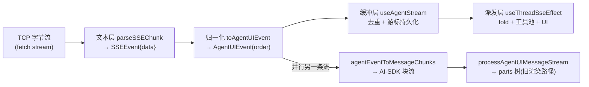
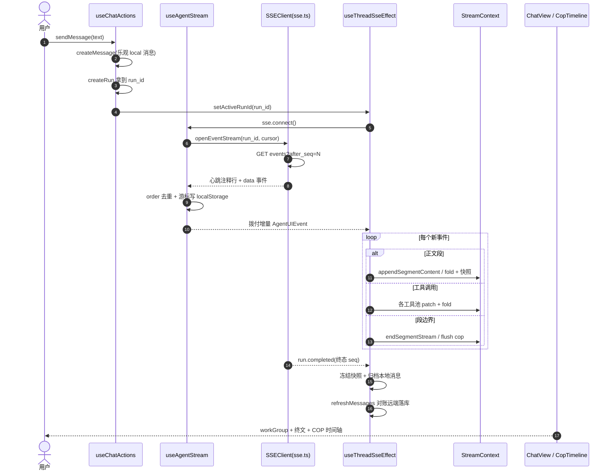
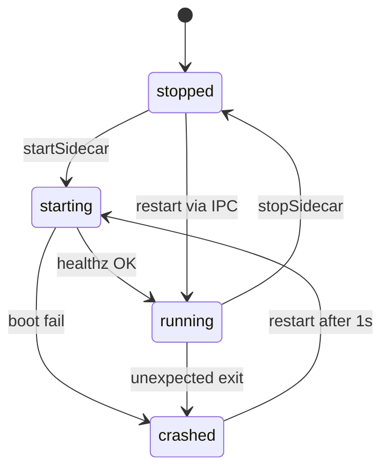

# Arkloop 前端解读：agent 会话的实时渲染与桌面壳

> 本解读按 ai-agent 类规格产出。本文是 Arkloop 解读的前端子文档，覆盖 web（React 19 + TS + Vite + Tailwind 4 + React Router）、shared（`@arkloop/shared`）、desktop（Electron 壳）与 tui 中**承载 agent 会话的机制层**：SSE 事件四层管线、turn 折叠状态机（shared `assistantTurn.ts`，项目最精华抽象）、COP 时间轴三层职责分离、会话状态 Context 分工、Electron sidecar 生命周期与 IPC、theme/i18n。所有引用按仓库相对路径 `src/...` 给出，源码根为 Arkloop 仓库。
>
> 覆盖口径（诚实标注）：组 A＝会话机制核心文件 49 个，逐文件精读（100%）；组 B＝机制相关大文件（api.ts/storage.ts/ChatView.tsx/ipc.ts 等）只精读机制段并登记样板长尾，约 60% 机制行级覆盖；组 C＝纯展示组件目录与 locales（约 2.5 万行）仅清单登记，未逐行精读。**本文不声称 web 全量精读**。
>
> 定位：后端（pipeline/agent-loop/tool-calling 文档）负责把一次 run 的全部过程以**扁平、有 seq 序号、多模态**的事件流持久化并推给前端；本文回答前端侧问题——如何把这条无界的增量流实时折叠成用户能读懂的"回合叙事"，以及桌面壳如何让一个"作为进程的后端"对渲染层隐形。

---

## 前端门面：四块应用、一个"会话 = 事件流"的心智模型

Arkloop 是"本地优先的对话式 AI agent 桌面平台"：Go 后端是嵌入 desktop app 的 sidecar 单进程（`desktop` CLI 二进制）。用户直接看到的是**门面层**，由四块应用构成：

| 应用 | 目录 | 角色 |
|---|---|---|
| web | `src/apps/web` | React 19 聊天 UI。dev 跑 Vite（proxy 把 `/v1` 转发到后端），prod 打包成静态资源由 desktop 的 renderer 目录加载 |
| shared | `src/apps/shared` | `@arkloop/shared`：HTTP client 与 token 逻辑、桌面 API 类型与探测、theme/locale Context、**assistant turn 折叠状态机本体**（最关键，被 web 复用） |
| desktop | `src/apps/desktop` | Electron 壳：拉起/探活/重启 Go sidecar、配置持久化、自动更新、托盘、IPC bridge（preload contextBridge） |
| tui | `src/apps/tui` | Bun + Solid 终端客户端，编译为独立二进制，直连同一台 desktop sidecar 的 `/v1` |

四块共享同一个心智模型：**会话 = thread；一次回答 = run；run 的内部工作 = 一串带 `seq` 的 agent 事件流**。Web/TUI 只是同一事件流的两套皮肤。

分工的本质：Go 端产事件并持久化（PG/desktop SQLite），web 端消费事件并在**纯前端内存里重建"可渲染的回合"**（turn → subsegment → timeline 行），桌面壳只负责"让 Go 活着 + 让渲染进程找得到它"。状态机放 shared，壳只做进程与网络胶水。

## 根因：把无界增量流折叠成有叙事结构的回合（并托管"作为进程的后端"）

后端把一次 agent run 的每个中间产物都以**扁平事件**形式推送（`message.delta` / `tool.call` / `tool.result` / `run.segment.start|end` / `terminal.stdout_delta` / `todo.updated` …）。真正难的问题不在传输，而在**实时折叠**：

1. **流式时序性**：正文逐字符到达、thinking 与工具调用交错；UI 不能等 run 结束再渲染。
2. **工具链的组织**：几十个 tool.call 平铺渲染毫无可读性，须按语义聚成"探索/执行/编辑/子代理/搜索/抓取"等 COP 块，并给整块一个**动态标题**（live 态显示正在做的，完成态显示统计摘要）。
3. **断线/刷新/回放**：SSE 断线要按 `after_seq` 续传；run 结束后 live 内存态要"归档"成一条本地助手消息；刷新后从 REST 拉历史必须能**从已存事件完整重放**出与 live 相同的折叠结果——同一份 fold 函数同时服务两种时序。
4. **双环境**：dev 浏览器打远程/本地 API；prod 是 Electron 内嵌本地 loopback。API 地址、token、外链策略随运行模式切换，需要一层可探测的桌面壳。

Electron 壳解决另一个根因：**Go 后端不是"服务"而是"进程"**。它随 app 启动、崩溃要自动拉起、退出要安全停掉；端口/token 要注入渲染层，让 web 的 HTTP client 不感知差异。

一句话：这是从"后端持久化的事件"到"带叙事结构的可折叠 UI"的双向映射工程。

## SSE 事件管线：四层转换与两条并行消费路径

### 管线总览

- **文本层 `parseSSEChunk`**：处理 data 行、空行分隔、忽略 `:` 注释行（服务端心跳），返回事件与未完成缓冲（`[src/apps/web/src/sse.ts:91-150]()`）。
  <!-- anchor: export function parseSSEChunk(buffer: string): { events: SSEEvent[]; remaining: string } { … return { events, remaining } -->

  一次 run 的事件 URL 是 `GET /v1/runs/{id}/events`，SSE 客户端在连接期把 `after_seq`（续传游标）与 `follow` 拼进 query（`[src/apps/web/src/sse.ts:246-252]()`）。
  <!-- anchor: private async doConnect(): Promise<void> { … urlObj.searchParams.set('follow', follow ? 'true' : 'false') -->

- **缓冲层去重 + 游标**：`useAgentStream.handleEvent` 用 `seenOrders` 按事件 `order` 去重（断线重连/重放不会二次入库），并把最新 seq 防抖写 localStorage（`[src/apps/web/src/hooks/useAgentStream.ts:54-80]()`）。
  <!-- anchor: const handleEvent = useCallback((event: AgentUIEvent) => { … }, [notifyEventListeners, runId]) -->

  连接期以 `max(内存游标, localStorage 游标)` 作为续传起点再开流（`[src/apps/web/src/hooks/useAgentStream.ts:112-157]()`）。
  <!-- anchor: const connect = useCallback(() => { … }, [agentClient, closeActiveStream, handleError, handleEvent, handleStateChange, notifyEventListeners, runId]) -->

- **断线续传的容错游标**：客户端记录 `lastSeq`；服务端 `run.catch_up` 事件携带批量缺失事件展开补发。接收时采用 **gap-tolerant 策略**——PG sequence 跳号/回滚会产生不连续 seq，前端从不等中间值，任何收到的 seq 都直接推进游标（`[src/apps/web/src/sse.ts:359-387]()`）。
  <!-- anchor: private processEvent(sseEvent: SSEEvent): void { … this.options.onEvent(runEvent) -->

- **重连退避**：`scheduleRetry` 指数退避（默认 1s 起、上限 10s、最多 5 次），并区分可重试网络错误与不可重试的 4xx（401 走 token 刷新）与 `AbortError`（`[src/apps/web/src/sse.ts:393-413]()`）。
  <!-- anchor: private async scheduleRetry(): Promise<void> { … await this.connect() -->

SSE 连接有两个生命周期信号与 web 页面重叠：run 切换时 `sseRunId` 变化驱动 connect/disconnect（`[src/apps/web/src/contexts/run-lifecycle.tsx:207-212]()`）。
<!-- anchor: useEffect(() => { … }, [sseRunId]) -->

页面从后台回到前台时，若连接已处于 closed/error/idle 则手动 `reconnect()`（`[src/apps/web/src/contexts/run-lifecycle.tsx:246-257]()`）。
<!-- anchor: useEffect(() => { … }, [sse, sseRunId, sse.state, sse.reconnect]) -->

### 派发层：单 hook 喂给全部会话 context

`useThreadSseEffect` 是页面级只挂一次的事件派发主干。它先做**缓冲拨付**：用 `processedEventCount` 游标从 `useAgentStream` 的事件数组里取"增量"，对代码执行类工具调用做**暂停拨付**（先渲染首批、延后剩余，保证首屏代码执行 UI 尽快出现），再逐事件分派（`[src/apps/web/src/hooks/useThreadSseEffect.ts:297-310]()`）。
<!-- anchor: const { fresh, nextProcessedCount } = filterUnprocessedAgentEvents({ … processedEventCountRef.current = nextProcessedCount -->

每类事件落到不同归属：

- `segment-start` 开新 Segment 并置 thinking 折叠断点（`[src/apps/web/src/hooks/useThreadSseEffect.ts:328-345]()`）。
  <!-- anchor: if (event.type === 'segment-start') { … addSegment({ segmentId, kind, mode, label, content: '', isStreaming: true, codeExecutions: [] }) -->
- `assistant-delta` 按 thinking/正文/activeSegment 三态分别走 fold 或直接 mutate 段正文（`[src/apps/web/src/hooks/useThreadSseEffect.ts:424-461]()`）。
  <!-- anchor: if (event.type === 'assistant-delta') { … bumpAssistantTurnSnapshot() -->
- `tool-call`/`tool-result` 先把事件喂给 `agentEventProcessing.ts` 各类纯函数（code/subagent/fileOp/webFetch/browser）做池 patch，再 fold 进回合结构（`[src/apps/web/src/hooks/useThreadSseEffect.ts:508-527]()`）。
  <!-- anchor: if (event.type === 'tool-call') { … setTopLevelCodeExecutions((prev) => [...prev, entry]) -->

## 一次 agent 回合从后端到屏幕（时序）

用户消息投递与 run 创建的完整路径见 `[src/apps/web/src/hooks/useChatActions.ts:137-159]()`：先 `createMessage`（乐观 local 消息以 `client_message_id` 换远端消息），再 `createRun` 拿 run_id 置为 activeRunId。
<!-- anchor: const created = await agentClient.createMessage({ … setActiveRunId(run.id) -->

关键拆解（后续各节展开）：

- run 事件 URL 构造：`[src/apps/web/src/agent-ui/arkloop-adapter.ts:42-45]()`。
  <!-- anchor: function buildStreamUrl(baseUrl: string | undefined, streamId: string): string { … return `${normalizedBaseUrl}/v1/runs/${streamId}/events` -->
- 事件归一化（后端 kebab → UI camel 别名）：`[src/apps/web/src/agent-ui/event-data.ts:12-51]()`。
  <!-- anchor: export function normalizeAgentEventType(type: string): AgentUIEventType { … return type -->
- run 折叠器状态机入口：`[src/apps/shared/src/assistantTurn.ts:318-540]()`。
  <!-- anchor: export function foldAssistantTurnEvent(state: AssistantTurnFoldState, event: AssistantTurnEvent): void { … return -->
- live turn 快照（rAF 节流）：`[src/apps/web/src/contexts/stream.tsx:191-210]()`。
  <!-- anchor: const bumpSnapshot = useCallback((opts?: { immediate?: boolean }) => { … setLiveAssistantTurn(snapshotAssistantTurn(assistantTurnFoldStateRef.current)) -->
- 终态归档到本地消息：`[src/apps/web/src/hooks/useThreadSseEffect.ts:759-818]()`。
  <!-- anchor: if (event.type === 'run-completed') { … void refreshMessages({ requiredCompletedRunId: completedHasRecoverableOutput ? completedRunId : undefined }) -->
- 取消态同样归档（以 run.cancelled 的 seq 为界）：`[src/apps/web/src/hooks/useThreadSseEffect.ts:841-872]()`。
  <!-- anchor: if (event.type === 'run-cancelled') { … ? materializeTerminalRunMessage(runId, 'cancelled', runCache, agentEventsForMessage) -->
- 历史渲染（workGroup 折叠 + 终文）：`[src/apps/web/src/components/MessageList.tsx:473-494]()`。
  <!-- anchor: if (workGroupSplit.workGroup != null) { … trimTrailingMargin={true} -->

## 会话折叠的精华：turn 状态机与 COP 时间轴

### 事件本体与字段级防御读取

后端事件 `RunEvent` 带 `event_id/run_id/seq/ts/type/data/tool_name/error_class`（`[src/apps/web/src/sse.ts:16-25]()`）。
<!-- anchor: export type RunEvent = { … error_class?: string -->

web 侧 `toAgentUIEvent` 把它转成内部 camelCase 的 `AgentUIEvent{id,streamId,order,timestamp,type,data,toolName,errorCode}`（`[src/apps/web/src/agent-ui/arkloop-adapter.ts:152-173]()`）。
<!-- anchor: function toAgentUIEvent(event: RunEvent): AgentUIEvent { … errorCode: event.error_class, -->

别名归一：`tool.call.delta → tool-input-delta`、`message.delta → assistant-delta`、`run.segment.start → segment-start`、`terminal.stdout_delta/stderr_delta → terminal-delta`、`run.input_requested → input-request` 等（`[src/apps/web/src/agent-ui/event-data.ts:12-51]()`）。
<!-- anchor: export function normalizeAgentEventType(type: string): AgentUIEventType { … return type -->

归一化层对 data 做**字段级防御读取**（`stringField/numberField/objectField` 兼容 snake/camel 双拼写、`error.error_class` vs `error.errorClass`），让后端演进改字段时旧事件仍可兼容渲染。

### turn 折叠状态机（shared）：live 增量与离线重放同源

`foldAssistantTurnEvent(state, event)` 就地维护 `{segments[], currentCop, thinkingMustBreakBeforeNext, lastEventTimeMs}`，规则注释就写在函数头上（`[src/apps/shared/src/assistantTurn.ts:312-316]()`）。
<!-- anchor: * - 新 COP 块：首个非隐藏 tool.call 创建新块 … * - thinkingMustBreakBeforeNext：tool.call 后置位，确保下一段 thinking 不与 call 前的 thinking 合并 -->

- **段生成规则**：首个非隐藏 `tool.call` 开新 cop 段；`message.delta` 的非空白正文会先 flush 当前 cop 再进入（或续写）text 段；空白 delta 若当前是纯 thinking cop 则回补 thinking，避免打断块。
- **thinking 归属**：`thinkingMustBreakBeforeNext` 是一个"断层"标记——tool.call 之后置位，保证下一条 thinking **不**与 call 之前的 thinking 合并成同一气泡（那是"决策后反思"而非"行动前思考"）；`timeline_title` 工具的 call 只给当前 cop 命名、不切断（`[src/apps/shared/src/assistantTurn.ts:448-478]()`）。
  <!-- anchor: const handleToolCall = (event: AssistantTurnEvent) => { … state.thinkingMustBreakBeforeNext = true -->
- **结果回填与孤儿 result**：tool.result 先反查 currentCop、再回溯已 flush 的 cop 段回填 result/error；都找不到时造一条"带 result 的 call"行，并 `closeThinkingBeforeLastCall` 收尾前面悬空的 thinking（`[src/apps/shared/src/assistantTurn.ts:367-388]()`）。
  <!-- anchor: const attachResultToCop = (toolCallId: string, toolName: string, result: unknown, errorClass?: string, errorMessage?: string) => { … closeThinkingBeforeLastCall(targetCop.items, eventTs) -->
- **悬空 thinking 的封口**：`closeThinkingBeforeLastCall` 从 items 尾部向前给最后一个 call 之前的 thinking 补结束时间戳（`[src/apps/shared/src/assistantTurn.ts:127-133]()`）。
  <!-- anchor: function closeThinkingBeforeLastCall(items: CopBlockItem[], endMs: number): void { … it.endedAtMs = endMs -->
- **边界封口**：`run.segment.start/end` 都会 flush 当前 cop 并清除断点标记（`[src/apps/shared/src/assistantTurn.ts:497-509]()`）。
  <!-- anchor: if (event.type === 'run.segment.start') { … return -->
- run 结束时 `finalizeAssistantTurnFoldState` 关闭所有未收尾 thinking 的时间戳并清空 currentCop（`[src/apps/shared/src/assistantTurn.ts:542-553]()`）。
  <!-- anchor: export function finalizeAssistantTurnFoldState(state: AssistantTurnFoldState, endMs?: number): void { … state.currentCop = null -->

全程**纯函数式快照**：渲染取 `snapshotAssistantTurn` 深拷贝出的段结构；历史/回放路径 `buildAssistantTurnFromEvents` 按 `seq` 排序后重放全部事件，得到与 live 相同的 `AssistantTurnUi`——这就是"刷新后历史与直播画面一致"的根（`[src/apps/shared/src/assistantTurn.ts:556-573]()`）。
<!-- anchor: export function buildAssistantTurnFromEvents(events: readonly AssistantTurnEvent[]): AssistantTurnUi { … segments: state.segments.map(cloneSegment), -->

web 的 `assistantTurnSegments.ts` 只是 shared 的薄适配层：把 AgentUIEvent 的 camelCase 字段翻译回 shared 期望的 kebab 事件类型与字段结构（`[src/apps/web/src/assistantTurnSegments.ts:45-60]()`）。
<!-- anchor: function toAssistantTurnEventType(type: string): string { … return type -->

其中 `toAssistantTurnEventData` 负责把 `delta/toolCallId/arguments/displayDescription/display/queries` 等驼峰字段重新映射为 `content_delta/tool_call_id/tool_name/arguments/display_description` 等后端字段名（`[src/apps/web/src/assistantTurnSegments.ts:62-98]()`）。
<!-- anchor: function toAssistantTurnEventData(event: AgentUIEvent): unknown { … return event.data -->

### COP 时间轴：可读化与布局的职责分离

fold 出来的 cop 段仍是异构 item（thinking/assistant_text/call）堆叠，需再加工成时间轴。项目把它切成三层，各司其职、逐层可测：

1. **可读化子段** `copSubSegment.buildSubSegments`：按 `categoryForTool` 把连续同类 call 切成子段（explore/exec/edit/agent/search/fetch/image/plan/generic）；call 之前的 thinking/assistant_text 作为 `pendingLead` 暂存，延迟挂进第一个工具子段，避免"孤儿思考"在无工具上下文时孤立展示（`[src/apps/web/src/copSubSegment.ts:759-811]()`）。
   <!-- anchor: export function buildSubSegments(items: CopBlockItem[]): CopSubSegment[] { … return segments -->
2. **聚合标题** `aggregateMainTitle`：live 态 = "已完成统计 · 正在做的..."（如 `Read 3 files · Searching auth flow...`）；complete 态 = 按类别聚合的摘要。live/complete 两套构建函数在同文件内（`[src/apps/web/src/copSubSegment.ts:675-735]()`），入口 `aggregateMainTitle` 按 `isLive && !isComplete` 分流（`[src/apps/web/src/copSubSegment.ts:743-750]()`）。
   <!-- anchor: function buildLiveMainTitle(segments: ReadonlyArray<CopSubSegment>): TitleSpan[] { … return parts.length > 0 ? parts : [stepsCompletedSpan(allCalls.length)] -->
   <!-- anchor: export function aggregateMainTitle( … return buildCompleteMainTitle(segments) -->
3. **结构化标题**：`TitleSpan` 允许 diff 着色段与 i18n 段混排，标题不是字符串而是结构化 span（`[src/apps/web/src/copSubSegment.ts:20-22]()`）。
   <!-- anchor: export type TitleSpan = … | { text: string; diffKind: 'added' | 'removed' } -->
4. **布局秩序** `copSegmentTimeline.buildTimelineEntries`：explore 摘要行与 edit 类 fileOp 作为 **barrier** 把 body 切成多段 timeline；紧跟 barrier 的 thinking 行被"吸附"到 barrier 而非飘进下一段——保证"它刚读完这些文件 → 紧接着在思考"的视觉绑定（`[src/apps/web/src/copSegmentTimeline.ts:712-768]()`）。
   <!-- anchor: export function buildTimelineEntries(params: { … return entries.sort((left, right) => left.seq - right.seq || left.kind.localeCompare(right.kind) || left.id.localeCompare(right.id)) -->

各层之间还有**池对齐 + fallback 补齐**层 `copTimelinePayloadForSegment`：把 cop 段 calls 投影成 CopTimeline 渲染所需的各类型池；设计意图注释见 `[src/apps/web/src/copSegmentTimeline.ts:431-433]()`，实现见 `[src/apps/web/src/copSegmentTimeline.ts:435-613]()`。
<!-- anchor: * 仅返回 CopTimeline 已支持的数据子集（代码 / 子代理 / 文件 / 抓取 / 搜索阶段步骤）。 … * 有 toolCallId 但池子整体尚未对齐时返回 { steps:[], sources:[] }——保留 COP 壳子，避免外层把整条 COP 当成无内容而丢掉。 -->
<!-- anchor: export function copTimelinePayloadForSegment( … ...(genericTools.length > 0 ? { genericTools } : {}), -->

一句话 Why：**fold 管"哪些内容"（块划分），subsegment/聚合管"叙事与标题"（可读化），timeline 管"布局秩序"（顺序 + 吸附）**。

### 工具可视化的增量建模与离线重建

每类工具在运行时维护一个 ref 池（codeExecutions/subAgents/fileOps/webFetches/browserActions…），每个 SSE chunk 只触发"归属该类的一次纯 patch"：

- **输出增量续写**：`applyTerminalDelta` 只在执行仍 running 时续写输出，ANSI 控制序列先清洗（`[src/apps/web/src/agentEventProcessing.ts:351-395]()`）。
  <!-- anchor: export function applyTerminalDelta( … nextExecutions: executions.map((item, index) => index === targetIndex ? updated : item), -->
- **后缀重叠去重**：两段输出合并用 `mergeExecutionOutput` 检查重叠后缀/前缀，避免分块到达的 stdout 累积重复（`[src/apps/web/src/agentEventProcessing.ts:274-288]()`）。
  <!-- anchor: function mergeExecutionOutput(previous: string | undefined, incoming: string | undefined): string | undefined { … return previous + incoming -->
- **结果解析**：tool.result 时 `extractCodeExecutionOutput` 解析 `exit_code/status/stdout/stderr/items`，按退出码优先级归并输出（`[src/apps/web/src/agentEventProcessing.ts:174-195]()`）。
  <!-- anchor: function extractCodeExecutionOutput(result: unknown): { output?: string; exitCode?: number } { … output: rawOutput || undefined, -->
- **子代理**：`applySubAgentToolCall/Result` 以 `spawn_agent` 建 `spawning` 项，后续 send_input/wait/resume/close/interrupt 事件快照推进状态机，result 里 `sub_agent_id` 作二级定位（spawn 用 toolCallId、其余用 subAgentId）（`[src/apps/web/src/agentEventProcessing.ts:951-1052]()`）。
  <!-- anchor: export function applySubAgentToolCall( … return { updated, nextAgents: agents.map((a, i) => i === targetIdx ? updated : a) } -->
- **web 搜索**：`applyAgentEventToWebSearchSteps` 把 `search_*` 段与搜索工具调用投影成搜索时间轴步骤（searching→reviewing），并统一收集 web/x 两种来源（`[src/apps/web/src/webSearchTimelineFromAgentEvent.ts:147-238]()`）。
  <!-- anchor: export function applyAgentEventToWebSearchSteps( … return steps -->

这些纯函数整体可离线重建：`buildMessage*FromAgentEvents(events)` 系列与历史重放路径同源；工具池在刷新后已无事件源时，`buildFallbackSegments` 用工具池自身兜底渲染 COP 行（`[src/apps/web/src/copSubSegment.ts:867-906]()`）。
<!-- anchor: export function buildFallbackSegments(tools: { … return segs -->

### 会话状态的 Context 分工与打断语义

AGENTS.md 明令只用 React Context，会话数据按职责拆成多个窄 Context：`StreamContext` 管 live 渲染态（段正文、顶层工具池、liveAssistantTurn、workTodos）；`RunLifecycleContext` 管一次 run 的"控制面"（activeRunId/sending/error/awaitingInput/freezeCutoff/processedEventCount 等 SSE 缓冲游标）；`MessageMetaContext` 管**每消息的派生渲染元数据**的内存 map + localStorage 持久化；`MessageStoreContext` 管消息列表（乐观 local 合并、terminal 本地消息合并、远端对账）；`ThreadListContext` 管侧栏。`useThreadSseEffect` 这一个 hook 把 SSE 事件同时喂给上述全部 context 与附件 UI。

**打断（cancel）语义 = seq 级冻结**：`freezeCutoff = lastVisibleNonTerminalSeq`。cancel 后晚于此 seq 的非终态事件在派发器被跳过，避免"取消后的尾巴"写进归档消息（`[src/apps/web/src/hooks/useThreadSseEffect.ts:312-321]()`）。
<!-- anchor: for (const event of freshToProcess) { … continue -->

归档最终以 `run.cancelled` 事件自身携带的 seq 为界（`[src/apps/web/src/hooks/useThreadSseEffect.ts:841-872]()`）。
<!-- anchor: if (event.type === 'run-cancelled') { … ? materializeTerminalRunMessage(runId, 'cancelled', runCache, agentEventsForMessage) -->

这套 seq 级冻结让 UI 的 cancel 与后端真正终止之间的竞态不乱屏。

**段正文的"打字机"**：`useStreamingContent` 用 `useSyncExternalStore` + 模块级 listener map，增量 delta 直接 mutate 目标 segment 并 notify，只刷新订阅该段的最小组件（`[src/apps/web/src/contexts/stream.tsx:105-128]()`）。
<!-- anchor: export function useStreamingContent(segmentId: string | null | undefined): string { … return segmentId ? (globalSegmentsRef?.current.find((s) => s.segmentId === segmentId)?.content ?? '') : '' -->

**快照节流**：turn 折叠后不直接 setState，而是 `bumpSnapshot` 用 `requestAnimationFrame` 批处理，保证每个 SSE chunk 不重渲整条大消息（`[src/apps/web/src/contexts/stream.tsx:191-210]()`）。
<!-- anchor: const bumpSnapshot = useCallback((opts?: { immediate?: boolean }) => { … setLiveAssistantTurn(snapshotAssistantTurn(assistantTurnFoldStateRef.current)) -->

**终态归档的"handoff"**：run.completed/cancelled 到达时先 `captureTerminalRunCache` 快照全部 ref 池 + turn（`[src/apps/web/src/hooks/useRunTransition.ts:117-129]()`），并 `setPreserveLiveRunUi(true)`——在远端消息对账回来之前 live turn 继续展示。
<!-- anchor: const captureTerminalRunCache = useCallback((terminalStatus?: 'running' | MessageTerminalStatusRef | null): TerminalRunCache => { … handoffAssistantTurn, -->

随后 `refreshMessages` 找到落库的助手消息（`[src/apps/web/src/contexts/message-store.tsx:148-158]()`），`persistRunDataToMessage` 把派生数据写进该消息、与消息本体一起持久化（`[src/apps/web/src/contexts/message-meta.tsx:265-351]()`），最后释放 handoff 让历史渲染接管。
<!-- anchor: const refreshMessages = useCallback(async (options?: { … }, [threadId, beginMessageSync, readConsistentMessages, isMessageSyncCurrent, setMessages]) -->
<!-- anchor: const persistRunDataToMessage = useCallback( … [setMeta], -->

## Electron 壳：把本地进程抹平成 HTTP

### sidecar 生命周期

启动顺序：先创建窗口立即显示 LoadingPage，再 `ensureLocalSidecar`——可能阻塞最长 30s 的健康轮询（`[src/apps/desktop/src/main/index.ts:541-550]()`）。
<!-- anchor: // 窗口已显示，再启动 sidecar（可能阻塞 30s） … activeSidecarPort = null -->

启动时通过环境变量把端口、桌面 token、OS 用户名、工作区/资源目录、memory/网络配置、browser-search URL 全部灌进子进程，sidecar 进程**零参数** `spawn(binPath, [])`，一切靠 env（`[src/apps/desktop/src/main/sidecar.ts:806-820]()`）。
<!-- anchor: const child = spawn(binPath, [], { … stdio: ['ignore', 'pipe', 'pipe'], -->

- **探活与重启参数**：500ms 轮询 `GET /healthz`、30s 判死；意外退出后 `restartCount < MAX_RESTARTS(3)` 则 1s 后重拉。常数定义见 `[src/apps/desktop/src/main/sidecar.ts:47-51]()`。
  <!-- anchor: const HEALTH_POLL_MS = 500 … const AUTO_PORT_SCAN_WINDOW = 20 -->
- 单次健康探测实现（`[src/apps/desktop/src/main/sidecar.ts:596-604]()`）。
  <!-- anchor: function healthCheck(port: number): Promise<boolean> { … resolve(false) -->
- 崩溃重启判定在子进程 exit 事件里（`[src/apps/desktop/src/main/sidecar.ts:856-865]()`）。
  <!-- anchor: console.error(`sidecar exited: code=${code}`) … reject(error) -->
- 启动期健康轮询循环在 `healthyPromise`（`[src/apps/desktop/src/main/sidecar.ts:869-879]()`）。
  <!-- anchor: const healthyPromise = (async () => { … ?? new SidecarStartError('health_timeout', -->
- **端口策略**：`manual` 固定端口不可用即报 `port_in_use`；`auto` 从首选端口向上扫 `AUTO_PORT_SCAN_WINDOW(20)` 个空位，再不行随机占临时端口（`[src/apps/desktop/src/main/sidecar.ts:721-744]()`）。
  <!-- anchor: async function resolveLaunchPort( … return await reserveEphemeralPort(excluded) -->
- 主循环里端口冲突可 `+1` 重试最多 `MAX_AUTO_PORT_RETRIES(6)` 次（`[src/apps/desktop/src/main/sidecar.ts:911-929]()`）。
  <!-- anchor: for (let attempt = 0; attempt < MAX_AUTO_PORT_RETRIES; attempt++) { … nextPreferredPort += 1 -->
- **凭据落地**：端口与桌面 token 以 `0o600` 权限写 `~/.arkloop/desktop.token` / `desktop.port`，供外部工具/CLI 复用（`[src/apps/desktop/src/main/sidecar.ts:899-936]()`）。
  <!-- anchor: export async function startSidecar(preferredPort: number, portMode: LocalPortMode = 'auto'): Promise<SidecarRuntime> { … throw error -->
- **退出清理**：`before-quit` 先 `stopSidecar`（SIGTERM、5s 超时 SIGKILL），Tray 销毁后再真正 quit；应用升级安装走 `isUpdateInstallQuit` 逃生分支（`[src/apps/desktop/src/main/index.ts:572-593]()`）。
  <!-- anchor: app.on('before-quit', (e) => { … app.quit() -->
- **关窗 ≠ 退出**：默认 `closeBehavior=keep-in-background`，关窗只 `win.hide()`，托盘 + 全局快捷键 ⌘⇧A 召回（`[src/apps/desktop/src/main/index.ts:389-396]()`）。
  <!-- anchor: win.on('close', (e) => { … win.hide() -->
- 全局快捷键切换显隐（`[src/apps/desktop/src/main/tray.ts:79-86]()`）。
  <!-- anchor: export function registerGlobalShortcut(getWindow: () => BrowserWindow | null, showWindow: ShowWindow): void { … showWindow() -->
- **二进制自愈**：sidecar 不在时就近四选一（打包资源 / `~/.arkloop/bin` / dev 构建产物）（`[src/apps/desktop/src/main/sidecar.ts:149-157]()`）；全缺则渲染层走"下载 sidecar"流程——GitHub release 按 platform/arch 取名、tmp 落盘、chmod、rename 到 `~/.arkloop/bin` 并写版本文件（`[src/apps/desktop/src/main/sidecar.ts:223-283]()`）。
  <!-- anchor: function getSidecarBinaryCandidates(): string[] { … getBundledSidecarPath(), -->
  <!-- anchor: export async function downloadSidecar( … fs.renameSync(tmpPath, getSidecarPath()) -->
- 下载/版本检查 URL 硬编码 GitHub 仓库（`[src/apps/desktop/src/main/sidecar.ts:55-56]()`）。
  <!-- anchor: const DEFAULT_GITHUB_REPO = 'qqqqqf-q/Arkloop' … const DEFAULT_DOWNLOAD_BASE = `https://github.com/${DEFAULT_GITHUB_REPO}/releases/download` -->
- 另拉 opencli（AutoCLI 开源版，独立仓库 `nashsu/AutoCLI`，不在本项目源码内），供 shell 生态互操作（`[src/apps/desktop/src/main/sidecar.ts:298-299]()`）。
  <!-- anchor: const OPENCLI_GITHUB_API = 'https://api.github.com/repos/nashsu/AutoCLI/releases/latest' … const OPENCLI_VERSION_FILE = path.join(os.homedir(), '.arkloop', 'bin', 'opencli.version.json') -->

### IPC 桥与"渲染层无感"注入

- main 用 `ipcMain.handle('arkloop:xxx')` 注册约 70 个通道（config/sidecar/updater/app/connectors/memory/notifications/power/window/logs/fs/dialog/cli-tool/onboarding/advanced），`registerIpcHandlers` 是全部注册入口，并含 preload 启动前同步取配置的 `ipcMain.on`（`[src/apps/desktop/src/main/ipc.ts:114-124]()`）。
  <!-- anchor: export function registerIpcHandlers( … desktopAccessToken: getDesktopAccessToken(), -->
- preload 在 `contextIsolation + sandbox` 下用 `contextBridge` 暴露两个全局：`window.__ARKLOOP_DESKTOP__`（**同步**注入 mode/token/apiBaseUrl，页面脚本执行前可取）与 `window.arkloop`（ArkloopDesktopApi，封装全部 invoke/on，订阅均返回退订函数）（`[src/apps/desktop/src/preload/index.ts:424-433]()`）。
  <!-- anchor: contextBridge.exposeInMainWorld('__ARKLOOP_DESKTOP__', { … getMode: () => configSnapshot.mode, -->
- 注意 `apiBaseUrl` 由 preload 依 `mode ∈ {local,saas,self-hosted}` 与最新 runtime 快照**实时计算**（`[src/apps/desktop/src/preload/index.ts:406-418]()`）。
  <!-- anchor: function computeApiBaseUrl(nextConfig: AppConfig, runtime: SidecarRuntime): string { … return '' -->
- 快照与真实 runtime 的瞬时差异靠推送纠正：main 通过 `arkloop:config:changed` / `arkloop:sidecar:runtime-changed` 推给 preload 更新内存快照，下一次 `getApiBaseUrl()` 即取到新值（`[src/apps/desktop/src/preload/index.ts:435-441]()`）。
  <!-- anchor: ipcRenderer.on('arkloop:config:changed', (_event: Electron.IpcRendererEvent, nextConfig: AppConfig) => { … sidecarRuntimeSnapshot = runtime -->
- shared 的 `desktop.ts` 只做**能力探测**（`isDesktop/getDesktopApi/getDesktopAccessToken/isLocalMode`…，类型全声明），渲染层永远经它间接访问，方便单元测试与浏览器降级（`[src/apps/shared/src/desktop.ts:391-436]()`）。
  <!-- anchor: export function isDesktop(): boolean { … return info?.accessToken ?? null -->
- HTTP client 的 baseUrl 优先取 Electron 注入（`getApiBaseUrl()`），否则回落 `VITE_API_BASE_URL`（浏览器 dev 走 Vite proxy 相对路径）（`[src/apps/shared/src/api/client.ts:197-210]()`）。
  <!-- anchor: export function apiBaseUrl(): string { … return raw.replace(/\/$/, '') -->
- 401 刷新按模式分流：desktop local 用桌面 token 打 `/v1/auth/local-session`，浏览器打 `/v1/auth/refresh`（`[src/apps/shared/src/api/client.ts:293-308]()`）。
  <!-- anchor: function requestRefreshAccessToken(): Promise<LoginResponse> { … _isRetry: true, -->

### 更新与自愈

两套更新并存：

- **app 本体**：`app-updater.ts` 面向 GitHub release 检查/下载/安装（mac 用原生更新器路径）。
- **二进制组件**（`updater.ts`）：`syncLocalVersions` 读本地 versions 文件并合并检测结果（`[src/apps/desktop/src/main/updater.ts:245-287]()`）；`applyUpdate` 下载替换，下载统一走"tmp → 校验 → rename"模式、进度经 IPC 上抛（`[src/apps/desktop/src/main/updater.ts:318-334]()`）。
  <!-- anchor: export async function syncLocalVersions(): Promise<LocalVersions> { … return next -->
  <!-- anchor: fs.mkdirSync(path.dirname(destPath), { recursive: true }) … fs.renameSync(tmpPath, destPath) -->

## 设计系统：主题三态、动态 CSS 变量与 i18n

- **三态主题**：shared `ThemeContext` 管 `system|light|dark`；仅显式主题时写 `data-theme`，`system` 时移除该属性（`[src/apps/shared/src/contexts/ThemeContext.tsx:23-30]()`）。
  <!-- anchor: useEffect(() => { … }, [theme]) -->

- CSS 侧配套三态解析，dark 为基座（`:root` 带 `color-scheme: dark`，`[src/apps/web/src/index.css:62-63]()`）。
  <!-- anchor: :root { … color-scheme: dark; -->

  跟系统亮色用 media query 且排除显式 dark（`[src/apps/web/src/index.css:246-247]()`）。
  <!-- anchor: @media (prefers-color-scheme: light) { … :root:not([data-theme="dark"]) { -->

  显式亮色用 `:root[data-theme="light"]`（脱离 media query，系统为暗时也能强制亮，`[src/apps/web/src/index.css:378-379]()`）。
  <!-- anchor: :root[data-theme="light"] { … color-scheme: light; -->

- **设计 token 全走 CSS 变量**：组件内联样式直接引用带 fallback 的 `var(--c-*, ...)`（如 COP 行前景色 `var(--c-cop-row-fg, var(--c-text-tertiary))`），保证主题编辑器改变量即全局生效。
- **AppearanceContext 运行时注入**：`buildStyleContent` 把字体栈（MiSans/Inter/system…+ 可选远程字体）、字号（改 `html{font-size}` 连带缩放所有 rem 工具类）、内置/自定义主题色板（dark/light 两套 `--c-*` 表）与背景图 dataUrl 拼成一段 `<style id="appearance-override">` 动态注入；主题编辑器预览复用同一函数（`[src/apps/web/src/contexts/AppearanceContext.tsx:86-160]()`）。
  <!-- anchor: function buildStyleContent( … return css -->
- **i18n 的双语强制同步**：`locales/en.ts`、`zh.ts` 用同一 `LocaleStrings` 接口标注（缺任一 key 即类型报错），`locales: Record<Locale, LocaleStrings> = { zh, en }`（`[src/apps/web/src/locales/index.ts:4-6]()`）。
  <!-- anchor: export type Locale = "zh" | "en"; … export interface LocaleStrings { -->
- COP 时间轴文案是结构化 `TimelineText`（`{kind:'search',tense:'live'}`），由 `renderTimelineText(text, locale)` 双语言渲染；段标题 `TitleSpan` 同样带 i18n 段——这是时间轴大量文案不写死字符串的根本原因（`[src/apps/web/src/copSubSegment.ts:20-22]()`）。
  <!-- anchor: export type TitleSpan = … | { text: string; diffKind: 'added' | 'removed' } -->

## 关键设计决策（权衡与替代代价）

**决策一：把"turn 折叠状态机"放在 shared，并采用"就地 mutate + 快照"而非事件重放。**
为什么：同一 fold 语义要服务 (a) 每增量 O(1) 更新 live UI 与 (b) run 结束后整段事件重放重建历史；放 shared 使 web/TUI 可共用。代价：fold 是有状态可变函数，行为靠详尽的单测 + 注释规则表兜底。替代方案对比——每次渲染重放全部事件 → 更纯但每帧 O(n×d)，10 分钟长 run 不可用；reducer + 不可变 → 每 chunk O(n) 复制段数组。现有折衷在三个约束里最优。

**决策二：Context-only + 双写 ref 的组合，而非外部状态库。**
为什么：贴合 AGENTS.md 约束，且 SSE 密集更新可绕过 React 批处理直达 ref，渲染频率完全可控（段正文用外部订阅逐段刷新、turn 用 rAF 快照节流、池更新用 setState 触发局部 memo）。代价：约 30 个 context + 无数 ref 交织、依赖关系隐晦；新增会话能力常需同时改 4~6 个 context；`stream.tsx` 的模块级 `globalSegmentsRef` 单例是 workaround（`[src/apps/web/src/contexts/stream.tsx:133-134]()`）。选 zustand 会更直白，但项目选择"技术债换零依赖 + 全 React 原生"。
<!-- anchor: // 全局 ref，让 useStreamingContent 的 getSnapshot 能访问到当前 provider 的 segmentsRef … let globalSegmentsRef: React.RefObject<Segment[]> | null = null -->

**决策三：消息级派生数据（assistantTurn/sources/codeExecs…）序列化到 localStorage 而非走后端。**
为什么：消息正文来自后端 REST，但"这个 run 做过什么工具"是展示增强数据，写库成本高且可能已丢失。刷新页面时从 localStorage 恢复 metaMap，并配合存的原始 agent 事件保证可重放。代价：localStorage 配额、ephemeral 淘汰机制（见下节风险）、以及与后端消息记录间可能"有正文无元数据"的不一致——所有读取带空安全（`??[]`）并有 `buildFallbackSegments` 兜底。

**决策四：Electron 把一切"本地服务感"抹平为 HTTP。**
为什么不走 Go 内嵌 node：保持 Go 单二进制可独立跑/CLI 复用；渲染进程以纯 web 视角工作（web dist 可直接放浏览器跑 dev）。代价：sidecar 生命周期管理全部落在 main 进程，是桌面侧最厚的胶水；端口/认证经 preload 同步注入导致"刷新后快照与真实 runtime 可能有瞬时差异"，靠 `runtime-changed` 推送纠正。

## 亮点与风险

**亮点**

1. fold 状态机"live 增量与离线重放同源"——shared 一份逻辑、两种时序，是事件驱动 UI 里少见的高完成度抽象。
2. seq 游标贯穿三层：SSE 断线续传、事件去重、cancel 冻结、终态归档"只取 ≤ seq 事件"，一条线解决所有乱序竞态。
3. COP 时间轴三层职责分离（fold→subsegment/title→timeline barrier/吸附）对"长 run 压缩成一句话 + 可展开"的产品目标实现得很干净；标题用可 i18n 的 `TimelineText` 而非字符串，双语成本趋近于零。
4. 桌面壳对渲染层透明：baseUrl/token/外链/本地刷新策略全部按运行模式注入，浏览器 dev 与 desktop prod 共享同一套 web 代码。
5. 大量纯函数（各 apply\* 与 build\*FromEvents、mergeExecutionOutput、applyAgentEventToWebSearchSteps）结构清晰、可离线重放测试。

**问题与风险**

1. **Context + ref 双写体系复杂度偏高**：`useThreadSseEffect` 单文件 1074 行、依赖 10+ context，任何会话渲染改动都高度耦合；`globalSegmentsRef` 这类模块级可变单例破坏 React 并发安全假设（仅靠"同步渲染"假设兜底，注释自认）。
2. **localStorage 作为会话副产物存储是技术债**：配额与 ephemeral 淘汰（storage.ts 设上限约 900 条并带淘汰索引）会静默丢 meta——历史上"消息有正文但工具链变空白"只能靠 fallback 兜底。同一个浏览器里 todo 快照却用了 IndexedDB（`[src/apps/web/src/todoDb.ts:23-33]()`），两套存储并存且语义不一致是明显债点；未来若转向 IndexedDB 重放，可顺带解决"多消息体积 + 淘汰"问题。
   <!-- anchor: function openDb(): Promise<IDBDatabase> { … req.onerror = (e) => reject((e.target as IDBOpenDBRequest).error) -->
3. **双渲染路径并存（事件直折叠 vs 消息块流 parts 树）**：同一事实两套渲染模型，维护成本与认知负担双倍；`processAgentUIMessageStream` 覆盖的 approval/denied 状态在主聊天折叠路径里并不可达（折叠器无 approval 概念），有死代码风险。消息块流路径把事件投影成 `text-*/reasoning-*/tool-input-*` 的 AI-SDK 风格块流（`[src/apps/web/src/agent-ui/arkloop-adapter.ts:295-310]()`）并夹带 `data-agent-event` 透明块保留原事件（`[src/apps/web/src/agent-ui/arkloop-adapter.ts:448-453]()`）。
   <!-- anchor: function agentEventToMessageChunks(uiEvent: AgentUIEvent, state: MessageChunkLifecycle): AgentUIMessageChunk[] { … return chunks -->
   <!-- anchor: const chunks: AgentUIMessageChunk[] = [{ … transient: true, -->
4. **SSE 读超时与主动关闭共用 `AbortController.abort()`**：`close()` 与读超时都走 abort，靠 `this.closed` 区分语义（`[src/apps/web/src/sse.ts:212-216]()`、`[src/apps/web/src/sse.ts:417-420]()`）；注释承认该复用，属可读性隐患。
   <!-- anchor: if (error.name === 'AbortError') { … await this.scheduleRetry() -->
   <!-- anchor: close(): void { … this.setState('closed') -->
5. **desktop 退出清理是串行 await**：`before-quit` 里 stopSidecar 若触发 SIGKILL 超时路径会拖慢退出；且崩溃后固定 1s 重启无 backoff，连续崩溃虽三次即停，但间隔期可能制造短促重启。
6. **更新渠道硬编码 GitHub 仓库**：下载/版本检查 URL 写死 `qqqqqf-q/Arkloop` 与 AutoCLI 渠道（`[src/apps/desktop/src/main/sidecar.ts:55-57]()`），若 release 改名或迁移即失效。
   <!-- anchor: const DEFAULT_GITHUB_REPO = 'qqqqqf-q/Arkloop' … const GITHUB_API_LATEST_RELEASE = `https://api.github.com/repos/${DEFAULT_GITHUB_REPO}/releases/latest` -->

## 与后端及兄弟模块的协同

| 前端能力 | 后端/兄弟模块对应 | 状态 |
|---|---|---|
| `GET /v1/runs/{id}/events?after_seq&follow` SSE 事件流 | run events 出口（事件持久化 + after_seq 游标 + heartbeat + `run.catch_up` 批量补发），见 pipeline 文档 | 一致 |
| `POST /v1/threads/{tid}/runs` body: persona_id/model/work_dir/reasoning_mode/resume_from_run_id | worker `RunMiddleware` 链 + executor 路由（agent-loop 文档） | 一致 |
| `tool.call.delta` 携带 `tool_call_index`（无 callId 的早期 delta 先缓冲，等 callId 到后补发） | 流式工具入参透传（[src/services/worker/internal/llm/contract.go:831-843]() 恒写 index、callId 非空才附） | 一致：后端 index 先行、callId 后到被证实 |
<!-- anchor: func (d ToolCallArgumentDelta) ToDataJSON() map[string]any { … return m -->
| `run.segment.start`(kind 前缀 `search_`) + `display.label/queries` | 搜索分段元数据；`mode:'hidden'` 表示隐藏段 | 前端据此建搜索时间轴；hidden 语义与后端对应待复核 |
| `input-request` 的 `requestedSchema`（需回答/纯 check-in 两态） | run 等待用户输入 | 前端在 SSE 重放时用"后续是否有 tool-result/终态事件"判断 input 是否已答 |
| `todo.updated` 写 IndexedDB 缓存 | 计划模式下 todo 广播（含 plan_bound/plan_path） | 前端写 todoDb 缓存并发事件；与 plan 文档语义待复核 |
| desktop 注入 env（memory/network/proxy） | `src/services/desktop/cmd/desktop` 读 env 装配（01 模块） | 一致 |
| 本地会话刷新 `POST /v1/auth/local-session` | 桌面 token 认证（01 模块） | 一致，细节待主 agent 复核 |
| TUI 直连同一 `/v1/runs/{id}/events` | 同一后端多客户端 | tui 自实现一套简化 SSE（`src/apps/tui/src/api/sse.ts`），非复用 web 客户端；本文未精读 |

其中两条前端推断的支撑点：

- 工具入参"index 先行、callId 后到"的缓冲实现（`[src/apps/web/src/agent-ui/arkloop-adapter.ts:254-265]()`）。
  <!-- anchor: function bufferToolInputDelta( … state.pendingToolInputDeltasByIndex.set(params.toolCallIndex, pending) -->
- SSE 重放时判断 input 是否已答（`[src/apps/web/src/hooks/useThreadSseEffect.ts:732-756]()`）。
  <!-- anchor: if (event.type === 'input-request') { … setAwaitingInput(true) -->

> 协同表中其余"待复核"项均来自前端侧推断：事件谱系、hidden 段语义等，需以 pipeline/agent-loop/tool-calling 各模块文档对照确认；本文未对后端做二次实证，仅标记不臆断。
