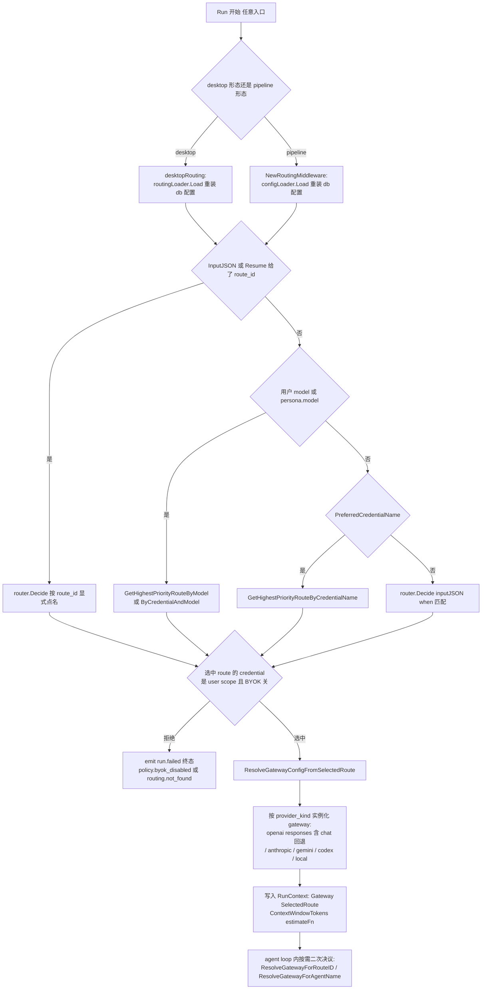
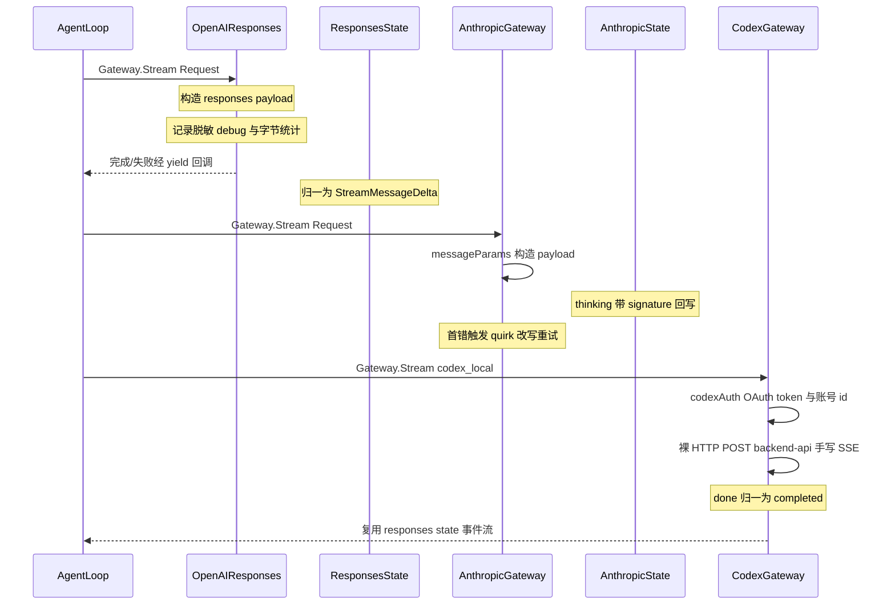

# Arkloop 多模型路由与 LLM Provider 接入解读

> 本解读按 ai-agent 类规格产出。定位为 Arkloop 解读系列的 **LLM 路由与 provider 接入子文档**：回答「模型从哪来、怎么选、怎么适配各家协议差异、凭据怎么管理」。对 `llm_credentials` / `llm_routes` 两张表的**结构**（列定义、唯一键）见 data-model 文档，本文只讲这两张表在运行期「如何被装载成可路由配置」。所有引用指向 Arkloop 仓库根（`/Users/morehao/Documents/study/ai-agent/Arkloop`），仓库相对路径从 `src/...` 起，可经 `verify-references.mjs` 程序重定位回源码。

## 模块在系统中的角色

`routing/` 与 `llm/` 两个包共同构成 Arkloop 的「模型能力层」，夹在中间件链与 agent loop 之间：pipeline 讲 run 的旅程如何编排，agent-loop 讲 loop 如何消费 LLM 结果，本层回答两者之间缺失的一环——**每一次 LLM 调用，到底由哪家 provider、哪个模型、哪份密钥、什么协议形态去执行**。

- `internal/routing`（约 1.3k 行非测试）是**决策层**：纯数据 + 纯函数，不持有网络与密钥，只把 `llm_credentials`/`llm_routes` 两张表（或环境变量 JSON）折叠成内存里的 `ProviderRoutingConfig`（凭据 + 路由规则），再按 selector 选出一条 `ProviderRouteRule`。
- `internal/llm`（约 10.7k 行非测试）是**执行层**：以 `Gateway` 接口 + `Request`/`StreamEvent` 统一契约为轴，分别适配 OpenAI（chat_completions / responses / codex_responses 三种协议形态）、Anthropic Messages、Gemini GenerateContent 五套线上协议 + stub 测试网关。
- `pipeline/mw_routing.go` 与 `app/composition.go` 的 `desktopRouting` 是把两层缝进 run 生命周期的中间件：**每个 run 开始都重新装载配置**，把选出的 route 与网关实例放进 `RunContext`，后续 agent loop、子代理、记忆/摘要工具再借 `rc.ResolveGatewayForRouteID`/`rc.ResolveGatewayForAgentName` 按需二次换路（闭包内按 route_id 走 `activeRouter.Decide` 重新决议，[src/services/worker/internal/pipeline/mw_routing.go:56-66]()）。
<!-- anchor: resolveGatewayForRouteID := func(resolveCtx context.Context, routeID string) (llm.Gateway, *routing.SelectedProviderRoute, error) { … routeDecision := activeRouter.Decide(map[string]any{"route_id": cleaned}, byokEnabled, false) -->

这一层对外的价值是「调用能力面」：让上层（agent loop、executor、sub-agent、记忆注入）只见 `Gateway.Stream(ctx, Request, yield)`，永远不用写 `if provider == openai`。README 宣传的 Multi-Model Routing（OpenAI/Anthropic/Gemini/any OpenAI-compatible + priority routing with your own keys）正是这一层的对外接口（[README.md:61-61]()）。
<!-- anchor: - **Multi-Model Routing** — OpenAI, Anthropic, Gemini, and any OpenAI-compatible API; priority-based routing with your -->

## 根因：BYOK 下「零配置接入 + 让上层无感」

根因可压缩成一句话：**Arkloop 是 BYOK 的本地单进程 agent，必须让「用户自备的任意一组密钥 + 任意一个模型」以近乎零配置的成本接入，同时不让上层 70+ 工具与 agent loop 感知 provider 差异。**

由这个根因拆出四个必须被同时满足的子问题：

1. **凭据是「用户的」，且是「启动后才可能配的」**。桌面场景用户随时在设置里加 key、加模型；服务端形态（api/worker 走 pgx）也要支持账户级路由。若把路由配置在进程启动时固化，用户每次加 key 都得重启 app——这与「常驻桌面 agent + heartbeat 定时唤醒」的形态冲突。AGENTS.md 明确写了 desktopRouting 动态装载使「启动后配置的凭据立即可用」。
2. **协议差异不在「请求/响应字段命名」这种浅层，而在更深的行为面**：thinking/reasoning 的往返签名（Anthropic 要求 assistant thinking 块带 signature 原样回传，OpenAI 走 `reasoning_content` 独立字段）、prompt caching 各家语义（Anthropic `cache_control: ephemeral` + `cache_edits`，OpenAI `cached_tokens` 只是计量）、工具调用参数是增量流式还是整块到达、错误响应里「上下文超长」的表述完全不同。浅层 normalize（把 messages 字段名统一）远不够，必须做**行为级归一**。
3. **同一场对话里不止一个模型**：主模型、子代理模型、记忆搜索嵌入、标题摘要、图像理解……都可能指向不同的 provider/route。因此「选路」不能只在 run 开始时发生一次，而必须在 agent loop 内**按调用点重复决议**。
4. **失败不是二态**。各家返回的 400/429/上下文超长/工具 JSON 损坏，要能被上层统一决策为「可重试 / 不可重试 / 策略拒绝 / 需要自动修复后重发」。若每种错误都让 agent loop 亲自解析原始 body，循环逻辑会被 provider 细节淹没。

> 反事实检验：若去掉动态装载、只保留 env 固化配置，Arkloop 仍可跑通 demo（`LoadRoutingConfigFromEnv` 至今保留着这条路径做兜底），但「桌面 UI 加 key 即时生效」的产品承诺就失效了——这就是 desktop 形态必须走 SQLite 装载而非 env 的原因。

## 统一契约层：协议差异如何被折叠

### 契约骨架：`Gateway` 与事件流

最核心的设计是 `Gateway` 接口只有**一个方法** `Stream(ctx, request, yield)`，且不做返回值事件管道，而是把「所有结果」通过回调 `yield` 一条条推出（[src/services/worker/internal/llm/gateway.go:7-8]()）。
<!-- anchor: type Gateway interface { … Stream(ctx context.Context, request Request, yield func(StreamEvent) error) error -->

推论一：**上层没有任何 provider 分支**。agent loop / executor / 分类路由 executor 只 switch 事件类型（`StreamMessageDelta`、`StreamRunCompleted`、`StreamRunFailed`…），从不读 RawJSON。

推论二：**「谁负责把事件翻译成上游想要的形状」与「谁负责消费」彻底分离**。yield 既是流式通道又是错误通道——每个 gateway 内部把上游 chunk 折算成同一组事件（增量文本、thinking channel、工具调用参数增量、完成/失败）。

契约的第二个轴是 `Request`：统一携带 `Model/Messages/Temperature/MaxOutputTokens/Tools/ToolChoice/PromptPlan/ReasoningMode`（[src/services/worker/internal/llm/contract.go:462-474]()）。
<!-- anchor: type Request struct { … modelInputImagesPrepared bool -->

其中 `PromptPlan` 把「system 哪些块稳定可缓存、会话哪些前缀、运行期 tail 哪些会变」显式建模出来，供 Anthropic `cache_control` 落点使用（[src/services/worker/internal/llm/contract.go:436-439]()）；`ContentPart` 则把 text/image/file/thinking/redacted_thinking 统一成一种 part，并带 `CacheHint`/`CacheControl`/`Signature` 这类 provider-neutral 语义字段（[src/services/worker/internal/llm/contract.go:138-149]()）。
<!-- anchor: type PromptPlan struct { … MessageCache  MessageCachePlan -->
<!-- anchor: type ContentPart struct { … modelInputImage *preparedModelInputImage -->

### 错误契约：先抽症状，再分类、再修复

`llm/contract.go` 顶部定义了两套错误词表：一套架构错误契约（config.missing/invalid、runtime_policy.denied、external_provider.failed、internal_platform.error、tool.format_repair），一套 provider 运行错误（provider.retryable/non_retryable、budget.exceeded、policy.denied、routing.not_found）。上层关心的其实是后者——**能不能重试、要不要报给用户**（[src/services/worker/internal/llm/contract.go:12-28]()）。
<!-- anchor: ErrorClassProviderRetryable    = "provider.retryable" … ErrorClassToolFormatRepair = "tool.format_repair" -->

真正的精巧点在 `symptoms.go` + `quirks.go` 的组合：

1. **先归一化症状**：各家 provider 的原始错误体先被抽成语义化 `SymptomID`——「上下文超长」在 OpenAI 是 `openai_error_code == context_length_exceeded`、在 Anthropic 是 `anthropic_error_type == context_length_exceeded`，检测器把它们折叠成同一个 `SymptomContextLengthExceeded`（[src/services/worker/internal/llm/symptoms.go:11-18]()）。注释写得很直白：任何下游决策（quirk 选择、错误分类、oversize 判定）都应基于 symptom，而不是各自再解析 provider 原始字段；统一的检测入口只有 `DetectSymptoms` 一处（[src/services/worker/internal/llm/symptoms.go:35-48]()）。
<!-- anchor: SymptomContextLengthExceeded     SymptomID = "context_length_exceeded" … SymptomCacheControlRejected      SymptomID = "cache_control_rejected" -->
<!-- anchor: func DetectSymptoms(ctx SymptomMatchContext, registry []Symptom) []SymptomID { … return hit -->

2. **再用 quirk 绑定「症状→修复动作」**：一个 quirk = 一个 symptom + 一个改写 payload 的函数（[src/services/worker/internal/llm/quirks.go:22-25]()）。
<!-- anchor: type Quirk struct { … Apply   func(payload map[string]any) -->
   openai 侧注册了 `echo_reasoning_content / downgrade_xhigh_reasoning / strip_tool_choice`，anthropic 侧注册了 `strip_unsigned_thinking / force_temp_one_on_thinking / echo_empty_text_on_thinking / strip_cache_control`——**注册表本身就是两家行为差异的可执行清单**（[src/services/worker/internal/llm/quirks.go:87-98]()）。
<!-- anchor: var openAIQuirks = []Quirk{ … {ID: QuirkStripCacheControl, Symptom: SymptomCacheControlRejected, Apply: applyStripCacheControl}, -->
   触发后由 `QuirkStore.ApplyAll` 在 payload map 上逐条执行（[src/services/worker/internal/llm/quirks.go:59-67]()）。
<!-- anchor: func (s *QuirkStore) ApplyAll(payload map[string]any, registry []Quirk) { … q.Apply(payload) -->

3. **quirk 是一次失败后「学会」的**：首次调用出错 → SDK 层 `DetectSymptoms → detectQuirk` 找到修复 → 发 `StreamQuirkLearned` 事件通知前端 → 把 quirk 写入该 gateway 实例的 `QuirkStore` → **同一请求带着改写的 payload 重试一次**（openai 在 [src/services/worker/internal/llm/openai_sdk.go:150-156]()，anthropic 在 [src/services/worker/internal/llm/anthropic_sdk.go:229-235]()）。这是「协议差异折叠」最浓的一笔：它把 provider 的隐性约束当作可在运行时习得的适配层，而不是预埋在 if/else 里。
<!-- anchor: if attempt == 0 { … return g.chatCompletions(ctx, request, yield, markActivity, attempt+1) -->
<!-- anchor: if attempt == 0 { … return g.streamAttempt(ctx, request, yield, markActivity, attempt+1) -->

这里有一个值得注意的折中：symptom 检测大量依赖**错误体文本子串**（如 `reasoning_content is missing` + `thinking is enabled`），而不是结构化错误码（[src/services/worker/internal/llm/symptoms.go:159-173]()）。这是对「各家 proxy/兼容层错误格式不可控」的务实妥协——代价是脆弱：上游改一行文案 quirk 就失效；收益是不用维护每个 provider 每个版本的错误码映射。因为本地单进程、出错即重试、最坏退化为一次 400，这个代价可接受。
<!-- anchor: var openAISymptoms = []Symptom{ … return bodyContainsContextLengthHint(c.RawBody) -->

### 单向转换器与流状态机的对称

每家 provider 的适配代码都切成两块，与「请求出去 / 响应回来」严格对称：

- 出站（`*_convert.go` / `*_sdk.go` 的 payload 构造）：把 `Request` 翻译成上游期望的 JSON map。
- 入站（`*_sdk.go` 的 stream state / `*_parse.go`）：把上游事件流折算回统一事件。

中间夹着 SDK 官方客户端（OpenAI 用 `openai-go/v3`、Anthropic 用官方 Go SDK、Gemini 用 `google.golang.org/genai`），但 SDK 只当传输层用——quirk 对 map 的改写要靠 `option.WithJSONSet` 强制覆盖 SDK 参数结构体的序列化结果，否则改不到上游（anthropic 侧这条约束被注释点名，[src/services/worker/internal/llm/anthropic_sdk.go:185-188]()）。Codex Responses 则是唯一不用官方 SDK 的网关，走裸 HTTP + 手写 SSE 读取（见下文）。
<!-- anchor: // quirk 修改的字段必须显式覆盖 SDK params struct 序列化结果， … opts = append(opts, option.WithJSONSet("messages", payload["messages"])) -->

## 路由决策流程

路由决策分两个阶段：**run 级装配**（中间件把配置装进 RunContext）与**调用级决议**（selector → route → gateway 实例化），二者复用同一个 `ProviderRouter`。

图内关键取舍，逐一展开：

- **空 When 的 route 不参与自动匹配，只能被 route_id 显式点名**——`Matches` 的注释直接写了这条语义（[src/services/worker/internal/routing/config.go:93-104]()）。这避免了「某用户只想要精确路由、却被一条 catch-all 抢占」的意外。代价是：想要「默认模型」必须有人显式给 model selector，否则走到 `routing.no_model_configured` 拒绝终态（[src/services/worker/internal/pipeline/mw_routing.go:175-180]()）。
<!-- anchor: // Matches checks whether the input satisfies all When conditions. … return true -->
<!-- anchor: if decision.Selected == nil && decision.Denied == nil { … Message:    "no model configured for this run; set persona.model", -->
- **selector 支持 `credential^model` 精确二段式**（`splitModelSelector` 用 `^` 拆分，[src/services/worker/internal/pipeline/mw_routing.go:336-346]()），这与 data 层「同一模型名可挂在多个凭据下」（`ux_llm_routes_credential_model` 唯一键限定在同一 credential 内）配合，才能表达「同样叫 gpt-5 但走 A 家还是 B 家」。这是路由表能表达「同名异 provider」的关键语法。
<!-- anchor: func splitModelSelector(selector string) (string, string, bool) { … return left, right, true -->
- **同优先级候选的排序规则**：Priority DESC → AccountScoped 优先 → When 条件越具体越优先（[src/services/worker/internal/routing/config.go:435-443]()）。即「显式 when 胜过空 when 兜底」在同一优先级内成立。
<!-- anchor: sort.SliceStable(candidates, func(i, j int) bool { … return len(candidates[i].When) > len(candidates[j].When) -->
- **能力与上下文窗口不在选路期参与**。`RouteContextWindowTokens` 从已选 route 的 `advanced_json.available_catalog` 快照里读，没有 catalog 快照时退回默认 128k（[src/services/worker/internal/routing/context_window.go:6-10]()）；`RouteModelCapabilities` 优先取快照、缺输入模态才回退名称推断（[src/services/worker/internal/routing/capabilities.go:21-31]()）。也就是说：**路由不承诺「选个装得下当前上下文的模型」，超限由下游预检兜底**（见下）。
<!-- anchor: func RouteContextWindowTokens(rule ProviderRouteRule) int { … return DefaultContextWindowTokens -->
<!-- anchor: func RouteModelCapabilities(rule ProviderRouteRule) ModelCapabilities { … return caps -->
- **BYOK 的闸门在选路后**：若选中凭据是 user-scope 而全局 BYOK 被关，无论显式 route_id 还是自动匹配都返回 `policy.byok_disabled`（`router.go` 内两处同构检查：[src/services/worker/internal/routing/router.go:92-97]() 与 [src/services/worker/internal/routing/router.go:117-122]()）。
<!-- anchor: if credential.OwnerKind == CredentialScopeUser && !byokEnabled { … Message:    "BYOK not enabled", -->
<!-- anchor: if credential.OwnerKind == CredentialScopeUser && !byokEnabled { … Message:    "BYOK not enabled", -->
  桌面单用户形态把所有凭据视为 platform 作用域装载，这一闸门恒不触发；pipeline 侧在 mw_routing.go 中由 `denyByokIfNeeded` 统一实现（[src/services/worker/internal/pipeline/mw_routing.go:349-357]()），且其注释明说个人项目恒为 true——用户始终使用自己的 key、无平台代付概念（[src/services/worker/internal/pipeline/mw_routing.go:52-54]()）。平台/用户作用域只是为未来的托管形态预留的。
<!-- anchor: func denyByokIfNeeded(cred routing.ProviderCredential, byokEnabled bool) *routing.ProviderRouteDenied { … return nil -->
<!-- anchor: // 个人项目恒为 true:用户始终使用自己的 key,无平台代付概念 … rc.RoutingByokEnabled = byokEnabled -->

### 预检与上下文窗口的关系（request_oversize）

协议差异折叠还有一个安静但关键的环节：**所有出站前先做字节预检**。三家 SDK gateway 与 Codex 网关在真正发请求前都执行同一段逻辑：payload 序列化字节数 > 5MB 就直接 yield `PreflightOversizeFailure`，不发网络请求（阈值判定在 [src/services/worker/internal/llm/request_oversize.go:12-17]()，OpenAI responses 侧调用在 [src/services/worker/internal/llm/openai_sdk.go:173-177]()）。
<!-- anchor: func RequestPayloadTooLarge(payloadBytes int) bool { … return RequestPayloadTooLarge(payloadBytes) || (contextWindowTokens > 0 && estimatedTokens > contextWindowTokens) -->
<!-- anchor: if RequestPayloadTooLarge(payloadBytes) { … return yield(PreflightOversizeFailure(llmCallID, payloadBytes)) -->

而 agent loop 侧则用 `EstimateProviderPayloadBytes` 预判「这条消息按当前 route 的最终形态有多大」——它复用**同款 convert 构造 payload 再算字节数**，不是另写一套估算器（[src/services/worker/internal/llm/request_estimator.go:10-19]()）。中间件把「字节估算闭包」连同 `rc.ContextWindowTokens` 一起写入 RunContext（[src/services/worker/internal/pipeline/mw_routing.go:283-290]()），供上下文压缩决策在动手前量化「这条 run 会不会因为塞不进窗口而失败」，而不是等到 provider 400。
<!-- anchor: func EstimateProviderPayloadBytes(cfg ResolvedGatewayConfig, request Request) (int, error) { … return len(encoded), nil -->
<!-- anchor: rc.Gateway = gateway … rc.EstimateProviderRequestBytes = estimateProviderReqBytes -->

这一设计回答了一个隐蔽问题：**为什么路由配置要带 context_length / cost_per_1k 这些看似无关的字段**——它们是让「先估算再决定是否压缩/换路」成为可能的元数据，而不是为了记账。

## OpenAI 与 Anthropic 适配对比 + Codex 特例

下面用一张时序图对比三家（OpenAI 以 responses 主协议为例；Codex 作为「同一 responses 语义、却必须走私有 backend 的特殊接入」单独展开）：

三个对比点值得深挖。

**对比一：thinking 往返的「签名」处理路径完全不同。**

OpenAI 的 reasoning 内容在流式 delta 里随 `reasoning_content` 字段一起到，SDK 状态机靠 `splitThinkContent` 按 `<think>` 标签切开同一帧里既有 thinking 又有可见文本的部分（[src/services/worker/internal/llm/openai_parse.go:1069-1091]()）；回传历史时把 thinking 内容塞回 assistant 消息的 `reasoning_content` 字段，且 OpenAI 部分兼容端点要求**必须存在**该字段——quirk `echo_reasoning_content` 在缺失时补空串（[src/services/worker/internal/llm/quirks.go:129-133]()）。
<!-- anchor: func splitThinkContent(inThink *bool, delta string) (thinkingPart, mainPart string) { … return -->
<!-- anchor: func echoReasoningContentOnItem(item map[string]any) { … item["reasoning_content"] = "" -->

Anthropic 则完全不同：thinking 是独立 content block，携带 `signature`；下一轮把 thinking 块带回时必须带原 signature，否则 400。所以入站时 `anthropicAssistantBlock` 单独存 signature（[src/services/worker/internal/llm/anthropic_parse.go:31-38]() 的 thinking part 组装），出站时 `anthropicContentBlocks` 遇到 thinking part 会丢掉无 signature 的、保留带 signature 的（[src/services/worker/internal/llm/anthropic_convert.go:621-631]()）；quirk `strip_unsigned_thinking` 进一步处理「signature 为空」这种上游异常态。同样是「把思考内容带回给模型」，两条协议适配路径在 convert 层的代码形状完全不同——这正是「协议差异必须行为级折叠」的实证。
<!-- anchor: case "thinking": … Signature: strings.TrimSpace(block.Signature), -->
<!-- anchor: case "thinking": … blocks = append(blocks, block) -->

**对比二：缓存语义是三家三样，但上层只见一个 CacheHint。**

Anthropic 的 prompt caching 依赖把 `cache_control` 精确打在某个 system block / message / tool 上，且受「最多 4 个缓存断点」的硬限制——`enforceAnthropicCacheControlLimit` 会截断超限断点（[src/services/worker/internal/llm/anthropic_convert.go:342-355]()）；`applyAnthropicMessageCachePlan` 再按 `Request.PromptPlan.MessageCachePlan` 的 marker 布局落点 `cache_control`、并用 `applyCacheEdits` 写 `cache_edits` 引用（[src/services/worker/internal/llm/anthropic_convert.go:381-401]()）。OpenAI 侧根本没有对等的写缓存原语，只有计量的 `cached_tokens`；Gemini 无 cache_control 概念。上层通过 `CacheHint`（write/reference/delete + scope）表达意图，具体落不落得下去、落在哪，是各家 convert 的事——**缓存是「尽力而为的能力协商」，不是统一承诺**。
<!-- anchor: func enforceAnthropicCacheControlLimit(payload map[string]any) { … delete(block, "cache_control") -->
<!-- anchor: func applyAnthropicMessageCachePlan(out []map[string]any, sourceToOut map[int]int, userSourceToOut map[int]int, plan MessageCachePlan) { … applyCacheEdits(out, userSourceToOut, plan) -->

**对比三：Codex Responses 是「同一语义、另一条私有时钟」的特例。**

Codex 的 payload 几乎完全复用 OpenAI Responses 构造器——`responsesPayload` 直接调 `buildOpenAIResponsesPayload`（[src/services/worker/internal/llm/openai_codex_responses.go:187-192]()），但有三处额外归一：
<!-- anchor: payload, err := buildOpenAIResponsesPayload(request, g.protocol, g.quirks) … return g.providerRequest(request, llmCallID, payload) -->
1. **鉴权**：官方 responses 走 API key + Bearer；Codex 走 `https://chatgpt.com/backend-api/codex`，要求 ChatGPT OAuth access token + `chatgpt-account-id` 头，account id 甚至可从 JWT payload 里解出（[src/services/worker/internal/llm/openai_codex_responses.go:208-220]()）。
<!-- anchor: func (g *openAICodexResponsesGateway) codexAuth() (string, string, *GatewayError) { … return token, accountID, nil -->
2. **payload 白名单过滤**：`filterOpenAICodexResponsesPayload` 只放行 backend 认识的键（model/instructions/input/tools/…），并强制 defaults：`store=false`、`text.verbosity=medium`、`tool_choice=auto`、每个 tool 带 `strict:null`（[src/services/worker/internal/llm/openai_codex_responses.go:294-306]() 与 [src/services/worker/internal/llm/openai_codex_responses.go:309-312]()）。这是「官方 SDK 覆盖不到私有端点」时手写兼容的典型代价——字段集合要自己维护。
<!-- anchor: func applyOpenAICodexResponsesPayloadDefaults(payload map[string]any) { … applyOpenAICodexToolDefaults(payload["tools"]) -->
<!-- anchor: func filterOpenAICodexResponsesPayload(payload map[string]any) { … delete(payload, key) -->
3. **事件归一让状态机复用**：Codex backend 的 SSE 事件 `response.done` 被 `normalizeOpenAICodexSSEData` 改写成 `response.completed`（[src/services/worker/internal/llm/openai_codex_responses.go:392-417]()），于是同一个 `openAIResponsesState.handleRaw` 不用改一行就消化了两套协议。**这是全模块最漂亮的一处折叠：以「事件类型名」为轴做归一，换取整个状态机复用。**
<!-- anchor: func normalizeOpenAICodexSSEData(data string) (string, bool) { … return string(encoded), true -->

> 对比基准：很多项目在此处会选择「把各家封装成一个统一 HTTP 客户端」（如 LiteLLM——统一请求 schema 再映射各家）。Arkloop 反过来选「统一心智模型（事件流 + symptom/quirk）+ 各家独立 convert/sdk 层」。前者省适配代码但对 thinking signature 回传、缓存断点、reasoning 别名这类行为差异无能为力；后者把这些差异显性化成可单测的注册表。这是本项目适配代码量高达 10k 行但仍被认为「值得」的原因。网关的实例化由 `NewGatewayFromResolvedConfig` 按 `ProtocolKind` 分派到各家构造器（[src/services/worker/internal/llm/protocol.go:604-625]()）。
<!-- anchor: func NewGatewayFromResolvedConfig(cfg ResolvedGatewayConfig) (Gateway, error) { … return NewOpenAICodexResponsesGateway(gatewayCfg), nil -->

## 凭据存储与 per-run 动态装载

### 密钥在哪、如何加密

- **服务端/账户形态（api 侧写入）**：`CreateProvider` 在**一个事务**里先 upsert secret 再写 `llm_credentials`，`secret_id` 指向 secrets 表，API key 明文**只出现在事务内存里**，落库的是 `encrypted_value + key_version`（[src/services/api/internal/llmproviders/service.go:208-249]()）。同时记 `key_prefix`（key 前 8 字符）用于 UI 展示/识别，而非回显全文。
<!-- anchor: func (s *Service) CreateProvider(ctx context.Context, accountID uuid.UUID, scope string, userID *uuid.UUID, input CreateProviderInput) (Provider, error) { … return Provider{Credential: cred, Models: []data.LlmRoute{}}, nil -->
- **desktop 形态（worker 侧读取）**：密钥同样存在 SQLite `secrets` 表。加密主密钥来自 `desktop.LoadEncryptionKeyRing`：优先 `ARKLOOP_ENCRYPTION_KEY` 环境变量，否则读 `{dataDir}/encryption.key`（64 hex = 32 字节，`0o600`），首次生成随机 32 字节写入文件（[src/services/shared/desktop/encryption.go:20-59]()）。算法是 AES-256-GCM，密文 base64 携带 keyVersion 用于密钥轮换（[src/services/shared/encryption/keyring.go:65-116]()）。
<!-- anchor: func LoadEncryptionKeyRing(opts KeyRingOptions) (*sharedencryption.KeyRing, error) { … return sharedencryption.NewKeyRing(map[int][]byte{1: key}) -->
<!-- anchor: func (kr *KeyRing) Encrypt(plaintext []byte) (string, int, error) { … return plaintext, nil -->

> 安全观察：桌面形态的「主密钥」就是磁盘上同目录的一个 `encryption.key` 文件——等于密钥与密文同居一台机器同一目录。对纯本地单进程产品这是可接受的风险模型（防的是「数据库文件被拷走」，不防「攻击者拿到整个 data dir」）；真正的系统级保护依赖 macOS Keychain 或 OS 全盘加密，项目未在代码内承担这一层，README/AGENTS 也未宣称。

### 为什么必须是 per-run 动态装载，而不是启动时固化

desktop 装载路径在 `loadDesktopRoutingConfig` 里，读的全部是 `llm_credentials JOIN secrets` 的单次只读事务（[src/services/worker/internal/app/composition.go:4953-4967]()）。它的两个实现细节各自对应一个产品约束：
<!-- anchor: // loadDesktopRoutingConfig builds a ProviderRoutingConfig from the SQLite … defer func() { _ = tx.Rollback(ctx) }() -->

1. **每次 run 都重新执行解密**。UI 里新加的 key 下次 run 立即可用，无需重启进程、无需热加载钩子——这就是 AGENTS.md「desktopRouting 动态加载使启动后配置的凭据立即可用」的落点。但每次 run 都跑一次「查三张表 + AES 解密全部活跃凭据」显然不便宜，于是 `ConfigLoader` 用 **1 秒 TTL 缓存**折中：1 秒内重复 run 直接命中缓存，超过 1 秒强制重读（[src/services/worker/internal/routing/loader.go:13-13]() 定义 TTL，[src/services/worker/internal/routing/loader.go:64-73]() 实现缓存命中判定）。这是「新鲜度 vs 成本」的显式取舍——本地单 run 通常间隔秒级以上，1s TTL 让「配置改动最多 1 秒后生效」同时把重复解密压到最低。
<!-- anchor: const desktopRoutingConfigCacheTTL = time.Second -->
<!-- anchor: func (l *ConfigLoader) loadDesktopCached() (ProviderRoutingConfig, bool) { … return cloneProviderRoutingConfig(l.desktopCached), true -->
2. **单只读事务 + 不碰写锁**。注释点明原因：SQLite 单连接 `MaxOpenConns=1`，若与写路径抢连接会死锁（[src/services/worker/internal/app/composition.go:4953-4956]() 的函数头注释）。这不是性能优化而是正确性要求——同一事务内完成 credential + secret + route 三张表的快照读取，保证拿到的配置是「一致时刻」的。
<!-- anchor: // loadDesktopRoutingConfig builds a ProviderRoutingConfig from the SQLite … // the single SQLite connection (MaxOpenConns=1). -->

装载链路本身是「宁可用旧/默认，也不让 run 崩」的降级结构：`ConfigLoader.Load` 在 DB load 出错或返回空 routes 时打 warn 后返回 fallback（env 配置或 stub default），`desktopRouting` 与 `NewRoutingMiddleware` 再据此决定继续（[src/services/worker/internal/routing/loader.go:34-61]()、[src/services/worker/internal/pipeline/mw_routing.go:41-46]()）。
<!-- anchor: func (l *ConfigLoader) Load(ctx context.Context, accountID *uuid.UUID) (ProviderRoutingConfig, error) { … return l.fallback, nil -->
<!-- anchor: loaded, dbErr := configLoader.Load(ctx, &rc.Run.AccountID) … activeRouter = routing.NewProviderRouter(loaded) -->
decrypt 失败的单条凭据会被跳过并 warn，而不是让整个装载失败（[src/services/worker/internal/app/composition.go:4992-5006]()）——「一条 key 失效不拖垮全部模型」对 BYOK 多凭据形态是必要韧性。
<!-- anchor: for _, c := range rawCreds { … apiKey = &plain -->

## 与 llm_credentials / llm_routes 表及 API 的关系

路由配置有三条装载路径，共享同一套 `ProviderRoutingConfig` 中间表示：

| 来源 | 装载函数 | 凭据密钥形态 |
|---|---|---|
| 环境变量 JSON（`ARKLOOP_PROVIDER_ROUTING_JSON`） | `LoadRoutingConfigFromEnv` | `api_key_env`：只存环境变量名，不存明文 |
| pgx（服务端/托管形态） | `LoadRoutingConfigFromDB` | `secrets.encrypted_value` AES 解密 |
| SQLite（desktop 形态） | `loadDesktopRoutingConfig` | SQLite secrets 表 + desktop keyring 解密 |

API 侧（`api/internal/llmproviders`）是这张表内容的**写端与发现端**，worker 的 routing/llm 是**读端与执行端**，两者通过 `llm_credentials`/`llm_routes` 表与 secrets 表解耦，互不 import：

- **写端**：`service.go` 的 CRUD 全部走 repository + `secrets` 加密（`CreateProvider` 事务写 secret+credential，见上文；`CreateModel` 按 provider 校验 `advanced_json`、对 Gemini 做 `models/` 前缀归一）。凭据可以 scope 为 platform 或 user，route 亦可 scope 到 account——`llm_credentials_repo.go` 的 `appendOwnerKindFilter` 按 ownerKind 追加 SQL 过滤（[src/services/api/internal/data/llm_credentials_repo.go:287-293]()），但 desktop 单用户形态把所有凭据视为 platform 作用域装载。
<!-- anchor: // appendOwnerKindFilter 追加 owner_kind 过滤条件。 … return query + fmt.Sprintf(` AND owner_kind = 'user' AND owner_user_id = $%d`, len(args)), args -->
- **发现端（能力目录闭环）**：`ListAvailableModels` 用用户的 key 去上游拉模型列表，通过 `catalog_adapter.go` 的各家 adapter 归一成统一的 `AvailableModel`（context_length / max_output_tokens / input·output modalities / tool_calling / reasoning / default_temperature），再经 `RouteAdvancedJSONFromAvailableModel` 把**能力快照写进该 model 对应 route 的 `advanced_json.available_catalog`**（[src/services/api/internal/llmproviders/catalog_advanced_json.go:10-40]()）。worker 的 `capabilities.go` 只认这个键——API 侧「抓到上游能力」与 worker 侧「运行时读能力」通过这一份快照对上了，没有任何硬编码模型名表。
<!-- anchor: func RouteAdvancedJSONFromAvailableModel(am AvailableModel) map[string]any { … AvailableCatalogAdvancedKey: cat, -->

这正是回答「**available_catalog 从哪来**」的闭环：上游 `/models` 抓取 → 归一化 → 写入 route 快照 → run 装载时读快照 → 决定 `RouteContextWindowTokens` / 视觉支持 / 工具 schema 可见性。而 `capabilities.go` 里 `inferModelCapabilities` 返回空 + `IsKnownVisionModel` 被标记废弃的注释是一个重要的反证：**项目刻意放弃了「按模型名猜能力」，一切以 catalog 快照为准**（[src/services/worker/internal/routing/capabilities.go:101-110]()）。
<!-- anchor: // inferModelCapabilities 根据 available_catalog 推断模型能力。 … return false -->
名称猜测只保留在 API 侧抓取后的兜底分类（如 `classifyOpenAIModel` 依名字/架构归档 embedding/image/chat，[src/services/api/internal/llmproviders/upstream.go:65-120]()）。
<!-- anchor: func classifyOpenAIModel(modelID string, arch openAIModelArchEntry) (modelType string, inputMods []string, outputMods []string) { … return "chat", nil, nil -->

## 关键设计决策

### 决策一：为什么动态 per-run 装载而非启动时固化

这条决策的本质是「把配置的生效时点从进程生命周期移到 run 生命周期」，并用 1s TTL 抹平重复解密的成本。它换来的产品能力（配置即时生效）与代码简单性（无订阅/无热加载）相比，代价极小（上文「为什么必须是 per-run 动态装载」一节详述了 TTL 与单只读事务两个落点）。desktop 形态的 middleware 每次 run 都经 `routingLoader.Load` 重取（[src/services/worker/internal/app/composition.go:3193-3195]()），被挂载在 desktop 中间件链上（composition.go:775）。
<!-- anchor: router := fallbackRouter … router = routing.NewProviderRouter(dbCfg) -->

### 决策二：为什么保留官方 SDK，却在外面套整层自研 convert/sdk/state，而不是完全自研 HTTP 或完全依赖 SDK

完全依赖官方 SDK 的诱人之处是省掉 10k 行适配代码，但三条硬约束把它排除：
1. quirk 机制需要**改写 payload map 后重发**，官方 SDK 的参数结构体是类型化的，无法表达「运行时学到的修复」；只能靠 `option.WithJSONSet` 在序列化前覆盖——anthropic 侧注释明确警告 quirk 修改必须显式挂 key，否则到不了上游（[src/services/worker/internal/llm/anthropic_sdk.go:185-188]()）。
<!-- anchor: // quirk 修改的字段必须显式覆盖 SDK params struct 序列化结果， … opts = append(opts, option.WithJSONSet("messages", payload["messages"])) -->
2. 需要在**事件层拦截**（thinking / 工具参数增量 / usage 累加），而各家 SDK 已把事件折叠成自己的类型；适配层必须读 `RawJSON()` 回到 map 再统一折算。
3. 需要**统一的字节预检与 debug 事件**（payload 脱敏、chunk 透传、统计哈希），SDK 给不了这些横向能力。

反过来完全自研 HTTP 则丢掉各家 SDK 的编码 / 分页 / 错误对象经验。所以最终形态是「**SDK 当传输层 + 自研协议折叠层**」：SDK 管 HTTP 语义，自研层管行为差异，Codex（SDK 覆盖不到）才退化为裸 HTTP + SSE 手写读取。这个分界是务实的——每一层只在它真正有比较优势的地方工作。

### 决策三：为什么「能力」要跟「路由」走（available_catalog 挂 route），而不是单独一张模型目录表

把能力快照塞进 `llm_routes.advanced_json.available_catalog` 意味着：**同一个模型 ID 通过不同凭据（不同 provider/网关）接入，可以携带不同能力**。比如同样是名为 `gpt-5` 的路由，直连 OpenAI 与走某兼容网关，上下文长度、视觉支持很可能不同——能力属于「这条凭据 × 这个模型」的组合，而不属于全局模型名。若另立模型目录表，就得再加一层「组合键 → 能力」的映射与外键维护。挂 route 的代价是快照冗余（每次 `ListAvailableModels` 重新抓取时覆盖），但换来的是**单键寻址**：选到 route 即同时拿到模型名与能力，无需二次 join。这是「宁可冗余，不要一致性复杂度」的本地优先哲学在数据模型上的又一次体现。

## 亮点与问题

### 亮点

1. **symptom → quirk 的运行时自适应**把 provider 隐性约束变成可学习的重试闭环，且重试只发生一次（attempt 0 检测、attempt 1 带修复重发），不引入无限重试风暴。这是大多数多 provider 项目没有的一层。
2. **同一 responses 语义在官方与私有 backend 间的事件归一**（Codex 的 `response.done` → `response.completed`），让整套状态机零成本复用，是「协议折叠」最优雅的实例。
3. **available_catalog 快照闭环**消灭了硬编码模型名 / 能力猜测，且让「能力跟着凭据 × 模型走」成为天然表达。
4. **预检与估算前置**：字节级 oversize 预检 + `EstimateProviderPayloadBytes` 复用真实 convert 路径，把「这条 run 会不会超窗」变成动手前的量化决策，而不是靠 400 兜底。
5. **上下文窗口 / 温度 / 能力从 route 快照读出后直接写入 RunContext**，并被 `model_identity` 中间件注入 system prompt（`<model_identity>` 段，[src/services/worker/internal/pipeline/mw_model_identity.go:14-27]()）——模型自己知道自己在什么窗口、什么能力下运行，能自主决定是否压缩或裁剪。这是「agent 对自己运行条件的自感知」，价值常被低估。
<!-- anchor: func NewModelIdentityMiddleware() RunMiddleware { … return next(ctx, rc) -->

### 问题

1. **symptom 依赖错误体文本子串**，对 provider / 代理层文案改动脆弱（如 `contextLengthTextHints` 之类的启发式，[src/services/worker/internal/llm/symptoms.go:133-155]() 的软约束命中），可能把「非上下文超长」误判成超长导致误分类。项目用「一次失败不致命」兜住了最坏情况，但没有结构化错误码策略。
<!-- anchor: // contextLengthTextHints 是各家 provider 在 message/body 文本中提示 … return false -->
2. **quirk 是 gateway 实例级、进程内状态**（`QuirkStore` 存于各 gateway struct），重启即忘，每次进程生命周期都要重新「交学费」重试一次；没有把学到的 quirk 持久化或跨实例共享。对一个重启频繁的桌面 app，这意味着常见的兼容性 quirk 每次启动后第一次调用仍会 400 一次。
3. **desktop 加密主密钥与密文同居一目录**（见上文安全观察），风险模型等于「数据库文件不被单独拷走」这一层。
4. **desktop 与 pipeline 存在两份形态接近的路由中间件**（`composition.go` 的 `desktopRouting` 与 `mw_routing.go` 的 `NewRoutingMiddleware`），决策逻辑有重复（model override → selector → 拒绝终态），只是数据源与 byok 常量不同。未来若桌面也需账户/平台作用域，二者会进一步分叉——目前靠「个人项目恒 true」注释维持共识。

> 复核口径说明：本文引用的 `composition.go` 区间（desktopRouting 决策链 3192-3313、`loadDesktopRoutingConfig` 4953-5096）已对照当前分支精读段确认，行号与 HEAD 一致；README.md:61 的 Multi-Model Routing 宣传行已复核属实。
