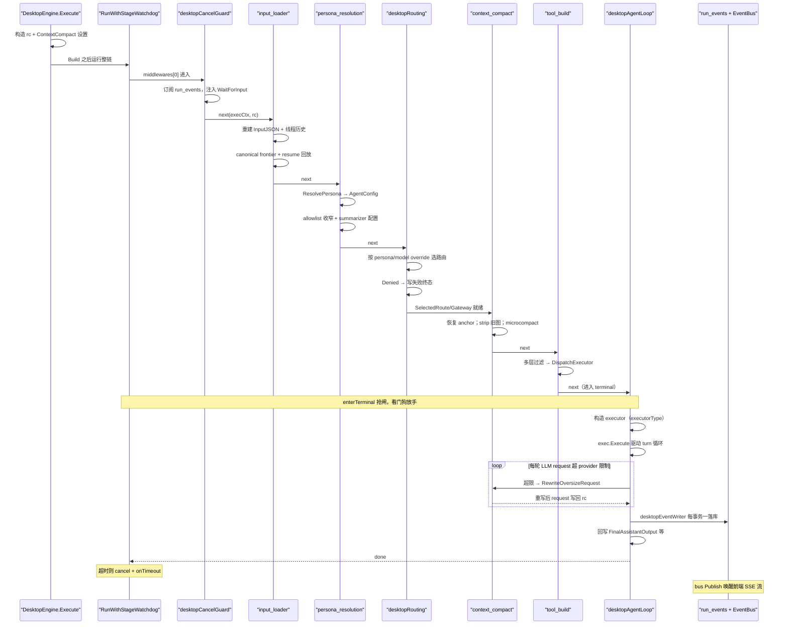

# Arkloop 中间件管线解读：一条 run 的有序加工链

> 本解读按 **ai-agent** 类规格产出。在整套解读中，本文落在 worker 的 **run 执行中枢**：把「一次 run 从空转的 run 记录加工成 agent loop 可消费的完整执行现场」这一装配面讲透——RunMiddleware 有序链、RunContext 状态流转、stage 观测与看门狗、上下文压缩 frontier 账本，以及 input_loader / context_compact / tool_build 等核心中间件。agent loop 本体（turn 循环 / governor 超时）与 memory、routing、channel、skill 等能力面属于其他切片，本文只交代它们在链上的接入位置与契约。

## 为什么 RunMiddleware 要建成一条有序链

根因是单进程内「共享可变上下文」与「极多执行前/后处理」的结构性张力：一次 run 的预处理可达三十余步（加载历史、注入记忆、解析 persona、选路由、压上下文、装配工具、注入心跳检查……），且大量步骤之间有生产—消费依赖——routing 要先知道 persona 选的 model，tool_build 要先知道 routing 选出的能力，summarizer 要读 routing 与 persona。若做成相互独立的组件，每个组件都要自己回答「我依赖的字段是谁、何时写入、该在哪个阶段跑」，跨组件编排责任散落各处；若手写一个巨型 `Execute` 编排函数，每加一个能力就要改动主函数并重排 if，横切关注点（观测、取消、超时、tracer）与主流程无法分离。

Arkloop 的选择是**把顺序写进数据结构**：中间件以 slice 形式静态列出，`middlewares[0]` 最先接触 run，terminal（agent loop）最后 [src/services/worker/internal/pipeline/middleware.go:11-22]()。

<!-- anchor: // Build 将中间件列表和终端 handler 组装为单个可调用的 RunHandler。 … 	return h -->

新增能力只是「往 slice 里插一个函数」，代价是**顺序即语义**——越靠后的中间件越依赖前面写入 `rc` 的状态；这也是维护者把装配列表当文档、反复强调顺序承载语义的原因（见装配代码 [src/services/worker/internal/app/composition.go:719-808]()）。

<!-- anchor: 	middlewares := []pipeline.RunMiddleware{ … 		pipeline.NewThreadPersistHookMiddleware(), -->

与备选方案对比，取舍一目了然：

| 方案 | 优点 | 在本项目的代价 |
|------|------|----------------|
| 有序中间件链（现状） | 次序契约显式；横切可包裹整链；新能力=插 slice | `rc` 隐式契约：字段谁写谁读靠注释与纪律，编译期不检查；追「谁动了 Messages」要靠 grep |
| 手写巨型 Execute | 直白 | 每加能力都改主函数并重排 if；横切（观测/超时）无法分离 |
| 独立组件 + 显式依赖注入 | 类型安全 | 编排责任分散；数十个组件的装配量巨大，且「同 run 内消息被多方修订」难以表达 |
| go.uber.org/fx 式容器 | 自动装配 | 太重，且丢失显式顺序——本项目需要的是「有语义的顺序」，不是「任意顺序可注入」 |

去掉这条链系统会退化：`rc` 上的上百字段失去统一的写入/读取秩序，同一 run 里的消息从「加载一次、多方修订」退化为散落各处的零散查询；而 `desktopObservedStage`、`RunWithStageWatchdog` 这类「把整条链当对象观察/看护」的能力也无处安放——它们恰恰依赖 RunMiddleware 这个统一抽象才存在。

### Build 是线性语义，不是洋葱语义

Go 生态（chi、negroni）惯用「洋葱模型」——中间件在 `next` 前后都可插代码，形成进—出双向包裹。Arkloop 的 `RunMiddleware` 名义上也是 `mw(ctx, rc, next)` 形态，但实际使用上**绝大多数中间件只在 `next` 前做事**，后置逻辑只出现在少数「run 结束后收尾」的中间件（heartbeat_schedule、title 异步、thread_persist hook 等）。因此心智模型是**流水线**而非洋葱：`Build` 用一次逆序闭包包装把列表折叠成单个 handler，读者只需从左到右读列表，无需推演双向调用栈 [src/services/worker/internal/app/composition.go:809-809]()。

<!-- anchor: 	terminal := desktopAgentLoop(e.db, e.bus, e.jobQueue, runsRepo, eventsRepo, e.shellExecutor, e.runtimeSnapshot) -->

### RunContext：全链共享的无锁执行现场

`RunContext` 是整条链唯一的共享载体，字段按写入方分节注释（「初始化时写入」「InputLoaderMiddleware 写入」「PersonaResolutionMiddleware 写入」「AgentLoopHandler 写入」……），字段注释即生产—消费契约的档案 [src/services/worker/internal/pipeline/context.go:58-120]()。

<!-- anchor: // RunContext 承载单次 Execute 调用的全部运行时状态，在 Pipeline 各中间件间共享。 … 	PendingSubAgentCallbacks []data.ThreadSubAgentCallbackRecord -->

几个值得注意的设计点：

- **`rc` 兼作「可逆写」面**：部分字段会被后写者覆盖或撤销。`AllowlistSet` 在 persona_resolution 被收窄、被 conditional_tools 加回；`rc.Messages` 被 input_loader 写入、被 context_compact 前台改写（microcompact / 图片剥离）、被 agent loop 追加、被 emergency compact 整段重写。
- **`rc` 是终端与链上后置型中间件之间的唯一写回通道**：agent loop 结束把 `FinalAssistantOutput`、`RunToolCallCount`、`RunIterationCount`、`ThreadPersistReady` 等写回 `rc`，供 thread_persist hook、activity_recorder、channel_delivery、impression/suggestion 等「next 之后才运行」的消费方读取 [src/services/worker/internal/pipeline/context.go:91-109]()。

<!-- anchor-base64:CS8vIC0tIEFnZW50TG9vcEhhbmRsZXIg5YaZ5YWl77yacnVuIOWujOaIkOWQjueahCBhc3Npc3RhbnQg5pyA57uI5ou85o6l5paH5pys77yM5L6bIE1lbW9yeU1pZGRsZXdhcmUg5YaZ5YWlIC0tIOKApiAJUnVuSXRlcmF0aW9uQ291bnQgaW50 -->

- **函数字段「早注册、晚调用」**：`rc` 大量持有函数（`WaitForInput`、`PollSteeringInput`、`ResolveGatewayForRouteID`、`TelegramVisibleTextDelta`……）。这让链头注册、链尾调用的横切等待逻辑不必绑死在某个中间件上——例如 desktopCancelGuard 在链头注入轮询函数，agent loop 在链尾耗时阶段才调用它。

### PromptAssembly：后写者如何影响 system prompt 而不触碰已物化字符串

`SystemPrompt` 不是简单字符串拼接，而是「命名 segment」的装配。每条 segment 携带 `Target`（system_prefix / conversation_prefix / runtime_tail）、`Stability`（stable_prefix / session_prefix / volatile_tail）与 `CacheEligible`，由 `PromptAssembly` 统一物化 [src/services/worker/internal/pipeline/prompt_assembly.go:7-30]()。

<!-- anchor: type PromptSegmentTarget string … 	CacheEligible bool -->

这是「后来者叠加内容」的关键机制：memory_injection、runtime_context、model_identity、plan_mode、heartbeat、searchable tool catalog 都向 system 前缀里 upsert 自己命名的一块；`Upsert` 同名即覆盖，允许后写者替换先写者的内容 [src/services/worker/internal/pipeline/prompt_assembly.go:52-67]()。

<!-- anchor: func (a *PromptAssembly) Upsert(segment PromptSegment) { … 	a.Segments = append(a.Segments, normalized) -->

`Stability` 与 `CacheEligible` 共同决定 prompt cache 的可用性——stable/session 段可进 cache，volatile_tail（plan_mode、心跳检查这类每次 run 变化的控制面）标记为不可缓存，避免污染 cache 快照。resume 场景下后写者还能整体移除重建（memory 快照段可被 compact/重建后移除）。

## 中间件链全序图

链的完整顺序即承载语义。下图中 `◉` 表示被 `desktopObservedStage` 观测的阶段；行号指 `src/services/worker/internal/app/composition.go` 的装配位置，各 `mw_*` 的实现文件见正文区段。整链装配 + terminal + 看门狗收口在 [src/services/worker/internal/app/composition.go:719-824]()。

```mermaid
graph TD
    subgraph G0["链头: 取消与原料加载"]
        A["desktopCancelGuard :720<br>可取消子 ctx + WaitForInput"]
        B["◉ input_loader :721<br>InputJSON + 线程历史 + frontier"]
        C["◉ heartbeat_schedule :722<br>run 结束后回写 trigger"]
        D["MCP discovery :723-731<br>发现可用 server 工具"]
        E["◉ plugin_hooks :732"]
        F["◉ tool_provider_bindings :733<br>active provider → executors"]
    end
    A --> B
    B --> C
    C --> D
    D --> E
    E --> F

    subgraph G1["身份/渠道与上下文: 谁在说话、给什么记忆"]
        G["◉ spawn_agent :734"]
        H["◉ persona_resolution :735<br>AgentConfig+profile+收窄"]
        I["◉ channel_context :736<br>ChannelContext+渠道工具面"]
        J["discuss / admin_tag<br>/ group_merge :737-739"]
        K["telegram / qq / sticker<br>end_reply 工具 :740-753"]
        L["scheduled_job_prepare :754"]
        M["sub_agent_context :755<br>skill_context :756-761"]
        N["agent_directory :762-767<br>plugin_context :768"]
        O["◉ memory_injection<br>+ runtime_context :770"]
        P["lsp 诊断 :772（可选）"]
    end
    F --> G
    G --> H
    H --> I
    I --> J
    J --> K
    K --> L
    L --> M
    M --> N
    N --> O
    O --> P

    subgraph G2["路由与上下文管理: 选模型、压上下文"]
        R["desktopRouting :775<br>SelectedRoute+Gateway"]
        S["◉ channel_group_context_trim :776-782"]
        T["title_summarizer :783<br>异步生成首标题"]
        U["context_compact :784<br>strip/microcompact/估算"]
        V["image_understanding :785-790<br>vision 预描述"]
        W["impression / suggestion :791-792<br>run_kind 专用"]
        X["activity_recorder/sticker<br>prepare :793-799"]
    end
    P --> R
    R --> S
    S --> T
    T --> U
    U --> V
    V --> W
    W --> X

    subgraph G3["工具装配与收尾: 给 agent loop 可执行现场"]
        Y["heartbeat_prepare :800<br>心跳 run 注册工具"]
        Z["model_identity :801<br>注入 model_identity 段"]
        AA["conditional_tools :802<br>按能力加回工具"]
        AB["tool_build :803<br>DispatchingExecutor+Specs"]
        AC["tool_loop_detection :804<br>注入 ToolLoopDetector"]
        AD["result_summarizer :805<br>注入 Layer2 压缩"]
        AE["thread_persist_hook :806<br>hook 链+compact 维护"]
        AF["channel_delivery :807"]
        AG["terminal = desktopAgentLoop :809"]
    end
    X --> Y
    Y --> Z
    Z --> AA
    AA --> AB
    AB --> AC
    AC --> AD
    AD --> AE
    AE --> AF
    AF --> AG
```

<!-- anchor: 	middlewares := []pipeline.RunMiddleware{ … 			"worker.pipeline_timeout", "pipeline stalled before agent loop", details) -->

## 从入队到 agent loop 的执行时序

时序上几个关键闸口值得单独看：

1. **desktopCancelGuard 是链上唯一把整条链的执行 ctx 换成可取消子 ctx 的中间件**：链头创建 `execCtx` 并订阅 `run_events:{runID}` 总线，后台 goroutine 把新输入事件灌进 `wakeInput` 通道，`WaitForInput`/`PollSteeringInput` 由此可被 agent loop 在链尾调用；defer 里 `cancel()` 并 `<-done` 等待订阅 goroutine 退出，保证链结束即停表 [src/services/worker/internal/app/composition.go:1120-1200]()。

<!-- anchor: func desktopCancelGuard(db data.DesktopDB, bus eventbus.EventBus) pipeline.RunMiddleware { … 		return next(execCtx, rc) -->

2. **agent loop 的接入契约很薄**：`desktopAgentLoop` 通过 `rc.ExecutorBuilder.Build(executorType, config)` 构造 executor 并 `exec.Execute`，事件经 `desktopEventWriter.append` 每次一事务落库 [src/services/worker/internal/app/composition.go:3404-3438]()。

<!-- anchor: 		executorType := "agent.simple" … 			return w.append(execCtx, rc.Run.ID, ev, "") -->

3. **run 完成由 terminal 写回 `rc`**：`RunToolCallCount`/`RunIterationCount`/`ThreadPersistReady` 在 agent loop 收尾处统一回填，成为链上后置中间件（thread_persist hook、impression 写回等）的运行条件 [src/services/worker/internal/app/composition.go:3459-3461]()。

<!-- anchor: 		rc.RunToolCallCount = w.toolCallCount … 		rc.ThreadPersistReady = true -->

## 观测与兜底：包住整条链，而非写进每个中间件

`desktopObservedStage`（阶段计时上报）与 `RunWithStageWatchdog`（进 loop 前总超时）都是「装饰」形态的链外机制，正是 RunMiddleware 统一抽象让它们能以包裹一层的方式存在。

### desktopObservedStage：把阶段观测做成一等抽象

`desktopObservedStage(stage, eventsRepo, inner)` 返回一个包裹器：仅当 stage 命中观测白名单时，对其执行计时并按完成/失败发 `run.{stage}` 事件；白名单之外的 stage 原样透传 [src/services/worker/internal/app/composition.go:880-915]()。

<!-- anchor: func desktopObservedStage(stage string, eventsRepo data.RunEventStore, inner pipeline.RunMiddleware) pipeline.RunMiddleware { … 		return err -->

白名单只有十来个阶段，且事件带默认 250ms 阈值过滤——stage 快且无错则不落库，避免把每次 run 的常规快路径都写进事件表；真正上报的是「慢」或「失败」这两个最有诊断价值的信号，落 `run_events` 后还经 EventBus 广播唤醒订阅方 [src/services/worker/internal/app/composition.go:917-955]()。

<!-- anchor: func emitDesktopStageEvent( … 	if rc.EventBus != nil { -->

### RunWithStageWatchdog：看门狗只盯进 loop 之前

装配尾声把 `middlewares+terminal` 整体交给 `RunWithStageWatchdog`。它只在 agent loop 之前设总时限（默认 120s、可经环境变量调节、0 即关闭）——「进 loop 前」的 stage 大多是 DB / LLM / 网关调用，理论上应快速返回；一旦卡死（如 MCP server 连不上），worker 槽会被占死且 run 永远停在 running [src/services/worker/internal/app/composition.go:811-823]()。

<!-- anchor: 	// 看门狗：agent loop 之前的任一 stage（如 MCP 发现连不上的 server）卡住超过阈值时， … 			"worker.pipeline_timeout", "pipeline stalled before agent loop", details) -->

裁决用一个「临界点互斥」门闩：`enterTerminal`（terminal 入口）与 `tryFire`（看门狗超时）只有一方能赢，杜绝「loop 已进入、看门狗误杀」与「看门狗已开火、loop 才姗姗来迟」两种竞态 [src/services/worker/internal/pipeline/stage_watchdog.go:25-45]()。

<!-- anchor: // enterTerminal 由 terminal handler 入口调用，返回 false 表示看门狗已抢先开火，应放弃执行。 … 	return true -->

超时路径也讲究：先 `cancel()` 掐断前段 ctx，再用 `context.WithoutCancel` + 独立 10s 超时 ctx 跑 `onTimeout`（落 run.failed 终态、dump 全部 goroutine 栈到临时文件）——清理动作不被已取消的上下文连坐，最终返回 `StageWatchdogTimeoutError` [src/services/worker/internal/pipeline/stage_watchdog.go:86-99]()。

<!-- anchor: 	case <-timer.C: … 		return StageWatchdogTimeoutError{Timeout: timeout} -->

这类包裹层的局限也很明显：只能观测「执行时长与成败」，拿不到中间件内部因果——内部因果由各中间件主动埋 tracer 事件补齐（`rc.Tracer.Event`）。

## input_loader：run 的原料工厂

`NewInputLoaderMiddleware` 是链上最重的一个：一次事务内完成 InputJSON 重建、线程历史加载、canonical 上下文构建与 resume/runtime-recovery 回放 [src/services/worker/internal/pipeline/mw_input_loader.go:108-168]()。

<!-- anchor: // NewInputLoaderMiddleware 加载 run 的 inputJSON 和线程历史消息到 RunContext。 … 		return next(ctx, rc) -->

为什么它做这么多：**消息的「可见形态」不是简单 SELECT**。一条线程历史上可能已被多次后台压缩，真实消息库之上叠加了 replacement 摘要层与 supersession 边；同时 run 可能是 continue（resume）或 runtime-recovery（崩溃自愈），需要在「上次断点」处把父 run 的 rollout 内容按原样回放成 LLM 消息。

设计要点：

- **InputJSON 权威来源是 run_events 的首事件 data**：`loadRunInputsWithTrace` 从 `eventsRepo.FirstEventData` 读 run 启动参数（route/persona/model/work_dir/collaboration_mode/plan_file_path……），而非信调用方传参 [src/services/worker/internal/pipeline/mw_input_loader.go:461-541]()。这把「API 层怎么进来的」与「run 实际看到什么」解耦，也让 resume 时参数天然一致。

<!-- anchor: 	_, dataJSON, err := eventsRepo.FirstEventData(ctx, tx, run.ID) … 			inputJSON["channel_delivery"] = rawChannelDelivery -->

- **canonical 三层模型（atom → chunk → frontier → entry）**：线程消息先切成「协议原子」（user_text / assistant_text / tool_episode，原子是压缩的语义单位、不可切分），再按 token 预算切成 chunk（`context_seq` 全局递增），历史压缩记录（replacement）投影其上形成 frontier，最终渲染成 LLM entry 列表。这个模型在加载期构建并幂等落库（sha256 校验），让「哪条消息在 prompt 里、哪段已被摘要替换」成为可查询的事实 [src/services/worker/internal/pipeline/thread_context_builder.go:107-176]()。

<!-- anchor: 	atoms, chunks := buildCanonicalAtomGraph(renderableMessages) … 		renderedMessages = append(renderedMessages, entry.Message) -->

- **atom 划分规则**：assistant 带 tool_calls 与其后连续 tool 消息并成一个 tool_episode atom，防止压缩把「调用—结果」对拆散 [src/services/worker/internal/pipeline/thread_context_graph.go:98-144]()。

<!-- anchor: func buildProtocolAtoms(messages []data.ThreadMessage) []canonicalAtom { … 	return atoms -->

- **resume = 可放弃的回放**：`collectResumeReplayInsertions` 沿 `ResumeFromRunID` 向上递归（visited 防环），逐层校验父 run 必须可 resume、无 pending tool call、rollout 可读，再把父 rollout 重建为消息、挂到语义锚点后 [src/services/worker/internal/pipeline/mw_input_loader.go:1032-1136]()。

<!-- anchor: func collectResumeReplayInsertions( … 	}), nil -->

- **显式 continue 失败即失败，自动尝试则降级**：resume 不可用时，显式 continue job 直接返回错误；系统自动尝试的则清掉 continuation 元数据、丢弃回放，退化为普通 run [src/services/worker/internal/pipeline/mw_input_loader.go:602-611]()。

<!-- anchor: 	} else if run.ResumeFromRunID != nil { … 				clearContinuationMetadata(inputJSON) -->

- **锚点（anchor key）机制**：resume 插入不是「追加到末尾」，而是按 `messageAnchorKey / replacementAnchorKeyForThreadSeq` 找到语义锚点（真实消息 ID 或 replacement 覆盖的 thread_seq 区间），把回放插到锚点之后，保证与 history 上界、frontier 对齐等后续处理一致 [src/services/worker/internal/pipeline/thread_context_builder.go:703-733]()。

<!-- anchor: func messageAnchorKey(messageID uuid.UUID) string { … 	return "" -->

权衡：这套加载把「一次 run 的成本」抬高（一次事务 + 图构建 + 幂等持久化），但换来下游所有中间件与 agent loop 不再感知压缩历史，且 resume/恢复共享同一 code path——对本地优先单进程是划算的。

## context_compact：frontier 账本驱动的上下文管理

骨架里 context_compact 占一个中间件位置，实际它是一个跨文件的子系统，按触发时机分三层。

### 三层触发：前台薄层 / 后台维护 job / 前台 emergency

**前台薄层（middleware）** `NewContextCompactMiddleware` 只做廉价操作：跨 run 恢复 pressure 锚点、剥离旧图片（保尾）、可选 microcompact、token 估算与事件上报——**不在链上跑 LLM 压缩**，未启用时对 `rc.Messages` 原样透传 [src/services/worker/internal/pipeline/mw_context_compact.go:74-101]()。

<!-- anchor: 		return func(ctx context.Context, rc *RunContext, next RunHandler) error { … 			return next(ctx, rc) -->

**后台维护（hook 触发 job）**：run 完成后 `NewThreadPersistHookMiddleware` 驱动 hook 链，注册在 hookRegistry 的 compact maintenance observer 判断线程压力是否越过 soft trigger（context 窗口百分比），是则入队一个 `context_compact_maintain` job [src/services/worker/internal/pipeline/hook_context_compact_maintain.go:32-88]()。

<!-- anchor: func (o *contextCompactMaintenanceObserver) AfterThreadPersist( … 	return nil, nil -->

`ExecuteContextCompactMaintenanceJob` 是「选区 → LLM 摘要 → 落 replacement → 重建上下文 → 再评估」的多轮循环，压回 target_pct（默认 65%）或选区耗尽为止，round 上限 10；入口先做连续失败熔断（失败 ≥ 上限则跳过本轮）并抢每线程文件锁 [src/services/worker/internal/pipeline/context_compact.go:1072-1107]()。

<!-- anchor: 	var lastPressureTokens int … 			return nil -->

**前台 emergency（agent loop 内）**：LLM request 超 provider 限制时，`agent/loop.go` 的 `maybeRecoverOversizeRequest` 调 `RewriteOversizeRequestWithOptions`——先剥旧图片 + microcompact 最近工具结果，若压力仍超限则走与后台几乎相同的 persisted replacement round（同步、带锁），再把重建后的历史写回 `rc.Messages/frontier`。重写入口在 agent loop [src/services/worker/internal/agent/loop.go:1587-1594]()。
<!-- anchor: 	rewritten, stats, rewriteErr := pipeline.RewriteOversizeRequestWithOptions( … 		forceCompact, -->

重写主体（降级路径与收口）在 [src/services/worker/internal/pipeline/context_compact.go:504-556]()。
<!-- anchor: 	rewritten := request … 	return rewritten, stats, nil -->

### frontier 语义：replacement 遮蔽 + supersession 顶替 + layer

整个压缩子系统围绕「把什么压成什么」的持久账本展开：历史 = 一串有序节点（chunk 或 replacement），replacement 是一段 chunk 范围的 LLM 摘要，携带全局 `context_seq` 区间与 **layer**（压缩代数）；一次压缩写入新 replacement 并记录它顶替了哪些旧节点（supersession 边）。

渲染层做「摘要优先、被覆盖则跳过 chunk」的投影：遍历 chunk 时若已被某条 replacement 覆盖就直接跳过，保证同一段原文不会同时以 raw 与摘要两种形态出现在 prompt 里 [src/services/worker/internal/pipeline/thread_context_frontier.go:64-90]()。

<!-- anchor: 	for _, chunk := range graph.Chunks { … 				continue -->

`selectPrefixOnlyReplacementCoverage` 则保证 frontier 只保留「覆盖从前缀起、彼此不重叠」的 replacement 链——同名区间以 layer 更大、时间更新的获胜，避免中间层摘要与底层摘要同时存活造成重复折叠 [src/services/worker/internal/pipeline/thread_context_frontier.go:157-206]()。

<!-- anchor: func selectPrefixOnlyReplacementCoverage( … 	return selected -->

**Why 这种「账本」设计**：本地优先 app 的线程是可回溯的用户资产，物理删除原文会破坏 thread_messages 消息流、渠道回看与恢复；让历史消息永不物理删除、只以 replacement 遮蔽是取舍的根本。代码注释也写明：delete-based trim 已显式退役，历史压缩只能走 replacement frontier 表达 [src/services/worker/internal/pipeline/context_compact.go:348-352]()。

<!-- anchor: // CompactThreadMessages 的 delete-based trim 语义已退役。 … 	return msgs, alignIDs(ids, len(msgs)), 0 -->

### 选区策略：保护尾消息 / compact zone 预算 / shrink retry

选区刻意分层，防止「摘要通胀」：

- **永远保护最近一条真实消息**：`protectedAtomSeq` 把尾 atom 排除出候选，不压缩正在讨论的话题 [src/services/worker/internal/pipeline/context_compact_frontier.go:541-547]()。

<!-- anchor: 	protectedAtomSeq := nodes[len(nodes)-1].AtomSeq … 			eligibleEnd = i -->

- **compact zone 预算**：窗口前部 replacement 摘要区按 `CompactZoneBudgetPct`（默认 25%）设上限。zone 满则只做「摘要的摘要」（replacement 再合并，至少 2 个才动）；zone 未满则只选 raw chunk 把覆盖范围向右推进——避免同层反复重写同一段 [src/services/worker/internal/pipeline/context_compact.go:809-853]()。

<!-- anchor: 	// 双分支选区：根据 compact zone 是否满来决定选谁 … 		if len(rawOnly) > 0 { -->

- **LLM 失败分级收缩重试**：`compactNodesWithShrinkRetry` 遇上下文溢出类错误就「整段原子地」切掉尾部再试（tool_episode 整组切），遇 unauthorized/forbidden 等非溢出错误不重试 [src/services/worker/internal/pipeline/context_compact_frontier.go:871-921]()。

<!-- anchor: func compactNodesWithShrinkRetry( … 	return !strings.Contains(errMsg, "unauthorized") && !strings.Contains(errMsg, "forbidden") -->

### 并发正确性与压力锚点

SQLite 不支持 advisory lock，桌面端用每线程一把文件锁 `CompactThreadCompactionLock`——前台 emergency 与后台 job 抢同一把锁，防并发写 replacement [src/services/worker/internal/pipeline/compact_thread_lock.go:20-55]()。

<!-- anchor: // CompactThreadCompactionLock acquires an exclusive file lock for the given thread. … 	return db, cleanup, nil -->

压力口径刻意用「锚」而非绝对值：以最近一次真实 LLM request 的 prompt token 作锚，当前估算相对锚的增量视为压力，避免把工具 schema 波动这类系统噪声误判成对话增长 [src/services/worker/internal/pipeline/context_compact_pressure.go:36-49]()。

<!-- anchor: // ApplyContextCompactPressure 用 gemini-cli 风格口径估算当前上下文压力。 … 	return pressure -->

## 工具面合成：model_identity → conditional_tools → tool_build

`model_identity`、`conditional_tools`、`tool_build` 三个中间件串成「模型能力 → 暴露哪些工具」的完整链路，是「顺序承载语义」最典型的例证：

- model_identity 把路由能力块写进 system prompt，注释明确要求必须排在 RoutingMiddleware 之后（`rc.SelectedRoute` 是前置条件）[src/services/worker/internal/pipeline/mw_model_identity.go:11-28]()。

<!-- anchor: // NewModelIdentityMiddleware injects a <model_identity> segment into the system prompt … 		return next(ctx, rc) -->

- conditional_tools 读 persona 规则：当路由能力「缺乏某输入模态」时把补救工具**加回** allowlist（并从 denylist 移除）——在 tool_build 之前改 allowlist [src/services/worker/internal/pipeline/mw_conditional_tools.go:11-40]()。

<!-- anchor: func NewConditionalToolsMiddleware() RunMiddleware { … 		return next(ctx, rc) -->

- tool_build 是工具面唯一的「最终装配点」，执行多层过滤：allowlist → provider allowlist 解析 → runtime 过滤（运行时不可用工具摘除）→ 未配置 executor 过滤 → 账号级可用性 → 身份必需工具过滤，最后 `BuildDispatchExecutor` [src/services/worker/internal/pipeline/mw_tool_build.go:50-121]()。
<!-- anchor: func NewToolBuildMiddleware() RunMiddleware { … 		allSpecs = applyProviderOwnedToolSpecs(allSpecs, rc.ActiveToolProviderByGroup) -->

装配产物（`ToolExecutor/FinalSpecs` 等）写回 `rc` [src/services/worker/internal/pipeline/mw_tool_build.go:182-188]()。
<!-- anchor: 		rc.ToolExecutor = executor … 			rc.ActiveToolProviderByGroup, -->

身份必需工具（memory/notebook/thread 系）在 `rc.UserID == nil` 时整组摘除——桌面恢复/匿名场景不会暴露需要身份的工具 [src/services/worker/internal/pipeline/mw_tool_build.go:344-358]()。

<!-- anchor: // identityRequiredTools are tools that need a valid UserID to function. … 	"thread_messages":      {}, -->

### read 能力四象限：给 LLM 的 schema 恰配能力

「读能力」特别体现顺序承载语义：`ReadCapabilities` 综合「主模型是否原生支持图片」（来自 routing）与「read 组当前 active provider 是否可作图片桥」（来自 tool_provider_bindings），随后 `ApplyReadImageSourceVisibility` 按四象限裁剪 read 工具的 JSON Schema——剥 image source、标注 prompt 必需、或全保留，保证给 LLM 的 schema 恰好匹配真实能力 [src/services/worker/internal/pipeline/read_capabilities.go:34-56]()。

<!-- anchor: // ApplyReadImageSourceVisibility 按 bridge 能力和主模型图片支持裁剪 read 的图片 source 暴露面。 … 	case !exposeImageSources && nativeImageInput: -->

### core/searchable 二层模型

persona 声明 `core_tools` 时，工具被切成 core（直接可见）与 searchable（仅目录段提示、经 load_tools 激活）两层。`load_tools` 的 executor 用「懒引用 + 指针到指针」在 DispatchingExecutor 创建前预绑定，闭包捕获 `dispatchRef` 与 `coreSpecsMap` 两个后续才填充的指针 [src/services/worker/internal/pipeline/mw_tool_build.go:83-101]()。

<!-- anchor: 		// Pre-bind load_tools executor before filtering so it survives … 					return coreSpecsMap -->

核心工具与 searchable 目录拆分后，searchable 工具的 spec 不进入 system prompt，只在 `tools.searchable_catalog` 段留一份目录（session 稳定、可缓存），`load_tools` 执行时才解析真实 spec [src/services/worker/internal/pipeline/mw_tool_build.go:138-180]()。

<!-- anchor: 		coreSet := resolveCoreToolSet(rc) … 			allSpecs = coreSpecs -->

Why：工具 schema 总和几乎占 context 的固定大头且可缓存，把低频工具移出 system prompt 只留目录，是「大工具集 × 有限上下文窗口」的必然选择；代价是 LLM 需多一步 load_tools 才能用工具——对会主动查询目录的模型友好，对偷懒模型是折损。

## result_summarizer：不进消息流的第二层压缩

与 context_compact 压缩「对话历史」不同，result_summarizer 压缩**单次工具结果**：把配置好的 summarizer（阈值/prompt/maxTokens）挂到 `rc.ToolExecutor` 上，工具结果超过阈值字节时由执行器在拼回消息前先调一次小模型压缩（Layer 2）[src/services/worker/internal/pipeline/mw_result_summarizer.go:15-80]()。

<!-- anchor: // NewResultSummarizerMiddleware 从系统 summarize persona 读取配置，按需为 ToolExecutor … 		rc.ToolExecutor.SetSummarizer(summarizer) -->

位置在 tool_build 之后（需要 ToolExecutor）、agent loop 之前。它与 context_compact 的分工是**维度互补**：一个管历史宽度（跨 turn），一个管单点深度（单 result 过大）；二者都复用系统 summarize persona 的模型配置，gateway 经 `resolveTitleGateway` 统一解析（支持 `title_summarizer.model` 平台配置 selector，找不到则回落主路由 gateway）[src/services/worker/internal/pipeline/mw_title_summarizer.go:133-179]()。

<!-- anchor: func resolveTitleGateway( … 	return gw, selected.Route.Model -->

## title_summarizer：不阻塞 run 的异步副作用

线程首次 run 触发首标题生成，两个设计点：

1. **异步且自带 context**：中间件把消息快照、gateway 选路、prompt 复制后 `go func()` 另起独立超时 ctx 跑 LLM，主链不等它 [src/services/worker/internal/pipeline/mw_title_summarizer.go:100-122]()。标题生成属「锦上添花」，不值得为一个标题让用户多等一次模型调用。

<!-- anchor: 		go func() { … 			titleGenerator(ctx, db, bus, gateway, runID, threadID, model, messages, prompt, maxTokens) -->

2. **幂等写入**：`writeThreadTitleAndEventOnce` 先 `SELECT ... FOR UPDATE` 锁 run 行，再查 `thread.title.updated` 事件是否已存在——goroutine 与并发 run 的重复写入被事务内查重挡住 [src/services/worker/internal/pipeline/mw_title_summarizer.go:320-385]()。

<!-- anchor: func writeThreadTitleAndEventOnce( … 	return seq, true, nil -->

标题输入也做了预算裁剪：`buildTitleMaterials` 只取 user 侧附件/图片名与提取文本，按传入预算截断（附件块与原文块共享预算）[src/services/worker/internal/pipeline/mw_title_summarizer.go:484-519]()。

<!-- anchor: func buildTitleMaterials(messages []llm.Message, budget int) string { … 	return strings.Join(blocks, "\n\n") -->

## tool_loop_detection：装配就位、消费未接线的防呆器

检测器本体维护 30 条滑动窗口，三类模式：同工具同参数重复（≥5 warning / ≥10 block）、连续 8 次同结果无进展、A-B-A-B ping-pong（阈值 6）[src/services/worker/internal/pipeline/mw_tool_loop_detection.go:16-20]()。

<!-- anchor: 	loopWindowSize       = 30 … 	loopPingPongThresh   = 6 -->

参数 hash 的关键是稳定口径：`filterParams` 先把 timestamp/random/nonce/id 等易变字段整体剔除再参与哈希，避免「每次参数略不同」绕开检测 [src/services/worker/internal/pipeline/mw_tool_loop_detection.go:143-159]()。
<!-- anchor: func filterParams(params map[string]any) map[string]any { … 	return out -->

参数 hash 取 sha256 前 16 字节 [src/services/worker/internal/pipeline/mw_tool_loop_detection.go:136-141]()。
<!-- anchor: func computeCallHash(toolName string, params map[string]any) string { … 	return hex.EncodeToString(sum[:16]) -->

result hash 则在 `RecordToolCall` 记账时只取 sha256 前 8 字节，只判断「是否同结果」不求精确 [src/services/worker/internal/pipeline/mw_tool_loop_detection.go:189-201]()。
<!-- anchor: func RecordToolCall(rc *RunContext, toolName string, args map[string]any, resultJSON map[string]any) { … 	rc.ToolLoopDetector.record(toolName, args, resultHash) -->

对外契约是 `CheckToolLoop`（执行前询问，block=true 拒绝）与 `RecordToolCall`（执行后记账），warning 消息经 `FormatLoopWarning` 包装后注入模型；中间件本身只把检测器注入 `rc` [src/services/worker/internal/pipeline/mw_tool_loop_detection.go:161-201]()。

<!-- anchor: // NewToolLoopDetectionMiddleware creates a middleware that detects and prevents tool call loops. … 	rc.ToolLoopDetector.record(toolName, args, resultHash) -->

## 其余通用中间件职责

除上述深读对象外，链上还有一批职责单一的中断面，各管一件横切事：

- **heartbeat_schedule**：run 结束后（next 返回后）按线程配置 upsert/删除 `scheduled_triggers`；heartbeat run 自身只刷新 cooldown、不重排调度（防自激）[src/services/worker/internal/pipeline/mw_heartbeat_schedule.go:20-29]()。

<!-- anchor: func NewHeartbeatScheduleMiddleware(db data.DB) RunMiddleware { … 		if rc.HeartbeatRun || isDiscussScheduledRun(rc) { -->

- **heartbeat_prepare**：heartbeat run 把决策工具注册进统一工具面（AllowlistSet / ToolExecutors / ToolSpecs 三处同步）并 upsert `heartbeat.check` runtime tail 段 [src/services/worker/internal/pipeline/mw_llm_heartbeat.go:85-154]()。

<!-- anchor: func NewHeartbeatPrepareMiddleware() RunMiddleware { … 			Name:          "heartbeat.check", -->

- **image_understanding**：主模型不支持图片且消息含图时，用 vision 模型生成描述文本注入（pre-description，不换 route）；无 vision route 则优雅降级、不 hard fail [src/services/worker/internal/pipeline/mw_image_understanding.go:23-62]()。

<!-- anchor: func NewImageUnderstandingMiddleware(cfg ImageUnderstandingConfig) RunMiddleware { … 		return next(ctx, rc) -->

- **impression / suggestion / activity_recorder**：run_kind 专用的「生成 run」三段式——识别 run_kind → 向 `rc.Messages` 追加素材 user 消息（`ThreadMessageIDs` 用 `uuid.Nil` 占位，表示非持久消息）→ 交给下游同一条链 → 完成后从 `rc.FinalAssistantOutput` 写回各自 store（画像 / 建议 / 活动记录）。三个入口分别是 impression [src/services/worker/internal/pipeline/mw_impression.go:38-101]()。
<!-- anchor: func NewImpressionPrepareMiddleware(impStore ImpressionStore, pool CompactPersistDB, auxGateway llm.Gateway, emitDebugEvents bool, configLoader *routing.ConfigLoader) RunMiddleware { … 		return err -->

suggestion [src/services/worker/internal/pipeline/mw_suggestion.go:35-85]()。
<!-- anchor: func NewSuggestionPrepareMiddleware(sugStore SuggestionStore, pool CompactPersistDB, auxGateway llm.Gateway, emitDebugEvents bool, configLoader *routing.ConfigLoader) RunMiddleware { … 		return err -->

与 activity_recorder [src/services/worker/internal/pipeline/mw_activity_recorder.go:34-54]()。
<!-- anchor: func NewActivityRecorderPrepareMiddleware(pool CompactPersistDB, auxGateway llm.Gateway, emitDebugEvents bool, configLoader *routing.ConfigLoader) RunMiddleware { … 		return err -->

- **runtime_timezone / runtime_context**：先解析用户级/账号级时区（IANA 校验、失效回退 UTC）[src/services/worker/internal/pipeline/mw_runtime_timezone.go:9-43]()。
<!-- anchor: func runtimeContextTimeZone(ctx context.Context, rc *RunContext) string { … 	return loc.String() -->

再注入 `<runtime_context>` 段（时区/本地日期/git 分支/目录树/AGENTS.md 项目指令）与渠道输出约束 [src/services/worker/internal/pipeline/mw_runtime_context.go:18-56]()。
<!-- anchor: func NewRuntimeContextMiddleware() RunMiddleware { … 		return next(ctx, rc) -->

- **plan_mode（input_loader 联动）**：collaboration_mode=plan 时 upsert `plan_mode` 尾段（只读、plan 文件约束、exit 语义），退出后 upsert `plan_mode_exit` 提醒段 [src/services/worker/internal/pipeline/mw_input_loader.go:304-358]()。

<!-- anchor: func SyncPlanModePrompt(rc *RunContext) { … 			Text: "<system-reminder>\n" + -->

- **thread_persist_hook**：agent loop 写 `ThreadPersistReady` 后驱动 hook 链（before/execute/after 三段），compact maintenance observer 挂在这条链上 [src/services/worker/internal/pipeline/hook_runtime_middleware.go:33-47]()。

<!-- anchor: func NewThreadPersistHookMiddleware() RunMiddleware { … 		rc.HookRuntime.AfterThreadPersist(ctx, rc, delta, result) -->

- **envelope_projection**：把 Telegram 群 user 消息里的 YAML envelope 就地投影为自然语言前缀（对非 channel 的 run 同样生效）[src/services/worker/internal/pipeline/envelope_projection.go:92-120]()。

<!-- anchor: // projectGroupEnvelopes 遍历 rc.Messages，将 user 消息中的 YAML envelope 替换为自然语言前缀。 … 	return projected, skipped -->

## 与其他模块的协同：共享链上的接入点

memory、routing、channel、skill、子代理等能力面与通用中间件**共用同一条链、同一套 `rc`**，各能力模块只需「在链上挑一个位置插进来」即完成集成。几个典型的接入点：

- **memory 能力插在 plugin_context 之后、routing 之前**：`desktopCapabilityMiddlewares` 把 memory_injection 与 runtime_context 两个观测 stage 拼成一块 [src/services/worker/internal/app/composition.go:870-878]()。

<!-- anchor: func desktopCapabilityMiddlewares( … 		desktopObservedStage("runtime_context", eventsRepo, pipeline.NewRuntimeContextMiddleware()), -->

memory_injection 外包一层 `traceDesktopMemoryInjection`：比较注入前后 materialize 出的 system prompt delta，用 tracer 事件记录哪些记忆形态（`<memory>` / `<notebook>` / `<working_memory>` / `<system_recalled_memories>`）真正进了 prompt [src/services/worker/internal/app/composition.go:846-868]()。

<!-- anchor: func traceDesktopMemoryInjection(inner pipeline.RunMiddleware) pipeline.RunMiddleware { … 		return err -->

记忆与工具是双向的：memory 中间件把 `<memory>` 快照 upsert 进 system prompt（走 PromptAssembly，可被 compact/重建移除）；tool_build 对身份必需工具要求 `rc.UserID` 存在，否则摘除（见上节）。

- **routing 是 llm.Gateway 的唯一事实入口**：persona_resolution 写 `AgentConfig.Model` 等，desktopRouting 解析出 `SelectedRoute/Gateway/ContextWindowTokens` 写回 `rc`，并向 `rc` 注入 `ResolveGatewayForRouteID/ResolveGatewayForAgentName` 供 loop 内切模型用 [src/services/worker/internal/app/composition.go:3277-3299]()。
<!-- anchor: 		rc.Gateway = gateway … 			return gw, selected, nil -->

route 被 Denied 时直接写失败终态 [src/services/worker/internal/app/composition.go:3250-3253]()。
<!-- anchor: 		if decision.Denied != nil { … 				decision.Denied.ErrorClass, decision.Denied.Message, nil) -->

- **channel 身份/上下文**：channel_context（persona 之后）从 channel_delivery payload 解析出 `ChannelContext`（sender/群/机器人身份），后续 channel 工具中间件、runtime_context、heartbeat_schedule、group_context_trim 与 delivery 都读它；部分 channel 中间件把渠道专属工具（telegram/qq/sticker/end_reply）注册进 `rc.ToolSpecs/ToolExecutors`。

- **skill 与子代理上下文**：skill_context 解析启用的 skills 并把 skill 工具 spec 并入工具面 [src/services/worker/internal/app/composition.go:756-761]()。

<!-- anchor: 			Resolve:        desktopSkillResolver(e.db), … 			ExternalDirs:   desktopExternalSkillDirs(e.db), -->

- **run_kind 专用中间件与普通 run 复用同一条链**：impression/suggestion/activity_recorder 的「prepare mw」结构一致（追加素材 → 同链 → 写回），说明中间件流水线 + rc 写回让不同 run 类型共享 agent loop，无需为每种 run 类型另造执行器。

## 亮点与隐患

### 亮点

- **一份 `rc` 承载整个执行现场**：字段按写入方分区注释，既是实现也是文档——新中间件从注释区就知道该读谁、该写哪。
- **PromptAssembly 让「后写者改 prompt」成为廉价且可撤销的操作**：stability/cache 标注让 prompt cache 可用性与「内容来自哪层」可追溯，是 service 态与桌面态共用同一装配的秘密。
- **resume/恢复与压缩共享同一 canonical 模型**：一次 run 无论来自新建、continue 还是崩溃恢复，都从同一「消息 → atom → chunk → frontier → entry」管线产出，路径少、语义一致。
- **SSE 观察 = 落库 + 进程内总线唤醒**：事件先落 `run_events`（SQLite 即事实源），worker 每落一事件经 EventBus 发 `run_events:{runID}`，前端 SSE 流订阅该频道被唤醒后按 seq 增量从 DB 读，天然支持断线补拉，不依赖长连接的可靠性 [src/services/api/internal/http/conversationapi/v1_runs.go:1108-1113]()。

<!-- anchor: 		// 进程内 EventBus：worker 提交 run_events 后经 bus 唤醒本流 … 			sub, err := bus.Subscribe(r.Context(), channel) -->

- **desktopEventWriter 单事务/事件落库**：`append` 每次一事务写 SQLite，保持锁短（composition.go:3620 起，类型注释自 3490 行起）。

### 隐患与风险

- **隐式契约 = 脆契约**：`rc` 字段的生产/消费全凭注释与纪律，编译器不校验「谁在 tool_build 之后还读 ToolSpecs」或「谁意外覆盖了 Messages」；field 级不变式缺自动化，装配集成测试是主要防线。
- **90+ 行装配列表靠人肉排序**：没有任何机制校验「后置中间件所需字段在前置已写」；顺序错误只能运行时暴露。防止回归靠 composition 集成测试与纪律（维护者把列表顺序当文档就是这个原因）。
- **ToolLoopDetector 疑似「装配了、消费未接线」**：截至当前快照，全 worker 源码中除检测器自身定义与 `rc.ToolLoopDetector` 注入（mw_tool_loop_detection.go:165）外，`CheckToolLoop / RecordToolCall / FormatLoopWarning` 均无调用点——若属实是「预留能力」，agent loop 的工具执行路径并未真正启用防循环，README/文档应与其真实状态对齐。
- **context_compact 多入口行为需严格一致**：前台 emergency / 后台 job / middleware 薄层三处共享同一套选区与落库函数，降低了分叉风险；但 emergency 在 agent loop 的同步路径里持文件锁 + 跑 LLM，极端情况下会把一次请求拖慢数秒，虽有重试/熔断兜底仍需观测。
- **观测层只见时长不见因果**：`desktopObservedStage`/看门狗只能判断某 stage 慢/失败，内部因果依赖各中间件主动埋 tracer 事件；漏埋的 stage 卡死只能靠看门狗兜底（goroutine dump 定位）。

## 一句话定位

**RunMiddleware 有序链是 Arkloop worker 的 run 唯一装配面：顺序即语义，`rc` 即契约，`frontier 账本` 让历史压缩只遮蔽不删除——三者合力把「一次 run」从空转记录稳定加工成 agent loop 可执行的现场。**
