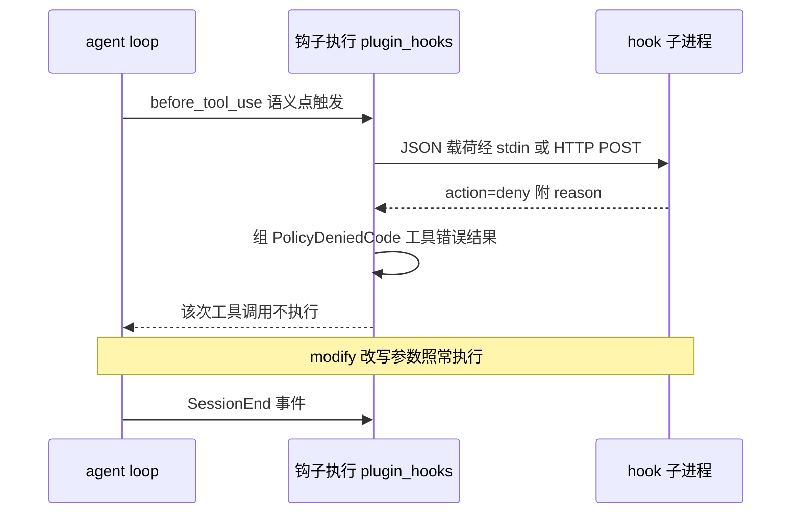
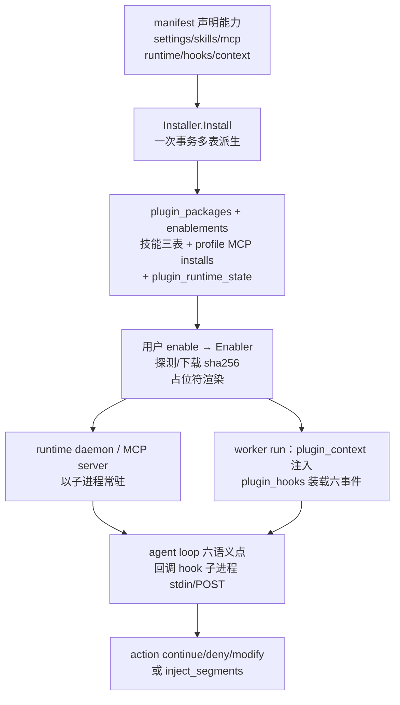

# Arkloop 插件系统与周边支撑解读

> 本解读按 ai-agent 类规格产出。本文是 Arkloop 整套解读的**平台扩展面子文档**，回答一个根本问题：**在"worker 是不可拆分库、agent loop 只有一份"的前提下，新能力（外部工具服务器、录制进程、代码语义查询、运维审计、命令行操作）凭什么能不加 fork 地长进来**。正文以插件系统为主体（manifest 三段式运行时 + hooks 子进程协议），随后按 sidecar / LSP / 审计与可观测 / CLI 四个支撑面展开。worker 主干叙事归 agent-loop.md / pipeline.md，能力注入（persona/skill/MCP 目录与授权）归 skills-mcp.md，本文只写"平台如何把扩展物声明、安装、启停并接进 run"。

## 根因：能力边界不写死在 agent loop，而是由平台"扩展面"承载

Arkloop 的 worker 是一个会被反复装配进不同形态（desktop 单进程 / 无头 / 渠道）的库，agent loop 每轮只做"取请求 → 调模型 → 执行工具"，它不感知自己在为主人服务之外还能干什么。平台判断：**凡是可能变化的能力，都做成声明式扩展物由周边子系统管理，worker 只消费已落库的派生物**。这样加一台 MCP 服务器、一个录制守护进程或一段代码诊断能力，都只是"装一条记录、派生出几行上下文/钩子"，agent loop 本身一次都不改。

这层扩展面落在四个互补子系统上：

- **插件系统**（`src/services/shared/plugin{manifest,hook,store,registry,binary}` + `src/services/api/internal/plugincontrib` + worker 两中间件）——把"一组能力绑定一份 manifest"这件事做成声明→安装→启停→接入 run 的完整链路，是扩展面的主体；
- **activity-record sidecar**——需要独立进程长时间占用的录制采集，做成自包含 SQLite 的可执行文件，被内置插件当运行实体管理；
- **LSP 集成**——可选启用的进程内代码语义服务，把语言服务器协议变成 agent 可调的工具与诊断回注；
- **审计/加密/特性开关与 CLI**——保证扩展面本身可运维、可信、可脚本化。

## 插件系统：manifest 驱动的一次安装、三段运行时

### 一次声明、四处落位

插件骨架横跨四个"语言层级"：样例与内置插件本体在 `src/plugins/`（每个目录一份 `manifest.yaml` + `skills/` bundle + `context.md`）；契约与工具（解析、校验、hook 协议、store、registry、二进制下载）全部收在 `shared/pluginmanifest` 等 shared 包；安装与启停的执行权在 `api` 侧的 `plugincontrib`（Installer / Enabler + runtime 状态机）；worker 只在 run 前段以两个中间件消费 DB 派生物（plugin_context / plugin_hooks）。契约层与执行层分离，使同一份 manifest 既能被 UI 面板处理、也能被 `ark plugin` CLI 与 headless 流程处理。

manifest 的能力边界收敛为六项字段 + context 文本，字段形状直接写在结构体里：`settings`/`settings_schema`（类型化 UI 配置）、`skills`（打包的 skill bundle）、`mcp_servers`（stdio/http 服务器）、`runtime`（外部二进制与 daemon）、`hooks`（run 生命周期回调）与 `context`（注入 system 的说明文本）（`[src/services/shared/pluginmanifest/manifest.go:24-41]()`）。
<!-- anchor: type Manifest struct { … Extra           map[string]any    `json:"-" yaml:"-"` -->
其中 `runtime` 字段自带 `detect`（PATH 或安装根探测路径）、`version_command`/`version_min`（版本比对）、`binary`/`download`（按平台归档 + sha256）与 `daemon`/`daemons`（长驻进程：command/args/args_when/enabled_when/env/health_url），是"外部二进制+守护进程"两类运行实体的完整声明面（`[src/services/shared/pluginmanifest/manifest.go:43-55]()`）。
<!-- anchor: type RuntimeConfig struct { … Arch           []string               `json:"arch,omitempty" yaml:"arch,omi -->
cua 样例演示了三种能力如何被塞进一份 47 行的 manifest：runtime 声明 darwin-arm64 的下载型 `cua-driver` 二进制（含 URL + sha256 与版本底线），mcp_servers 用 `${runtime.cua-driver.command}` 占位符把它声明成 stdio 服务器，skills 指向 `skills/cua-driver` bundle，末尾 `context: context.md` 给出注入文本（`[src/plugins/cua/manifest.yaml:10-40]()`）。
<!-- anchor: runtime: … context: context.md -->

**关键取舍是显式拒绝"代码注入型"插件面**：解析时若出现 Claude Code 风格字段（`commands`/`agents`/`toolPolicy`/`webview`）直接报错（`[src/services/shared/pluginmanifest/manifest.go:1148-1155]()`）。
<!-- anchor: func rejectUnsupportedFields(root map[string]any) error { … return nil -->
插件不承载新指令、新 agent 或 webview，只承载 skills + MCP + hooks 三种"内容/进程"扩展——这保证了 worker 侧永远只认 DB 里三类派生物，插件无法修改 agent 行为本身，只能在自己的声明边界内注入上下文或拦在事件点。

### 安装 = 一次事务的多表派生

`Installer.Install` 把"装一个插件"定义为**原子地落一批业务表**：事务内先持久化插件资产与解析后的 manifest，upsert `plugin_packages` 包记录，随后在**同一事务**里做四件事——迁移旧的 enablements/runtime（升级路径上把旧包改 inactive、停旧版本）、reconcile 技能三表（skill_packages / 安装 / workspace 启用，`reconcilePluginSkills`）、对已启用插件把 manifest 声明的 skills 一并写到 workspace 技能启用表、并把 manifest 的 `mcp_servers` 同步成 profile 级 MCP installs（`syncProfileMCPInstalls`），最后提交（`[src/services/api/internal/plugincontrib/service.go:145-270]()`）。
<!-- anchor: func (i *Installer) Install(ctx context.Context, req InstallRequest) (data. … return pkg, nil -->
安装语义被刻意做厚：**不是"放个文件"，而是"让 manifest 的能力声明物化到各业务表"**。后续 worker / MCP discovery / 技能系统读的是这些表，而不是再解析一遍 manifest，从而安装期就收敛了"哪个版本、装给谁、启哪些技能、起哪些 MCP"这些派生结果。

### runtime：探测、下载、占位符渲染、daemon 生命周期

插件声明的外部二进制并不随包自带，runtime 的职责是"把它弄到本机并在运行时把路径回写成状态"：

1. **探测**：`DetectRuntime` 依次尝试 manifest 声明的多条 `detect` 路径；命令名走 PATH、绝对路径落在安装根下，命中后跑 `version_command` 与 `version_min` 比对，未装/过期/错误各有状态（`[src/services/shared/pluginbinary/detect.go:41-97]()`）。
<!-- anchor: func DetectRuntime(ctx context.Context, runtime pluginmanifest.RuntimeConfi … return DetectResult{Status: StatusInstalled, Path: resolvedPath, HelperAppP -->
2. **下载**：`DownloadAndExtract` 下载归档后先 `verifySHA256`（manifest 带硬编码 sha256），tar/zip 解包时每个条目经 `archiveEntryPath` 归一化（去掉 `../` 类穿越段）再写盘，并对"一个归档里多文件映射到同一落点"判错（`[src/services/shared/pluginbinary/download.go:35-62]()`、`[src/services/shared/pluginbinary/download.go:96-99]()`）。
<!-- anchor: func DownloadAndExtract(ctx context.Context, client *http.Client, store Arc … return extractTarGzip(ctx, store, pluginID, version, data, cfg.TargetDir, c -->
<!-- anchor: cleanName, err := archiveEntryPath(name) … return fmt.Errorf("plugin binary archive entry %q: %w", name, err) -->
3. **占位符渲染**：manifest 里的命令/参数/env 多是模板。`ResolveString` 把 `${settings.x}`、`${runtime.<id>.command}`、`${PLUGIN_DATA}`（以及 `arch`/`platform`）替换为运行期值——设置值、探测回写的二进制绝对路径、插件数据目录都从这里变成真正可执行的字符串（`[src/services/shared/pluginmanifest/placeholder.go:20-38]()`、`[src/services/shared/pluginmanifest/placeholder.go:67-86]()`）。
<!-- anchor: func ResolveString(value string, ctx PlaceholderContext) (string, error) { … return resolved, nil -->
<!-- anchor: func resolvePlaceholder(key string, ctx PlaceholderContext) (string, error) … return "", fmt.Errorf("unknown plugin placeholder %q", key) -->

这些环节由 Enabler 编排：`InstallRuntime` 按 manifest 逐 runtime 探测/下载、把二进制路径与版本回写进扁平 `statusMap`，已启用则把声明的 daemon 拉起来，最后整体 upsert `plugin_runtime_state`（`[src/services/api/internal/plugincontrib/runtime.go:30-149]()`）。
<!-- anchor: func (e *Enabler) InstallRuntime(ctx context.Context, req EnableRequest) (d … return state, nil -->
`startRuntimeDaemons` 对每个 runtime 的每个 daemon 先判断 `enabled_when`（设置条件不满足就标 disabled），满足才 `startRuntimeDaemon`（`[src/services/api/internal/plugincontrib/runtime.go:278-287]()`）。
<!-- anchor: func startRuntimeDaemons(ctx context.Context, manifest Manifest, settings, … startRuntimeDaemon(ctx, runtimeConfig, daemon, settings, runtimeState) -->
而"启停"的真正依据是 DB 里的 enablement + runtime state：CheckRuntime 每次都会探测回写并调用 `checkRuntimeDaemons`（对有 `health_url` 的 daemon 做进程内健康检查后更新 `status: running/unknown/stopped`），把**"声明的 runtime 到底还活没活"变成 UI/CLI 可渲染的扁平 map**（`[src/services/api/internal/plugincontrib/runtime.go:151-187]()`）。
<!-- anchor: func (e *Enabler) CheckRuntime(ctx context.Context, req EnableRequest) (dat … StatusJSON:    runtimeStateJSON(statusMap), -->

### worker 消费侧：只认三种派生物

worker 不再接触 manifest，只按 profile + workspace 读"已启用插件的 DB 派生"，且刚好三样：

- **context 文本**：`LoadPluginContextSegments` 把启用插件的 manifest context 内容拼成 `plugin.context.<id>` 的 system 段（`PromptStabilitySessionPrefix` 且 `CacheEligible: true`——随 system prompt 前缀缓存），其中 schema 缺失（桌面旧库没建插件表）时经 `isPluginSchemaUnavailable` 静默跳过而不是炸掉 run（`[src/services/worker/internal/pipeline/mw_plugin_context.go:51-77]()`、`[src/services/worker/internal/pipeline/mw_plugin_context.go:189-198]()`）。
<!-- anchor: func LoadPluginContextSegments(ctx context.Context, queryer pluginQueryer, … return segments, nil -->
<!-- anchor: func isPluginSchemaUnavailable(err error) bool { … strings.Contains(text, "does not exist") -->
- **hooks**：`LoadPluginHooks` 从同一批 enablement 记录里抽出 manifest 的 `hooks` 声明，逐条做占位符渲染（command/args/url/headers 都用与 runtime 相同的 `ResolveString` 语义），装成 `PluginHookConfig`（`[src/services/worker/internal/pipeline/mw_plugin_hooks.go:38-58]()`）。
<!-- anchor: func LoadPluginHooks(ctx context.Context, queryer pluginQueryer, rc *RunCon … return hooks, nil -->
- **MCP installs**：`mcp_servers` 在安装期已写成 profile MCP install 记录，之后由 MCP discovery 按常规路径连接——工具并入 run 的机制见 skills-mcp.md，插件系统不重复发明连接器。

两条加载查询共用同一个"按 account/profile/workspace + `desired_enabled`"的 SQL（`loadPluginEnablements`），保证上下文与 hooks 看到的启用集永远一致（`[src/services/worker/internal/pipeline/mw_plugin_context.go:79-125]()`）。
<!-- anchor: func loadPluginEnablements(ctx context.Context, queryer pluginQueryer, rc * … return records, nil -->

### hooks：agent loop 六处语义点的子进程协议

hooks 是插件唯一能"在 run 途中拦一手"的通道，它的协议刻意最小：**事件 + 子进程 + JSON 进出**。

事件面收敛成六个，与 agent loop 一一对应（`[src/services/shared/pluginhook/hook.go:11-23]()`）：
<!-- anchor: const ( … EventAfterTool  HookEvent = EventAfterToolUse -->
- session 边界：`SessionStart` / `SessionEnd`；
- 模型调用：`BeforeModel` / `AfterModel`；
- 工具调用：`BeforeTool` / `AfterTool`。

执行通道两种：`command` 型把 JSON 载荷从**stdin**喂给子进程（并注入 `ARKLOOP_PLUGIN_ID`/`ARKLOOP_PLUGIN_DATA`/`ARKLOOP_RUN_ID` 环境变量），`http` 型 **POST** 到 `url`，两种都是无界面的单次调用（`[src/services/shared/pluginhook/runner.go:35-68]()`、`[src/services/shared/pluginhook/runner.go:70-102]()`）。
<!-- anchor: func (r *CommandHookRunner) Run(ctx context.Context, input HookInput) (Hook … return output, nil -->
<!-- anchor: func (r *HTTPHookRunner) Run(ctx context.Context, input HookInput) (HookOut … return decodeOutput(buffer.Bytes(), input.Event) -->
子进程回一个极薄的结果对象：`action`（`continue`/`deny`/`modify`）+ `reason`/`message` + `args`/`modified`（改写的工具参数）+ `inject_segments`（要注入 prompt 的段），多余字段进 `raw`（`[src/services/shared/pluginhook/hook.go:85-95]()`）。
<!-- anchor: type HookOutput struct { … raw            map[string]any -->
动作与事件之间做硬校验：`inject_segments` 只允许 `before_model`，`modify` 只允许 `before_tool_use`，非法动作直接报错（`[src/services/shared/pluginhook/hook.go:153-169]()`）。
<!-- anchor: func (o HookOutput) validate(event HookEvent) error { … return nil -->

worker 侧的六个语义点落在两个执行体里：会话边界钩子包在 run 执行外围——agent run 前后必调 `RunPluginSessionStart`/`RunPluginSessionEnd`（后者用 `WithoutCancel` 保证即使 run 被取消也要把退出原因报给插件），（`[src/services/worker/internal/pipeline/handler_agent_loop.go:149-159]()`）；
<!-- anchor: RunPluginSessionStart(ctx, rc) … RunPluginSessionEnd(context.WithoutCancel(ctx), rc, err) -->
模型与工具四点在 agent loop 内部：

- `BeforeModel`：可 `deny`（把 run 打成 `run.failed`、error_class=`plugin.before_model_denied`）或返回追加的 `inject_segments`（只接受 system 段并归一为 `plugin.hook.*` 名字后插进系统提示前缀）（`[src/services/worker/internal/agent/loop.go:219-230]()`、`[src/services/worker/internal/pipeline/plugin_hooks.go:104-125]()`）。
<!-- anchor: if runCtx.PipelineRC != nil && runCtx.PipelineRC.PluginHookRunner != nil { … }, nil, stringPtr(errorClass))) -->
<!-- anchor: func RunPluginBeforeModelCall(ctx context.Context, rc *RunContext, request … return out, nil -->
- `BeforeTool`：可 `deny`——该次工具调用被替换成带 `PolicyDeniedCode` 的错误结果、工具不执行（`[src/services/worker/internal/agent/loop.go:960-967]()`、`[src/services/worker/internal/pipeline/plugin_hooks.go:76-98]()`）。
<!-- anchor: if runCtx.PipelineRC != nil && runCtx.PipelineRC.PluginHookRunner != nil { … return *before.Result -->
<!-- anchor: func RunPluginBeforeToolUse(ctx context.Context, rc *RunContext, call llm.T … return out -->
- 也可 `modify`——`BeforeTool` 改写 `ArgumentsJSON` 后照常执行；随后正常执行路径再发一次 `AfterTool` 观察事件（`[src/services/worker/internal/agent/loop.go:1009-1013]()`、`[src/services/worker/internal/pipeline/plugin_hooks.go:181-200]()`）。
<!-- anchor: result := runCtx.ToolExecutor.Execute(ctx, call.ToolName, copyMap(call.Argu … pipeline.RunPluginAfterToolUse(ctx, runCtx.PipelineRC, call, result) -->
<!-- anchor: func pluginDeniedToolResult(call llm.ToolCall, result PluginHookResult) too … "tool_name": call.ToolName, -->
- 单次 hook 有默认 5s 超时（manifest 可给 `timeout_ms` 覆盖），超时按 continue-with-error 处理不拖垮 run（`[src/services/worker/internal/pipeline/plugin_hooks.go:16-16]()`、`[src/services/worker/internal/pipeline/plugin_hooks.go:140-165]()`）。
<!-- anchor: const defaultPluginHookTimeout = 5 * time.Second -->
<!-- anchor: func runPluginHook(ctx context.Context, rc *RunContext, hook PluginHookConf … return result, true -->

事件别名（`before_run`/`after_run` 等同义拼写）与事件归一集中在 `normalizePluginHookEvent`（`[src/services/worker/internal/pipeline/plugin_hooks.go:239-277]()`），各事件的载荷字段由 `pluginHookPayload` 按事件裁剪（`[src/services/worker/internal/pipeline/plugin_hooks.go:326-352]()`）——意图是让同一份 manifest 在桌面 UI 与 CLI 前都长一个样。
<!-- anchor: func normalizePluginHookEvent(event string) string { … return normalized -->
<!-- anchor: func pluginHookPayload(inv PluginHookInvocation) map[string]any { … return payload -->

### 生态注册与内置插件

插件能力面通过 catalogapi 的 `/v1/plugins`、`/v1/plugins/` 端点对 UI/CLI 暴露，注册点与 `ark plugin` 客户端消费的是同一批 API（`[src/services/api/internal/http/catalogapi/register.go:88-89]()`）。
<!-- anchor: mux.HandleFunc("/v1/plugins", pluginsEntry(deps.AuthService, deps.AccountMe … mux.HandleFunc("/v1/plugins/", pluginEntry(deps.AuthService, deps.AccountMe -->
内置插件从 `src/plugins` 的两个目录 seed（`builtinPluginDirs = ["cua","activity-recorder"]`），`SeedBuiltinPlugins` 逐个按 manifest 走安装路径，**但建出的 enablement 默认 `Enabled=false`**——首次由用户在 UI 开启才真正 apply 起 runtime（`[src/services/api/internal/plugincontrib/builtin.go:167-189]()`）。
<!-- anchor: if current == nil { … return err -->

### 权衡与未决

插件系统选择"manifest 声明 + DB 派生 + 子进程协议"的组合，换来 worker 零修改与能力边界可控，代价也明显：**事件与动作的归一逻辑散在三处**（`pluginhook.hook` 的共享协议、`pluginmanifest` 的解析、pipeline 的执行各有近似但不完全相同的 switch），枚举易漂移；`inject_segments` 的生效面刻意只开 `before_model`，等于插件想给模型"提词"只有这一个窗口；daemon 生命周期由 API 进程管理，宿主进程消失时靠插件侧 watchdog 或 runtime state 兜底，不是系统级守护。

## activity-record：自带 SQLite 的自包含录制 sidecar

### 进程形态：独立 module、独立库、四条命令

activity-record 是**独立 Go module**（自带 `go.mod`，根在 `src/services/activity-record`，依赖 modernc.org/sqlite 纯 Go 驱动），不 import worker/api 任何东西。入口就一个 `activity-record` 可执行文件、四条子命令：`sync`（一次性）、`daemon`（长驻）、`check`（输出 ax/mic 权限给 UI 探测）、`walk`（调试用真实 AX 遍历预览）（`[src/services/activity-record/cmd/activity-record/main.go:26-48]()`、`[src/services/activity-record/cmd/activity-record/main.go:153-159]()`）。
<!-- anchor: func run() error { … return fmt.Errorf("unknown command %q", command) -->
<!-- anchor: func runCheck() error { … return json.NewEncoder(os.Stdout).Encode(result) -->
之所以要独立成进程，而不是塞进 worker：麦克风、AX、剪贴板监听这类采集源要求常驻、要求反复处理原生权限与平台 API，且不能因为 agent run 崩溃就丢采集。它自己管理数据，不与主库混放。

采集被抽象成两类源：**同步型 `Source`**（一次性 `Sync`，扫外部产物，如 codex/chrome/shell 历史）与 **daemon 型 `DaemonSource`**（`Source` 之外再带一个 `Run`，把事件流推给 store）（`[src/services/activity-record/internal/syncer/syncer.go:34-37]()`、`[src/services/activity-record/internal/syncer/daemon.go:24-27]()`）。
<!-- anchor: type Source interface { … Sync(context.Context, *store.Store) (int, error) -->
<!-- anchor: type DaemonSource interface { … Run(ctx context.Context, db *store.Store, events chan<- store.Event) error -->
存储是 sidecar 自有 schema：`activity_events` 以 `UNIQUE(source, source_event_id)` 幂等 upsert（重跑同步不产生重复行），`source_cursors` 记每源增量游标，`activity_refs` 记需要被外部引用的大内容（`[src/services/activity-record/internal/store/store.go:261-278]()`、`[src/services/activity-record/internal/store/store.go:286-302]()`）。
<!-- anchor: const schemaSQL = ` … UNIQUE(source, source_event_id) -->
<!-- anchor: CREATE TABLE IF NOT EXISTS source_cursors ( … updated_at TEXT NOT NULL -->

### 采集源：扫外部产物 vs 盯实时桌面

同步源读"别人已经写好的记录"并只做增量搬运。codex 源逐行解析 `~/.codex/sessions/*.jsonl`，从 session_meta / turn_context / event_msg / response_item 里抽取 user prompt 与最终回答，注入型指令会被过滤（`[src/services/activity-record/internal/sources/codex/source.go:190-273]()`）；
<!-- anchor: func parseSession(path string, sourceFile string) ([]store.Event, error) { … return buildEvents(sessionID, sourceFile, projectPath, candidates), nil -->
chrome 源先**复制一份 History 库再以只读 immutable 打开**（绕开浏览器写锁），把 visits/downloads/keyword_search_terms 三张表按游标增量扫成浏览/下载/搜索事件，Chrome 时间戳经 `chromeEpochOffsetMicros` 偏移换算为 Unix 时间（`[src/services/activity-record/internal/sources/chrome/source.go:18-18]()`、`[src/services/activity-record/internal/sources/chrome/source.go:154-314]()`）。
<!-- anchor: const chromeEpochOffsetMicros = 11644473600 * 1000 * 1000 -->
<!-- anchor: func syncProfile(ctx context.Context, profile profile, cur profileCursor) ( … return next, events, nil -->
shell/safari/screentime 同类：只读外部历史，shell 从保存偏移 tail 并按行 hash 去重。

daemon 源盯实时桌面。ax 源周期性地取前台应用的可访问性树快照，**内容 hash 没变就不发事件**（省掉重复文本），空转/无权限也各自跳过（`[src/services/activity-record/internal/sources/ax/source.go:42-108]()`）。
<!-- anchor: func (s *Source) Run(ctx context.Context, _ *store.Store, events chan<- sto … Metadata:      meta, -->
其中 macOS 的 AX 遍历是内嵌 Objective-C 的 CGO 文件：`doWalkFocusedWindow` 依次做可访问性信任检查、取前台应用、排除名单、对 Chromium 系先开 AXEnhancedUserInterface、取焦点窗口与标题、隐身模式跳过、再带 `max_nodes`/`max_depth`/截止时间的树遍历（`[src/services/activity-record/internal/sources/ax/walker_darwin.go:364-454]()`）。
<!-- anchor: static AXWalkResult doWalkFocusedWindow(int max_depth, int max_nodes, doubl … return result; -->
window（前台应用 + idle 状态机）、clipboard/keyboard/mouse 与 audio（麦克风连续转写）补齐其余维度。

### 音频管线：先降成本、再去复读

麦克风转写若不做裁剪会持续烧 ASR 费用。管线分三步省钱：**30s 段 + 2s 重叠滑窗**分段（`segmenter`，重叠是为句子不被切断）（`[src/services/activity-record/internal/sources/audio/source.go:85-105]()`）；
<!-- anchor: func segmenter(ctx context.Context, frames <-chan []int16, out chan<- []int16 … buf = append(buf[:0], buf[segmentSamples-overlapSamples:]...) -->
**VAD 门控**把 WebRTC 判定为静音的帧整段裁掉（gap ≤ 阈值则合并、两端各扩 padding 保词边界、过短区域丢弃），只把"有人说话"的部分送去转写付费（`[src/services/activity-record/internal/sources/audio/vad.go:42-104]()`）；
<!-- anchor: func (v *vadGate) speechRegions(seg []int16) [][2]int { … return out -->
转写回来自带 2s 重叠导致的重复词，`dedup` 在"去标点、小写"的视图上找"前段尾 = 本段头"的最长重叠，**在原文上按词截掉重复，保留原大小写与标点**（`[src/services/activity-record/internal/sources/audio/dedup.go:12-41]()`）。
<!-- anchor: func dedup(previous, current string) string { … return strings.Join(currOrig[overlap:], " ") -->

### 与插件系统的咬合点 + 命名风险

sidecar 的"运行实体"身份来自内置插件 `arkloop.plugins.activity-recorder`：插件 manifest 把 settings 声明成开关（enable_ax / enable_keyboard / enable_audio_transcription …），Enabler 侧把它们翻译成 `activity-record daemon --sources ax,window,... --sync-sources codex,chrome,...` 的参数，然后 spawn。这段对进程复用的处理很有代表性：**指纹 = 二进制 + 完整参数**，进程内并发调用串行化，参数不变就复用已有 PID，配置变更才 kill 旧进程重启；spawn 时注入 `ARKLOOP_ACTIVITY_RECORD_PARENT_PID` 让子进程盯着宿主（`[src/services/api/internal/plugincontrib/activity_recorder_sources.go:143-211]()`）。
<!-- anchor: fingerprint := strings.Join(append([]string{cmdParts[0]}, args...), "\x00") … _ = cmd.Wait() -->
宿主退出后子进程经 parent-PID watchdog 5 秒轮询自杀，保证录制进程不活过宿主（`[src/services/activity-record/cmd/activity-record/main.go:96-115]()`）。
<!-- anchor: func watchParentProcess(ctx context.Context, cancel context.CancelFunc) { … cancel() -->

命名上要特别留意：**sidecar 的 daemon 与 worker 内同名 `activity_recorder` 提炼 run 是两套东西**。sidecar 采集的是"录原始活动"；而 worker 里的 `run_kind=activity_recorder` 是一个普通 agent run（中间件 `isActivityRecorderRun` 识别，`runkind.ActivityRecorder = "activity_recorder"`），它的职责是定时读取 sidecar 近期活动、把有长期价值的事实提炼写进 memory（`[src/services/worker/internal/pipeline/mw_activity_recorder.go:21-32]()`、`[src/services/shared/runkind/runkind.go:7-7]()`）。
<!-- anchor: func isActivityRecorderRun(rc *RunContext) bool { … return false -->
<!-- anchor: const ActivityRecorder = "activity_recorder" -->
前者是"录音机进程"，后者是"听写整理员 run"，只是共享了 activity-recorder 这个名词。

## LSP：桌面可选的代码语义层

LSP 集成是 worker 桌面模式下**按需启停的代码智能子模块**（`worker/internal/lsp`，约 4.3k 行），三段式：`Manager` 管语言服务器生命周期与文件跟踪，`LSPTool` 把 12 个 LSP operation 暴露成 `tools.Executor` 工具，`DiagnosticRegistry` 收集去重诊断并渲染成给 LLM 的文本（`[src/services/worker/internal/lsp/manager.go:35-46]()`）。
<!-- anchor: type Manager struct { … started     atomic.Bool -->
它是完全 opt-in 的：`lsp.LoadConfig()` 读 `~/.arkloop/lsp.json`，并对 gopls / typescript-language-server / pyright / rust-analyzer 做自动探测（PATH 优先、IDE 扩展目录兜底、只补尚未被显式配置占用的扩展名）（`[src/services/worker/internal/lsp/config.go:84-134]()`）。
<!-- anchor: func autoDetectServers(logger *slog.Logger) map[string]ServerConfig { … return detected -->
只有探测到服务器且装配在 desktop 路径才启用：`composition.go` 里 Servers 非空才建 Manager、注册 `lsp` 工具、用 `LSPAwareExecutor` 包住 `edit`/`write_file` 两个写文件工具（`[src/services/worker/internal/app/composition.go:190-208]()`），中间件链中 `[lsp]` 项（`NewDiagnosticMiddleware`）也只在 `lspManager != nil` 时追加（`[src/services/worker/internal/app/composition.go:771-772]()`）。
<!-- anchor: if lspCfg, lspErr := lsp.LoadConfig(); lspErr != nil { … slog.InfoContext(ctx, "desktop: lsp enabled", "servers", len(lspCfg.Servers) -->
<!-- anchor: if e.lspManager != nil { … middlewares = append(middlewares, lsp.NewDiagnosticMiddleware(e.lspManager) -->
给模型的工具契约是单个 `lsp` 工具、`operation` 枚举 12 种（definition/references/hover/document_symbols/workspace_symbols/type_definition/implementation/diagnostics/rename/prepare_call_hierarchy/incoming_calls/outgoing_calls），参数 file_path/line/column/query/new_name 按 operation 区分（`[src/services/worker/internal/lsp/tool_spec.go:8-47]()`）。
<!-- anchor: var LSPToolLLMSpec = llm.ToolSpec{ … "additionalProperties": false, -->

可展开的设计点是**"写文件 → LSP 通知 → 诊断回注 prompt"的编辑闭环**。`LSPAwareExecutor` 在写工具成功后先 MarkFileEdited + ClearFile（清掉过期诊断，防止新值被旧值覆盖）再 `NotifyFileChanged`（didChange+didSave）（`[src/services/worker/internal/lsp/filehook.go:26-56]()`）；
<!-- anchor: func (e *LSPAwareExecutor) Execute( … return result -->
磁盘侧 fsnotify `FileWatcher`（300ms debounce、跳过 `.git`/`node_modules`/`vendor` 等目录）把外部编辑器直改也转成 LSP 生命周期通知（`[src/services/worker/internal/lsp/manager.go:18-27]()`、`[src/services/worker/internal/lsp/filewatcher.go:85-150]()`）。
<!-- anchor: var ignoredDirs = map[string]bool{ -->
<!-- anchor: func (fw *FileWatcher) handleEvent(event fsnotify.Event) { … if err := fw.manager.NotifyFileDeleted(ctx, path); err != nil { -->
`DiagnosticMiddleware` 把 `## Active Diagnostics` 以 volatile-tail 段塞进每次 run 的 prompt，且近期有编辑时先 `time.Sleep(ActiveWaitDelay)`（3 秒）等 LSP 追上再继续（`[src/services/worker/internal/lsp/middleware.go:12-34]()`）。
<!-- anchor: func NewDiagnosticMiddleware(manager *Manager) pipeline.RunMiddleware { … return next(ctx, rc) -->
设计上换取的是"单进程内嵌 + 懒启动"的轻量：语言服务器按文件扩展名**首次请求才创建实例**（`ServerForFile` 里 `m.servers` 没有就 new）（`[src/services/worker/internal/lsp/manager.go:155-184]()`）；
<!-- anchor: func (m *Manager) ServerForFile(path string) (*ServerInstance, error) { … return si, nil -->
崩溃自动重启上限 3 次、初始化/关闭/请求各有超时（`[src/services/worker/internal/lsp/server_instance.go:29-36]()`）；
<!-- anchor: const ( … var contentModifiedBackoff = []time.Duration{500 * time.Millisecond, time.S -->
根目录（rc.WorkDir）变化时整组服务器与 watcher 停掉、后续懒重启（`[src/services/worker/internal/lsp/manager.go:70-128]()`）。
<!-- anchor: func (m *Manager) SetRootDir(dir string) { … m.mu.Unlock() -->
代价是：3 秒 `ActiveWaitDelay` 落在同步中间件路径，近期有写文件的 run 固定 +3s；root 切换整体重建对 WorkDir 频繁变化场景开销大；经 `LSPAwareExecutor` 写入与外部编辑器直改两条路径对"近期编辑"的时效口径不同。

## 审计、可观测与加密：扩展面的可信底座

桌面 API 侧没有独立的审计服务，而是一个**类型化写入器** `audit.Writer`：组合 audit repo + membership repo，为 auth / API key / 邀请 / 额度 / entitlement / run / thread 等事件提供 `WriteXxx` 门面，事件点布在各 handler（`[src/services/api/internal/audit/writer.go:16-20]()`）。
<!-- anchor: type Writer struct { … logger         *slog.Logger -->
记录模型统一为 Action（点分域，`auth.login`/`runs.cancel` 等）+ TargetType/TargetID + TraceID + IP/UA + Metadata + before/after state，敏感值不落明文——登录失败也只记 sha256 `login_hash`，不存登录名原值（`[src/services/api/internal/audit/writer.go:34-57]()`、`[src/services/api/internal/audit/writer.go:732-767]()`）。
<!-- anchor: func (w *Writer) WriteLoginFailed(ctx context.Context, traceID string, logi … w.logError(traceID, "failed to write login-failed audit log", err) -->
<!-- anchor: func (w *Writer) writeStateChange( … w.logError(traceID, msg, err) -->
越权尝试（access denied）双写日志 + 审计、带 `deny_reason` 与 actor/resource 双身份（`[src/services/api/internal/audit/writer.go:238-316]()`）。
<!-- anchor: func (w *Writer) WriteAccessDenied( … w.logError(traceID, "failed to write access-denied audit log", err) -->
IP/UA 来自 observability 中间件塞进 context 的请求元数据，`requestMetaFromContext` 是审计与 HTTP 边界的唯一取数口（`[src/services/api/internal/audit/writer.go:778-786]()`）。
<!-- anchor: func requestMetaFromContext(ctx context.Context) (ip *string, ua *string) { … return ip, ua -->
trace 为 `X-Trace-Id`：32 hex，自产随机或校验透传非法即丢弃（`[src/services/api/internal/observability/trace.go:22-44]()`）。
<!-- anchor: func NormalizeTraceID(value string) string { … return lowered.String() -->

加密面是 AES-256-GCM 的多版本 keyring，密钥来源单一：`ARKLOOP_ENCRYPTION_KEY`（64 hex/32B）且当前只装版本 1（`[src/services/shared/encryption/keyring.go:48-63]()`）。
<!-- anchor: func NewKeyRingFromEnv() (*KeyRing, error) { … return NewKeyRing(map[int][]byte{1: keyBytes}) -->
`Encrypt` 返回 `(base64, keyVersion)`、`Decrypt` 显式带版本，环里可同时留旧 key 解历史、新 key 只加密，为轮换留了口（`[src/services/shared/encryption/keyring.go:65-87]()`、`[src/services/shared/encryption/keyring.go:89-117]()`）。
<!-- anchor: func (kr *KeyRing) Encrypt(plaintext []byte) (string, int, error) { … return base64.StdEncoding.EncodeToString(sealed), kr.currentVer, nil -->
<!-- anchor: func (kr *KeyRing) Decrypt(encoded string, keyVersion int) ([]byte, error) … return plaintext, nil -->
api 侧 `crypto/envelope` 只是类型别名转发，避免两包各实现一份（`[src/services/api/internal/crypto/envelope.go:11-13]()`）。
<!-- anchor: func NewKeyRing(keys map[int][]byte) (*KeyRing, error) { … return sharedencryption.NewKeyRing(keys) -->

特性开关按 account 覆盖：`IsEnabled(account, key)` = account override > flag 全局默认 > 未知 flag 报错，无账号上下文则走 `IsGloballyEnabled`（`[src/services/api/internal/featureflag/service.go:31-51]()`、`[src/services/api/internal/featureflag/service.go:55-65]()`）。
<!-- anchor: func (s *Service) IsEnabled(ctx context.Context, accountID uuid.UUID, flagK … return flag.DefaultValue, nil -->
<!-- anchor: func (s *Service) IsGloballyEnabled(ctx context.Context, flagKey string) (b … return flag.DefaultValue, nil -->
其中 `work_enabled` 是工作台总开关，判定直接消费全局默认（`[src/services/api/internal/featureflag/work.go:7-18]()`）。
<!-- anchor: const WorkEnabledKey = "work_enabled" … return enabled -->
观察：audit 每事件一次同步 DB 写、无批量缓冲；env 只加载单 key（version=1），多版本轮换路径只存在于 API 语义、桌面未见轮换入口。

## CLI 扩展：ark plugin 与 activity-record 命令

`ark plugin`（`src/services/cli/cmd/ark/plugin.go`）是**薄客户端**：list/install/uninstall/enable/disable/info/settings/runtime status|install/search，全部是"参数整形 + API 往返 + formatter"，无领域逻辑（`[src/services/cli/cmd/ark/plugin.go:22-50]()`）。
<!-- anchor: func cmdPlugin(ctx context.Context, args []string) error { … return &exitError{2} -->
install source 自动识别三态：本地 manifest 路径 / HTTP(S) URL / registry plugin-id；search 的 registry URL 解析链为 `--registry-url` → env `ARKLOOP_PLUGIN_REGISTRY_URL` → `~/.arkloop/config.json`（`[src/services/cli/cmd/ark/plugin.go:321-344]()`、`[src/services/cli/cmd/ark/plugin.go:381-407]()`）。
<!-- anchor: func pluginInstallRequest(source string) (apiclient.PluginInstallRequest, e … return apiclient.PluginInstallRequest{}, fmt.Errorf("plugin source is inval -->
<!-- anchor: func resolvePluginRegistryURL(flagValue string) string { … return strings.TrimSpace(cfg.PluginRegistryUrl) -->
CLI 默认指向 desktop API，是宿主/插件运维入口而非新架构层。`activity-record` 本身亦自带四条 CLI 子命令（sync/daemon/check/walk）供脚本化运维。

## 观察汇总

- **扩展面的共同纪律**：能声明就不写死、能派生就不重解析、能子进程就不同进程内联——manifest 一次声明、安装期物化到业务表、运行期只消费 DB 派生，这是插件、sidecar 与 LSP 三处共享的模式。
- **命名风险**：activity-record sidecar（录制进程）与 worker 内 activity_recorder 提炼 run 同名不同物，阅读代码时需按进程边界区分。
- **分层边界最紧处是 worker**：它只暴露"context 段 + 六事件 hook + 工具（含 MCP/lsp）"这几个口子，任何扩展想进入 run 都必须走这几条窄缝，这也让 agent loop 的可审计性（trace、plugin_hooks trace、诊断段）得以保持。
