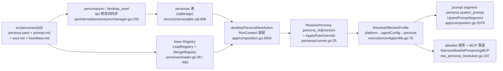
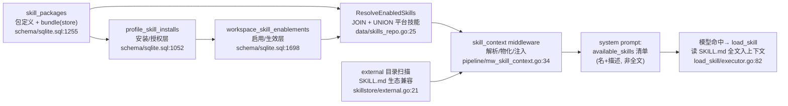
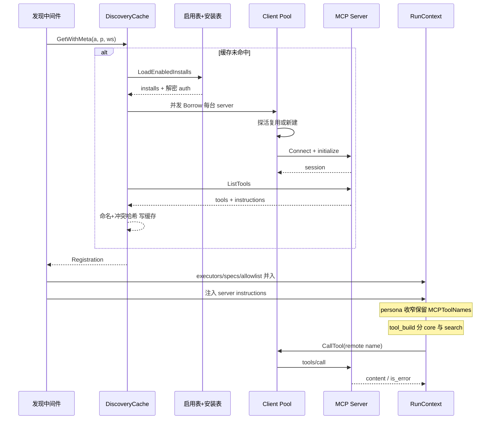

# Arkloop Persona / Skill / MCP 能力注入解读

> 本解读按 ai-agent 类规格产出。本文是 Arkloop 解读的能力注入矩阵子文档，覆盖三条"向 run 注入新内容"的声明链路——**Persona**（src/personas 声明式身份与边界）、**Skill**（skill_packages→profile_skill_installs→workspace_skill_enablements 三层技能管理 + ClawHub 生态）、**MCP**（外部工具服务器的 discovery/连接池/缓存与工具并入）。三者的消费侧恰在 run pipeline 的同一段：`MCP discovery → … → persona_resolution → … → skill_context → agent_directory → plugin_context → … → conditional_tools → tool_build → agent loop`（`[src/services/worker/internal/app/composition.go:719-808]()`）。工具 schema/执行治理归 tool-calling.md，主循环归 agent-loop.md，本文只写"身份与能力如何声明、授权、收窄、进入一次 run"。
<!-- anchor: middlewares := []pipeline.RunMiddleware{ -->

## 根因：agent 的「身份」与「能力」由谁决定

一个 run 最终要回答两个问题：**它要以什么人格/约束对用户负责**（写代码还是只聊天、允许多贵多长的推理、能用哪些凭证），以及**它手上有什么牌**（内置工具之外还能调谁）。Arkloop 把这两个问题拆成三个正交的声明维度，而不是每个 agent 各写一套完整实现：

- **Persona 回答"我是谁、我的边界在哪"**——它是可热更新的纯声明（YAML + Markdown），不携带行为代码，只约束 system prompt 怎么拼、工具可见性怎么收窄、预算怎么封顶、选哪个 executor 执行策略（`[src/personas/normal/persona.yaml:1-31]()`）。
<!-- anchor: id: normal -->
- **Skill 回答"我可复用的技能从哪来、什么时候进上下文"**——把一批文件（SKILL.md + 资源）打包成版本化 bundle，经 skill_packages 目录与「安装/启用」两层语义进入某次 run，最后只把技能清单注入系统提示，指令本体等模型主动 load_skill 才进上下文。
- **MCP 回答"外部世界的工具怎么被安全接进来"**——不复制代码，只建立会话：按 account/profile/workspace 读取启用配置、连远端 server、把对方 tools/list 翻译成本 run 的 agent 工具，并同样受 persona allowlist/denylist 约束。

README 的两句宣传正好对应这三块：Agent Runtime = "MCP servers, and ClawHub skills"，Custom Personas = "Independent system prompts, tool allowlists, budgets, and executor types"（`[README.md:62-65]()`）。
<!-- anchor: - **Agent Runtime** — Built-in tools, MCP servers, and ClawHub skills; sub-agent spawning and scheduled jobs -->

三者共享同一个根因假设：**agent 循环本身不感知能力边界，边界全部由 run 前段注入的状态决定**。于是"加一种人格/一种技能/一台工具服务器"只是加一份声明或一条记录，不需要 fork agent loop。下面按装载链路、安装模型、连接架构三条线展开，最后汇总设计权衡与风险。

## Persona：声明式身份层

### persona 目录契约

`src/personas/` 下每个子目录是一份 persona，最少两份文件：`persona.yaml`（声明）与 `prompt.md`（system prompt 正文）。可选 `soul.md`（由 `soul_file` 指定、默认同名）、`heartbeat.md`、`title_summarize.md`/`result_summarize.md`。以 `platform` 为例，整份声明只有 13 行：身份字段 + `tool_allowlist` + `budgets` + `executor_type`（`[src/personas/platform/persona.yaml:1-13]()`）——"平台管理 Agent"的能力上限完全靠允许列表卡住。
<!-- anchor: id: platform -->

`normal` 是默认通用人格，其字段展示这条声明语法的完整形状：`soul_file`、`core_tools`（常驻 request.Tools 的工具，区别于 allowlist 的"可用集"）、`budgets.reasoning_iterations: 99999 / temperature: 1`、`reasoning_mode: auto`、`prompt_cache_control: system_prompt`、`heartbeat.enabled: true`（`[src/personas/normal/persona.yaml:5-31]()`）。
<!-- anchor: soul_file: soul.md -->

### 装载：文件系统与 DB 两个来源

装载的唯一入口是 `loadSinglePersona`：解析 persona.yaml 为 `Definition`，同时强制读取同目录 `prompt.md`（非空），并按 `soul_file`/`heartbeat` 等声明加载可选 markdown（`[src/services/worker/internal/personas/loader.go:97-254]()`）。
<!-- anchor: func loadSinglePersona(yamlPath string) (Definition, error) { -->

关键设计点：**markdown 内容在装载期就读进内存拼进 Definition**，而不是 run 时按路径读。运行时只依赖一个纯值结构 `Definition`（含 SoulMD/PromptMD/Budgets/Roles/HeartbeatMD 等）（`[src/services/worker/internal/personas/registry.go:123-159]()`），DB 与文件系统两个来源产出同一形态，后续合并/角色派生都在纯值上做。
<!-- anchor: type Definition struct { -->

装载来源有两处、时机会合在 persona_resolution 阶段：

- **文件系统**：worker 装配期用 `LoadRegistry(root)` 扫目录建 base registry（`[src/services/worker/internal/personas/loader.go:48-95]()`），根路径沿 `runtime.Caller` 回溯找 `src/personas` 或环境变量覆盖（`[src/services/worker/internal/personas/loader.go:26-46]()`）。
<!-- anchor: func LoadRegistry(root string) (*Registry, error) { -->
<!-- anchor: func BuiltinPersonasRoot() (string, error) { -->
  运行期由 `loadPersonaRegistryFromFS` 的 30 秒 TTL 闭包提供重读（`[src/services/worker/internal/app/composition.go:474-520]()`、`[src/services/worker/internal/app/composition.go:508-519]()`）。
<!-- anchor: func loadPersonaRegistryFromFS() func() *personas.Registry { -->
<!-- anchor: if cached != nil && time.Since(cachedAt) < 30*time.Second { -->
- **DB（personas 表）**：worker 每次 run 在 persona_resolution 阶段按 account/project 查询激活行，再 `MergeRegistry(base, dbDefs)` 用 DB 覆盖同名文件系统定义（`is_system` 不可覆盖）（`[src/services/worker/internal/personas/loader.go:555-678]()`、`[src/services/worker/internal/personas/loader.go:682-699]()`）。
<!-- anchor: func LoadFromDB(ctx context.Context, pool *pgxpool.Pool, projectID *uuid.UUID) ([]Definition, error) { -->
<!-- anchor: func MergeRegistry(base *Registry, overrides []Definition) *Registry { -->

desktop 单进程模式不经过 pgx，走同一张表结构的 sqlite，且 SELECT 加激活过滤：只取 `project_id IS NOT NULL OR sync_mode='platform_file_mirror' OR persona_key='summarizer'` 的行（`[src/services/worker/internal/personas/loadfromdb.go:22-36]()`）——`platform_file_mirror` 正是 API 侧同步器在 DB 里留下的标记（见下文「桌面双向镜像」）。
<!-- anchor: const personaSelectSQL = `SELECT persona_key, version, display_name, description, -->

### 解析：persona_id@version 与 role

`ResolvePersona` 从 run 输入 JSON 取 `persona_id`（可带 `@version` 后缀），查 registry、校验版本漂移，最后按输入的 `role` 应用角色覆盖并克隆出本次生效定义（`[src/services/worker/internal/personas/runner.go:25-87]()`）。
<!-- anchor: func ResolvePersona(inputJSON map[string]any, registry *Registry) Resolution { -->

角色（`roles`）是同一个人格下的"身份变体"：可按角色名覆盖 soul/prompt、工具黑白名单、budget、凭证、模型与推理模式（`[src/services/worker/internal/personas/roles.go:50-159]()`），应用时对 Definition 深拷贝后再覆盖，避免污染共享 registry（`[src/services/worker/internal/personas/roles.go:245-287]()`）。
<!-- anchor: func parseRoleOverride(value any, label string) (RoleOverride, error) { -->
<!-- anchor: func ApplyRoleOverride(def Definition, role string) (Definition, bool) { -->

解析错误是全类型化的：not_found / version_mismatch / invalid_id 各有 error class，persona_resolution 收到错误直接发 `run.failed` 事件并终结 run，不留半配置状态（`[src/services/worker/internal/pipeline/mw_persona_resolution.go:54-77]()`）。
<!-- anchor: resolution := personas.ResolvePersona(rc.InputJSON, runPersonaRegistry) -->

### 生效：EffectiveProfile 与系统提示组装

`shared/executionconfig` 是 persona 语义的中立契约（worker/API 共用）。三层配置按 **platform（平台硬限）→ agentConfig（模型/凭证选择）→ persona（人格声明）→ run 输入** 做有向合并，规则是"收紧优先"：

- reasoning_iterations 取 persona 请求值与平台值中**更小**者；platform 为 0（不限）时以 persona 值为准（`[src/services/shared/executionconfig/profile.go:111-118]()`）。
<!-- anchor: if value := persona.Budgets.ReasoningIterations; value != nil && *value > 0 { -->
- 输出 token 上限取 persona 请求与 agentConfig 中**更小**者，防止 persona 顶破模型档位上限（`[src/services/shared/executionconfig/profile.go:120-126]()`）。
<!-- anchor: if persona.Budgets.MaxOutputTokens != nil { -->
- system prompt = agentConfig 前缀 + `SoulMD` + `PromptMD`（+ 角色文本）（`[src/services/shared/executionconfig/profile.go:109]()`）。
<!-- anchor: profile.SystemPrompt = joinPromptSegments(agentConfigPromptPrefix, persona.SoulMD, persona.PromptMD) -->
- 空段丢弃、段间双换行拼接由 joinPromptSegments 负责（`[src/services/shared/executionconfig/profile.go:155-165]()`）。
<!-- anchor: func joinPromptSegments(parts ...string) string { -->
- budgets 的字段白名单严格校验（未知字段直接报错），temperature/top_p/cost/token 上限逐字段解析（`[src/services/shared/executionconfig/profile.go:178-249]()`）。
<!-- anchor: func ParseRequestedBudgetsMap(raw map[string]any) (RequestedBudgets, error) { -->

desktop 的 persona_resolution 中间件是消费端：把 DB/文件合并出的 registry 交给 `ResolvePersona`，把解析结果写进 RunContext（`PersonaDefinition`、各 budget、summarizer 配置），并把组装好的系统提示作为**可缓存 prompt segment**（`persona.system_prompt`，`CacheEligible` 取决于 `prompt_cache_control`）插入 prompt 汇编器（`[src/services/worker/internal/app/composition.go:3040-3139]()`）。
<!-- anchor: resolution := personas.ResolvePersona(rc.InputJSON, registry) -->

工具边界在同一个中间件里收窄：persona 的 `tool_allowlist` 把当前 allowlist 收窄（但**保留 MCP 工具**），`tool_denylist` 逐个剔除（`[src/services/worker/internal/app/composition.go:3105-3115]()`）；保留 MCP 的实现是 NarrowAllowlistPreservingMCP（`[src/services/worker/internal/pipeline/mw_persona_resolution.go:197-220]()`）。
<!-- anchor: if resolution.Definition != nil { -->
<!-- anchor: func NarrowAllowlistPreservingMCP( -->

### 热更新与桌面双向镜像

persona 是"可运行期编辑的身份"：文件系统来源有 watcher（2s 轮询 mtime，原子替换 registry 指针）（`[src/services/worker/internal/personas/watcher.go:34-58]()`）；API 侧 `personasync.Manager` 以 **advisory lock + 内容 hash** 双向同步 `src/personas/` 目录与 DB `personas` 表：同 key 两边都在但内容不一致时，比较"目录 mtime vs DB updated_at"，更晚者胜并记 conflict 警告；删除方向用 `prev*` 快照区分"谁删的"（`[src/services/api/internal/personasync/manager.go:155-233]()`）。
<!-- anchor: func (w *WatchedRegistry) Watch(ctx context.Context) { -->
<!-- anchor: func (m *Manager) syncOnce(ctx context.Context) error { -->

文件→DB 方向把整份声明展开写进 personas 行（soul/prompt/allowlist/budgets/conditional_tools/executor 全 json 化）（`[src/services/api/internal/personasync/manager.go:300-337]()`）。
<!-- anchor: func (m *Manager) applyFileToDB(ctx context.Context, snap fileSnapshot) error { -->
DB→文件方向把 DB 行物化为 persona.yaml/prompt.md/soul.md/title_summarize.md/result_summarize.md（`[src/services/api/internal/personasync/manager.go:339-392]()`）；desktop 冷启动另有一次性 seed 直接落库（`[src/services/api/internal/personasync/desktop_seed.go:23-60]()`）。
<!-- anchor: func (m *Manager) applyDBToFile(ctx context.Context, persona data.Persona) error { -->
<!-- anchor: func SeedDesktopPersonas(ctx context.Context, db desktopPersonaSeedDB, personasRoot string) error { -->

persona 由此形成「源在 git（src/personas）、运行期可在 DB 改、可双向回写」的单一事实闭环——这也解释了 worker/API 里"文件 or DB 两个来源、结果同构"的架构姿态。

### Persona 装载与生效链路

## Skill：可复用技能包的三层管理

### 资产、授权、生效：三个安装语义层

skill 与 persona 最大的差别在于它是**有实体的包**：`skill.yaml`（元数据）+ `SKILL.md`（指令）+ 任意资源，一起压成 **bundle** 存进 object store（`manifest.json` + `bundle.tar.zst`，key 由 skill_key@version 派生），DB 只存指针与描述（`[src/services/shared/skillstore/skillstore.go:79-89]()`）。
<!-- anchor: func DerivedManifestKey(skillKey, version string) string { -->

包表 `skill_packages` 字段已写明语义：`account_id` 为 NULL 即平台自有、另有 `registry_*`（市场来源）、`scan_*`（安全扫描结论）、`sync_mode`、`content_hash`（`[docs/schema/sqlite.sql:1256-1287]()`）。AGENTS.md 把三层关系概括为：`skill_packages`（包定义）→ `profile_skill_installs`（用户级安装）→ `workspace_skill_enablements`（工作区级启用）（`[AGENTS.md:128-130]()`）。
<!-- anchor: skill_key             TEXT    NOT NULL, -->
<!-- anchor: 三层管理:`skill_packages`(包定义)→ `profile_skill_installs`(用户级安装)→ `workspace_skill_enablements`(工作区级启用);ClawHub Registry 外部市场,支持 OpenClaw SKILL.md。 -->

三层语义拆开看：

1. **skill_packages = 资源目录**：谁拥有包、内容在 store 的位置、来自哪个 registry、扫描结论，不含任何"给谁用"的信息。
2. **profile_skill_installs = 授权/所有权**：把 (skill_key, version) 装进 profile（`PK (profile_ref, skill_key, version)`，owner_user_id/owner_plugin 记录谁装的）（`[docs/schema/sqlite.sql:1052-1061]()`）。
<!-- anchor: CREATE TABLE profile_skill_installs ( -->
3. **workspace_skill_enablements = 生效开关**：在 workspace 点亮/关闭已装技能（`PK (workspace_ref, skill_key)`，**不含 version**）（`[docs/schema/sqlite.sql:1698-1707]()`）。
<!-- anchor: CREATE TABLE workspace_skill_enablements ( -->

worker 侧读取一次把三层语义落到一条 SQL：run 若有 (profile, workspace)，则 `wse JOIN psi JOIN sp` 取"**该 profile 装过** 且 **该 workspace 启过** 的激活包"，再 `UNION ALL` 平台技能；profile/workspace 引用为空时退化为只取平台技能（`[src/services/worker/internal/data/skills_repo.go:25-99]()`）。
<!-- anchor: func (r SkillsRepository) ResolveEnabledSkills(ctx context.Context, accountID uuid.UUID, profileRef, workspaceRef string) ([]skillstore.ResolvedSkill, error) { -->

这条 SQL 最能说明设计意图：workspace 的 enablement 只有与 profile 的 install 相交时才可见——**启用不能越过安装授权**。API 管理端也只暴露成对操作：`Install`/`Delete`/`ListByProfile`（`[src/services/api/internal/data/profile_skill_installs_repo.go:57-160]()`），以及 workspace 的 `Replace`（整表换）/`Set`（单个开关）/`ListByWorkspace`（`[src/services/api/internal/data/workspace_skill_enablements_repo.go:58-161]()`）——没有"直接启用一个未安装包"的口子。
<!-- anchor: func (r *ProfileSkillInstallsRepository) Install(ctx context.Context, profileRef string, accountID, ownerUserID uuid.UUID, skillKey, version string) error { -->
<!-- anchor: func (r *WorkspaceSkillEnablementsRepository) Replace(ctx context.Context, tx pgx.Tx, accountID uuid.UUID, workspaceRef string, enabledByUserID uuid.UUID, items []WorkspaceSkillEnablement) error { -->

### 平台技能与 profile override

平台技能是模型的特殊分支：`account_id IS NULL AND sync_mode='platform_skill'` 的包**默认对所有 profile 生效**（auto_inject=true），但允许 profile 用 `profile_platform_skill_overrides` 标记为 `manual`（改为手动启用）或 `removed`（移除）（`[src/services/worker/internal/data/skills_repo.go:65-72]()`、`[docs/schema/sqlite.sql:1021-1030]()`）。
<!-- anchor: LEFT JOIN profile_platform_skill_overrides pso -->
<!-- anchor: CREATE TABLE profile_platform_skill_overrides ( -->

平台技能由 API 侧 `skillseed` 从内置目录 `src/skills/` 播种：扫描子目录 skill.yaml、构建 bundle 上传 store、再 `UpsertPlatformSkill`（account_id NULL + sync_mode='platform_skill' + scan_status='clean'）；DB 有而目录已删的包被 deactivate（`[src/services/api/internal/skillseed/seeder.go:158-228]()`、`[src/services/api/internal/data/skill_packages_repo.go:444-461]()`）。
<!-- anchor: func (s *Seeder) syncOnce(ctx context.Context) error { -->
<!-- anchor: func (r *SkillPackagesRepository) UpsertPlatformSkill(ctx context.Context, manifest skillstore.PackageManifest, contentHash string) (SkillPackage, error) { -->

desktop 单进程走无锁变体 `SyncOnceDirect`（跳过 pg advisory lock 选举）（`[src/services/api/internal/skillseed/desktop_seed.go:15-33]()`）。
<!-- anchor: func SeedDesktopSkills( -->

### 从解析到挂载：skill_context 四件事

skill_context 中间件把三层解析结果变成 run 可用的东西，四件事：

1. **解析**：`cfg.Resolve(account, profileRef, workspaceRef)` → `ResolvedSkill` 列表（带 store 指针与 mount 路径）（`[src/services/worker/internal/pipeline/mw_skill_context.go:61-75]()`）。
<!-- anchor: skills, err := cfg.Resolve(ctx, rc.Run.AccountID, rc.ProfileRef, rc.WorkspaceRef) -->
2. **布局**：桌面把 mount 根放在数据目录 `skills/`（`/opt/arkloop/skills` 是抽象默认），并为每个 run 分配独立 index 路径（`[src/services/shared/skillstore/layout.go:14-19]()`、`[src/services/worker/internal/app/skill_runtime.go:45-59]()`）。
<!-- anchor: func DefaultPathLayout() PathLayout { -->
<!-- anchor: func desktopSkillLayout(runID uuid.UUID) (skillstore.PathLayout, error) { -->
3. **物化**：Preparer 先按 content_hash 把启用包从 store 解到磁盘 mount 目录，再写 run 级 index；解包做路径逃逸检查、原子写文件（`[src/services/worker/internal/app/skill_runtime.go:114-147]()`、`[src/services/worker/internal/app/skill_runtime.go:148-178]()`）。
<!-- anchor: func ensureSkillExtracted(ctx context.Context, store objectstore.Store, skill skillstore.ResolvedSkill, storeRoot string) error { -->
<!-- anchor: func prepareDesktopHostSkills(ctx context.Context, skills []skillstore.ResolvedSkill, layout skillstore.PathLayout) error { -->
4. **注入**：把 "enabled（三层解析出）+ external（外部目录扫出）" 两类技能渲染成 `<available_skills>` prompt 段（SessionPrefix 稳定位、可缓存），并声明**硬规则**：命中即必须先用 `load_skill` 拉取、禁止只提不调（`[src/services/worker/internal/pipeline/mw_skill_context.go:113-130]()`）。
<!-- anchor: func buildAvailableSkillsPromptBlock(enabled []skillstore.ResolvedSkill, external []skillstore.ExternalSkill) string { -->

### load_skill：指令懒加载

`load_skill` 拿到技能名后先在 `execCtx.EnabledSkills`（三层启用集）匹配（skill_key/display_name/`key@version` 三别名），找不到再匹配 `ExternalSkills`；enabled 项若磁盘尚未物化，则**当场从 bundle 解出**指令文件再返回内容（`[src/services/worker/internal/tools/builtin/load_skill/executor.go:82-132]()`、`[src/services/worker/internal/tools/builtin/load_skill/executor.go:134-182]()`）。
<!-- anchor: func (e *ToolExecutor) findSkillEntry(execCtx tools.ExecutionContext, skillName string) (skillEntry, error) { -->
<!-- anchor: func ensureInstructionFile(skill skillstore.ResolvedSkill, instructionPath string, store objectstore.Store) (string, error) { -->

也就是说 SKILL.md 全文**不进**系统提示预算（`<available_skills>` 只给名 + ≤250 字描述、总预算 8000 字符）（`[src/services/worker/internal/pipeline/mw_skill_context.go:22-24]()`）——这是与 persona prompt 的根本差别：技能指令属于"模型主动要才给"，避免常驻占用上下文。
<!-- anchor: skillListingBudgetChars  = 8000 -->

### load_tools：运行时工具目录

`load_tools` 补全另一半：persona 定义 `core_tools` 后，allowlist 内但不在 core 的工具（含 MCP 工具）成为 **searchable** 池——模型只见名字与关键词（`<available_tools>`），schema 要命中才激活。匹配优先级：精确名 → 名字互相包含 → 元数据/描述文本关键词（`[src/services/worker/internal/tools/builtin/load_tools/executor.go:159-209]()`）。
<!-- anchor: func matchTools(queries []string, searchable map[string]llm.ToolSpec, pool map[string]llm.ToolSpec) []llm.ToolSpec { -->
`["*"]` 可一次全量加载；激活流程进程内一次性去重（`[src/services/worker/internal/tools/builtin/load_tools/executor.go:96-145]()`）。
<!-- anchor: matched := expandToolDependencies(matchTools(queries, searchable, pool), pool) -->
依赖工具自动连带激活由 expandToolDependencies 处理（`[src/services/worker/internal/tools/builtin/load_tools/executor.go:233-261]()`）。
<!-- anchor: func expandToolDependencies(matched []llm.ToolSpec, pool map[string]llm.ToolSpec) []llm.ToolSpec { -->

tool_build 阶段保证这两个发现工具恒在：persona 声明 core_tools 时把 `load_tools`/`load_skill` 强塞进 allowlist 并注册 executor（`[src/services/worker/internal/pipeline/mw_tool_build.go:72-81]()`）；随后按 core set 把 specs 切成 core（进 request.Tools）与 searchable（进 catalog + executor searchable 池）（`[src/services/worker/internal/pipeline/mw_tool_build.go:138-179]()`）。
<!-- anchor: hasCoreTools := rc.PersonaDefinition != nil && len(rc.PersonaDefinition.CoreTools) > 0 -->
<!-- anchor: coreSet := resolveCoreToolSet(rc) -->

### 外部 SKILL.md 生态兼容

除三层内管技能外，run 还扫描**外部目录**（env `ARKLOOP_EXTERNAL_SKILL_DIRS`、DB `skills.external_dirs` 设置、以及 well-known `~/.claude/skills`、`~/.config/alma/skills`）——任何"含 SKILL.md 的直接子目录"都被收进 `<available_skills>` 与 `load_skill` 候选（`[src/services/shared/skillstore/external.go:21-65]()`、`[src/services/shared/skillstore/external.go:115-131]()`）。
<!-- anchor: func DiscoverExternalSkills(dirs []string) []ExternalSkill { -->
<!-- anchor: func WellKnownSkillDirs() []string { -->
external 技能不进 DB、不版本化，是兼容 OpenClaw/Claude 生态 SKILL.md 的轻量路径（描述优先解析 frontmatter 的 description）（`[src/services/shared/skillstore/external.go:69-112]()`）。
<!-- anchor: func extractSkillDescription(skillPath, instructionPath string) string { -->

### 种子与 ClawHub 市场

`src/skills/` 下是仓库自带的 platform skills（geogebra-drawing/opencli/ust-teaching），每条只是 `skill.yaml` + `SKILL.md`（`[src/skills/geogebra-drawing/skill.yaml:1-6]()`）。
<!-- anchor: skill_key: geogebra-drawing -->
第三来源是**注册表市场**：`registryProvider` 接口抽象 Search/GetVersion/DownloadBundle（`[src/services/api/internal/http/catalogapi/registry_provider.go:109-115]()`），默认 provider 是 ClawHub（clawhub.ai）（`[src/services/api/internal/http/catalogapi/registry_provider.go:26-27]()`）。
<!-- anchor: type registryProvider interface { -->
<!-- anchor: defaultRegistryProvider   = "clawhub" -->
下载后的 bundle 走与内置相同的解码/校验/入库链路，来源与扫描信息落回 `skill_packages` 的 registry_*/scan_* 列。导入还支持直接贴 GitHub repo URL（抓 archive → 归一化 → 入库）（`[src/services/api/internal/http/catalogapi/skill_import.go:35-70]()`）。
<!-- anchor: func importSkillFromGitHub( -->

### Skill 安装到注入链路

## MCP：外部工具服务器接入

MCP 与 skill 的分层同构（profile 安装 + workspace 启用），但连接是有生命的：一次发现建立会话、工具可被反复调用。下面是 worker 引入 go-sdk 后的形态。

### 数据层：installs / enablements / secrets

- `profile_mcp_installs`：profile 级"安装"一台 server，存 launch_spec（transport + url/headers 或 command/env）、来源、host_requirement、以及**指向 secrets 的 auth_headers_secret_id**（不带明文）（`[docs/schema/sqlite.sql:999-1019]()`）。
<!-- anchor: CREATE TABLE profile_mcp_installs ( -->
- `workspace_mcp_enablements`：workspace 级开关，`PK (workspace_ref, install_id)`，`enabled` 布尔（`[src/services/shared/mcpinstall/runtime.go:77-92]()`、`[docs/schema/sqlite.sql:1664-1675]()`）。
<!-- anchor: rows, err := pool.Query(ctx, ` -->
<!-- anchor: CREATE TABLE workspace_mcp_enablements ( -->
- `secrets` 存加密值（key_version 支持轮换）；`mcp_oauth_connections`/`mcp_oauth_flows` 存 OAuth 动态接入的握手与令牌（token_secret_id/client_secret 继续指向 secrets）（`[docs/schema/sqlite.sql:830-864]()`）。
<!-- anchor: CREATE TABLE mcp_oauth_connections ( -->

读取侧 `LoadEnabledInstalls` 一次 JOIN 出"该 workspace 启用 + 该 profile 安装"的启用列表（`[src/services/shared/mcpinstall/runtime.go:64-129]()`）；`config.LoadConfigFromDB` 再补细节：profile 的**默认 workspace** 上的启用也一并加载（设置页启用、会话未绑 workspace 时也能发现），并按行解密 auth secret 组装 `ServerConfig`（`[src/services/worker/internal/mcp/config.go:90-161]()`）。
<!-- anchor: func LoadEnabledInstalls(ctx context.Context, pool DiscoveryQueryer, accountID uuid.UUID, profileRef string, workspaceRef string) ([]EnabledInstall, error) { -->
<!-- anchor: func LoadConfigFromDB(ctx context.Context, pool DiscoveryQueryer, accountID uuid.UUID, profileRef string, workspaceRef string) (*Config, error) { -->

### Discovery 与工具并入

`DiscoverFromDBWithDiagnostics` 把配置变成可注册工具集：对每台 server **并发** `pool.Borrow` → `ListTools`，每台独立计时与结果（ok/empty/borrow_failed/list_failed），失败 server 不进注册表而不拖垮整体（`[src/services/worker/internal/mcp/registry.go:79-137]()`）。
<!-- anchor: func DiscoverWithDiagnostics(ctx context.Context, cfg Config, pool *Pool) (Registration, DiscoverDiagnostics, error) { -->

工具命名是**两段防冲突**：raw 名是 `mcp__{serverID}__{toolName}`，清洗成合法字符（`[src/services/worker/internal/mcp/registry.go:252-264]()`）。
<!-- anchor: func mcpToolRawName(serverID string, toolName string) string { -->
若多名 server 撞同名 base，对 raw 名 sha256 取 8 位短哈希后缀，另有 `_2/_3` 递增去重兜底（`[src/services/worker/internal/mcp/registry.go:271-285]()`）。
<!-- anchor: func ensureUniqueToolName(name string, used map[string]struct{}) string { -->
命名发生在按 server 聚合之后：先统计 base 名碰撞数，再对撞名的 raw 做哈希后缀（`[src/services/worker/internal/mcp/registry.go:180-191]()`）。
<!-- anchor: for _, entry := range discoveredByServer { -->

每台 server 收敛成一个共享 `ToolExecutor`（internal→remote 名映射 + pool 引用），并把 server 的 `instructions`（InitializeResult）单独收集（`[src/services/worker/internal/mcp/registry.go:217-232]()`）。
<!-- anchor: executor := NewToolExecutor(server, remoteMap, pool) -->

mw_mcp_discovery 位于链条前段（第 4 位），把注册结果并入 run：`ForkRegistry` 生成带 MCP 工具的子 registry、executors/specs 追加、allowlist 打上工具名并记入 `rc.MCPToolNames`（给后续 persona 收窄做"保留名单"）（`[src/services/worker/internal/pipeline/mw_mcp_discovery.go:23-101]()`）。
<!-- anchor: func NewMCPDiscoveryMiddleware( -->
server 指令进 `mcp.server_instructions` prompt 段（`[src/services/worker/internal/pipeline/mw_mcp_discovery.go:300-317]()`）；同时滤掉与内置 spawn_agent 工具同名的 MCP 工具（内置优先，防注册冲突）（`[src/services/worker/internal/pipeline/mw_mcp_discovery.go:130-140]()`）。
<!-- anchor: func buildMCPServerInstructionsBlock(instructions map[string]string) string { -->
<!-- anchor: func filterBuiltinConflicts(specs []tools.AgentToolSpec) []tools.AgentToolSpec { -->

**并入后可见性由 persona 与 tool_build 二次决定**：MCP 工具名进了 allowlist 与 `rc.MCPToolNames`，persona 收窄会保留它们（`[src/services/worker/internal/pipeline/mw_persona_resolution.go:213-218]()`）；若 persona 声明 core_tools，MCP 工具落在 searchable 目录、需 `load_tools` 激活才见 schema——平台因此让 MCP 工具"可被发现但默认不常驻"。
<!-- anchor: for name := range mcpToolNames { -->

### 连接生命周期：Pool 与健康复用

`Pool` 是进程级长连接缓存，key = account:server。`Borrow` 快路径查缓存并 `IsHealthy` 探活（3s Ping），命中直接复用；不健康关旧建新；并发抢占时后建者自弃（`[src/services/worker/internal/mcp/pool.go:49-86]()`）。注意 key 不含 profile/workspace，**同一 server 连接在整进程内共享**。
<!-- anchor: func (p *Pool) BorrowWithMeta(ctx context.Context, server ServerConfig) (Client, BorrowMeta, error) { -->

`sdk_client.go` 基于 go-sdk：transport 按类型选 stdio（`exec.Command` 子进程）/http_sse/streamable_http，`Connect` 放 goroutine 用"竞速超时"而非"带超时 ctx 杀掉会话"（go-sdk 把 session 后台循环绑在传入 ctx 上，派生 cancel 会连坐 pool 复用的会话）（`[src/services/worker/internal/mcp/sdk_client.go:26-82]()`）。错误在边界统一分类（timeout/disconnected/rpc/protocol/auth_required），OAuth 哨兵错误单列（`[src/services/worker/internal/mcp/sdk_client.go:215-249]()`）。
<!-- anchor: func newSDKClient(ctx context.Context, server sharedmcpinstall.ServerConfig, authStore AuthStore) (*sdkClient, error) { -->
<!-- anchor: func classifySDKError(err error) error { -->

调用侧 `ToolExecutor.Execute` 借客户端 → 限时 `CallTool` → 错误分派到工具 error class；MCP 返回的 image content 拆成 attachments（base64 解码后走系统 image pipeline），text content 原样透传（`[src/services/worker/internal/mcp/executor.go:38-118]()`）。
<!-- anchor: func (e *ToolExecutor) Execute( -->

发现结果有进程级 TTL 缓存（默认 600s），key = account|profile|workspace，命中即免重连（`[src/services/worker/internal/mcp/discovery_cache.go:49-75]()`、`[src/services/worker/internal/app/composition.go:523-530]()`）。
<!-- anchor: func (c *DiscoveryCache) GetWithMeta( -->
<!-- anchor: const desktopDefaultMCPCacheTTLSeconds = 600 -->
缓存失效不靠 TTL 空等：设置变更时 API 发 `mcp_config_changed` 事件，worker 收到即 `Invalidate(account)` 并按 DB 里全部启用组合**预取回源**（prewarm），把下一次 run 的连接成本提前付掉（`[src/services/worker/internal/app/mcp_prewarm.go:33-87]()`）。
<!-- anchor: func (e *DesktopEngine) listenDesktopMCPConfigChanges(ctx context.Context) { -->

### transport 与 OAuth

HTTP transport 统一过 `NewSafeHTTPClient`：Dial 前做 DNS 级 IP 过滤（拒绝 metadata IP 与本地回环等 SSRF 目标）、redirect 也过 URL 校验（`[src/services/shared/mcpinstall/sdk_transport.go:187-222]()`）。
<!-- anchor: func NewSafeHTTPClient() *http.Client { -->
stdio 子进程 env 继承父进程再覆盖（`[src/services/shared/mcpinstall/sdk_transport.go:28-35]()`）。
<!-- anchor: func BuildCommandTransport(server ServerConfig) *sdkmcp.CommandTransport { -->

MCP 现代 OAuth（RFC 9728 资源指示器 + 动态客户端注册，协议版本 2025-11-25）在 `shared/mcpoauth` 自研：抓 protected-resource 与 authorization-server 两份 well-known 元数据（多候选 URL 回退）（`[src/services/shared/mcpoauth/discovery.go:17-51]()`）。
<!-- anchor: func DiscoverServerInfo(ctx context.Context, httpClient HTTPDoer, serverURL string, resourceMetadataURL string) (DiscoveryState, error) { -->
动态注册 client（`[src/services/shared/mcpoauth/flow.go:18-61]()`）。
<!-- anchor: func RegisterClient(ctx context.Context, httpClient HTTPDoer, discovery DiscoveryState, clientMetadata ClientMetadata, scope string) (ClientInformation, error) { -->
PKCE S256 起授权（`[src/services/shared/mcpoauth/flow.go:63-122]()`）。
<!-- anchor: func StartAuthorization(discovery DiscoveryState, clientInformation ClientInformation, redirectURI string, scope string, state string) (AuthState, error) { -->
回调换 code→token、可刷新（offline_access 时强制 consent）（`[src/services/shared/mcpoauth/flow.go:133-160]()`）。
<!-- anchor: func RefreshAuthorization(ctx context.Context, httpClient HTTPDoer, discovery DiscoveryState, clientInformation ClientInformation, refreshToken string) (Tokens, error) { -->
刷新由 transport 层 `ArkloopOAuthHandler.TokenSource` 触发并回写 secrets，access token 有 5 分钟提前量判断是否需刷新（`[src/services/shared/mcpinstall/sdk_transport.go:138-176]()`）。
<!-- anchor: func (h *ArkloopOAuthHandler) TokenSource(ctx context.Context) (oauth2.TokenSource, error) { -->

### 桌面镜像双向同步

`mcpfilesync.Service` 提供与文件世界的互操作：`SyncDesktopMirror` 把 DB 里 desktop-file 来源的 installs 渲染成标准 `mcpServers` JSON（写数据目录、权限 0600、auth headers 解密后回填）——兼容任何"读 mcpServers.json"的客户端（`[src/services/api/internal/mcpfilesync/service.go:82-132]()`）。
<!-- anchor: func (s *Service) SyncDesktopMirror(ctx context.Context, accountID uuid.UUID, profileRef string) error { -->
反向 `SyncFromOfficialFile` 监听同一文件：外部（IDE/项目 `.mcp.json`、用户手改）出现 server 定义时按 install_key 增量 upsert 进 profile_mcp_installs，文件里删除的同步删，并 notify worker 失效缓存（`[src/services/api/internal/mcpfilesync/service.go:265-362]()`）；文件 mtime 与上次记录一致则跳过，避免写回自触发（`[src/services/api/internal/mcpfilesync/service.go:519-533]()`）。
<!-- anchor: func (s *Service) SyncFromOfficialFile(ctx context.Context, accountID uuid.UUID, profileRef string) error { -->
<!-- anchor: func (s *Service) shouldSync(modified time.Time) bool { -->

### 发现与工具并入时序

链路实现对应：发现并入 mw_mcp_discovery.go:32、缓存 discovery_cache.go:49、配置读取 mcpinstall/runtime.go:64、并发发现 worker/mcp/registry.go:79、连接池 worker/mcp/pool.go:44、工具调用 worker/mcp/executor.go:38。

## 关键设计决策

### 为什么 skill 要设 profile「安装」+ workspace「启用」两道闸

直觉上"装到 workspace 就完了"更简单，Arkloop 却分两层，三个理由：(1) **授权与生效分离**——安装记录 `owner_user_id/owner_plugin` 表达"谁带来的能力"，workspace 启用表达"此刻这里用不用"，插件随 profile 提供技能、用户按 workspace 点亮由此成立；(2) **会话语境正交**——run 语境是 (profile, workspace) 二元组，两个维度独立演进；(3) 平台技能以 `account_id IS NULL` 表达"全局默认、可被 profile override 摘除"。代价是 worker 读取变成四表 JOIN + UNION（fullQuery 的整段 SQL）（`[src/services/worker/internal/data/skills_repo.go:43-74]()`），且**存在语义暗坑**：workspace 启用了某个版本但该 profile 未安装（如版本升级后 install 行消失）时，JOIN 会静默丢弃该启用（不报错只是不生效）（`[src/services/api/internal/data/workspace_skill_enablements_repo.go:93-131]()`）。
<!-- anchor: const fullQuery = `SELECT skill_key, version, display_name, description, manifest_key, bundle_key, instruction_path, auto_inject, content_hash FROM ( -->
<!-- anchor: func (r *WorkspaceSkillEnablementsRepository) Set(ctx context.Context, accountID uuid.UUID, workspaceRef string, enabledByUserID uuid.UUID, skillKey, version string, enabled bool) error { -->

### 为什么 MCP 选「run 前发现 + TTL 缓存 + 事件预取 + 失败回退」

比起 lazy（首调再连）或"每次 run 全量握手"，Arkloop 在 run 前段完成工具枚举，三个收益：schema 在 system prompt/allowlist 阶段就绪（persona 收窄可保留 MCP、模型提前知道有哪些工具）；连接被 Pool 复用、枚举结果被 TTL 缓存，成本摊到"600s 内首次 + 变更预取"；单 server 失败只降级该 server，整体失败才回退 base 工具并留 warn（`[src/services/worker/internal/pipeline/mw_mcp_discovery.go:53-56]()`）。代价同样可见：**工具集新鲜度 ≤ TTL**（默认 10 分钟），server 变更不发事件会被缓存遮住；每次 run 哪怕只用一台 server 也要先对全部启用 server 握手。这是用"控制面延迟"换"数据面确定性"，与 heartbeat 的"run 前就绪"哲学一致。
<!-- anchor: if db != nil { -->

### 为什么 persona 是「声明 + 收窄」而不复制执行器

persona.yaml 能写 executor_type，但 executor 只是**选型**（agent.simple 等全局实现），persona 不为某种人格写行为代码。作用面是：system prompt 怎么拼、哪些工具可见（allowlist/denylist）、烧多少（budget 取平台与声明的更小者）、用哪台模型/凭证。安全边界因此可静态审计：budget 的 min 合并保证 persona 永远无法突破平台或 agentConfig 上限（`[src/services/shared/executionconfig/profile.go:120-126]()`），allowlist 收窄保留 MCP 防止外部工具被 persona 误伤（`[src/services/worker/internal/pipeline/mw_persona_resolution.go:197-220]()`）。替代方案（人格内嵌 prompts 完整快照）会把 prompt 与工具许可耦合死，新增能力就要重放所有人格。
<!-- anchor: if persona.Budgets.MaxOutputTokens != nil { -->
<!-- anchor: func NarrowAllowlistPreservingMCP( -->

## 与其他模块协同

- **pipeline**：三块能力对应三个 run 前段 stage（MCP discovery → persona_resolution → skill_context），并受后段 conditional_tools/tool_build 二次整形（`[src/services/worker/internal/app/composition.go:721-768]()`）；中间件间靠 RunContext 传状态（`MCPToolNames` 就是 MCP 写给 persona 的"别误删我"名单）。
<!-- anchor: 	desktopObservedStage("input_loader", eventsRepo, desktopInputLoader(e.db, runsRepo, eventsRepo, e.messageAttachmentStore, e.rolloutStore)), -->
- **conditional_tools**：persona 可声明按模型能力条件增减工具（如模型无图像输入时补 image_understanding），在 tool_build 前直接改 allowlist/denylist（`[src/services/worker/internal/pipeline/mw_conditional_tools.go:11-39]()`）。
<!-- anchor: func NewConditionalToolsMiddleware() RunMiddleware { -->
- **executor/agent-loop**：persona 的 `executor_type` 决定 terminal 用哪种 agent 循环；summarizer 系统 persona 提供 title/result summarizer 配置给后段中间件（`[src/services/worker/internal/app/composition.go:3117-3134]()`）。
<!-- anchor: 		if registry != nil { -->
- **agent-loop/sub-agent**：`agent_directory`（本地 `~/.arkloop/home` 的 SOUL.md/AGENTS.md）紧随 skill_context 注入子代理人格，与 skill 的 external 目录策略同源（文件系统即配置）——子代理人格装载细节归 agent-loop 切片（`[src/services/worker/internal/app/composition.go:762-767]()`）。
<!-- anchor: 		desktopObservedStage("agent_directory", eventsRepo, pipeline.NewAgentDirectoryMiddleware( -->
- **heartbeat**：persona 声明 heartbeat.enabled/interval 且同步器落 DB 列（`[src/services/worker/internal/personas/loadfromdb.go:28]()`），desktop 调度器按此入队 heartbeat run。
<!-- anchor: 	        COALESCE(heartbeat_enabled, 0), COALESCE(heartbeat_interval_minutes, 30) -->

## 亮点与问题

### 亮点

- **三层技能语义是"资产、授权、生效"三态分离的干净模型**，worker 用一条带注释语义的 SQL 表达完整解析，读代码即得语义。
- **persona 是纯声明 + 纯值 Definition**：文件/DB/角色/同步器产出同构结构，热更新（2s watcher / 30s reload）无状态切换。
- **MCP 的连接资产意识**：Pool 健康复用 + go-sdk session 生命周期 + 事件驱动预取，对桌面常驻进程是教科书级取舍。
- **工具发现的 budget 纪律**：SKILL.md 不进常驻上下文、available_skills 限 8000 字符，把"上下文预算"当一等公民。
- **互操作面广**：ClawHub 市场 + GitHub 导入 + OpenClaw/`.claude/skills` external 兼容 + mcpServers.json 镜像，几乎每种外部生态都有接入面。

### 问题与风险

- **三层 JOIN 的静默丢弃（版本漂移）**：workspace 启用了某个版本但该 profile 安装缺失/版本漂移时技能不出现在清单且无显式诊断——启用动作带 version 参数，但 workspace_skill_enablements 表本身不存版本，JOIN 时靠 wse.version 与 install 精确匹配，一旦 install 行的版本被升级顶掉，启用项即从解析结果中消失而不报错（`[src/services/api/internal/data/workspace_skill_enablements_repo.go:93-131]()`、`[src/services/worker/internal/data/skills_repo.go:43-74]()`）。
<!-- anchor: func (r *WorkspaceSkillEnablementsRepository) Set(ctx context.Context, accountID uuid.UUID, workspaceRef string, enabledByUserID uuid.UUID, skillKey, version string, enabled bool) error { -->
<!-- anchor: const fullQuery = `SELECT skill_key, version, display_name, description, manifest_key, bundle_key, instruction_path, auto_inject, content_hash FROM ( -->
- **persona_resolution 存在两份实现疑似重复**：pipeline 里的 `NewPersonaResolutionMiddleware`（pgx 版，取 DB pool 且自带 pgx 路径）与 composition.go 里 desktop 用的 `desktopPersonaResolution`（sqlite 路径）各自实现同一职责；搜索装配代码未见 pgx 版在生产链路上被引用（仅测试直接调用）——云/HTTP 版 run 若未装配前者则走不到，两套逻辑有重复维护面（`[src/services/worker/internal/pipeline/mw_persona_resolution.go:16-16]()`、`[src/services/worker/internal/app/composition.go:735-735]()`）。
<!-- anchor: func NewPersonaResolutionMiddleware( -->
<!-- anchor: desktopObservedStage("persona_resolution", eventsRepo, desktopPersonaResolution(e.db, e.personaRegistry, runsRepo, eventsRepo)), -->
- **`ResolvedSkill.AutoInject` 字段无消费方**：解析 SQL 与 scan 都算出 auto_inject（`[src/services/worker/internal/data/skills_repo.go:90-90]()`），类型上也是公开字段（`[src/services/shared/skillstore/skillstore.go:68-68]()`），但 skill_context 注入只渲染名称清单、load_skill 按需拉取，生产代码未见按该字段"把指令自动注入 system prompt"的分支——疑为预留开关或半成品。
<!-- anchor: 		if err := rows.Scan(&item.SkillKey, &item.Version, &item.DisplayName, &item.Description, &item.ManifestRef, &item.BundleRef, &item.InstructionPath, &item.AutoInject, &item.ContentHash); err != nil { -->
<!-- anchor: 	AutoInject      bool   `json:"auto_inject"` -->
- **MCP 工具集新鲜度受 TTL 约束**：非事件路径最长 10 分钟延迟；且 run 前 discovery 要全量握手，慢 server 会拖慢每次 run（有慢事件/诊断兜底）。
- **persona 同步冲突策略是"时间赢"而非"语义赢"**：两边都改时按 mtime 更晚者整体覆盖，无字段级三向合并，误覆盖风险存在（`[src/services/api/internal/personasync/manager.go:155-233]()`）。
<!-- anchor: func (m *Manager) syncOnce(ctx context.Context) error { -->
