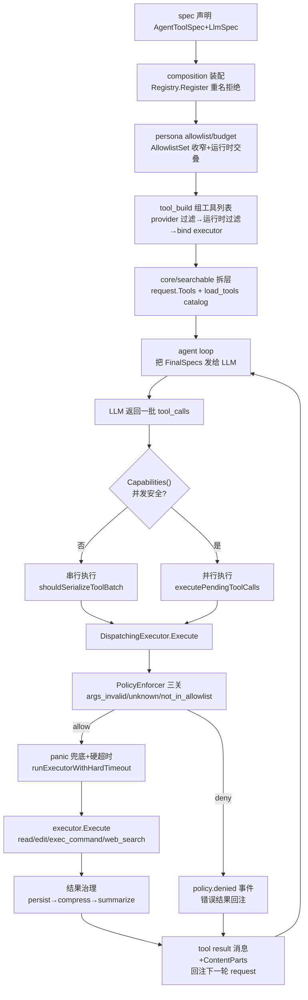
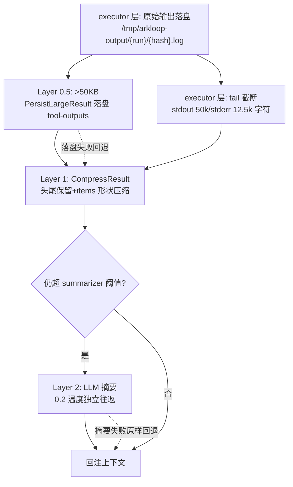
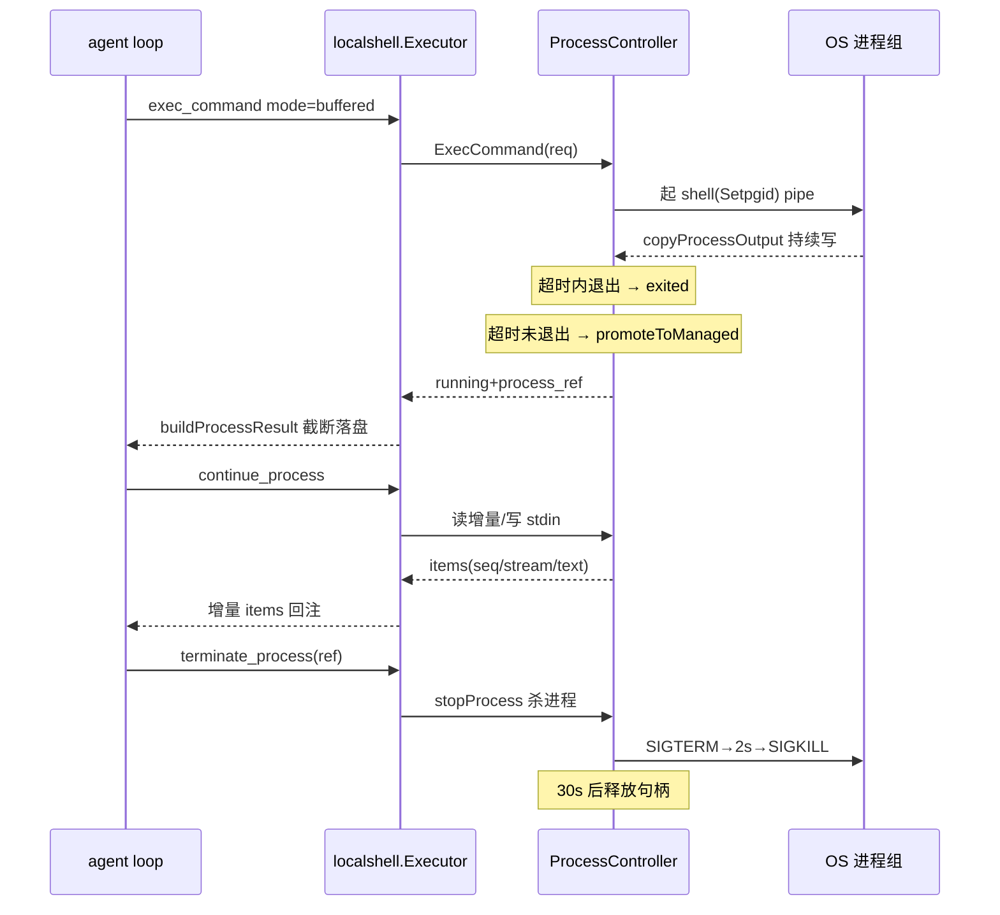

# Arkloop 工具系统解读：从 schema 到执行治理

> 本解读按 ai-agent 类规格产出。本文是 Arkloop 解读的工具系统子文档，覆盖 `src/services/worker/internal/tools`（含 `localshell`）及 pipeline / agent-loop 装配：工具 schema（AgentToolSpec/LlmSpec 分离）、Registry、dispatch 与 policy 把关、结果治理四层、localshell 进程状态机、内置工具家族与 read-before-write 信任模型。Skill/MCP/Persona 归 skills-mcp.md；spawn_agent / memory / channel 工具不属本文。主循环文档讲「循环怎么转」，本文讲「循环里可调用的工具如何被定义、注册、把关、执行、结果治理后回注上下文」——agent 能力的落点 `[src/services/worker/internal/agent/loop.go:942-1013]()`。
<!-- anchor: func (l *Loop) executeToolCall( … return result -->

## 工具系统在项目中的角色

工具系统由四层叠加构成，各司其职：

- **schema 层**（`tools` 包顶层）：`AgentToolSpec` 声明工具 worker 侧运行时契约——风险、副作用、并发、是否独占、硬超时语义（`[src/services/worker/internal/tools/spec.go:32-43]()`）；同工具在代码里显式维护第二张脸 `LlmSpec`（`llm.ToolSpec`），作为给 LLM 的 function-calling schema。
<!-- anchor: type AgentToolSpec struct { … SupportsProgressHeartbeat bool -->
- **注册与调度层**：`Registry` 静态收集 spec（重名拒绝）；`DispatchingExecutor` 是运行时枢纽——先过 `PolicyEnforcer`（allowlist / 参数可哈希 / 工具已知性三关），再包 panic 恢复 + 硬超时 + 四层结果治理，最后交给绑定到该工具名的 executor（`[src/services/worker/internal/tools/dispatch_executor.go:264-400]()`）。
<!-- anchor: func (e *DispatchingExecutor) Execute( … return result -->
- **执行器层**：数十个内置工具 executor 实现文件 / 网络 / 交互 / 状态变更语义，共享 `fileops` 抽象、`ExecutionContext` 与事件发射器；本地代码执行由 `localshell` 进程控制器承担。
- **装配与把关层**（pipeline 中间件）：run 进入 loop 前，`tool_build` 依 persona allowlist、运行时可用性、provider 绑定把「整库工具」收窄成本 run 工具集 + searchable 目录（`[src/services/worker/internal/pipeline/mw_tool_build.go:52-116]()`）。
<!-- anchor: effectiveAllowlist := CopyStringSet(rc.AllowlistSet) … dispatchRef = executor -->

README 宣传的 "Built-in tools, MCP servers, and ClawHub skills""工具分 RiskLevel、persona 可配 allowlist/budget" 中，builtin tools + RiskLevel + allowlist 即本文范围；MCP 服务器与 ClawHub skills 归技能 / 人设切片，这里只提协同点。

## 根因：为什么工具是「一等公民 schema」

把工具做成带结构化元数据的 schema，而非「一段函数 + 一段 prompt」，根因是工具系统面对的是一个**不可信的调用方（LLM）在单机用户态执行任意副作用**的信任问题：

1. **LLM 每次生成的工具调用都可能是错的、恶意的或被 prompt 注入的**，而它访问的是用户真实文件系统与 shell。系统必须在「调用发生前」有一道不依赖模型自觉的检查岗，于是每个工具预先声明「我有多危险」——`RiskLevel` 分 low / medium / high，写文件 medium、跑命令 high、读文件 low，分级而非一刀切（`[src/services/worker/internal/tools/spec.go:10-15]()`）。
<!-- anchor: type RiskLevel string … RiskLevelHigh   RiskLevel = "high" -->
2. **同一会话工具数可达上百**（内置 + 渠道 + memory + MCP），LLM 上下文装不下全量 schema、也容易挑错。因此必须有「工具集合治理」：按 persona / 渠道收窄可见集、按需 `load_tools` 动态加载——工具须先被登记成可枚举、可过滤、可索引的注册表实体，再谈可见性。
3. **执行语义差异大**：有的只读（可并行、可取消），有的改状态（必须串行、中断即半途而废），有的要持续输出（follow / pty）。loop 决定「批内串行还是并行」需要元数据——`Capabilities()` 由 `SideEffects` / `ConcurrencySafe` / `RequiresExclusiveAccess` 推导并发安全标记，直接喂给 loop 批调度（`[src/services/worker/internal/agent/loop.go:882-893]()`）。
<!-- anchor: func (l *Loop) shouldSerializeToolBatch( … return false -->
4. **需要为事件流与可观测提供稳定元数据**：每个 `tool.call` / `policy.denied` 事件带上 risk_level、args hash、spec 能力，前端时间线 / 审计 / 调试有据可查（`[src/services/worker/internal/tools/policy.go:202-205]()`）。
<!-- anchor: func toolCallSpecPayload(spec AgentToolSpec) map[string]any { … return payload -->

schema 因此独立成层：**它是「策略面」与「执行面」之间的稳定接口**。没有它，allowlist、plan mode、risk 分级、并发调度、事件观测都要各复制一套工具知识，迟早分叉。

## schema 层：AgentToolSpec 与 LlmSpec 为什么分离

每个内置工具目录几乎都声明两样东西：`AgentSpec`（worker 侧运行时契约，含 RiskLevel / SideEffects / 能力标记）与 `LlmSpec`（LLM 侧 function schema，纯 JSON Schema）。两者由同目录代码显式维护而非自动互转，因为服务的对象完全不同：

- `AgentSpec` 回答「worker 怎么安全地执行它」——风险、并发、硬超时，进注册表、供 allowlist 匹配；`LlmSpec` 回答「模型怎么正确地调用它」——参数结构、枚举、约束、长描述，拼进 `request.Tools`、参与 prompt cache 的 schema hash。
- **能力默认值推导**降低声明成本：`SideEffects=true` 默认不可并发；`ConcurrencySafe` 显式覆盖后若又声明 `RequiresExclusiveAccess` 仍强制退化为不可并发；`InterruptBehavior` 为空时，可并发工具默认可 cancel、有副作用工具默认 block；`HardTimeoutMode` 默认 enforced——默认值让 90% 的只读小工具只写三行 spec 即可（`[src/services/worker/internal/tools/spec.go:91-119]()`）。
<!-- anchor: func (s AgentToolSpec) Capabilities() ToolCapabilities { … HardTimeoutMode:           hardTimeoutMode, -->
- **多 provider 同逻辑名**是双模型的直接受益者：`web_search` 同时注册 `web_search` / `web_search.basic` / `web_search.tavily` / `web_search.exa` 四个 spec，后三者靠 `LlmName:"web_search"` 声明「我是谁的逻辑别名」；dispatch 层据 LlmName 把模型调用解析到当前激活的 provider executor（`[src/services/worker/internal/tools/builtin/web_search/executor.go:30-63]()`）。schema 文本也随 provider 切换——Exa 的参数形状与 Tavily 不同，`ProviderLlmSpec` 按 provider 名返回不同 schema（`[src/services/worker/internal/tools/builtin/web_search/executor.go:121-132]()`）。
<!-- anchor: var AgentSpec = tools.AgentToolSpec{ … SideEffects: false, -->
<!-- anchor: func ProviderLlmSpec(providerName string) (llm.ToolSpec, bool) { … return LlmSpec, false -->
- spec 注册前必须过 `Validate()`：名字 / 描述 / 风险非空、版本必须给（`[src/services/worker/internal/tools/spec.go:62-78]()`）。
<!-- anchor: func (s AgentToolSpec) Validate() error { … return nil -->

## Registry 与装配：注册即去重、persona 收窄

`Registry` 极简——一个 map + 校验 + 排序输出。两个硬约束体现 schema 纪律：注册前必须 `Validate()`；**重名注册直接报错**，防止两个工具抢占同一逻辑名、导致策略按名字放行却执行到错误实现（`[src/services/worker/internal/tools/registry.go:16-24]()`）。组合装配阶段（desktop）把所有内置 / localshell / conversation / LSP / 渠道 / 记忆 spec 灌进同一注册表，失败只告警不中断——桌面态要「尽量活着」（`[src/services/worker/internal/app/composition.go:163-180]()`）。
<!-- anchor: func (r *Registry) Register(spec AgentToolSpec) error { … r.specByName[spec.Name] = spec -->
<!-- anchor: toolRegistry := tools.NewRegistry() … slog.WarnContext(ctx, "desktop: skip tool registration", "name", spec.Name, "err", err) -->

persona 收窄 + 运行时探测叠加：desktop 态把 persona 的 AllowlistSet 与运行时探测可用工具做交叠，denylist 再逐项移除（`[src/services/worker/internal/app/composition.go:2950-2955]()`）。`tool_build` 中间件在此之上完成对 LLM 可见性的最终裁剪（见下文生命周期）。
<!-- anchor: if len(snapshot.Runtime.ToolAllowlist) > 0 { … pipeline.RemoveToolOrGroup(rc.AllowlistSet, rc.ToolRegistry, denied) -->

## dispatch：policy 是执行前的最后一道闸

`DispatchingExecutor.Execute` 是一条「策略 → 执行 → 治理」串行流水线，顺序不可颠倒：策略放行（含事件落账）→ panic 兜底与硬超时 → Layer 0.5 落盘 → Layer 1 压缩 → Layer 2 LLM 摘要 → 打点收尾（`[src/services/worker/internal/tools/dispatch_executor.go:362-400]()`）。
<!-- anchor: // Layer 0.5: persist very large outputs to disk for later retrieval. … return result -->

策略与执行解耦的收益是：**policy 决定不依赖任何 executor 实现，executor 也不关心自己被拒还是被压缩**。`RequestToolCall` 的三道拒绝各有独立 deny_reason，全部作为结构化事件流出，前端可展示「为什么被拒」（`[src/services/worker/internal/tools/policy.go:37-131]()`）：

<!-- anchor: func (p *PolicyEnforcer) RequestToolCall( … Events:     []events.RunEvent{callEvent}, -->

- **参数无效**：stablejson 哈希参数失败（参数不是合法可稳定序列化 JSON）→ `tool.args_invalid`；
- **未注册**：resolve 后仍查不到 spec → `tool.unknown`（通常是 MCP / 渠道工具未注入却仍被模型调用）；
- **不在 allowlist** → `tool.not_in_allowlist`，payload 附带当前 allowlist 全文，模型可读到「我该用什么」。

关键细节：allowlist 同时查**逻辑名**（LLM 会写的 `web_search`）与**解析名**（当前绑定的 `web_search.tavily`），避免「persona 白名单放了 web_search.tavily、模型却只写 web_search 被误伤」以及反向的逃逸（`[src/services/worker/internal/tools/policy.go:92-95]()`）。
<!-- anchor: allowed := p.allowlist.Allows(allowlistName) … allowed = p.allowlist.Allows(strings.TrimSpace(resolvedToolName)) -->

对比替代方案：把策略放进 executor（每个工具自查 allowlist）→ 策略逻辑被复制 N 份且绕过面大；把策略放在 loop 前统一预检（只查一次）→ 覆盖不到 loop 中途动态激活的工具。放在 `DispatchingExecutor` 这个「所有工具调用的必经点」是最小闭合的检查面——任何路径进来的调用都过同一道门。

## 工具生命周期流程

一张图串起「定义 → 注册 → 收窄 → 可见 → 调用 → 把关 → 执行 → 治理 → 回注」：

关键装配落点（pipeline 与 loop 两侧）：

- **persona allowlist/budget 来源**：persona 解析把用户配置（tool_allowlist / tool_budget / per_tool_soft_limits）合成进 `RunContext.AllowlistSet` 与 `EffectiveProfile`；desktop 态还会与运行时探测的可用工具做交叠（`[src/services/worker/internal/app/composition.go:2950-2955]()`）。
<!-- anchor: if len(snapshot.Runtime.ToolAllowlist) > 0 { … pipeline.RemoveToolOrGroup(rc.AllowlistSet, rc.ToolRegistry, denied) -->
- **tool_build 的过滤管线**：provider allowlist 解析 → 图片 bridge 决策 → `filterAllowlistByRuntime`（判定 web_search / exec_command / memory_* 等运行时托管工具是否真可用）→ user 身份缺失时剔掉 memory / thread 类工具 → 逐项丢未绑定 executor 的工具 → 再丢「未配置」与「账户不可用」的工具，最后 `BuildDispatchExecutor` 只绑定幸存者（`[src/services/worker/internal/pipeline/mw_tool_build.go:52-116]()`）。
<!-- anchor: effectiveAllowlist := CopyStringSet(rc.AllowlistSet) … dispatchRef = executor -->
- **core/searchable 拆层**：persona 配了 `core_tools` 时，工具被拆成「进 request.Tools 的 core」与「只进 load_tools 目录的 searchable」两组；searchable 的短目录文本被 upsert 进 system prompt 的 `tools.searchable_catalog` 段，模型先 load_tools、loop 再把新工具 `DrainActivated` 追加进下一轮 request.Tools（`[src/services/worker/internal/pipeline/mw_tool_build.go:138-180]()`、`[src/services/worker/internal/agent/loop.go:721-726]()`）。
<!-- anchor: coreSet := resolveCoreToolSet(rc) … allSpecs = coreSpecs -->
<!-- anchor: if activated := l.toolExecutor.DrainActivated(); len(activated) > 0 { … request.Tools = append(request.Tools, activated...) -->
- **串并行决策**：loop 依每个待执行调用的 `Capabilities()`，只要批内有一个不可并发或需独占的工具就整体串行，避免两个 write 并发写同一文件（`[src/services/worker/internal/agent/loop.go:882-893]()`）。
<!-- anchor: func (l *Loop) shouldSerializeToolBatch( … return false -->
- **结果回注**：执行结果经 `toolResultFromExecution` 转成 `StreamToolResult` 消息放回 messages；多模态附件（`ContentParts`）在同一函数转成 image ContentPart，主模型原生支持图片时直接作为 image 输入回注、不走文本描述（`[src/services/worker/internal/agent/loop.go:3372-3408]()`）。
<!-- anchor: func toolResultFromExecution( … Error:              errObj, -->

## 结果治理：大输出怎么办

### 问题本质

工具是 agent 的「外脑」，输出常常远超单轮能消费的量：一次 `exec_command` 的构建日志可上 MB，一次 grep 可命中上万行。如果原样回注上下文，代价是 token 膨胀、prompt cache 失效、逼近上下文窗口。治理目标不是「省存储」而是「**省模型上下文 + 不丢关键信息**」。系统用四道渐进的闸门，前一道兜不住才走下一道：

第一层（executor 内，非统一治理层）是 Tail 截断与原始落盘：输出先原样写入 `/tmp/arkloop-output/{runID}/{hash}.log`（含 per-run 200MB / per-file 64MB 配额与 sha256 去重），再对回注文本做 UTF-8 安全的 tail 截断（默认保留尾 50k 字符），stderr 给更小预算（尾 12.5k）——错误输出优先保 tail，因为命令失败信息通常在尾部（`[src/services/worker/internal/tools/localshell/executor.go:339-348]()`）。
<!-- anchor: stdout := sanitizeOutput(resp.Stdout) … stderr, stderrTrunc := tools.TruncateOutputField(stderr, tools.TruncateMaxChars/4) -->
截断与配额常量集中在 `output_truncate.go`：`TruncateMaxChars=50_000`、`LargeOutputDir=/tmp/arkloop-output`、`MaxBytesPerRun=200MB`、`MaxBytesPerFile=64MB`（`[src/services/worker/internal/tools/output_truncate.go:16-28]()`）。
<!-- anchor: TruncateMaxChars = 50_000 … MaxBytesPerFile = 64 * 1024 * 1024 -->

第二层（Layer 0.5）是统一大结果持久化：任何非 bypass 工具的 `ResultJSON` 若序列化后超过 50KB，`PersistLargeResult` 把它写成 `~/.arkloop/tool-outputs/{threadID}/{toolCallID}.txt`，回注内容替换为轻量 preview + filepath + hint，且只保留 metadataFields（error / exit_code / status / cursor / duration_ms 等）（`[src/services/worker/internal/tools/persist_large_result.go:28-105]()`）。preview 是 4KB head + 4KB tail、各自裁到换行与 UTF-8 边界的摘要；hint 提示模型「用 grep 搜该文件、用 read offset/limit 分页，别整读」——把「读大文件」的 token 成本转嫁给模型下一次**显式、分页的**工具调用（`[src/services/worker/internal/tools/persist_large_result.go:82-95]()`）。
<!-- anchor: func PersistLargeResult( … Events:       result.Events, -->
<!-- anchor: preview := generatePreview(content, PersistPreviewHead, PersistPreviewTail) … newResult["hint"] = "Full output saved. Use grep to search the file, or read with offset/limit to page through it. Do NOT read the entire file." -->

第三层（Layer 1）是结构化压缩：大但不到落盘级（或落盘失败回退）的结果走 `CompressResult`——`metadataFields` 原样保留（它们是执行语义不是载荷），其余字段 / items / 字符串递归按预算压缩（`[src/services/worker/internal/tools/result_compressor.go:94-113]()`）。字符串做「头行 + 尾行 + `...[N lines truncated]...` 标记」截断；`items` 数组每项只留 seq/stream/text 且各自缩到预算（`[src/services/worker/internal/tools/result_compressor.go:135-166]()`）。这里刻意针对 localshell 的 items 结构做**形状感知压缩**，而非通用 JSON 裁切。
<!-- anchor: func CompressResult(toolName string, result ExecutionResult, limit int) ExecutionResult { … Events:     result.Events, -->
<!-- anchor: func compressOutputItems(v any, budget int) any { … return out -->

第四层（Layer 2）是 LLM 摘要：若 Layer 1 之后仍超 `summarizer.threshold`（来自 system summarize persona 配置），派一个独立低温度（0.2）摘要模型调用，把整块输出压成「摘要 + `_summarized` 标记」，要求保留数字 / 路径 / 标识符 / 状态码 / 精确错误消息、删重复日志与样板噪音（`[src/services/worker/internal/tools/result_summarizer.go:45-104]()`）。`resultSummarizerTimeout=30s`、`maxTokens` 默认 512 兜底，防止摘要本身成为慢点。
<!-- anchor: func (s *ResultSummarizer) Summarize(ctx context.Context, toolName string, result ExecutionResult) ExecutionResult { … Events:     result.Events, -->

### 为什么这么排序：信息保真 × 成本阶梯

- **先落盘再压缩**：持久化是**无损兜底**——信息永远可捞回；压缩 / 摘要是**有损但省 token**。先无损落盘、再有损收缩，让有损决策可逆。代价是磁盘写放大（几十 MB 级 run 输出）与模型后续「还要 grep 回来」的额外轮次。
- **不一步到位 LLM 摘要**：LLM 摘要是成本与延迟最高的一档（一次 30s 超时内的独立模型往返），本地压缩则是纯本地 O(n) 裁剪。把「结构性冗余」（日志中段、重复行）交给便宜的本地压缩先清一遍，剩下的语义冗余才值得花模型钱。`resultSummarizerTimeout=30s`、`resultSummarizerTemperature=0.2` 兜底（`[src/services/worker/internal/tools/result_summarizer.go:14-15]()`）；摘要失败原样回退 Layer-1 结果（`[src/services/worker/internal/tools/result_summarizer.go:84-87]()`），治理链任一环故障都不丢结果。
<!-- anchor: const resultSummarizerTimeout = 30 * time.Second … const resultSummarizerTemperature = 0.2 -->
<!-- anchor: if streamErr != nil && streamErr != sentinel { … return result -->
- **为什么不是无条件压缩一切**：三类工具显式 bypass——**read 类**（read / read_file / notebook_read / memory_read 自带 offset/limit 分页，系统再截断会破坏模型的有意分页）（`[src/services/worker/internal/tools/generative_ui.go:14-22]()`）；**bootstrap 类**（visualize_read_me / artifact_guidelines 返回必须全文进上下文的规范文本）；**product help 类**（arkloop_help）。这是「模型有更优读取策略时，系统治理让路」的显式设计。
<!-- anchor: // readClassTools are read-class tools that have built-in pagination (offset/limit/lines). … "memory_read":   {}, -->
- **磁盘卫生是配套治理**：run 结束 `CleanupRunDisk` 清目录、worker 启动 `CleanupStaleOutputDirs` 兜底过期目录（`[src/services/worker/internal/tools/output_truncate.go:107-146]()`），persist 大结果目录在 thread 清理时一并删除（`[src/services/worker/internal/tools/cleanup_persisted.go:11-23]()`）。
<!-- anchor: // CleanupRunDisk removes the persisted output directory for a run and resets tracking. … _ = os.RemoveAll(dir) -->
<!-- anchor: // CleanupPersistedToolOutputs removes the tool-outputs/{thread_id} directory … if err := os.RemoveAll(dir); err != nil { -->

### 对比替代方案

- **把工具输出限制死在小尺寸**（executor 强制 max_output_bytes）：省事，但让 grep / read 等「本就该拿大数据」的工具失去用武之地；本地 agent 的价值恰在能啃大仓库。Arkloop 选「允许大输出 + 结果侧治理」，并把 executor 级 soft limit（exec_command 默认 16KB 原始截断）与 LLM-facing 的 `CompressTargetBytes`（50KB）分开设置，两个预算互不干扰（`[src/services/worker/internal/tools/soft_limits.go:19-22]()`）。
<!-- anchor: // CompressTargetBytes is the maximum ResultJSON size (in bytes) we want to … CompressTargetBytes = 50 * 1024 -->
- **全量摘要覆盖一切**：会丢失精确行号、错误文本这类必须逐字的信号——summarize prompt 明确要求保真，说明设计者清楚「摘要会丢信息」是常态。

## localshell：一个「进程生命周期状态机」

### 为什么需要一个 controller

shell 工具不是「起一个命令拿结果」，而要支持 **buffered / follow / stdin / pty** 四种模式与可续读、可输入、可终止、可 resize 的长生命周期进程（`[src/services/worker/internal/tools/localshell/spec.go:43-96]()`）。Arkloop 是单进程嵌入式 runtime，worker 进程与用户桌面同生命周期——**进程必须被进程内代码全面托管**，不能起完就丢给 OS。`ProcessController` 就是「进程即资源」的托管层：每个 `managedProcess` 是带锁对象，持 cmd / stdin / ptyFile / 状态 / 退出码 / 输入去重集 / 环形输出缓冲 / 唤醒通道（`[src/services/worker/internal/tools/localshell/controller.go:75-104]()`）。
<!-- anchor: var ExecCommandLlmSpec = llm.ToolSpec{ … "additionalProperties": false, -->
<!-- anchor: type managedProcess struct { … promotedSeededErr int // stderr bytes already seeded -->

工具层 `exec_command` / `continue_process` / `terminate_process` / `resize_process` 四合一 Executor 只是参数解析 + controller 调用的薄壳（`[src/services/worker/internal/tools/localshell/executor.go:78-136]()`）——**executor 无状态，状态全在 controller**，因为 executor 每次 Execute 是短暂的，进程状态必须住在比一次工具调用活得久的结构里。
<!-- anchor: func (e *Executor) Execute( … resp, runErr := e.controller.ExecCommand(req) -->

### 状态机的关键决策

**buffered 超时 = 自动晋升托管，而不是杀掉**——这是 localshell 最有味道的决策。buffered 命令超时后，`promoteToManaged` 把已超时的进程转成后台 managed 进程：输出用 snapshot-offset 增量搬进环形缓冲，后台 goroutine 用 200ms ticker 持续 drain，退出时做最后一次 drain 并置 exit code；模型随后用 continue_process 继续读——**把「超时即失败」软化为「超时即转异步可轮询」**（`[src/services/worker/internal/tools/localshell/controller.go:289-368]()`）。晋升失败才退回「先 SIGTERM、2s 宽限后 SIGKILL、exit_code=124」的旧路径。
<!-- anchor: func (c *ProcessController) runBuffered(req ExecCommandRequest) (*Response, error) { … }, nil -->

**环形缓冲 + 游标让「增量读」无锁竞态**：输出不进无限 buffer，而是 `ItemBuffer`——超过 1MB（`processRingBytes`）就从队头丢最老 item、同步前移 `headSeq`（`[src/services/worker/internal/tools/localshell/protocol.go:123-158]()`）。客户端持有 cursor（seq），`ReadFrom(cursor)` 返回增量；游标太老（已被环形缓冲挤掉）→ `cursor_expired`，游标超前 → `invalid_cursor`（`[src/services/worker/internal/tools/localshell/controller.go:758-766]()`）。这让 continue_process 成为「服务端无状态的增量协议」，支持多轮轮询且不重复 / 不漏读；响应有 32KB 默认分块，溢出标 `truncated` 与 output_ref。
<!-- anchor: type ItemBuffer struct { … b.headSeq = b.nextSeq -->
<!-- anchor: func validateCursorLocked(proc *managedProcess, cursor uint64) error { … return nil -->

**超时分级而非一刀切**：模式不同默认超时不同（buffered 默认 30s 且可 30min 上限内自定，follow / stdin / pty 强制要求 timeout_ms），单进程最大 30min（`[src/services/worker/internal/tools/localshell/protocol.go:233-248]()`）；controller 层 `waitForExit` 用 `time.AfterFunc` 到点杀进程，进程树（Setpgid）整组先软后硬（`[src/services/worker/internal/tools/localshell/controller.go:654-684]()`、`[src/services/worker/internal/tools/localshell/proc_desktop_unix.go:11-28]()`）。
<!-- anchor: func NormalizeTimeoutMs(mode string, value int) int { … return value -->
<!-- anchor: func (c *ProcessController) waitForExit(proc *managedProcess, timeoutMs int) { … c.scheduleProcessRelease(proc) --> <!-- anchor: func procSysProcAttr() *syscall.SysProcAttr { … func killProcessGroupHard(pid int) error { -->

**stdin 写入按 input_seq 去重**：LLM 重试可能重放 stdin 文本导致重复输入污染进程；`acceptedInputSeqs` 记录已接受 seq，重放直接跳过写（`[src/services/worker/internal/tools/localshell/controller.go:173-207]()`）。同刻只有一个 continue_process 在途（inFlight 互斥 + 409 busy），杜绝两个并发轮询同时写 stdin / 读游标。
<!-- anchor: var accepted *int64 … proc.acceptedInputSeqs[*req.InputSeq] = struct{}{} -->

### 安全与卫生

- **干净环境而非继承宿主环境**：进程 env 从白名单重建（PATH / HOME / LANG / TMPDIR / USER 等），PATH 强制追加 `~/.arkloop/bin` 与一套默认 unix PATH（`[src/services/worker/internal/tools/localshell/executor.go:30-46]()`）；host 环境里未白名单的键被显式置 null 清除，模型 env 覆盖只能改白名单键（`[src/services/worker/internal/tools/localshell/executor.go:443-472]()`）。
<!-- anchor: var localShellAllowedEnvKeys = []string{ … "WINDIR", -->
<!-- anchor: func sanitizeLocalEnvPatches(overrides map[string]*string) map[string]*string { … return slices.Contains(localShellAllowedEnvKeys, key) -->
- **输出消毒**：CR 覆盖行保留最后一段、剥 ANSI 转义序列，防「进度条 / 终端控制字符」弄脏回注内容（`[src/services/worker/internal/tools/localshell/executor.go:570-601]()`）。
<!-- anchor: func sanitizeOutput(s string) string { … return out.String() -->
- **run 归属与回收**：run 结束时 `ShellExecutor.CleanupRun` 杀掉该 run 名下仍 running 的进程（外壳同时维护 process_ref → runID 映射供清理），controller `Close()` 全局兜底——这是 agent 可能遗留后台进程时的防泄漏网（`[src/services/worker/internal/runtime/shell_executor.go:102-123]()`、`[src/services/worker/internal/tools/localshell/controller.go:1023-1043]()`）。
<!-- anchor: func (e *ShellExecutor) CleanupRun(ctx context.Context, runID string, terminalStatus string) error { … return e.ensureLocal().CleanupProcesses(ctx, refs, terminalStatus) -->
<!-- anchor: func (c *ProcessController) CleanupRun(runID string) { … proc.mu.Unlock() -->
- **命令改写尝试（rtk）**：对不含引号 / 管道等元字符的「简单命令」尝试交给 rtk rewrite（本地工具链一部分），1.5s 超时、失败静默回退原命令——「可选降级」而非「硬依赖」（`[src/services/worker/internal/tools/localshell/executor.go:603-635]()`）。
<!-- anchor: func rtkRewrite(ctx context.Context, command string) string { … return true -->

局限与风险（诚实标注）：localshell 是**本机进程执行、没有沙箱**——安全边界由 RiskLevelHigh + allowlist + plan mode + 用户在场共同构成，而非 OS 隔离；exec 继承用户全部权限（可 rm -rf $HOME），这正是它被评为 high 的原因（`[src/services/worker/internal/tools/localshell/spec.go:11-17]()`）。
<!-- anchor: var ExecCommandAgentSpec = tools.AgentToolSpec{ … RiskLevel:   tools.RiskLevelHigh, -->

## 内置工具家族

数十个内置工具可归为若干族（toolmeta 目录对分组有权威索引，`groupOrder` 给出展示顺序——discovery → web_search → x_search → web_fetch → shell → filesystem → memory → document → orchestration，`[src/services/shared/toolmeta/registry.go:35-45]()`）：
<!-- anchor: var groupOrder = []string{ … GroupOrchestration, -->

| 家族 | 代表工具 | 共享底座 | 备注 |
|---|---|---|---|
| 文件读族 | read（file_path / message_attachment / remote_url 三源）、read_file（legacy）、grep、glob | fileops.Backend / FileTracker | read_file 已不被注册，仅留 spec |
| 文件写族 | write_file、edit（含 create/delete 语义） | fileops + Tracker + omission 检测 | read-before-write 强制 |
| 执行族 | exec_command / continue_process / terminate_process / resize_process | localshell.ProcessController | RiskLevelHigh |
| 网络族 | web_search、x_search、web_fetch | provider 抽象 + outboundurl SSRF 保护 | web_search / web_fetch 多 provider |
| 记忆 / 会话族 | memory_*、notebook_*、conversation_search / context 等 | memory / conversation 数据层 | 细节归记忆与数据层切片 |
| 编排族 | load_tools、todo_write、ask_user、enter/exit_plan_mode、timeline_title、summarize_thread | ToolActivator + per-run 状态 | 让模型「管理自身循环」 |
| 文档 / 生成族 | document_write、create_artifact、show_widget、image_generate、visualize_read_me、artifact_guidelines | objectstore + generative UI 源 | |

### 文件工具：read-before-write 是「信任模型」的基石

文件族是所有本地 agent 的命脉，Arkloop 用一套 `FileTracker` 把「模型读过才准写」固化成硬规则：

- 读工具每次读文件记录 read time 与读过的**行区间 + mtime**（区间合并去重）（`[src/services/worker/internal/tools/builtin/fileops/tracker.go:115-143]()`）；
<!-- anchor: func (t *FileTracker) RecordReadState(runID, path string, mtime int64, start, end int) { … func (t *FileTracker) CheckReadDedup(runID, path string, currentMtime int64, start, end int) bool { -->
- 写工具写前必须验：同 run 内该文件被 read 过（`HasBeenReadForRun`）且 mtime 未晚于最后读取时刻（staleness）——**防的是 LLM 对着过期内容改文件**；源码注释也承认 TOCTOU 竞态存在，判为「窗口小、可接受」（`[src/services/worker/internal/tools/builtin/edit/executor.go:62-81]()`）；
<!-- anchor: // read-before-edit check … // Acceptable risk — the window is small and a full lock would hurt throughput. -->
- edit 还要求 old_string 在文件中恰好匹配一次（多匹配即拒绝，歧义保护），再走四层渐进匹配（exact → 归一化引号/空白 → regex → fuzzy）（`[src/services/worker/internal/tools/builtin/edit/match.go:20-40]()`），匹配成功后在 executor 里反向应用替换保持字节偏移正确；
<!-- anchor: // match runs 4-layer progressive matching against content for oldString. … return nil -->
- **omission 检测**堵住模型偷懒写 `// rest of code...` 占位符（16 个常见短语 + 注释前缀剥离 + 省略号匹配），宁可报错也不产出残缺文件（`[src/services/worker/internal/tools/builtin/fileops/omission.go:8-26]()`、`[src/services/worker/internal/tools/builtin/fileops/omission.go:36-65]()`）；
<!-- anchor: var omissionPhrases = []string{ … "no changes", -->
<!-- anchor: func DetectOmissionInContent(content string) error { … return nil -->
- 编码卫生：UTF-16 BOM 直接拒改（要求先转 UTF-8）、CRLF 先归一后还原、尾部空白只清受影响行、`.md` 豁免尾空清理（`[src/services/worker/internal/tools/builtin/edit/executor.go:95-108]()`、`[src/services/worker/internal/tools/builtin/edit/executor.go:156-161]()`）；
<!-- anchor: // UTF-16 BOM detection … newString = strings.ReplaceAll(newString, "\r\n", "\n") -->
<!-- anchor: // trailing whitespace strip (skip .md/.mdx) — only on affected lines … newContent = stripTrailingWhitespaceRange(newContent, editStart, editStart+newLen) -->
- 写文件用临时文件 + 原子 rename，避免半写状态被外部读到（`[src/services/worker/internal/tools/builtin/fileops/local.go:47-70]()`）；
<!-- anchor: func (b *LocalBackend) WriteFile(_ context.Context, path string, data []byte) error { … if err := os.Rename(tmpName, resolved); err != nil { -->
- 写成功即 `InvalidateReadState`，强制下一轮编辑前重读（`[src/services/worker/internal/tools/builtin/edit/executor.go:176-179]()`）。
<!-- anchor: if e.Tracker != nil { … e.Tracker.InvalidateReadState(runID, trackingKey) -->

**shell 与文件工具的状态联动**是这套设计里容易被忽略的高招：`exec_command` 执行后，`ShellExecutor` 用 `DetectModifiedFiles` 对命令文本做 best-effort 静态解析（`>` / `>>` 重定向、`sed -i`、`tee`、`cp/mv` 目标），把「命令可能动过的文件」的 read-state 直接作废——**防止模型用 shell 改了文件后，edit 因旧 mtime 快照拿到过时内容**（`[src/services/worker/internal/runtime/shell_executor.go:49-56]()`、`[src/services/worker/internal/tools/localshell/filedetect.go:11-36]()`）。
<!-- anchor: if e.fileTracker != nil && toolName == localshell.ExecCommandAgentSpec.Name { … e.fileTracker.InvalidateReadState(execCtx.RunID.String(), p) -->
<!-- anchor: func DetectModifiedFiles(command string, cwd string) []string { … return resolved -->

### 网络工具：provider 化的 search / fetch + SSRF 出站策略

`web_search` 以 provider 抽象解耦多个搜索后端（basic / Tavily / Exa），schema 按当前 provider 覆盖；executor 无 provider 时 `IsNotConfigured` 让 tool_build 直接把它从可见列表剔掉——**「没配 key 的工具根本不该出现在模型面前」**（`[src/services/worker/internal/tools/builtin/web_search/executor.go:155-157]()`）。
<!-- anchor: func (e *ToolExecutor) IsNotConfigured() bool { … return e == nil || e.provider == nil -->

`web_fetch` 的安全要点在出站策略：仅 http/https、禁 localhost 直连、IP 类 hostname 过 `shared/outboundurl` 策略（SSRF 防护），dial 层也包 `SafeDialContext`（`[src/services/worker/internal/tools/builtin/web_fetch/url_policy.go:24-54]()`）。风险分级与暴露面成正比：web_search low（出网读）、web_fetch medium（出网读可控目标）、exec high（本机全权限）。
<!-- anchor: func EnsureURLAllowed(rawURL string) error { … return EnsureIPAllowed(ip) -->

### 编排工具：模型管理自身循环

- `load_tools`：按 catalog 关键词在 searchable 池匹配、自动展开依赖（show_widget → visualize_read_me），被激活 spec 走 ToolActivator 注入下一轮 request.Tools（`[src/services/worker/internal/tools/builtin/load_tools/executor.go:26-29]()`、`[src/services/worker/internal/tools/builtin/load_tools/executor.go:80-130]()`）——persona「最小 prompt 足迹」的执行端。
<!-- anchor: var toolDependencies = map[string][]string{ … "show_widget":     {"visualize_read_me"}, -->
<!-- anchor: searchable := e.specsFn() … entry["state"] = stateActivated -->
- `todo_write`：executor 持有 per-run 状态 `map[runID][]TodoItem`（全量替换语义）；plan-bound 模式则直接改 `.plan.md` front matter，两种模式都发 `todo.updated` 事件——**todo 既是模型工作记忆也是 UI 状态**（`[src/services/worker/internal/tools/builtin/todo_write/executor.go:38-43]()`、`[src/services/worker/internal/tools/builtin/todo_write/executor.go:74-108]()`）。
<!-- anchor: // Executor 持有 per-run todo 状态，生命周期与 DispatchingExecutor 相同。 … state map[string][]TodoItem // runID -> items -->
<!-- anchor: func (e *Executor) executePlanBound( … "updated_todos": planUpdateMaps(updates), -->
- `ask_user`：把 {message, fields} 转成前端表单 schema 并回传 `pending_user_input` 状态，由 loop 等待用户输入——工具调用成为「与用户交互的通道」而非纯函数（`[src/services/worker/internal/tools/builtin/askuser/executor.go:48-95]()`）。
<!-- anchor: func ValidateAndNormalize(args map[string]any) (string, map[string]any, error) { … if req, _ := field["required"].(bool); req { -->
- `enter_plan_mode`：把 Plan Mode 做成**运行时开关**而非纯 prompt 约定——executor 调 `SetIsPlanMode(true)` 并注入中文指令文本；写工具（write_file / edit / todo plan-bound 等）执行前统一查 `PlanModeWriteBlocked`，plan mode 下只允许写当前 plan 文件，其余写一律被工具自身短路拒绝（`[src/services/worker/internal/tools/builtin/enter_plan_mode/executor.go:71-92]()`、`[src/services/worker/internal/tools/plan_mode.go:56-71]()`）。开关状态住在 pipeline RunContext（`IsPlanModeActive` 被写工具消费），其「写保护」判定（`.plan.md` 且在 plan 目录内）由 tools/plan_mode.go 的纯函数完成（`[src/services/worker/internal/tools/plan_mode.go:117-134]()`）。
<!-- anchor: binding.SetIsPlanMode(true) … "instructions":   instructions, -->
<!-- anchor: func PlanModeWriteBlocked(rc any, started time.Time, filePath string) (ExecutionResult, bool) { … }, true --> <!-- anchor: func PlanModePlanFileCandidate(workDir string, path string) bool { … return rel != "." && rel != "" && !strings.HasPrefix(rel, ".."+string(filepath.Separator)) && rel != ".." -->

### 无状态检索工具（read / grep / glob）的高效化

read 用 `CheckReadDedup` 在文件 mtime 未变且请求行区间已被读过时直接返回 `file_unchanged`，省一次磁盘 IO 与重复 token（`[src/services/worker/internal/tools/builtin/read/executor.go:212-222]()`）；read 统一走 `LocalBackend` 而非直接 os.ReadFile——**backend 抽象让将来换沙箱 / 远程 FS 不必动工具逻辑**（注释明言 sandbox 已移除、本机唯一路径，`[src/services/worker/internal/tools/builtin/fileops/backend.go:24-28]()`）。
<!-- anchor: // dedup: check before reading to skip file IO when content unchanged … DurationMs: durationMs(started), -->
<!-- anchor: // ResolveBackend 返回以 workDir 为根的本机文件后端。 … return &LocalBackend{WorkDir: resolveWorkDir(workDir)} -->

## 与其他模块协同

- **pipeline 中间件链**：`tool_provider_bindings`（每 run 解出激活 provider 组）→ persona_resolution → `tool_build`（组 FinalSpecs + DispatchingExecutor）→ result_summarizer（注入 Layer 2 摘要器）的相对位置即数据流依赖：provider 绑定必须先于 tool_build，summarizer 注入必须晚于 executor 创建——`mw_result_summarizer` 在注入时读 system summarize persona 的 threshold / prompt / max_tokens，并 `SetSummarizer` 到 ToolExecutor（`[src/services/worker/internal/pipeline/mw_result_summarizer.go:17-78]()`）。
<!-- anchor: func NewResultSummarizerMiddleware( … rc.ToolExecutor.SetSummarizer(summarizer) -->
- **persona 系统**：allowlist 集合在 persona_resolution 收窄（desktop 与运行时探测交叠）；budgets 的 tool_timeout_ms / tool_budget / per_tool_soft_limits 汇入 EffectiveProfile 后在 loop 层转成 ExecutionContext 对应字段。persona 机制本身归人设切片，这里只消费其结果。
- **agent loop**：loop 负责三个「工具系统外部」的衔接——批调度串并行、DrainActivated 注入新 spec、把 ExecutionResult 转 StreamToolResult 回注。工具系统在 loop 内只暴露 `DispatchingExecutor.Execute` 与 `Capabilities()` 两个口子，耦合面极小（`[src/services/worker/internal/agent/loop.go:1009-1013]()`）。
<!-- anchor: result := runCtx.ToolExecutor.Execute(ctx, call.ToolName, copyMap(call.ArgumentsJSON), execCtx, call.ToolCallID) … return result -->
- **事件流**：policy / todo 事件都经 events.Emitter 出 `tool.call` / `policy.denied` / `todo.updated` 等事件，前端时间线与 run 审计据此重建「模型做了什么、为什么被拒」。
- **conversation 工具族**：`conversation_search` / `conversation_context` 等让模型「读取自身对话历史与被压缩的上下文」，是 context_compact 中间件产物的消费面；与工具系统的联系是「工具可读系统状态」这一类别的代表。

### 协同中的风险点（接口标注）

- `tool_build` 直接 import 内置工具包、把工具名硬编码进 `runtimeManagedToolNames` 与 executors map（`[src/services/worker/internal/pipeline/mw_tool_build.go:18-46]()`）；composition / builtin 里 spec 与 executor 用字符串名两处引用，工具改名需同步多处——「装配表即脆弱合同」。
<!-- anchor: var runtimeManagedToolNames = map[string]struct{}{ … "x_search":             {}, -->
- `AgentToolSpec.SupportsProgressHeartbeat` 目前只在 spec 与能力 JSON 中声明，搜索全文未见执行端消费方——预留能力 / 半成品（`[src/services/worker/internal/tools/spec.go:43-43]()`）。
<!-- anchor: SupportsProgressHeartbeat bool -->
- `read_file`（builtin/read_file）与 `localfs`（file_read / file_write）两套实现已不被任何装配路径 import，保留为 legacy / 未来沙箱路径——读者易误以为存在两条文件执行链（`[src/services/worker/internal/tools/builtin/read_file/spec.go:8-14]()`、`[src/services/worker/internal/tools/localfs/spec.go:8-14]()`）。
<!-- anchor: var AgentSpec = tools.AgentToolSpec{ … SideEffects: false, -->
<!-- anchor: var FileReadAgentSpec = tools.AgentToolSpec{ … SideEffects: false, -->

## 关键设计决策

### schema 承载执行知识，而非每次调用时猜

`SideEffects=true → 不可并发`、`RequiresExclusiveAccess → 无论如何不可并发`、`InterruptBehavior` 缺省按并发性推导（`[src/services/worker/internal/tools/spec.go:91-121]()`）。这个「从最少声明推导能力」的决策让新工具声明成本极低，也让策略端（loop 批调度、hard timeout、中断）有了稳定输入。代价是**隐式耦合**：`SideEffects` 一词同时承担「是否可并行」与「是否破坏性」两层语义，声明者若声明 SideEffects=false 却真会改外部状态，就静默绕过串行保护。备选是显式逐项声明，但那样每个 spec 要多写四个布尔，犯错面反而更大——「默认安全方向」的取舍合理，值得文档明示推导规则。
<!-- anchor: func (s AgentToolSpec) Capabilities() ToolCapabilities { … HardTimeoutMode:           hardTimeoutMode, -->

### 结果治理「先无损落盘、再有损压缩、最后才花模型钱」

四层闸门排序本质是「信息保真 × 成本」的阶梯：落盘零信息损失但费磁盘 + 一轮检索；本地压缩省 token 不省语义但可能截断关键中段；LLM 摘要最省 token 但引入幻觉风险与模型往返成本。把最贵的 LLM 摘要放最后、且失败即原样回退（Summarize 出错返回原 result），保证治理链任何一环故障都不丢结果（`[src/services/worker/internal/tools/result_summarizer.go:84-87]()`）。备选方案（一律摘要 / 一律截断）都丢失「可精确捞回」这个本地 agent 的核心体验。
<!-- anchor: if streamErr != nil && streamErr != sentinel { … return result -->

### 写类工具用「先读后写 + 过期检查」的进程内护栏，而非沙箱隔离

Arkloop 桌面场景的用户把完整文件系统权限给了 agent（本地优先的根本立场），因此文件工具的安全模型不是「限制它能碰什么」，而是**「防止它基于过时认知碰坏什么」**——read-before-write、mtime staleness、omission 占位符检测、shell 改文件后 read-state 失效，全是围绕「模型的世界模型必须与磁盘一致」的护栏（`[src/services/worker/internal/tools/builtin/edit/executor.go:62-85]()`）。这与 OpenAI Codex 式沙箱或受限 workspace 是相反取舍：**能力全开 + 认知一致性护栏**，承认 TOCTOU 竞态存在但判为窗口小、可接受——适合「信用户本地文件本来就属于用户」的产品形态。
<!-- anchor: // read-before-edit check … return editErrResult(errStale(filePath), started) -->

## 亮点与问题

### 亮点

- **一处 schema、多方受益**：RiskLevel 驱动 deny 事件与 UI 展示，Capabilities 驱动并发调度与超时，metadataFields 驱动压缩保真——spec 是策略面与执行面共享的单一事实源。
- **allowlist 双名解析**（logical + resolved）对 provider 化工具友好：模型写逻辑名、系统解析到实际绑定，策略不会因名字映射错位产生误伤或绕过（`[src/services/worker/internal/tools/policy.go:92-95]()`）。
<!-- anchor: allowed := p.allowlist.Allows(allowlistName) … allowed = p.allowlist.Allows(strings.TrimSpace(resolvedToolName)) -->
- **buffered 超时晋升托管**把「命令跑太久」从失败事件变成可继续的异步状态，是本地 agent 处理长任务的高价值设计（`[src/services/worker/internal/tools/localshell/controller.go:337-368]()`）。
<!-- anchor: case <-time.After(timeout): … }, nil -->
- **输出治理不是一刀切截断，而是有 bypass 名单**：分页读类工具不截断，语义压缩提示词强调保真，体现「为模型保留最优读取策略」的产品理解（`[src/services/worker/internal/tools/generative_ui.go:14-22]()`）。
<!-- anchor: // readClassTools are read-class tools that have built-in pagination (offset/limit/lines). … "memory_read":   {}, -->
- **Plan Mode 作为运行时开关下沉到工具层**：写工具自己查开关短路，不依赖 prompt 或 loop 检查，多工具入口共享同一道闸（`[src/services/worker/internal/tools/builtin/enter_plan_mode/executor.go:71-92]()`）。
<!-- anchor: binding.SetIsPlanMode(true) … "instructions":   instructions, -->

### 问题与代价

- **截断预算三档并存、常量分散**：executor 层 `MaxOutputBytes`（localshell 32KB）与 LLM-facing `CompressTargetBytes`（50KB）与 `TruncateMaxChars`（50k 字符）分属不同文件（`[src/services/worker/internal/tools/soft_limits.go:19-22]()`、`[src/services/worker/internal/tools/output_truncate.go:16-28]()`），读者需拼图才懂全貌；且草稿视角下这三档预算的关系是显式设计而非缺陷——文档提示而非批评。
<!-- anchor: // CompressTargetBytes is the maximum ResultJSON size (in bytes) we want to … CompressTargetBytes = 50 * 1024 -->
<!-- anchor: TruncateMaxChars = 50_000 … MaxBytesPerFile = 64 * 1024 * 1024 -->
- **schema 声明超前于执行端**：`supports_progress_heartbeat` 无消费者；`interrupt_behavior=block` 在 loop 中目前只有串行化语义，未见「blocking 工具执行期间把 UI 更新 / 取消信号路由给它」的落地。
- **live 进程全部无沙箱**：防护是「策略 + 提示 + 用户在场」的组合，一旦 allowlist 被宽配置（如默认放开 exec_command），单条恶意 prompt 即具备完整用户权限——RiskLevelHigh 只是标记而非隔离（`[src/services/worker/internal/tools/localshell/spec.go:11-17]()`）。
<!-- anchor: var ExecCommandAgentSpec = tools.AgentToolSpec{ … RiskLevel:   tools.RiskLevelHigh, -->
- **组件间字符串耦合**：spec 名、executors map 键、bypass 名单、runtimeManagedToolNames 里同一工具名重复出现多次且互不校验一致性（`[src/services/worker/internal/pipeline/mw_tool_build.go:18-46]()`）。
<!-- anchor: var runtimeManagedToolNames = map[string]struct{}{ … "x_search":             {}, -->
- **注释与代码漂移**：edit executor 注释写「3-layer progressive matching」而 match() 实际 4 层（`[src/services/worker/internal/tools/builtin/edit/executor.go:115-116]()`、`[src/services/worker/internal/tools/builtin/edit/match.go:20-40]()`）。
<!-- anchor: // 3-layer progressive matching … mr := match(content, oldString) -->
<!-- anchor: // match runs 4-layer progressive matching against content for oldString. … return nil -->

## 总结

Arkloop 工具系统的设计主线可以用一句话概括：**在一个不可信 LLM 拥有完整本机权限的产品里，把「工具能做什么」显式成 schema、把「何时允许调用」收敛到单一 policy 闸门、把「大输出怎么回注」降级成无损优先的渐进治理，并用进程内状态机与认知一致性护栏兜住执行层**。schema 是策略面与执行面的稳定接口，read-before-write 是文件工具的信任基石，四层结果治理是「省上下文但不丢信息」的工程化回答，localshell 晋升托管则把长任务从「超时失败」变成「异步可轮询」——每一层都服务同一个产品立场：本地优先、能力全开、护栏在工具系统内而非 OS 边界。

