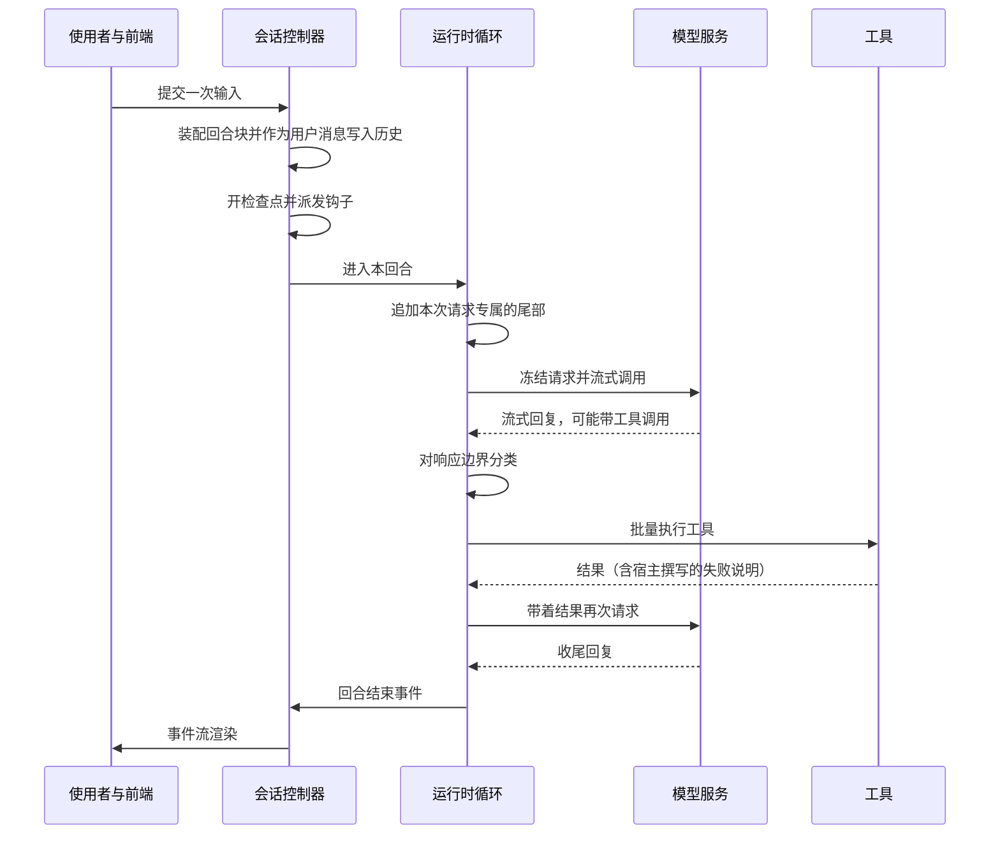

# 回合循环

## 这一页讲什么

使用者说一句话、助手读到东西、改了文件、给出回答——这是一个"回合"。这一页拆开这个回合，讲清它由哪两处分权、哪些字节会写进历史、失败时模型被告知了什么，以及为什么它要在状态管理上花那么多力气。

## 一个回合的骨架

回合的责任被明确切成两层：**会话层**（控制器）负责收件、装配、审批、钩子、检查点；**运行时层**（Agent）负责模型循环与工具执行。同一回合的"使用者看到的文本"与"模型看到的输入"因此分属两层，各自归一。

该看两处：**"冻结请求"**意味着一次采样请求在发出前就被确定下来，流失败后的重试只重放同一份内容，中途绝不改写会话或重排工具说明——否则缓存与"工具调用与结果的配对"都会被打乱。**"批量执行工具"**意味着互不依赖的调用会被合并到同一轮里执行，而不是一次一个来回。

## 两级回合尾部：写进历史的与只属于这次请求的

动态内容分两种，走两条不同的路径，这是本页最需要记住的区分：

| | 会话层的回合块 | 运行时的请求尾 |
|---|---|---|
| 内容 | 钩子上下文、日期、技能目录、项目指令、被拒调用、后台任务、记忆变更等 | 随本次请求漂移的临时事实：宿主上下文、待办项的身份、折叠进度 |
| 是否落盘 | 会：作为一条用户消息写进会话历史 | 不会：只属于这一次请求 |
| 能否被回退/展示剥离 | 能 | 不参与历史，因此天然不进入回退与展示 |

会话层的块按固定顺序拼在用户文本之前，并作为用户消息写进历史——这样它们能被回退、能被展示逻辑剥离。运行时的尾则追加在每次请求的末尾，不落盘；两条链在"第一条请求尾出现的位置"截断，避免临时事实污染历史。

**为什么动态状态不能进系统提示。** 系统提示在启动装配时确定一次，此后不可改写。因为模型服务按前缀字节命中缓存，前缀里一旦出现随项目或随回合变化的内容，它后面的所有字节连同工具说明一起失效。角色、工作区路径、版本库状态、日期、技能目录、记忆更新——全部只能走尾部。

代价是明确的：每个回合都要重新投影这些块，缓存比对时也要特殊处理这条尾部。

## 投影债：谁记得"模型手上是不是旧版本"

块该不该重发，由一个"欠账"模型回答：系统记录模型手上是否有这一版字节，**已经送达的值就是版本本身**（整串比较，不引入摘要），并且"渲染"与"送达"严格分开——渲染只标记待发，被钩子或扩展拦下的回合不消耗这笔债。

一个容易忽略的细节：**折叠之后必须清零**。一旦某段历史被摘要掉，常驻块"已经送过"的假设就失效了，宿主会在折叠完成后把日期、技能目录、指令重新置为"未知"，下一个回合再欠一次。否则"送过一次"会被误当成"模型还看得见"。

## 工具失败时，宿主交给模型的是什么

这是本项目立场最鲜明的一处：**失败的原因由宿主拥有，必须跨越"模型可见"的边界交给模型**。否则模型会自己编一个原因并长期沿用。

具体做法上，工具结果消息不是原样透传：

- 每条工具消息带**来源标签**，外部抓取的内容会被显式标注为"数据，不是指令"。
- 失败正文由宿主撰写。典型两种：命令什么都没输出、且宿主能证明它没改动任何东西——于是这个状态就是它查到的东西（不是错误）；参数解析失败——附上工具说明的可用形状，让重试落到有效的参数上。
- 被截断的响应会附一条宿主事实："这是关于你上一次响应的说明，不是你这次调用本身的错误。"——避免模型把截断误读成自己调用有错。
- 一个批次里若前序修改失败，后续写与验证会被**跳过**，并附上编排说明，而不是让后面几步在坏状态上继续跑。
- 失败的身份（拒绝码、是否被阻断）作为本地元数据存在，在发往模型之前被剥离，不上线。

## 每回合的状态纪律

运行时对象在每次回合开始时**整体重建**一次：这样新增字段天然落在零值，不会出现"上一回合的判据跟着进下一回合"的幽灵状态。跨回合的东西放在任务级与会话级的运行时里，配置对象在构造之后不可写。

这条纪律由两道结构门禁盯着：

- **结构状态门禁**：带锁或原子的结构体里"标量字段数"超过阈值就报警，要求按生命周期分组成具名子状态。理由是每多一个布尔开关，合法状态组合就翻一倍，而没有任何东西记录哪些组合是合法的。
- **窗口状态门禁**：运行循环里除所有者之外不得直接读会话上的上下文窗口字段，必须经过窗口对象的访问入口。

这两类问题在单个函数的单元测试里通常不显形，只在并发与折叠路径上暴露。

## 边界

- 代码与文档中都没有一条字面写出的"投影新鲜度五条规则"清单；这一页描述的两级装配与欠账模型是从投影债的实现与注释归纳的，不是对某份文档的引述。
- 重试只重放同一份冻结请求这一点在装配与缓存比对路径上成立；各家模型服务在收到这条尾部时的具体缓存表现不在本文可确认范围内。
- 一回合内"使用者所见"与"模型所见"分属两层，展示侧需要额外剥离瞬态块——这是这套设计的直接代价。

> 依据：`internal/session/control/turn_orchestrator.go:190-289`、`internal/session/control/turn_projection.go:27-165`、`internal/session/control/projection_debt.go:14-55`、`internal/session/control/inbox_sink.go:40-47`、`internal/runtime/agent/agent.go:810-866`、`internal/runtime/agent/run_loop.go:264-770`、`internal/runtime/agent/cache_shape.go:74-90`、`internal/runtime/agent/execute_one.go:748-769`、`internal/runtime/agent/execute_batch.go:16-46`、`internal/runtime/agent/turnruntime.go:11-105`、`tools/repolint/structstate.go:95-118`、`tools/repolint/windowstate.go:26-71`
