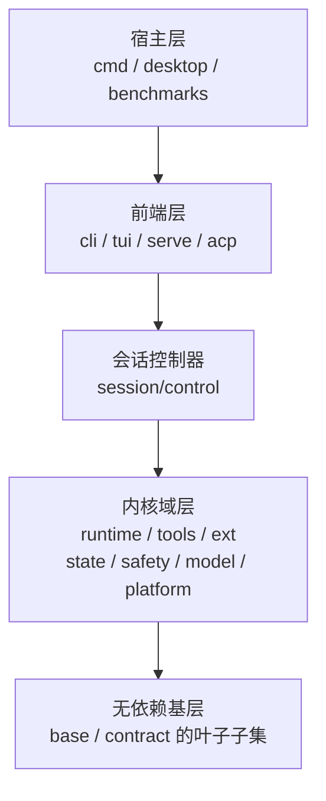
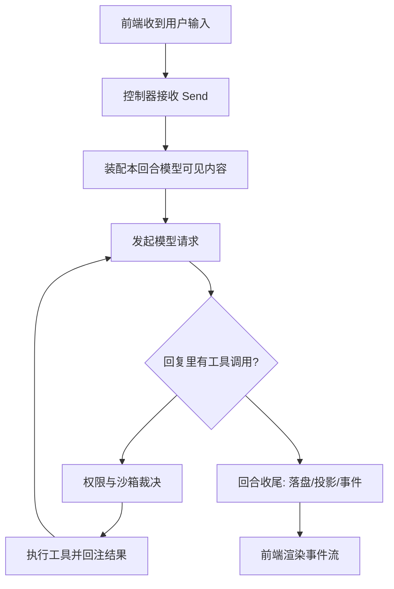

# 系统架构

## 整体形态

Reasonix 是一棵**严格单向依赖**的软件树：宿主进程在最上面，前端在它下面，再往下是一个传输无关的会话控制器，最后是真正干活的内核各域与无依赖的基层。任何一层都不能反向依赖它的上层——这条规矩不是靠约定，而是由代码检查强制执行。

下面这张图只讲一件事：依赖只能自上而下。读它时注意中间那个"会话控制器"是整棵树的腰——所有前端都必须经过它，而它不认识任何前端。

## 分层与职责

| 层 | 负责什么 | 明确不负责什么 |
|----|---------|---------------|
| 宿主层（`cmd/`、`desktop/`、`benchmarks/`） | 组装整个系统并运行它；承载操作系统能力（窗口、托盘、签名、更新） | 不实现业务状态；桌面外壳不持有会话真相 |
| 前端层（`internal/frontend/`） | 把控制器发来的事件渲染成人能看的界面，把人的操作翻译成控制器命令 | 不实现回合生命周期、取消、审批——这些在控制器里 |
| 会话控制器（`internal/session/control/`） | 拥有 Agent 运行循环与会话生命周期；接收命令、发出事件流 | 不依赖任何前端；不自己执行工具 |
| 内核域层 | 上下文、工具、扩展、状态、安全、模型、平台能力各自一块 | 不反向依赖控制器或前端 |
| 无依赖基层（`internal/base/`、部分 `internal/contract/`） | 纯工具与类型：diff、文件锁、shell 语法树、token 计数、密钥处理 | 不携带任何内核知识，可被任意层引用 |

这条分层规则的可执行版本写在一个检查工具里，声明了"哪些包算前端""哪些包算叶子"。它的四条禁令分别是：叶子包不得引用非叶子；控制器只能被前端与入口引用；内核不得引用前端；宿主适配器只能由宿主组装。任何一条被违反，构建门禁就会失败。

## 模块地图

这张表是理解后续各页的索引：后面每个主题页都对应其中一块。

| 目录 | 职责 | 关键概念 |
|------|------|---------|
| `internal/session/control/` | 唯一的传输无关会话驱动 | 命令、事件流、回合准入、审批编排、检查点编排 |
| `internal/runtime/` | Agent 循环与各类运行时策略 | 回合运行时状态、委派、计划器、守护者、能力路由、恢复、写声明 |
| `internal/contract/` | 契约与类型层 | 工具契约、Provider 契约、事件、配置、权限规则、计费 |
| `internal/tools/` | 内置工具实现 | 文件读写编辑、shell 执行、后台任务、脚本、会话工具、建议器 |
| `internal/ext/` | 扩展体系 | MCP 客户端、Extension Protocol、插件包、Skill、钩子、斜杠命令、市场、主题 |
| `internal/state/` | 状态与持久化 | 会话存储、检查点、记忆、指令、投影库、历史、轨迹、用量 |
| `internal/safety/` | 安全边界 | 权限策略、沙箱、出网控制、命令安全、证据与可信状态 |
| `internal/model/` | 模型接入 | OpenAI 兼容、Anthropic 兼容、Provider 代理、目录、计费、多模态 |
| `internal/platform/` | 平台能力 | 远端工作区、浏览器、桌面控制、语言服务器、更新、安装布局、git 集成 |
| `internal/frontend/` | 四个前端与诊断前端 | 终端、Web 服务、ACP、能力诊断、医生、远程宿主适配器 |
| `internal/assembly/boot/` | 装配 | 读取配置、解析模型、组装工具与扩展、产出控制器 |
| `desktop/` | Studio 桌面端（独立 Go module） | Electron 外壳、React 界面、更新助手、打包 |

## 一次用户请求的主链路

用户按下回车之后，请求会依次穿过下面这些环节。注意两个特点：控制器把所有"发生了什么"变成类型化事件流，而不是让前端去猜；工具调用不是直接执行，而是先经过权限与沙箱裁决。

装配阶段是整条链路里最讲究的一步：系统提示前缀必须跨轮逐字节不变（否则模型服务的前缀缓存失效、成本与延迟都会变差），而技能目录、记忆、运行时事实这些会变的东西只能"骑"在回合尾部。这一约束的细节见 [context-memory.md](context-memory.md)，回合内部各阶段见 [agent-loop.md](agent-loop.md)。

## 关键设计取舍

**单点控制器取代"N 个前端各写一遍"。** 会话驱动被刻意做成不依赖传输层的一个对象，终端、Web 服务、桌面共用它。代价是这个对象成为最重的模块（仓库里最大的前端与最大的单一职责包都与它相邻），但它换来的是"新前端不需要重写回合生命周期与审批"。

**装配只发生在少数地方。** 把配置、模型、工具、扩展拼装成一个可运行控制器，是少数几个被允许"俯视全部依赖"的位置之一（装配包与宿主）。这避免了每个前端各拼一套依赖图。

**桌面端不做进程内直连。** Studio 的界面与内核之间隔着一层本地 HTTP 与事件流：界面发出的每个业务请求都打到内核自己的本地服务上。代价是多一次本机往返；换来的是桌面、本机浏览器、远端界面走完全相同的路由。外壳只提供操作系统能力，不持有业务状态。

**分层用检查工具固定，而不是写在文档里。** 见 [engineering.md](engineering.md)：分层声明是一份可执行清单，违反即构建失败。

**无依赖基层要保持"闭合"。** 工具类包之间可以互相引用，但谁都不能引用内核——这样一个叶子被任意层引用时不会拖进一整张依赖图。

> 依据：`internal/session/control/controller.go:1-11`、`internal/assembly/boot/runtime.go:100-123`、`tools/repolint/layers.go:11-107`、`REASONIX.md:9-24`、`desktop/README.md:1-52`
