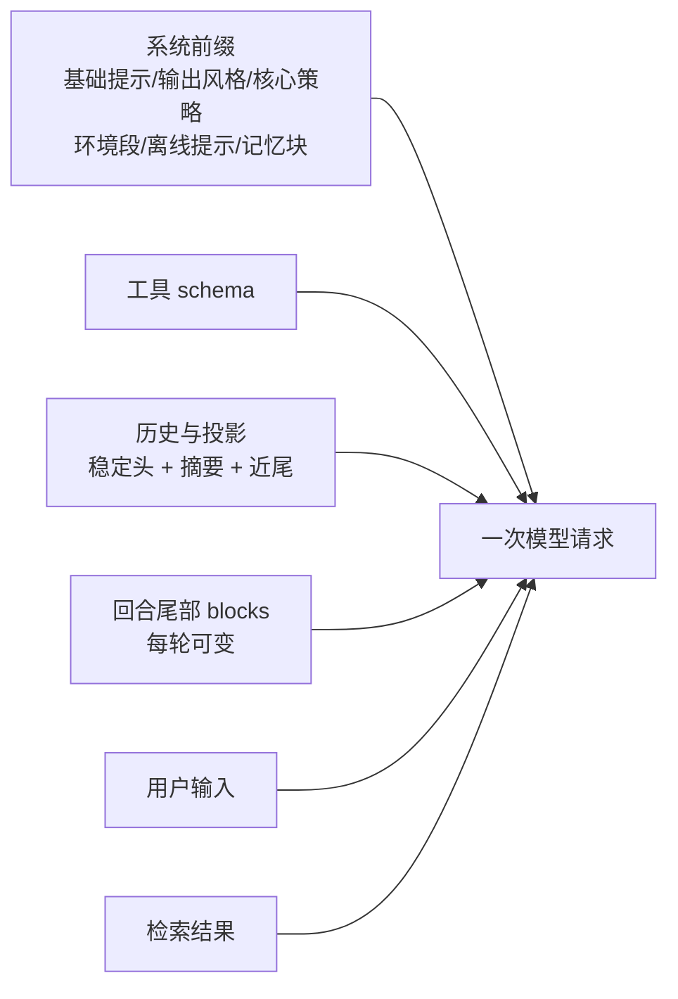
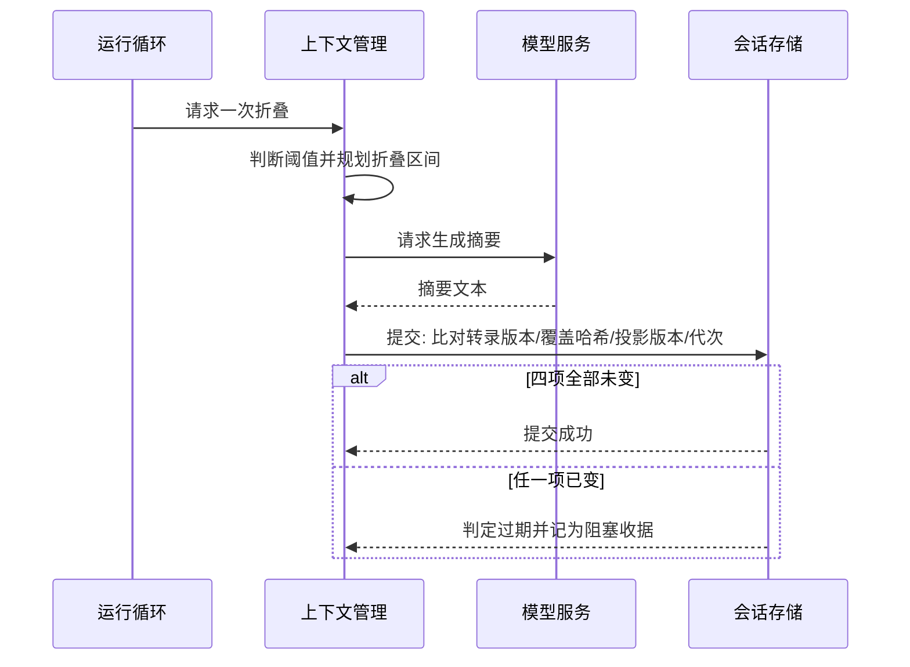

# 上下文与记忆

## 这一页要回答什么

编码助手每一轮都要把一大段内容发给模型：系统提示、工具说明、历史对话、当前任务。这些内容里，哪些能改、哪些改了会付出代价、由谁决定什么时候更新——这一页解释 Reasonix 的答案。它也是理解"为什么它要设计得这么绕"的关键：绕的地方几乎都来自同一个约束——**模型服务按前缀字节命中缓存，前缀一改，整段重算**。

## 一次请求由哪些字节组成

一次模型请求可以分成两半：**稳定半**（系统提示与工具说明）和**易变半**（历史、回合尾部、用户输入）。图中的箭头都在说"这些字节会出现在同一次请求里"，而两个标注框说明它们受不同规矩管。

稳定半是"只允许声明式配置改动"的部分：基础系统提示、输出风格、六条核心策略、启动时探测的环境摘要、离线提示，以及记忆中以"钉住"方式存在的那部分正文。工具说明（schema）虽然风格上不属于文本提示，但和系统提示一起被纳入同一个前缀指纹——它们共同决定缓存键。

**为什么必须逐字节稳定。** 模型服务的前缀缓存以字节为单位命中。前缀里任何一处改动，都会让这台机器上每个会话的这一轮从冷启动重新计费，之后的字节也随之作废。所以运行期间产生的任何新事实——技能目录变了、记忆写入了、今天是几号——都不能回头改前缀，只能挂到"回合尾部"。

环境摘要这一项值得单独说：它是启动时探测一次得到的快照（操作系统、shell、常见工具版本），而不是每轮重新探测。若每轮探测，探测结果的抖动会直接变成前缀抖动。

## 项目指令：分层、导入与快捷指令

项目指令是使用者写给助手的长期约定，Reasonix 按固定的层级去找，并且**同名规则只保留一份**。

| 来源 | 位置 | 说明 |
|------|------|------|
| 用户全局 | 记忆状态根目录下 | 对所有项目生效 |
| 祖先目录 | 从工作目录逐级向上 | 越靠近项目的目录越优先 |
| 项目根 | 工作区根目录 | 团队共享约定，通常进版本库 |
| 个人变体 | 对应位置的 `*.local.md` | 个人偏好，不进版本库 |

同一优先级下，约定的文件名按 `REASONIX.md`、`AGENTS.md`、`CLAUDE.md` 的顺序取第一个；正文按内容哈希去重，更具体的目录胜出；个人变体比同目录的共享文件优先一级。这样做的直接目的是省 token：一段指导只该在提示里出现一次。

指令文件里还有两类语法：

- **`@path` 导入**：单独一行写 `@` 加路径，把另一个文件的内容取进来。导入被限制在工作区或用户指令根之内，深度有限，且拒绝符号链接逃逸与循环导入。
- **快捷指令**：在对话里以 `#` 开头写一句，把它追加成一条始终生效的指令，写进指令文件后随回合尾部生效。

## 记忆：钉住进前缀，其余靠检索

助手可以主动记下"可出错的背景事实"，存在专门的记忆库里。记忆有三个互相独立的维度：

| 维度 | 取值 | 作用 |
|------|------|------|
| 类型 | 用户偏好 / 反馈 / 项目 / 参考资料 | 给内容分类 |
| 作用域 | 本项目 / 全局 | 决定这条事实在哪些项目可见 |
| 激活方式 | 钉住 / 按需检索 | 决定它是否每次都进前缀 |

每条记忆落成一个带元信息头的文件，同时刷新一份索引文件。**索引只写盘，不进提示**——如果索引进前缀，那么每写一条记忆都会让其后所有字节重发。取回记忆靠一个专门的工具，模型需要时才去问。

钉住是唯一被允许"付一次冷启动"的例外：使用者明确要求某条事实始终在场，就接受它改动前缀的代价。钉住的正文有独立预算，不能无限增长。

这里也有一个和项目文档不一致的地方值得指出：项目文档里能读到"上下文引擎（Context Engine）"这样的说法，但源码里并不存在这样命名的独立模块，相关能力分散在指令解析、记忆库与上下文管理三处。

## 上下文窗口：什么时候折叠，为什么折叠是一次事务

对话变长后必须压缩。Reasonix 的自动压缩只有一条路径——**摘要折叠**——并且它只在一个条件下触发：估算输入超过了"窗口的 85%"与"使用者配置的经济上限"中先到的那个。

早期版本还会对工具输出做逐轮的裁剪与清理，后来被移出自动路径：逐轮改写历史会让上下文投影反复重写，缓存收益被吃掉。现在裁剪只剩两种用途——工具结果第一次可见时的截断，以及喂给摘要器时使用的临时副本。

折叠本身不是"就地改写历史"，而是一次带校验的提交。原因是摘要生成是一次网络调用，期间会话历史可能已经变化；如果不比对，就会把针对旧历史的摘要装到新历史上，造成内存与磁盘分叉。

该看的是那个 `alt`：**四项全部未变才提交**（会话转录版本、被覆盖内容的哈希、投影版本、运行时代次）。任一项变了就判定过期，并且这个失败会被记成一条明确的"阻塞收据"，而不是悄悄重试——使用者能在收据里看到本轮为什么没有折叠。

## 回合尾部与新鲜度：欠账模型

前缀之外的可变内容集中在"回合尾部"：钩子上下文、当前日期、可用技能目录、项目指令块、MCP 提示失败、被拒绝的调用、后台任务状态、记忆变更、语言选择、计划模式标记、当前目标等。它们每轮重新渲染，顺序按"越靠近用户输入越具体"排列，检索到的记忆片段单独放在用户文本之后。

那么"什么时候该重新渲染"由谁决定？答案是**欠账模型**：系统比较"模型手上持有的版本"与"现在会渲染出的版本"，不相等就算欠一次，下一轮补上；渲染只标记待发，真正随请求发出去之后才算结清；会话切换或折叠时清零。

这个模型特意不依赖"写入者通知我"。技能目录这类值由拥有者**每轮直接去问注册表**，指令块每轮从磁盘重新发现——即使某次写入忘了广播，模型也不会一直拿着旧目录。代价是每轮多一次比较或读取，换来的是"新鲜度不靠人记得"。

## 一个诚实的边界

上下文估算用的不是模型真正的分词器，而是按字符脚本近似的计数器（ASCII 大致每 4 字节 1 个 token，非 ASCII 每字符 1 个）。它只需要为"是否触发折叠"提供一个跨调用一致的答案，不追求精确计费。真正的用量以模型服务返回的计量为准。上下文窗口的大小取自 provider 声明，或在未声明时通过"被拒绝的最小请求 / 被接受的最大请求"探测出的边界来估计。

> 依据：`internal/assembly/boot/prompt.go:20-42`、`internal/assembly/boot/prompt_policy.go:5-22`、`internal/state/instruction/resolver.go:130-141`、`internal/state/instruction/resolver.go:217-281`、`internal/state/memory/activation.go:12-44`、`internal/state/memory/store.go:39-77`、`internal/session/control/turn_projection.go:47-70`、`internal/session/control/projection_debt.go:11-55`、`internal/session/control/skill.go:52-71`、`internal/runtime/agent/compact.go:24-42`、`internal/runtime/agent/compact_commit.go:28-56`、`internal/runtime/agent/prune.go:14-50`、`internal/runtime/agent/cache_shape.go:20-49`、`internal/base/tokencount/tokencount.go:14-25`
