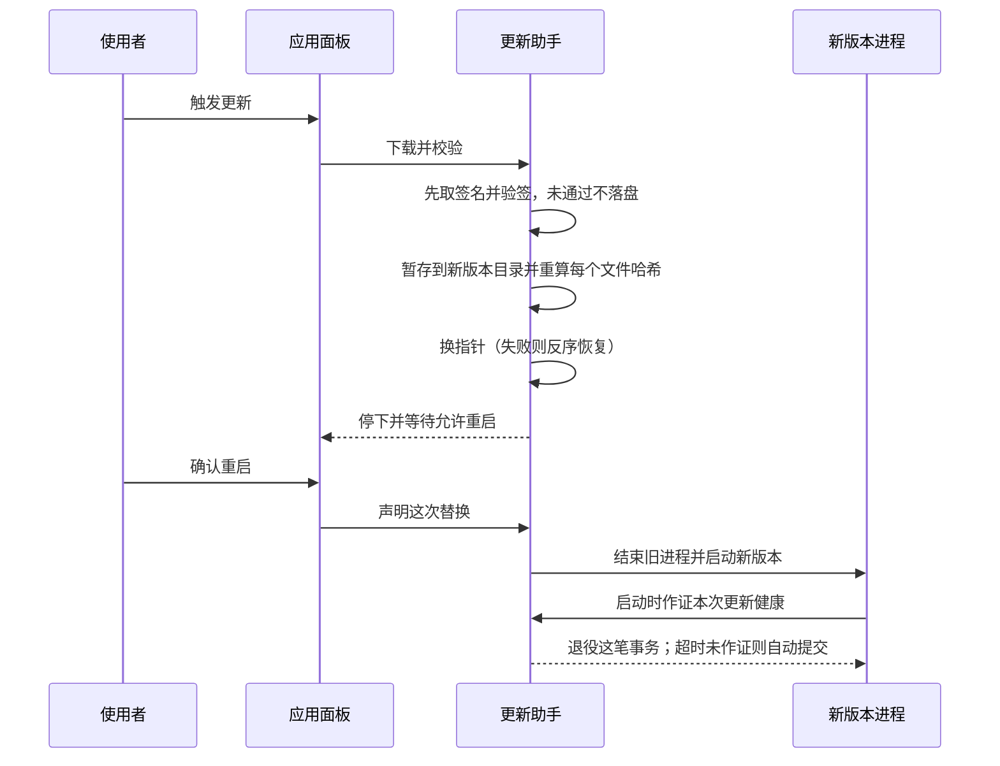

# 构建与交付

## 这一页讲什么

使用者拿到的 Reasonix 是两种东西：桌面安装包，和命令行归档（或经由 npm / Homebrew 安装的二进制）。这一页讲它们怎么被构建出来、怎么被验证、装到本机之后怎么更新，以及**仓库里哪些文件已经不再适用**。

## 两条发布线

| 版本线 | 分支 | 标签 | 交付物 |
|--------|------|------|--------|
| 2.x（本文档描述的对象） | `studio` | `studio-v*` | Studio 安装包（macOS / Windows / Linux）与 CLI 归档 |
| 1.x | `main-v2` | `desktop-v*`、`npm-v*`、`v*` | 1.x 桌面应用与 npm / Homebrew 上的稳定 CLI |

两条线的标签命名空间是分开的，发布流水线在解析标签时会校验被构建的提交**必须位于 `studio` 分支的历史中**。这条检查挡的是一个具体的错误：拿另一条线的提交打上 2.x 标签，会产出一个"没有 Studio 的 Studio 版本"。

2.x 线还带一层开关：CLI 是否经由 npm 与 Homebrew 发布，由仓库级变量控制，默认不发布。理由是两条线同时写同一个分发渠道会互相覆盖。

## 构建恒等式：为什么一个流水线能出六个平台

**`CGO_ENABLED=0` 是整个项目的硬约束**，它在多处被显式钉死，而不是靠某一处的默认行为：

| 位置 | 用途 |
|------|------|
| 本地构建目标 | 产出 CLI 与插件示例二进制 |
| 交叉编译目标 | 一次产出六个平台组合 |
| lint 工具安装 | 避免 PATH 上的 clang 影响工具链 |
| 发布流水线的 CLI 归档步骤 | 发布产物同样关闭 CGO |
| npm 打包脚本 | 六个平台的子包构建 |
| 文档嵌入校验脚本 | 保持与构建一致 |
| 嵌套模块的构建 | 单独交叉编译桌面 host 以证明其与平台无关 |

可行的前提是依赖里没有需要 C 的部分——会话索引用的 SQLite 是纯 Go 实现，正是为了让这条承诺成立。

**版本身份靠链接期注入**，而不是写在源码里：版本、提交短哈希、构建时间由构建参数写入，文档内容还额外注入说明它对应哪个版本与修订。这意味着**本地 `make build` 的产物与发布产物并不等同**——本地构建不注入其中的一部分，用本地产物复现线上问题会失真。

**两个嵌套模块的边界效果是"根模块看不见它们"**：桌面端与 Go SDK 各自是一个模块，根模块的构建与测试默认不进入它们，所以测试目标必须分别分派。这里也有一处需要注意的偏差：嵌套模块的注释把理由写成"CGO 隔离"，但该目录下并没有任何需要 CGO 的源码，可核实的实际效果只是模块边界。

## 安装渠道

| 渠道 | 形态 | 要点 |
|------|------|------|
| Studio | 平台安装包 | macOS 提供 `.dmg`/`.zip`，Windows 提供安装器与便携包，Linux 用 `.deb`（这是它能自更新的形式） |
| CLI 归档 | 六个平台组合的压缩包 | 发布页附带校验和与签名文件 |
| npm | 主包加六个平台子包 | **不含下载脚本**：二进制直接打进子包，启动器只做定位与转发；主包与六个子包必须同版本齐发，漏一个就是"装上即失败" |
| Homebrew | macOS 脚本渲染的 cask | 带"不回退到更旧版本"的守卫 |

CLI 还有一条自更新路径，但它有明确边界：它只校验同一发布内的校验和、**不验签**；并且当自身由 npm 或 Homebrew 安装时，直接拒绝自我替换。

## 签名与信任根

项目里有两套签名机制，强度并不相同：

| 机制 | 用在哪 | 客户端怎么验 |
|------|--------|-------------|
| minisign | Studio 的更新产物与增量索引 | 公钥以常量形式编译进客户端；私钥只存在于 CI 密钥中 |
| Windows 代码签名 | Windows 安装包与可执行文件 | 由 CI 里的证书步骤提供，签名契约文件限定"哪些流水线可以碰证书" |

Studio 的签名在 CI 里签完之后会**当场自校验一遍**（包括增量索引文件），不通过就不会发布。Windows 的证书步骤则先校验签名工具安装包自身的哈希与发布者，再用它签名。

## 更新事务与回滚

Studio 的更新被刻意做成一笔"要么完整落地、要么不动现有版本"的事务。原子性来自两点：**最后一步才换指针**，以及**备份与暂存必须同卷**（这样才能用重命名完成切换）。

该看的是最后一格：**健康确认由下一次启动作证，而不是由执行替换的进程自己评价**。只有新启动的进程能退役这笔事务；超过时限没有确认的会被自动提交，而如果下次启动仍在跑旧版本，就会被判为一次"未落地"的失败，并按记录回滚。

## 会误导人的遗留物

以下内容在当前工作树里**已经不是有效的说明**，读代码时容易被带偏：

- 顶层的 GoReleaser 配置文件在本线**没有任何调用者**（它服务的是另一条线的发布）。
- npm 打包脚本的注释指向一个只存在于另一条线的发布工作流。
- 签名相关目录的名字来自一个已退役的签名服务；实际签名由 CI 里的证书步骤完成。
- 嵌套模块与 CI 里各有一处关于"CGO 模块"的说法，与该目录的实际源码不符。
- CI 里存在两处字面写死的 lint 工具版本，与专门的版本文件并存，有漂移风险。

## 边界

- 本文不评估发布产物的下载量、更新成功率或安装包体积，这些在源码中无法确认。
- 分发渠道的当前开关状态（CLI 是否已归 2.x 线）取决于仓库级变量，源码只体现门控逻辑，不体现变量的当前取值。
- 增量更新在本地已有内容块占比不足时会退回整包，这是设计中的回退，不是异常。

> 依据：`Makefile:14-16`、`Makefile:87-110`、`npm/build.mjs:11-64`、`npm/reasonix/bin/reasonix.js:4-19`、`desktop/go.mod:1-10`、`internal/platform/update/verify.go:20-27`、`internal/platform/update/download.go:90-124`、`internal/platform/update/tree_handoff.go:73-143`、`internal/platform/appupdate/install.go:145-179`
