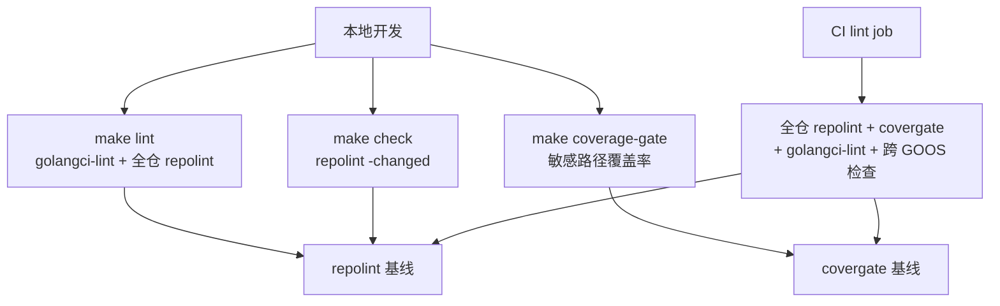

# 工程门禁

## 为什么这一页值得单独讲

多数项目会写一份"架构规范"文档，然后靠评审记性维持。Reasonix 的做法相反：**凡是能机械判定的规矩，都写成一个可运行的检查**，并给它一个稳定的规则名。跑一次检查就知道有没有违反，不需要讨论措辞。

这一页讲三件事：这些检查跑在哪里、它们分别拦什么、以及项目自己承认的盲区在哪里。对选型者来说，这一页能回答一个更实际的问题——"这个项目的架构承诺，靠什么不烂掉"。

## 门禁跑在哪里

检查分成两个运行面：本地开发用的快口径，和 CI 用的全口径。它们在很多时候跑同一批规则，但"看多大范围"不同。

| 命令 | 做什么 | 口径要点 |
|------|--------|---------|
| `make lint` | 固定版本的 `golangci-lint` 加全仓规则检查 | 与 CI 用同一个版本号，避免"本地绿、CI 红" |
| `make check` | 只对**本工作树改动过**的文件跑规则 | "改动"是已改动、已暂存与未跟踪文件的并集，而不是 `git diff` |
| `make coverage-gate` | 对项目声明的敏感路径跑测试并核对覆盖率下限 | 只跑这些包，因此比 `make lint` 重，独立成目标 |
| `make pricecheck` | 联网核对厂商价目表 | 刻意不进 CI：读不到页面本身就是失败，不能被当作"通过" |

## 检查分别拦什么

| 规则 | 拦什么 | 为什么值得做成检查 |
|------|--------|------------------|
| 分层与层序 | 低层引用高层、工具层引用内核、内核引用会话控制器 | 依赖方向一旦错乱，重构成本随规模指数上升 |
| 结构状态 | 带锁或原子的类型里"标量字段数"超过阈值 | 防止用一个 `bool` 修边界问题——每加一个开关，合法状态数量翻倍 |
| 窗口状态 | 除上下文窗口模块外直接读会话窗口字段 | 所有权唯一，避免多处各算一份 |
| 跨语言镜像 | Go 类型与桌面端**手写**的同名接口双向对账 | 两边由不同工具链编译、只通过 JSON 相遇，谁多一个字段都没人发现 |
| 前端一致性 | 某个前端已具备的能力，其它前端是否也真的接线了 | 防止"给控制器加行为、所有前端继承"变成一句口号 |
| 错误身份 | 禁止用文本匹配判断错误类型 | 只有出错的人知道是超时还是连接断开；文本会被改写、翻译、漂移 |
| 拒绝路径 | 服务端错误必须带机器可读的码，不能只丢一句文本 | 调用方需要能分辨领域错误、内部错误与依赖错误 |
| 注释与文件规模 | 注释分级预算、文件行数上限、注释掉的代码、章节横幅 | 见下节：这些预算用**棘轮**记账 |
| 孤儿与闲置面 | 无人调用的能力、构建产物、代码归属、文档规范 | 保持树里没有"看起来还在用"的死面 |

分层与层序是两条互补规则：**层序**规定 `internal/` 下每个目录是一个"层"，包只能引用同层或更低的层（目录即声明，搬动目录就是改依赖权限）；**分层**再补三条白名单——工具层不得上引、会话控制器只能从前端与入口到达、前端与宿主适配器只能由更上层导入。

## 记账方式：只许收紧的棘轮

规则发现了问题，不一定立即失败——项目允许**已记录的历史欠账**存在，但只允许它变小。

| 机制 | 语义 |
|------|------|
| 全仓上限 + 单文件预算 | 两层账本；某文件可以因为整体总量而超限 |
| 权重等于超出量 | 违规的"价值"是超出的差额，而不是条数，因此"用一条长违规换一条短违规"照样触发 |
| 只许收紧 | 收紧（含把上限写得更低）不需要仪式；任何抬升都必须显式声明，并先列出被抬升的具体项 |
| 闲置预算会被报出 | 干净运行时会提示"有多少预算已不再使用"，只有主动回收才会腾出空间 |
| 覆盖率版同理 | 敏感路径的覆盖率下限只能提高；降低需要显式声明并给理由 |

这套记账方式有一个明确的不对称：**降低门槛无需解释，提高门槛必须解释**。这正好对应审查时真正需要人看的东西。

## 豁免表：一张可被推翻的欠条

不可能所有例外都当场修掉，所以项目允许"经过审查的例外"，但要求例外是一张**可被审查的欠条**，而不是消失在代码里：

- 每条例外必须写清**涉及哪个能力、哪个包、关联哪个问题单、理由是什么**；四段缺一即被判定为格式错误，而不是当成一条欠债。
- 例外的代价与被免除的那条边**等价计费**，因此这张表不会变成"欠债消失的地方"。
- 判断逻辑**从不读理由文本**——理由是给人看的，机器只认结构。
- 判断"某个前端是否驱动了某个能力"时，读的是类型系统的真实方法集，而不是名字匹配。因为像 `Close`、`Status` 这类名字既是业务能力也是标准库方法，按名字匹配会把标准库方法误记成"已接线"。

## 判断读结构，不读措辞

这条纪律在本项目里有四处落点，也是理解很多设计取舍的钥匙：

- **错误用身份而不是句子。** Go 内部靠可比较的哨兵错误，跨 HTTP 靠带点的错误码。
- **拒绝路径带码。** 服务端不允许只返回一句文本错误。
- **命令安全读语法树。** shell 命令被解析成参数序列并按结构分类，而不是匹配某几个危险字符串。
- **命令解释不靠短语表。** 项目明确记录：依赖措辞的判定会在真实输入上误判，而一个会误判的门禁比没有门禁更糟——因此这类判定被成批删除。

## 效果测试：把断言搬到最终边界

普通的单元测试问"这个组件返回了什么"；效果测试问"**真正到达模型服务的字节是什么**"。项目把这类测试放在装配层，断言的对象是最终边界上的产物：工具说明在不同配置档下是否一致、系统提示里是否混进了本机路径、被截断的工具输出能否按引用读回、配置的花费上限是否真的拦住了跑飞的回合。

这条规矩的理由很直接：**每个组件各自正确，不等于系统整体生效**——一个特性可能在线路上并不存在。所以性能与行为相关的特性必须带一个到最终边界的效果测试。

## 门禁自己的盲区

这是本页最值得记住的部分：项目把自己的盲区写进了测试注释，而不是留白。

- **注册表未必覆盖全部规则。** 规则清单里列了 28 条，但仓库里存在一条已实现、却未进入清单的规则；没有任何测试校验"清单覆盖所有规则"。
- **看错名字的风险被记录为具体形态。** 前端一致性判定按方法而非用户可见能力；无人驱动的能力整行退出不算失败——测试注释直接给出了这类"孤儿"的当前数量级。
- **窗口状态规则只扫运行循环的顶层文件。** 子目录、以及经由接口的间接读取都不在其视野内。
- **跨语言镜像只做单向读取对账。** 它检查"读方声明的名字必须被写方真的发出"，跨文件或嵌入的声明需要另外登记。
- **没有任何检查读前缀字节。** "前缀必须逐字节稳定"由效果测试与评审持有，而不是由一条静态规则持有。

把这些写出来不是自我否定，而是把"这条门禁能保证什么、不能保证什么"变成读者可以核对的陈述。

> 依据：`tools/repolint/main.go:51-69`、`tools/repolint/baseline.go:116-163`、`tools/repolint/layers.go:79-108`、`tools/repolint/layer_order.go:19-35`、`tools/repolint/structstate.go:13-28`、`tools/repolint/frontendparity.go:33-45`、`tools/repolint/frontendparity_test.go:242-258`、`tools/repolint/wireparity.go:285-309`、`tools/repolint/errortext.go:12-20`、`tools/repolint/refusal.go:21-49`、`tools/repolint/comments.go:12-52`、`Makefile:31-74`、`tools/covergate/main.go:25-111`、`internal/assembly/boot/effect_test.go:1-19`、`internal/base/shellparse/bash.go:28-43`
