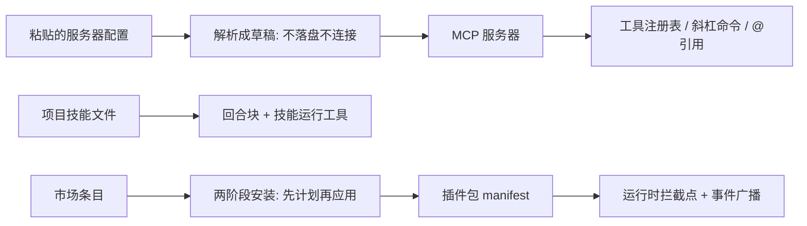

# 扩展体系

## 这一页讲什么

Reasonix 允许外部东西接进来：外部工具服务器、能拦截运行时行为的扩展进程、可分发的插件包、以及项目自带的技能说明。它们解决的不是同一类问题，接进内核的位置也不同。这一页把四条路径分开讲清楚，并指出各自的信任边界。

## 四条路径各自接在哪里

四条路径的定位差别：

| 路径 | 它是什么 | 接进内核的位置 | 信任级别 |
|------|---------|--------------|---------|
| MCP | 一套业界通用的工具服务器协议 | 工具注册表、斜杠命令、`@` 引用 | 与其它工具同等，但其进程默认以宿主权限运行 |
| 扩展协议 | 一个能被内核调用、也能拦截内核行为的 sidecar 进程 | 运行时拦截点与事件广播 | 只能由已安装且启用的插件包启动 |
| 插件包 | 可分发的安装单位，声明自己要用哪些能力 | 装配期的快照与替换槽 | 需显式安装与启用 |
| 技能 | 一份按需加载的说明文件 | 回合块与技能运行工具 | 与项目指令同级 |

## MCP：把标准协议适配进内核

MCP 客户端实现把外部服务器的工具包装成与内建工具**同构**的对象，所以模型看不到区别。它的几个设计点值得说明：

- **三种传输共用一套逻辑**：本地子进程、流式 HTTP、以及遗留的 HTTP 加服务器推送。协议修订上同时兼容两代：握手声明较新的版本，另外保留一条"免握手探测"的路径给不认新方法的旧服务器——每次启动旧服务器会先付一次探测等待，超时才回退。
- **三类能力各有落地面**：工具列表进注册表；提示词列表变成斜杠命令；资源列表变成 `@服务器:地址` 引用，取回正文前置到消息里，二进制附件只做标注不解码。后两条绕开了工具审批那条路径，相当于多开了两个输入通道。
- **命名空间由内核强制**：外部工具被强制成 `mcp__服务器__工具` 的形状，否则与内建名冲突。
- **进程模式默认是"宿主权限"**：本地子进程服务器默认不套命令沙箱。这是有意为之——有些服务器（例如能让助手操作真实浏览器的那些）必须触碰宿主资源；代价是装一个本地 MCP 服务器，就等于允许它以宿主权限运行。受限模式只保留给内部托管部署与测试，永不自动选中。

**粘贴配置只有解析，没有动作。** 项目提供一个"解析草稿"的入口：把使用者粘贴的三种形态（配置片段、命令行、URL）统一成草稿并列出风险，**既不落盘也不连接**。同意权完全交给界面，明文凭据只报风险、不阻断。这意味着如果界面漏展示那几条风险，使用者就没有第二次机会。

**凭据在配置里是引用而不是字面量。** 配置支持从环境变量展开，未设置时展开成空串（避免把 `${TOKEN}` 这样的字面量送上网络）。所有展示面会先经过一层凭据投影。要清楚这层投影**是显示层行为，不是访问控制**——它拦不住扩展去读真实环境变量，只能防止截图、日志与缺陷报告泄露。原生 OAuth 只在客户端能完整接管授权流程时才启用；一旦使用者显式配置了凭据或认证头，就走原有的凭据管理路径，不去抢使用者的令牌管理。

## 扩展协议：带裁决的运行时插槽

扩展协议是一个能被内核调用、也能介入内核行为的独立进程，走严格的一问一答消息格式。它的核心是两个不同性质的方法：

| | 拦截 | 事件 |
|---|------|------|
| 性质 | 一次请求，**必须答复** | 一条通知，无需答复 |
| 可选的答复 | 继续 / 阻止 / 替换；权限类拦截点另可允许或拒绝 | 无 |
| 队列 | 阻塞等待，有超时 | 非阻塞有界队列，**满了就丢弃**，只警告一次 |
| 可靠性 | 按声明的必需或可选决定失败后果 | 不保证送达 |

第三行是理解它用途的关键：**事件这条路不保证送达，所以观察者不能把它当审计或事实来源**。而拦截这条路能真正改变行为，因此它带着"必需就失败、可选就跳过并警告"的错误策略。

扩展对内核行为的接入点分成三类规则：

- **钩子与拦截器永不冲突**——多个扩展可以在同一个位置各做一件事。
- **被遮蔽的种类按层级决出唯一赢家**，同层级不同来源默认直接失败。
- **替换槽只能有一个所有者**——替换系统提示、上下文、请求内容、某个工具或某个模型接入点，都属于"直接替换运行时行为"，第二个占位者会让构建失败，而不是留下一个影子赢家。

一个值得注意的授权设计：**这类运行时扩展只能由"已安装且启用的插件包"启动，项目配置永远无权声明它**。扩展在握手时声明自己要拦截哪些点、替换哪些槽，必须是它 manifest 里已声明的子集；sidecar 继承未经过滤的宿主环境，属于全权契约。授权是被做成"构造上不可能"的，而不是靠运行时检查。代价是项目配置仍然可以声明 MCP 服务器、钩子与技能，这条信任边界需要几个包各写各的检查来维持。

## 插件包：可安装、可审查、可回滚

插件包是分发单位，安装来源包括本地目录、URL、服务器配置片段、包管理器名称，以及兼容的第三方市场目录。

- **manifest 只认精确的接口版本**，不接受"兼容某个范围"。版本不符直接拒绝，没有迁移窗口。
- **安装是两阶段**：先出一份计划（要装什么、会影响什么），应用阶段必须回显计划标识符。这个设计挡的是"计划之后内容被换掉"。
- **市场是来源，不是信任根**。从市场安装得到的只是"从哪里拿"，不构成额外授权。

## 技能：按需加载与上下文预算的博弈

技能是一份被发现的说明文件，用来把某个专业方向的工作方式告诉助手。

| 方面 | 做法 |
|------|------|
| 发现 | 按约定目录与作用域优先级查找，项目级与用户级并存 |
| 声明 | 元信息可声明内联执行或子代理执行、允许使用的工具、是否只读、适用路径 |
| 清单压缩 | 清单有条数上限，超限只保留名字 |
| 注入 | **不进系统提示前缀**，而是作为回合块随回合下发 |

最后一条是它与项目指令共享的核心约束。技能目录每个项目都不同，如果放进缓存前缀，就会让模型服务的前缀缓存按项目分叉，直接损害命中率与定价。因此它走"回合块加投影债务"这条路：渲染不等于送达，只有真正跑完的回合才算结清，被钩子或扩展拦下的回合会把清单退回未送达状态。代价是模型可能有一轮看不到最新清单，靠欠账逻辑补发或撤回。

## 边界

- **项目文档提到的"v1 sidecar"在源码里不存在**：仓库只有当前这一代扩展协议，"v1"仅作为一个被明确拒绝的版本号出现在测试断言里。也没有独立的"凭据诊断"包，相关判定只在契约层的一处。
- **扩展协议没有兼容余地**：旧版本扩展一旦存在就无法加载，这是"版本不符即拒绝"的直接代价。
- **凭据投影不是安全边界**，见上文说明。
- **hook 是并行于扩展协议的另一套机制**，两者不要混为一谈：扩展协议是跨进程的运行时插槽，而钩子是内核内的可插拔检查点。
- 技能包的包注释仍描述"只有名字与描述进入系统提示词索引"，与实际的回合块注入不一致；本文以控制层代码为准。

> 依据：`internal/ext/plugin/plugin.go:1-6`、`internal/ext/plugin/plugin.go:34-58`、`internal/ext/plugin/prompts.go:36-54`、`internal/ext/mcpregistry/registry.go:274-347`、`internal/ext/mcpsetup/parse.go:28-56`、`internal/base/secrets/endpoint.go:13-49`、`internal/ext/extension/protocol/registry.go:12-41`、`internal/ext/extension/intercept.go:13-31`、`internal/ext/extension/dispatch/dispatch.go:206-290`、`internal/ext/extension/dispatch/dispatch.go:344-378`、`internal/ext/extension/sidecar/doc.go:1-25`、`internal/ext/extension/builder.go:274-293`、`internal/ext/pluginpkg/manifest_v2.go:16-21`、`internal/session/control/turn_projection.go:47-70`
