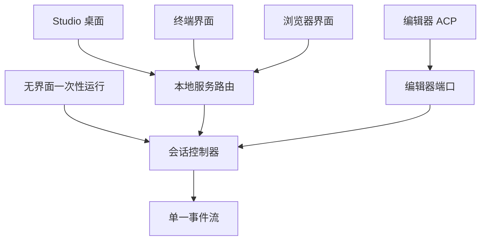

# 四种使用形态

## 这一页讲什么

同一个助手要出现在桌面应用、终端、浏览器和编辑器里。这一页讲它们**怎么共用一套内核**：控制器对外暴露什么样的接口、每个形态怎么驱动它、本地服务上挡着哪些门，以及编辑器那条协议为什么长得和别的形态不一样。

## 唯一的控制器与它的驱动端口

会话控制器对外不是"一个巨大的方法集合"，而是被切成若干**按能力分组的小接口**（端口），前端只声明自己真正要用的那几个。

| 端口类型 | 包含什么 | 谁用 |
|---------|---------|------|
| 完整端口 | 20 个子端口：生命周期、回合控制、审批、目录信任、计划决策、目标、会话历史、记忆、能力、状态、持久化、输入、设置、收件箱、来源归属、后台任务、本地命令、差异渲染、反馈、提交 | 需要驱动全部能力的形态 |
| 编辑器端口 | 只含生命周期、回合控制、审批、收件箱，加上斜杠命令与 MCP 表面等编辑器会展示的部分 | 编辑器接入 |

拆分的意义在"编辑器端口**没有**声明什么"：编辑器里不能编辑技能、不能改钩子、不能写沙箱规则、不能提交反馈——这些能力属于真正持有完整界面的形态。这样做的直接好处是一个前端不会因为引用控制器而顺手获得它不该有的能力。

正在驱动哪些端口这件事本身也被一条检查盯着：某个前端已经具备的能力、它的端口也声明了、却没有真的调用，就会被记为缺口。

## 四种形态怎么驱动同一个控制器

| 入口 | 形态 | 怎么驱动控制器 |
|------|------|--------------|
| `reasonix`（`tui` / `chat` / `code`） | 终端界面 | 进程内 HTTP 通道：不开端口，直接打本地服务的路由 |
| `reasonix web` | 浏览器界面 | 起本地服务并自动打开浏览器 |
| `reasonix serve` | 本机服务 | 单个服务器驱动一个会话；多工作区由中心节点分发 |
| `reasonix acp` | 编辑器接入 | 标准输入输出上的一条 JSON-RPC 连接 |
| `reasonix run "任务"` | 无界面 | 直接驱动一个回合，不需要界面 |
| Studio | 桌面应用 | Electron 外壳拉起本机 host，页面通过回环地址走同一批路由 |

一个值得注意的事实：**终端界面并不直接调用控制器**，而是经由本地服务的进程内通道。好处是所有形态共享同一套路由与事件流语义；代价是本地命令执行这类能力只对进程内请求开放——网络来源的请求不能触发它。

## 本地服务：路由、多道门与事件流

本地服务把控制器的命令暴露成小的 JSON 请求，把事件暴露成一条服务器推送流。它挡着多道彼此独立的门，每一道挡的是不同性质的威胁：

| 关卡 | 挡什么 |
|------|--------|
| 认证模式（无 / 令牌 / 密码） | 谁能登录 |
| 主机头校验 | 把请求指向本机回环之外的伪造 |
| 跨站请求防护 | 浏览器里的其他页面代替使用者发起的请求 |
| 变更闸门（启动令牌） | 即使认证关闭，任何非只读操作仍必须带令牌 |
| 仅本机 | 非本机来源的访问 |
| 回环闸门（Studio 自带） | 桌面面板与 host 之间的同源约束 |

最后一道值得强调：**"能连到这个端口"不等于"是操作者"**。所以认证关掉的时候，改文件、跑命令这类操作仍然要求一个随机生成的启动令牌；这个令牌不来自配置文件，而是每次启动现铸一个。

多工作区由一个中心节点处理：一次请求返回全部记忆中的工作区及其会话，新开工作区得到一个独立前缀下的运行时。同一个会话文件在任一时刻只有一个运行时持有写入租约，第二个面板打开同一会话时是只读的——要写就排队或让步。

事件流用带编号的帧推送，支持按需重放；重放预算用尽时会明确告诉客户端"这一帧不完整"，而不是假装流是连续的。

## ACP：编辑器为什么不一样

编辑器接入走的是 Agent Client Protocol（编辑器接入 AI 助手的通用约定），形态与其它三种有明显差别：

| 方面 | ACP 的做法 | 为什么 |
|------|-----------|--------|
| 传输 | 标准输入输出上的一条 JSON-RPC 连接 | 编辑器以子进程方式拉起助手，没有端口 |
| 握手 | 双方交换**能力**而不是版本号 | 版本号无法表达"我支持哪些具体行为" |
| 审批 | 作为**未完成请求里的反向请求**发回宿主 | 助手在等编辑器回答，不能另起一条通道 |
| 拒绝 | 传输失败、取消、拒绝一律判为"工具被拒"，把结果交回模型 | 回合不该因此挂住 |
| 输出 | 标准输出只能是协议流，诊断全部走标准错误 | 否则协议流会被日志污染 |

握手阶段助手会如实报告自己的能力边界：能列出与恢复会话、能接收图片与嵌入资源、但**不支持音频**，MCP 只支持较新的流式传输、不支持旧的 SSE 传输。编辑器则在握手时告诉助手它能否代理文件读写、是否有宿主终端。

## Studio 与终端和同一份协议的关系

Studio 的界面、Electron 外壳、内核 host 是三段：外壳只提供操作系统能力（窗口、菜单、托盘、打开器），业务请求全部由界面直接发给本机 host 的 HTTP 服务。host 启动时把回环地址与随机令牌通过标准输出的握手交给外壳，外壳校验令牌长度、地址必须是本机、端口必须真实存在。界面因此不知道自己在哪种外壳里运行——它只会向宿主端口索取操作系统能力。

代价是桌面端的界面与内核之间是**手写镜像的协议两端**：一侧是 Go 类型，另一侧是 TypeScript 声明。两者由不同工具链编译、只在 JSON 上相遇，所以项目用一条专门的双向对账检查盯住它。

## 边界

- 保存的接口注释有两处已过时：服务端包注释仍把自己描述成"并列的第二个前端"，端口文件仍写着"终端驱动全部子端口"。当前生产代码里终端是经本地服务的进程内通道驱动的，注释未同步。
- Studio 的界面走本机服务这一点在本地场景成立；远端主机与云端中继场景是否改走代理，本次未逐一确认。
- 事件流的重放有预算上限，超出的历史不会无限保留。

> 依据：`internal/session/control/port.go:24-52`、`internal/session/control/port.go:429-464`、`internal/frontend/cli/cli.go:90-163`、`internal/frontend/serve/routes.go:10-111`、`internal/frontend/serve/hub.go:537-577`、`internal/frontend/serve/launch_token.go:53-69`、`internal/frontend/serve/inprocess.go:48-53`、`internal/frontend/acp/handshake.go:13-58`、`internal/frontend/acp/dispatch.go:404-443`、`cmd/reasonix-studio-host/main.go:229-288`、`tools/repolint/frontendparity.go:12-24`、`tools/repolint/wireparity.go:38-54`
