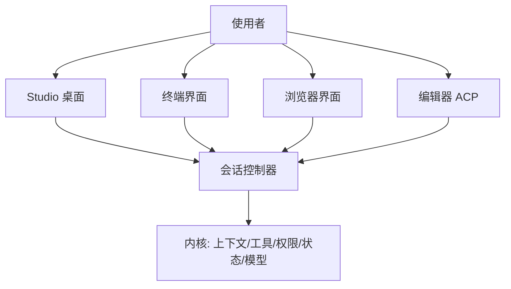

# 项目概览

## 一句话定位

Reasonix 是一个**本地优先**的开源 AI 编程助手：程序跑在使用者自己的机器上，模型服务由使用者自行配置（内置 DeepSeek 预设，任何 OpenAI 兼容端点都只是一条配置），助手在选定的项目目录里读代码、改文件、跑命令和测试。同一套 Go 内核同时支撑桌面应用 Studio、终端界面、本机浏览器界面和编辑器 ACP 接入四种形态。

## 解决什么问题

它主要回应三类现实约束，而不是"让模型写代码"这个目标本身。

**代码与密钥不离开本机。** 内核是本地进程，只有模型请求会发往使用者指定的模型服务；工作目录、权限边界、命令执行全部在本地裁决。这一点决定了它的默认形态是"一个人在自己机器上用的工具"，而不是托管服务。

**模型会失控，所以每一步都要可裁决、可回退。** 改文件之前先存快照，可以按对话轮次退回；命令、写文件这些动作按使用者设定的档位决定"直接放行"还是"先问一句"；被明确禁止的操作在任何档位下都拦得住。计划模式允许先看方案、批准后才动手。

**四种使用场景不该有四套实现。** 图形界面、终端、浏览器、编辑器是同一个内核的不同外壳。行为加在共用的会话控制器上，四个前端一起继承，而不是各自实现一遍。

下面这张图是全文的骨架：四个外壳都指向同一个会话控制器，控制器之下才是真正干活的内核。读它时注意两点——桌面端的业务请求并不绕过后端，仍然打到内核自己的本地 HTTP 服务；因此"远程工作区"和"本机浏览器"复用的是同一条通道，而不是两套逻辑。

## 给谁用 / 典型场景

| 使用者 | 场景 | 用哪种形态 |
|--------|------|-----------|
| 第一次尝试的人 | 填一个模型密钥就能用，不需要配命令行 | Studio 桌面应用 |
| 长期在终端工作的人 | 全屏交互式会话；`reasonix run "任务"` 可放进脚本 | 终端 |
| 想用浏览器界面或远程访问的人 | 本机启动 Web 界面，或把服务挂到远端工作区 | `reasonix web` / 本机 HTTP 服务 |
| 编辑器重度用户 | 在编辑器里获得原生聊天、上下文与工具审批 | VS Code 扩展 / 其他支持 ACP 的编辑器 |
| 想接自己模型的人 | 自定义 OpenAI 兼容 provider，或本地模型网关 | 配置文件 |
| 想让 AI 用上自有工具的人 | MCP server、Extension Protocol sidecar、插件包、Skill | 扩展体系 |

## 核心能力一览

| 能力 | 说明 | 典型场景 |
|------|------|---------|
| 读写与执行 | 在选定项目目录内读文件、改文件、跑命令与测试 | 修 bug、加功能、跑一遍测试 |
| 权限分档 | 每次询问 / 日常自动放行 / 硬阻断三种规则并存；设了禁止规则就始终生效 | 让 `go test` 免问、让 `rm -rf` 永远拒绝 |
| 计划模式 | 先出方案，批准后才执行 | 改动面大、想先对齐思路 |
| 检查点回退 | 每个用户轮存一次文件快照，可按轮退回，不碰 git 历史 | 一次改坏了想整体撤销 |
| 多模型组合 | 可选的执行器 + 规划器双模型协作，各自独立会话 | 用强模型规划、用便宜模型执行 |
| 子代理委派 | 把一段工作交给带边界的子代理（前台任务、并行任务、Skill 运行） | 大规模并行改动、专门方向的 review |
| 四种形态 | Studio / 终端 / 浏览器 / 编辑器共享同一内核 | 同一会话在不同界面继续 |
| 扩展 | MCP、Extension Protocol sidecar、插件包、Skill 四条路径 | 接外部工具、拦截运行时事件、打包分发 |
| 打包分发 | 单一静态二进制，六种目标平台；桌面端应用内自更新 | 内网机器无需装依赖 |

## 技术栈

| 组件 | 用途 | 选型理由 |
|------|------|---------|
| Go（内核） | 会话驱动、工具、权限、状态、模型适配 | 编译成不依赖动态库的单二进制，跨平台交付简单 |
| Bubble Tea v2 / Lip Gloss | 终端界面 | 与内核同进程，无需额外运行时 |
| Electron + React 19 + Vite | Studio 桌面外壳 | 桌面只提供操作系统能力与窗口；业务请求仍打到内核自己的 HTTP 服务 |
| `modernc.org/sqlite` | 会话投影与索引 | 纯 Go 实现，与项目不使用 CGO 的构建承诺一致 |
| `mvdan.cc/sh/v3` | shell 命令解析 | 用语法树而不是文本匹配判断一条命令要做什么 |
| tree-sitter | 多语言源码解析 | 给"读代码"提供结构化信息 |
| Starlark | 脚本类工具的执行语言 | 语法受限、无副作用失控风险 |
| `aead.dev/minisign` | 发布产物签名与验签 | 客户端可离线校验下载到的安装包 |

## 两条版本线的关系

项目同时维护两条线，架构并不相同：

| 版本线 | 分支 | 状态 | 获取方式 |
|--------|------|------|---------|
| 2.x（本文档描述的对象） | `studio` | 活跃开发 | Studio 发布页（标签 `studio-v2.*`） |
| 1.x | `main-v2` | 维护 / 稳定 | npm 与 Homebrew 的稳定通道 |

1.x 继续接收缺陷修复、模型接口兼容与安全修复，但不再扩展核心架构；两条线共享部分数据（例如旧版会话可以被 2.x 打开继续），迁移与并存方式在项目文档中有专门说明。

## 现状与边界

- **2.x 仍在快速迭代。** 会话与配置格式尚未冻结为 2.x 的稳定契约，跨大版本迁移路径仍在补齐；选型时不应把当前格式当作长期稳定的承诺。
- **需要使用者自己提供模型。** 项目不自带模型额度，费用直接付给模型服务商；离线环境下模型不可用。
- **沙箱强度随平台不同。** 写入、读取、能力三个保护维度在 macOS 与 Linux 有各自机制，Windows 目前都不强制——这意味着 Windows 上的边界依赖权限规则与审批，而不是操作系统级强制。
- **部分能力尚未定论。** macOS 上经由 Apple Events、Mach 服务进行的宿主代为执行不在当前治理范围内，也未做过实测验证。项目文档中有若干与实现不一致之处，本文档以源码为准。

> 依据：`README.zh-CN.md:62-126`、`README.zh-CN.md:128-168`、`docs/GUIDE.zh-CN.md:34-164`、`docs/ROADMAP.md:17-47`、`REASONIX.md:434-467`、`go.mod:1-10`、`desktop/README.md:1-52`、`LICENSE:1-3`
