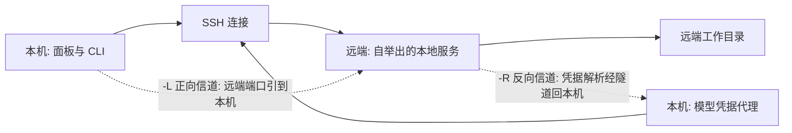

# 平台能力

## 这一页讲什么

除了读文件、改文件、跑命令，Reasonix 还能把工作目录放到远端主机上、能查语言服务器的定义与引用、能操作浏览器、能控制桌面应用。这些能力不在每个平台都能用，边界也各不相同。这一页把它们的机制与代价讲清楚。

## 远端工作区：内核在别处，本地只剩传输

远端工作区不是"把请求发到远端去执行"，而是**把整个内核搬到那台机器上**：在远端自举出一个本地服务，本机只负责 SSH 传输与端口转发。好处是助手的每一次读写都直接落在远端磁盘上，不需要同步副本；代价是那台机器上必须能装（或已有）一个版本够新的 Reasonix。

两条信道的方向正好相反，生命周期也相反：

| 信道 | 谁监听、谁拨出 | 用途 | 断线后 |
|------|--------------|------|--------|
| 正向转发 | 本地监听，远端拨出 | 把远端服务的端口引到本机，供面板调用 | 本地监听刻意保留，一次网络中断不会让已分发的地址失效 |
| 反向转发 | 远端监听，本地拨出 | 把本机的模型凭据代理发布到远端 | 随连接消失，重连后必须重新注册并把新端口告知已在运行的远端内核 |

反向信道带来一个很实际的好处：**远端主机不需要自己的模型密钥，也不需要能上外网**。代价是每次重连都要重新指向。

自举的顺序是"先复用、再安装、最后串行化"：探测远端系统与架构，如果记录的进程仍是服务就直接复用（这是重连路径）；否则按配置安装或上传，取远端锁之后再次尝试复用（避免并发安装重复拉起）；生成访问令牌以仅本人可读的权限写入文件（绝不放进命令行参数），拉起脱离终端的服务，轮询端口文件，并独立校验"这个进程确实是 Reasonix 服务"。远端服务刻意比连接活得久，下次连上直接复用。

远端能力有一个明确的"活但不可用"状态：远端内核版本低于面板所需门槛时会被判定为可用性不足，而不是报错——面板会提示需要升级远端。

## 语言服务器

Reasonix 能查符号定义、引用、悬停信息与诊断，方式是拉起本机已有的语言服务器。

| 方面 | 做法与理由 |
|------|-----------|
| 生命周期 | 会话级而不是单轮：会话关闭才收掉，避免每轮重启 |
| 来源 | 一律从 `PATH` 查找，不从项目目录自动执行；随包不分发 |
| 并发 | 首批并发查询共用一次启动，而不是重复拉起 |
| 面向模型的工具 | 四个只读工具：定义、引用、悬停、诊断 |
| 诊断等待 | 有明确等待窗口；服务器仍在建索引时返回"稍后重试"而不是失败 |

四个工具都是只读的，因此一批查询可以并行派发并共用同一个服务器进程。语言服务器缺失时，把安装提示作为错误交给模型，而不是让能力默默消失。项目内声明的语言服务器程序要先过一次准入校验才允许启动。

## 浏览器与桌面控制：两种把边界往外伸的方式

这两项能力都把"助手能看到什么"扩展到了工作目录之外，但围栏完全不同：

| | 浏览器工具 | 桌面控制 |
|---|-----------|---------|
| 操作对象 | 本机已安装的 Chromium 系浏览器 | 本机其它应用窗口 |
| 怎么发现 | 按顺序查找已安装的浏览器，**从不自行下载** | 通过随应用提供的原生辅助进程 |
| 隔离 | 使用专用配置目录，绝不用日常配置 | 不回读使用者个人信息，只读窗口无障碍树与截图 |
| 围栏 | URL 方案加工作区根：`http`/`https` 放行，本地文件必须落在工作区内，其它方案拒绝 | 一份"绝不操作"名单：助手自身、终端、钥匙串与密码管理器、系统设置与授权弹窗、任务管理器等 |
| 只读 / 写操作 | 可导航、可读页面结构，可点击输入 | 可点按与输入，但效果按事后读回的证据分级 |
| 拒绝策略 | 任何拿不准的情况拒绝而不是猜 | 模态框会吞掉的输入**不发送**，以明确的"被阻止"结果返回 |

两处细节值得单独指出。浏览器的网络日志**刻意不记录请求头与响应体**，只记方法、地址、类型、状态、字节数与耗时——因为凭据最可能出现在头和体里，留下就等于写进每一个读过这段记录的会话。桌面控制的每一步效果按辅助进程**事后读回的值**分级：读回一致才算"已确认"，值没变只是"疑似空操作"，其余一律"不可验证"；一次被接受的调用或一个变化的画面都不算证据。在终端插入输入等于绕过所有其它边界，因此终端在名单之列。

## 安装布局：版本化目录加最后换指针

桌面端的安装是"版本目录 + 指针文件"：新版本先拷进一个暂存目录，校验通过后重命名成正式目录，**最后才交换指针**。启动器只读指针，不数崩溃次数、不自行选择旧版本、也不进入安全模式；回滚就是"把指针指回一个更旧的目录"，而不是撤销一个新目录。

更新事务的完整流程（验签、暂存、交换、下次启动时作证、超时自动提交、失败回滚）见 [deployment.md](deployment.md)。这里只强调布局上的一个约束：备份与暂存必须与安装目录同卷，否则重命名这类原子操作无法使用。

## 平台胶水

一些让上述能力落地的配套件，各自的姿态也值得记录：

| 组件 | 做法 |
|------|------|
| git 工作树 | 助手创建的工作树放在管理目录下，且绝不自动删除 |
| git 集成 | 只做本地提交、不推送；提交消息有长度上限，敏感内容需要确认 |
| 通知与剪贴板 | 通知用于长任务结束；支持从剪贴板粘贴截图 |
| 崩溃报告与遥测 | 崩溃报告本地留存、明确确认后才发送；遥测只上报分类计数，不上传任何内容 |
| 账号与设备身份 | 设备码登录；实例标识与身份标识分开，遥测用的安装标识既非账号也非硬件标识 |

## 边界

- **Windows 的限制最多。** 远端自举依赖远端外壳能回答系统探测，Windows 上的 POSIX 兼容层被明确归为不支持；浏览器在 Windows 上退回回环调试端口，运行期间本机其它进程可达。
- **浏览器围栏只管 URL 方案与本地文件。** 内网页面并不受控，也没有域名或私网段过滤——所谓"出网控制"在这里不体现为网页黑白名单。
- **桌面控制的多数步骤拿不到确定结论**，"不可验证"是被承认的正常结果，而不是失败。
- 本文不评估这些能力的性能与稳定性，源码中未提供可核实的量化数据。

> 依据：`internal/platform/remote/remote.go:1-11`、`internal/platform/remote/bootstrap/bootstrap.go:1-7`、`internal/platform/remote/attach/attach.go:143-169`、`internal/platform/remote/attach/attach.go:431-477`、`internal/platform/remotecloud/host.go:1-4`、`internal/platform/lsp/manager.go:33-46`、`internal/platform/lsp/tool.go:11-18`、`internal/platform/browser/doc.go:1-22`、`internal/platform/computer/doc.go:1-30`、`internal/platform/computer/session.go:22-86`、`internal/platform/installlayout/current.go:1-7`、`internal/platform/update/tree_handoff.go:29-46`、`internal/platform/delta/doc.go:1-19`、`internal/platform/telemetry/policy.go:1-16`
