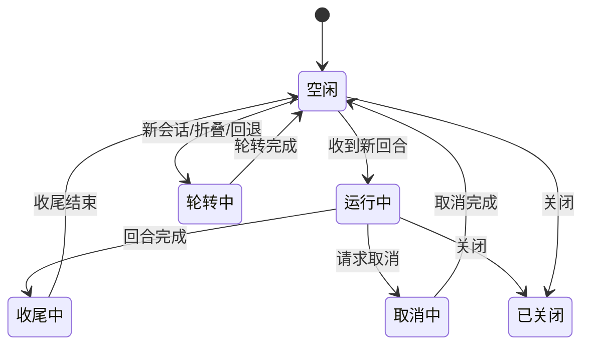
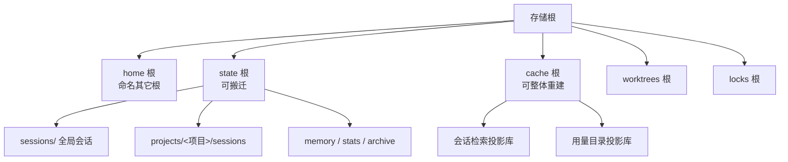

# 会话与数据

## 这一页讲什么

助手要能"接着上次聊"、要能"退回改动之前"、还要能在换一个界面之后看到同一段对话。这些能力背后是一套关于"真相存在哪、谁能写、怎么恢复"的设计。这一页讲清三件事：会话状态由谁持有、数据在磁盘上长什么样、以及"可回退"在存储层是怎么实现的。

## 会话状态由谁持有

同一份会话状态被切成三层，各自有明确的权威范围：

| 层 | 持有者 | 权威范围 |
|----|--------|---------|
| 运行期状态 | 会话控制器 | 内存中的对话转录、每轮检查点计数与轮次边界、内存收件箱 |
| 持久化记录 | 会话存储包 | 磁盘上的事件日志、兼容检查点、列表信息、分支信息、租约 |
| 跨进程写入权 | 会话租约 | 同一会话文件在任一时刻只有一个进程可写 |

运行期的准入被合并成一个单一状态：空闲、运行中、收尾中、取消中、轮转中、已关闭。合并的理由是消除"先检查再切换"的时间窗——如果拆成若干个布尔开关，两个检查之间状态就可能被别的路径改掉。

该看的是两条：**收尾中仍算活跃**（还在投递事件，此时不接受新回合，但会排队），以及**轮转与运行互斥**（换会话、折叠、回退都必须等回合结束）。

## 存储拓扑：五个存储根

数据按"能不能搬、能不能丢"分成五个根。这个划分决定了搬迁、备份与清理策略。

| 存储根 | 放什么 | 可搬迁 / 可重建 |
|--------|--------|----------------|
| home | 命名其它根的位置、全局配置与密钥 | 搬迁会牵动全部路径 |
| state | 会话、记忆、统计、归档 | 可搬迁 |
| cache | 两个 SQLite 投影库 | 可整体删除并重建 |
| worktrees | 助手创建的 git 工作树 | 体积大，独立成根 |
| locks | 进程间锁 | 钉在操作系统用户级，保证跨进程收敛 |

会话有两个入口目录：全局会话目录，以及按项目分目录的会话目录。五根之中只有 cache 是可以随便删的——这一点很重要：检索索引与用量汇总都不是真相，删掉只会失去查询能力，不会丢数据。

## 一个会话是一组文件

一个会话不是单个文件，而是一组伴随文件，各管一件事：

| 文件 | 内容 |
|------|------|
| 事件日志 | **权威**的追加式记录，模型可见内容的真相来源 |
| 兼容检查点（`.jsonl`） | 供旧版本与外部工具读取的检查点，已降级为非权威 |
| 列表信息（`.meta`） | 标题、时间、来源等展示字段 |
| 分支信息 | 归档、钉住、未读、恢复深度等 |
| 事件索引 / 展示索引 | 只存派生元数据，不存正文 |
| 判决 / 执行记录 | 子代理与工具执行的独立记录 |
| 恢复信息、上下文信息 | 崩溃恢复与上下文状态 |

目录级还有 `.blobs/`（内容寻址的附件与图片）、`.outputs/`（被截断的大输出）、`.ckpt/`（检查点）、`.inbox/`（投递队列）、`.jobs/`（后台任务）。

因为是一个会话对多个文件，**删除必须完整枚举**：漏掉事件日志不仅会留下已删除会话的痕迹，还会让加载逻辑把这份会话"复活"。

## 检查点与回退

检查点是"出事了能退回去"的安全网，它有三个鲜明的设计取向：

**不依赖 git。** 快照直接存文件内容，按内容寻址去重。使用者不需要把工作目录纳入版本控制，助手也不会去碰 git 历史。

**每轮生成一次，首次触碰才记快照。** 在每个用户轮开始时开一个检查点，但只对真的被改动的文件留快照。磁盘对象数随轮数线性增长，因此有保留轮数、内容块总量与单文件大小的三重上限来收口。

**只覆盖能预知改动的工具，并明说覆盖不到的地方。** 助手的编辑类工具能提前给出"我要改哪些文件"，因此可被完整覆盖；而执行的 shell 命令会做什么无法预知，这类副作用被**显式记为覆盖率缺口**，而不是悄悄当作已覆盖。一旦覆盖率是部分的、或存在缺口，文件回退需要使用者明确确认。

回退本身是一次两段式事务。准备阶段只读，产出"要改哪些文件、有哪些冲突、覆盖到什么程度"的计划；提交阶段在排他屏障下逐文件执行，并且**先把"我可能已经改了这个文件"的意图写进磁盘，再做实际替换**。这样即使进程中途崩溃，重启后也能保守判定哪些文件需要补偿——而不是去猜。

回退有三种范围：只退代码、只退对话、两者都退。对话回退依赖轮次边界表；如果某段历史已经被压缩折叠越过，对应的边界就不存在了，这时回退会明确失败而不是给出错误结果。

## 投影库：可以随时丢弃的 SQLite

全文检索与用量统计用 SQLite，但它们被严格定义为**投影**——业务数据必须在数据库之外保持权威，任何时刻都要能删库重建。

| 投影库 | 内容 | 真源 |
|--------|------|------|
| 会话检索库 | 会话历史的全文索引（含子代理与归档） | 会话文件 |
| 用量目录库 | 按文件增量的用量记录与汇总 | 日度统计文件 |

读路径必须容忍数据库不可用：打不开或版本超前时只降级（降级模式或纯内存模式）或隔离，绝不会去重命名一个健康的库文件。这也是它们放在 cache 根下的前提——丢了只是少一个索引。

## 版本与迁移

这里要如实说明一个现状：**没有单一的会话格式版本号**。版本号分散在各子系统里——事件日志有自己的 schema 版本（区分"图片内联"与"图片入库"）、分支信息有、展示索引有、折叠状态有、用量报告有。兼容性由每个读者各自"读不懂就拒绝"，而不是由一个总版本号判断"这份会话能否被本版本打开"。

跨大版本的旧数据由专门的迁移包显式处理（旧会话、记忆、配置各有一条导入通道），导入后会留标记，避免重复导入。这一块的完整冻结与统一，是项目 2.x 路线图上仍标记为未完成的一项。

## 边界

- 事件日志回放设有硬上限（条数与体积），超过上限时宁可拒绝加载，也不回退到旧的兼容检查点——因为两者可能已经分叉。
- 跨进程写入权靠租约文件，进程内的写入授权是一种只在内存里存在的代际令牌，无法从磁盘重建；换了控制器或换了路径必须重新签发。
- 检查点的保留上限（轮数、内容块总量、单文件大小）意味着很旧的回退点会被回收。

> 依据：`internal/contract/config/storage_roots.go:16-30`、`internal/contract/config/storage_roots.go:170-188`、`internal/state/sessionstore/doc.go:1-11`、`internal/state/sessionstore/session_content.go:34-38`、`internal/state/store/session.go:356-381`、`internal/state/checkpoint/checkpoint.go:1-14`、`internal/state/checkpoint/checkpoint.go:308-330`、`internal/state/checkpoint/transaction.go:620-757`、`internal/session/control/checkpoint.go:111-125`、`internal/session/control/rewind.go:17-27`、`internal/state/projectiondb/projectiondb.go:1-4`、`internal/state/historycatalog/schema.go:11-72`、`internal/state/usagecatalog/catalog.go:154-181`、`internal/state/migration/migration.go:1-16`
