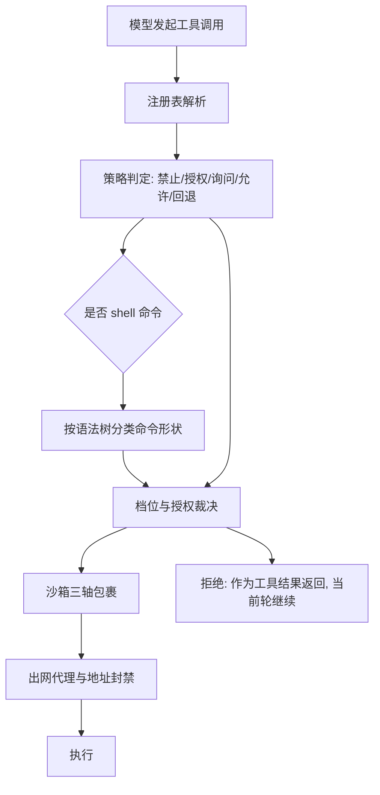
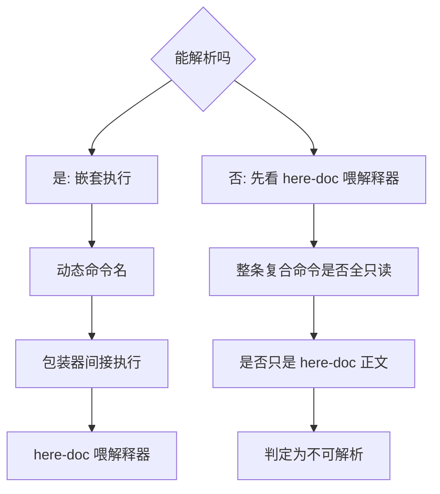

# 工具与安全边界

## 这一页讲什么

助手能读文件、改文件、跑命令、访问网络——这些动作必须被裁决。这一页讲清三件事：工具是怎么被声明与调用的、一次调用要过哪些判定、以及每个安全承诺到底有没有可核实的执行机制。最后一件事最容易被夸大，所以本文会把"能证明的"和"只在配置里存在的"分开写。

## 工具契约：说明由代码生成，文档不是权威

内置工具在编译期自注册，模型看到的是每一轮组装出来的注册表，而不是一个全局集合。每个工具声明自己的名字、说明、参数说明，以及若干可选性质：是否只读、是否需要顺序执行、能否预览、是否依赖运行时上下文才可用。

关键点是**"说明即代码"**：参数说明是硬编码在源码里的 JSON Schema，而面向人的工具契约文档由测试从同一份声明反向生成并逐字比对——说明一漂移，测试就失败。也就是说文档服从代码，而不是相反。

| 工具类别 | 代表 | 特点 |
|---------|------|------|
| 文件读写与编辑 | 读、写、编辑、多处编辑、移动、删除范围 | 多处编辑会先在内存里逐条应用，全部成功才落盘——中途失败不会留下半成品 |
| 命令执行 | 前台命令、后台任务 | 前台有输出上限并保留末尾；后台任务的生命周期是整个会话 |
| 脚本 | Starlark 脚本 | 只在开启代码模式时加入；脚本内的每次工具调用都走同一条审批与观测路径 |
| 只读辅助 | 建议、文档检索、语言服务器查询 | 不产生副作用，因此不需要审批往返 |

后台任务类工具的可用性依赖运行上下文：在没有任务上下文的场合，它们会**明确拒绝**而不是静默降级。

## 权限：一张静态规则表加一个可覆写的档位

权限策略本身是纯函数、不碰 I/O：给一个动作与资源，返回一个裁决。判定顺序固定，这是它最重要的性质。

| 顺序 | 规则 | 说明 |
|------|------|------|
| 1 | 硬禁止 | 任何档位、任何授权都无法抵消 |
| 2 | 会话内授权 | 使用者本轮明确允许过的 |
| 3 | 询问 | 需要人决定 |
| 4 | 允许规则 | 从不询问 |
| 5 | 回退 | 只读工具放行；写工具按当前档位 |

"档位"（每次都问 / 自动放行 / 拒绝 / 只读）的作用方式是**在构建判定器时覆写回退档位**，而不是改写规则表。这条"档位不改规则表"的性质有一个诚实的例外：交互式档位还会从会话授权里剔掉那些"必须真人批准"的条目，并给记忆的写入与删除追加强制询问规则——这些是档位之外的附加约束，源码里写得很明确。

一条调用涉及多个对象时（例如移动文件有源和目标），**任一被拒即整体拒绝**。

## 一次工具调用的判定路径

下面的图把上述规则串成一条可执行的顺序。读它时请注意最下方那条旁路——拒绝不是终止符。

## 命令安全：读语法树，并按形状说明原因

对 shell 命令，项目不匹配危险字符串，而是把它解析成语法树（**只解析，不求值**），然后按"形状"分类。被拦的形状包括：无法解析的、嵌套执行的、命令名动态拼出来的、内联代码的、经包装器间接执行的、以及用 here-document 喂给解释器的。

分类的降级顺序也是确定的：能解析时按固定顺序取第一个命中的形状；解析失败时先看是否有 here-document 喂解释器、再看整条复合命令是否全都只读、再看是否只是 here-document 正文，最后才判为"不可解析"。复合命令按顶层分段逐段判定，**任何一段命中即整条升级为需要人**。

这样设计有两个直接后果。**第一，模型得到的不是一个笼统的"不允许"，而是"你这条命令因为哪个形状被挡"**——告诉它该往哪个方向改写。**第二，命中这些形状的调用只接受精确授权**：前缀规则或通配规则一律不覆盖它。理由是使用者批准的是"这一条命令"，不是"以后任何内嵌的命令"。

## 沙箱三轴：只有一轴是真的可证明

沙箱把保护拆成三个互相独立的轴。**必须如实说明的是：源码里只有第一轴有可对外调用的探测机制，另两轴只是在配置档里被执行，没有对应的探测函数。**

| 轴 | 表达成什么 | 可否对外声称"受约束" |
|----|-----------|-------------------|
| 完整性（写） | 允许写入的根目录集合 | 可以：有独立探测，并能升级为"宿主保护"或"可感知篡改" |
| 机密性（读） | 禁止读取的根目录集合 | 否：只在档位里执行 |
| 权限（能力） | 允许使用的主机服务（如 ssh-agent、容器运行时） | 否：只在档位里执行 |

平台落地方式完全不同，因此跨平台只能声明三者共同拥有的一部分：

| 平台 | 机制 | 结果 |
|------|------|------|
| macOS | 系统沙箱配置（先默认放行、再拒绝写入、按写根重开、按禁读根遮蔽、最后处理网络与主机服务，规则以"最后匹配为准"） | 三轴都有机制 |
| Linux | 命名空间隔离（网络命名空间、整机只读挂载、临时目录替换、禁读根遮蔽） | 三轴都有机制 |
| Windows | **没有**操作系统级的命令沙箱 | 三轴都不强制，依赖权限规则与审批 |

"最后匹配为准"这个细节很重要：它意味着主机服务的授权规则必须排在网络规则之后，否则会被覆盖掉。也要注意，写隔离与网络隔离是两件独立的事——禁用网络并不会自动切断对主机服务的访问，反之亦然。

## 出网与凭据

出网控制分三层，任何一层失效都会让该层失效，因此每一层都选择"失败即拒绝"并把原因写进工具结果：

- **白名单代理**：先处理拒绝、再处理放行；即使通过白名单，回环地址、链路本地地址与云元数据地址仍被拒绝。
- **跳转约束**：带凭据的跳转被限制在同源加密连接、且跳数有上限；网络抓取另有拨号期的内网地址校验。
- **直接控制**：命令只有在被真正包裹执行时才拿到代理凭据；平台不支持时，代理不启动、出网关闭，而不是放行。

`redirectguard` 这个名字容易让人以为它管浏览器，实际上它管的是**HTTP 跳转**这类可能泄漏凭据的路径。

另外要澄清一个常见误解：项目里那份标注为"敏感路径"的清单（`internal/safety/...`、`internal/ext/plugin/...` 等）**不是运行时安全名单**，而是一份工程治理声明——它同时用于"改到这些路径即升级为高风险、需要专项评审"和"这些路径的测试覆盖率必须维持"两个目的。一份声明两处生效，正是为了避免第二份清单漂移。

## 审批往返：拒绝是一次结果，不是终点

需要人决定时，助手会发出一次审批请求并登记为待决；同一轮里的多个请求可以按随机前缀成组。切换到更宽松的档位时，已被新模式涵盖的待决请求会被消解，但"必须真人"类的提示仍然保留可见。使用者做的会话级授权会被记住，作用范围是当前会话。

最关键的一条语义：**权限拒绝不会终止回合**。拒绝以工具结果的形式交回模型（带"被阻止"的明确标记与机器可读的拒绝码），当前轮继续。只有少数几种拒绝是终局的（命中硬禁止规则、只读档位、使用者明确拒绝、无人值守），其余（已登记等待真人、目录未受信任）不算终局。被拒绝的调用会在下一轮以提示块的形式带回，以免被上下文折叠抹掉。

## 边界

- **不要把三轴当作统一的隔离承诺。** 只有写保护有可对外调用的证明，读隔离与主机服务授权是配置事实；Windows 上三者都不强制。
- **安全边界依赖平台机制是否真的启用。** 沙箱关闭、平台不支持、命令未被真正包裹——任何一处都会让对应层失效，因此这些层都选择失败即拒绝。
- 项目自述有一处尚在提案阶段的可信执行设计（任务合约、证据包、能力放量），该文档被明确标为提案状态、且不在随包文档集合内，不应被当作已交付能力。
- 本文不评估绕过风险的实际概率；"某个机制存在"不等于"该机制在某平台某配置下一定生效"。

> 依据：`internal/safety/permission/permission.go:178-254`、`internal/safety/permission/bash_approval.go:22-114`、`internal/safety/permission/verdict.go:33-42`、`internal/safety/sandbox/protects.go:9-23`、`internal/safety/sandbox/seatbelt_darwin.go:95-129`、`internal/safety/sandbox/seatbelt_other.go:119-143`、`internal/safety/egress/policy.go:28-46`、`internal/session/control/approval_orchestration.go:186-221`、`internal/session/control/approval.go:103-135`、`internal/contract/tool/contract_test.go:24-64`
