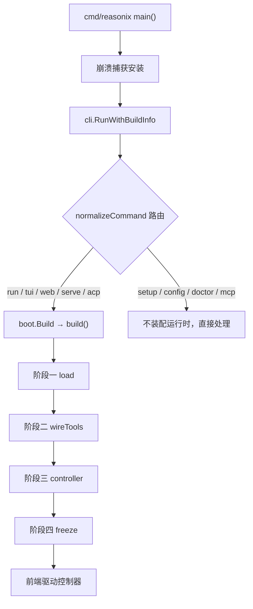

# DeepSeek-Reasonix 深度解读：让编码 Agent 变成宿主可裁决的本地工具

> 本解读按 **ai-agent** 类规格产出（主类型 ai-agent ⊗ 副类型 framework / CLI）。正文所有 `文件:行号` 引用均为 **Reasonix 仓库相对路径**（如 [internal/assembly/boot/boot.go:1-9]()），点开即可核对。
<!-- anchor: // Package boot assembles a ready-to-drive control.Controller from configuration … package boot -->

`解读基线：v2.37.0（e17ef45e3）`

## 根因：编码 Agent 失真的三个方向

一个编码 Agent 最贵的失误不是"写错代码"，而是三件更难被发现的事：

- **它把缓存打碎了。** 推理服务的自动前缀缓存只在系统提示前缀逐字节稳定时命中。任何"顺手更新一下系统提示"的改动，都会让之后每一轮重新计算整个前缀——成本与首字延迟同时劣化，而且没有任何报错提示你。
- **它把失败原因编出来了。** 一次响应被输出上限截断，到达模型时可能只剩"invalid arguments"这种下游症状。模型于是自造一条规则解释它，而**这条编造的规则会活得比事故更久**：会话从此学会"不要批量调用"，而批量调用从来不是问题所在 [REASONIX.md:70-76]()。
<!-- anchor: - Failure attribution is host-owned state. When the host can determine why an … to stop batching calls that were never the problem. -->
- **它的裁决权在滑走。** 谁来决定一个危险命令能不能执行？如果这个判断散落在提示词措辞、模型自律和若干处重复的 `if` 里，宿主就失去了在人该说"不"的位置上说"不"的能力。

Reasonix 把这三件事都变成**宿主拥有、由门禁强制**的状态，而不是模型的自觉：前缀所有权与投影新鲜度写进规范并由 `context_projection_test.go` 在 provider 边界把守；失败归因被定义为"宿主拥有的状态"并要求跨越 model-visible 边界 [REASONIX.md:77-78]()；权限裁决则落在叶子、由 `{action, resource, effect}` 规则表达，且明确声明 **forbid 规则永远成立** [README.md:73-74]()。
<!-- anchor: - A host-owned identity has to cross the model-visible boundary. Stable step … ids, typed error codes, boundary causes — anything the host expects the model -->
<!-- anchor: - **Permission levels.** Have it ask every time, or let everyday actions run on  … - **Rewind.** A file is saved before it changes, so you can rewind by conversati -->

一句话概括它的立场：**骨架由宿主拥有，模型只负责判断**。这条立场决定了后面所有架构选择——为什么需要唯一控制器、为什么架构约束要写成 CI 门禁、为什么沙箱要拆成三维、为什么子 Agent 委派要拆成五个互不重叠的概念。

## 概览

### 定位与适用场景

Reasonix 是一个**本地优先、模型可选**的开源编码 Agent：同一份 Go 内核支撑四种使用形态——桌面应用 Reasonix Studio、全屏终端 TUI、本机 HTTP/SSE 服务（Studio 的通道）、以及编辑器集成（VS Code 走 ACP 协议拉起 `reasonix acp` 子进程）[README.md:87-92]()。它自己不绑定模型：DeepSeek 只是一个预设，任何 OpenAI 兼容端点都是配置项而非新代码 [README.md:123-127]()。
<!-- anchor: ## Four ways to use it … - **Editor.** Install the extension in VS Code; other editors that support ACP ( -->
<!-- anchor: - **Config-driven.** Providers, the agent, enabled tools, and plugins are all … two models together (executor + planner) in separate, cache-stable sessions. -->

它适合的读者有三类：想研究"Agent 工程化"具体怎么做的人；要为自己产品嵌入 Agent 能力的团队（内核是库、控制器是接口）；以及关心"如何用机械化门禁守住架构"的工程师——这是本项目最可迁移的部分。

### 核心能力清单

| 能力 | 说明 | 关键机制 |
| --- | --- | --- |
| 四形态同内核 | Studio 桌面 / TUI / Web(HTTP+SSE) / 编辑器 ACP 共用同一份编排 | 唯一控制器藏在所有前端之后 |
| 配置与插件驱动 | Provider、Agent、启用的工具、插件全部在 `reasonix.toml` 里声明，无硬编码模型 | registry + `init()` 自注册；MCP 与 v2 扩展协议注入 |
| 缓存优先的上下文维护 | 前缀跨轮字节稳定；动态状态走回合尾部；唯一的自动阈值是 `compact_ratio` | 阈值默认 0.85，`triggerTokens = floor(context_window × compact_ratio)` |
| 权限分级与 plan mode | 每档决定"每次问"还是"日常动作放行"，forbid 规则在任何档位下都成立 | 叶子裁决 + 审批模式叠加；plan mode 先出方案再动手 |
| Rewind（按轮回退） | 文件在被改前先保存，可按对话轮回退且不碰 git 历史；**只覆盖编辑工具改过的文件，shell 命令改的不在内** | 检查点落在会话状态域 |
| 双模型协作 | 可选 executer + planner 两个模型，跑在各自独立的 cache-stable 会话里 | 运行时的双模型协调器 |
| 子 Agent 委派 | profile / TaskSpec / CapabilityGrant / ContextRequest / SchedulerPolicy 五概念分离，字段归属由测试强制 | 由反射字段白名单测试冻结 |
| 三维沙箱 | Integrity（写根）/ Confidentiality（禁读根）/ Authority（宿主能力）三个**正交**维度，不做"一维概括三维"的承诺 | 每个维度各有独立的能力探测函数 |
| 零摩擦分发 | `CGO_ENABLED=0` 单静态二进制，一条命令交叉编译六个目标；目标机上除二进制外无需安装任何东西 | 纯 Go SQLite 等依赖约束 |
| 机械化架构门禁 | 分层、wire 对齐、前端能力边、受锁结构体字段棘轮等写成 CI 检查 | 自研 `tools/repolint`（28 条规则 / 28 个非测试源文件，三档解析） |
| 记忆与检索 | 分层标准指令进前缀；可错事实库出前缀、按需读；会话历史走 BM25 检索 | 记忆域与指令域分离 |

逐条依据（一行一条，便于点开核对）：

- 四形态共用唯一控制器 [internal/session/control/controller.go:1-10]()
<!-- anchor: // Package control is the transport-agnostic session driver. A Controller owns … // cancellation, or approval. The Controller depends on no frontend. -->
- 配置与扩展的声明式注入 [docs/SPEC.md:9-13]()
<!-- anchor: 1. **Config- and plugin-driven core.** The core knows only interfaces. Concrete … CLI works out of the box. -->
- 压缩阈值取自项目规格 [docs/SPEC.md:257-269]()
<!-- anchor: Long tasks fill the model window. Reasonix keeps a **cache-first, append-only** … Any rewrite would invalidate the prompt cache from that point on. -->
- 阈值的默认值在配置层 [internal/contract/config/config.go:1400-1408]()
<!-- anchor: // Soft/snip/force are load-only compatibility; CompactRatio alone drives mainte … MaxParallelWriters:     3, -->
- 权限分级与 plan mode 的对外表述 [README.md:73-73]()
<!-- anchor: - **Permission levels.** Have it ask every time, or let everyday actions run on  -->
- rewind 的对外表述 [README.md:74-74]()
<!-- anchor: - **Rewind.** A file is saved before it changes, so you can rewind by conversati -->
- 双模型协作的对外表述 [README.md:125-127]()
<!-- anchor: - **Multi-model & composable.** DeepSeek ships as a preset; any … two models together (executor + planner) in separate, cache-stable sessions. -->
- 子 Agent 五概念的对外表述 [REASONIX.md:20-24]()
<!-- anchor: - Subagent delegation keeps five concepts apart: a profile says how a worker … per-call values. `internal/runtime/delegation/profile_boundary_test.go` enforces -->
- 三维沙箱的对外表述 [REASONIX.md:434-448]()
<!-- anchor: ## Sandbox dimensions … or Authority claim. -->
- `CGO_ENABLED=0` 与依赖约束的对外表述 [README.md:134-136]()
<!-- anchor: - **Zero-friction distribution.** `CGO_ENABLED=0` single binary; cross-compile … binary — nothing to install on the target machine beyond the binary itself. -->
- 同一承诺在规格侧的表述 [docs/SPEC.md:12-13]()
<!-- anchor: 2. **Single static binary.** `CGO_ENABLED=0`; cross-compile with one command; … CLI works out of the box. -->

### 技术栈一览

| 层面 | 选型 |
| --- | --- |
| 语言 / 运行时 | Go 1.26（`toolchain go1.26.9`），构建期强制 `CGO_ENABLED=0` |
| 终端 UI | `charm.land/bubbletea/v2` + `bubbles` + `lipgloss/v2` |
| CLI 与配置 | `spf13/pflag`；`BurntSushi/toml` + `gopkg.in/yaml.v3` |
| 本地存储 | `modernc.org/sqlite`（纯 Go，无 CGO）承担投影库；会话主体是可追加的 JSONL |
| Shell 语义 | `mvdan.cc/sh/v3` 解析 bash AST 做命令安全判定，不做措辞匹配 |
| 代码解析 | `tree-sitter`（Go 绑定 + JavaScript / Python / Rust / TypeScript 语法）用于代码索引 |
| 渲染 | `yuin/goldmark` 渲染 Markdown，`alecthomas/chroma/v2` 做语法高亮 |
| 脚本扩展 | `go.starlark.net`（code mode 下的脚本工具） |
| 传输 | 标准库 `net/http` + `gorilla/websocket`（浏览器与云端中继） |
| 安全与凭据 | `aead.dev/minisign` 校验更新包签名；`zalando/go-keyring` 存凭据 |
| 桌面端 | Electron 44 壳 + React 19 / Vite 8 / CodeMirror 6 前端（TypeScript） |
| 可选服务端 | Cloudflare Workers（账号、崩溃报告、论坛三个独立信任域） |
| 构建发布 | `Makefile` + GoReleaser + GitHub Actions + `electron-builder` |
| 代码质量 | `golangci-lint` + 自研 `tools/repolint`（`go/parser` 与 `go/types` 级分析）+ 覆盖率门禁 `tools/covergate` |

### 项目规模

| 指标 | 数值 |
| --- | --- |
| Go 文件 | 4,818 个（其中测试文件 2,504 个） |
| Go 非测试代码 | 399,444 行（`internal/` 占 362,075 行） |
| Go 测试代码 | 442,069 行（测试/生产 ≈ 1.11 : 1） |
| TypeScript / TSX | 119,329 行（桌面端与前端） |
| 内核域包 | `internal/` 下 12 个域（base / contract / ext / frontend / model / platform / runtime / safety / session / state / tools / assembly） |
| 专题文档 | `docs/*.md` 40 篇，另有 `REASONIX.md` 作为加载进每个会话系统提示的项目记忆 |
| 版本 tag | 561 个（本次基线 `v2.37.0` 为 2.x 线最新稳定 tag） |
| 许可 | MIT |

## 架构总览

下图是 Reasonix 的纵向分层与允许的依赖方向。它要回答一个具体问题：**为什么一个 40 万行的 Go 程序不会长成一团互相 import 的泥**——答案不是靠评审纪律，而是把每一层允许的 import 集合声明出来，交给 CI 拒绝越界。


读图要点有三处。

**第一，前端只负责传输**：`frontend/{cli,tui,serve,acp}` 与装配入口 `assembly/boot` 是唯一允许 import `control` 的包，而 `control` 之下任何包都不允许反向 import 前端。**第二，编排只有一处**：`internal/session/control` 是唯一传输无关的会话驱动，它拥有 agent 运行循环与会话生命周期，把发生的一切——推理、工具调用、审批、回合完成——作为类型化事件流发给单一 `event.Sink`；终端 TUI、桌面 webview、HTTP/SSE 服务器各自驱动同一个控制器，没有谁重新实现 turn 生命周期、取消或审批。**第三，能力域彼此不直接依赖**：`tools` / `ext` / `model` / `state` / `safety` / `platform` 六个高频域都经契约层（`internal/contract`）对齐接口，这也是"配置与插件驱动"能在代码上成立的前提。

[REASONIX.md:14-19]()
<!-- anchor: - Layering (enforced): utility packages import nothing under `reasonix/` except … sets live in `tools/repolint/layers.go`. -->

[internal/session/control/controller.go:1-10]()
<!-- anchor: // Package control is the transport-agnostic session driver. A Controller owns … // cancellation, or approval. The Controller depends on no frontend. -->

[docs/SPEC.md:9-13]()
<!-- anchor: 1. **Config- and plugin-driven core.** The core knows only interfaces. Concrete … CLI works out of the box. -->

图的底部是 utility 叶层：**42 个包的闭合集合，而且它跨 7 个域**（`base` / `contract` / `model` / `platform` / `ext` / `state` / `safety`），不是某一层的子树——这是本图最容易看错的一处。闭合的含义是"这 42 个包之间可以互相 import，但不允许 import 集合外的任何 `reasonix/` 包"，等价于"集合外的任何包都可以自由 import 其中一个叶子" [tools/repolint/layers.go:25-89]()。理由写在声明处：一个叶子够到另一个叶子不会拖来依赖图，而拒绝这种 import 会让同一个判断被复制进好几个包，抄本漂移正是这个仓库反复记录的事故形态 [tools/repolint/layers.go:21-24]()。这条判断的代价和收益都很具体，是理解本项目工程哲学最好的入口。
<!-- anchor: var leaves = []string{ … out = append(out, Finding{rel, ref.line, ruleLayering, msg, 1}) -->
<!-- anchor: // Utility layer: these packages carry no knowledge of the kernel and must … // refusing it is what leaves the same judgement copied into several of them. -->

### 模块职责映射

```
cmd/reasonix, cmd/reasonix-studio-host, desktop/    宿主进程；只做入口、宿主服务与桌面壳
internal/frontend/{cli,tui,serve,acp,capdiag,doctor,…}   传输层：子命令、终端界面、HTTP/SSE、ACP
internal/assembly/boot                              装配：配置 → 工具/插件 → 权限门 → 控制器 → 扩展快照
internal/session/control                            唯一编排层：命令进、类型化事件出
internal/runtime/{agent,delegation,coordinator,…}   策略层：主循环、子 Agent 委派、双模型协作、任务契约
internal/contract/*                                 契约层：tool / provider / event / config / agentgraph / permrule…
internal/tools/*                                    内置工具、脚本、shell 运行
internal/ext/*                                      扩展协议、插件包、MCP、Skill、主题
internal/model/*                                    各 Provider 适配、模型目录、计费
internal/state/*                                    会话存储、检查点、记忆、投影库、迁移
internal/safety/*                                   权限裁决、沙箱三维、出网、命令安全
internal/platform/*                                 平台能力：Remote-SSH、LSP、浏览器、更新、修复
internal/base/*                                     叶包主要聚居地：diff / filelock / frontmatter / shellparse / tokencount…（叶层共 42 包，跨 7 个域）
tools/repolint, tools/covergate, tools/pricecheck   架构门禁与质量门禁本身
```

## 启动流程

Reasonix 的启动可以概括为"四阶段装配 + 冻结"：配置落定、能力接线、控制器成型、扩展快照冻结。它被刻意做成**一个**装配点，因为四个前端都需要完全相同的装配结果，各自重新推导一次就意味着四份会漂移的行为 [internal/assembly/boot/boot.go:1-9]()。
<!-- anchor: // Package boot assembles a ready-to-drive control.Controller from configuration … package boot -->



四个阶段各自做什么：**阶段一 load** 依次结算根目录、配置迁移、配置、凭据、事件 sink、扩展、Provider、模型、会话、shell 与系统提示；**阶段二 wireTools** 接上工具注册表、内置工具、MCP、LSP 与浏览器、权限门与审批、hooks、角色与子 Agent、Skill 与命令以及 capability 面；**阶段三 controller** 构造 `control.Controller` 并用双模型 Coordinator 包装；**阶段四 freeze** 冻结扩展快照与 provider 可见的工具面，此后工具 schema 定型，供缓存诊断使用。

四个阶段的顺序本身是一条设计约束。阶段一边界由 `load()` 的注释明确：它"结算配置、扩展世代、执行模型、会话资源与系统提示"，此后不再回头；阶段二把工具注册表、MCP、权限门、hooks、角色与 Skill 全部接上，其中一行注释记录了委派链的关键要求——执行器与它派出的每个子 Agent **共用同一道权限门**，这样"子 Agent 永远不是绕过父级限制的弱路径" [internal/assembly/boot/build.go:315-348]()。阶段三构造控制器，阶段四才冻结快照，因为快照一旦冻结，工具 schema 就定型供缓存诊断使用 [internal/assembly/boot/build.go:106-134]()。
<!-- anchor: func (b *builder) wireTools() error { … t.gate = control.NewSharedHeadlessGate(t.policy, opts.HeadlessApprovalMode) -->
<!-- anchor: func build(ctx context.Context, opts Options) (*BuildResult, error) { … return res, err -->

这一节也解释了 `boot` 包为何把首末行放在同一份文档里：`Build` 只是 `BuildRuntime` 的兼容包装，前端保留原签名；运行时集合**不在这里关闭**，而是链进控制器的清理流程，于是扩展 sidecar 的生命周期恰好等于其控制器的生命周期 [internal/assembly/boot/runtime.go:108-122]()。**生命周期归属谁，谁负责关闭**——这条纪律在本项目中反复出现。
<!-- anchor: // Build loads config, resolves the model(s), and returns a Controller wrapping  … return res.Controller, nil -->

## 核心模块导读

| 关注面 | 一句话定位 | 子文档 |
| --- | --- | --- |
| 主循环与上下文维护 | 一个 turn 从准入到终止的完整结构；cache-stable 前缀的字节构成、窗口所有权与压缩触发 | [agent-loop.md](agent-loop.md) |
| 记忆与检索 | 为什么"必须遵守的规则"进前缀、"可错的事实"出前缀；Context Engine 的检索与回注 | [context-memory.md](context-memory.md) |
| 工具、权限与沙箱 | 工具契约与输出溢出、叶子裁决与审批档位、三维正交沙箱与 shell AST 安全判定 | [tool-system.md](tool-system.md) |
| 扩展体系 | MCP / Extension Protocol v2 sidecar / 插件包 v2 / Skill 四件事的冲突约束与能力边界 | [extension-system.md](extension-system.md) |
| 宿主接入协议 ACP | 编辑器拉起 `reasonix acp` 后，会话生命周期与权限往返如何跨进程完成 | [acp.md](acp.md) |
| 会话状态与 Rewind | 会话真源在哪、检查点的精确语义与"不回滚什么"、格式版本与恢复路径 | [session-state.md](session-state.md) |
| 数据模型 | 权威留在文件、数据库只是可丢弃投影；五个存储根与两个 SQLite 投影库 | [data-model.md](data-model.md) |
| 架构守卫 | 门禁族清单与实现手法；棘轮机制；为什么架构要写成可执行检查 | [architecture-guardrails.md](architecture-guardrails.md) |
| 子 Agent 委派 | 五概念边界为什么这样切、`profile_boundary_test.go` 如何守住它 | [subagent-delegation.md](subagent-delegation.md) |
| Provider 层 | 多 Provider 适配、模型目录与路由、价格即定义、出网代理 | [llm-provider-layer.md](llm-provider-layer.md) |
| 服务端与 Studio 通道 | `frontend/serve` 的 HTTP/SSE 面：桌面应用如何只经 loopback 驱动本机内核 | [serve-api.md](serve-api.md) |
| 平台能力 | Remote-SSH、LSP、浏览器与 Computer Use、安装布局与修复 | [platform-capabilities.md](platform-capabilities.md) |
| 交付与部署 | 单二进制承诺的因果链、Studio 打包与签名公证、自更新的原子性 | [deployment.md](deployment.md) |

## 子文档索引

- [architecture-design.md](architecture-design.md) — 叙述型架构设计说明：设计输入与约束、总体架构与依赖方向、模块责任矩阵（含"明确不做什么"）、写入链路与状态机、关键决策的备选与复审触发条件、容量口径、已知边界与可验收承诺
- [agent-loop.md](agent-loop.md) — 回合的完整结构与 9 条停止条件；cache-stable 前缀的字节构成与 turn tail 两级装配线；窗口所有权；压缩触发公式与投影级 CAS 折叠；per-turn 状态纪律及其两个反例
- [context-memory.md](context-memory.md) — "必须遵守的规则进前缀、可错的事实出前缀"这条切分；指令枚举顺序与按正文哈希去重；事实模型与冲突归并；自动召回的尾部回注；会话历史的可丢弃检索投影
- [tool-system.md](tool-system.md) — 工具契约与输出溢出的可推导比较；叶子处 `{action, resource, effect}` 裁决与审批档位；shell AST 的六类 blocker 与降级顺序；三维正交沙箱与各自的能力探测函数
- [extension-system.md](extension-system.md) — MCP 客户端、Extension Protocol v2 sidecar、Extension Runtime v2 插件包、Skill 四件事的分工与所有权边界：谁能贡献 Provider、谁能拦截运行时事件
- [acp.md](acp.md) — 编辑器如何以 ACP 拉起 `reasonix acp`；"没有版本协商、只有能力位"的兼容策略；审批作为反向请求的并发约束；四种拒绝的身份与取消路径；会话真相仍在 controller 与磁盘
- [session-state.md](session-state.md) — 真源与投影的划分；检查点与 rewind 的精确语义（两段式事务、覆盖率状态、硬拒条件）；四代格式演进与版本闸门；"意图位先于副作用"的崩溃恢复路径
- [data-model.md](data-model.md) — 五个存储根与两个 SQLite 投影库；全仓唯一 SQLite 驱动入口；三层版本闸门；两张投影库的实体与字段级表；远端 D1 的"只加不改"策略与跨库 email 外键
- [architecture-guardrails.md](architecture-guardrails.md) — 28 条门禁的清单与判据；三档解析技术（文本 / `go/parser` / `go/types`）的选择理由；棘轮的"超出量"计量与豁免表成本核算；效果测试纪律
- [subagent-delegation.md](subagent-delegation.md) — 子 Agent 委派的五个互不重叠的概念及其字段归属；权限门共用与 CapabilityGrant 的单向收窄；并发与深度上限；持久化子运行记录与取消/预算传播
- [llm-provider-layer.md](llm-provider-layer.md) — Provider 契约与各适配器；模型目录与按名解析（没有硬编码 `switch model`）；流式与工具调用参数的映射；错误码跨越 model-visible 边界；价格表与出网代理
- [serve-api.md](serve-api.md) — 本机 HTTP/SSE 服务端的路由面与事件投影；loopback 的信任边界；审批往返在 HTTP 上的表达；多工作区接入（含远端）；静态资源交付与生命周期归属
- [platform-capabilities.md](platform-capabilities.md) — Remote-SSH 远程工作区、LSP 集成、浏览器与 Computer Use、安装布局与修复；平台差异与能力探测；Windows 上的缺口
- [deployment.md](deployment.md) — "单静态二进制"承诺的完整因果链；六个交叉编译目标；两条发布线与四形态各自的交付方式；自更新的签名校验与原子替换；构建发布流水线与发布前硬门禁
- [CHANGELOG.md](CHANGELOG.md) — 本篇解读自身的基线记录（依据 `v2.37.0`@`e17ef45e3`）与覆盖范围说明

## 同领域定位对比

Reasonix 落在"**自带内核的编码 Agent**"这一格，而它的邻居们各自只占其中一半。把它和本知识库已收录的同类放一起看，差异比单独看它更清楚：

| 项目 | 语言 | 内核归属 | 上下文策略 | 隔离与裁决 | 与 Reasonix 的关键差异 |
| --- | --- | --- | --- | --- | --- |
| **Reasonix** | Go | 自带内核，同时以 ACP **被编辑器拉起**、以 MCP **调用外部能力** | 前缀逐字节稳定 + 尾部投影 + 事实出前缀 | 三维正交沙箱 + 叶子 `{action,resource,effect}` 裁决 | 把"架构约束"本身做成 28 条 CI 门禁；四种前端共用唯一控制器 |
| **OpenCode** | TypeScript | 自带内核，服务化运行时 | 事件账本为唯一事实源 + 投影视图 | 叶子裁决同构（`{action,resource,effect}`）+ 自研四轴 LLM 路由 | 同为"单控制器 + 类型化事件流 + 叶子权限"，但用 Effect-TS 依赖图替代 CI 门禁表达分层 |
| **GoRaven** | Go | 自带内核（自研六边形框架 + eino ReAct） | compress + middleware pruning 双机制；**明确不做记忆与检索** | local / Docker 双沙箱；strict/system 两级命令校验 | 主动拒绝记忆分层与向量检索，Reasonix 则把"可错事实"分流成独立存储 |
| **CompozyOS** | Go + TS | **不收编内核**：以 ACP 宿主收养外部 CLI agent | 会话先于进程且 durable，先持久后广播 | 分层策略门 + 哈希令牌审批 | Reasonix 是"被收养"的一方（`reasonix acp`），CompozyOS 是收养者 |
| **Goose** | Rust | 自带内核，统一 Provider trait 接 15+ LLM | SQLite 会话持久化 | 工具权限审批 + prompt 注入扫描 | 同样双协议（MCP 客户端 + ACP 双向），但沙箱与缓存的工程化程度不同量级 |
| **zacp** | Go + Vue3 | 不产内核，纯 ACP 客户端网关 | 由被托管的 CLI agent 决定 | Web 端权限确认往返 | Reasonix 出现在 zacp 的内置 catalog 里——**它既是本项目，也是别人目录里的一项** |
| **Multica** | Go + TS | **不跑 LLM**，把 26 种 agent CLI 外包给用户机器 daemon | 由被驱动 CLI 决定 | 纯 SQL 任务状态机 + schema-digest 审批 | 对比可见：Reasonix 选择"内核自己写"，Multica 选择"内核完全外包" |

三处值得单独记下的判断：

**第一，Reasonix 是这条赛道里少见的"四形态单内核 + CI 门禁双押注"。** 大多数同类只做一个前端，或只做一层抽象；Reasonix 同时让 TUI、HTTP 服务端（Studio 用）、ACP 宿主接口和一个 `cli` 门面驱动同一个 `control.Controller`，并把"分层不许越界"从文档里搬到 `tools/repolint` 的 28 条规则上由 CI 拒绝 [tools/repolint/layers.go:11-18]()。
<!-- anchor: // Transport-agnostic control.Controller sits behind every frontend; nothing … "internal/frontend/tui", -->

**第二，它同时是宿主和被宿主。** 对编辑器而言它是 ACP 服务端（被 VS Code 拉起），对 MCP 服务器而言它是客户端（把外部能力收进工具面）——两个方向的所有权关系正好相反，这也是本项目最容易被读混的一处结构（详见 [acp.md](acp.md)）。

**第三，它的"不做"同样清晰。** 不做云端 Agent 托管、不做多租户控制面、不绑定自家模型、不把判断写成提示词措辞表。这些"不做"不是能力缺失，而是把复杂度预算全部投给了"本地单机上的正确性"：缓存前缀、失败归因、权限裁决、会话可回退。

## 设计亮点

**一、把架构约束写成可执行的门禁，而不是文档。** `tools/repolint/` 有 28 个非测试源文件，每条规则对应一类"gofmt/vet/golangci 表达不了"的仓库标准；登记表 `allRules` 恰好也是 28 条。其中最危险的两条——分层（`layering`）与秩次序（`layer-order`）——基线债务都是 **0**，即不允许任何新增越界。这不是"我们有架构文档"，而是"越界会让 CI 红"。

[tools/repolint/main.go:1-2]()
<!-- anchor: // repolint enforces the repo standards that gofmt/vet/golangci cannot express. … package main -->

[tools/repolint/main.go:51-58]()
<!-- anchor: var allRules = []string{ … ruleCSSImportant, ruleCSSSize, ruleStrayFile, -->

[tools/repolint/layers.go:11-18]()
<!-- anchor: // Transport-agnostic control.Controller sits behind every frontend; nothing … "internal/frontend/tui", -->

**二、棘轮的计量单位是"超出量"，不是"条数"。** `struct-state` 只数**超出 12 的那部分**标量字段，`frontend-parity` 数的是**缺的边**（一行可以权重 2，补一个前端必然让它降为 1）。于是"修好一个坏结构体"换不出"新增一个更差的不被看见"——这是把技术债管理变成守恒量的少数正确做法（详见 [architecture-guardrails.md](architecture-guardrails.md)）。

**三、utility 层的闭合是集合闭包论证，不是逐对依赖。** 42 个叶包**跨 7 个域**（`base`/`contract`/`model`/`platform`/`ext`/`state`/`safety`），规则只有一句：成员之间可以互相 import，成员不得 import 集合外的任何 `reasonix/` 包 [tools/repolint/layers.go:25-89]()。作者给出的理由是：拒绝这种 import 会让同一个判断被复制进好几个包，而抄本漂移正是这个仓库反复记录的事故形态 [tools/repolint/layers.go:21-24]()。
<!-- anchor: var leaves = []string{ … out = append(out, Finding{rel, ref.line, ruleLayering, msg, 1}) -->
<!-- anchor: // Utility layer: these packages carry no knowledge of the kernel and must … // refusing it is what leaves the same judgement copied into several of them. -->

**四、沙箱拆成三维正交，且每个维度都有独立的能力探测函数。** Integrity（写根）/ Confidentiality（禁读根）/ Authority（宿主能力）三者互不概括，`ReadOnly` 被明确划归 Integrity 一个维度而非独立一维。更关键的是"声明只在探测为真时存在"：`IntegrityEnforced` 只回答"写"这一件事，而 Authority 的注释**主动否认**"host IPC 已隔离"这类过度声明。

[REASONIX.md:434-448]()
<!-- anchor: ## Sandbox dimensions … or Authority claim. -->

[internal/safety/sandbox/protects.go:18-22]()
<!-- anchor: // IntegrityEnforced reports whether a command confined by spec runs under a … return spec.Enforce() && Available() -->

[internal/safety/sandbox/authority.go:14-26]()
<!-- anchor: const ( … // endpoints are governed. -->

**五、缓存前缀的字节稳定是被断言出来的，不是被声称的。** 58 个 `*_effect_test.go` 断言的是"抵达 provider 边界的字节"，其中跨项目比较前缀会逐字节比对并**报出第一个分歧字节** [internal/assembly/boot/effect_test.go:462-466]()。"没写入所以前缀没动"不算证明，必须先读回索引 [internal/assembly/boot/effect_test.go:606-612]()。
<!-- anchor: // TestEffectPrefixCarriesNoProjectText asserts the property the goldens can … // prefix cache on every project the machine had not already warmed. -->
<!-- anchor: // A prefix that did not move because nothing was written proves nothing. … t.Fatalf("the save never reached the index this test is about:\n%s", index) -->

**六、上下文折叠是投影级 CAS 事务，不是截断。** 提交要求"转录版本 + 全量覆盖哈希 + 投影版本 + generation"四者同时未变才生效 [internal/runtime/agent/compact_commit.go:38-46]()；维护收据显式带 `CacheBreak: true` 承认自己打断了缓存 [internal/runtime/agent/compact_commit.go:78]()；并且**第二次检查点必须等一个 tail 量的新封闭历史**，用来给缓存破坏频率封顶 [internal/runtime/agent/compact_projection.go:426-435]()。
<!-- anchor: a.sess.win.compactionMu.Lock() … return sessionstore.CompactionState{}, errCompressStaleContext -->
<!-- anchor: if fromProjection && !scope.ignoreEconomics { … return CompactionNoop, NoopFoldBelowEconomics, nil -->

**七、"先剪工具输出再摘要"是正确性要求，不是优化。** 正常可见视图永不被改写，只有临时摘要请求会变短 [internal/runtime/agent/compact_fold_input.go:13-15]()；如果不先做逐条 head/tail 几何裁剪，就只剩"整条丢弃"这一手，会丢掉失败命令的**输出尾部**——而 `forFailure` 恰恰是把几何向尾部加权 [internal/runtime/agent/prune.go:75-80]()。
<!-- anchor: // Summary input construction is internal to a summary transaction. The normal … // request fed to the summarizer is shortened. -->
<!-- anchor: func (s snipStrategy) forFailure(cap int) snipStrategy { … return s -->

**八、"不追踪"被记为一条带类型的缺口，而不是静默失败。** bash 的副作用不进 rewind 捕获路径，但它不是被忽略，而是被写成 `GapBashSideEffect`，`Detail: "bash side effects are not path-tracked"`；MCP 外部副作用同样有 `GapMCPExternal` 落点 [internal/runtime/agent/path_effect.go:333-336]()。于是 rewind 遇到任何 gap 都强制用户确认 [internal/session/control/rewind.go:17-27]()。**把一个"能力上限"变成一条可查询的状态**，这条手法可以直接搬到任何"部分可撤销"的系统里。
<!-- anchor: // Non-previewable writers: record a coverage gap (do not guess paths). … obs.RecordGap(checkpoint.CoverageGap{Reason: checkpoint.GapBashSideEffect, Tool: -->
<!-- anchor: // ErrRewindCoverageConfirmationRequired is returned by the compatibility … return wantsFiles && plan.CanFiles && (plan.Coverage == checkpoint.CoverageParti -->

**九、宿主拒绝不是失败，四种拒绝靠错误码而非措辞区分。** `Gate.ask` 在用户拒绝时返回 `Verdict{Code: RefusalDeclined}`，**回合继续**，模型拿到一段宿主撰写的、不可重试的原因 [internal/safety/permission/verdict.go:108-123]()。同时权限拒绝**不是**停止条件——它回注为带 `refusalCode` 的 blocked 工具结果，循环继续 [internal/runtime/agent/run_loop.go:724-725]()。
<!-- anchor: func (g *Gate) ask(ctx context.Context, toolName string, args json.RawMessage, r … v.Reason = approverReason -->
<!-- anchor: if o := batch.outcomes[i]; o.errMsg != "" || o.blocked || o.refusalCode != "" { … msg.ToolFailure = &provider.ToolFailure{RefusalCode: o.refusalCode, Blocked: o.b -->

**十、"意图位先于副作用"作为统一的崩溃恢复模式。** 本项目在三处独立位置采用了同一手法：`Published` 在首次 rename **之前**落盘；`CommitDigest` 在最终快照**之前**落盘；rewind 事务失败后 manifest **留在 `committing`** 供下次启动幂等重试。可恢复性的来源不是日志框架，而是"先写意图、再做动作"。

[internal/state/checkpoint/transaction.go:649-652]()
<!-- anchor: // Persist a conservative "may have published" intent before the first … t.Published = true -->

[internal/state/sessionstore/branch.go:105-119]()
<!-- anchor: type InFlightTurnMeta struct { … CommitDigest string `json:"commit_digest,omitempty"` -->

[internal/state/checkpoint/transaction.go:1103-1108]()
<!-- anchor: // RecoverTransactionsWithApplier finishes startup recovery after the resumed … func (s *Store) RecoverTransactionsWithApplier(applier ConversationApplier) []st -->

**十一、单二进制承诺外溢成了仓库结构。** `CGO_ENABLED=0` 不只是构建标志：它逼出了纯 Go SQLite（全仓**只有一个文件** import 驱动 [internal/state/projectiondb/projectiondb.go:20-21]()），并进一步逼出 `desktop/go.mod` 的**嵌套 module**——桌面端依赖被隔离在子模块里，以免污染主模块的依赖承诺。一条工程契约能穿过构建系统一路影响到目录布局，这在同类项目里不常见。
<!-- anchor: moderncsqlite "modernc.org/sqlite" … sqlite3 "modernc.org/sqlite/lib" -->

**十二、唯一控制器让"行为加一处、四个前端同时继承"成立。** `internal/session/control` 是唯一传输无关的会话驱动，TUI、HTTP/SSE 服务端、ACP 宿主接口、CLI 门面驱动的是同一个 `control.Controller`，没有谁重新实现回合生命周期、取消或审批 [internal/session/control/controller.go:1-10]()。
<!-- anchor: // Package control is the transport-agnostic session driver. A Controller owns … // cancellation, or approval. The Controller depends on no frontend. -->

## 不足与风险

### 一、文档漂移已成系统性问题——**连项目自己的项目记忆文件也在漂移**

这是本次解读最值得警惕的发现。`REASONIX.md` 会被加载进**每一个**会话的系统提示，它是这个项目的"活文档"，但它在 v2.37.0 已经有三处失准：

| 文档断言 | 代码事实 |
| --- | --- |
| 项目记忆文件把按生命周期分组的模式称作 `agent.perTurnState` | 该标识符在 v2.37.0 **已不存在**，类型已更名为 `turnRuntime` |
| 项目记忆文件说只有 CLI / serve / ACP / boot 可 import 控制器 | 名单里还有 TUI，且 benchmarks 被当作宿主 |
| ACP 协议包自称 "depends only on stable contracts" | 该包实际还 import 运行时、委派、工具、扩展与状态域 |
| 顶级中英 README 写 "Extension Protocol **v1** sidecars" | wire protocol 是 `reasonix.extension.v2`，`reasonix.extension.v1` 是被拒的异己 id，且 v1 从未公开发布 |

对应的可核依据（一行一条）：

- 项目记忆文件的命名漂移 [REASONIX.md:37-37]()
<!-- anchor: (`agent.perTurnState` is the pattern), which costs one field and removes the -->
- 新类型的位置 [internal/runtime/agent/turnruntime.go:15-15]()
<!-- anchor: type turnRuntime struct { -->
- 项目记忆文件漏列的 controller 准入名单 [REASONIX.md:17-17]()
<!-- anchor: the frontends `cli`, `serve`, `acp`, `boot` and the hosts `cmd/`, `desktop/` -->
- 门禁侧的真实名单 [tools/repolint/layers.go:13-18]()
<!-- anchor: var frontends = []string{ … "internal/frontend/tui", -->
- ACP 协议包的自述 [internal/frontend/acp/protocol.go:7-14]()
<!-- anchor: // The package is an adapter layer over the v2 kernel and depends only on stable … // package stays independent of the cli wiring. -->
- 实际协议 id [internal/ext/extension/protocol/protocol.go:22-22]()
<!-- anchor: const ProtocolID = "reasonix.extension.v2" -->
- v1 从未公开发布 [docs/EXTENSION_RUNTIME_V2.md:18-18]()
<!-- anchor: - Extension wire protocol: `reasonix.extension.v2` (major 2). -->

`docs/` 侧的漂移范围更大：

- [docs/SPEC.md:26-60]() 的 §2 Layout 是最严重的一处：它列出的**全部 11 个 `internal/` 包在 v2.37.0 都不存在**——`internal/cli`、`internal/config`、`internal/provider`、`internal/provider/openai`、`internal/tool`、`internal/tool/builtin`、`internal/permission`、`internal/command`、`internal/plugin`、`internal/remote`、`internal/agent` 逐个搬到 `internal/{frontend,contract,model,tools,safety,ext,platform,runtime}/` 之下；同节的依赖方向图 `cli → {agent, plugin, config} → {tool, provider}` 也已不成立，真实分层由 `tools/repolint/layers.go` 的秩表声明 [tools/repolint/layers.go:11-18]()。
<!-- anchor: ## 2. Layout … prompts) so the desktop module consumes the same surface. See §Remote below. -->
<!-- anchor: // Transport-agnostic control.Controller sits behind every frontend; nothing … "internal/frontend/tui", -->
- `docs/CHECKPOINTS.md` 与实现有**代差**：其数据模型仍写作 `FileSnap{Path, Content}` [docs/CHECKPOINTS.md:55]()，检查点打开时机与 Phase 声明同样过期，并且遗漏了 SchemaV2 blob、写后指纹、覆盖率缺口、prepare/commit/undo 事务、`MutationBarrier`、`expired/` 目录、legacy 拒绝；其"retention default ~30 days, configurable"在代码里**没有依据** [docs/CHECKPOINTS.md:76]()。
- [docs/CONFIG_PATHS.md:43-43]() / `:46` 描述的 `<cache>/session-catalog/v3.sqlite` 与 `<cache>/task-catalog/v1.sqlite` 在全仓 `*.go` **零命中**；`:45` 与 [docs/USAGE_CATALOG.md:3-3]() 说 usage catalog 是 `v1.sqlite`，代码实际是 `v5.sqlite`。
<!-- anchor: | Disposable session catalog | `<cache root>/session-catalog/v3.sqlite` | -->
<!-- anchor: Reasonix stores disposable usage rollups at `<cache root>/usage-catalog/v1.sqlit -->
- [docs/SESSION_MEMORY_RETRIEVAL.md:320-322]() 称"标准指令进稳定前缀"，**与代码相反**：只有 pinned 正文进前缀，指令骑回合 [internal/session/control/turn_projection.go:43-68]()；`:117` 的 pinned 1500 字符上限同样无据——配置注释明说"unset means unbounded rather than a number picked here"。
<!-- anchor: - Standing instructions and pinned memory bodies join the stable prefix at … `memory` tool. -->
<!-- anchor: // turnBlocksFor is the whole set a turn can carry, in projection order. Adding … turnBlock{"active-goal", c.activeGoalTurnBlock(goal, goalStatus)}, -->

依据：
[internal/contract/config/config.go:770-773]()
<!-- anchor: // MemoryConfig bounds what saved memory costs, and every axis ships off. The … // user's call, so unset means unbounded rather than a number picked here. -->
- `docs/RECOVERY.md` 讲的是安装布局、崩溃记录与卡住的 in-app update [docs/RECOVERY.md:1-4]()，**不含会话崩溃恢复**——会话持久化语义只存在于代码里；而它教的 "Discard previous update" 按钮在代码里**根本不存在**（服务端只有 health/install/restart 四个路由），真正有效的恰好是该文档的另一步。
<!-- anchor: # Recovery and diagnostics (v1.20+) … records, pending-update state, and configuration problems do not change the -->
- 安装与版本这一面同样有几处对不上：顶级 README 写 "Go 1.25+"，`go.mod` 钉的却是 **1.26.0 + toolchain 1.26.9**；README 宣传 `-rc.N` 预发布候选，而本树 **44 个 studio tag 全是无后缀稳定版**；README 的安装表**漏了发布作业强制要求的 `.rpm` 与 `windows/arm64`**；`.goreleaser.yaml` **在全仓没有调用者**，而它与构建脚本共同引用的 `release-npm.yml` **不存在**。

依据：
[README.md:196-199]()
<!-- anchor: #### CLI … keep `GOTOOLCHAIN=auto` so Go downloads the pinned toolchain, or install it. -->
[go.mod:1-5]()
<!-- anchor: module reasonix … toolchain go1.26.9 -->
[README.md:143-148]()
<!-- anchor: ### Reasonix Studio (2.x) … pre-releases): -->
[README.md:150-154]()
<!-- anchor: | Platform | Package | Architecture | … | Linux | `.deb` | x64 | -->
[.github/workflows/release-studio.yml:1090-1096]()
<!-- anchor: for required in 'ReasonixStudio-linux-*.deb' 'ReasonixStudio-linux-*.rpm' \ … exit 1 -->
[npm/build.mjs:25-25]()
<!-- anchor: // npm ships on its own `npm-v*` tag (release-npm.yml); also accept a bare `v*`. -->

**判断**：一个把"程序化验证高于模型自述"作为核心信条的项目，其文档却没有对应的漂移门禁（repolint 只有 `docs.go` 系列做有限检查）。代码与门禁是自洽的，文档不是。缓解建议见 [可借鉴的设计](#可借鉴的设计)。

### 二、门禁体系有已知的结构性盲区，且大部分由作者自己记录

- `struct-state` 的判据是"**谁拥有 `sync`/`atomic` 原语**"，而项目真正的边界是"谁拥有状态"。因此 `turnGate`（注释明说 "held under c.mu"）**完全逃逸**该门禁 [internal/session/control/turn_gate.go:11-28]()。
<!-- anchor: type turnGate struct { … workspaceRelease *workspaceActivityUse -->
- [tools/repolint/frontendparity_test.go:242-246]() 自己记录：「39 个死能力 / 122 条边不被任何门禁覆盖」。
<!-- anchor: // Boundary, measured and left open: a capability whose last consumer goes away … // orphan cannot see it because it counts functions and never methods. -->
- **"读措辞"的逃逸有两个已确认实例**，而门禁只拦得住其中一种写法。① transient 超时分类在 [internal/runtime/recovery/rules.go:36-64]() 是纯子串匹配（`ErrSummary = firstLine(err.Error())`），门禁没拦住它是因为 taint 分析只跟局部变量，结构体字段 `Observation.Output` 逃逸；**公平地说**，这些短语多为宿主自己产生而非读第三方措辞，且同一份 `Observation` 上已有结构信号未被使用 [internal/runtime/agent/recovery_gate.go:191-195]()。② 对 provider 错误**正文**做正则来抓工具序号——而门禁只覆盖 `err.Error()` 进入 `strings.*` 的情形，**对 `Body` 做正则完全在覆盖范围之外**。这比单个 bug 更值得注意：**门禁的覆盖范围与它宣称的立场之间有缝隙**，而项目自述把这条立场讲得很绝对。
<!-- anchor: // The classifier is deliberately narrow: permission/sandbox/user blocks are … if strings.Contains(text, marker) { -->
<!-- anchor: errSummary := "" … errSummary = firstLine(result) -->

依据：
[internal/contract/provider/schema_error.go:11-38]()
<!-- anchor: var providerToolIndexPattern = regexp.MustCompile(`(?i)\btool\s+(\d+)\s+function … return &annotated -->
[tools/repolint/errortext.go:12-14]()
<!-- anchor: var textMatchers = map[string]bool{ … "Index": true, "EqualFold": true, "Cut": true, "Split": true, -->
- `window-state` 门禁**不扫 `internal/runtime/agent/` 的子目录** [tools/repolint/windowstate.go:28-30]()。
<!-- anchor: if !strings.HasPrefix(rel, windowStatePackage) || strings.HasSuffix(rel, "_test. … return nil -->
- **前缀字节稳定性没有任何门禁**，只由 effect 测试与运行期缓存诊断持有。
- **"per-turn 状态纪律"有一个已确认的旁路**：`turnRuntime` 由 `beginRunTurn` 单次赋值构造，所以"加字段即自动归零"；但 `capabilityGateState` 不在其中——它住在 `Agent` 上（[internal/runtime/agent/agent.go:339-339]()），靠 `SeedCapabilityRoute` **显式**清零，而该函数的全部生产调用点只有两处，都在同一个包装函数里 [internal/session/control/capability.go:47-56]()；该包装函数的生产入口也只有两个 [internal/session/control/turn_entry.go:263]()、[internal/session/control/turn_orchestrator.go:269]()。更要紧的是它在"没有路由输入且没有内联技能"时会**提前返回、根本不进清零点**。后果：**合成回合（Goal 续跑一类）会继承上一个真实回合的能力门记忆**。这不是疏忽而是"per-turn 纪律靠约定、不靠类型强制"的直接代价——凡是没被写进 `turnRuntime` 的状态，都只能靠调用点自觉。
<!-- anchor: capabilityGate capabilityGateState -->
<!-- anchor: // Pass structured decision to the agent via ledger — never re-parse the prompt. … p.SeedCapabilityRoute(decision) -->

依据：
[internal/session/control/capability.go:44-46]()
<!-- anchor: return composed … decision := c.routeCapabilities(ctx, routeInput) -->
- `allRules`（[tools/repolint/main.go:51-58]()）**漏登记 `process-input`**，而该检查确实在运行 [tools/repolint/main.go:192]()。功能无碍，但违背了"权威清单"自身的意图。
<!-- anchor: var allRules = []string{ … ruleCSSImportant, ruleCSSSize, ruleStrayFile, -->
- **但"实现了却没接线"这一类债务，本项目其实是记账的**，这一点必须为它说清楚。本次解读在三个互不相关的关注面各自撞见了同一形态：`internal/state/memory/index.go` 的 provider-visible 索引零生产调用者、扩展体系的 `RegistrationScope` 代际回滚只有测试调用点、更新修复路径的 `RecoverFailedInstall` 等导出入口只被测试调用。看起来像门禁失灵，实际不是：`orphan` 规则**就是为这件事写的**，其源码注释明说"Tests do not count as callers — they are exactly what keeps such a corpse warm" [tools/repolint/orphan.go:9-13]()，命中时给出的建议是"wire it, move it to a test-support package, or delete it" [tools/repolint/orphan.go:128-131]()。它**确实报了**，只是被棘轮允许了：`orphan` 在 `tools/repolint/baseline.json` 里的额度是 **66**（每个命中权重 1）。所以准确的说法是——**项目知道这批未接线的导出入口，并给它记了一个数**；门禁没有失灵，是棘轮在容忍一批有编号的债。这比"门禁漏了"是好得多的状态，也解释了为什么这类代码能长期存活。
<!-- anchor: // An exported kernel API with no production caller anywhere in the tree is how … // not count as callers — they are exactly what keeps such a corpse warm. -->
<!-- anchor: // apart. Nothing referencing it at all is unambiguous. … what = "is referenced nowhere, including tests; delete it" -->
- 以上债务数字来自解析 `tools/repolint/baseline.json`（`limits` 段共 29 项），**本次未实际运行 `go run ./tools/repolint`**（需要下载 go1.26.9 toolchain，沙箱无法获得可编译的树）。另需注意 `ruleDeadCode` 的规则名是 `commented-code`，它查的是**被注释掉的代码**，不是"未被调用的代码"——两者容易混淆。

### 三、Windows 上三个沙箱维度全部不强制

`BashModeForGOOS` 在 Windows 上落到 `"off"`——**即使旧配置显式请求 `"enforce"` 也一样**，而 macOS/Linux 保留显式模式行为 [internal/contract/config/config.go:993-999]()；seatbelt 与 bwrap 两条后端实现都不可用。也就是说：**上述"三维正交沙箱"的强制力在 Windows 上是零**，只剩权限门这一层软件裁决。这一条在 README 里没有被强调。（本次未在 Windows 上实测，结论来自读码。）
<!-- anchor: // BashModeForGOOS normalises the bash-sandbox mode for tests and cross-platform … return "off" -->

### 四、GA gate 与路线图欠账仍然敞开

`docs/ROADMAP.md` 的六个 GA gate 里只有两个已达成（G2 迁移到位；G6 三平台签名自更新）——但 G6 的 "Met" 只保证"三条路径都在"，**不保证语义统一**：macOS 走 bundle 交接、Windows 走 installer 或 tree swap（由 `Line` 声明选择，**未声明即拒绝而不是猜**）、Linux 走 pkexec + deb、其它平台显式不支持。**G3（"会话与配置格式带版本与迁移路径，并在 2.x 线上冻结"）仍是 Open**，G1/G4/G5 同样 Open；发布列车规则 R6/R7 明确标注 "Planned, not in place"（今天每个 stable tag 都会直接把 `latest` 推走）。这与代码现状吻合：检查点保留策略是**硬编码常量**（100 个带载荷检查点 / 1 GiB blob 配额 / 单文件 32 MiB），`internal/contract/config` 里**不存在** `[checkpoints]` 段或任何保留期配置。

[docs/ROADMAP.md:43-47]()
<!-- anchor: | G2 | W1a and W1b are done, so a person moving from npm 1.x finds their convers … | G6 | Signed, self-updating builds on macOS, Windows and Linux | Met | -->

[internal/platform/update/installer_run_windows.go:25-35]()
<!-- anchor: func (l Line) runInstaller(path string, shellExecute shellExecuteFunc) error { … return fmt.Errorf("update: this line declares no Windows installer to run") -->

[internal/platform/update/apply_other.go:11-12]()
<!-- anchor: func (v VersionedInstaller) apply(_ context.Context, _ Cached) error { … return fmt.Errorf("update: self-update is unsupported on %s", runtime.GOOS) -->

[docs/ROADMAP.md:44-44]()
<!-- anchor: | G3 | Session and config formats carry a version and a migration path, and are  -->

[docs/ROADMAP.md:33-34]()
<!-- anchor: | R6 | Planned, not in place: stable releases follow a weekly train. Builds publ … | R7 | Planned, not in place: Studio offers a `stable` and a `latest` update cha -->

[internal/state/checkpoint/types.go:292-296]()
<!-- anchor: // Default retention for file payloads. … DefaultMaxFileBytes      = 32 << 20 // 32 MiB per file capture -->

**这条欠账今天已经是一笔生效中的敞口，而不是「以后要补的前置条件」。** 按发布列车规则，R6/R7 未落地、R5 规定 GA 全门未满足前不得打下一个稳定 tag，而 R3 会让那个版本成为把 npm / Homebrew 从 1.x 切到 2.x 的版本；但 `docs/ROADMAP.md` 在 `studio-v2.27.0` 与 `studio-v2.28.0` 两个 tag 里的相关文本与今天完全一致、G3/G4 在那两个 tag 里就已是 Open——也就是说**通道的切换早于门的满足**，而 2.x 会话格式既没有冻结声明，也没有降级路径。需要说明的是，「通道已经移到了 2.x」这条判断来自**外部状态核对**（包注册表与公共对象存储），不是仓库内证据，因此不进本篇的引用体系；仓库内可核的是这些规则本身的文本与发布开关的条件。

[docs/ROADMAP.md:30-32]()
<!-- anchor: | R3 | The same release publishes the CLI to npm and to the `esengine/reasonix`  … | R5 | The next stable `studio-v2.*` release MUST NOT be tagged until every gate -->

[.github/workflows/release-studio.yml:1455-1458]()
<!-- anchor: cli-pointer: … if: vars.STUDIO_PUBLISHES_CLI == 'true' -->

### 五、术语重载与死代码

- `checkpoint` 一词同时指"文件快照检查点"与"provider 可见的 compaction 检查点"。`docs/TASK_CONTRACT.md` 已为同类混淆改过名（Pause policy），但 `checkpoint` 未统一。
- [internal/state/memory/index.go:12-17]() 仍自称 "provider-visible index for the cached prefix"，但**已无生产调用者**；另外两处残留同一旧叙事（见下方依据）。
<!-- anchor: // Index returns the provider-visible index for the cached prefix: every live … return s.indexAt(time.Now().UTC()) -->

依据：
[internal/state/memory/store.go:20-29]()
<!-- anchor: // Store is the scoped auto-memory store: project and global directories of … // List() and Index() merge both directories so every session sees the full set. -->
[internal/contract/config/config.go:770-772]()
<!-- anchor: // MemoryConfig bounds what saved memory costs, and every axis ships off. The … // recall rides each turn's tail; how much of that is worth paying is the -->
- 约定目录清单在 [internal/contract/config/paths.go:525-532]() 与 [internal/state/instruction/resolver.go:342-358]() **各写一份**。
<!-- anchor: // ConventionDirs are the parent directories scanned for agent assets (skills, … var ConventionDirs = []string{".reasonix", ".agents", ".agent", ".claude"} -->
<!-- anchor: func userInstructionImportRoots(userDir string) []string { … return out -->

### 六、边界上的几处不对称与取舍

- **与"宿主身份必须跨越模型可见边界"这条自述存在张力**：`provider.ToolFailure` 被注释声明为"provider serializer 永不发出" [internal/contract/provider/local_metadata.go:7-11]()，于是 `refusalCode` 这类机器身份只到前端与审计，模型只收到 `blocked: <句子>`。
<!-- anchor: // ToolFailure says a result did not succeed, and why when the host refused. … Blocked     bool   `json:"blocked,omitempty"` -->
- **ACP 路径没有审批超时**：`cli/acp.go` 不填 `ApprovalTimeout`，`waitContext` 在 `<=0` 时直接返回父 ctx [internal/session/control/approval.go:475-480]()；上界只有 `session/cancel`、stdin EOF、宿主显式 `cancelled` 三条取消路径。
<!-- anchor: // waitContext bounds the blocking wait by approvalTimeout when set. … return context.WithTimeout(ctx, a.approvalTimeout) -->
- **`history` 工具的脱敏不对称**：它直接打印 `session_path` 绝对路径，而 `auto_recall` 有 redact 政策 [internal/state/memory/auto_recall.go:449-456]()。
<!-- anchor: func recallEntry(hit RecallHit, snippet string) string { … html.EscapeString(displayTitle(memory.Title, memory.Name)), html.EscapeString(sn -->
- **`workers/crash-report` 的 D1 schema 遗留问题**：`exit_code` 两表类型不一致（一处 INTEGER 可空、一处 TEXT NOT NULL），`sessions.token` 是明文主键。
- **若干关注面的覆盖率不足**（本次深挖中如实记录，未虚报）：会话状态篇按声明文件集 40%；工具与沙箱篇核心集 90.0% ✅ 但次要集 10.1% ❌（`internal/safety/evidence` 整包约 7,435 行属另一关注面未纳入）；扩展体系篇加权口径约 12%–15% ❌；服务端篇全包 29.0%、核心必读 62.9% ❌（四个大文件的单次读取被工具中段截断）；ACP 篇测试文件未读。这些是**本次解读的覆盖边界**，不是项目的缺陷；未达标的后果是**覆盖面偏窄**，已引用的论断都经过逐行取证，但意味着这些关注面的结论在具体改动前仍应回到源码复核。

### 七、本机 HTTP 面存在一条绕过权限门的读路径（**本次解读最需要开发者关注的一条**）

`internal/frontend/serve` 的 `/workspace/file` 端点（GET/PUT）在读写文件时只做了三件事：`filepath.IsLocal` 约束相对路径、`os.OpenRoot` 固定根、sha256 revision 做写冲突检测。它**既不调用 `internal/safety/permission` 的裁决，也不受沙箱读约束** [internal/frontend/serve/workspace_files.go:72-105]()。
<!-- anchor: func (s *Server) workspaceFileRead(w http.ResponseWriter, r *http.Request) { … _ = json.NewEncoder(w).Encode(workspaceFile{Path: filepath.ToSlash(path), Conten -->

后果：任何持有该服务 launch token 的本机 HTTP 客户端，可以读取工作区根下**任意不超过 2 MiB 的文本文件**——包括 `.env` 这类凭据文件。2 MiB 上限与"非二进制"过滤是**实现细节，不是保密边界**。

之所以单独列出来，是因为这条路径与同一层其它决策**自相矛盾**：Studio 的 loopback gate 与 device reach 的 `grant` 归零都明确拒绝了"loopback 客户端就等于操作者"这个假设，而这里恰恰接受了它。本项目对子 Agent 的纪律是"执行器与每个子 Agent 共用同一道权限门，子 Agent 既没有更弱路径也没有更强路径" [internal/assembly/boot/build.go:342-348]()；这条读路径是同一个内核上的一条**更弱路径**。
<!-- anchor: // One gate for the executor and every sub-agent, so a child is never a … t.gate = control.NewSharedHeadlessGate(t.policy, opts.HeadlessApprovalMode) -->

**缓解措施已存在，因此风险有界、不应夸大**：服务默认 `auth_mode=token` 而非 `none`，且 `web` 会忽略配置里的 `none` [internal/frontend/cli/web_runtime.go:26-33]()；Studio 宿主强制 `tcp4 127.0.0.1:0`（仅回环），地址经 stdout JSON 握手交付、stdin 作父进程租约 [cmd/reasonix-studio-host/main.go:55-60]()。所以这不是"互联网可读"，而是"**本机同用户下任何拿到 token 的进程可读工作区文本文件**"。对单机单人使用影响有限；对"把 Agent 服务暴露给同机其它用户或容器"的场景则是实际缺陷。本次未做端到端渗透验证，结论来自读码。
<!-- anchor: func serveConfigWithCommandDefaults(command string, authExplicit bool, cfg confi … return cfg -->
<!-- anchor: const ( … handshakeVersion = 1 -->

### 八、发布流水线不跑仓库规范门禁，"发布前必须过 CI"只是人工前置

`repolint`、`covergate`、`golangci-lint` 只在 CI 工作流里被调用，**发布工作流全文没有任何 `make check` / repolint / covergate / CI 状态查询** [.github/workflows/ci.yml:480-497]()。"发布前必须通过 CI" 只写在发布手册的人工前置条件里 [docs/STUDIO_RELEASE.md:19-27]()。也就是说：**28 条架构门禁守得住 PR，守不住发布**。
<!-- anchor-base64:LSBuYW1lOiByZXBvIHN0YW5kYXJkcwphcmdzOiAtLXRpbWVvdXQ9NW0= -->
<!-- anchor: ## 2. Preconditions … | P5 | The Windows signing mode is known. `true` signs with Certum and blocks th -->

同一族的几处硬化缺口：

- **`CGO_ENABLED=0` 的机器门禁只覆盖一个目标**：五个位置显式钉死了这条契约（`Makefile:14-16`、`Makefile:104-110` 的六个交叉编译目标、[.goreleaser.yaml:13-13]()、[npm/build.mjs:60-62]()），但 CI 里唯一的"CGO-free"机器检查只覆盖 `cmd/reasonix-studio-host`，**CLI 本体的 CGO-free 只在真正发布时才会被验证**。项目最核心的交付承诺，其自动化验证点落在最晚、最贵的时刻。
<!-- anchor: - CGO_ENABLED=0 -->
<!-- anchor: cwd: ROOT, … env: { ...process.env, CGO_ENABLED: "0", GOOS: t.goos, GOARCH: t.goarch }, -->

依据：
[scripts/verify-embedded-docs.sh:45-45]()
<!-- anchor: CGO_ENABLED=0 go build -trimpath -ldflags="$ldflags" -o "$binary" ./cmd/reasonix -->
[.github/workflows/studio.yml:186-192]()
<!-- anchor: # is host-independent, so once is enough. … CGO_ENABLED=0 GOOS=$os GOARCH=amd64 go build -o /dev/null ./cmd/reasonix-studio- -->
- **`.goreleaser.yaml` 在全仓没有调用者**，而 [.goreleaser.yaml:42-42]() 与 [npm/build.mjs:25-25]() 共同引用的 `release-npm.yml` **不存在**。
<!-- anchor: # npm is a separate line (release-npm.yml, `npm-v*`), so an npm prerelease no -->
<!-- anchor: // npm ships on its own `npm-v*` tag (release-npm.yml); also accept a bare `v*`. -->
- **[docs/RECOVERY.md:62-62]() 教用户点的 "Discard previous update" 按钮在代码里不存在**：服务端只有 health / install / restart 四个路由 [internal/frontend/serve/update.go:45-52]()；真正有效的恰好是该文档的另一步（退出重启后由桌面端 2 秒探针处理）。
<!-- anchor: 1. Click **Discard previous update** in the banner or Settings, then **Retry**. -->
<!-- anchor: func (h *Hub) registerUpdateRoutes(mux *http.ServeMux) { … mux.HandleFunc("POST /update/restart", h.commitInstall) -->
- **`pricecheck` 的自我描述与实现不符**：`Makefile:69-74` 与 [REASONIX.md:250-251]() 说"读不了的页面退出非零"，但工具对"没有读取器"（现有一例）只打印 `unread` 而不置失败，只有 `UNREADABLE` 才 `exit 1` [tools/pricecheck/main.go:39-43]()。
<!-- anchor: touching a rate and when a vendor announces a change. A page it cannot read … exits non-zero — unread is its own verdict and never counts as agreement. -->
<!-- anchor: for _, s := range sources() { … continue -->
- **"内核不认识具体模型"这条纪律其实没有门禁**，这一点比它看起来重要。`tools/repolint/layers.go` 的 `violates()` 只有四条规则（leaves / session-control / frontends / hostAdapters），**没有一条涉及 provider 适配器** [tools/repolint/layers.go:96-107]()；`layer-order` 只禁止"向上 import"，而 `model` 的秩是 3、`runtime` 是 6 [tools/repolint/layer_order.go:29-38]()，所以 `runtime/agent → model/openai` 在规则上**被明确允许**。门禁真正守住的是**反方向**——适配器不得 import 内核与前端。也就是说：真正有价值的那条约束（内核只认识契约、不认识模型差异）**靠的是约定**，代码里体现为"全仓非测试代码中 `internal/runtime/**` 零引用四个对话适配器"。这不是缺陷，但它和"前缀字节稳定"一样，属于**项目自述里讲得很硬、而机械保证只覆盖了一半**的那一类纪律。
<!-- anchor: func violates(pkg, dep string) string { … return "" -->
<!-- anchor: "ext":      5, … // internal/. -->

### 九、两处"看起来有、实际不可达"的能力

- **Windows 上浏览器驱动的隔离代价被写成了注释，没有运行时告警**：在 Windows 上 CDP 无法走 Unix socket，只能退化为 loopback 端口，于是**该浏览器运行期间本机任何进程都能驱动它**。这条缺口只写在包注释里 [internal/platform/browser/engine.go:35-37]()，没有任何运行期提示。与第七条同类：能力仍在，但"谁还能用"的边界已经变了。
<!-- anchor: // usePipe is false where a child cannot inherit descriptors 3 and 4. The port … var usePipe = runtime.GOOS != "windows" -->
- **一个死 sentinel**：`computer.CodeUnsupported` 意在表达"本平台不支持 Computer Use"，但它在**全仓（含测试）没有任何构造点** [internal/platform/computer/failure.go:12-14]()。因此"平台不支持"在 wire 上根本不可表达——实际机制是**工具在装配期缺席**（只有宿主调过 `SetComputerHelper` 才会注册，缺席时模型连工具名都看不到）[internal/assembly/boot/computer.go:29-35]()。机制本身是合理的（门控优于 stub），但留下的 sentinel 会让读者以为存在一条它其实接不到的代码路径。
<!-- anchor: const ( … CodeUnsupported       Code = "computer.unsupported" -->
<!-- anchor: func bindMachineTools(reg *tool.Registry, cfg *config.Config, root string, reuse … return bindBrowser(reg, cfg, root, reused) -->

## 可借鉴的设计

按"脱离本项目仍然成立"的程度排序，以下是本次解读认为最值得搬走的部分。

**1. 棘轮要按"超出量"计费，而不是按"违规条数"。** 只数超标的部分，才让"修复"和"新增"进入同一个守恒式。配套的两条细节同样重要：豁免表的每一行都要有成本（加一行能力豁免会让能力行权重 −1、表行 +1，测试断言总额不变 [tools/repolint/frontendparity_test.go:149-152]()），以及**豁免理由必填但门禁从不读它**——理由是给人看的，不是给规则分支用的。
<!-- anchor: // Total is unchanged: declaring a scope moves debt into a file a reviewer … t.Fatalf("scoping changed the total debt: %d", edges.Weight+table.Weight) -->

**2. 用几条依赖方向规则替代 DI 框架的图验证。** 本项目是手写的四阶段 builder，没有 wire/fx/反射 [internal/assembly/boot/build.go:106-134]()，装配正确性由 `layer-order` + `layering` + `orphan` 三条门禁承担。如果你不想引入运行时依赖注入框架，"静态分层 + 门禁"是一条可行且更便宜的路线。
<!-- anchor: func build(ctx context.Context, opts Options) (*BuildResult, error) { … return res, err -->

**3. 把"不支持"编码成一条带类型的、可查询的状态。** 不要写 `// TODO: bash 副作用暂不追踪`，要写一个带 `Kind` 与 `Detail` 的缺口记录，让调用方**必须**对它做决策（本项目里是强制用户确认）。任何"部分可撤销 / 部分可观测"的系统都能直接套用。

**4. 意图位先于副作用。** 崩溃恢复不需要日志框架，只需要在动手之前把"我打算做什么"落盘，并让未完成状态在下次启动时可幂等重试。本项目在检查点发布、分支提交、rewind 事务三处独立收敛到了同一手法。

**5. 效果测试断言"抵达边界的字节"，而不是断言内部函数被调用。** 并配三种纪律：报出**第一个分歧字节**而不是只说"不相等"；不用轮数而用结构化暂停原因（`InspectRunPause` 的 `Kind=="task_budget"`）判定预算 [internal/assembly/boot/effect_test.go:247-255]()；以及**负控制**——"事实没进前缀"这个结论必须同时有"索引确实被写入"的断言作对照 [internal/assembly/boot/effect_test.go:574-627]()。
<!-- anchor: // Ordinary chat has no round ceiling, so a gate that never reached the … t.Fatal("no round reached the provider; the run never started") -->
<!-- anchor: // TestEffectRememberDoesNotMoveTheCachedPrefix is the cache boundary for saved … t.Fatalf("the saved fact reached the prefix:\n%s", after) -->

**6. 能力声明只在探测为真时存在。** 三个沙箱维度各自有独立的 `*Enforced()` / `*Supported()` 函数，**不要**用一个 `IsSandboxed()` 概括三个正交事实。同时注意 macOS 上的跨维度耦合：`(deny network*)` 会连带切断 ssh-agent，所以 authority 规则必须排在网络规则之后、deny 排在 grant 之前（SBPL 取最后匹配）[internal/safety/sandbox/seatbelt_darwin.go:119-126]()。**一个维度的强制如果写错位置会削弱另一个维度。**
<!-- anchor: // Authority rules last, and denies before grants: SBPL takes the final … fmt.Fprintf(&b, "(allow network-outbound (literal %s))\n", sbplString(p)) -->

**7. 拒绝不是失败。** 用户拒绝要表达成一个**非错误的、不可重试的**结论，回合继续，并把"为什么"由宿主撰写后交给模型。四种拒绝（用户拒绝 / 策略拒绝 / 超时 / 不可用）必须靠**类型化错误码**区分，而不是靠文本 [internal/safety/permission/verdict.go:108-123]()。
<!-- anchor: func (g *Gate) ask(ctx context.Context, toolName string, args json.RawMessage, r … v.Reason = approverReason -->

**8. 去重按内容哈希而非文件名。** 当同一份约定有三个合法来源（`REASONIX.md` / `AGENTS.md` / `CLAUDE.md`）时，正确的做法是**全部加载**再按展开后正文的 SHA-256 去重，而不是按优先级回退——回退会静默丢掉用户明确写下的两份 [internal/state/instruction/resolver_test.go:49-61]()。
<!-- anchor: func TestResolveKeepsDistinctConventionFilesInDeterministicOrder(t *testing.T) { … t.Fatalf("document %d = %+v, want %s with stable order", i, got.Documents[i], na -->

**9. 检索投影可以"过期但不错"。** 把 FTS 索引设计成纯可丢弃物，只存分词后的 token，snippet 回权威文件读且**先比 `content_digest`**：这样投影过期最坏导致"少结果"，永不导致"错内容" [internal/state/history/indexed.go:296-320]()。这条把"索引要不要同步"这个难题直接消掉了。
<!-- anchor: failed := map[string]bool{} … continue -->

**10. 用"连续性 + 降级"替代"版本表"。** 远端 D1 侧没有迁移表，而是靠"只加不改 + 运行时可加性"；本地 SQLite 侧则用三层版本闸门：编号必须连续（跳号报错）、未来版本的 schema **不隔离而是降级为内存投影**、分词器版本变化时**一个事务清空 4 张表重放**。"可丢弃"这个前提一旦成立，迁移问题就大幅缩小。

[internal/state/projectiondb/projectiondb.go:292-293]()
<!-- anchor: if migration.Version != current+1 || migration.Apply == nil { … return fmt.Errorf("projection migration gap after version %d", current) -->

[internal/state/projectiondb/projectiondb.go:129-139]()
<!-- anchor: case errors.As(err, &future): … db, err = open(ctx, opts, mode) -->

[internal/state/historycatalog/catalog.go:118-139]()
<!-- anchor: func (c *Catalog) ensureTokenizerVersion(ctx context.Context) error { … return err -->

**11. 让一条工程契约穿透到目录结构。** `CGO_ENABLED=0` → 纯 Go SQLite → 全仓单点 import → `desktop/go.mod` 嵌套 module 隔离桌面依赖。如果你的项目有一条"不可妥协的交付契约"，值得检查它是否真的穿透到了依赖与目录层，而不是只写在 README 里。

## 总结

Reasonix 的价值分两层。

**作为产品**，它是一个本地优先、模型可选的开源编码 Agent，四种使用形态（Studio 桌面 / TUI / 本机 HTTP+SSE 服务 / 编辑器 ACP）共享同一个 `control.Controller`，"除二进制外目标机无需安装任何东西"这条承诺由 `CGO_ENABLED=0` 与纯 Go 依赖链贯穿到底 [docs/SPEC.md:12-17]()。它适合想要一个可审计、可回退、模型不被绑定的编码 Agent 的个人与小团队。
<!-- anchor: 2. **Single static binary.** `CGO_ENABLED=0`; cross-compile with one command; … 4. **Two extension tiers.** Compile-time built-ins (self-register via `init()`), -->

**作为工程范本**，它的可迁移性远高于它的功能面。这个项目用 40 万行 Go 回答了一个具体问题：**当一个系统的正确性主要取决于"模型不要自作主张"时，宿主该怎么把这份约束变成机械可验证的东西？** 它给出的答案是多层的：前缀字节稳定由 provider 边界的效果测试断言；失败归因的定义权收在宿主手里并要求跨越模型可见边界 [REASONIX.md:70-78]()；权限在叶子按 `{action, resource, effect}` 裁决且 forbid 永远成立；沙箱拆成三个各有独立探测函数的正交维度；架构分层写成 28 条 CI 规则由棘轮守债务。
<!-- anchor: - Failure attribution is host-owned state. When the host can determine why an … ids, typed error codes, boundary causes — anything the host expects the model -->

它同时把**自己的欠账**留在明面上：Windows 三维沙箱全不强制、GA gate G3 未过、检查点保留策略无配置面、门禁有若干被作者本人记录在测试里的盲区，以及本机 HTTP 服务上一条绕过权限门的工作区文件读路径。而最反讽也最值得记住的一条是——**文档没有跟上代码**：[REASONIX.md:37-37]() 引用了一个已不存在的标识符，`docs/SPEC.md` 的目录布局整节描述了七个已不存在的包，`docs/CHECKPOINTS.md` 与实现存在代差。一个把"程序化验证高于自述"作为信条的项目，恰恰在文档这一面缺了同一套门禁。
<!-- anchor: (`agent.perTurnState` is the pattern), which costs one field and removes the -->

如果只带走一句话：**Read the structure, not the wording** —— 判断要读结构（AST、类型、契约、schema），不要读措辞；这条原则既适用于 Agent 判断用户意图，也适用于工程师判断一个项目是否值得信任。本解读的每一条结论都按这条原则处理：能点开到源码行号的写结论，只能推断的标明推断，查不实的删掉。
