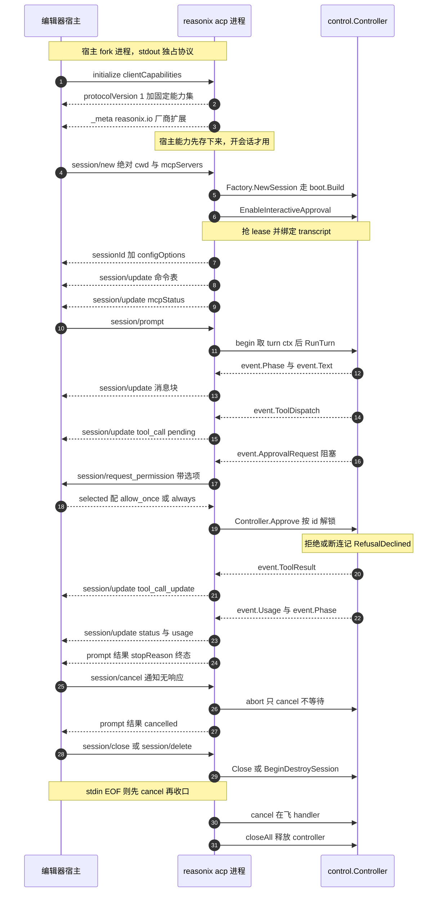

# ACP：把内核交给宿主，把裁决权留在内核

> 本解读按 **ai-agent** 类规格产出，属 DeepSeek-Reasonix 深度解读的子文档；共 13 篇，解读基线 `v2.37.0`（`e17ef45e3`）。正文所有 `文件:行号` 引用均为 Reasonix 仓库相对路径，点开即可核对。相关篇章见 [README.md](README.md)。

## 在系统中的角色：第四个宿主适配器

Reasonix 有四种使用形态，共用同一个内核：Studio 桌面、TUI、Web（HTTP+SSE）、编辑器。编辑器形态走 ACP（Agent Client Protocol），由编辑器或其他宿主**拉起 `reasonix acp` 子进程**，用 JSON-RPC 完成会话、流式更新、工具调用与审批往返。

ACP 前端是内核的第四个宿主适配器，也是唯一一个"宿主拥有进程"的适配器。去掉它，Reasonix 仍然能被 TUI、Web、desktop 驱动——但它在编辑器里就不存在了，这等于放弃"人在写代码的现场里叫 agent 干活"这个场景。

它承担三件别的前端不做的事：

- 把内核的 typed 事件流（`event.Event`）翻译成 ACP 的 `session/update` 通知，这是**单向投影**，不是状态搬运；
- 把内核权限门的 `Ask` 决策翻译成一次**跨进程往返**（`session/request_permission`），宿主拥有的否决权由此进入内核；
- 把编辑器的**未保存缓冲区**和**宿主终端**接进文件工具与 bash（当宿主声明了对应能力时），让编辑作用于"编辑器现在显示的内容"而不是磁盘上最后一次保存的副本。

[docs/ACP.md:76-84]()
<!-- anchor: When the client advertises `fs.readTextFile`, `fs.writeTextFile`, or … tools run locally inside the Reasonix process. -->

本篇的主线是一句可以被逐个机制验证的话：**ACP 把一个交互式编码工具的审批往返塞进了单一条 JSON-RPC 连接里，于是并发模型、错误身份和取消路径都被这条连接反向约束。** 章节顺序按这条约束展开——先看约束本身，再看握手、审批、会话簿记各自的解法，最后才是端口与门禁这类跨前端话题。

## 根因：一条 JSON-RPC 连接的三个反向约束

根因不是"怎么做一个编辑器插件"，而是三个约束的叠加。第三个是整篇的支点。

**一、宿主拥有进程生命周期。** 编辑器不会去连一个端口，它 fork 一个进程。于是"协议通道"必须是标准流，"日志"必须另走一路，否则协议会被日志字节污染：ACP 明确要求 stdout 独占协议、诊断走 stderr。

[docs/ACP.md:9-12]()
<!-- anchor: Reasonix implements Agent Client Protocol (ACP) v1 as an NDJSON JSON-RPC 2.0 … messages, tool activity, plans, permission requests, and configuration updates. -->

**二、会话真源不能放在宿主。** 编辑器会崩溃、会重连、会同时开两个窗口。所以"这个会话做了什么"必须落在内核 + 磁盘，宿主只持有"它现在画什么"。

[docs/ACP.md:88-90]()
<!-- anchor: Each ACP session owns an independent Reasonix controller, workspace root, model, … persisted transcript. State does not leak between sessions. -->

这段自述写得很具体：每个 ACP session 拥有独立的 controller、workspace root、model、执行设定、协作模式、审批模式、MCP 集和持久化 transcript，状态不在会话间泄漏。

**三、裁决必须在人那一侧。** 模型发起工具调用后能不能跑，答案不来自模型，也不来自 agent 进程，而来自宿主的用户。这就要求一条从内核**反向走到宿主、再走回来**的往返，而这条往返发生在一个**仍然挂着的** `session/prompt` 请求内部。

三条约束合起来逼出了本关注面的三个主题，后面各节分别处理：

| 约束 | 它逼出的机制 | 代价落点 |
|---|---|---|
| stdout 独占协议、请求会长时间挂着 | 每帧一个 goroutine + 出站写串行化 | 需要额外的连接关闭中断路径，否则审批等待会死等 |
| 审批是一次嵌套的反向请求 | 拒绝必须携带身份（Code），而不是靠错误文本 | 协议层要显式区分"拒绝 / 中止 / 没人可问" |
| 宿主的生命不受内核控制 | 三条取消入口，不依赖对端守约 | 没有审批超时，用户走开就无人收口 |

## 谁拥有什么：进程、状态、裁决的三分

先摆清归属，后面每一节都是这张表在某个具体问题上的落地。

| 归属 | 宿主（client） | `reasonix acp`（agent） |
|---|---|---|
| 进程 | 拉起、杀掉、决定 stdin 何时关闭 | 被拥有；stdin EOF 即退出 |
| 协议通道 | 提供 stdin/stdout/stderr 三路独立 | stdout 独占 JSON-RPC，stderr 只放诊断 |
| 会话真源 | 只存 sessionId 字符串 | `control.Controller` + 盘上 `<id>.jsonl` transcript |
| UI 状态 | 消息气泡、计划面板、审批弹窗、权限选择 | 无 UI；只发 `session/update` 与 `session/request_permission` |
| 工作目录 | 决定绝对 `cwd` 并传进来 | 校验必须是绝对路径，之后 root 住文件工具与 bash |
| 权限裁决 | 给出 allow/reject 与"仅此次/本会话" | 把答案落到 session 授权表，并决定拒绝时模型看到什么 |
| 模型 / preset / 审批模式 | 通过 `configOptions` 选择 | 拥有生效值与持久化（sidecar meta） |

宿主侧的状态薄得刻意：`acpSession` 只留 controller 指针、sink、transcript 路径、cwd、model/effort/preset、审批模式、协作模式、状态遥测、lease 和几个时间戳。

[internal/frontend/acp/service.go:266-325]()
<!-- anchor: type acpSession struct { … maintenanceDone chan struct{} -->

注意 `acpSession` 里**没有对话内容**。历史永远从 `ctrl.History()` 或磁盘读，ACP 不留副本——这是"状态不泄漏"能成立的机制，而不是纪律。

## 传输与进程治理：stdio、每帧一个 goroutine、写串行化

transport 是 **NDJSON（每帧一行 JSON）的 JSON-RPC 2.0，跑在 stdio 上**，单行上限 32 MiB，因为 prompt 可以内嵌资源文本。

[internal/frontend/acp/server.go:14-16]()
<!-- anchor: // maxMessageBytes caps a single inbound NDJSON line. ACP messages can embed … const maxMessageBytes = 32 << 20 // 32 MiB -->

不用 TCP / WebSocket 的理由是结构性的：宿主已经在 fork 进程，再开端口就要引入端口分配、认证、跨机器暴露面三个新问题，而这些问题在"进程是我起的"这个前提下全都不必要。

进程治理有三条硬约束。第一条直接来自"审批往返嵌在一个挂着的请求里"这个事实。

- **每帧一个 goroutine。** 一个长时间运行的 `session/prompt` 不能挡住 `session/cancel` 或审批回复，所以请求和通知各自 fan-out。

[internal/frontend/acp/server.go:199-223]()
<!-- anchor: // dispatch parses one frame and routes it. Requests and notifications fan out t … c.writeError(json.RawMessage("null"), ErrInvalidRequest, "invalid request") -->

`Serve` 在协议通道结束时先 cancel 所有在飞 handler（让 prompt 解套），再 `wg.Wait()` 等它们把响应刷出去，最后才失败掉所有未决的**出站**请求。

[internal/frontend/acp/server.go:127-159]()
<!-- anchor: // Serve reads inbound frames until the reader ends or ctx is cancelled. Each … return loopErr -->

- **写串行化。** 所有出站帧过一把 mutex，避免并发的 prompt 与 cancel 把一行 JSON 交错了。

[internal/frontend/acp/server.go:51-67]()
<!-- anchor: type Conn struct { … closed    chan struct{} -->

[internal/frontend/acp/server.go:323-326]()
<!-- anchor: func (c *Conn) write(m outbound) error { … return c.enc.Encode(m) -->

- **出站请求可被连接关闭打断。** `Conn.Request` 同时在等对端响应、ctx 取消和 `closed` 通道三者，所以断连时审批等待不会变成死等。

[internal/frontend/acp/server.go:291-319]()
<!-- anchor: // Request sends an outbound request and blocks until the peer responds, ctx is … return nil, errors.New("acp: connection closed") -->

进程由 `internal/frontend/cli/acp.go` 的 `acpCommand` 落地：解析 `--model/--preset/--planner/--sandbox-*`，然后 `acp.Serve(ctx, os.Stdin, os.Stdout, factory, info)`，`ctx` 来自 `signal.NotifyContext`，所以 Ctrl-C 也能收口。

[internal/frontend/cli/acp.go:27-34]()
<!-- anchor: // acpCommand runs Reasonix as an Agent Client Protocol agent: a stdio JSON-RPC … // at the cwd the client opens. -->

[internal/frontend/cli/acp.go:76-89]()
<!-- anchor: ctx, stop := signal.NotifyContext(context.Background(), os.Interrupt) … return 0 -->

生命周期结束有两条路径，都被显式处理：

- `serve` 返回后 `defer svc.closeAll()`：abort 在飞回合、关掉每个 controller（连带停掉 MCP 子进程）、释放 session lease。

[internal/frontend/acp/service.go:155-158]()
<!-- anchor: conn.Handle("session/delete", svc.sessionDelete) … return conn.Serve(ctx) -->

[internal/frontend/acp/service.go:1223-1233]()
<!-- anchor: // closeAll tears down every open session (aborting any in-flight turn and … sess.releaseSessionLease() -->

- 单会话级 `session/close` / `session/delete`：前者幂等释放资源不删历史，后者走 `BeginDestroySession` 并能在超时后降级为 `MarkCleanupPending` + 下次启动 reconcile。

[internal/frontend/acp/session.go:474-489]()
<!-- anchor: // sessionClose releases an active session. Unknown sessions are accepted as a … return SessionCloseResult{}, nil -->

[internal/frontend/acp/session.go:555-612]()
<!-- anchor: // sessionDelete removes a session from future list results. Deleting a missing … return SessionDeleteResult{}, nil -->

这两条路径不是"收尾的样板代码"，而是"请求会长时间挂着"这个设计的必要条件：没有它们，一个挂着的 `session/prompt` 会在宿主消失后留下孤儿回合。

## 握手：用能力协商代替版本协商

`initialize` 是唯一一次"双方各自亮牌"。agent 侧的能力集是**固定的常量**，不是运行时推导的：`loadSession`、`sessionCapabilities.{list,resume,close,delete}`、`promptCapabilities.{image:true, audio:false, embeddedContext:true}`、`mcpCapabilities.{http:true, sse:false}`，再加一整块 `_meta["reasonix.io"]` 厂商扩展（steer、inbox、reloadExtensions、extensionSurface，以及 goal/status/mcpStatus 的 schemaVersion）。

[internal/frontend/acp/handshake.go:14-19]()
<!-- anchor: func (s *service) initialize(_ context.Context, raw json.RawMessage) (any, error … return InitializeResult{ -->

宿主侧的能力则被**存起来给后面的会话用**，而不是当场决定行为：`setClientCapabilities` 把 `ClientCapabilities` 存进 service，`session/new` / `load` / `resume` 时才由 `bindClientIO` 决定要不要接上文件覆盖层与宿主终端。

[internal/frontend/acp/service.go:192-201]()
<!-- anchor: func (s *service) setClientCapabilities(caps ClientCapabilities) { … return s.clientCaps -->

[internal/frontend/acp/service.go:227-239]()
<!-- anchor: // bindClientIO fills SessionParams' overlay/terminal fields from the client's … p.Terminal = tr -->

这个"先存后用"的顺序不是实现细节，而是能力位语义的必然：握手时还没有会话，能力位在这一刻无法影响任何行为；只有会话建立、cwd 与 root 定下来之后，"要不要用宿主的文件系统"才是一个有意义的问题。

### 版本不匹配怎么办：答案是"不处理"

`InitializeParams.ProtocolVersion` 被反序列化进来，然后**从不比较**。

[internal/frontend/acp/handshake.go:14-19]()
<!-- anchor: func (s *service) initialize(_ context.Context, raw json.RawMessage) (any, error … return InitializeResult{ -->

回复恒为协议版本 1。

[internal/frontend/acp/protocol.go:23-32]()
<!-- anchor: // ProtocolVersion is the ACP version this agent implements. Matches main. … ErrInternal       = -32603 -->

这看起来危险，但兼容性由五件事共同兜住，而不是由版本号兜住：

1. **能力位协商**：宿主不声明 `fs.readTextFile`，文件工具就整体退回进程内本地实现，不报错。
2. **`_meta` 宽容解析**：客户端能力块里未知或形状不对的条目一律等价于"该功能关闭"。`clientExtensionSurfaceSupported` 要求 `_meta["reasonix.io"]["extensionSurface"]["supported"]` **显式为 true**，其余一切（缺键、类型错、块本身畸形）都返回 false。
3. **厂商命名空间**：只有 `_<vendor>/` 前缀被 ACP 保留给厂商方法，所以裸的 `reasonix/session/reloadExtensions` 可能与未来官方方法撞名，必须写成 `_reasonix.io/session/reloadExtensions`。
4. **文本回退**：结构化扩展面板只发给声明了支持的客户端；每个客户端**都**会额外收到一份扁平化的 `agent_message_chunk` 文本。
5. **同一语义的多个历史 id 都被接受**：`normalizeConfigID` 把 `reasoning_effort`/`thought_level`、`profile`/`runtime_profile`/`token_mode`、`approval`/`approval_mode`/`tool_approval_mode` 归一到同一条轴，所以写旧 id 的老宿主仍然能切到正确的轴。

[docs/ACP.md:76-84]()
<!-- anchor: When the client advertises `fs.readTextFile`, `fs.writeTextFile`, or … tools run locally inside the Reasonix process. -->

[internal/frontend/acp/service.go:210-224]()
<!-- anchor: // clientExtensionSurfaceSupported tolerantly parses the client's vendor … return supported -->

[internal/frontend/acp/protocol.go:534-538]()
<!-- anchor: // sessionReloadExtensionsMethod follows ACP v1's reserved vendor-extension … const sessionReloadExtensionsMethod = "_reasonix.io/session/reloadExtensions" -->

[internal/frontend/acp/dispatch.go:251-283]()
<!-- anchor: // emitExtension maps one extension structured-UI event onto ACP updates. A … s.send(messageChunk{SessionUpdate: "agent_message_chunk", Content: textBlock(pre -->

[internal/frontend/acp/session_config.go:535-546]()
<!-- anchor: func normalizeConfigID(id string) string { … return strings.TrimSpace(id) -->

代价是清楚的：没有显式版本闸门，一个 ACP v2-only 的宿主连上来时 agent 不会说"我不支持你"，只会按 v1 语义降级或返回 `-32601`。换来的是"一个二进制服务所有 ACP v1 宿主"，以及"新增厂商扩展不需要动协议版本号"——考虑到 v1 生态里已经有一批集成方，这个收益压过了闸门的价值。

判据仍然是结构而不是措辞：这五件事里没有一件读"宿主自称是什么版本"，全部读"宿主实际声明了什么能力"。

## 核心链路：一次完整会话

这张图把上面所有切分点串在一次真实会话里。读它时只需要盯住两条方向相反的边：`session/request_permission` 是 agent→client 的**请求**（要回复），`session/update` 是 agent→client 的**通知**（不回复）；而 `session/cancel` 是 client→agent 的通知（不回复）。这一张图同时是"协议方法清单"的反面教材——真正重要的不是有哪几个方法，而是哪一条边会让内核停下来等人。



图后的着落：这条链路里**只有一个地方**是"内核等宿主"，就是 `event.ApprovalRequest` 那一步（以及同构的 `event.AskRequest`）。其他所有边都是内核单向投影给宿主，宿主不参与决策。理解这一点，就理解了为什么 ACP 前端可以很薄——它的复杂度几乎全部集中在"如何把一次跨进程往返安全地嵌进一个仍然挂着的 JSON-RPC 请求里"，而不是在"如何把内核状态同步给宿主"。

“宿主应保持请求打开”这件事是协议要求，不是本项目的实现偏好。

[docs/ACP.md:171-173]()
<!-- anchor: Hosts should keep the `session/prompt` request open until Reasonix returns its … directions. -->

## 审批往返：嵌在未完成请求里的反向请求

### 过协议的工具面

工具调用的**宣告**与**结果**是两条消息。宣告是 `tool_call`：`toolCallId`、`title`（工具名）、`kind`（read/edit/search/execute/other，宿主据此分类渲染）、`status: pending`、`rawInput`（原始 JSON 参数）和 `locations`（这个调用碰的文件，可选带行号，让编辑器能跳过去跟随）。

[internal/frontend/acp/protocol.go:600-615]()
<!-- anchor: // toolCall is a "tool_call" update (announces a call, with title/kind/rawInput) … Line *int   `json:"line,omitempty"` -->

`locations` 只对名字在白名单里的工具生成（`read_file`/`write_file`/`edit_file`/`code_index` 等），并且**只取 args 里的 `path`**；搜索/列表类工具被明确排除，因为它们的 `path` 是目录范围而不是用户想打开的文件。

[internal/frontend/acp/dispatch.go:692-724]()
<!-- anchor: var locationTools = map[string]bool{ … return []ToolCallLocation{loc} -->

相对路径会先按 session cwd 绝对化。

[internal/frontend/acp/dispatch.go:727-731]()
<!-- anchor: func (s *updateSink) absPath(p string) string { … return filepath.Join(s.cwd, p) -->

结果走 `tool_call_update`，`status` 为 `completed` 或 `failed`，`content` 是文本。**过线前会被截断到 8000 字符**，并附一句"还差多少字符被截断"——注释明确写了这是**只为显示**，完整结果仍然给模型。

[internal/frontend/acp/dispatch.go:32-34]()
<!-- anchor: // maxResultChars clips a tool result before it crosses the wire, matching main' … const maxResultChars = 8000 -->

[internal/frontend/acp/dispatch.go:644-654]()
<!-- anchor: // clip truncates text to maxResultChars, appending a note, matching dispatch.ts … strconv.Itoa(len(text)-end) + " more chars truncated)" -->

唯一的例外是宿主标记为完整 unified diff 的结果：它**不截断**，因为 diff 是宿主要渲染的东西，只包进一段长度动态计算的 ``` 围栏（围栏长度超过正文里最长的反引号串，否则正文里的一行 ``` 会提前闭合它）。

[internal/frontend/acp/dispatch.go:619-625]()
<!-- anchor: func toolResultText(text string, isDiff bool) string { … return fence + "diff\n" + body + "\n" + fence -->

这两处细节的共同点是：它们都是"为渲染服务"的协议契约。`locations` 决定编辑器能不能跳转，围栏长度决定宿主能不能安全渲染 diff；这些字段一旦被当成普通 JSON 载荷处理，宿主侧就会以"看起来能用但偶尔坏掉"的方式失败。

### 触发路径：从权限门到一次跨进程往返

往返发生在 `session/request_permission` 上，但触发它的路径值得完整走一遍。

1. 内核的权限门（`permission.Gate`）对工具调用给出 `Ask`，转给 `gateApprover`。

[internal/session/control/approval_bridge.go:131-135]()
<!-- anchor: // approval bridge (agent gate → events) … type gateApprover struct{ c *Controller } -->

2. `requestApprovalDecision` 先做短路判定（YOLO / auto / 已批准计划的执行窗口 / 本会话已有的授权），再串行化未决弹窗，然后**注册一个等待者并发出一条 `event.ApprovalRequest`**，最后 select 在"收到答复"与"ctx 结束"之间阻塞。

[internal/session/control/approval_orchestration.go:629-637]()
<!-- anchor: waitCtx, cancelWait := c.approval.waitContext(ctx) … return approvalReply{}, waitCtx.Err() -->

3. ACP 的 `updateSink` 收到这个事件后，**不在 emit goroutine 上做往返**——因为 agent 是串行 emit 的，阻塞在这里会卡住整条事件流。它另起一个 goroutine 用 turn ctx 发 `session/request_permission`。

[internal/frontend/acp/dispatch.go:232-237]()
<!-- anchor: case event.ApprovalRequest: … go s.requestPermission(turnCtx, e.Approval) -->

4. 宿主的回复被翻译成一个三元组 `(allow, session, persist)` 交给 `Controller.Approve`，后者按 id 找到等待者、解除阻塞，并把"本会话记住"落成 session 授权。

[internal/frontend/acp/dispatch.go:431-443]()
<!-- anchor: allow, session, persist := false, false, false … s.approve(a.ID, allow, session, persist) -->

[internal/session/control/approval_orchestration.go:26-30]()
<!-- anchor: // Approve answers a pending ApprovalRequest by ID: allow runs the call, session … c.ApproveFrom(id, allow, session, persist, nil) -->

第 3 步那句"另起一个 goroutine"是全篇最容易被忽略的一行。它不是并发优化的选择，而是**串行 emit 契约的直接后果**：既然事件流是串行的，任何在事件回调里等待对端的行为都会把整个内核的活动冻住，包括取消。于是"一次跨越进程的往返"被强行拆成"发请求"与"等回复"两段，分别落在不同的执行单元里。

### 两个 ID 面：审批与工具调用

**审批 ID 与工具调用 ID 是两个不同的 ID，过线时被显式加上前缀区分**：审批是 `"gate-" + a.ID`，ask 是 `"ask-" + askID + "-" + q.ID`。

[internal/frontend/acp/dispatch.go:420-420]()
<!-- anchor: ToolCallID: "gate-" + a.ID, -->

[internal/frontend/acp/dispatch.go:547-547]()
<!-- anchor: ToolCallID: "ask-" + askID + "-" + q.ID, -->

这样宿主可以在同一张工具卡上把"这次调用"与"这次授权询问"关联起来，又不会让两者的生命周期互相污染：一次工具调用可以触发零次或多次授权询问，一次授权询问也可以覆盖一个由模型发起的纯提问。

### 谁能给出"记住"这个选项，由内核决定

`approvalOptions` 分两档：`fresh`（用户级信任/业务决策，如沙箱逃逸、出网、托管配置写入、记忆读写的 remember/forget）或工具本身要求"每次都要人"时，**只给 allow_once / reject_once**，把"允许本会话"降级为一个更窄的会话选项或干脆不给——因为宽泛的 YOLO 与自动规则**不允许**替这类决策作答；普通工具才给三选一。

[internal/frontend/acp/dispatch.go:580-600]()
<!-- anchor: func approvalOptions(tool, subject string, fresh bool) []PermissionOption { … return options -->

`fresh` / `requireHuman` 的语义在控制器侧定义。

[internal/session/control/approval_bridge.go:449-464]()
<!-- anchor: // approvalRequest is one ask: what is being approved, why, and which postures … requireHuman bool -->

把"哪些决策必须由人做"放在内核而不是前端，是一个跨前端一致性的决定：ACP、TUI、Web 三个前端因此不可能各自对"记住"给出不同的可选集合。代价是前端失去按场景裁剪选项的自由——ACP 只能把内核算好的三档原样画出来。

## 宿主拒绝不等于失败：错误身份与四种拒绝

这是全篇最值得学的一点：**拒绝既不是系统错误，也不是"再试一次"。**

门的 `ask` 分支在 `allow == false` 且 `err == nil` 时返回 `Verdict{Reason: "the user declined this tool call — do not retry it; ask how they would like to proceed or choose another approach.", Code: RefusalDeclined}`。注意**没有 error**。

[internal/safety/permission/verdict.go:108-123]()
<!-- anchor: func (g *Gate) ask(ctx context.Context, toolName string, args json.RawMessage, r … v.Reason = approverReason -->

含义是：工具调用**真的没跑**，但整个回合没有失败——模型拿到的是一个**调用级失败 + 宿主撰写的失败归因文本**，然后它可以在下一轮换一条路。这正好回应了项目根因里那条"模型会编造失败原因，所以失败归因是宿主拥有的状态"：原因文本不是模型猜的，是内核写好的，并且**明确禁止重试**，因为重试一个被人拒绝的调用是在训练用户去点"总是允许"。

拒绝还有四种身份，靠 `Code` 而不是靠措辞区分。

[internal/safety/permission/verdict.go:116-123]()
<!-- anchor: allow, remember, approverReason, err := g.approve(ctx, toolName, Subject(args),  … v.Reason = approverReason -->

[internal/safety/permission/verdict.go:149-158]()
<!-- anchor: // denial names what refused a call: a matched deny rule, the read-only … return Verdict{Reason: postureRefusal, Code: RefusalUnattended} -->

四者是：`RefusalDeclined`（人拒绝了）、`RefusalUnattended`（这个会话根本没人可问，或当前姿态拒绝一切需要审批的调用）、`RefusalDenyRule`（命中 deny 规则）、`RefusalReadOnly`。各自的原因文本互不相同，且都写了"为什么重试无用"。这是"判断必须读结构，不能读措辞"在权限面上的落法：前端可以放心地按 Code 做机械化处理，而不必去匹配英文句子。

同时，这一层与前端是解耦的——ACP 不实现 `Gate`，它只是让 controller 装配一个把 Ask 转成事件的 approver。

[internal/session/control/approval_orchestration.go:148-158]()
<!-- anchor: // approval decisions to the frontend via ApprovalRequest events, and wires the … if c.executor != nil { -->

## 取消路径与超时：三条入口，以及缺省的那一位

**ACP 路径不设审批超时。** `acpFactory.sessionBootOptions` 没有填 `boot.Options.ApprovalTimeout`。

[internal/frontend/cli/acp.go:166-185]()
<!-- anchor: return boot.Options{ … }, nil -->

而 `approvalManager.waitContext` 在 `approvalTimeout <= 0` 时直接返回父 ctx。

[internal/session/control/approval.go:475-480]()
<!-- anchor: // waitContext bounds the blocking wait by approvalTimeout when set. … return context.WithTimeout(ctx, a.approvalTimeout) -->

所以等待的上界**只有三个来源**，且都是取消而不是超时：

| 情形 | 机制 | 结果 |
|---|---|---|
| 宿主发 `session/cancel` | `abort()` 取消 turn ctx | `waitCtx.Done()` → 返回 `context.Canceled` 错误 → 门给出 `Verdict{Reason: "approval aborted"}` 加 error；回合以 `stopReason: cancelled` 收尾 |
| 宿主进程/管道断开（stdin EOF） | `Conn.Serve` 结束读循环后 `cancel()` 在飞 handler | 同上；同时所有未决**出站**请求被 `shutdown()` 以 `"acp: connection closed"` 失败掉 |
| 宿主明确回 `outcome: cancelled` 或选项不是 allow | `requestPermission` 解析不出 allow | `s.approve(id, false, false, false)`，即"拒绝"而非"中止" |

第二种情形在 `requestPermission` 这一侧有双重兜底：`Conn.Request` 自身 select 了 `closed` 通道，所以即便 turn ctx 因为某种原因还没被取消，断连也会立刻把请求失败掉，从而走"拒绝"这条不会挂死的路。

[internal/frontend/acp/server.go:313-319]()
<!-- anchor: select { … return nil, errors.New("acp: connection closed") -->

[internal/frontend/acp/dispatch.go:431-443]()
<!-- anchor: allow, session, persist := false, false, false … s.approve(a.ID, allow, session, persist) -->

第三种情形值得单独点出：**"宿主说取消"和"宿主说拒绝"在内核里是两件不同的事**——前者是 error（回合被取消），后者是 `RefusalDeclined`（回合继续，模型收到不可重试的原因）。ACP 把 `outcome.outcome != "selected"` 一律当拒绝，所以一个只想关掉弹窗的宿主会让模型以为"用户拒绝了这个调用"。

[internal/frontend/acp/dispatch.go:434-439]()
<!-- anchor: if json.Unmarshal(raw, &res) == nil && res.Outcome.Outcome == "selected" { … allow, session = true, true -->

这是当前协议映射的一个粗糙处，属于已知边界的范畴：`session/request_permission` 的 ACP 结果类型里没有表达"这次询问被撤回"的第三态，于是内核侧的两种语义在协议层被压成了一种。

### 三条不被"自动允许"侵蚀的边界

**一、模型可以强制要一个真人决定，而 YOLO 模式不能替这个人回答。** `Controller.Ask` 只把问题当 `AskRequest` 发出去并阻塞，注释写明了理由——`ask` 工具存在的目的就是拿到真实用户决定，YOLO 只自动批准工具调用，不能替人回答他自己的问题。

[internal/session/control/approval_orchestration.go:278-283]()
<!-- anchor: // Ask implements agent.Asker: it emits an AskRequest and blocks until … // tool calls; it must not answer the user's questions for them. -->

而 ACP 把 `AskRequest` 与 `ApprovalRequest` 都送进同一个 `session/request_permission` 往返，所以宿主不需要为"提问"再实现一套交互。

[internal/frontend/acp/dispatch.go:251-257]()
<!-- anchor: // emitExtension maps one extension structured-UI event onto ACP updates. A … // AskRequest, which already rides the session/request_permission round-trip. -->

**二、"本会话允许"这条捷径不能覆盖需要每次问人的工具。** 装配交互式门时，`policy.SessionAllow` 会先被 `rulesWithoutFreshHumanApproval` 剥掉记忆、计划审批、沙箱逃逸、托管配置写入这几类，再强制把 `remember`/`forget` 加入 Ask 规则——否则 `--allowed-tools remember` 就能在无人提示的情况下写记忆。

[internal/session/control/approval_orchestration.go:199-208]()
<!-- anchor-base64:Ly8gQSBzZXNzaW9uIGFsbG93bGlzdCAoZS5nLiAtLWFsbG93ZWQtdG9vbHMpIG11c3QgbmV2ZXIgc2F0aXNmeSBhIHRvb2wgdGhhdApwZXJtaXNzaW9uLlJ1bGV7VG9vbDogbWVtb3J5Rm9yZ2V0VG9vbH0s -->

**三、id 不能跨 controller 代际重复。** 审批/提问的 id 由 `promptIDs` 发放，前缀在 manager 构造时**一次性随机**，注释解释了原因：重建后的 controller 与前端共用同一条事件流，前端会丢弃"它已经答过的 id"，所以 id 一旦重复，一次旧答复会被当成新答复消费。

[internal/session/control/approval.go:285-297]()
<!-- anchor: // promptIDs issues the identity an answer is correlated by. A rebuilt controlle … return promptIDs{prefix: hex.EncodeToString(b[:])} -->

这也解释了 `Approve` 那句"未知/已过期的 ID 被忽略"为什么是安全的——静默忽略比错配答复安全。ACP 侧再叠一层 `"gate-"` / `"ask-"` 前缀，把两条决策面在同一条连接上彻底分开。

[internal/session/control/approval_orchestration.go:26-30]()
<!-- anchor: // Approve answers a pending ApprovalRequest by ID: allow runs the call, session … c.ApproveFrom(id, allow, session, persist, nil) -->

有一条 ACP 有意不做的能力也可以在这里看清：**计划修订没有 ACP 面。** `PlanDecisions` 被排除在 `EditorAPI` 之外，理由写在端口注释里——计划决策是工作流转移而不是权限答复，而"编辑器桥没有修订计划的屏幕"。

[internal/session/control/port.go:109-112]()
<!-- anchor: // PlanDecisions answers the plan card. It is apart from Approvals because a … // and the editor bridge have no screen for revising a plan. -->

同处也说明 `FolderTrust` 只属于显示文件夹的前端。所以 ACP 能**显示**计划（`todo_write` 的参数派生出 `plan` 更新），但一个计划审批提示在 ACP 上只能被当成普通的允许/拒绝来回答。

[internal/frontend/acp/dispatch.go:737-768]()
<!-- anchor: func planEntriesFromTodoArgs(rawArgs string) ([]PlanEntry, bool) { … return entries, true -->

**本文的推断（未读到端到端测试）**：由此推出的"ACP 上拿不到'改一版再执行'这个第三出口"属于**推断而非直接证据**——依据是 `PlanDecisions` 不在 `EditorAPI` 中。

[internal/session/control/port.go:460-469]()
<!-- anchor: type EditorAPI interface { … SessionPersistence -->

且 ACP 从未调用 `ResolvePlanDecision`。我**没有**读到一条"ACP 上收到 planApprovalTool 的审批提示并只回复 allow/reject"的端到端测试，所以这一步留作推断。

## 会话簿记：真源在 controller 与磁盘，ACP 只持有指针

这条链路的切分逻辑是**把"一整轮"作为一个不可分的协议单元**，而不是把每个中间状态都提成一个方法。

**建立**（`session/new`）——mint 一个 UUID，建一个绑定该 id 的 `updateSink`，请 Factory 装配 controller，打开交互式审批，抢 session lease，把 transcript 路径设成 `<sessionDir>/<id>.jsonl`。

[internal/frontend/acp/session.go:39-148]()
<!-- anchor: func (s *service) sessionNew(ctx context.Context, raw json.RawMessage) (any, err … }, nil -->

[internal/frontend/acp/service.go:713-714]()
<!-- anchor: func transcriptPath(dir, id string) string { … return filepath.Join(dir, id+".jsonl") -->

这里有一个不显眼但关键的顺序问题：`session/new` 的响应必须先写到线上，客户端才能注册这个 sessionId；但 `available_commands_update` 和 MCP 状态快照又必须在响应之后立刻到。于是引入了 `afterResponse`——transport 在成功写出 result **之后**才调用钩子。

[internal/frontend/acp/service.go:176-188]()
<!-- anchor: // afterResponse wraps a result with work that must run after the transport has … r.after() -->

[internal/frontend/acp/server.go:23-27]()
<!-- anchor: // responseWithAfter lets a request handler schedule work that must run only … AfterResponse() -->

[internal/frontend/acp/server.go:244-258]()
<!-- anchor: var after func() … after() -->

**保存与恢复**——transcript 按 session id 命名，让 `session/load` 能跨进程重启按 id 找回。ACP 的元数据**不在** transcript 里，而是一个原子替换的 sidecar `<id>.acp.json`。

[internal/frontend/acp/session_meta.go:117-154]()
<!-- anchor: func saveACPMeta(sessionPath string, meta acpSessionMeta) error { … return fileutil.ReplaceFile(tmpPath, path) -->

这样做的理由是把"会话内容"与"会话的界面状态（当前模型、模式、审批姿态、标题、用量遥测）"分开演进：前者是内核的格式，后者是 ACP 的格式，互不牵连。

`session/load` 与 `session/resume` 是**同一个函数只差一个布尔位**：`openExistingSession(..., replay bool)`，区别是加载后要不要把历史当 `session/update` 重放一遍。

[internal/frontend/acp/service.go:537-564]()
<!-- anchor: func (s *service) openExistingSession(ctx context.Context, method, id, cwdParam  … return cfgState, nil -->

[internal/frontend/acp/session.go:220-237]()
<!-- anchor: func (s *service) sessionLoad(ctx context.Context, raw json.RawMessage) (any, er … }, nil -->

[internal/frontend/acp/session.go:252-269]()
<!-- anchor: func (s *service) sessionResume(ctx context.Context, raw json.RawMessage) (any,  … }, nil -->

把两者合成一个入口而不是两份实现，是因为它们的全部差异就是"重放"这一个副作用；两份实现会立刻在"加载后设置哪些状态"上漂移。

会话真源在磁盘上还有一层保护：**session lease**。ACP 打开会话时抢锁，别的运行时（另一个 desktop 窗口、CLI）想写同一个会话会被明确拒绝，而不是静默双写。

[internal/frontend/acp/service.go:631-637]()
<!-- anchor: // Bind the transcript for writing only if no other runtime (a desktop … return SessionConfigState{}, sessionLeaseBindError(method, leaseErr) -->

如果内核在提交时发现磁盘上的 transcript 被别人改过（快照冲突），会**换到一条 recovery 分支**；`resolveTranscriptPath` 跟随 sidecar 里的 `ActiveTranscript` 重定向，让按 id 的查找不会重启后静默打开恢复前的那份文件。

[internal/frontend/acp/service.go:725-746]()
<!-- anchor: func resolveTranscriptPath(dir, id string) string { … return resolved -->

**prompt**（`session/prompt`）——同步跑完整轮。prompt 块被扁平化成一段文本（图片/二进制落到 `.reasonix/attachments/` 并用 `@path` 引用，跟其他前端交出去的形式完全一致），然后 `sess.begin` 抢一个 per-turn 的 cancelable context，把 turn ctx 装进 sink，跑 `RunTurnWithRaw`，最后按 `runErr` 与 ctx 状态给 stop reason。

[internal/frontend/acp/session.go:272-340]()
<!-- anchor: // sessionPrompt runs one turn. It flattens the prompt blocks to text and runs t … return res, nil -->

[internal/frontend/acp/prompt_attachments.go:14-71]()
<!-- anchor: // promptText turns a prompt's blocks into the text of one turn. Bytes a block … return "@" + rel, nil -->

stop reason 只有三个值：`end_turn` / `cancelled` / `error`。

[internal/frontend/acp/protocol.go:540-546]()
<!-- anchor: // StopReason tells the client why a turn ended. Values match main's wire. … StopError     StopReason = "error" -->

判据是"ctx 是否被取消"而不是"错误文本像不像取消"，这样"回合内工具失败"不会被误报成用户取消。

[internal/frontend/acp/session.go:328-340]()
<!-- anchor: stop := StopEndTurn … return res, nil -->

**流式更新**——`updateSink.Emit` 是整条链路唯一的事件翻译点，把 typed `event.Event` 映射成 `session/update`：`Reasoning` → `agent_thought_chunk`，`Text` → `agent_message_chunk`，`ToolDispatch` → `tool_call`(`pending`)，`ToolResult` → `tool_call_update`(`completed`/`failed`)，`todo_write` 的参数额外派生一条完整的 `plan` 更新（每次替换上一次，镜像 `todo_write` 的契约），`Notice`(warn) → 带 `metadata.notice.code` 的 message chunk。

[internal/frontend/acp/dispatch.go:134-247]()
<!-- anchor: // Emit implements event.Sink. The agent calls it serially (see event.Sink), so  … s.emitExtension(e) -->

[internal/frontend/acp/notice_meta.go:6-37]()
<!-- anchor: // warningUpdate is an agent_message_chunk that also names the notice it carries … return chunk -->

切分点很明确：**只翻译宿主能渲染的东西**。`StreamAttempt` 只做记账（它的 `Partial` 工具派发被丢弃，因为 ACP 期望"一个工具调用一张 pending 卡"，且 ACP 没有文件 diff 更新载荷），`Message`/`Phase`/`TurnStarted`/`TurnDone` 没有落点——其中 `TurnDone` 的结论已经通过 `session/prompt` 的 `stopReason` 出去了。

[internal/frontend/acp/dispatch.go:36-46]()
<!-- anchor: // updateSink is an event.Sink bound to one session that maps the agent's typed … // session/prompt stopReason instead). -->

[internal/frontend/acp/dispatch.go:155-175]()
<!-- anchor: case event.StreamAttempt: … return -->

**取消**（`session/cancel`）——是一个**通知**，没有响应，未知 session 静默忽略。

[internal/frontend/acp/session.go:615-623]()
<!-- anchor: // sessionCancel aborts a session's in-flight turn, if any. It is a notification … sess.abort() -->

`abort()` 只 cancel context、不等待。这是刻意的：取消必须能立刻返回，哪怕工具正堵在一个系统调用里；真正等它收口的地方是 `closeAll()` / `close` / `delete` 里的 `abortAndWait`。

[internal/frontend/acp/service.go:366-388]()
<!-- anchor: func (s *acpSession) abort() { … <-maintenanceDone -->

[internal/frontend/acp/service.go:1223-1233]()
<!-- anchor: // closeAll tears down every open session (aborting any in-flight turn and … sess.releaseSessionLease() -->

**配置轴与重建**——ACP 有四个独立控制轴：协作模式（`modes` + `session/set_mode`）、模型、推理档位、执行设定、工具审批。文档特意说明它们**不是**一个混合模式选择器。

[docs/ACP.md:108-121]()
<!-- anchor: ## Session controls … Use `session/set_config_option` for model, effort, execution setting, and tool a -->

实现上分成两类：

- 改变"controller 怎么被装配"的（model、effort、agent_preset 的重建路径）走**重建**：新建一个 controller，把 history、Plan/Goal/审批姿态、会话授权、生命周期钩子、客户端能力接线全部迁移过去，**先持久化再发布替换**（失败则旧 controller 仍然完全可用），最后才 `ReleaseResources` 旧的。

[internal/frontend/acp/service.go:989-1154]()
<!-- anchor: func (s *service) rebuildSessionLocked(ctx context.Context, sess *acpSession, cf … return nil -->

- 只改"门"的（`tool_approval`）与执行设定都**原地更新，不重建**。

[internal/frontend/acp/session_config.go:334-347]()
<!-- anchor: func (s *service) switchSessionToolApproval(ctx context.Context, sess *acpSessio … return cfgState, nil -->

[internal/frontend/acp/session_config.go:196-256]()
<!-- anchor: func (s *service) switchSessionRuntimeProfile(ctx context.Context, sess *acpSess … return cfgState, nil -->

并发策略是"非阻塞 + 每轴合并"：busy 期间到达的 model / preset / effort 请求按**轴**入队（同轴后写覆盖先写，不同轴互不覆盖），等会话空闲再对**当时的实时基线**重新解析一次；`maintenanceDone != nil` 时才允许入队，否则 `TryLock` 失败就排队等锁。

[internal/frontend/acp/service.go:937-986]()
<!-- anchor: // sessionConfigDelta names exactly one config axis a caller asked to change … return err -->

[internal/frontend/acp/service.go:1004-1016]()
<!-- anchor: if sess.running || status.Running || sess.maintenanceDone != nil { … sess.pendingConfig = removePendingAxes(sess.pendingConfig, deltas) -->

[internal/frontend/acp/session_config.go:259-331]()
<!-- anchor: // switchSessionConfig resolves and applies one explicit config request without … return cfgState, nil -->

`pendingConfig` 的存在还顺带阻断了新回合：`begin()` 在有排队配置时拒绝开新回合，避免模型跑在一个已经不被承认的配置上。

[internal/frontend/acp/service.go:338-345]()
<!-- anchor: s.mu.Lock() … return nil, nil, false -->

**状态遥测**——ACP 侧的 `statusTelemetry` 把 `Phase`/`Usage`/`ApprovalRequest`/`AskRequest`/`ToolDispatch` 映射成 `idle/running` + `starting/implementing/waiting_permission/waiting_input/...` + turn outcome + final readiness + 累计用量，每个变更递增 sequence，通过 `_reasonix.io/session/status_update` 推出去。

[internal/frontend/acp/status.go:300-369]()
<!-- anchor: type statusTelemetry struct { … return "", false -->

[internal/frontend/acp/status.go:699-709]()
<!-- anchor: func (s *service) publishStatus(sess *acpSession, eventName string) { … Status:        status, -->

`usage_update` 是 ACP 标准更新，从 `ctrl.ContextSnapshot()` 拿上下文占位、从遥测拿累计费用；窗口未知时**什么都不发**而不是发一个 `size: 0` 的假值。

[internal/frontend/acp/usage_update.go:17-42]()
<!-- anchor: // usageUpdateFor builds the update from the controller's context gauge and the … sess.sink.send(u) -->

## 方向与归属：ACP 与 MCP 的对照

上面所有机制都可以被压成一张静态对照图。之所以值得单独画一张，是因为 ACP 与 MCP 在 Reasonix 里是**方向相反的两套宿主协议**，而这两条方向决定了状态归属：ACP 是"编辑器拉起 Reasonix、Reasonix 在会话内反向请求编辑器"（宿主在外、内核在内、控制流反向），MCP 是"Reasonix 拉起外部 server、按需调用其工具"（内核在外、server 在内、控制流正向）。两者共用同一份工具面与同一道权限门，但**裁决只发生在 ACP 那一侧**——这张图的核心论据就是位置与箭头方向，不是消息清单。


这张图在说什么：左边一栏是编辑器形态——顶层是编辑器宿主，底层是 `reasonix acp` 子进程，控制流从宿主向下进入内核（`session/new`、`session/prompt`、`session/cancel`），而内核向上有三条边：一条是单向投影的 `session/update`，另外两条是**反向请求**（`session/request_permission` 与 `fs/*`、`terminal/*`），它们要宿主回复。右边一栏是 MCP 形态——顶层是 Reasonix 内核本身，底层是被它拉起或连接的外部 server，控制流同样自上而下（`initialize`、`tools/call`、`resources/read`），回程只有能力清单与通知。两栏底部横跨的是同一份内核底座：同一个 `control.Controller`、同一道 `internal/safety/permission` 门、同一份工具注册表。图的下半部分还钉住两件容易被忽略的事实：ACP 的取消路径只有三条入口（`session/cancel`、stdin EOF、宿主显式回 `cancelled`），以及**没有审批超时**——`ApprovalTimeout` 在 ACP 装配路径上根本没有被填，`waitContext` 在小于等于 0 时直接返回父 ctx。

该看什么、代价是什么：先看两条控制流的方向差，再看两条反向请求边只出现在左侧。这意味着"授权只在宿主一侧发生"是一个位置性质，不是纪律性质；MCP server 无论声明多少能力都不会获得裁决权。代价是两条：其一，ACP 侧多出来的反向边必须嵌在一个仍然挂着的 `session/prompt` 里，于是并发模型被迫复杂化（每帧一个 goroutine、写串行化、断连中断）；其二，超时这一位没有被填，用户走开时回合会一直挂着，唯一出路是宿主主动取消或断连——这是明确的欠账，不是设计选择。另外要如实说明：MCP 侧的 sampling / elicitation 一类反向请求**在本篇读到的证据里没有出现**（握手只广告 `http:true, sse:false`），所以图上没有画这条边；这不是"MCP 协议没有这种能力"的断言，只是本篇证据的边界。

## 与其它前端的共享与分叉

### 共享：一个 controller，三个前端继承

规范原文是"给 controller 加行为，不要给前端加，这样三个前端都继承"。

[REASONIX.md:11-13]()
<!-- anchor: - One transport-agnostic `control.Controller` sits behind every frontend (chat … frontend, so all three inherit it. -->

结构上这靠两件事落地。

- `internal/session/control` 是**唯一**传输无关控制器，且分层门禁规定只有 `cli`、`serve`、`acp`、`boot` 和宿主 `cmd/`、`desktop/` 可以 import `control`，前端之下的任何东西都不能。

[REASONIX.md:14-19]()
<!-- anchor: - Layering (enforced): utility packages import nothing under `reasonix/` except … sets live in `tools/repolint/layers.go`. -->

- 控制器按**子端口**切分，每个前端只声明它真正驱动的那一份。ACP 声明的是 `control.EditorAPI`，它有意**不**包含 skill 编写、hook 编辑、沙箱规则保存、feedback 提交——注释把理由写成一句：编辑器不编写技能、不编辑 hook、不保存沙箱规则、不提 feedback，报告表单属于那些拥有对应屏幕的界面。

[internal/session/control/port.go:455-469]()
<!-- anchor: // EditorAPI is what an editor integration drives over ACP: turns, approvals and … SessionPersistence -->

每个子端口都有编译期断言，所以"某个前端迁移到接口上"是机械操作，不可能与实现静默漂移。

[internal/session/control/port.go:472-477]()
<!-- anchor: // Compile-time proof that the concrete controller satisfies each sub-port and … _ Lifecycle          = (*Controller)(nil) -->

一个值得记录的现状观察：ACP 的 `acpController` 字段类型比 `control.EditorAPI` **更窄**——它没列 `control.Inbox`；inbox 相关方法是在 `sessionAPI()` 里用运行时类型断言 `.(control.EditorAPI)` 取得的，`session/steer` 也一样。

[internal/frontend/acp/service.go:246-260]()
<!-- anchor: type acpController interface { … ContextSnapshot() (int, int) -->

[internal/frontend/acp/inbox.go:12-24]()
<!-- anchor: func (s *service) sessionAPI(sess *acpSession) (control.EditorAPI, error) { … return api, nil -->

[internal/frontend/acp/session.go:362-380]()
<!-- anchor: ctrl := sess.currentCtrl() … return SessionSteerResult{ItemID: rec.ItemID, Disposition: string(rec.Dispositio -->

两套机制并存的原因多半是测试替身需要更小的接口，但结果是：**端口声明在 `port.go` 里是权威的，而在 acp 包内字段类型上的收窄是局部的**。门禁读的是 `port.go` 的 `EditorAPI` 与包内实际调用，所以这个收窄不影响门禁判定——只是读代码时需要知道存在两个"ACP 驱动什么"的答案。

### 分叉：frontend-parity 门禁怎么防止漏接

门禁的判定是三步：

1. **能力集** = `*control.Controller` 的全部导出方法（用 `go/types` 的方法集枚举，带位置信息）。
2. **可达** = 每个前端**声明的端口**（不是它调用的东西）支持哪些方法，取接口完整方法集——所以通过内嵌子端口到达的能力与直接写名的完全等价。
3. **已消费** = 对该前端包做类型检查，收集所有 selector 的 `types.Selection` 中属于 `control` 包的方法名。

[tools/repolint/frontendtypes.go:155-170]()
<!-- anchor: // portMethods is the port's complete method set, so a capability reached … return out, nil -->

然后 `row()` 逐个能力渲染 `acp=yes` / `serve=n/a` / `acp=no`，**缺失边按权重计数而不是按行计数**。

[tools/repolint/frontendparity.go:106-126]()
<!-- anchor: // row renders the capability's frontends in declared order and counts the ones … return strings.Join(cells, " "), missing -->


关键细节，每一条都是为了不让门禁被绕过：

- **`n/a` 与 `no` 是两件事。** 端口本身不承载这个能力 → `n/a`，这是 `port.go` 已经做过并编译过的范围决策；端口承载了但没调用 → `no`，这是债务。

[tools/repolint/frontendparity.go:109-126]()
<!-- anchor: func (m parityMatrix) row(method string, ports []frontendPort, scoped map[string … return strings.Join(cells, " "), missing -->

- **无人驱动的能力不算债务。** 注释写得很直白：如果把它也算上，每一个 controller 的私有 helper 都会变成四向缺陷。

[tools/repolint/frontendparity.go:73-78]()
<!-- anchor: for _, c := range m.capabilities { … continue -->

- **例外表是有代价的。** `frontendScopes` 里的每一行必须带 issue 与 reason，且判定**从不读这两个字段**——它们只为人服务。注释说明理由：一行例外的代价等于它替掉的那条缺失边的代价，所以这张表是把债务搬进这个文件，而不是让债务消失。

[tools/repolint/frontendparity.go:28-37]()
<!-- anchor: // frontendScope excuses one capability a frontend's port declares and that it … reason string -->

当前这张表是**空的**，注释说这是刻意的：门禁先如实地把今天的树量出来，每一行例外都得在自己的 PR 里被论证。

[tools/repolint/frontendparity.go:40-42]()
<!-- anchor: // Empty on purpose: the gate ships measuring what the tree does today, and each … var frontendScopes []frontendScope -->

- **谁被登记是有理由的。** 真正登记的只有 `acp`(EditorAPI) 与 `serve`(SessionAPI) 两个；HTTP 驱动的 shell 因为 `wire-parity` 已覆盖而缺席；`cli` 缺席的理由不同——交互式会话拿掉之后它只是 `serve` 与一次性 run 的启动器，不是"人通过它操作一个会话"的面。

[tools/repolint/frontendparity.go:19-25]()
<!-- anchor: // A shell that drives the kernel over HTTP is absent: wire-parity covers it. … {pkg: "internal/frontend/serve", port: "SessionAPI"}, -->

### 为什么读 `go/types` 而不是 selector 名字

这是门禁里最容易被质疑、也最值得学的一个决定。

**因为名字匹配会失败在"假阳性"这个方向。** `Close`、`Status`、`Label` 既是 controller 的能力，也是标准库里一堆类型的方法。如果只按名字匹配，"`os.File.Close`"会被记成"serve 驱动了 `Lifecycle.Close`"——一个假的"已接线"，而 ratchet 最不能失守的方向恰恰就是"漏报债务"。

[tools/repolint/frontendtypes.go:40-44]()
<!-- anchor: // loadParityMatrix reads the matrix from type information and never from … // real debt, the one direction a ratchet must not fail in. -->

同一条推理的另一半写在规范里：`REASONIX.md` 把"给 controller 加行为"写成受门禁持有的规则，并解释了为什么判定必须读类型；而"动词怎么拼"（`/branch`、`POST /branches`）是表现层的事，留在门禁之外。

[REASONIX.md:110-121]()
<!-- anchor: - "Add behavior to the controller so every frontend inherits it" is held by … `POST /branches` — is presentation and stays out of it. -->

同一条推理还带来两个附带决定：

- **矩阵在一个声明的 build target 上读**（`CGO_ENABLED=0 GOOS=linux GOARCH=amd64`）。理由：`internal/frontend/cli` 带有 `_windows` / `_unix` 文件，GOOS 相关文件集会与开发者本地的 baseline 打架；而且这是 CLI 自己的发布配置，树本来就必须能这样编。

[tools/repolint/frontendtypes.go:25-29]()
<!-- anchor: // One declared build target keeps the matrix off the machine that reads it: … var parityTarget = []string{"CGO_ENABLED=0", "GOOS=linux", "GOARCH=amd64"} -->

- **测试文件不参与"已消费"统计**。注释的理由是"只存在于测试里的调用，就是 `orphan.go` 已经拒绝计为调用者的那种尸体取暖"。

[tools/repolint/frontendtypes.go:173-176]()
<!-- anchor: // controlCalls type-checks one frontend and reports the control methods it … func controlCalls(fset *token.FileSet, imp types.Importer, pkg listedPkg) (map[s -->

代价也很直白：门禁依赖 `go list -export` 能把前端及其依赖整棵图编出导出数据，报错信息里直接写着"frontend-parity reads types and needs a building tree"。

[tools/repolint/frontendtypes.go:95-107]()
<!-- anchor: func listPackages(root string, ports []frontendPort) (map[string]listedPkg, erro … return nil, fmt.Errorf("frontend-parity reads types and needs a building tree; ` -->

**树编不过，这条门禁就跑不了**——它是一把只有能编译的树才能挥动的尺子。

**本文的明确限定：本次解读没有运行这条门禁**（需要可编译的 Go 工具链），所以下面的数字取自仓库里受版本控制的 ratchet 基线文件，而不是一次现场测量。

现状：`tools/repolint/baseline.json` 的 `limits["frontend-parity"] = 27`，即当前登记 27 条缺失边（按边加权），分散在 11 个 controller 文件里，其中 `internal/session/control/mcp_admin.go` 单文件占 6 条。可以逐条验证的例子：

| 能力 | 声明处 | serve 是否调用 | acp 是否调用 | 说明 |
|---|---|---|---|---|
| `RemoveMCPServer` | MCPControl | 是 | 否 | ACP 只读 MCP 健康状态，不做增删 |
| `InstallMCPServer` | MCPControl | 是 | 否 | 同上 |
| `CapabilityScope` | Lifecycle | 是 | 否 | ACP 没有能力清单界面 |
| `SubmitExtensionForm` | Extensions | 是 | 否 | ACP 把阻塞表单改走 `session/request_permission` |

[internal/session/control/port.go:246-246]()
<!-- anchor: ConfiguredMCPNames() []string -->

[internal/session/control/port.go:240-240]()
<!-- anchor: ReconnectMCPServer(name string) (int, error) -->

[internal/session/control/port.go:51-51]()
<!-- anchor: Close() -->

[internal/session/control/port.go:306-306]()
<!-- anchor: // ProviderCatalog is the session's merged provider catalog — config/broker -->

最后一行解释得通，而且**是设计而非疏忽**：`internal/frontend/acp/dispatch.go` 明确写了阻塞式 form/request 提示"从不走这里"——扩展 hub 把它们路由到 `AskRequest`，从而复用标准的 `session/request_permission` 往返。

[internal/frontend/acp/dispatch.go:251-257]()
<!-- anchor: // emitExtension maps one extension structured-UI event onto ACP updates. A … // AskRequest, which already rides the session/request_permission round-trip. -->

理由是"ACP 没有别的能显示问题的提示，而把服务端的表单画在那里会被读成 agent 在请求许可"。

[internal/frontend/acp/dispatch.go:491-499]()
<!-- anchor: func (s *updateSink) requestAsk(ctx context.Context, a event.Ask) { … return -->

也就是说 `SubmitExtensionForm` 这条缺失边是"用另一条路实现了同一件事"，但门禁只能看到"没调用"，所以要把它降为零就必须在例外表里写一行、并承担同样的权重。**这就是门禁的设计意图：把"我认为这是设计"变成一笔必须被记账的显式债务。**

### 依赖方向与共享状态

依赖方向是单向的：`internal/frontend/acp` → `internal/session/control` → `runtime` / `tools` / `state` / `safety`，反向不允许。这条方向由分层的声明集合持有，规范明确只有前端 `cli`/`serve`/`acp`/`boot` 与宿主 `cmd/`、`desktop/` 可以 import `control`，而前端之下的任何东西都不能。

[REASONIX.md:14-19]()
<!-- anchor: - Layering (enforced): utility packages import nothing under `reasonix/` except … sets live in `tools/repolint/layers.go`. -->

两边共享的状态只有三样，且都不在 ACP 包内：

- **事件类型与 sink 契约**：`internal/contract/event` 定义 `event.Event` 与 `event.Sink`，内核只认这个接口，ACP 提供实现。

[internal/frontend/acp/dispatch.go:52-76]()
<!-- anchor: type updateSink struct { … return &updateSink{conn: conn, sessionID: sessionID} -->

- **权限门的接口**：`internal/safety/permission` 定义 `Gate`/`Approver`/`Verdict`，ACP 不实现它，而是让 controller 装配一个把 Ask 转成事件的 approver。

[internal/session/control/approval_orchestration.go:148-158]()
<!-- anchor: // approval decisions to the frontend via ApprovalRequest events, and wires the … if c.executor != nil { -->

- **会话写权威**：跨进程的 `sessionstore.SessionLease`。ACP 打开会话时抢锁，拿到的 lease 交给 controller 做写入授权。

[internal/frontend/acp/session_write_authority.go:14-32]()
<!-- anchor: // bindACPWriteAuthority issues a generation-bound write authority when ctrl is … return nil -->

lease 的失败是一条带身份的错误：`sessionstore.ErrSessionLeaseHeld` 由 `SessionLeaseError.Unwrap` 暴露，ACP 用 `errors.Is` 认出它，再翻译成一条**带持有者名字和关闭提示**的 JSON-RPC 错误。

[internal/state/sessionstore/session_lease.go:49-59]()
<!-- anchor: func (e *SessionLeaseError) Error() string { … func (e *SessionLeaseError) Unwrap() error { -->

[internal/frontend/acp/session.go:22-32]()
<!-- anchor: // sessionLeaseBindError maps a lease-acquisition failure to the protocol … return &RPCError{Code: ErrInternal, Message: method + ": session lease: " + err. -->

这是项目"错误携带身份，不携带句子"在跨模块边界上的一次具体落地：前端不需要解析错误文本就能判断"这个会话被别人占着"。

lease 本身的设计也值得一提：跨进程靠一个 OS 文件锁加一个记录 `writer_id`/`pid`/`hostname` 的 JSON sidecar，进程内则维护**两个分开的注册表**——"正在尝试获取"与"已经持有"。注释解释了为什么不能合并：把一次进行中或已失败的获取当成所有权证据，会让依赖所有权的修复逻辑误判。

[internal/state/sessionstore/session_lease.go:21-33]()
<!-- anchor: var ErrSessionLeaseHeld = errors.New("session lease held by another runtime") … sessionLeaseSeq          atomic.Uint64 -->

**口径说明**：以上关于 `control` 与 `sessionstore` 内部的结论（错误哨兵、双注册表的动机、审批表的机械实现）来自我对这两个包源码的阅读，不在 ACP 目录内；它们与 [session-state.md](session-state.md)、[tool-system.md](tool-system.md) 的对应小节**同源**，若那两篇的口径有调整，以那两篇为准。

## 已知边界：明确的欠账，不是"刻意的设计选择"

- **无协议版本协商。** `InitializeParams.ProtocolVersion` 解析后从不比较，回复恒为 1。后果：一个只支持 ACP v2 的宿主不会被明确拒绝，只会拿到 v1 语义或 `-32601 MethodNotFound`。兼容性完全靠能力位、宽容 `_meta` 解析、厂商命名空间、文本回退，以及同一语义的历史 id 归一这五件事承担。

[internal/frontend/acp/handshake.go:14-19]()
<!-- anchor: func (s *service) initialize(_ context.Context, raw json.RawMessage) (any, error … return InitializeResult{ -->

[internal/frontend/acp/protocol.go:23-32]()
<!-- anchor: // ProtocolVersion is the ACP version this agent implements. Matches main. … ErrInternal       = -32603 -->

- **音频块不支持。** `promptCapabilities.audio` 恒为 `false`。

[internal/frontend/acp/handshake.go:29-32]()
<!-- anchor: PromptCapabilities: PromptCapabilities{ … EmbeddedContext: true, -->

`promptText` 对未知与音频类型的块**静默丢弃**（返回空串），而 base64 非法或非图片的 image 块则**让整个 prompt 以 invalid params 失败**。

[internal/frontend/acp/prompt_attachments.go:32-49]()
<!-- anchor: func blockText(root string, b ContentBlock) (string, error) { … return "", nil -->

两种失败模式不同这件事文档写清了，但"静默丢弃"本身没有给宿主任何反馈。

[docs/ACP.md:155-159]()
<!-- anchor: - An image block or a binary (`blob`) resource is saved under … the prompt with invalid params instead of being dropped. -->

- **MCP 的 SSE 口径两处不一致。** 握手广告 `mcpCapabilities.sse = false`，而 `mcpSpecs` 在 `session/new` 的 `mcpServers` 里**接受** `sse` 类型并归一为 `sse`。也就是"不广告但接受"——对读过能力位的客户端是矛盾信号。

[internal/frontend/acp/handshake.go:34-34]()
<!-- anchor: MCPCapabilities: MCPCapabilities{HTTP: true, SSE: false}, -->

[internal/frontend/acp/service.go:1558-1571]()
<!-- anchor: switch typ { … return nil, fmt.Errorf("MCP server %q uses unsupported transport %q", m.Name, m. -->

- **`session/list` 不支持分页。** 带 `cursor` 直接返回 `-32602`；结果结构里 `nextCursor` 存在但注释说明内存列表不分页所以省略。

[internal/frontend/acp/session.go:505-506]()
<!-- anchor: if strings.TrimSpace(p.Cursor) != "" { … return nil, &RPCError{Code: ErrInvalidParams, Message: "session/list: unsupporte -->

[internal/frontend/acp/protocol.go:395-399]()
<!-- anchor: // SessionListResult is the first and only page of sessions Reasonix currently … NextCursor string        `json:"nextCursor,omitempty"` -->

- **同一会话并发 prompt 被拒。** `begin()` 的 `TryLock` 失败或 `running`/`deleted`/有排队配置 → `-32600 InvalidRequest: session already has an active prompt`。这是"一轮就是一个协议单元"的直接后果，不是限制被遗漏。

[internal/frontend/acp/service.go:328-351]()
<!-- anchor: func (s *acpSession) begin(ctx context.Context) (context.Context, context.Cancel … return runCtx, cancel, true -->

[internal/frontend/acp/session.go:295-297]()
<!-- anchor: runCtx, cancel, ok := sess.begin(ctx) … return nil, &RPCError{Code: ErrInvalidRequest, Message: "session/prompt: session -->

- **无审批超时。** 走了 `"ask"` 姿态而宿主用户走开了，这个回合会一直挂着，唯一出路是 `session/cancel` 或断连；`approvalManager` 的超时字段对 ACP 恒为 0。

[internal/frontend/cli/acp.go:166-185]()
<!-- anchor: return boot.Options{ … }, nil -->

[internal/session/control/approval.go:475-480]()
<!-- anchor: // waitContext bounds the blocking wait by approvalTimeout when set. … return context.WithTimeout(ctx, a.approvalTimeout) -->

- **`outcome.cancelled` 与拒绝不可区分。** `requestPermission` 只认 `outcome == "selected"` 且 `optionId` 是 allow 系列，其余全落到 `allow=false`。宿主用"取消"关掉弹窗时，模型会收到 `RefusalDeclined` 的"用户拒绝了"文本。

[internal/frontend/acp/dispatch.go:434-439]()
<!-- anchor: if json.Unmarshal(raw, &res) == nil && res.Outcome.Outcome == "selected" { … allow, session = true, true -->

- **平台限制：Windows 没有沙箱强制。** `acpSandboxEngine` 只对 darwin/linux 返回 seatbelt/bubblewrap，其他一律 `"none"`；并且 `--sandbox-bash=enforce` 在引擎不可用时**直接报错**而不是静默降级。

[internal/frontend/cli/acp.go:253-263]()
<!-- anchor: func acpSandboxEngine(mode string) string { … return "none" -->

[internal/frontend/cli/acp.go:206-215]()
<!-- anchor: sandboxAvailable := true … return acp.SessionRuntimeState{}, fmt.Errorf("effective bash sandbox unavailable -->

这与项目全局的"Windows 三维沙箱皆不强制"一致。

- **客户端能力缺失时全线退回本地实现。** 没有 `fs.readTextFile` / `fs.writeTextFile` / `terminal` 就没有文件覆盖层与宿主终端，`bindClientIO` 干脆不接线。

[internal/frontend/acp/service.go:227-239]()
<!-- anchor: // bindClientIO fills SessionParams' overlay/terminal fields from the client's … p.Terminal = tr -->

`clientIO` 每个方法在能力缺失或传输/客户端报错时返回 `ok=false`，让工具退回本地。

[internal/frontend/acp/clientio.go:19-27]()
<!-- anchor: // clientIO implements builtin.FileOverlay and builtin.TerminalRunner over the … caps      ClientCapabilities -->

文件工具是**读也走覆盖层**的，因为编辑必须作用于编辑器当前显示的内容；而非 UTF-8 文件不适配——ACP 的文件方法是纯文本的，它留在本地保留编码的路径上。

[docs/ACP.md:80-84]()
<!-- anchor: edit applies to what the editor currently shows instead of to the last saved … tools run locally inside the Reasonix process. -->

- **`session/steer` 这个裸名字不被接受**，必须用握手广告出来的 `_reasonix.io/session/steer`；且路径缺失的兼容会话在没有活动 prompt 时返回 `-32600` 而不是排队。

[internal/frontend/acp/session.go:383-387]()
<!-- anchor: // Compatibility for older controller stubs / pathless sessions. … return SessionSteerResult{Disposition: "steer_accepted"}, nil -->

[docs/ACP.md:224-232]()
<!-- anchor: | Condition | JSON-RPC result | … On `InvalidRequest`, the compatibility session did not queue the guidance. -->

### 本次解读的覆盖率欠账

本次解读的关注面内部覆盖率：`internal/frontend/acp/` 的**非测试**文件合计 6,992 行，已读 6,851 行 = **98%**（唯一未读的三个文件共 141 行，是与本文论点无关的类型定义与小 helper）；次要文件集（`internal/session/control` 四份 + `internal/safety/permission/verdict.go` + `internal/state/sessionstore/session_lease.go`）合计 3,192 行，已读 1,693 行 = **53.0%**，逐文件从 39% 到 80% 全部 ≥30%。

**未达标的缺口是测试文件**：ACP 目录的测试合计 8,691 行，只精读 175 行（审批往返、取消两个端到端用例 + `TestServeLifecycle` 断言），其余仅按测试名清单抽样，即**测试覆盖率约 2%**。这是本次的已知缺口，不是可以忽略的细节——ACP 侧的行为契约（尤其配置轴并发与切换恢复）大量由测试名与断言表达。下一轮最该补的两份证据是 `server_test.go`（2,442 行，配置轴并发用例）与 `switch_recovery_test.go`（570 行）。另外，27 条加权缺失边与"例外表为空"都取自 `tools/repolint/baseline.json`，**门禁本次未运行**，因此这些数字是基线快照而不是现场测量。

### 与项目自述不一致的地方（4 处）

- **`TranscriptPath` 的注释已经过期。** `internal/frontend/acp/protocol.go` 说 `TranscriptPath` 是 "reserved for a future on-disk transcript pointer; omitted (null) for now"，但 transcript 路径存在时它已经会被回填，实现已经落地。

[internal/frontend/acp/protocol.go:549-553]()
<!-- anchor: // SessionPromptResult ends a session/prompt. TranscriptPath is reserved for a … TranscriptPath *string    `json:"transcriptPath,omitempty"` -->

[internal/frontend/acp/session.go:337-338]()
<!-- anchor: if sess.transcript != "" { … res.TranscriptPath = &sess.transcript -->

- **注释指向一个本包不存在的文件。** `internal/frontend/acp/protocol.go` 说审批往返"see permission.go"，但这个包**没有 permission.go**——审批桥在 `dispatch.go`。同一段注释里还引用了 1.x 的 `src/acp/protocol.ts` 与 `dispatch.ts` 作为对照，在 2.x 工作树里这两条指引都会把读者带偏。

[internal/frontend/acp/protocol.go:9-10]()
<!-- anchor: // notifications (see dispatch.go), bridges permission.Approver onto … // session/request_permission round-trips (see permission.go), and exposes the -->

- **包自述的依赖面比现实更严格。** `internal/frontend/acp/protocol.go` 自称这个包"depends only on stable contracts"。实际上该包（非测试）还直接 import 了 `internal/runtime/agent`、`internal/runtime/delegation`、`internal/tools/builtin`、`internal/tools/jobs`、`internal/ext/plugin`、`internal/ext/extension/uihub`、`internal/state/sessionstore`、`internal/state/store`、`internal/safety/permission`。其中 `builtin.FileOverlay` / `TerminalRunner` 确实是接口（属于契约），但下面两处引用抓到的是具体实现：一个是类型断言，一个是子代理清理函数。

[internal/frontend/acp/protocol.go:7-14]()
<!-- anchor: // The package is an adapter layer over the v2 kernel and depends only on stable … // package stays independent of the cli wiring. -->

[internal/frontend/acp/status.go:398-404]()
<!-- anchor: var readinessErr *agent.FinalReadinessError … eventName = "pause" -->

[internal/frontend/acp/service.go:1511-1511]()
<!-- anchor: if err := delegation.DeleteSubagentsByParent(filepath.Dir(sessionPath), sessions -->

- **MCP 的 SSE 口径两处不一致。** 握手广告 `SSE: false`，而 `mcpSpecs` 在 `session/new` 的 `mcpServers` 里接受 `"sse"` 类型并归一为 `sse`（见"已知边界"）。读者只能靠读两处代码才能发现这个矛盾。

[internal/frontend/acp/handshake.go:34-34]()
<!-- anchor: MCPCapabilities: MCPCapabilities{HTTP: true, SSE: false}, -->

[internal/frontend/acp/service.go:1558-1571]()
<!-- anchor: switch typ { … return nil, fmt.Errorf("MCP server %q uses unsupported transport %q", m.Name, m. -->

## 关键设计决策

### 决策一：用能力协商代替版本协商

**做法**：`initialize` 只交换能力位与 `_meta`，从不校验 `protocolVersion`；兼容性靠"能力缺失即降级 + 未知 `_meta` 一律忽略 + 厂商方法加 `_<vendor>/` 前缀 + 结构化面板永远附带文本回退 + 同一语义的历史 id 归一"五件事承担。

**放弃的替代方案**：一个显式的版本闸门（"我只支持 v1，你是 v2，断开"），或按版本号分派的适配层。

**代价**：宿主无法从握手得知"我们其实谈不成"，只能靠后续调用返回 `-32601` / `-32602` 反推；厂商扩展的可用性必须逐个从 `_meta` 里读，且读法必须宽容——"显式 true 才算支持"这种写法必须逐处复制。

[internal/frontend/acp/service.go:210-224]()
<!-- anchor: // clientExtensionSurfaceSupported tolerantly parses the client's vendor … return supported -->

**收益**：一个二进制服务所有 ACP v1 宿主，新增扩展不需要动协议版本号；考虑到 v1 生态里已经有一批集成方，这个收益压过了闸门的价值。

### 决策二：一整轮 `session/prompt` 收敛全部中间状态，包括审批往返

**做法**：`session/prompt` 是一个**长时间挂着的请求**；流式更新、工具调用、计划、审批请求都作为同一连接上的**通知或反向请求**在它挂着的期间发生。宿主只需要"保持请求打开，同时双向处理"。

[docs/ACP.md:171-173]()
<!-- anchor: Hosts should keep the `session/prompt` request open until Reasonix returns its … directions. -->

**放弃的替代方案**：让 prompt 立即返回一个 turn id，之后所有状态都通过独立的轮次通道传递。

**代价**：三处结构性负担。其一，该请求可能挂很久，`session/close` 与 stdin EOF 必须成为真正可靠的收口，否则内核会留下孤儿回合——这也是 `closeAll` 与 `abortAndWait` 存在的原因。其二，**"先写响应、再推通知"这个顺序需求无法用普通 handler 表达**，于是必须引入 `responseWithAfter` 这一层 transport 语法和 `afterResponse` 包装，好让客户端先注册 sessionId 再收到第一条 `session/update`。

[internal/frontend/acp/server.go:23-27]()
<!-- anchor: // responseWithAfter lets a request handler schedule work that must run only … AfterResponse() -->

[internal/frontend/acp/service.go:176-188]()
<!-- anchor: // afterResponse wraps a result with work that must run after the transport has … r.after() -->

其三，审批是**嵌套在**一个未完成请求里的反向请求，所以 agent 必须在同一个 ctx 上并发做 I/O 而不能阻塞事件流——那句"另起一个 goroutine"的注释就是这条约束的化石。

[internal/frontend/acp/dispatch.go:233-237]()
<!-- anchor: // The run loop is now blocked awaiting Approve(id, …). Do the … go s.requestPermission(turnCtx, e.Approval) -->

**收益**：宿主实现极简，"一个有状态的双向 JSON-RPC 客户端"就够了，不需要理解轮次状态机。

### 决策三：把端口当债务账本，用类型信息而不是名字来记账

**做法**：`frontendPorts` 声明每个前端驱动的端口；门禁用 `go/types` 求"能力 - 可达 - 已消费"，缺失边按权重计数，例外必须带 issue 与 reason 且同样计费。

**放弃的替代方案**：(a) 按 selector 名字匹配——被"`Close`/`Status` 既是能力也是标准库方法"证伪，会产出假"已接线"；(b) 不设门禁、靠 code review 记住规范——注释说明了这个门禁为什么必须存在：`REASONIX.md` 把行为放到 controller 上让每个前端继承，而**没有任何东西读回这句话**。

[tools/repolint/frontendparity.go:61-64]()
<!-- anchor: // REASONIX.md puts behavior on the controller so every frontend inherits it, … // carries a capability another frontend already drives, with no call to it. -->

**代价**：门禁要求可编译的树（`go list -export`），在工具链或依赖缺位时整条规则失效；同时它只能看到"有没有调用"，看不到"用另一条路等价地实现了"——`SubmitExtensionForm` 就是这种被误记为债务的设计选择，必须靠例外表人工抵账。反过来看，这个"缺陷"正是它有效的原因：它把**人类判断**与**机械事实**分开存放，判断必须显式落笔并付费。

## 亮点与问题

**值得学的四点**：

- **拒绝是调用级失败而不是系统错误**，并且四种拒绝身份各有不同的原因文本，全部明确写出"重试无用"。这把"失败归因归宿主"从口号变成了 `Code` + 文本的契约。

[internal/safety/permission/verdict.go:121-121]()
<!-- anchor: v := Verdict{Reason: "the user declined this tool call — do not retry it; ask ho -->

- **`fresh` / `requireHuman` 两个正交标志位**把"这是用户级信任决策"与"这个工具每次都要人"分开，使得"拒绝永远可以被自动采纳、允许永远不能"这条不对称性有了结构保证：hook 的自动允许绝不能替人作主，而 deny 永远可以自动服从，因为拒绝总是安全的。

[internal/session/control/approval_bridge.go:449-464]()
<!-- anchor: // approvalRequest is one ask: what is being approved, why, and which postures … requireHuman bool -->

[internal/session/control/approval_orchestration.go:585-590]()
<!-- anchor: // A hook's auto-allow must never stand in for a human-required decision: … // applies universally — refusing is always safe to honor automatically. -->

- **`locations` 与 diff 围栏这类"为渲染服务"的细节被当成协议契约对待**：路径白名单排除了搜索/列表工具（避免把目录当文件跳过去），围栏长度动态计算（避免正文里的 ``` 提前闭合）。这些是"宿主能真正用起来"和"只是一个 JSON 字段"的差别。

[internal/frontend/acp/dispatch.go:692-724]()
<!-- anchor: var locationTools = map[string]bool{ … return []ToolCallLocation{loc} -->

[internal/frontend/acp/dispatch.go:619-625]()
<!-- anchor: func toolResultText(text string, isDiff bool) string { … return fence + "diff\n" + body + "\n" + fence -->

- **恢复后的进程不谎称自己还在跑一个回合。** 从 sidecar 恢复遥测时，如果上次的 phase 是 `running`，内核不会原样还原，而是发布一个终止态 `recovery_paused` 并附"previous turn interrupted"——注释说明了理由：重启后的进程并不拥有那个回合，把 `running` 留着会让监看它的宿主编排器永远等下去。

[internal/frontend/acp/status.go:505-535]()
<!-- anchor: func restoreStatusTelemetry(saved *persistedStatusTelemetry) *statusTelemetry { … return t -->

同理，一个排队配置应用失败时，`reportPendingSessionConfigError` 会把**当前生效的**配置回推给宿主，否则选择器会显示一个从未落地的切换。

[internal/frontend/acp/session_config.go:428-438]()
<!-- anchor: func (s *service) reportPendingSessionConfigError(ctx context.Context, sess *acp … sess.sink.send(configOptionUpdate{SessionUpdate: "config_option_update", ConfigO -->

**问题**：

- 两处过期的注释（`TranscriptPath` 与 `permission.go`），说明文档性注释缺少像 `error-text` / `refusal-path` 那样的门禁照看。
- MCP 的 `sse` 能力位与 `mcpSpecs` 的接受范围口径不一致，会让严格读能力位的宿主产生矛盾判断。
- 审批超时缺省值在 ACP 上为"无限"，这让"用户走开"退化成一个必须由宿主负责的问题，而 `approvalManager` 明明已经具备超时能力（只是那一位没填）。
- `acp` 包内存在两个"ACP 驱动什么"的答案（`port.go` 的 `EditorAPI` 与 `service.go` 的 `acpController`），加上运行时断言取宽口，读代码的成本比门禁的判定成本高。
- 测试覆盖是本次解读的欠账（约 2%）：协议行为契约大量由测试表达，而正文的若干结论（尤其配置轴并发与恢复路径）没有测试证据支撑。
