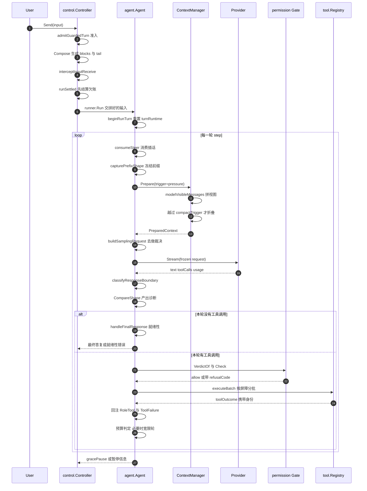

# 主 Agent 循环与上下文维护：回合边界由缓存字节定义

> 本解读按 **ai-agent** 类规格产出，属 DeepSeek-Reasonix 深度解读的子文档；共 13 篇，解读基线 `v2.37.0`（`e17ef45e3`）。正文所有 `文件:行号` 引用均为 Reasonix 仓库相对路径，点开即可核对。相关篇章见 [README.md](README.md)。

## 在系统中的角色：发动机，以及它唯一的对外口子

`internal/runtime/agent` 是这台机器的发动机。`internal/session/control` 是一个传输无关的控制器——它管准入、管审批、管投影欠账、管目标状态机——但它自己不产生任何一次模型调用。control 与 agent 之间只有一个口子：`runWithRunner` 把拼好的输入交给 `runner.Run`，并且在这个调用**之前**结算本轮欠账。去掉 agent，control 会退化成一个能持久化会话、能弹审批卡、但推不动任何一步的状态机。

`Run` 本体只有 60 行左右：从 ctx 取本轮步数上限、`beginRunTurn` 落用户消息、`runToolLoop` 跑循环，其余全部下沉。这是一个刻意的形状——循环的每一条终止条件都是一个具名函数，而不是主循环里的一个 `if`。

- `Run` 的文档注释把它的职责边界一次说完：追加用户输入、驱动工具循环，直到模型给出最终答复、上下文被取消、或供应商报错。
  [internal/runtime/agent/agent.go:805-809]()
<!-- anchor: // Run appends the user input and drives the tool loop until the model returns a … // Turn policy lives in beginRunTurn / runToolLoop / handleFinalResponse. -->
- 入口函数本身把"步数上限是宿主的事"写进签名语义：`maxSteps <= 0` 在这里意味着不封顶，真正的封顶是宿主给的任务预算。
  [internal/runtime/agent/agent.go:810-819]()
<!-- anchor: func (a *Agent) Run(ctx context.Context, input string) (runErr error) { … runMaxStepsKey = limit.key -->

这条单向边界决定了本文后面所有"为什么在这一侧"的回答：

- **turn tail 的拼接在 control 侧**（用户消息的字节由 control 决定），
- **投影到供应商请求在 agent 侧**（`Derived` 消息、工具结果、缓存诊断），
- 两侧共享的只有 `sessionstore` 里的 canonical 转录与 `event.Sink`。

## 根因：回合的边界由缓存字节的稳定性定义

这是本篇的主论点，必须先立住：**在这个项目里，"一个回合"不是一次请求-响应，而是"一段字节保持不变的窗口"**。回合的起点是宿主把新字节写进模型可见视图的那一刻，终点是那些字节被改写（折叠、重写、取消）的前一刻。之所以必须这样定义，是因为 DeepSeek 的自动前缀缓存按**字节前缀**命中：任何一次改写都会让"它背后的全部字节"重新计费，而"背后的全部"里最大的一块是工具 schema。

一旦接受这个定义，本层的三条设计压力就都变成了它的推论。

**张力一：模型侧上下文是缓存敏感的。** 项目自己的效果测试把代价说得非常直白：workspace 路径曾经是前缀里唯一的"每项目字符串"，它一变，"它背后的全部——提示词剩下的部分加上 4.3K token 的工具 schema——都错过了供应商的前缀缓存"。

[internal/assembly/boot/effect_test.go:462-467]()
<!-- anchor: // TestEffectPrefixCarriesNoProjectText asserts the property the goldens can … func TestEffectPrefixCarriesNoProjectText(t *testing.T) { -->

结论不是"尽量少改前缀"，而是**把所有动态状态从前缀里彻底移出去**，改由 turn tail 承载。这条边界有正反两向的效果测试：正向禁止项目事实进入前缀，反向确保每轮重投影的尾部不被误报成"正文被改写"。同一约束在 VCS 事实上被再钉了一次——两个在版本控制状态上不一致的项目必须发出逐字节相同的 system 消息，而该事实仍然要到达模型，所以它由回合携带。

[internal/assembly/boot/effect_test.go:530-539]()
<!-- anchor: // TestEffectVersionControlRidesTheTurnNotThePrefix pins the cache boundary at … t.Setenv("PATH", os.Getenv("PATH")+string(os.PathListSeparator)+robustTempDir(t) -->

**张力二：模型会自己编造失败原因。** 一次被输出上限截断的调用到达模型时是一段非法 JSON；宿主什么也不说的话，会话会从症状里学出一条长期有效的假规则（"宿主不接受尖括号""批量调用不可用"）。项目的解法是把**失败原因做成宿主拥有的状态**，并让它跨过模型可见边界成为一个具名事实。这正是本文最后一章失败归因要展开的内容。

**张力三：判断读结构，不读措辞。** 这是最容易被低估的一条。区分"被切断"与"写错转义"用的是两个结构信号（`io.ErrUnexpectedEOF` 与 `*json.SyntaxError`），不是错误字符串匹配；`isErrorMessage` 优先读宿主机录下的失败事实，字符串前缀匹配被明确降级为"给旧转录兜底的后备"。措辞表会被真实输入成批推翻，结构不会。

- 参数契约层读的是 JSON 解码错误的结构类型。
  [internal/runtime/agent/call_contract.go:34-49]()
<!-- anchor: // malformedArgumentsDetail says why the arguments did not parse. A call that … return "The arguments were not valid JSON." + reemit -->
- 保留策略层的错误识别以宿主事实优先、字符串前缀只作后备。
  [internal/runtime/agent/compact.go:403-414]()
<!-- anchor: func isErrorMessage(m provider.Message) bool { … return strings.HasPrefix(s, "error:") || strings.HasPrefix(s, "blocked:") -->

## 设计思路：三条被测试与门禁双向持有的策略

**策略与引擎分离。** 阈值、预算、折叠区规划住在 `compact.go`（策略/计量），事务、快照陈旧性、投影提交住在 `compact_projection.go`（事务）。这个切分让"什么时候该压缩"和"压缩怎么提交"可以分别测试：前者是纯函数（`planCompaction`、`tailStart` 只吃 `[]provider.Message` 和整数），后者必须处理 CAS 与并发。

**窗口是单所有者。** 所有与上下文窗口有关的状态住在一个 `windowState` 里，嵌在 `sessionRuntime` 中；循环通过 `a.window()` 拿到一个**每次现构造**的 `contextWindow` 视图，该视图的依赖被收窄成一个 10 方法的 `windowHost` 接口。任何其它代码直接读 `sess.win` 都是"第二个所有者"，由 repolint 的 `window-state` 规则报错。

**宿主拥有身份，模型只看到句子。** `blocked: <原因>` 的句子给模型，`refusalCode` 的 dotted code 给前端与审计；`provider.ToolFailure` 被明确标注为"provider serializer 永不发出"的本机元数据。

[internal/contract/provider/local_metadata.go:3-11]()
<!-- anchor: // Records a tool result carries for this host alone. Provider serializers never … Blocked     bool   `json:"blocked,omitempty"` -->

## 关键数据结构：四层生命周期，按"谁重置谁"切开

主循环天然是"很多个布尔和小整数"的地方。如果每个都挂在 `Agent` 上，那么每一个都需要在恰当的地方被手动重置，而漏掉一个的后果是上一位用户的回合状态泄漏到下一位用户。项目的回答是按生命周期分层：每一层用一种**能被强制检查的**重置手段。

| 类型 | 生命周期 | 重置方式 | 位置 |
|---|---|---|---|
| `agentConfig` | 一个 Agent 的一生 | 不可变；`agent_config_test.go` 强制没人写它 | internal/runtime/agent/agent_config.go:3 |
| `sessionRuntime` | 一段会话 | `reset()` 逐字段点名；无法整体赋值 | internal/runtime/agent/sessionstate.go:17 |
| `taskRuntime` | 一个投递 scope（可跨多次 `Run`） | `restartLedger()` 单次整体赋值 | internal/runtime/agent/taskstate.go:15 |
| `turnRuntime` | 恰好一次 `Agent.Run` | `beginRunTurn` 的 `a.turn = turnRuntime{}` | internal/runtime/agent/turnruntime.go:15 |

表中四层的定义位置逐条可核：

- 不可变的一生配置。
  [internal/runtime/agent/agent_config.go:3-3]()
<!-- anchor: // agentConfig is everything New fixes for an Agent's lifetime; nothing writes -->
- 会话层状态，以及它为什么不能整体赋值。
  [internal/runtime/agent/sessionstate.go:17-17]()
<!-- anchor: type sessionRuntime struct { -->
- 投递 scope 层账本。
  [internal/runtime/agent/taskstate.go:15-15]()
<!-- anchor: type taskRuntime struct { -->
- 单次 `Run` 的宿主状态。
  [internal/runtime/agent/turnruntime.go:15-15]()
<!-- anchor: type turnRuntime struct { -->

`taskRuntime` 的注释把中间那层的定位写得很清楚：它是"多次 `Agent.Run` 延续同一个投递 scope 时共享的宿主状态：一个账本、一张账单、一套失败预算"；它的生命周期在 session 与 turn 之间，`SetSession` 整体替换它，`beginRunTurn` 在 scope 变化时重启它。注意注释里那句"只对一次 Run 有效的状态住在 `perTurnState` 里"——这是**命名漂移**，见后文"已知边界"。

[internal/runtime/agent/taskstate.go:10-14]()
<!-- anchor: // taskRuntime is the host state shared by every Agent.Run continuing one … // for exactly one Run lives in perTurnState instead. -->

`taskRuntime` 里有两个字段是 `*atomic.Bool` / `*atomic.Uint64` 而不是值类型，注释直说原因是"`taskRuntime` 是整体赋值的，而 atomic 不能"。

[internal/runtime/agent/taskstate.go:36-42]()
<!-- anchor: // calls do not pay to be told again. A pointer because taskRuntime is … criteriaEpoch *atomic.Uint64 -->

同一个约束在 `sessionRuntime` 上无解——它带 mutex 和 atomic，整体赋值非法——所以那里的"没有字段被忘记"只能靠测试持有。

[internal/runtime/agent/sessionstate.go:54-57]()
<!-- anchor: // reset rebinds the runtime to a new conversation. Every field is named here or … // guarantee has to be tested rather than compiled. -->

上下文窗口一侧的状态同样单独成层：`windowState` 里 `compactionMu` 与 `compactionRunMu` 是两个不同用途的锁，注释区分它们：前者保护 CAS 提交用的 `compactionState` 与内存里的 sidecar generation，且**在委托给供应商做摘要的整段时间里绝不持有**；后者是 singleflight，保证同一时刻只有一次折叠在跑。`cacheState` 字段被明确标注为"遗留的续接遥测，永不可见供应商"。

- `windowState` 的字段与两条锁的用途。
  [internal/runtime/agent/context_window.go:13-28]()
<!-- anchor: type windowState struct { … checkpointState string // none|restored|applied; runtime-only -->
- 两条锁的分工注释。
  [internal/runtime/agent/context_window.go:17-22]()
<!-- anchor: // compactionMu guards projection snapshots/install and the in-memory sidecar … compactionRunMu sync.Mutex -->
- 遗留遥测字段被排除在供应商可见面之外。
  [internal/runtime/agent/context_window.go:25-25]()
<!-- anchor: cacheState      string // legacy resume telemetry; never provider-visible -->

`windowState` 的重置语义与 `sessionRuntime` 不同：它把 `coveredHash` 置空（因为该指纹以随新转录重启的 rewrite 计数器为键）、在 `compactionMu` 下把 `compactionState` 与 `cacheState` 归零、并让折叠进度 `restart()`；`checkpointState` 被刻意留给 `preflight` 连同转录路径一起重绑。把这两组状态拆开，就让"新会话"和"新窗口"可以有不同的重置时机。

[internal/runtime/agent/context_window.go:33-41]()
<!-- anchor: func (w *windowState) reset() { … w.compaction.restart() -->

## 一个回合的完整链路

导读：下图是"用户按下回车到宿主决定停止"的完整链路，参与者用的是真实包/类型名。注意两个位置的顺序是契约而非实现细节——`settleTurnProjections` 只发生在交给 runner 的那一刻之前，工具结果回注永远紧跟在它对应的 assistant 调用之后。

这张图里最容易被读漏的一点是：**准入、tail 组装、欠账结算都发生在 `Run` 之外**。`Agent.Run` 拿到的是已经定型的字符串，它自己不做策略判断——这正是"回合边界由字节定义"的落地形状。

### 阶段逐条

**准入。** `admitGuardedTurn` 在写用户消息之前做完全部判断：写权、工作区活动、会话是否已关闭/正在排空/正在轮换、是否已有回合在跑。结果是一个具名的 `admissionResult`——`turnDroppedWriteAuthority`、`turnDroppedWorkspace`、`turnDroppedRotating` 等，拒绝的原因本身就是身份，而不是一句人话。这一个函数承担了"回合的第一条停止条件"。

- 准入判定的完整位置与顺序。
  [internal/session/control/admission_guard.go:61-123]()
<!-- anchor: func (c *Controller) admitGuardedTurn(body func(ctx context.Context) error, park … return turnStarted -->
- 拒绝结果是具名枚举而非句子。
  [internal/session/control/admission_guard.go:12-24]()
<!-- anchor: type admissionResult int … turnNoTurn -->

**前缀组装。** 前缀 = system 消息（可能多条，`systemPrompt()` 按序拼接）+ 供应商可见工具 schema。两者一起进 `CaptureShape` 得到 `SystemHash`/`ToolsHash`/`PrefixHash`。

[internal/runtime/agent/agent.go:1445-1446]()
<!-- anchor: func (a *Agent) capturePrefixShape(schemas []provider.ToolSchema) PrefixShape { … return CaptureShape(a.systemPrompt(), schemas, a.sess.conversation.RewriteVersio -->

**turn tail 组装（两级装配线的第一级）。** control 侧先产有序 block 列表，再渲染成用户消息。顺序是契约：`hook-context`、`currentDateTag`、`available-skills`、`project-instructions`、`mcp-prompt-failure`、`refused-calls` 是**欠账块**（只对真实回合排空，合成回合不得消费用户的欠账），随后是 `scheduled-run`、`background-jobs`、`memory-update`、`reasoning-language`、`response-language`、plan-mode marker、`active-goal`。注释说明了这个列表替换掉了什么：它取代了**八个各自 preempt 的写入点，而那八个点的顺序只反映它们碰巧被写出来的次序再倒过来**。

- `projectTurn` 的排布规则：块在文本之前、tail 在文本之后，越靠近请求的块权威越具体。
  [internal/session/control/turn_projection.go:23-40]()
<!-- anchor: // projectTurn renders what the provider sees for one turn: the owed blocks in … return strings.TrimRight(b.String(), "\n") + "\n\n" + tail -->
- 全部块种类及其投影顺序集中在一处。
  [internal/session/control/turn_projection.go:43-68]()
<!-- anchor: // turnBlocksFor is the whole set a turn can carry, in projection order. Adding … turnBlock{"active-goal", c.activeGoalTurnBlock(goal, goalStatus)}, -->

`recallTail` 是唯一排在用户文本之后的块，理由写在注释里：检索到的事实是在回答这个请求，所以它应该和请求待在一起。

[internal/session/control/turn_projection.go:118-121]()
<!-- anchor: // recallTail is the one block that follows the user's text rather than … // records why it did not retrieve instead of retrieving again. -->

**结算时机。** `settleTurnProjections` 只被 `runSettled` 调用一次，位于"扩展已经裁决完、马上就要交给 runner"这一行之前。它结算五笔欠账：日期、技能目录、项目指令、MCP prompt 失败、被拒调用。注释给出了这个位置的代价与理由：在这行之前，一个回合仍可能被扩展拒绝或被 hook 拦下，而**被拦下的回合如果清掉了欠账，模型就会握着没人发给它的状态**。

- 结算点就在交给 runner 的上一行。
  [internal/session/control/turn_projection.go:138-144]()
<!-- anchor: // runSettled hands the composed turn to the runner and settles what it carried. … return c.runWithRunner(ctx, input) -->
- 五笔欠账的名单。
  [internal/session/control/turn_projection.go:159-164]()
<!-- anchor: func (c *Controller) settleTurnProjections() { … c.refused.settle() -->

这条"组合完才结算"的时序保证有多广，我们核到了调用点这一层：`runSettled` 的生产调用点只有两处——headless 回合，以及编排回合里位于扩展裁决与 `PromptSubmit` hook 之后的那一处；`settleTurnProjections` 在生产代码里也只在 `runSettled` 内部被调用一次，另有若干测试直接调用它来构造状态。也就是说这条保证**在已确认的 2 条入口上成立**；未穷举的是"是否存在绕过 `runSettled` 的第三种入队方式"，我们只核了 `runSettled` 自身的调用点，没有逐个追子代理技能循环、合成回合与 Goal 续跑的入口链。

- headless 入口。
  [internal/session/control/turn_entry.go:263-263]()
<!-- anchor: err = c.runSettled(ctx, c.withCapabilityRoute(ctx, input, rawInput)) -->
- 编排入口：扩展裁决在前、hook 在后，`runSettled` 是最后一步。
  [internal/session/control/turn_orchestrator.go:217-217]()
<!-- anchor: input, blocked, interceptErr := c.interceptInputReceive(ctx, input) -->
  [internal/session/control/turn_orchestrator.go:278-278]()
<!-- anchor: err = c.runSettled(ctx, modelInput) -->

**每轮循环。** `runToolLoop` 的循环条件本身就把"宽限轮"编码进去了：步数上限为 0、步数未到上限、宽限轮、恢复宽限轮四者任一成立就继续。

[internal/runtime/agent/run_loop.go:266-266]()
<!-- anchor: for step := 0; state.runMaxSteps <= 0 || step < state.runMaxSteps || state.grace -->

循环体内的顺序值得逐项读：先取 schema、**先冻结前缀形状**（注释：形状在采样前只捕获一次并对整个尝试生命周期冻结，流重试不得在轮中改写会话历史）、再排空内容重写原因、再做一次计划态快照（注释：采样前取，中途的状态变更不能放行本轮）、然后才发起流式请求；回来后把**真正发出去的** body chain 填回形状，最后才做缓存诊断。

[internal/runtime/agent/run_loop.go:279-297]()
<!-- anchor: schemas := a.svc.tools.ProviderSchemas(ctx) … cacheDiagnostics := CompareShape(prevPrefixShape, prefixShape, usage, contentRea -->

**响应边界分类。** `classifyResponseBoundary` 同时看 finish reason（`length` / `repetition_truncation`）与"最后一个工具调用的参数是否在值中间断掉"，产出这一轮的边界事实。

- 边界事实的判定。
  [internal/runtime/agent/response_boundary.go:27-50]()
<!-- anchor: func classifyResponseBoundary(usage *provider.Usage, calls []provider.ToolCall)  … fact:      truncationFact(reason, last, calls[last].Name), -->
- 截断原因被区分成两类以便报告。
  [internal/runtime/agent/response_boundary.go:57-63]()
<!-- anchor: func argumentsCutOff(arguments string) bool { … return errors.Is(err, io.ErrUnexpectedEOF) -->

**最终答复判定。** 这是主干上唯一一个"能不能停"的判定点，顺序不可换：

[internal/runtime/agent/run_loop.go:603-628]()
<!-- anchor: if readiness.reason != "" { … return false, &EmptyFinalError{Blocks: state.emptyFinalBlocks, FinishReason: fin -->

就绪性先判：不通过就立刻结束，并且**不再用隐藏的模型消息重试**——宿主拥有接下来发生什么（Goal 模式由 FSM 在预算内自动续跑，普通投递模式弹恢复卡等用户明确继续），这一条注释比任何文档都直白。

[internal/runtime/agent/run_loop.go:604-608]()
<!-- anchor: // Delivery no longer retries readiness with hidden model messages: the … // the recovery card for an explicit user continuation. -->

只有就绪性通过之后，才轮到"没有可见答复"的三振出局逻辑；其中 DeepSeek thinking 模式的 reasoning-only stop 被明确豁免，"工具结果之后没有任何可见综合"则是例外，恰好重试一次。

- 豁免被限定在声明了 tool-call reasoning 策略的供应商上。
  [internal/runtime/agent/agent.go:1086-1105]()
<!-- anchor: // reasoningOnlyFinishHonoured reports whether the model finished with a stop … return strings.TrimSpace(reasoning) != "" -->
- 重试恰好一次。
  [internal/runtime/agent/run_loop.go:624-624]()
<!-- anchor: owedSynthesis := state.usedAnyTool && state.emptyFinalBlocks == 0 && silentSince -->

### 停止条件清单

一次 `Run` 能结束的路径是一条一条具名的，而不是主循环里散落的 `if`。

1. **自然结束**——`handleFinalResponse` 走到底返回 `false, nil`。
   [internal/runtime/agent/run_loop.go:645-645]()
<!-- anchor: return false, nil // model gave a final answer -->
2. **就绪性不通过**——`FinalReadinessError`，并把 `pending.deliveryRecovery` 置位，使宿主可以选择"带着证据续跑"而不是从空账本重来。
   [internal/runtime/agent/run_loop.go:615-615]()
<!-- anchor: return false, &FinalReadinessError{Attempts: 1, Reason: readiness.reason, Missin -->
   [internal/runtime/agent/final_readiness.go:629-643]()
<!-- anchor: // PrepareReadinessContinuation is the same authorization for a continuation the … return true -->
3. **空最终答复超限**——连续 `maxEmptyFinalBlocks = 3` 次无可见文本即 `EmptyFinalError`。
   [internal/runtime/agent/run_loop.go:626-628]()
<!-- anchor: state.emptyFinalBlocks++ … return false, &EmptyFinalError{Blocks: state.emptyFinalBlocks, FinishReason: fin -->
   [internal/runtime/agent/agent.go:45-45]()
<!-- anchor: const maxEmptyFinalBlocks = 3 -->
4. **工具轮上限 / 任务预算**——两个轴在**每轮开始前**检查，且被检查顺序有理由：预算写在前面，因为它是失控真正被上报的轴。触发后不是立刻结束，而是 `armFinalizationRound` 武装一个宽限轮；宽限轮里如果再要工具，宿主把整批未执行的调用配成 blocked 并转成暂停。
   [internal/runtime/agent/run_loop.go:753-757]()
<!-- anchor: // Spend is checked before rounds: it is the axis a runaway is actually … return true, nil -->
   [internal/runtime/agent/finalization.go:40-40]()
<!-- anchor: func (a *Agent) armFinalizationRound(state *turnRuntime, cause landCause) { -->
   [internal/runtime/agent/goal_run_boundary.go:35-41]()
<!-- anchor: func (a *Agent) stopUnexecutedBoundaryCalls(state *turnRuntime, calls []provider … return nil, false -->
5. **无进展 / 复读**——`ProgressWatch` 产出 `no_progress` / `perseveration` 两类暂停，并映射到具名 `PauseClass`。
   [internal/runtime/agent/progress_watch.go:21-26]()
<!-- anchor: // PauseKindNoProgress is RunPauseInfo.Kind for a run the watch paused. … const PauseKindPerseveration = "perseveration" -->
   [internal/runtime/agent/errors.go:11-32]()
<!-- anchor: func PauseClass(err error) string { … return "" -->
6. **上下文耗尽**——折叠在 overflow / 物理上限下无法产出可用投影时返回 `ErrCompactionRequired`，它经由采样准备冒泡到循环，宿主直接以错误结束本轮。
   [internal/runtime/agent/preflight.go:15-15]()
<!-- anchor: var ErrCompactionRequired = errors.New("context exceeds provider limit and compa -->
   [internal/runtime/agent/run_loop.go:298-308]()
<!-- anchor: if err != nil { … return err -->
7. **等待用户**——`ask` 与 `await_user` 都实现 `DecisionBarrier() bool { return true }`：它们结束本轮，同批后续调用被标为未运行。`await_user` 会记一个 UserGate，这就是"无法在缺少用户的情况下推进"与"停下来了但还有活没干"之间唯一的机器信号；就绪性检查对"被用户门控的未完成清单"明确豁免。
   [internal/contract/tool/tool.go:163-166]()
<!-- anchor: // IsDecisionBarrier reports whether a call must end its round once it runs. … return ok && b.DecisionBarrier() -->
   [internal/runtime/agent/final_readiness.go:288-291]()
<!-- anchor: // A list gated on the user is not an unfinished one: another turn cannot … return missing -->
8. **不是停止条件的**：权限拒绝。拒绝走 `blocked` 结果回注模型，循环继续（见失败归因一节）。
9. **取消**——ctx 取消时宿主先存完这一批已配对的工具结果再返回，以免会话里留下没有结果的调用。
   [internal/runtime/agent/run_loop.go:731-734]()
<!-- anchor: // the batch results so the session keeps paired tool-call history. … return false, ctx.Err() -->

## cache-stable 前缀与两级 turn tail 装配线

### 前缀由什么组成，什么被禁止进去

**前缀由什么组成。** system 消息 + 供应商工具 schema。工具 schema 在哈希前会按 Name/Description/Params 排序归一化——否则注册表里 map 的遍历顺序就会变成缓存抖动。

[internal/runtime/agent/cache_shape.go:60-72]()
<!-- anchor: func NormalizeToolSchemas(schemas []provider.ToolSchema) []provider.ToolSchema { … return out -->

**什么被禁止进入前缀**，以及各自被什么持有：

| 禁止项 | 唯一去向 | 证据 |
|---|---|---|
| workspace 路径 / VCS 事实 | turn tail | internal/assembly/boot/effect_test.go:462-467、internal/assembly/boot/effect_test.go:530-539 |
| 技能目录（含"没有可用技能"这种空投影） | turn tail | internal/session/control/skill.go:46、internal/session/control/skill.go:56-71 |
| 项目 standing instructions / 已保存事实索引 | turn tail | internal/session/control/memory.go:56、internal/session/control/memory.go:62-75 |
| plan-mode marker | 用户消息文本 | internal/session/control/input.go:24-27 |
| 运行时事实（日期、后台任务完成、目标状态） | turn tail | internal/session/control/turn_projection.go:52-68 |

表中每一行的机器可核引用：

- workspace 路径是前缀里唯一的每项目字符串，效果测试直接断言两个项目的前缀相同。
  [internal/assembly/boot/effect_test.go:462-467]()
<!-- anchor: // TestEffectPrefixCarriesNoProjectText asserts the property the goldens can … func TestEffectPrefixCarriesNoProjectText(t *testing.T) { -->
- VCS 事实同样不得进前缀，但必须到达模型，所以由回合携带。
  [internal/assembly/boot/effect_test.go:530-539]()
<!-- anchor: // TestEffectVersionControlRidesTheTurnNotThePrefix pins the cache boundary at … t.Setenv("PATH", os.Getenv("PATH")+string(os.PathListSeparator)+robustTempDir(t) -->
- 技能目录的欠账投影与空投影。
  [internal/session/control/skill.go:46-46]()
<!-- anchor: const skillsAllOffBlock = "# Skills\n\nEvery skill this project had is switched  -->
  [internal/session/control/skill.go:56-70]()
<!-- anchor: func (s *skillSet) owedCatalog() string { … return s.catalog.owed(block) -->
- 项目指令与已保存事实索引的欠账投影。
  [internal/session/control/memory.go:56-56]()
<!-- anchor: const instructionsClearedBlock = "# Instructions\n\nThis project's standing inst -->
  [internal/session/control/memory.go:62-74]()
<!-- anchor: func (m *memoryManager) owedInstructions() string { … return m.instructions.owed(block) -->
- plan-mode marker 走用户消息文本。
  [internal/session/control/input.go:24-27]()
<!-- anchor: // PlanModeMarker is prepended to every user turn while plan mode is on. It ride … const PlanModeMarker = planmode.Marker -->
- 运行时事实的块列表位置。
  [internal/session/control/turn_projection.go:52-68]()
<!-- anchor: blocks = append(blocks, … turnBlock{"active-goal", c.activeGoalTurnBlock(goal, goalStatus)}, -->

唯一**声明过**的前缀例外是 pinned memory body，而且它是被测试写下来的：钉住是"声明过的前缀例外"。

[internal/assembly/boot/context_projection_test.go:403-425]()
<!-- anchor: func TestProjectionPinningIsTheDeclaredPrefixException(t *testing.T) { … t.Fatal("the pinned body is in the prefix and the prefix did not move; one of th -->

### 跨轮稳定的前缀字节构成

把一次请求的字节按"跨轮是否变"切开，比任何文字描述都更能说明前缀边界的形状。五段的划分依据是**谁写它**：装配阶段写死的前两段构成前缀，循环每轮重拼的一段构成尾，投影事务在中间换掉一段，而转录本身永不改写。

| 段 | 内容 | 谁写 | 跨轮是否变 | 依据 |
|---|---|---|---|---|
| (1) system 前缀 | 多条 system 消息按序拼接 | 装配阶段；唯一被允许移动前缀的写者 | 跨会话逐字节不变（pinned memory body 是声明例外） | internal/assembly/boot/prefix_boundary_effect_test.go:82-99 |
| (2) 工具 schema | 供应商可见工具 schema，哈希前按 Name/Description/Params 排序归一化 | 工具注册表 → 装配阶段 | 跨会话不变（同一套声明） | internal/runtime/agent/cache_shape.go:60-73 |
| (3) 历史正文 | canonical 转录的投影视图 | `sessionstore` 持有 canonical；视图由 checkpoint 投影决定 | 只有一次成功折叠才整体换一次；**canonical 本身永不改写** | internal/runtime/agent/compact_projection.go:348-359 |
| (4) 每轮重投影的 `Derived` tail 三件 | 宿主上下文 tail / 折叠进度 tail / todo 身份 tail | agent 主循环，每轮现拼 | 每轮都变，且被缓存诊断**显式排除** | internal/runtime/agent/context_window_host.go:15-26 |
| (5) compaction digest 块 | 折叠产物：稳定头 + 一个结构化 digest + 保留的最近 verbatim 尾 | `commitSummaryProjection` 安装的 checkpoint 投影，受 CAS 保护 | 只在一次成功折叠时换一次 | internal/runtime/agent/compact_commit.go:38-47 |

表中各段的机器可核引用：

- (1) 两个在技能、指令、仓库状态、保存事实上全不相同的会话必须发出逐字节相同的 system 前缀。
  [internal/assembly/boot/prefix_boundary_effect_test.go:82-97]()
<!-- anchor: func TestEffectNoProjectStateReachesThePrefix(t *testing.T) { … firstDivergence(toolsA, toolsB)) -->
- (2) 工具 schema 在哈希前做排序归一化。
  [internal/runtime/agent/cache_shape.go:60-72]()
<!-- anchor: func NormalizeToolSchemas(schemas []provider.ToolSchema) []provider.ToolSchema { … return out -->
- (3) 投影换掉的是折叠区那一段，稳定头原样保留。
  [internal/runtime/agent/compact_projection.go:348-358]()
<!-- anchor: func buildVisibleCompressionProjection(visible []provider.Message, plan visibleC … return provider.ProjectionMessages(projection) -->
- (4) 三个 tail 注入方法与其余七个依赖同属一个 10 方法接口。
  [internal/runtime/agent/context_window_host.go:15-25]()
<!-- anchor: type windowHost interface { … Session() *sessionstore.Session -->
- (5) 安装 digest 的那次提交受四元 CAS 保护。
  [internal/runtime/agent/compact_commit.go:38-46]()
<!-- anchor: a.sess.win.compactionMu.Lock() … return sessionstore.CompactionState{}, errCompressStaleContext -->

关于这张表有两句话必须补上，否则读者会把段 (5) 的位置读错：**`BodyChain` 的截断发生在段 (3) 与段 (4) 的交界**——它逐条累积消息哈希，遇到第一条 `Derived` 消息就 `break`；而段 (5) 是安装在历史正文**内部**的一条 `RoleUser` 摘要消息（不是第四个 tail），因此它落在截断线的 (3) 一侧、属于被携带区间。另一句话是：**`PrefixHash` 只由段 (1) 与段 (2) 决定**（对 `{system, tools}` 做一次 `shortHash`），与 (3)(4)(5) 的任何变动无关；这正是"改前缀"与"改正文"在诊断上会被分开报的原因。

- 累积哈希在第一条 `Derived` 处停止。
  [internal/runtime/agent/cache_shape.go:80-90]()
<!-- anchor: func BodyChain(msgs []provider.Message) []string { … return chain -->
- digest 被包装成带固定标记的 `RoleUser` 消息。
  [internal/runtime/agent/projection.go:251-258]()
<!-- anchor: // formatSummaryMessage builds the stable user-turn wrapper around a digest. … SummaryTagClose, -->

### `control.Compose` 做什么

第二级 tail 之外，control 侧还有一层"这一轮欠模型什么"的渲染：先算 block 列表（内部会排空 hook 上下文、取 `date.owed()`、`skills.owedCatalog()`、`memory.owedInstructions()`、`mcp.promptFailures.owed()`、`refusedCallsBlock()`），再拼 recall tail，最后交给 `projectTurn`。注意它读的是 `owed()` 而不是"上次发了什么"——欠账的判定逻辑归各个 owner 自己。

[internal/session/control/input.go:108-136]()
<!-- anchor: func (c *Controller) compose(text, source string, includeHookContext bool) strin … return projectTurn(blocks, text, tail) -->

**两级装配线的分工与它带来的一个真实后果。** control 一级写在**用户消息正文内部**（provider 眼里仍是 `RoleUser`），agent 一级追加**独立的 `Derived` 消息**。两者都会被 `BodyChain` 在第一条 `Derived` 处截断，但 control 那一级是用户消息正文的一部分，因此**确实参与被携带区间**。我们顺着 `compareBody` 的实现核过这一点：它按两条链中较短的长度比对，只在"较旧那条链的末项字节被改写"时报 `changed`。

[internal/runtime/agent/cache_shape.go:98-150]()
<!-- anchor: // compareBody reports what the two chains say about the region both requests … BodyHash:            bodyHash, -->

所以结论是明确的：**control 侧的 block 顺序改变不会触发 `body_unreported` 误报**——每个真实回合追加的是一条新消息，链只是变长，`carried` 位置的累积哈希不变；反过来，如果哪天有一处**原地改写**历史用户消息正文而不声明重写原因，那会命中 `body_unreported`，而那是真报不是误报。两级 tail 的安全性建立在"追加而不改写"这条隐含契约上。

[internal/runtime/agent/preflight.go:43-45]()
<!-- anchor: func (a *contextWindow) modelVisibleMessages() []provider.Message { … return a.withTodoIdentityTail(a.withFoldProgressTail(visible, a.foldProgress())) -->

### 改了前缀靠什么发现：三层，且没有一层是门禁

**字节层**：`effect` 测试直接断言"到达供应商的 system 消息"与"工具 schema JSON"。`prefix_boundary_effect_test.go` 构造两个在技能、指令、是否仓库、保存事实上全不相同的会话，要求两者的 system prompt 逐字节相同，并且 **tool schema 也逐字节相同**——注释解释了为什么后者才是大头："供应商缓存的前缀是 system 消息**加上工具 schema**，后者是更大的那一半"。

[internal/assembly/boot/prefix_boundary_effect_test.go:82-97]()
<!-- anchor: func TestEffectNoProjectStateReachesThePrefix(t *testing.T) { … firstDivergence(toolsA, toolsB)) -->

**运行期**：`CompareShape` 比对相邻两次请求的前缀形状与 body chain，产出 `CacheDiagnostics.PrefixChangeReasons`。关键在于 `BodyChain` **在第一条 `Derived` 消息处停止**——注释说："它在宿主的派生尾部停下：那些字节是每次请求重新投影出来的，不是下一次请求会携带的东西"。没有这条截断，每一轮重投影的 tail 都会被误报成"正文被改写"。这个断言被效果测试钉住：三个脚本化回合，逐对断言 `!BodyChanged` 且 `CarriedMessages != 0`，并且没有任何一条 usage 事件报告前缀移动。

[internal/assembly/boot/effect_cache_tail_test.go:79-92]()
<!-- anchor: for i := 1; i < len(reqs); i++ { … t.Errorf("a usage event reported the prefix moved: %v", d.PrefixChangeReasons) -->

**门禁层**：repolint 管的是**结构**（谁许读窗口、标量字段上限、分层），**没有**一条规则直接读前缀字节。前缀边界的保证靠"最终边界的效果测试"这个模式，不靠 lint。这是本项目里"门禁"与"测试"分工的一个清晰样本，也是后文"已知边界"的第一条欠账。

## 上下文窗口的所有权

导读：这一节回答的是"为什么需要 `windowState` / `windowHost` / `a.window()` 三个东西而不是一个结构体"，以及**谁有资格碰它们**。这是一张位置图：论据不是流程步骤，而是"谁在边界内、谁在边界外、哪条边被门禁切断"。虚线圆角框内是 `window-state` 门禁点名的四类合法所有者，框外那条带叉号的红色虚线是它唯一做的事——拒绝。

看这张图要抓住三件事。**第一，视野是"面"不是"链"**：`contextWindow` 拿到的不是 Agent 的指针，而是一个 10 方法的 `windowHost` 接口，所以"窗口能碰 Agent 的什么"是一份可读清单，回边上的方法分组就是这份清单。**第二，`a.window()` 是工厂而不是缓存**：每次进入现构造，所以它永远不会持有一个过期的会话视图。**第三，也是最重要的**：`sess.win` 的合法读者被门禁钉成四类（`contextWindow`、`windowState`、`sessionRuntime`、`ContextManager`），"Agent 之外的任何接收者"这条边被显式拒绝——因为 `sess.win.compactionState` 是被 CAS 保护的，一个旁路读到这里的地方同时也就绕过了那把锁的协议，而且它读到的值看起来是对的，只在 fold 与并发改写同时发生时才出错。

代价是抽象的层数变多了：一个窗口状态要跨三个名字（`sessionRuntime.win`、`windowState`、`contextWindow`）才能读全，而门禁的报错信息本身不得不充当文档（它必须点名"调用 `a.window()`"并列出四个所有者）。

### windowState / windowHost / a.window() 各解决一个问题

**`windowState`：状态与它依赖的数据同生命周期。** 它嵌在 `sessionRuntime` 里，之所以单独一层而不是把字段摊进 `sessionRuntime`，是因为 `sessionRuntime` 的 reset 是"逐字段点名"式的，而窗口状态有自己的重启语义（见前文 `reset()`）。

[internal/runtime/agent/sessionstate.go:22-22]()
<!-- anchor: win windowState -->

**`windowHost`：依赖面收窄成一个 10 方法接口。** 窗口需要回问循环十件事：三个 tail 注入（todo 身份、折叠进度、宿主上下文）、`toolFactsFor`、`providerProjectionMessages`、`prepareSamplingRequest`、折叠前后的两个扩展拦截点、失败诊断标注、以及 `Session()`。这是一个刻意的窄接口：它让"窗口能做什么"成为一份清单，而不是"窗口能碰 Agent 的所有东西"。

[internal/runtime/agent/context_window_host.go:15-25]()
<!-- anchor: type windowHost interface { … Session() *sessionstore.Session -->

**`a.window()`：每次现构造。** 它返回一个 `contextWindow` 值，而不是缓存一个实例；注释的理由是"每次进入现构造，所以它永远不会持有一个过期的会话视图"。这条约束的直接受益者是 `SetSession`：换会话时不需要去通知一个长期存活的窗口对象。

[internal/runtime/agent/context_window_host.go:42-48]()
<!-- anchor: // window is the agent's context window, built per entry so it never holds a … activeTurnCreatedAt: &a.activeTurnCreatedAt, windowProbe: &a.windowProbe, -->

### window-state 门禁禁止什么、为什么值得一条门禁

门禁的范围是精确的：只扫 `internal/runtime/agent/` 下**直接位于该目录**的非测试文件（`strings.Contains(strings.TrimPrefix(rel, windowStatePackage), "/")` 一行把子目录排除），跳过接收者属于 `contextWindow` / `windowState` / `sessionRuntime` / `ContextManager` 四者之一的函数，然后在函数体里找形如 `sess.win` 的 `SelectorExpr`，命中即报错。权重固定为 1。

- 规则标识与四类合法所有者。
  [tools/repolint/windowstate.go:9-22]()
<!-- anchor: const ruleWindowState = "window-state" … "ContextManager": true, // the window's maintenance transaction -->
- 子目录被排除的那一行。
  [tools/repolint/windowstate.go:28-30]()
<!-- anchor: if !strings.HasPrefix(rel, windowStatePackage) || strings.HasSuffix(rel, "_test. … return nil -->
- `SelectorExpr` 的匹配形态与报错文案。
  [tools/repolint/windowstate.go:38-53]()
<!-- anchor: ast.Inspect(fn.Body, func(n ast.Node) bool { … return true -->

为什么这值得一条 AST 规则而不是一条注释：`sess.win.compactionState` 是被 CAS 保护的——`commitSummaryProjection` 要求转录版本、全量前缀哈希、投影版本、generation 四者同时未变，否则拒绝安装。**一个旁路读到这里的地方，同时也就绕过了这把锁的协议**。更隐蔽的是，它读到的值看起来是对的，只有在 fold 与并发改写的同时发生时才出错——这类缺陷靠 code review 抓不住，靠编译期更抓不住。门禁的报错信息本身就是文档：它点名"调用 `a.window()`，让 `*contextWindow` 上的方法去碰 `sess.win`"，并列出四个允许的所有者。

[internal/runtime/agent/compact_commit.go:38-46]()
<!-- anchor: a.sess.win.compactionMu.Lock() … return sessionstore.CompactionState{}, errCompressStaleContext -->

## 上下文维护：触发、粒度、分工

### 什么时候触发

规则是"两条边界谁先到用谁"：**容量边界** = `window × compact_ratio`，**经济边界** = 配置的 `ContextSoftLimitTokens`。两条边界是分开配置的、只有一条会触发，所以 `CompactTrigger()` 被导出——注释直说原因：面板如果只渲染设置，就没法说清到底哪条在生效。另外两条语义写在注释里：**窗口未测量时两条都不设值，而不是猜一个大小**；**把 ratio 设到超过 1 就是关闭维护，而经济边界只能收紧一条活着的边界、不能复活一条已退役的边界**。

[internal/runtime/agent/compact.go:121-138]()
<!-- anchor: // CompactTrigger is the boundary in force, which is the number a frontend has … return capacity -->

容量边界本身还有一个细节：`ablation.Compaction` 被关掉时 ratio 被强制成 0.5，经济边界在同一个 ablation 下直接返回 0——即消融实验只保留一条更激进的容量边界。

- 消融态下容量边界退到 0.5。
  [internal/runtime/agent/compact.go:100-101]()
<!-- anchor: if a.ablation.Off(ablation.Compaction) { … ratio = 0.5 -->
- 消融态下经济边界直接退役。
  [internal/runtime/agent/compact.go:111-112]()
<!-- anchor: if a.ablation.Off(ablation.Compaction) { … return 0 -->

物理安全线是另一个量，且被明确与用户阈值分开：预留量是 256 token（`protocolReserveTokens`）。"回复预算与输入阈值无关，在发送时独立解析"这句注释解释了为什么输出上限**不**参与压缩触发：否则调整 max_tokens 会改变压缩时机。

[internal/runtime/agent/compact.go:141-148]()
<!-- anchor: // hardInputCeiling is a physical input-safety boundary, not another user … return max(1, window-protocolReserveTokens) -->

判定发生在 `ContextManager.prepareOnce`，而且压力值的选择有讲究：阈值用的是"拦截器之前的稳定请求形状"（messages + tools + role projection）。注释解释了为什么：**扩展拦截器只在真正的采样请求上运行，避免有副作用的插件被调用两次**；如果它们把提示词撑过了物理上限，overflow 恢复仍然会兜住。

[internal/runtime/agent/context_manager.go:93-104]()
<!-- anchor: func (m ContextManager) prepareOnce(ctx context.Context, policy ContextPreparePo … est := a.estimatedShapeTokens(visibleShape) -->

真正决定"折还是不折"的判定有两级，且豁免逻辑集中在一个 `compactionScope` 结构体里。"询问（manual）、overflow 和物理上限各自豁免触发阈值；只有后两者以及显式 force 才豁免'折叠必须值得'这条"——这句话是整个压缩经济学的核心：手动压缩不要求"上下文本该被压缩"，但仍要求"折完确实变小"。这个设计在 `CompactNow` 的文档注释里被重复了一遍并给了行为学理由：一个什么都没新增的上下文会被拒绝，而不是被第二次摘要。

- 两级豁免的构造。
  [internal/runtime/agent/context_manager.go:144-155]()
<!-- anchor: // Asking, overflow and a physical ceiling each waive the trigger. Only the … return m.foldContext(ctx, prepared, policy, inputHash, est, ownEst, fold, hard,  -->
- 两条豁免边界的具体取值。
  [internal/runtime/agent/context_manager.go:146-149]()
<!-- anchor: scope := compactionScope{ … ignoreEconomics: policy.IgnoreEconomics || policy.Trigger == CompactionTriggerOv -->
- `CompactNow` 一侧的同一理由。
  [internal/runtime/agent/agent.go:589-592]()
<!-- anchor: // CompactNow runs one requested projection compaction (canonical transcript … // than summarized a second time. Only IgnoreEconomics waives that. -->

折叠之后的收尾同样重要：如果折叠结果显示 token 数仍在触发线之上，宿主把这一次维护记成 blocked、把 `stuck` 置位（后续的压力型触发直接不再尝试），并且**只有供应商已经明确拒绝过（overflow）才在这里结束回合**——注释给了理由：我们自己的上限是估算值，拿它去拒绝，会把一个"窗口小到装不下一次摘要"从一次供应商本可以服务的运行变成一个失败的运行。

[internal/runtime/agent/context_manager.go:230-243]()
<!-- anchor: if policy.Trigger == CompactionTriggerManual { … slog.Info("agent: context maintenance paused above the fold trigger", "reason",  -->

### 粒度：不是截断，是"安装一个投影"

粒度只有一种：**在模型可见视图上安装一个 checkpoint 投影 = 稳定头 + 一个结构化 digest + 保留的最近 verbatim 尾**。canonical 转录**永不被改写**——这是项目反复声明的不变量，压缩只改"看什么"，不改"存了什么"。

折叠区怎么算：

[internal/runtime/agent/compact.go:466-495]()
<!-- anchor: // planCompaction returns [head:start] to fold; the tail is recentTailBudget … return head, start, true -->

`head` 来自 `pinnedPrefixLen`：system 消息，加上"足够小、可以被当作简报"的第一个用户回合。digest 永远不会被钉住——注释说"转录里任何 digest 都进入折叠区并与下一个合并，所以一个会话无法累积一条 digest 链"。这个禁令的目的很实在：不然每次折叠产一个摘要，摘要又被折进下一个摘要，摘要会变成一种只增不减的会话级状态。

- `pinnedPrefixLen` 的组成与 digest 禁令。
  [internal/runtime/agent/compact.go:300-308]()
<!-- anchor: func (a *contextWindow) pinnedPrefixLen(msgs []provider.Message) int { … return i -->
- digest 不得被钉住的理由。
  [internal/runtime/agent/compact.go:296-299]()
<!-- anchor: // everything else: the system prompt and the first user turn (its task + stated … // into the next one, so a session cannot accumulate a chain of them. -->

`start` 由 `tailStart` 从最新往前累积，到超出预算（且已保留 `minKeep` 条）为止，然后**回退对齐到工具结果边界**，避免 verbatim 尾以一个"其 assistant 调用已被摘要掉"的孤儿工具结果开头。此外有一个更硬的边界：折叠只能结束在"每一个工具调用都有结果"的位置，否则就是给供应商一个永不解决的 assistant 轮。

- tail 起点与工具结果边界的回退对齐。
  [internal/runtime/agent/compact.go:529-551]()
<!-- anchor: // tailStart walks newest→oldest, growing the verbatim tail until the next … return start -->
- 折叠必须停在封闭前缀处。
  [internal/runtime/agent/compact.go:326-344]()
<!-- anchor: // closedPrefixEnd is how far into msgs every tool call has its result. A fold … return end -->

"保留什么"由 keep policy 决定，且它有一个时间窗：**保留策略只作用于最新 digest 之后的消息**（否则"保留的错误消息"会无限增长，下一次折叠就再也折不动了）；**正在跑的回合的那条用户消息永远保留**，注释说这是为了"这一轮剩余部分正在执行的工作"，同时它保证了崩溃/取消恢复能拿回完整的工具配对。

[internal/runtime/agent/compact.go:347-383]()
<!-- anchor: func (a *contextWindow) keepIndexes(region []provider.Message, policy KeepPolicy … return keep, retention -->

还有一个刻意的计量选择：所有 verbatim 保留判定用**固定估算**（字数 × 0.25），不用上一轮校准出来的比率。理由写在注释里：**"一个随上一轮比率移动的阈值，会在一个 checkpoint 保留某一轮、在下一个 checkpoint 把它折掉"**。校准值只用于 tail 预算，不用于保留判定。

[internal/runtime/agent/compact.go:386-390]()
<!-- anchor: // fixedTokenEstimate is what every verbatim-retention decision measures with. … return int(float64(msgChars(m)) * fallbackTokPerChar) -->

### `compact.go` 与 `compact_projection.go` 的分工

| 关注点 | `compact.go`（策略/计量） | `compact_projection.go`（事务/投影） |
|---|---|---|
| 触发阈值 | `compactTrigger` / `capacityCompactTrigger` / `economicCompactTrigger` / `hardInputCeiling` | — |
| tail 与折叠区规划 | `planCompaction` / `tailStart` / `remeasuredTailStart` / `pinnedPrefixLen` / `closedPrefixEnd` | `planFoldRegion`（在 planCompaction 之上加"活动回合可折到哪"的判定） |
| 保留策略 | `keepIndexes` / `shouldKeepMessage` / `isErrorMessage` / `isUserMarked` | `partitionFoldWith` / `splitKeptTurn` / `supersedeStandingState` |
| 摘要调用 | `summarize` / `summarizeAt` / `renderTranscript` / `summarizeToolArgs` | — |
| 快照与陈旧性 | — | `explicitCompressionSnapshot` / `explicitCompressionSnapshotCurrent` |
| 提交与判定 | — | `commitSummaryProjection` 的调用方、`acceptCheckpointCandidate`、`visibleInputForFold` |
| 显式 `compress` 工具 | 锚点解析（`summarizeBoundary`） | `CompressContext` / `compressVisibleRange` / `planVisibleCompression` |

这个切法的收益是可以分别测试：`planCompaction` 与 `tailStart` 是纯函数（只吃消息切片与整数），而 `compressVisibleRange` 必须处理快照陈旧、扩展拦截、CAS 提交与事件发出。

### 为什么"先剪工具输出再摘要"的顺序重要

先厘清一件事：**存在两条不同的路径，只有一条会改写字节。**

- **模型可见的首次形态**：一次超过 `MaxToolOutputBytes = 32KB` 的工具结果，在它第一次成为消息时就被裁剪（几何参数由工具自己的 `SnipHint` 决定），或者走 spill 落盘后分页读。这个被裁的形态在消息的整个生命周期内稳定，**不会被后续维护再裁一次**——注释原话。
- **喂给 summarizer 的临时转录**：只在摘要请求里变短，正常视图不动。

- 首次形态的裁剪与 spill 分页。
  [internal/runtime/agent/agent.go:1907-1913]()
<!-- anchor: // truncateToolOutput is the first-visible hard cap for a tool result. Under-cap … return truncateToolOutputFor(s, "", "", MaxToolOutputBytes, defaultSideEffecting -->
  [internal/runtime/agent/tool_output_spill.go:239-261]()
<!-- anchor: bound := event.OutputBound{Lines: strings.Count(body, "\n") + 1, Bytes: len(body … strategy = strategy.forFailure(MaxToolOutputBytes) -->
- 第二条路径的边界：helper **从不改写**正常模型可见视图。
  [internal/runtime/agent/compact_fold_input.go:13-15]()
<!-- anchor: // Summary input construction is internal to a summary transaction. The normal … // request fed to the summarizer is shortened. -->

顺序为什么不能反：summarizer 的输入预算 = 窗口 − 输出预留 − framing − 256。如果不先按每条消息做 head/tail 几何裁剪，超预算时只剩一种手段——**整条消息丢弃**（`summaryOmittedMessage`）。丢整条会丢掉失败命令的**输出尾部**，而失败诊断恰恰在尾部。先做每条消息的几何裁剪，几何还是**失败感知的**：`snipStrategy.forFailure` 会把配额从头部挪向尾部，因为"失败命令的答案在末尾"。这解释了为什么"先剪再摘"不是优化而是正确性。

- 摘要输入预算的组成。
  [internal/runtime/agent/compact_fold_input.go:58-75]()
<!-- anchor: func (a *contextWindow) summaryInputBudget(instructions string) int { … return budget -->
- 失败感知的几何裁剪。
  [internal/runtime/agent/prune.go:75-80]()
<!-- anchor: func (s snipStrategy) forFailure(cap int) snipStrategy { … return s -->

同一层还有一个"一次付钱、长期受益"的机制：`annotateFailureDiagnostics` 在摘要之前用一次模型调用挑出"必须逐字保留的行"，把选择**记在消息上**（`ToolExecution.DiagnosticLines`），此后每次折叠都复用同一选择。注释说明了次序的代价考虑：每次诊断都是一次模型调用，所以它等卡片弹出来之后才做，而且**只有被保留的失败才会问**——被折掉的失败永远不会去读它的选择。

[internal/runtime/agent/failure_diagnosis.go:42-67]()
<!-- anchor: func (a *Agent) annotateFailureDiagnostics(ctx context.Context, region []provide … return out -->

摘要本身也被要求"是摘要"：产物必须命中固定的标题集合，否则以 `errSummaryNotDigest` 拒绝。系统提示里还有一条对治幻觉的硬约束："不要编造任何消息里没有的东西；不知道就留空，不要猜"。另一处防泄漏：`renderTranscript` 用 `summarizeToolArgs` 把工具调用的**参数**摘要化，避免一个 digest 变成用户消息时把一段长参数原样泄回（注释点名 issue #4317）。

- digest 必须命中的标题集合。
  [internal/runtime/agent/compact.go:59-84]()
<!-- anchor: const summarySystemPrompt = `You are compacting the earlier part of a coding age … Rules: be terse — bullet points and fragments, not prose. Preserve identifiers,  -->
- 不命中即拒绝。
  [internal/runtime/agent/compact_projection.go:693-702]()
<!-- anchor: // runCompactionSummary uses the single local summarizer path for every provider … return summary, CompactionModeSummarized, usage, "", nil -->
- 参数摘要化防泄漏。
  [internal/runtime/agent/compact.go:707-711]()
<!-- anchor: // renderTranscript flattens messages into a readable transcript for summarizati … return renderTranscriptWith(msgs, summarizeToolArgs, modelVisibleBody) -->

### 前缀稳定性如何在压缩后存活

**它不"存活"——它被声明为一次低频的重置。** 项目的做法是把破坏成本记账、把破坏面限成一次、并让"只有一次"可被证明：

1. **承认**：提交时生成的维护收据带 `CacheBreak: true`。
   [internal/runtime/agent/compact_commit.go:72-78]()
<!-- anchor: receipt := &sessionstore.ContextMaintenanceReceipt{ … SummaryHash: summaryHash, CacheBreak: true, CreatedAt: now, -->
2. **限一次**：折叠不得从头开始重建整个视图。`visibleInputForFold` 优先在"上一次投影 + 新历史"上操作；并且第二次 checkpoint 必须等**一个 tail 量的新封闭历史**才被允许，注释直说了经济理由——"每一次 checkpoint 都要付出整个前缀缓存的代价，所以第二次要等够了；否则小窗口每隔几轮就折一次，花掉的比省下的多"。
   [internal/runtime/agent/compact_projection.go:426-435]()
<!-- anchor: if fromProjection && !scope.ignoreEconomics { … return CompactionNoop, NoopFoldBelowEconomics, nil -->
3. **稳定头进投影**：投影最前面保留的就是 pinned prefix（system + 可钉用户回合）原样，摘要只替换它之后的一段。
   [internal/runtime/agent/compact_projection.go:348-358]()
<!-- anchor: func buildVisibleCompressionProjection(visible []provider.Message, plan visibleC … return provider.ProjectionMessages(projection) -->
4. **尾部仍是活的**：冻结的是 body，最近的尾部从 canonical 现拼，所以 fold 不会把 tail 冻成快照。`Derived` 的传播规则正是为此存在的：一旦一段 body 吞并过派生的 tail，它从那以后自身也标记为 `Derived`。
   [internal/runtime/agent/projection.go:241-243]()
<!-- anchor: // A run that swallowed a derived tail is derived from there on: its bytes … prev.Derived = prev.Derived || msg.Derived -->

### "压缩本身就会破坏缓存"这个矛盾怎么处理

这是一个真实的、无法消除的矛盾：fold 的目的就是改变模型看到的字节，而任何字节改变都必然打掉前缀缓存。项目的处理分六条，全部能在代码里指到：

1. **把它做成一次事务，而不是一次写入。** 提交要求转录版本 + 全量覆盖前缀哈希 + 投影版本 + generation 四者与规划时一致，否则返回 `errCompressStaleContext`。规划与提交之间如果转录变了，候选被丢弃，而不是装一个基于旧视图的摘要。
   [internal/runtime/agent/compact_commit.go:38-46]()
<!-- anchor: a.sess.win.compactionMu.Lock() … return sessionstore.CompactionState{}, errCompressStaleContext -->
2. **陈旧之后不再付费重试。** 自动路径把该输入哈希记成 blocked 并放弃本次生成。
   [internal/runtime/agent/context_manager.go:127-136]()
<!-- anchor: if blocked, reason := a.contextMaintenanceBlocked(inputHash, ownEst, policy.Trig … return prepared, nil -->
   并且区分两种状态：`NoopInputUnchanged`（"上下文自上次整理以来没有变化"）与 `NoopNoNewClosedPrefix`（"自上次 checkpoint 以来没有东西封闭"）——注释解释了为什么它们必须分成两个 code："读起来相同，但对下一轮能期待什么的意思是相反的"。
   [internal/runtime/agent/projection.go:70-72]()
<!-- anchor: // CompactionNoopReason identifies why an attempt folded nothing. "Already folde … // what the next round can expect, so the verdict carries a code, not a sentence -->
3. **折叠前先量、折叠后先验。** `acceptCheckpointCandidate` 在多条线之间做判定：候选必须真的更小；manual 低于触发线时任何真实节省都可接受；固定前缀本身已超 50% 时走例外路径，但要求节省超过 25%；并且有一条**任何豁免都不得越过**的红线——"落回触发线上的 checkpoint 买到的是下一次折叠，而不是避免了它"。
   [internal/runtime/agent/compact_projection.go:591-631]()
<!-- anchor: // savings, since below the trigger the ceiling has nothing to protect. … return nil -->
4. **折叠完成把"一次性交付"重新变欠。** `CompactionDone` 事件让 control 侧 `forget()` 掉日期、技能目录、项目指令三笔已交付状态，下一个合格回合重新 `owed()` 并从**活的 canonical 状态**重新计算。测试 `TestProjectionCompactionReOwesTheLatestCanonicalState` 用填充轮 + `ctrl.Compact` + 断言 `CompactionDone` 之后 `<available-skills>` 里重新出现 `ledger-audit` 来钉住这条。
   [internal/session/control/inbox_sink.go:40-46]()
<!-- anchor: case event.CompactionDone: … s.c.memory.forgetDeliveredInstructions() -->
   [internal/assembly/boot/context_projection_test.go:255-281]()
<!-- anchor: func TestProjectionCompactionReOwesTheLatestCanonicalState(t *testing.T) { … t.Fatalf("freshness: the re-owed listing is the one the fold summarised away, no -->
5. **会话级命中率不被折叠清零。** `cacheHit` / `cacheMiss` 是会话累计，`sessionRuntime` 的注释明确写了"压缩不得重置它——否则可见前缀每被折一次命中率就会塌一次"。
   [internal/runtime/agent/sessionstate.go:24-28]()
<!-- anchor: // cacheHit/cacheMiss are the session aggregate, which compaction must not … cacheMiss atomic.Int64 -->
6. **物理溢出还有一条独立出路。** 当估算已经越过物理上限时，`mustFree` 为真，摘要失败必须降级而不是让回合搁浅。
   [internal/runtime/agent/context_manager.go:158-162]()
<!-- anchor: func (m ContextManager) foldContext(ctx context.Context, prepared PreparedContex … mustFree := policy.Trigger != CompactionTriggerManual && (policy.Trigger == Comp -->

## per-turn 状态：一个结构体消掉一整张状态表

**问题。** 主循环天然是"很多个布尔和小整数"的地方：本轮还能跑几步、已经空答复几次、是否处于宽限轮、是否已经劝过一次收尾、有没有用过工具、复读被抓了几次、就绪性上次的判定……如果每个都挂在 `Agent` 上，那么每一个都需要在恰当的地方被手动重置，而**漏掉一个的后果是上一位用户的回合状态泄漏到下一位用户**。

**解法。** 只对一次 `Agent.Run` 有效的状态全部放进 `turnRuntime`，并且 `beginRunTurn` 用**一次整体赋值**把它置零。

[internal/runtime/agent/turnruntime.go:11-25]()
<!-- anchor: // turnRuntime is the host state for exactly one Agent.Run. beginRunTurn builds … recoveryGraceRound bool -->

注释把整个模式说完了："`beginRunTurn` 用一次赋值构造它，所以**在这里加一个字段，下一轮它就是零值**。" 收益不是省了几行重置代码，而是把"记得重置"从一个**纪律问题**变成一个**编译期免费的结构性质**。

**这个模式的边界被同样显式地画出来。** 有三类状态**不**放进 `turnRuntime`：

- `pendingTurn` —— "由 Run 之外的某人武装给下一次 Run 的状态"（子代理派生、刚就绪性失败的回报、分支捕获）。它**刻意不在** `turnRuntime` 里，理由正是上一条：`beginRunTurn` 会重建 `turnRuntime`，而在它存在之前武装的状态会被那次赋值一起抹掉。
  [internal/runtime/agent/turnruntime.go:91-104]()
<!-- anchor: // pendingTurn is what someone outside the Run arms for the next one: a … deliveryRecovery bool -->
  [internal/runtime/agent/agent.go:329-331]()
<!-- anchor: // pending is what an external caller arms before the next Run; see … pending pendingTurn -->
- `taskRuntime` —— 跨多次 `Run` 共享的账本与预算，用 `restartLedger` 的单次赋值重置，且"向前携带的字段被逐个点名，因为每一个对应 `beginRunTurn` 里的一个条件"。
  [internal/runtime/agent/taskstate.go:85-96]()
<!-- anchor: // restartLedger begins a new task's accounting. It is written as one assignment … criteriaEpoch: new(atomic.Uint64), -->
- `sessionRuntime` —— 带 mutex/atomic，整体赋值非法，因此**同一个性质只能靠测试**：`sessionstate_test.go` 用 AST 把结构体字段与 `sessionReset` / `sessionCarryOver` / `windowReset` / `windowCarryOver` 四张名单对照。这是同一设计意图在两种约束下的两种实现，很值得注意。
  [internal/runtime/agent/sessionstate.go:54-57]()
<!-- anchor: // reset rebinds the runtime to a new conversation. Every field is named here or … // guarantee has to be tested rather than compiled. -->

**一个诚实的反例（这条纪律不是全覆盖）。** `capabilityGateState` 是"一轮的 gate 记忆"（是否已经花掉 prefer 提醒、报告过哪种 miss），它的注释同样说"把结构体置零就是本轮重置"——但它住在 `Agent` 上，置零靠 `SeedCapabilityRoute` 显式写一行 `a.capabilityGate = capabilityGateState{}`，而**不在** `turnRuntime` 里。

- `capabilityGateState` 的定义与"置零即本轮重置"的注释。
  [internal/runtime/agent/capability_gate.go:16-23]()
<!-- anchor: // capabilityGateState is one user turn's gate memory, scoped to the same turn … preferMissSeen  bool -->
- 它挂在 `Agent` 上。
  [internal/runtime/agent/agent.go:338-339]()
<!-- anchor: // capabilityGate is the turn's gate memory across final-answer retries. … capabilityGate capabilityGateState -->
- 唯一的清零点。
  [internal/runtime/agent/capability_gate.go:36-36]()
<!-- anchor: a.capabilityGate = capabilityGateState{} -->

我们顺着这个清零点核了一遍调用链，结论比"需要跨模块确认"更具体：非测试代码里 `SeedCapabilityRoute` 只有两个调用点，都来自 control 的 `withCapabilityRoute`（一个是执行器 Agent，一个是 Dual-model Planner），而 `withCapabilityRoute` 在生产代码里也只有两个入口——headless 回合无条件经过，编排回合则**带 `!turn.synthetic` 条件**。也就是说，**合成回合（Goal 自动续跑、投递续跑等）不经过清零点**，于是上一位真实用户那一轮的 gate 记忆会被合成回合继承；此外 `withCapabilityRoute` 在"剥离瞬态块后的路由输入为空且没有内联技能"时会提前返回、连清零点都不进。我们确认了这两条旁路，但**未穷举**所有回合路径（子代理 Agent、技能循环等未逐一核对），所以这里记成"已确认的缺口 + 未穷举"而不是"全覆盖"。

- 两个调用点。
  [internal/session/control/capability.go:47-61]()
<!-- anchor: // Pass structured decision to the agent via ledger — never re-parse the prompt. … if block == "" { -->
- 编排回合的 `!turn.synthetic` 条件。
  [internal/session/control/turn_orchestrator.go:266-269]()
<!-- anchor: ctx = c.bindTurnScope(ctx, continuation) … modelInput = c.withCapabilityRoute(ctx, input, turn.raw) -->
- headless 回合无条件经过。
  [internal/session/control/turn_entry.go:263-263]()
<!-- anchor: err = c.runSettled(ctx, c.withCapabilityRoute(ctx, input, rawInput)) -->

**`struct-state` 门禁怎么工作。** 规则只对**拥有 mutex 或 atomic 的结构体**计数，只数**标量**字段（基础类型 + `atomic.*` + `time.Duration` + `time.Time`），超过 12 就产出 finding，且 **weight = 超出数**。

- 规则意图与上限常量。
  [tools/repolint/structstate.go:8-13]()
<!-- anchor: // Each independent scalar multiplies the states a guarded type can be in, and … const maxScalarFields = 12 -->
- 只对带同步原语的结构体计数。
  [tools/repolint/structstate.go:30-54]()
<!-- anchor: // guardsConcurrentState reports whether the type owns a synchronisation … return false -->
- 只数标量字段。
  [tools/repolint/structstate.go:15-27]()
<!-- anchor: var scalarBasicTypes = map[string]bool{ … "atomic.Value": true, "time.Duration": true, "time.Time": true, -->
  [tools/repolint/structstate.go:79-92]()
<!-- anchor: func isScalarType(expr ast.Expr) bool { … return false -->
- weight 等于超出数。
  [tools/repolint/structstate.go:112-116]()
<!-- anchor: if n := scalarFieldCount(st); n > maxScalarFields { … n - maxScalarFields}) -->

这两处设计决定了它的行为特征：

- 不数 map / slice / 指针 / 结构体。注释解释了理由："没有 mutex 的结构体不是被并发变更的状态，而把 config 或 DTO 也数进来，会让这条 finding 淹没在一张翻译表下面。"
- weight = 超出数，使得棘轮无法用"用一个短违规换一个长违规"来通关。
- 命中时返回 `false` 停止向下遍历该节点，所以一个结构体只报一次。

报错文案本身就是处方：`"%s carries %d scalar state fields, over the %d ceiling; group them by lifetime"`——**按生命周期分组**，也就是本文前面那四层。这条规则与 `turnRuntime`/`taskRuntime`/`sessionRuntime` 的划分是同一个意图的两种表达：一个用 lint 逼出来，另外三个用代码做出来。

## 失败归因：宿主拥有原因，模型只收到句子

总原则与三条具体 cause。这一章是"张力二"的落地：每一类失败都有一个宿主函数先判出**身份**，再决定给模型哪句话。

### cause 1：输出被截断

- **宿主判定**：`classifyResponseBoundary` 同时看 finish reason 与"最后一个调用是否在值中间断掉"；判定还区分了两种截断原因以便报告。
  [internal/runtime/agent/response_boundary.go:27-50]()
<!-- anchor: func classifyResponseBoundary(usage *provider.Usage, calls []provider.ToolCall)  … fact:      truncationFact(reason, last, calls[last].Name), -->
  [internal/runtime/agent/response_boundary.go:79-84]()
<!-- anchor: func truncationCause(reason string) string { … return "hit the model's output-token limit" -->
- **传播**：半截的调用**既不进历史也不进执行**；宿主写一条 `HostAuthored` 的 user 消息说明原因。
  [internal/runtime/agent/run_loop.go:391-398]()
<!-- anchor: // recordTruncationFact hands the model the host's reading of a response that … return true -->
- **注入位置是条件性的，而且原因很硬**：如果被截断的那一段**就是全部调用**，那么这一轮的结果就是这条宿主事实，直接 `continue` 进入下一轮（没有工具跑过、也没有任何答复完成）。如果这一轮还有别的工具调用，事实被推迟到**工具结果之后**再注入——注释给了不可协商的理由：供应商要求 assistant 与其工具结果之间不能被打断。
  [internal/runtime/agent/run_loop.go:350-369]()
<!-- anchor: if len(calls) == 0 { … a.recordTruncationFact(boundary) -->
- **为什么不让模型自己看症状**：这是 `REASONIX.md` 里"截断到达模型时变成 invalid arguments"那段推理的落地点。宿主给出"被切断，不是写错转义，所以重发同样的形状会再次截断；把摘要和自由文本写短"这类**可操作的**原因，而不是让会话从症状里学出长期假规则。

### cause 2：权限/策略拒绝

- **宿主判定**：`applyRecoveryAndPermission` 拿到 `permission.Verdict`，拒绝时产出一个 `blocked: <句子>` 的 output，并把 `refusalCode` 设为 `v.Code`。
  [internal/runtime/agent/execute_one.go:442-442]()
<!-- anchor: func (a *Agent) applyRecoveryAndPermission(ctx context.Context, plan *toolCallPl -->
  [internal/runtime/agent/execute_one.go:530-537]()
<!-- anchor: if !v.Allow { … }, true -->
- **传播链**：`toolOutcome.refusalCode` → 批次 ToolResult 事件上的 `RefusalCode` → 回注的 tool 消息上的本机元数据。
  [internal/runtime/agent/execute_batch.go:319-319]()
<!-- anchor: Err: o.errMsg, RefusalCode: o.refusalCode, WorkspaceLease: o.workspaceLease, -->
  [internal/runtime/agent/run_loop.go:724-725]()
<!-- anchor: if o := batch.outcomes[i]; o.errMsg != "" || o.blocked || o.refusalCode != "" { … msg.ToolFailure = &provider.ToolFailure{RefusalCode: o.refusalCode, Blocked: o.b -->
- **"本机元数据"是字面意义上的**：`ToolFailure` 的文档注释写着"provider serializer 永不发出它们"。所以**模型看到的是句子，机器身份只给前端与审计**。前端用 `permission.IsRefusalCode` 做机器判定，而不是匹配句子。
  [internal/contract/provider/local_metadata.go:7-11]()
<!-- anchor: // ToolFailure says a result did not succeed, and why when the host refused. … Blocked     bool   `json:"blocked,omitempty"` -->
- **参数契约先于权限**：有一类拒绝在花掉用户审批之前就发生——目标自己的 schema 已经排除的调用（必填缺失、类型不符），产出 `tool.arguments_invalid` 这个 dotted code。注释解释了双重动机："执行本来就不可能，所以这既不让用户审批被花在一个注定失败的调用上，也不让答案变成一段用宿主语言词汇写的 unmarshal 错误。"
  [internal/runtime/agent/call_contract.go:22-31]()
<!-- anchor: func (a *Agent) applyCallContract(plan *toolCallPlan) (toolOutcome, bool) { … return toolOutcome{output: "error: " + msg, errMsg: msg, refusalCode: refusalArg -->

### cause 3：同批依赖被跳过

- **宿主判定**：一个失败/被阻止的调用，到底是"改过的动作失败了"还是"还没跑就被拦下"，由屏障等级 `barrierLevel` 区分；每个候选在执行前再 re-check 一次（其中被跳过的 bash 调用会拿到 `FailurePhase = dependency`、`State = not_run` 的结构化元数据）。
  [internal/runtime/agent/execute_batch.go:378-426]()
<!-- anchor: func batchFailureBarrier(a *Agent, call provider.ToolCall, o toolOutcome) barrie … return barrierFull -->
  [internal/runtime/agent/execute_one.go:269-303]()
<!-- anchor: func (a *Agent) applyMutationDependencyBarrier(plan *toolCallPlan) (toolOutcome, … }, true -->
- **传播**：两种情况给**两句不同的话**。区别在注释里说得非常具体：如果告诉模型"一个修改失败了"，而实际上根本没有任何修改跑过，**它就会去找一笔它从未做过的写**。所以"被拦下，所以这个检查测不到你要的状态"与"同批前面一个修改失败，所以跳过"是两个身份，不是一个身份加一句修饰。
  [internal/runtime/agent/execute_batch.go:40-46]()
<!-- anchor: func (l barrierLevel) message() string { … "Fix or re-run the failed change first; verification was not executed." -->
- **两个不同的轴**：`barrierNone` 与"仅验证"两种等级也存在，因此"只拦验证、放行只读诊断"是可能的——注释原话是"宿主已证实的只读诊断仍然运行"。
  [internal/runtime/agent/execute_one.go:265-282]()
<!-- anchor: // applyMutationDependencyBarrier blocks later mutations and verifications in th … return toolOutcome{}, false -->

### 附带的两个宿主事实

- **工具输出溢出**：超限结果要么 spill 落盘（`event.BoundSpilled`）要么分页窗口化（`event.BoundWindowed`），否则按失败感知几何截断并附一条 `notice`；被裁的形态在消息整个生命周期内稳定。
  [internal/runtime/agent/tool_output_spill.go:239-270]()
<!-- anchor: bound := event.OutputBound{Lines: strings.Count(body, "\n") + 1, Bytes: len(body … // windowToolOutput cuts body back to whole leading lines that fit in cap. What -->
- **上下文相关的工具不可用**：循环先收集"当前工作流不可用"的调用；第一次给一次修复指令，第二次直接以错误结束运行——这是一个明确的"重复犯同一个结构性错误"终止条件。
  [internal/runtime/agent/run_loop.go:674-686]()
<!-- anchor: unavailableContextTools := a.unavailableContextualToolCalls(ctx, calls) … return false, fmt.Errorf("model repeatedly called context-unavailable tools with -->

## 与其他模块协同

**依赖方向。** agent 依赖 `internal/contract/*`（类型与门禁标识）、`internal/state/sessionstore`（canonical 转录与投影 sidecar）、`internal/safety/evidence`（账本）、`internal/safety/permission`（通过 `permission.VerdictOf` 值类型，不是通过 Gate 实例）。反过来，agent 通过窄接口向外回问：`Gate`（一次工具调用的许可）、`ToolHooks`（调用前后钩子）、`HostContext`（宿主上下文 tail）、`windowHost`（窗口对循环的十个依赖）。这些接口的存在理由是同一个：让 agent 不依赖 `internal/safety/permission` 包、不依赖 hook 包、也不被窗口反向穿透。

[internal/runtime/agent/execute_one.go:515-515]()
<!-- anchor: v, err := permission.VerdictOf(ctx, a.svc.gate, plan.permName, gateArgs, plan.re -->

**共享状态。** 两侧共享的是 `sessionstore.Session`（canonical 转录，agent 通过 `SetSession`/`Session()` 访问，control 通过 runner 间接访问）与 `event.Sink`。**没有共享的内存结构**——control 的 `projectionDebt` 与 agent 的 `windowState` 是两套互不知道的欠账账本，它们之间靠两条事件搭桥：agent 发 `event.CompactionDone`，control 收到后 `forget()` 三笔已交付状态。这也是 SVG 里那条跨出边界的虚线的意义：两套账本之间**只有事件、没有共享内存**。

[internal/session/control/inbox_sink.go:40-46]()
<!-- anchor: case event.CompactionDone: … s.c.memory.forgetDeliveredInstructions() -->

## 关键设计决策

### 决策一：前缀不可变，全部动态状态走 turn tail

**做法。** system prompt 与工具 schema 构成唯一被缓存的前缀；技能目录、项目指令、已保存事实索引、workspace/VCS 事实、日期、后台任务完成、目标状态、plan-mode marker 全部改由用户消息承载。唯一声明的例外是 pinned memory body。

**放弃了什么。** 放弃了"动态信息放 system prompt 更权威"这一直觉。把技能目录放进 system prompt 会让模型更容易把它当成硬约束，但代价被写成了可执行断言：**两个项目会产生不同的 system prompt，于是那个项目之后的每一个字节都要重发一次**，而且工具 schema 是更大的那一半。

[internal/assembly/boot/prefix_boundary_effect_test.go:88-93]()
<!-- anchor: if sysA, sysB := systemOf(a), systemOf(b); sysA != sysB { … // schemas, which are the larger half. A per-project tool surface diverges -->

**代价。**

1. 每一轮都要重发这些块。账单是"每轮多几百字节到几 KB"的量级（本文不给具体数字——没有实测）。
2. 欠账机制本身成为复杂度来源：每个 owner 必须能回答"我为什么又欠了"。
3. 一个变空的投影**仍然要发一次**，"沉默"不能被解释成"没有变化"。这一点被显式实现——否则模型会继续把上一轮的旧块当作当前状态。
   [internal/session/control/skill.go:43-70]()
<!-- anchor: // skillsAllOffBlock replaces the listing when every skill is switched off: an … return s.catalog.owed(block) -->
   [internal/session/control/memory.go:53-74]()
<!-- anchor: // instructionsClearedBlock is what replaces the standing instructions when they … return m.instructions.owed(block) -->
4. 被拦截的回合不能让欠账被清掉，所以结算点被推到了交给 runner 前的最后一行。这是本条决策最精致的部分：**代价被推进了时序约束里**。
   [internal/session/control/turn_projection.go:138-144]()
<!-- anchor: // runSettled hands the composed turn to the runner and settles what it carried. … return c.runWithRunner(ctx, input) -->

**替代方案没有被采纳的原因**：任何"只在变化时改前缀"的方案都要求能判断"变化"；而项目对判断的要求是"检测必须是语义的，不得依赖写者的通知、mtime 或调用路径"。把动态状态彻底移出前缀，就不需要判断了——这是一次**用带宽换掉一个判断**的交易。

- 只有"已声明的前缀配置"能移动 cache-stable 前缀，pinned memory body 是唯一声明的例外。
  [REASONIX.md:184-187]()
<!-- anchor: - **Prefix ownership.** Only declared prefix configuration may move the … pinning is a request to pay one cold start. -->
- "检测必须是语义的"这条规则本身。
  [REASONIX.md:197-200]()
<!-- anchor: - **Detection is semantic.** Freshness may not rest on writer notification, on … same question, and a change no projection renders is not a change. -->

### 决策二：投影欠账"到达 runner 才结算"

**做法。** 每个投影 owner 持有一个 `projectionDebt`（`delivered` / `pending` 两个 `atomic.Pointer[string]`）。`owed(projection)` 把当前值放进 pending 并返回该值；`settle()` 把 pending 写成 delivered；`forget()` 把 delivered 清空。`settleTurnProjections` 在 `runSettled` 里被调用一次。

- 欠账三件套的实现。
  [internal/session/control/projection_debt.go:11-38]()
<!-- anchor: type projectionDebt struct { … d.delivered.Store(pending) -->
  [internal/session/control/projection_debt.go:52-54]()
<!-- anchor: func (d *projectionDebt) forget() { … d.delivered.Store(nil) -->
- 唯一的结算调用点。
  [internal/session/control/turn_projection.go:159-164]()
<!-- anchor: func (c *Controller) settleTurnProjections() { … c.refused.settle() -->

**放弃了什么。** 放弃了"发出去就记账"这种明显更简单、也更符合直觉的顺序。

**代价。**

1. 需要每个 owner 自己实现"我为什么又欠了"。`skillSet.owedCatalog` **主动去问 canonical 注册表**而不是等通知（其判别器有独立 benchmark `benchmarks/catalog-detector`）；`memoryManager.owedInstructions` 每轮重新从磁盘发现。这两处都是"语义检测"的具体账单。
   [internal/session/control/skill.go:56-70]()
<!-- anchor: func (s *skillSet) owedCatalog() string { … return s.catalog.owed(block) -->
   [internal/session/control/memory.go:62-74]()
<!-- anchor: func (m *memoryManager) owedInstructions() string { … return m.instructions.owed(block) -->
2. 出现了一类新的失败模式：**忘了 `forget()`**。它被两处持有——`CompactionDone` 事件与会话重启（`context_projection_test.go` 的 Arm 1/Arm 2 分别断言"同状态在新会话里投影逐字节相同"与"记忆更新随回合走且能跨重启"）。
   [internal/session/control/inbox_sink.go:40-46]()
<!-- anchor: case event.CompactionDone: … s.c.memory.forgetDeliveredInstructions() -->
3. 需要一个测试专门覆盖"变了却没发"的负例。`TestProjectionOutOfBandSkillWriteReachesTheNextTurn` 就是它：注册表没变时**不得重发**任何东西。
   [internal/assembly/boot/context_projection_test.go:305-337]()
<!-- anchor: func TestProjectionOutOfBandSkillWriteReachesTheNextTurn(t *testing.T) { … t.Errorf("a touched mtime re-sent a listing that did not change:\n%s", listing) -->

**为什么值得。** 因为"清欠"这个动作只有在**字节真的送出去**的时候才是真的。注释把反面写得很清楚：在这行之前一个回合仍可能被扩展拒绝或被 hook 拦下，"而一个被它们清掉的欠账，会让模型握着没人发给它的状态"。

[internal/session/control/turn_projection.go:139-141]()
<!-- anchor: // Settling happens here and nowhere earlier: between composing and this line a … // cleared by one of those leaves the model holding state nobody sent it. -->

### 决策三：失败原因由宿主判定并成句，措辞表不当判断依据

**做法。** 截断、参数非法、权限拒绝、同批依赖跳过、输出溢出、上下文相关工具不可用——每一类都有一个宿主函数先判出**身份**（sentinel / dotted code / barrier 等级），再接一句给人（和给模型）的话。

**放弃了什么。** 放弃了"匹配错误文本"这条开发成本极低的捷径。项目甚至为这条放弃写了门禁：`error-text` 禁止匹配错误字符串，`refusal-path` 禁止在 HTTP 前端里新增 `http.Error`，判断必须走 dotted code 或 sentinel。

**代价。**

1. 宿主必须维护这套分类，而每一次分类都需要能追到一个结构信号。`isErrorMessage` 那处的注释坦白了这个代价的边界：旧的字符串前缀检查"无法看见一个开头不是这样的失败"，所以它**只是后备、不是规则**。
   [internal/runtime/agent/compact.go:410-414]()
<!-- anchor: // The prefix match is what answers for a transcript written before the host … return strings.HasPrefix(s, "error:") || strings.HasPrefix(s, "blocked:") -->
2. 需要"一次付钱"的额外模型调用来把诊断变成宿主状态（`failure_diagnosis.go` 的 45 秒超时 / 256 输出 token 预算）。
3. 需要效果测试断言真实边界，因为组件正确不等于系统有效。
4. 句子表仍然存在（例如 `CompactDeclineText` 给每个 `CompactionNoopReason` 一句人话），但**它只用于展示**：判断读的是 code，句子是人没有自己的说法时的兜底。这条界线必须守住，否则就退化成了措辞判断。
   [internal/runtime/agent/projection.go:85-107]()
<!-- anchor: // CompactDeclineText says why a request was declined. The code is the identity  … return string(reason) -->

### 附带一条：架构由门禁持有

`window-state`、`struct-state` 这两个规则值得单独看，因为它们把"架构决策"从"文档里的承诺"变成了"CI 会拦的错误"。代价也很真实：门禁需要 AST 遍历、需要棘轮基线（`tools/repolint/baseline.json`，`-update` 拒绝在无 `-allow-widen` 时扩大）、以及**门禁范围之外的合法代码会对人产生摩擦**（例如下面记录的 `capabilityGateState` 这种"表里不一"的 per-turn 状态）。

[REASONIX.md:170-175]()
<!-- anchor: `go run ./tools/repolint` enforces the budgets above against a ratchet baseline: … reports budget the tree stopped using: it is only reclaimed by an `-update`, and -->

## 亮点与已知边界

**亮点。**

1. **把"记得重置"变成编译期性质。** `turnRuntime` 由 `beginRunTurn` 一次赋值构造，字段增加即自动归零。同一个意图在 `taskRuntime`（单次赋值）与 `sessionRuntime`（AST 测试）上因约束不同而换了两条实现路径——这种"同一意图的多种持有方式"在本项目里是常态而非例外。
   [internal/runtime/agent/turnruntime.go:11-13]()
<!-- anchor: // turnRuntime is the host state for exactly one Agent.Run. beginRunTurn builds … // State an external caller arms before a Run lives in pendingTurn; state that -->
2. **缓存边界的双向测试。** 既有"两个项目必须产生逐字节相同的前缀"（正向禁止），又有"任务列表 tail 不得被报告成正文改写"（反向误报防护）。只测一边是最常见的不完整。
   [internal/assembly/boot/effect_cache_tail_test.go:79-92]()
<!-- anchor: for i := 1; i < len(reqs); i++ { … t.Errorf("a usage event reported the prefix moved: %v", d.PrefixChangeReasons) -->
3. **`BodyChain` 在 `Derived` 处截断。** 一行判断同时解决了两件事：让每轮重投影的 tail 不污染缓存诊断，以及把"这一段字节属于这次请求、不属于下一次"编码进类型语义。
   [internal/runtime/agent/cache_shape.go:80-90]()
<!-- anchor: func BodyChain(msgs []provider.Message) []string { … return chain -->
4. **折叠经济学被写成了可判定条件。** "第二次 checkpoint 要等一个 tail 量的新封闭历史""落回触发线的 checkpoint 买到的是下一次折叠""manual 低于触发线时任何真实节省都可接受"——三条都是能读到行号的具体判定，不是原则宣示。
   [internal/runtime/agent/compact_projection.go:426-435]()
<!-- anchor: if fromProjection && !scope.ignoreEconomics { … return CompactionNoop, NoopFoldBelowEconomics, nil -->
   [internal/runtime/agent/compact_projection.go:591-631]()
<!-- anchor: // savings, since below the trigger the ceiling has nothing to protect. … return nil -->

**已知边界（欠账，不是设计选择）。**

1. **前缀边界没有任何门禁。** repolint 里没有任何一条规则读前缀字节；这个保证只由 effect 测试 + 运行期缓存诊断持有。这意味着一个不经过这两条路径的改动（例如在装配阶段直接往 system 消息里拼东西）可能逃过全部检查。
   [internal/assembly/boot/prefix_boundary_effect_test.go:82-97]()
<!-- anchor: func TestEffectNoProjectStateReachesThePrefix(t *testing.T) { … firstDivergence(toolsA, toolsB)) -->
2. **`window-state` 门禁不扫子目录**，也不识别别名或间接引用。它只匹配接收者名为 `win` 且外层选择器名为 `sess` 的形态，所以 `internal/runtime/agent/` 下新增子包、或以别名持有窗口状态都不会受它约束。
   [tools/repolint/windowstate.go:28-30]()
<!-- anchor: if !strings.HasPrefix(rel, windowStatePackage) || strings.HasSuffix(rel, "_test. … return nil -->
   [tools/repolint/windowstate.go:38-53]()
<!-- anchor: ast.Inspect(fn.Body, func(n ast.Node) bool { … return true -->
3. **`struct-state` 只数标量、只数带同步原语的结构体。** 一个用 map 或小结构体承载同样状态乘积的类型不会被它看见。
   [tools/repolint/structstate.go:8-13]()
<!-- anchor: // Each independent scalar multiplies the states a guarded type can be in, and … const maxScalarFields = 12 -->
   [tools/repolint/structstate.go:30-54]()
<!-- anchor: // guardsConcurrentState reports whether the type owns a synchronisation … return false -->
4. **`capabilityGateState` 的 per-turn 清零依赖调用路径**，不在 `turnRuntime` 纪律的覆盖范围内（见前文的调用链核对：合成回合不经过清零点；路由输入为空时也会提前返回）。
   [internal/runtime/agent/capability_gate.go:36-36]()
<!-- anchor: a.capabilityGate = capabilityGateState{} -->
   [internal/session/control/turn_orchestrator.go:266-269]()
<!-- anchor: ctx = c.bindTurnScope(ctx, continuation) … modelInput = c.withCapabilityRoute(ctx, input, turn.raw) -->
5. **`refusalCode` 不跨越模型可见边界，与项目自述存在张力。** 项目自述里有一条明确的要求："宿主拥有的身份必须跨过模型可见边界"——宿主期望模型引用的东西，都必须出现在为它渲染的那份状态里；在这个例子里跨过边界的只有截断事实、屏障句子等，`refusalCode` 没有——模型只收到 `blocked: <句子>`，机器身份停在前端与审计。这可能是有意的（模型不需要按 code 分支，只需要读句子），但它是自述与实现之间一处没有被显式记账的差异，本文按张力记录而不是当成设计选择。
   [internal/contract/provider/local_metadata.go:7-11]()
<!-- anchor: // ToolFailure says a result did not succeed, and why when the host refused. … Blocked     bool   `json:"blocked,omitempty"` -->
   [REASONIX.md:77-82]()
<!-- anchor: - A host-owned identity has to cross the model-visible boundary. Stable step … renderers printed bare ordinals. Canonical dynamic state still stays out of -->
6. **命名漂移：`agent.perTurnState` 已经不存在。** 项目自述把"按生命周期分组"的模式称作 `agent.perTurnState`，`agent_config.go` 与 `taskstate.go` 的注释也沿用了这个名字，但 v2.37.0 里该类型已更名为 `turnRuntime`，`perTurnState` 在本树中已不存在（全仓 grep 只命中上述三处注释）。这是项目级现象，与 [architecture-guardrails.md](architecture-guardrails.md)、[context-memory.md](context-memory.md) 同源。
   [REASONIX.md:36-38]()
<!-- anchor: the move this blocks — group by lifetime into a named sub-state instead … whole product. -->
   [internal/runtime/agent/agent_config.go:4-6]()
<!-- anchor: // it afterwards, which agent_config_test.go enforces. Embedded rather than … // the struct-state ratchet count reachable states instead of size: an immutable -->
   [internal/runtime/agent/taskstate.go:13-14]()
<!-- anchor: // wholesale, beginRunTurn restarts it when the scope changes, and state valid … // for exactly one Run lives in perTurnState instead. -->
   [internal/runtime/agent/turnruntime.go:11-15]()
<!-- anchor: // turnRuntime is the host state for exactly one Agent.Run. beginRunTurn builds … type turnRuntime struct { -->
7. **本文未覆盖的部分。** `capability_gate.go` 之外的能力路由（`internal/runtime/capability`）只在调用点层面读过；`final_readiness.go` 依赖的 `evidence.Ledger` 语义（未读 `internal/safety/evidence`）只按调用点转述；[internal/runtime/agent/agent.go:1544-1649]() 与 `execute_one.go` 的少量区间未读。
<!-- anchor: a.emitRefreshedDispatch(c, profile) … return strings.Join(strings.Fields(strings.TrimSpace(s)), " ") -->

