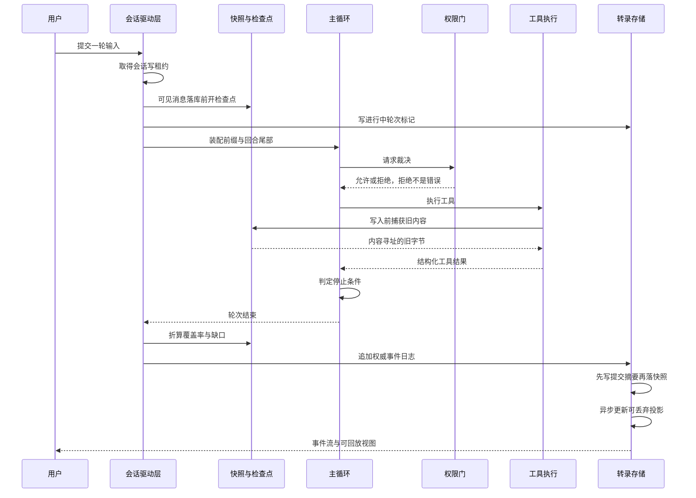
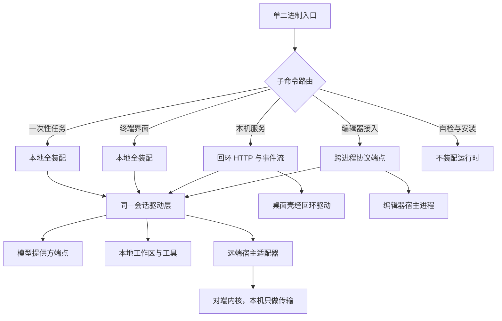

# DeepSeek-Reasonix 架构设计说明：把编码 Agent 做成宿主可裁决、可回退、可审计的本地工具

> 这是一份**叙述型架构设计说明**，写给要接手、要评审或要照着它做技术决策的工程团队；它回答的是"边界在哪、部件有哪些、允许的依赖方向是什么、每个模块承诺什么又不做什么、关键决策付了什么代价、什么条件下该回头改、容量怎么算、当前不能做什么、怎么验收"。
>
> 它与同一目录下的**证据型**子文档是两种文体：证据型文档的每条论断都带可点开的源码索引，本篇**通篇不含任何源码引用、行号或锚点**——本篇的可信度来自骨架的完备性（非目标、代价、备选、复审触发条件、量化口径、验收点），而不是引用密度。要追证据，请另看本目录的索引文档与那 13 篇证据型子文档；本篇不给出任何链接。
>
> 凡是没有把握的事实，本篇不写；凡是没有把握的概念，一律用工程通用词表述，实现侧用词集中在附录 A。

`解读基线：v2.37.0（e17ef45e3）`

## 一、背景与定位：要解决什么问题

### 1.1 产品定位与目标用户

本系统是一个**本地优先、模型可选**的开源编码 Agent。同一份 Go 内核支撑四种使用形态：桌面应用、全屏终端界面、本机 HTTP/SSE 服务（桌面应用的通道）、以及编辑器集成（编辑器以子进程方式拉起它的宿主接入端点）。它不绑定任何模型提供方，"换模型"是配置项而不是新代码。

目标用户有三类，三类人的诉求不同，这一点决定了下面所有的架构取舍：

- **单机开发者**：希望 Agent 能读写自己的仓库、跑命令、改文件，但不希望在"它该停手的地方"失去控制，也不希望能把改坏的东西改回来。
- **要把 Agent 能力嵌进自己产品的团队**：他们要的是一个**库与一组接口**，而不是一个抄不完的应用。因此内核与前端必须分离，且分离要被机器守住。
- **关心"架构约束怎么落地"的工程师**：他们把本项目当作"用机械化门禁替代评审纪律"的样本。

### 1.2 问题的起点：三种会静默劣化的失效

设计不是从功能清单开始的，而是从三种**不报错的**失效开始的。它们的共同特征是：出错时没有任何异常、日志或告警，只会让系统在几天后变得又慢又贵又难用。

**第一，缓存被打碎。** 推理服务的前缀缓存只在系统提示前缀逐字节稳定时命中。任何"顺手更新一下系统提示"的改动——把记忆摘要塞进前缀、把技能目录挂到前面、把权限姿态写进工具描述——都会让此后每一轮重新计算整个前缀。成本与首字延迟同时劣化，且没有错误。这条约束推翻了最自然的做法：**canonical 状态不能直接写进前缀，必须投影到回合尾部**。

**第二，失败原因被模型编出来。** 一次响应因为输出上限被截断，到达模型时可能只剩"参数不合法"这种下游症状。模型于是自造一条解释，而**这条编造的规则会活得比事故更久**：会话从此学会"不要批量调用"，而批量调用从来不是问题所在。结论是：宿主比模型更早知道操作为什么失败（截断、超时、策略拒绝、输出溢出、参数解析），所以**失败归因是宿主拥有的状态**，必须跨越模型可见边界交给模型。

**第三，裁决权在滑走。** 谁决定一个危险命令能不能执行？如果这个判断散落在提示词措辞、模型自律和若干处重复的条件分支里，宿主就失去了在人该说"不"的位置上说"不"的能力。这类判断只有落在**结构化规则与结构化输入**上才守得住：命令用语法树判、工具用声明式规则判、能力用探测结果判，而不是用短语匹配。

### 1.3 失败的形态：不做会怎样

本系统要预防的失败形态不是"功能少一个"，而是下面四类，每一类都有对应的架构位置（验收点见第十四章）：

1. **成本与延迟静默漂移**：前缀不再稳定，缓存命中率下降，用户只感觉到"变贵变慢"，定位不到原因。
2. **错误结论被长期固化**：一次截断被解释成一条规则，此后会话持续绕开一个并不存在的问题。
3. **不可回退的破坏**：模型改了文件、跑了命令，用户想回到十分钟前，而系统只有 git 干净时才能回退。
4. **裁决权失效**：危险操作通过一条"更弱的路径"（某个未接权限门的前端、某个未强制沙箱的平台）发生，而设计文档上写着它被防住了。

### 1.4 本篇的叙述口径

本篇对本系统做**架构级**描述：只承诺能由骨架与量化口径支撑的内容。凡是只能由运行实测回答的问题（真实缓存命中率、真实延迟、真实越权可利用性），本篇一律不给数字，只给可校准的公式与校准步骤（见第十二章），并把它列进只能人工抽样的验收项（见第十四章）。

## 二、设计输入：约束、非目标与技术选型

### 2.1 交付与运行约束

- **单静态二进制**是外部契约，不是构建细节：构建期强制关闭 CGO，并逐目标显式钉死（源码构建、交叉编译的每个平台目标、发布配置、包管理器打包脚本、嵌入式文档校验脚本各钉一处）。目标机器上除二进制外不需要安装任何运行时。
- **依赖树必须纯 Go**。唯一的重依赖（纯 Go 实现的嵌入式数据库驱动）被限定在**可丢弃投影**这一层，不允许上浮到会话真源。
- 桌面端依赖被隔离成**嵌套模块**，以免其原生构建污染"主模块零 CGO"的承诺；代价是根模块的构建、静态检查与测试命令看不见桌面端，必须额外增加构建目标来覆盖它。
- **交付形态四种，产物两条线**：命令行形态与桌面形态各自发布，命名空间不同，但更新通道只有一个（见第十一章）。

### 2.2 算力与后端约束

- **算力全部在本地**：没有服务端推理、没有云端 Agent 托管、没有多租户控制面。模型推理经外部端点完成，端点地址与凭据都是配置项。
- **上下文窗口由提供方决定，而且可能测不到**。当窗口大小未被测量时，容量侧与尾部预算**两条边界都不设**——这是刻意的：宁可让维护不触发，也不要按一个猜测的窗口去裁剪历史。
- **前缀缓存是经济性的主要来源**，因此"模型可见字节的确定性"是一条硬需求：相同 canonical 状态加相同投影状态，必须产生逐字节相同的模型可见内容。

### 2.3 可靠性与安全约束

- **本地进程会崩溃、会被 kill、会被断电**。没有守护进程，没有外部协调者。因此可恢复性只能来自"**写前意图先于副作用**"加"**下次启动幂等重试**"。
- **同一份会话文件跨进程只能有一个写者**。仲裁用操作系统级文件租约而不是内存锁，因为竞争来自不同进程；信息文件只是给人看的，不参与仲裁。
- **输入不可信**：仓库内容、外部工具提供方返回的文本、第三方插件的 sidecar、编辑器宿主都是不可信输入。因此裁决必须在宿主侧完成，且"能力声明只在探测为真时才存在"。
- **越权面必须显式声明**。凡是"不支持""不追踪""不强制"的能力，必须表现为一条可查询的带类型状态，而不是静默尽力而为。

### 2.4 许可约束

项目以 MIT 分发。这不只是法律声明，它直接约束了依赖选择：任何不能随二进制再分发的组件都不能进主干，这条约束与"纯 Go"约束叠加，解释了为什么序列化、数据库、解析器都选了可静态链接的实现。

### 2.5 明确的非目标

以下事项**明确不做**，不做不是能力缺失，而是把复杂度预算集中投在"本地单机上的正确性"：

- **不做云端 Agent 托管与多租户控制面**：系统的边界就是一台机器上的一个进程族。
- **不做模型侧的记忆与自律**：凡是能由宿主判定的，不交给提示词措辞。
- **不做向量检索**：会话历史只做词法检索，召回质量让位于"投影可丢弃、内容永远回真源读"。
- **不做"一维沙箱"的概括承诺**：不做"系统已沙箱化"这种把三个正交事实压成一个布尔的声明。
- **不做分支隔离式的发布策略**：通道归属用显式开关与冻结变量表达，而不是长期维护多条分支。
- **不做"发布时自动兜底"**：更新的成功判定外包给下一次启动，而不是在替换动作里假装确认成功。

### 2.6 无法复原项

以下代价是已经付掉、不能再靠重构撤回的，评审时应当把它们当作设计输入而不是缺陷：

- **1.x 到 2.x 的目录布局整体搬迁**：旧的顶层包被拆散到契约、模型、工具、安全、扩展、平台、运行时之下，旧文档中的布局描述与依赖方向图**整段不再成立**。文档侧没有跟上，形成了成体系的漂移（见第十三章）。
- **检查点格式四代并存**：新格式无法假设"旧格式不存在"，因为旧二进制可能同时在跑——省略内联旧内容会让旧二进制判定"文件原本不存在"从而删文件。这条兼容要求永久性地增加了检查点写入的字段数。
- **术语重载**：同一个词同时指"文件快照检查点"与"提供给模型的折叠检查点"。已有一处同类混淆被改名，这个词没有。
- **配置兼容靠钳制而不是迁移**：越界取值在加载时被夹到合法区间，因为"老配置不用迁移"被视为更小的代价。

### 2.7 技术选型及其代价

| 选型 | 换来了什么 | 代价 |
|---|---|---|
| Go 作为唯一实现语言 | 单二进制交付、结构化并发、跨平台交叉编译 | 需要自研静态分析门禁来守住分层；泛型与反射类元编程能力弱，装配只能手写 |
| 纯 Go 嵌入式数据库驱动 | 兑现零 CGO 承诺；全仓只有一个文件 import 驱动 | 数据库生态与性能弱于 C 实现；驱动升级受纯 Go 约束牵制 |
| 会话真源用可追加的 JSONL，数据库只做投影 | 权威可读、可 diff、可被人直接检查；投影可随时重建 | 需要自己实现索引、游标、进度上报与重建路径 |
| shell 语义用语法树解析 | 命令安全判定读结构而不是读措辞 | 解析失败必须设计降级阶梯，且阶梯本身就是安全决策 |
| 三档静态分析（逐行文本 / 语法树 / 类型信息） | 能表达 gofmt 与通用检查工具表达不了的仓库标准 | 类型级分析必须钉死一个构建目标（固定平台与关闭 CGO），否则结论不稳定 |
| 手写四阶段装配，不引入依赖注入框架 | 装配过程可读、可中断、可断言 | 失去框架自带的依赖图验证，必须由三条依赖规则补上 |
| 无向量检索、纯词法召回 | 投影可丢弃、内容永远回真源读；没有嵌入模型的版本与成本问题 | 召回质量有上限，且必须靠"排序信号 + 一条硬边界"而不是语义相似度 |

## 三、总体架构：边界、部件与依赖方向

### 3.1 边界画在哪里

**系统边界画在"本地单机上的一个宿主进程族"之内**，而不是画在网络服务上。边界之外有四类东西，它们都被当作外部依赖而不是内部部件：模型提供方端点、仓库工作区、编辑器宿主进程、远端（SSH）工作区上的对端内核。边界之内则要求"所有裁决都在宿主手里"，这也是为什么权限、沙箱、失败归因三个关注面都被放在系统内部而不是委托给外部。

一条容易被读错的边界：当系统附着到一个远端工作区时，**内核跑在远端，本机只做传输、转发与组装**。这不是实现细节，而是边界决策——把它反过来（本机内核经文件传输协议读写远端文件）会让每个文件操作都过一次网络往返，并让所有基于本地文件系统语义的工具失效。代价与备选见第十章。

### 3.2 部件清单

按"谁拥有什么"列出，自顶向下：

- **宿主进程族**：命令行入口、桌面宿主进程、桌面壳。只做进程入口、宿主服务与窗口壳，不含编排逻辑。
- **传输层前端族**：命令行前端、终端界面、本机 HTTP/SSE 服务端、编辑器宿主接入端点、平台诊断与自检入口、远端宿主适配器。前端只负责传输与呈现。
- **装配入口**：唯一的装配点，把配置、能力、控制器与扩展快照组装起来。
- **会话驱动层**：唯一传输无关的编排层。命令进、类型化事件出。
- **运行时策略层**：主循环、子代理委派、双模型协作、任务契约与策略。
- **契约层**：工具、提供方、事件、配置、代理图、权限规则等类型与接口。
- **能力域**：工具执行族、扩展与插件宿主、模型适配层、状态与持久化、安全与裁决、平台能力。
- **叶层**：跨 7 个域的 42 个无依赖工具包集合，成员之间可互相引用，成员不得引用集合之外的任何本仓库包。
- **门禁工具族**：架构门禁、覆盖率门禁、价格校验工具。它们不进运行时，只进流水线。

### 3.3 允许的依赖方向

依赖方向由一张**秩表**声明，越界会被流水线拒绝，而不是靠评审记忆。秩自低到高：

`叶层(0) → 契约层(1) → 安全 ‖ 状态(2) → 模型适配(3) → 平台能力(4) → 扩展 ‖ 工具(5) → 运行时策略(6) → 会话驱动(7) → 装配(8) → 前端(9) → 宿主`

三条规则把这张表变成可执行约束：

1. **允许的边**：只能从低秩指向高秩；同秩之间对等（这是最强的约束，它挡住了"随手加一层"）。
2. **会话驱动层的准入名单**：只有前端族与装配入口（共 5 条名单）可以引用会话驱动层；它之下的任何包不得反向引用前端。
3. **叶层闭合**：叶层成员可互相引用，但不得引用集合外的包。闭合的论证是**集合闭包**而不是逐对依赖——它把"从任何地方引用它"的代价从一张完整依赖图压成一个有界集合，同时避免同一个判断被复制进多个包而形成抄本漂移。

另有一条**宿主适配器**规则：远端宿主适配器只有一条合法宿主，只有位于前端线之上的包才能引用它。

### 3.4 运行形态

同一内核有六种装配形态，它们的差别只在"配置从哪来、事件发到哪、谁持有生命周期"：

| 形态 | 装配内容 | 事件出口 | 生命周期归属 |
|---|---|---|---|
| 命令行一次性任务 | 全装配，无交互界面 | 终端文本 | 进程结束即结束 |
| 终端界面 | 全装配 + 终端渲染 | 终端渲染 sink | 控制器清理链 |
| 本机 HTTP/SSE 服务 | 全装配 + 多运行时路由 + 网关 | 编号事件流 | 服务进程；会话级操作系统租约 |
| 编辑器宿主接入 | 全装配 + 跨进程反向请求 | 协议通知 | 由编辑器拉起的子进程 |
| 桌面应用 | 宿主进程强制回环地址 + 桌面壳 | 经本机服务的编号事件流 | 宿主进程以标准输入作为父进程租约 |
| 远端工作区 | 远端全装配，本地只做传输与转发 | 本地前端 sink | 远端服务不随本次连接结束而停止 |

### 3.5 分层架构图与读图要点

下面这张图是本篇的总体架构视图，它要回答一个具体问题：**为什么一个四十万行量级的 Go 程序不会长成一团互相引用的泥**。答案是每一层允许引用的集合被显式声明出来，并交给流水线拒绝越界。

读图要看三处。**第一，前端只负责传输**：前端族与装配入口是唯一允许引用会话驱动层的包，而它之下的任何包都不允许反向引用前端。**第二，编排只有一处**：会话驱动层是唯一传输无关的会话驱动，它拥有运行循环与会话生命周期，把推理、工具调用、审批、回合完成都作为类型化事件发给单一事件出口；终端界面、桌面壳、本机服务端各自驱动同一个控制器，没有谁重新实现回合生命周期、取消或审批。**第三，能力域彼此不直接依赖**：工具、扩展、模型、状态、安全、平台六个高频域都经契约层对齐接口，这也是"配置与插件驱动"能在代码上成立的前提。

图的底部是最容易看错的一处：**叶层不是某一层的子树，而是跨 7 个域的 42 个包的闭合集合**。闭合的含义是"这 42 个包之间可以互相引用，但不允许引用集合外的任何本仓库包"，等价于"集合外的任何包都可以自由引用其中一个叶子"。理由写在声明处：一个叶子够到另一个叶子不会拖来依赖图，而拒绝这种引用会让同一个判断被复制进好几个包；抄本漂移正是这个仓库反复记录的事故形态。这条判断的代价和收益都很具体，是理解本项目工程哲学最好的入口。

## 四、核心模块与职责

### 4.1 责任矩阵

下表是本章的主干。第四列"明确不做什么"与第二列同等重要：一个模块的边界由它拒绝承担的事情定义。

| 模块 | 负责什么 | 对外承诺 | 明确不做什么 | 依赖谁 |
|---|---|---|---|---|
| 宿主进程与桌面壳 | 进程入口、宿主服务、窗口壳、父进程租约 | 桌面应用只能通过回环地址与本机服务通信；地址经标准输出握手交付 | 不含编排、裁决或会话逻辑；不直接调用模型 | 装配入口、传输层前端族 |
| 传输层前端族 | 子命令路由、终端渲染、HTTP/SSE 网关、编辑器协议适配、远端宿主适配 | 同一个控制器之上的多种传输；事件出口是单一 sink | 不实现回合生命周期、取消或审批；不直接读写会话真源 | 会话驱动层、装配入口 |
| 装配入口 | 配置结算、能力接线、控制器构造、扩展快照冻结 | 四个前端得到完全相同的装配结果；装配是可断言的四阶段过程 | 不拥有运行期状态；不代替控制器做裁决 | 契约层、全部能力域 |
| 会话驱动层 | 命令受理、回合编排、投影结算、审批往返、事件投影 | 唯一的编排层；行为加一处、所有前端同时继承 | 不做传输、不做渲染、不做具体权限判定 | 运行时策略层、契约层、状态层 |
| 运行时策略层 | 主循环相位推进、上下文维护、失败归因、停止条件判定 | 模型可见字节由它最终装配；它拥有"为什么失败" | 不决定文件事务；不直接落盘权威转录 | 契约层、模型适配层接口、状态层 |
| 子代理委派 | 委派概念边界、容量与深度约束、写声明调度、谱系落盘 | 子代理与父级共用同一道权限门；声明互不重叠的写路径，否则整批不启动 | 不放开比父级更宽的权限；不为嵌套请求排队等父级持有的槽 | 运行时策略层、契约层、状态层 |
| 双模型协作 | 规划与执行两个角色各自的会话与前缀 | 两个角色各持独立会话，各自前缀稳定；共享的只有静态上下文 | 不把两个角色的系统提示混成一份 | 运行时策略层、模型适配层接口 |
| 契约层 | 工具、提供方、事件、配置、代理图、权限规则的类型定义 | 能力域之间只经契约对齐；类型即边界 | 不含实现；不做平台相关分支 | 叶层 |
| 工具执行族 | 内置工具、脚本执行、shell 运行、作业管理 | 结构化工具结果；输出溢出走可推导判定与溢出文件 | 不自行放行权限；不解释失败原因（归因归主循环） | 契约层、安全层、状态层 |
| 扩展与插件宿主 | 扩展协议、插件包、外部工具接入、技能与主题 | 声明形态与生效位置分离；拦截有阻塞与非阻塞两级 | 不越过宿主裁决；不允许扩展把 `deny` 翻成 `allow` | 契约层、安全层、状态层 |
| 模型适配层 | 提供方适配、模型目录与解析、流式映射、计费与价格 | 差异化被关在适配器内部；重放所有权不在适配器 | 不叠加第二层重试预算；不把模型差异泄进契约层字段 | 契约层、安全层（出网）、叶层 |
| 状态与持久化 | 会话真源、快照与检查点、记忆、可丢弃投影、迁移 | 权威在可读文件里；数据库投影随时可重建；格式不认识就拒绝 | 不做跨存储事务；不把投影当权威 | 契约层、叶层 |
| 安全与裁决 | 权限规则匹配与叶子裁决、沙箱三维、出网管控、命令安全 | 拒绝不是失败；能力声明只在探测为真时存在 | 不做"一维沙箱"的概括承诺；不靠措辞匹配做判断 | 契约层、叶层 |
| 平台能力 | 远端工作区、语言服务集成、浏览器与桌面自动化、安装布局与更新修复 | 越界能力用封闭错误码加装配期缺席表达；更新事务有写前意图与启动健康确认 | 不在缺失能力时提供"总是失败"的占位工具；不猜测平台机制 | 契约层、叶层 |
| 叶层 | 42 个跨域无依赖工具包 | 成员之间可互相引用；集合闭合 | 不得引用集合之外的任何本仓库包 | 无（层闭合） |
| 门禁工具族 | 架构门禁、覆盖率门禁、价格校验 | 越界会让流水线红；历史债以额度记账且只允许人工放松 | 不进运行时；不替评审做判断 | 与被检查的代码同层（只做静态分析） |

### 4.2 承诺的强度分级

矩阵里的"对外承诺"强度不同，评审时不应同等看待：

- **可机器验证的承诺**：依赖方向、秩次序、线格式一致性、前端能力边、受锁结构体字段数、导出入口是否被生产代码调用。这些有对应的门禁规则，违反即流水线失败。
- **由效果测试持有的承诺**：模型可见字节的确定性、事实不进前缀、预算暂停的判定。它们靠"断言抵达边界的字节"而不是断言内部调用，因此比单元测试强，但**没有专门的静态规则**。
- **仅由约定持有的承诺**：前缀字节稳定、"内核不认识具体模型"、每回合状态的归零纪律。这些在项目自述里讲得很硬，但机械保证只覆盖了一半；第十三章把它们列为缺口而不是亮点。

### 4.3 三条被禁止的依赖方向

1. **前端之下不得反向引用前端**：会话驱动层与它之下的任何包都不得引用终端界面、本机服务或编辑器适配。
2. **适配器不得引用内核与前端**：模型适配器只认识契约层。规则真正守住的是这个反方向——"内核只认识契约、不认识模型差异"这条更有价值的纪律，在规则上其实是被允许的（运行时策略层的秩高于模型适配层），靠的是非测试代码零引用的约定。
3. **叶层不得引用集合外的包**：包括不得引用契约层，尽管契约层的秩更高。这条不是"防止循环"，而是保证叶子的可复用性。

## 五、写入链路：完整生命周期

### 5.1 端到端全景：从一次提交到可回放

本章回答的问题是：**用户提交一次请求之后，到结果既落盘又可回放，中间经过哪些所有权转移，每一步的失败会在哪里被看见**。下面这张时序图给的是主干路径；读它的关键是三处所有权交接——会话写租约在哪一刻取得、旧内容在哪一刻落盘、提交摘要在哪一刻写在最终快照之前。

读这张图要抓四个顺序，它们都是刻意选的：

1. **检查点在可见用户消息落库之前打开**。这个顺序决定了轮次边界指向哪条消息，从而决定按对话回退时截断到哪里。前端也用同一条边界把消息下标映射回轮次，而不是自己数用户气泡——合成或隐藏的消息会让计数发散。
2. **旧内容在工具真正写入之前捕获**，所以它是**前像**而不是事后推测。每个路径在同一轮内只快照第一次触碰时的内容，因为那才是这一轮的起点。
3. **提交摘要在最终快照之前落盘**。这是"意图位先于副作用"的第三次独立应用（前两次在检查点发布与分支提交），也是崩溃后能区分"这次提交做完了没有"的唯一依据。
4. **投影异步跟进**。会话保存提交后只发一个非阻塞提示，投影库落后于权威是正常状态而不是故障。

### 5.2 关键状态机

本关注面的核心结构是**一个带回边的状态机**，不是功能清单。正向主线是"会话 → 轮次 → 变更"；主线之外有四类方向相反的边，性质完全不同：

- **正向边**：取得会话所有权、轮次推进、变更被捕获、事务提交，单向前进，没有回头箭头。会话在取得写权限之前是"待建"，取得写权限之后才是真源；取得方式不是打开文件，而是跨进程租约。
- **可反复走的回边**：崩溃恢复补偿、按轮回退、并发写者冲突后分叉。每次都是一笔**新事务**，每次都要付代价（多一份被顶掉的转录版本、消耗一次撤销槽、加深恢复分叉链）。
- **只能走一次的回边**：撤销。撤销槽是单槽，且会被任何新变更失效，因此这条边在"下一次变更之后"就不存在了。
- **不可逆的边**：载荷过期（元数据还在但内容已不可恢复）与未来版本闸门拒绝（读写双双拒绝）。它们没有返回箭头，不是"暂时不能回去"，而是信息已经不在盘上，或者本构建根本无权读写。

版本闸门的姿态是**"不认识的版本就拒绝"**，不是尽力解析。这是刻意的：对未来格式做宽容解析会把"读不懂"伪装成"读到了"。格式迁移则相反地宽容：旧代际的会话由**标记文件**闸门控制的一次性导入接管，跑一次就留下标记，且**从不修改源文件**。

### 5.3 并发控制与租约

系统有四个层次的互斥，各管一件不同的事，混用任何一个都会出错：

| 层次 | 管什么 | 仲裁者 | 竞争失败时的行为 |
|---|---|---|---|
| 会话写租约 | 同一会话文件的跨进程写者 | 操作系统文件锁 | 只读附着降级为只读；准备写则直接报错，不静默覆盖 |
| 会话内回合门 | 同一会话内的回合串行 | 进程内互斥 | 排队 |
| 检查点事务排他 | 回退事务与后台写者 | 显式进入排他区，复核预览指纹 | 活跃后台写者连对话侧一起拒绝 |
| 子代理槽位与写声明 | 会话级子代理并发、互不重叠的写路径 | 会话级调度器 | 嵌套请求无容量即失败；非嵌套排队；撞父写声明即失败 |

两条纪律值得单列。**其一，租约的信息文件只是给人看的**，不参与仲裁：信息说别人持有就尊重，信息损坏但锁是自由的才当作残留，且只回收**本进程自己**留下的条目。**其二，兼容期的旧式保存锁是限时等待**（秒级上限加毫秒级轮询），因为租约本应挡住竞争者，而遗留写者与卡住的进程仍可能占着旧锁文件；无限等待会把界面卡死，并让会话租约永远不释放。

### 5.4 幂等与崩溃恢复

崩溃恢复在这个系统里有四种不同含义，必须分开讲，否则会得到"恢复已经做了"的错误结论：

1. **转录级**：权威事件日志是可追加的，崩溃后靠兼容检查点加尾巴修复收敛；残尾从不被截断成"看起来完整"。
2. **轮次级**：进行中标记决定"这一轮到底提交了没有"。读者从"标记仍在且本进程无主"**派生**出中断状态，而不是把"中断"写进日志——写进去就需要有人保证它被清掉。
3. **冲突级**：检测到外部改写时不覆盖、不丢弃，而是另存一支，让两条历史都留着。
4. **回退事务级**：清单加上意图位加上逆序补偿；事务失败后清单**留在提交中**状态，供下次启动幂等重试。

幂等的来源不是日志框架，而是三处相同的写法：发布位在第一次重命名之前落盘；提交摘要在最终快照之前落盘；被隔离但标记未写的窗口有专门的孤儿备份字段来认领。**每一个中断点都被显式建模**，包括"意图已持久但重命名尚未发生"这一瞬。

### 5.5 可回放性从哪来

可回放性由三件事共同保证，缺一件都会退化成"看起来能回放"：

- **权威不可变地追加**：事件日志只追加，语义由折叠得到，因此"重放"就是重新折叠，不需要外部快照对齐。
- **投影可丢弃且带进度**：投影库落后时，读接口返回显式进度标记而不是阻塞读者；投影重建是正常路径而不是异常路径。
- **事件出口有编号与有界重放**：发给前端的不可丢事件带编号，落在有界尾窗内；超出尾窗后明确回"不完整，请重读转录"，而不是假装连续。

### 5.6 本章边界

本章描述的是**权威写入链路**。本节明确不覆盖：投影库内部的实体与字段设计（那是证据型文档的活，本篇不做实体关系图）、远端工作区上对端内核的落盘细节、以及桌面壳侧的文件交付。另外，"把不可追踪写成带类型的缺口"这条纪律在第八章与第十三章各出现一次，因为它同时是执行模型的输入与已知边界的来源。

## 六、处理策略：从原始输入到可检索单元

### 6.1 策略主张：规则进前缀、事实出前缀

本系统的上下文策略只有一条切分线：**"必须遵守的规则"可以进稳定前缀，"可能出错的事实"一律出前缀**。这条线不是为了整洁，而是缓存经济性的直接推论——事实会变，规则不会；把会变的东西放进前缀，等于每次变动都作废整个缓存。

落地方式是三条保证叠加，任何一条缺失都不足以证明"事实没进前缀"：

1. **代码结构**：事实索引的生产入口没有调用者；
2. **单元不变量**：事实库为空与非空时，静态上下文逐字节相同；
3. **边界效果测试**：断言抵达提供方边界的字节，并配一条**负控制**——"索引确实被写入了"，否则"没进前缀"这个结论可能是因为什么都没写。

### 6.2 标准指令的枚举、去重与交付

标准指令（项目约定文件）的处理顺序是完整的枚举而不是优先级回退：

- **枚举顺序**：用户全局目录 → 从仓库根逐级下探到目标目录；每一级先看三个公认的约定文件名，再看个人覆盖文件；优先级单调递增。
- **去重按展开后正文的内容摘要，而不是按文件名**。这一点是刻意的：三个约定文件是三个独立来源（来自不同的同类工具），回退会静默丢掉用户明确写下的两份约定且没有任何诊断；代价是重复，因此去重必须按内容。
- **导入语法要处理嵌套、重复与循环**，识别失败要记诊断。
- **交付位置**：指令**不进稳定前缀**，而是骑回合尾部，且每回合重新从磁盘解析，不信任快照。
- **结算时机**：只有真正交给运行器时才把欠账清零。也就是说欠账的清偿点是"到达运行器"，而不是"某处宣布要处理了"。

### 6.3 可错事实的模型、冲突归并与索引

事实库用四个正交维度表达"这是哪种知识"，并用一个冲突键表达"两条知识说的是不是同一件事"：

- **内容类型**：事实属于哪个类别，决定它被如何呈现。
- **作用域**：项目级还是全局。
- **来源与确认状态**：决定它在冲突时能不能压过另一条。
- **冲突键**：两条事实的冲突键相同即视为同一命题的两个候选，归并时保留高优先者。

索引文件是**派生态**：它对人类可见、对模型不可见，可以随时重建。这个"可见性分离"是刻意的——如果索引进了模型视野，它就成了一个会漂移的权威副本。

### 6.4 会话历史：可丢弃投影加模型主动拉取

会话历史的策略与记忆相反：**宿主从不自动注入历史**，只建一个可丢弃的检索投影，由模型自己决定要不要调工具去查。

- 投影只存分词后的词项，正文不落在投影里；命中后回权威文件读片段，且**先比对内容摘要**。因此投影过期只会"少结果"，不会"错内容"——这是这个策略最重要的性质。
- 检索信号是**纯词法的**，没有向量。因此排序只能靠词法相关度与一条硬边界（时效性），不能靠语义相似度。
- 更新路径是"提示词加指纹加增量或重建"：两侧指纹都不变则只更新已见代数；可增量追加则只读新增部分；否则整来源重建。
- 结果回到模型时**要二次校验**，因为投影与权威之间允许存在时间差。

### 6.5 可调参数与代价

| 策略旋钮 | 取值与语义 | 代价 |
|---|---|---|
| 压缩触发比例 | 默认 0.85，作用于容量侧 | 比例越大越省 token，也越接近窗口边界；大于 1 等价于关闭维护 |
| 尾部预算 | `clamp(窗口 × 10%, 32K, 96K)` | 预算越大，近期上下文越完整，但折叠频率与缓存破坏频率同时上升 |
| 自动召回 | 默认 4 条 / 2400 字符，装在用户文本之后的尾部块 | 装不下时逐条裁剪并记为省略；同回合已有记忆更新说明时整段抑制 |
| 指令重解析 | 每回合从磁盘重新解析 | 换来"不信任快照"的新鲜度，代价是每回合的解析与去重开销 |
| 历史投影 | 词法检索、可丢弃、带进度上报 | 召回质量有上限；换来"永不给出过期内容"的强保证 |

## 七、读取链路：从提问到可溯源回答

### 7.1 运行时视图：前缀加两级尾部

模型每一轮看到的内容由三段拼成，段与段的稳定性不同：

1. **稳定前缀**：字节恒定，只由声明过的前缀配置驱动。只有一种内容是例外地被允许写进前缀的——被钉住的记忆正文。
2. **控制侧尾部**：投影欠账块写在每回合**新追加**的用户消息正文里，因此历史链只会变长，不会原地改写。
3. **主循环侧尾部**：在历史之后追加的派生消息（宿主上下文、折叠进度、待办身份等）。

两级尾部的分界由"链在第一条派生消息处截断"来承认，并有反向测试钉住"尾部不得被误报为正文改写"。这条设计的收益很直接：**尾部变化不会让前缀缓存失效，而尾部本身也不需要前缀那样的稳定性保证**。

### 7.2 召回与排序

读取链路的排序信号只有两类，这是第六章节制的直接结果：

- **词法相关度**：投影用全文检索索引加键集游标分页，硬过滤"健康且未失联"的来源。因此重建中的来源对读者是**不可见的**，代价是重建窗口内查不到该来源，而不是查到半份结果。
- **一条硬边界**：时效性做成排序信号加一条硬边界，而不是删除或隐藏。删除会让回答失去"曾经有这条"的信息，隐藏会让模型无法判断该不该再问。

新鲜度被当作**数据上报**（结果里带显式进度与版本号），而不是把读者阻塞在一个假想的强一致上。

### 7.3 引用与溯源

溯源靠三件事，它们的共同点是"回真源"而不是"信副本"：

1. **片段回权威文件读，并先比对内容摘要**：投影只提供候选位置，内容以权威为准。
2. **身份而不是位置**：需要指向某个外部对象（浏览器标签、待办项）时用一次性身份，导航后即失效，因此陈旧引用会失败成明确的"陈旧引用"错误，而**不会落到替代对象上**。这是一个用身份避免误操作的干净解法。
3. **不对称的脱敏要显式承认**：自动召回路径对路径做脱敏，而历史检索工具直接打印会话文件绝对路径。这是已知的不对称（见第十三章），本篇不把它描述成统一政策。

### 7.4 尾部预算、省略与抑制

尾部预算的语义是三条约束叠加，任何一个超限都会触发省略记账而不是静默截断：

- 条数上限与字符上限**同时**生效（默认 4 条 / 2400 字符）；
- 先按条数取候选，再按字符预算逐条裁剪片段；装不下就丢弃并记录省略计数；
- 同一回合已经存在记忆更新说明时整段抑制，避免"刚说过又要说一遍"。

读写同侧的边界也要说清：**工具结果的溢出判定不是纯阈值**。正文超过 32 KiB 之后，还要满足"正文减去指针不小于指针"才值得用指针替换正文——也就是指针本身至少要占正文的一半。这条可推导比较的收益是：模型永远能在"看到全文的一部分"与"看到指针加溢出文件位置"之间做选择，而不是被一个固定阈值决定哪一段重要。另外，"读回溢出文件"的调用**绝不再溢出**，否则会出现指针套指针。

## 八、执行模型

### 8.1 主循环的相位

一个回合自外向内经过四个相位，每一相位的失败归属不同：

1. **准入**：取得会话写租约、打开检查点、写进行中标记、装配模型可见上下文。失败属于宿主，通常直接终止本轮。
2. **推理**：向提供方发请求、消费事件流、把方言折成统一词表、累加工具调用参数。参数按索引累加而不是按到达顺序拼接——流式分片到达顺序不保证。
3. **执行**：把工具调用变成裁决请求与工具执行，结果结构化回注。这一相位是唯一允许产生文件副作用的地方，也是唯一有前像捕获的地方。
4. **结算**：判定停止条件、折算覆盖率与缺口、追加权威日志、更新投影。

### 8.2 停止条件与"什么不算停止条件"

停止条件里最值得记住的是**两条反直觉项**，它们直接影响 Agent 的行为质量：

- **就绪性失败不再用隐藏消息重试**，直接结束本轮，由宿主决定后续。用隐藏模型消息重试会把一次宿主侧问题变成一次模型侧的学习信号。
- **权限拒绝不是停止条件**：它回注为带拒绝码的受阻工具结果，循环继续。拒绝被表达成一个非错误的、不可重试的结论，模型拿到的是宿主撰写的原因，而不是一句错误文本。
- **一轮默认不受任何计数约束**：单轮步数上限的默认值是 0，表示不设总轮数上限。这是一个显式选择，不是遗漏——真正的上界来自预算、取消与停止条件。
- **输出溢出不等于失败**，它是一种正常的工具结果形态。

### 8.3 工具面与授权

工具面由三件事定义，缺一件就会出现"某条路径更弱"的漏洞：

- **契约由工具声明本身构成**，且工具清单是按字节排序的、随权限姿态**不抖动**——否则工具 schema 会连同前缀一起失效。
- **裁决在叶子，中央只做规则匹配**：权限档位只改一个兜底项、从不改规则表，因此否定规则在任何档位下都优先匹配。前端自动放行也走同一条路径，且要求结果**恰好**是允许。
- **命令安全读语法树**：若干类阻塞项各有独立身份；解析失败时按固定阶梯降级（从"交给解释器的文档流"到"复合叶子全只读"），而不是一律判"必须问人"。同时，"动态命令不继承更宽规则"有硬闸：只接受逐字精确规则。
- **沙箱是三个正交维度**：完整性（写根）、保密性（禁读根）、授权（宿主能力）。只读只是完整性维度的一个属性，不是独立维度；每个维度有**独立的探测函数**，且注释会主动否认过度声明（例如否认"宿主进程间通信已隔离"）。能力声明只在探测为真时存在。

### 8.4 子代理委派

委派被拆成五个互不重叠的概念（生命周期、授权来源各不相同），字段归属由**反射白名单测试**强制：新增字段必须同时改守卫，且反向守卫"投影不得丢掉工作身份字段"。边界不是文档里的一句话，而是会失败的测试。

执行侧的六条纪律：

1. **所有派发入口先编译成统一的执行规格再走同一条运行路径**。
2. **执行器与每个子代理共用同一道权限门**；"能不能问人"按入口分级，只有被委派的运行才持有提问者。
3. **写声明同时是调度边界、执行边界与审计基准**：缺省即整工作区认领从而默认串行；要求同时运行的写者**预声明互不重叠的路径**，否则预检失败且**整批不启动**。
4. **嵌套抢槽无容量即失败**，不让子代理等父级持有的槽；三种等待原因（总并发、写者上限、路径被持有）必须可读，因为补救动作不同。
5. **可持久先于可观测**：队列与启动都先落日志再画图，写不下就拒绝启动；"中断"从不被写入，而是由读者从"打开且本进程无主"派生。
6. **上下文请求有四种语义**，且带一条缓存约束（子代理不能在共享前缀上引入新的不稳定字节）。

### 8.5 多渠道与前端对等

四种使用形态共用同一控制器，因此"行为加一处、所有前端同时继承"。防止漏接靠两条机制：**能力边的存在性检查**（某前端是否消费了控制器的某个能力）与**以类型而不是名字记账**——只有真正属于控制器包的方法才被记为"已消费"，避免同名的无关方法（例如关闭文件）被误记为已实现。这条约束同时说明为什么前端对等检查必须读类型信息：按名字匹配会把无关方法算进来，也会把真正的缺漏放过。

## 九、状态与持久化全景

### 9.1 真源划分

持久化只有一条公理：**权威留在人类可读的文件里，数据库一律是可丢弃的投影**。由它推出三条落地规则：

- **权威是追加式事件日志**（会话）与**标记式文本文件**（记忆、指令、价格表）。它们可被直接检查、可被 diff、不依赖任何驱动。
- **兼容检查点文件保留**，承担随机读、发现锚点与旧二进制兼容三重职责。它不是权威，但也不能删——它是另一代际读者理解同一会话的入口。
- **投影库可以随时重建**，重建是正常路径。任何"投影损坏导致数据丢失"的场景在设计上都不成立，因为权威从未经过投影。

### 9.2 存储根与投影

存储被组织成**一个闭合集合的根**，而不是拼接出来的路径：会话目录、缓存目录、配置目录、数据目录、状态目录。其中只有一个根不可搬移（因为它承载跨进程租约与安装布局），其余都可配置。

两个数据库都是投影，且**全仓只有一个位置 import 数据库驱动**：连接串、每连接参数、迁移、隔离与重建全部收在那一个文件里。两个业务投影都不 import 驱动，只调用它。这条收口的价值是：换驱动、改参数、改隔离策略只需改一处，而"哪个库是投影"这个问题不需要靠约定回答。

三条与容量直接相关的行为：投影写入是**异步加合并**的（入队容量有限，溢出时记脏路径稍后对账，而不是丢弃）；投影打开是**懒加载**的（不在启动关键路径上，打开失败也只是"没有投影"）；读路径有**一道门槛**——只有当天数据的大小、偏移、时间戳与状态全部吻合，才允许用聚合结果回答，否则回退到权威文件精确查询。

### 9.3 幂等写入与一致性边界

一致性策略是**幂等写入加最终一致**，而不是跨存储事务：

- **权威侧指纹决定要不要重做**：只有内容指纹与元数据指纹都变了才重建，因此重复提示、丢失提示、外部改写最终都会收敛。
- **重建对外不可见**：先把来源标记为陈旧（在事务之外，立刻让旧词项不再命中），再在单个事务里替换行并递增版本号。读者侧硬过滤健康且未失联的来源，因此"重建中"对读者表现为"暂时查不到"，而不是"查到半份"。
- **精确一次靠主键加忽略重复插入**；同一偏移但哈希变了说明文件被外部改写，立刻升级为整文件重放。
- **没有跨存储事务**，这一点被显式暴露给调用者而不是掩盖：读结果带一个"部分结果"标记，在索引未完成时为真。系统选择**把新鲜度当数据上报**，而不是把读者阻塞在一个假想的强一致上。

### 9.4 迁移策略与三层版本闸门

迁移策略分三档，档位由"读错的代价"决定：

1. **投影库用编号迁移加重建优先**：迁移编号必须连续，跳号即报错；未来版本的 schema **不隔离，而是降级为内存投影**（可读不可写）；分词器版本变化则在一个事务里清空词表并整体重放。危险时选择**重建而不是修复**。
2. **两类投影库的版本前进方式不同**：一类走编号迁移，另一类直接换文件名并删除旧库。这个不一致是历史形成的，本篇如实写出而不包装成原则。
3. **会话侧只有版本闸门**：事件日志的 schema 高于本构建支持的上限时，**读取与保存双双拒绝**，且没有降级路径。旧代际的导入由标记文件控制、一次性、只拷贝不改源；导入失败给的是类型化的跳过原因，让上层按码决策而不是匹配字符串。

## 十、关键设计决策与代价

本章是全篇最重要的一章。每条决策都按四段写：**选了什么、代价是什么、放弃了什么备选、什么条件下该回头复审**。没有第四条的设计不是决策，是习惯。

### 10.1 前缀不可变，动态状态全部走回合尾部

**选了什么**：稳定前缀只由声明过的前缀配置驱动；记忆、技能目录、运行时事实一律投影到回合尾部，分成控制侧与主循环侧两级。

**代价**：需要两级尾部的装配线与"链在第一条派生消息处截断"的判定；投影新鲜度变成一个有所有权的问题（谁拥有动态事实，谁负责让它重新欠一次）；欠账的清偿点必须是"到达运行器"而不是"某处宣布处理"。

**被放弃的备选**：把记忆摘要与技能目录直接写进系统提示。这条路实现最短，但每写一次就作废一次前缀缓存，且**没有任何报错**——正是本设计要防的第一类失效。

**复审触发条件**：出现一种内容，它既必须逐轮可变、又必须比尾部更强的位置保证（例如必须影响工具 schema 的字节）；或运行期缓存诊断显示前缀仍在非声明路径上变化。

### 10.2 失败归因归宿主，跨边界只传身份

**选了什么**：宿主判定截断、超时、策略拒绝、输出溢出、参数解析失败，并把**句子**交给模型；机器身份（拒绝码这类）只到前端与审计。

**代价**：宿主必须维护一份"谁更早知道为什么失败"的责任表；跨进程错误要做 dotted code 化；模型看不到拒绝码，只能在句子层面理解拒绝。这与"身份必须跨越模型可见边界"的自述存在张力，本篇按事实写成边界而非完成态（见第十三章）。

**被放弃的备选**：把原始错误文本或结构化错误对象直接交给模型。这会立刻回到"模型自造规则"的老路，而且编造的规则会活得比事故更久。

**复审触发条件**：出现一类失败，宿主无法在拿到响应的同一轮内判定原因（例如需要跨轮才能确认的语义错误）；或前端与模型对同一失败的理解出现实际分歧。

### 10.3 折叠是投影级比较并交换事务，不是截断

**选了什么**：上下文维护做成一次事务性投影替换，提交要求转录版本、全量覆盖哈希、投影版本与代数**四者同时未变**；维护收据显式承认自己打断了缓存；第二次折叠必须等一个尾部量的新封闭历史。

**代价**：折叠的实现复杂度远高于截断；写入路径更长，失败的中间态更多；必须显式管理"缓存破坏频率"这个非功能指标。

**被放弃的备选**：直接截断旧消息，或按固定的头尾几何裁剪历史。截断会不可逆地丢掉信息，而且没有"提交前复核"这一步，遇到并发写入就会产生撕裂的视图。

**复审触发条件**：折叠频率随上下文增长失控；或出现"四者未变仍提交成功"这类校验缺口；或用户反馈历史被折叠后无法回答本来能回答的问题。

### 10.4 工具结果溢出用可推导比较加指针，不用固定阈值加头尾截断

**选了什么**：正文超过 32 KiB 之后，还要满足"正文减指针不小于指针"才用指针替换正文；被替换的正文进溢出文件；"读回溢出文件"的调用绝不再溢出。

**代价**：模型需要多一步才能看到全文；溢出文件的生命周期与管理成为额外负担；指针式结果的形状与普通结果不同，下游渲染要处理两种形态。

**被放弃的备选**：头尾各留一段的几何截断。它会丢掉失败命令的**输出尾部**，而失败诊断恰恰集中在尾部；先剪工具输出再摘要的次序因此是正确性要求而不是优化。

**复审触发条件**：总是被阅读的恰好是被截掉的那一段；或指针式结果让模型频繁放弃读取全文。

### 10.5 权限裁决在叶子，中央只做规则匹配

**选了什么**：规则用"动作、资源、效果"三元组表达，中央只做匹配，判定在叶子；权限档位只改一个兜底项、从不改规则表，因此否定规则永远先匹配；前端自动放行要求结果**恰好**是允许。

**代价**：规则表成为安全关键资产，必须有人维护其完备性；档位与规则的双层语义需要文档与测试同时说明；动态命令需要一条额外的硬闸（只接受逐字精确规则）。

**被放弃的备选**：在中央做统一判定。它会让"档位"必须表达成一张更复杂的表，而档位与规则的相互作用正是最容易出错的地方。

**复审触发条件**：出现一条路径绕过了匹配入口（本机 HTTP 面的读接口就是这样一个已确认的例子）；或规则表增长到无法人工审查完备性。

### 10.6 沙箱三维正交，而不是一个只读布尔

**选了什么**：完整性、保密性、授权三个维度各有一组探测函数，互不概括；只读只是完整性维度的一个属性；每个维度独立声明支持与否。

**代价**：三个维度都必须各自实现，平台差异要写三遍；跨维度耦合必须手工处理（例如某平台禁用网络会连带切断代理转发，因此规则顺序本身是安全论据）；平台缺口的表达更啰嗦。

**被放弃的备选**：一个只读布尔加若干开关。它读起来简单，但会把"写法根保护"与"禁读根保护"混为一谈，也让"某维度不生效"无法被单独声明。

**复审触发条件**：新增一个平台后端；或出现"某维度声明为真但实际不生效"（当前有一个平台的三个维度全部落到关闭，见第十三章）。

### 10.7 权威留在可读文件，数据库只是可丢弃投影

**选了什么**：会话真源是追加式事件日志，权威在文本文件；数据库只服务检索与统计，可在任何时候重建。

**代价**：需要自建索引、游标分页、进度上报与重建路径；读路径要处理"投影落后"这个常态；跨存储只能最终一致，必须把新鲜度当数据暴露。

**被放弃的备选**：把会话主体放进数据库并用事务保证强一致。这会让权威依赖一个进程内的驱动，并把"数据库损坏"升级为"数据丢失"，与本系统的可检查性立场冲突。

**复审触发条件**：投影重建耗时增长到影响可用性；或出现只有数据库才知道、无法从权威重建的状态。

### 10.8 转录双表示：追加日志加兼容检查点，而不是单一存储

**选了什么**：权威是可追加的事件日志；同时保留一份兼容检查点文件，承担随机读、发现锚点与旧二进制兼容。

**代价**：同一份历史有两种表示，必须保证它们不打架；写路径要同时维护两者；字段设计被旧代际的解读方式绑住（例如必须保留内联旧内容，否则旧二进制会判定文件原本不存在并删除它）。

**被放弃的备选**：只保留单一存储。单库版本会失去"旧二进制仍能安全共存"这条性质，也会失去"人可以直接读会话"这条运维优势。

**复审触发条件**：旧代际的支持窗口关闭（届时可以砍掉兼容表示）；或两种表示出现实际分歧。

### 10.9 回退用全量前像加内容寻址加补偿事务，而不是版本控制或差分链

**选了什么**：按用户轮次建立检查点；保存的是该轮内首次触碰的**全量旧内容**，按内容摘要寻址存 blob；回退是两段式事务，先把已发布位写盘再重命名，失败后留清单供下次启动幂等重试。

**代价**：存储放大（全量而不是差分）；必须管理保留配额；回退的作用域是"该轮及以后的路径集合"，且**只覆盖编辑工具改过的文件**——命令行产生的副作用不在内。这一点不隐藏：它被写成一条带类型的覆盖率缺口，遇到任何缺口都强制用户确认。

**被放弃的备选**：依赖版本控制系统的历史，或维护差分链。前者要求在回退时假设工作区是干净的，后者把可恢复性建立在一条越长越脆的链上。

**复审触发条件**：全量前像的存储放大成为主要成本；或缺口类型（命令行、外部工具）在真实使用中占比过高，使"必须确认"退化为"习惯性确认"。

### 10.10 架构债务用基线棘轮承载，而不是零容忍

**选了什么**：门禁族把当前债务记成一个**额度**，其中棘轮的计量单位是"**超出量**"而不是"违规条数"：受锁结构体只数超过阈值的标量字段，前端对等只数**缺的边**。豁免表的每一行都有成本（加一行会让能力行权重减一、表行加一，测试断言总额守恒），豁免理由必填但门禁从不读它。

**代价**：基线文件成为一个人人需要理解的资产；额度放松只能由人手在 reviewer 可见的差异里完成，因此每次放松都有社交成本；新规则上线时要么立刻零债务，要么先欠一笔。

**被放弃的备选**：零容忍（会迫使作者删规则或大规模重构，最终结果是门禁被绕过），或不设基线（规则会立刻被大量豁免淹没，等价于没有规则）。

**复审触发条件**：某个规则的额度长期只增不减；或额度的存在使某类缺陷实际不再被修复（需要为它设一条下降计划）。

### 10.11 手写四阶段装配，用依赖规则替代框架的图验证

**选了什么**：装配是手写的分阶段构造器，没有依赖注入框架、没有反射；装配正确性由三条依赖规则（允许的边、秩次序、未接线导出入口）承担。

**代价**：装配代码更长、更显式，新增依赖必须手工接线；失去框架自带的"循环依赖"检测，必须靠静态规则补；装配顺序本身成为设计约束，必须写在注释里并被测试保护。

**被放弃的备选**：引入依赖注入框架或代码生成。收益是自动图验证，代价是引入运行时反射、初始化顺序不确定，以及一棵更重的依赖树——后者直接与"纯 Go 依赖树"的交付约束冲突。

**复审触发条件**：装配点数量增长到手工维护开始出错；或三条规则无法覆盖真实的装配缺陷类型（例如只在运行期出现的初始化顺序问题）。

### 10.12 委派以预声明写路径为调度边界，要么整批启动要么全不启动

**选了什么**：写声明同时是调度边界、执行边界与审计基准；缺省即整工作区认领从而默认串行；要求同时运行的写者预声明互不重叠的路径，否则预检失败且整批不启动；嵌套请求无容量即失败。

**代价**：调用方必须事先知道要写哪些路径，这对探索型任务不友好；预检失败使整批不可用，局部可用性被牺牲；三种等待原因必须可读，否则用户不知道该抬哪个上限。

**被放弃的备选**：先到先得的路径锁，或让嵌套请求排队等父级释放槽。前者会让死锁与饥饿变成运行期问题，后者会让嵌套委派在父级持槽时永久阻塞。

**复审触发条件**：预检失败在实际使用中频繁发生且路径其实不重叠（说明声明粒度太粗）；或出现写冲突导致的数据损坏。

### 10.13 宿主接入用能力协商代替版本协商

**选了什么**：接入握手中协议版本字段被反序列化出来但**从不比较**，回复恒为固定值；兼容性靠五件事保证——能力位、宽容的扩展字段、带厂商命名空间的字段、结构化面板附纯文本回退、历史配置标识归一。

**代价**：兼容性责任从"比较一个数字"转移到五处分散的约定上，任何一处被忽略都会造成静默不兼容；没有版本号也意味着无法给出"最低支持版本"这种简单答案。

**被放弃的备选**：严格版本协商加拒绝不匹配的主机。这会在宿主升级时立刻断开，而宿主（编辑器）的升级节奏不由本项目控制。

**复审触发条件**：出现无法用能力位表达的破坏性变更；或某个宿主宿主在"宽容扩展字段"上做了不宽容的假设。

### 10.14 自更新等于写前意图加事务身份加启动健康确认

**选了什么**：任何替换正在运行的自己的操作，都先落一条写前意图，记下一个不透明的事务标识；只有**从这次更新真正启动起来的那个进程**才能宣布健康，超时后自动提交；失败有按平台各自的原子替换与回滚材料。

**代价**：安装布局被迫复杂化（版本目录、暂存区、待处理标记、锁、隔离目录、配置快照）；恢复路径本身成为仓库里最复杂的一处代码，必须以棘轮额度记账；失败态的可见性依赖文档与前端，而恢复的**第二条路径虽然已实现却没有接线**（见第十三章）。

**被放弃的备选**：下载后直接覆盖并自行判定成功。它省掉意图位与健康确认，但会让"新版本启动了但立刻崩"变成一个只能靠用户手动装回旧版的状态。

**复审触发条件**：健康确认与回滚路径长期没有真实触发（说明它未被验证）或被触发时无法收敛；或多平台语义差异扩大到"同名不同事"，需要重新命名而不是继续共用一个承诺。

## 十一、部署形态与运行拓扑

### 11.1 进程与外部依赖

系统对外部世界只有五个依赖面，且没有一个需要常驻服务：

- **模型提供方端点**：单向上行，经专用出网客户端（带重定向守卫）。
- **仓库工作区**：本地文件系统；命令执行依赖本地 shell 语义。
- **凭据存储**：操作系统钥匙串，或文件形式的凭据文件。
- **可选的外部工具服务器**：以子进程方式接入，凭据以**投影**方式注入而不是下发原文；令牌一律不走命令行参数。
- **远端工作区（可选）**：复用系统 SSH 自身配置与已知主机文件，不发明新协议；对端需要一份可运行的内核，由自举流程送达。

操作系统级依赖只有文件锁、进程存活判定与（可选的）平台沙箱后端。**没有任何组件需要管理员权限安装**；需要提权的只有包管理器形态的更新，且提权由平台工具完成而不是由本系统直接调用。

### 11.2 配置分层与查找顺序

配置分三层，优先级自低到高：内置默认 → 用户全局配置 → 项目配置，命令行标志覆盖全部。此外还有一类**不可配置项**，它们的取值是硬编码常量（例如检查点保留配额），本篇在第十二章把它们单独列出——因为"没有配置面"本身就是一条需要评审的架构事实。

配置的兼容策略是**钳制而不是迁移**：越界取值在加载时被夹到合法区间，未知键被忽略，理由是"老配置不用迁移"。代价是用户写错的值不会报错。

### 11.3 启动期易错点

按"出错时的可诊断性"从差到好排列：

1. **凭据不可用**：模型端点无法鉴权时，只有在第一次请求时才暴露，而那时已经进入了一个回合。
2. **窗口未测量**：容量侧与尾部两条边界都不设，表现为"上下文维护从不触发"。这是刻意的行为，但很容易被误读成"维护坏了"。
3. **会话被另一进程持有写租约**：准备写的路径直接报错，只读附着降级为只读。表现正确，但用户容易以为是文件损坏。
4. **扩展或外部工具服务器起不来**：以显式的诊断与失败码表达，且工具在装配期缺席——模型连工具名都看不到。这是最容易诊断的一类。
5. **平台沙箱后端不可用**：沙箱落到关闭，权限门仍在。如果用户假设"沙箱在生效"，这是一个静默的安全假设落差。

### 11.4 运行拓扑图

下面这张图回答"一次会话在物理上由哪些进程承担、它们之间靠什么连"。它要强调两件事：**控制器只有一个，进程可以有很多**；以及**跨机器场景下内核在对端，本机退化为传输**。

读图要点有三处。**第一，控制器只有一份**：四个入口都汇入同一个会话驱动层，因此行为加一处即可被所有形态继承。**第二，"不装配运行时"是一条真实存在的分支**：安装、自检一类的子命令不应该为了打印一条诊断信息而构造整个运行时，这条分支的存在本身就是启动性能决策。**第三，远端场景的拓扑与本地不同构**：远端宿主适配器之下是**另一个完整内核**，本机不承担推理与工具执行；因此远端会话的能力集取决于对端内核版本，这是本系统里唯一"能力随环境变化"的地方。

## 十二、容量与性能口径

### 12.1 公式

本章给的是**可校准的口径**，不是测量结果。四个公式覆盖了系统里绝大部分容量行为：

- **容量侧压缩触发**：`trigger_tokens = min(context_window × compact_ratio, ContextSoftLimitTokens)`，其中 `compact_ratio` 默认 0.85。两条边界取**更紧**的一条；当 `context_window` 未被测量（取值为 0）时，**两条都不设**，容量侧维护不触发。比例大于 1 等价于关闭维护。
- **物理输出上限**：`physical_output_limit` **独立**于上面两条边界计算，并额外预留 256 token。也就是说，容量侧与经济侧都不收紧它，它是另一条正交的边界。
- **尾部预算**：`tail_budget = clamp(context_window × 10%, 32K, 96K)`，即最近历史的目标预算。
- **工具结果溢出判定**：`spill ⇔ (body > 32KiB) ∧ (body − pointer ≥ pointer)`，等价于 `pointer ≤ body / 2`。它不是纯阈值，而是一条可推导比较：只有当指针本身不超过正文的一半时，用指针替换正文才是划算的。

两条由公式直接推出的**交界点**，比参数本身更有用：

- 尾部预算的**下界**在 `context_window < 320K` 时生效（此时窗口的 10% 不足 32K），**上界**在 `context_window > 960K` 时生效，中间区间按 10% 线性。
- 容量侧与经济侧谁先触发，取决于 `ContextSoftLimitTokens` 是否低于 `0.85 × context_window`：低于则经济边界先触发，高于或未设则容量侧先触发。

### 12.2 参数表

| 参数 | 取值 | 含义与约束 |
|---|---|---|
| `compact_ratio` | 0.85（默认） | 容量侧压缩触发比例 |
| 压缩触发 | `min(context_window × compact_ratio, ContextSoftLimitTokens)` | 两条边界取更紧的一条；窗口未测量则两条都不设 |
| 物理输出上限 | 独立计算，另预留 256 token | 与上面两条无耦合 |
| 尾部预算 | `clamp(context_window × 10%, 32K, 96K)` | 近期尾部预算 |
| 摘要输出上限 | 16K | 折叠时摘要请求的输出上限 |
| 工具结果内容上限 | 32 KB | 另有原始内容通道承载全文，超出走溢出文件 |
| 溢出判定 | `body > 32KiB` 且 `body − pointer ≥ pointer` | 可推导比较，非纯阈值 |
| 检查点保留 | 100 个带载荷检查点 / blob 总量 1 GiB / 单文件 32 MiB | **硬编码常量，无配置面** |
| 子代理深度上限 | 2 | 只决定"还能不能再派一层" |
| 子代理并发上限 | 6 | **会话级**总数，不是每层各 6 |
| 并行写者上限 | 3 | 指"声明了互不重叠写路径"的并发写者 |
| 自动召回 | 4 条 / 2400 字符 | 装在用户文本之后的尾部块 |
| 单轮步数上限 | 0 | 0 表示无总轮数上限 |
| 子步数预算 | `max(父步数 / 2, 5)` | 父级无上限则子级无上限 |
| 并发与写者取值域 | 0 表示取默认；1–32 之外在加载时钳制；写者不得超过总数 | 归一化发生在加载期，老配置不需要迁移 |
| 事件流有界重放 | 8 MiB 尾窗 | 只对不可丢事件编号；淘汰后明确回"不完整" |
| 投影入队容量 | 1024 | 溢出不是丢弃，而是记脏路径稍后对账 |
| 数据库每连接参数 | 忙等 150 ms、日志体积上限 4 MiB、连接池 4 | 内存模式强制连接池为 1 |
| 兼容保存锁等待 | 5 s 上限、25 ms 轮询 | 限时是为了不把界面卡死 |
| 重试两级预算 | 契约层 10 次、退避上限 15 s、服务端建议等待上限 60 s；主循环层 5 次重放、0.5–8 s 加抖动 | 两层职责不同：契约层管连接与头部阶段，主循环层管整体重放 |
| 审批等待 | 本机服务侧默认 3 分钟；编辑器接入路径**不设审批超时** | 编辑器路径的上界只有三条取消路径 |
| 更新健康确认 | 24 小时超时后自动提交 | 只有从该次更新启动的进程能提前确认 |
| 配置快照保留 | 5 份 | 更新修复路径的一部分 |
| 本机文件读接口上限 | 2 MiB 且限文本 | 这是实现细节，**不是保密边界**（见第十三章） |
| 门禁规模上限 | 单文件 800 行、单函数 120 行、复杂度 30 | 超出部分以额度记账 |
| 受锁结构体阈值 | 标量字段数 12 | 只数超出部分 |
| 未接线导出入口额度 | 66 | 每个命中权重 1，门禁会报，棘轮在容忍 |
| 前端能力缺口债务 | 27 条边 / 11 个驱动文件 | 另有 39 个死能力 / 122 条边不被任何门禁覆盖 |

### 12.3 三个档位示例

下表用三组**假设的窗口取值**演示"哪条边界先触发"。它们是口径示例，不是实测：把实际窗口代入即可得到实际结论。

| 档位 | 假设窗口 | 压缩触发 | 尾部预算 | 哪条边界先触发 |
|---|---|---|---|---|
| 小仓库、单模型 | 64K | 54,400 token（容量比例先到，假设经济边界未设或更高） | 32K（**下界**生效：10% 只有 6.4K） | 尾部预算被下界顶住；尾部占窗口近一半，折叠会很频繁 |
| 中型仓库、双模型 | 200K | 170,000 token | 32K（**下界**仍生效：10% 为 20K） | 与上一档同一条边界先触发，但尾部占比从约 50% 降到约 16% |
| 大型仓库、远端工作区 | 1M | 850,000 token | 96K（**上界**生效：10% 已达 100K） | 尾部预算第一次由上界决定，占比约 9.6%，低于 10% 的设计意图 |

三档的读法不是"数值大小"，而是各自的**容量瓶颈在哪一项**：

- **小档位的瓶颈是尾部占比**：尾部预算被下界顶住，意味着近期历史相对于窗口过大，折叠频率高，缓存破坏也频繁。这一档要调的是窗口假设或尾部下界，而不是压缩比例。
- **中档位的瓶颈是绝对量级**：边界行为与小档位相同，但每次折叠要处理的历史多三倍以上，摘要输出上限（16K）成为摘要质量的实际上限。
- **大档位的瓶颈是尾部上界**：96K 的上界在这个量级下比设计意图（10%）更紧，说明上界是为一类更大窗口预留的；一旦真实窗口常态化超过 960K，这个上界就是应该复审的参数。

另外两项容量在任何档位都可能独立成为瓶颈：**检查点实际保留数量**约为 `min(100, 1 GiB / 平均前像字节)`——若某次改动的平均前像较大，则字节配额先到顶而不是数量配额；若单个文件超过 32 MiB，它根本进不了检查点。**子代理并发**在任何档位都不变（会话级 6），因此大仓库上的并行度瓶颈不是模型窗口，而是写路径能否被声明为互不重叠。

### 12.4 校准步骤

按顺序做，每一步都产出可复核的记录：

1. **先确认窗口是否可测量**。若不可测量，记录"两条边界都不设"这一事实，**不要用猜测值填充**——猜一个窗口去裁剪历史是本设计明确拒绝的行为。
2. **采集一轮会话的计量**：输入 token、输出 token、缓存命中与未命中，并把它们与"前缀是否变化"的事件对齐。
3. **只在前缀稳定的前提下调压缩比例**。若前缀仍在非声明路径上变化，任何比例调整都是在噪声上做优化。
4. **调尾部预算时看两个信号**：折叠频率（太高就抬下界或抬上界）与"折叠掉的信息是否仍被需要"（被需要就说明尾部预算太小）。
5. **检查点容量按平均前像字节算**，代入 `min(100, 1 GiB / 平均字节)`。若单文件经常超过 32 MiB，问题在"该文件是否该被纳入捕获"，而不是配额太小。
6. **并发与深度以等待原因分布为输入**调：三种等待原因（总并发、写者上限、路径被持有）各自对应不同的补救动作，只抬错的那一个。
7. **门禁额度只允许人工放松**，且放松必须和"是否拆文件、是否减少规则命中"一起决定；额度长期只增不减时要为它设一条下降计划。

### 12.5 非实测声明与其余计量

**本篇不含任何实测数字**：没有延迟分位数、没有吞吐、没有缓存命中率、没有 token 节省比例。第十二章给出的全部是公式、常量与由它们推出的交界点；三个档位示例使用的是假设窗口，不是测量结果。任何声称"本系统性能如何"的结论都必须由校准步骤产出。

除第十二章之外的量化事实分散在各章，汇总在此以便复核：**门禁规模**（28 条规则、42 个叶包、5 条前端准入名单、1 条宿主适配器名单）、**债务计量**（见 12.2 末四项）、**重试与超时**（见 12.2）、**测试规模**（测试代码与生产代码行数比约 1.11 比 1，是最容易被引用也最容易失去意义的一个数字）、以及**交付规模**（六个交叉编译目标）。

## 十三、已知边界与缺口

本章按**影响面**排序：越靠前意味着"在真实使用中越可能出问题"。每一条都写影响，而不是只列现象；每一条都区分"设计选择"与"欠账"，不把欠账包装成选择。

### 13.1 本机服务存在一条绕过权限门的读路径

本机 HTTP 服务的一个工作区文件读写端点只做了三件事：限制路径为相对路径、把根固定住、用内容摘要做写冲突检测。它**既不经过权限裁决，也不受沙箱读约束**。

**影响**：任何持有该服务启动令牌的本机客户端，可以读取工作区根下任意不超过 2 MiB 的文本文件——包括环境变量文件这类凭据文件。2 MiB 上限与"非二进制"过滤是**实现细节，不是保密边界**。这条路径与同一层其它决策自相矛盾：桌面宿主的回环门与移动端接入的授权归零都明确拒绝了"回环客户端就等于操作者"这个假设，而这里恰恰接受了它；对子代理的纪律是"执行器与每个子代理共用同一道权限门"，这条读路径是同一个内核上的一条**更弱路径**。风险是有界的，不应夸大：服务默认使用令牌鉴权，且网页形态会忽略"无鉴权"配置；桌面宿主强制回环地址，地址经标准输出握手交付，标准输入作为父进程租约。所以准确表述是"**本机同用户下任何拿到令牌的进程可读工作区文本文件**"，而不是"互联网可读"。对单机单人使用影响有限，对"把服务暴露给同机其它用户或容器"的场景是实际缺陷。本篇未做端到端渗透验证，结论来自读码。

### 13.2 发布流程不跑仓库规范门禁

架构门禁、覆盖率门禁与通用静态检查只在常规集成流水线里被调用；**发布工作流全文没有任何一步调用它们，也不查询流水线状态**。"发布前必须通过 CI"只写在发布手册的人工前置条件里。

**影响**：28 条架构门禁守得住合并请求，守不住发布。同一族的硬化缺口还有两处：与交付承诺直接相关的"零 CGO"机器门禁只覆盖一个宿主目标，命令行本体的零 CGO 只在真正发布时才被验证——**最核心的交付承诺，其自动化验证点落在最晚、最贵的时刻**；另一个发布工具配置在全仓没有调用者，而它引用的一个工作流文件根本不存在。

### 13.3 文档漂移已成体系，连项目自身的记忆文件也在漂移

这是本次解读最值得警惕的一类缺口，因为它侵蚀的是"读文档就能建立正确模型"这个前提。

**影响**：项目每个会话都会加载的那份项目记忆文件里，有一处指称的标识符在当前版本**已不存在**；同一文件对"哪些包可以引用会话驱动层"的名单是错的（漏了一个前端，也漏了被当作宿主的基准测试）。规格文档里整节的包布局**全部 11 个顶层包在当前版本都不存在**，同节的依赖方向图也已不成立。检查点文档与实现存在代差，其数据模型、打开时机与"保留期可配置"的说法在代码里没有依据。已有两个投影库在文档中被描述，但在当前版本的 Go 代码里**零命中**；另有一个库的版本号在文档里落后四个版本。顶级文档仍写着已被取代的扩展协议版本号。

**判断**：一个把"程序化验证高于人工自述"作为核心信条的项目，其文档却没有对应的漂移门禁。代码与门禁是自洽的，文档不是。缓解方向是把文档中的可机检部分（版本号、路径存在性、能力清单）也纳入门禁，而不是继续靠人工同步。

### 13.4 能力面版本化门未通过

路线图里的"会话与配置格式带版本与迁移路径，并在 2.x 线上冻结"这一项**仍是未完成状态**。

**影响**：配置侧有真实迁移，**会话侧只有各自为政的格式号，且没有降级路径**——遇到不认识的版本直接报错。更麻烦的是它与发布规则相互作用：发布列车规则明确要求"GA 全门未满足前不得打下一个稳定版本标签"，而另一条规则会让那个版本成为把包管理器从 1.x 线切到 2.x 线的版本。也就是说，**一个已知不满足准入条件的版本，会成为用户群的默认升级目标**。这不是"待办"，而是一条已经打开的风险敞口。

### 13.5 部分平台的能力维度完全不强制

有一个平台上的沙箱**三个维度全部落到关闭**——即使旧配置显式请求强制也无效，而其它两个平台保留显式模式行为。该平台的两条沙箱后端实现都不可用。

**影响**：三维正交沙箱的强制力在该平台上**为零**，只剩软件权限门这一层裁决。这与文档给人的印象不一致，因为"三维沙箱"被当作一个跨平台的架构承诺在讲。同一平台上还有第二处退化：浏览器调试通道无法走进程内通道，只能退化为回环端口，因此**该浏览器运行期间本机任何进程都能驱动它**；这条缺口只写在包注释里，没有运行时告警。另一处相关缺口是"非原子的不可替换重命名"在移植目标上退化为"先查再改名"，使依赖该性质的清理逻辑不再具备"一步完成恢复并消费备份"的保证。以上结论均来自读码，**未在该平台上实测**。

### 13.6 更新修复的第二条路径已实现但没有接线

更新修复路径里有若干导出入口在当前仓库**没有生产调用方**，只被测试调用；其中一处声明了十几个函数。文档教用户点的"放弃上一次更新"入口在代码里找不到对应实现，真正有效的恰好是文档的另一步。

**影响**：失败态的可见性是**文档侧的承诺**，其触发端不在该模块内。也就是说，用户一旦落到"更新卡住"的状态，产品面可能没有一条可走的复位路径。这正是"未接线导出入口"门禁要抓的形态，而门禁**确实报了**——是棘轮额度在容忍它（见 12.2）。所以准确的表述是"有编号的债"，而不是"门禁失灵"。

### 13.7 若干已导出入口只有测试调用

除了上一节的更新路径，至少还有两处同类形态：记忆模块里一个自称"提供方可见索引"的入口**零生产调用者**，且它的注释仍在描述一个已废弃的架构；扩展体系里某个注册代际回滚只有测试调用点。

**影响**：读者（包括模型，因为部分旧叙事仍留在源码注释里）会以为存在一条实际接不到的代码路径。好消息是这类债是被记账的：专门的"未接线导出入口"规则命中时给出的建议是"接上它、移进测试支持包，或者删掉"，命中会被计入一个额度为 66 的棘轮。**门禁没有失灵，是棘轮在容忍一批有编号的债**——这比"门禁漏了"是好得多的状态，但也意味着这类代码会长期存活。

### 13.8 门禁有结构性盲区，多条纪律实际靠约定

已确认的盲区至少有六处，它们的共同形态是"**项目自述讲得很硬，而机械保证只覆盖了一半**"：

- 受锁结构体棘轮的判据是"谁拥有同步原语"，而真正的边界是"谁拥有状态"，因此有实际持有会话内互斥的组件完全逃逸。
- **前缀字节稳定没有任何门禁**，只由效果测试与运行期缓存诊断持有。
- 窗口所有权门禁**不扫描某个子目录**，因此那条纪律在该目录下无效。
- "内核不认识具体模型"这条纪律在规则上其实**是被允许的**（运行时策略层的秩高于模型适配层），真正守住的是反方向；真正有价值的那条靠"非测试代码零引用"的约定。
- **每回合状态的归零纪律有两条已确认的旁路**：有一处能力门状态住在长生命周期对象上，靠显式调用清零而不是随每回合结构重建，且在"没有路由输入且没有内联技能"时会提前返回、连清零点都不进。后果是**合成回合会继承上一个真实回合的能力门记忆**。
- 前端对等检查自己记录着**39 个死能力、122 条边不被任何门禁覆盖**。

**影响**：这些不是缺陷，而是"门禁的覆盖范围与其宣称立场之间的缝隙"。评审时应当把上列条目按"约定"而非"约束"来依赖；要升级成约束，需要为每一条补一条规则或一个效果测试。

### 13.9 读措辞的逃逸、术语重载与重复声明

- **读措辞有两个已确认实例，而门禁只拦得住一种写法**：一处对超时失败做**子串匹配**，一处对提供方错误**正文**做正则抓工具序号；门禁的污点分析只跟局部变量，因此走结构体字段与正文的路径都逃逸。公平地说，这些短语多为宿主自己产生而不是读第三方措辞，且同一份观察数据上已有结构信号可用却未被使用——所以这是"可用结构信号未用尽"，不是"只能读措辞"。
- **术语重载**：同一个词同时指"文件快照检查点"与"提供给模型的折叠检查点"。已有一处同类混淆被改名，这个词没有。**影响**：跨模块讨论时会把两件事混为一谈，而它们的保留策略与失效语义完全不同。
- **同一份名单存在两处声明**：约定目录清单在配置层与解析层各写一份。**影响**：两份抄本会漂移，而漂移在这个仓库是被反复记录的事故形态。

## 十四、验收标准与开放问题

本章的作用是让"这套架构是否按设计工作"变成一个可执行的问题。它分三部分：可自动化验收点、只能人工抽样的部分、开放问题。

### 14.1 可自动化验收点

每一条都必须能写成一个会失败的检查，而不是一条原则。

| 验收点 | 判据 | 归属 |
|---|---|---|
| 前缀字节稳定 | 跨两条独立构造路径逐字节比对模型可见前缀，相等则通过；不等必须报出**第一个分歧字节** | 效果测试 |
| 事实不进前缀 | 在提供方边界断言字节，并配一条负控制："索引确实被写入了" | 效果测试 |
| 指令不进稳定前缀 | 同样的边界断言，作用于标准指令 | 效果测试 |
| 允许的依赖方向 | 允许的边、秩次序两条规则的基线必须为 0，即不允许任何新增越界 | 门禁 |
| 叶层闭合 | 叶层成员不得引用集合外的任何本仓库包 | 门禁 |
| 前端能力对等 | 以**类型**而不是名字记账的能力边；缺口计数不得上升 | 门禁 |
| 线格式一致性 | 双向校验手写 wire 类型与 Go 侧类型 | 门禁 |
| 受锁结构体字段数 | 只数超过阈值的标量字段数，额度不得上升 | 门禁 |
| 未接线导出入口 | 生产调用者计数为零的导出入口入账；额度放松必须在 reviewer 可见的差异里 | 门禁 |
| 棘轮守恒 | 加一行豁免必须让总额不变（能力行权重减一、表行加一） | 门禁 |
| 崩溃恢复幂等 | "意图已持久但重命名未发生"的中断点必须被显式建模；重启后重试收敛 | 单元测试 |
| 追踪缺口显式化 | 命令行与外部工具产生的副作用必须落成**带类型的缺口记录**，不得静默成功 | 单元测试 |
| 迁移编号连续 | 编号迁移跳号必须报错；未来版本 schema 必须降级为只读投影 | 单元测试 |
| 重建优先 | 投影损坏时走重建路径而不是修复路径 | 集成测试 |
| 租约仲裁 | 第二进程能读到完整会话但没有写权限；准备写必须报错而不是静默覆盖 | 集成测试 |
| 更新事务 | 只有从该次更新启动的进程能确认健康；失败必须留下可回滚材料 | 集成测试 |
| 发布前门禁 | 发布流程必须包含仓库规范门禁或查询流水线状态（**当前不满足**） | 流水线 |
| 交付承诺的机器验证 | 零 CGO 必须在所有发布目标上被验证，而不只是一个宿主目标（**当前不满足**） | 流水线 |

### 14.2 只能人工抽样的部分

这些无法自动化，必须由人在真实使用中抽样，并给出抽样记录而不是"看起来没问题"：

1. **失败归因是否真的让模型停止编造规则**：需要对比"宿主给出原因"与"不给原因"两种情况下，模型后续是否绕开一个并不存在的问题。
2. **尾部块的可读性与顺序**：模型可见文本是否自然、尾部块是否被误读成用户发言。这只能靠人工阅读真实轨迹。
3. **提示词与尾部顺序变化对缓存命中的长期影响**：运行期缓存诊断能给出信号，但结论需要跨多个会话观察。
4. **越权面的端到端确认**：13.1 那条读路径需要一次真实的渗透验证，包括令牌获取路径与同机其它用户的可行域。
5. **平台缺口**：13.5 列出的平台结论全部来自读码，必须在该平台上实测才能升级为确证。
6. **文档与实现一致性**：当前只靠人工比对，抽样时应优先比对"每个会话都会加载的那份记忆文件"与"规格文档的布局章节"。

### 14.3 开放问题

以下问题在本篇的口径下**没有确定答案**，它们应当被作为评审议题而不是遗留清单：

1. **前缀字节稳定是否应该有一条静态门禁**，还是继续由效果测试与运行期诊断持有？前者能提前发现问题，后者能覆盖真实字节；这是一个成本与覆盖面的取舍。
2. **每回合状态的归零纪律如何从"约定"升级为类型强制**？当前的做法是"进入每回合结构即自动归零"，但有一处状态住在外层对象上。可选的升级方向是把所有每回合状态收进单一构造点，代价是那个结构会变大。
3. **合成回合继承能力门记忆是否需要显式语义**？当前是旁路的副作用。要么让合成回合显式清零，要么让"继承"成为一个被文档化的行为。
4. **检查点保留策略是否应该有配置面**？当前是硬编码常量。加配置面的代价是"用户可以把保留量调到一个让回退不可用的值"。
5. **会话格式的版本与降级路径怎么补**（对应 13.4）？配置侧已有先例，会话侧的难点在于"降级读写"会引入旧代码写新格式的风险。
6. **读措辞的逃逸能否用白名单式门禁堵住**？要堵住"对正文做正则"这类写法，需要一条比"污点只跟局部变量"更强的分析，代价是误报率。
7. **远端与本地行为随中间代理是否启动而变化**，是否需要把它变成一个显式状态而不是一条警告？当前的表述是"同一台机器上的行为会随此事而变"，这对用户是一个隐式条件。
8. **文档漂移是否值得一条门禁**（对应 13.3）？可机检的部分有明确候选：版本号、被引用的路径存在性、能力清单与协议标识。

## 附录 A 概念与实现用词对照

本表把读者使用的工程通用词映射到实现侧用词，供检索与沟通使用。**本表不含任何行号**，也刻意不写仓库相对源码路径。

| 读者用词 | 实现侧用词 |
|---|---|
| 会话驱动层 / 控制器 | 会话控制器（`control.Controller`），唯一传输无关控制器 |
| 宿主进程族 | 命令行入口、桌面宿主进程、桌面壳（含父进程租约与标准输出握手） |
| 传输层前端族 | `cli` / `tui` / `serve` / `acp` / 平台诊断与自检 / 远端宿主适配器 |
| 装配入口 / 四阶段装配 | 分阶段构造器（`boot.Build`、`BuildRuntime`）：结算、接线、控制器、冻结 |
| 回合尾部（两级） | turn tail：控制侧写入用户消息正文的欠账块 + 主循环侧追加的派生消息 |
| 前缀配置 / 稳定前缀 | cache-stable 前缀配置；唯一例外是 pinned memory bodies |
| 投影欠账 | projection debt；清偿点是"到达运行器"（`runSettled`） |
| 每回合状态纪律 | `turnRuntime` 单次构造（旧称 `perTurnState`，该标识符在当前版本已不存在） |
| 压缩与折叠 | `compact` 系列：投影级事务、覆盖哈希、代数、维护收据（`CacheBreak`） |
| 失败归因 | 宿主判定的 cause 与拒绝码；跨边界用 dotted code（`refuse`） |
| 输出溢出文件 | 工具结果溢出：`RawContent` 加指针，判定为 `body − pointer ≥ pointer` |
| 权限规则与档位 | `{action, resource, effect}` 规则表加 `Policy.Mode` 兜底项 |
| 三维沙箱 | Integrity / Confidentiality / Authority 三组独立探测函数 |
| 命令安全 | `mvdan.cc/sh` 语法树加若干类 blocker 与降级阶梯 |
| 快照与检查点存储 | `checkpoint.Store`：SchemaV2、内容寻址 blob、prepare/commit/undo 事务 |
| 覆盖率缺口 | `GapBashSideEffect` / `GapMCPExternal` 等带类型的缺口记录 |
| 权威事件日志 | 会话事件日志（events.jsonl）加兼容检查点（jsonl） |
| 可丢弃投影库 | 纯 Go SQLite 投影库，唯一驱动入口为 `projectiondb`；`history-search` / `usage-catalog` |
| 迁移编号与版本闸门 | `schema_migrations` 连续性检查与未来版本拒绝 |
| 可错事实库 | `memory` store：frontmatter 事实文件加 `MEMORY.md` 索引（索引对模型不可见） |
| 标准指令 | `instruction` 解析器：三份公认约定文件加个人覆盖文件，按正文摘要去重 |
| 自动召回 | `auto_recall`：尾部块，默认 4 条 / 2400 字符，带省略计数 |
| 会话历史检索 | `historycatalog` 的 FTS5 投影加 `history` 工具（纯词法，无向量） |
| 子代理委派 | `delegation`：五概念边界、`ProfileExecSpec`、`writeclaim` 调度器 |
| 写声明 | `write_paths`，同时是调度边界、执行边界与审计基准 |
| 每回合预算与暂停 | `task_budget` 暂停原因，经 `InspectRunPause` 结构化读取 |
| 模型适配层 | `contract/provider` 契约层加四个 kind 的适配器，另有 `providerbroker` |
| 双模型协作 | `coordinator`：planner 与 executor 各持独立会话与前缀 |
| 重放所有权 | 主循环层重放；提供方只报告被打断（`StreamInterruptedError`） |
| 本机服务网关 | 六道门顺序包裹：日志、鉴权、主机守卫、页面、跨站、变更门 |
| 事件流编号与重放 | 编号事件加有界尾窗；淘汰后回"不完整" |
| 扩展宿主 / 拦截两级 | Extension Runtime v2 sidecar：`extension/intercept`（阻塞）与 `extension/event`（丢弃答案） |
| 插件包与清单 | 插件包 manifest 与安装来源校验、受管目录的兼容重写 |
| 外部工具接入 | MCP 客户端：transport、生命周期、凭据投影、工具身份 pin |
| 技能目录 | Skill 注入走回合尾部块（`available-skills`）与 `owedCatalog` |
| 编辑器接入协议 | ACP：`session/prompt`、嵌在未完成请求里的反向审批、能力位 |
| 更新事务 | `repair`：`Prepared` 写前意图、`UpdateTransactionID`、启动健康确认 |
| 安装布局 | `current.json` 加 `versions/<v>` 加暂存区与待处理标记 |
| 架构门禁族 | `repolint`：28 条规则，三档判据（逐行文本 / 语法树 / 类型信息） |
| 棘轮与额度 | `baseline` 的 `limits` 段（共 29 项），计"超出量"而不是"条数" |
| 覆盖率门禁 | `covergate` 与敏感面清单 |
| 效果测试 | `*_effect_test.go` 家族，断言抵达边界的字节 |
| 叶层 | 42 个跨域无依赖包集合（`leaves` 名单） |

## 附录 B 场景索引：问题到架构位置

| 我要做的事 | 看哪里 |
|---|---|
| 判定某条逻辑该放前端还是该放控制器 | 3.3、4.1、4.3 |
| 新增一个前端并确保行为对等 | 4.1、8.5、14.1 |
| 加一个新工具并让它进模型视野 | 4.1、8.3、10.5 |
| 让模型在危险操作前必须问人 | 8.3、10.5、10.6 |
| 解释"为什么这次失败了" | 1.2、8.2、10.2 |
| 排查上下文变贵或变慢 | 3.3、6.1、7.1、12.4 |
| 调整压缩触发与尾部预算 | 12.1、12.2、12.3、12.4 |
| 判断某条内容该进前缀还是进尾部 | 6.1、6.2、7.1、10.1 |
| 设计一条新的记忆来源或作用域 | 6.3、9.1 |
| 做会话历史的检索与引用 | 6.4、7.2、7.3 |
| 让改动可回退 | 5.1、5.2、5.5、10.9 |
| 处理崩溃后的会话恢复 | 5.4、9.3、10.8 |
| 新增一种持久化存储并判断它该不该是投影 | 9.1、9.2、10.7 |
| 做格式变更与迁移 | 5.2、9.4、13.4、14.3 |
| 并发派发多个子代理 | 5.3、8.4、10.12 |
| 控制子代理的权限、并发与深度 | 8.4、12.2、13.8 |
| 接入一个新的模型提供方 | 2.7、4.1、10.2 |
| 保持多模型下的前缀稳定 | 6.1、7.1、8.1、10.1 |
| 让编辑器能拉起本系统 | 3.4、8.5、10.13 |
| 暴露本机服务并评估风险 | 11.1、11.3、13.1 |
| 引入一个新平台或新平台后端 | 8.3、10.6、11.1、13.5 |
| 让某个能力在平台上不可用时"不存在" | 8.3、13.5、14.3 |
| 做自更新与失败回滚 | 10.14、11.3、13.6 |
| 判断某条设计约束该不该写成门禁 | 3.3、4.2、10.10、13.8、14.3 |
| 给技术债记账并设下降计划 | 10.10、12.2、12.4、13.7 |
| 定义"这套架构算不算按设计工作" | 14.1、14.2 |
| 准备一次架构评审 | 2.5、2.6、10（全章）、13（全章）、14.3 |
| 把某项能力从"约定"升级为"约束" | 4.2、13.8、14.1 |
| 处理文档与实现不一致 | 13.3、14.2、14.3 |
| 决定某个参数该不该有配置面 | 11.2、12.2、14.3 |

