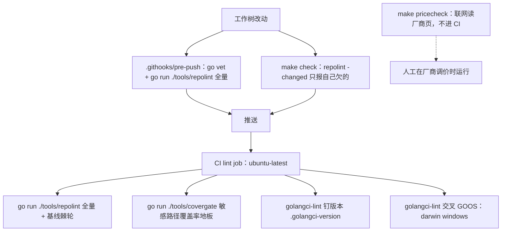

# 架构守卫：分层依赖秩表与 repolint 门禁族

> 本解读按 **ai-agent** 类规格产出，属 DeepSeek-Reasonix 深度解读的子文档；共 13 篇，解读基线 `v2.37.0`（`e17ef45e3`）。正文所有 `文件:行号` 引用均为 Reasonix 仓库相对路径，点开即可核对。相关篇章见 [README.md](README.md)。

## 在系统中的角色：把架构不变量写成可执行检查

Reasonix 把"架构不变量"从评审意见变成可执行检查。`tools/repolint` 是一个 6155 行（含规则测试；非测试 3804 行）的 Go 程序，唯一的第三方依赖是 `gopkg.in/yaml.v3`，只被文档规则用来解 frontmatter 标量；它在 CI 的 `lint` job 里以 `go run ./tools/repolint` 跑一次，任何**新增**违规立刻失败。

[tools/repolint/docs.go:16-16]()
<!-- anchor: "gopkg.in/yaml.v3" -->

它管的问题与 `gofmt` / `go vet` / `golangci-lint` 不重叠：那三个分别管语法、正确性与惯用法，repolint 管的是**只有这个项目知道答案的判断**——哪两层不许互相看见、桌面端手抄的 JSON 契约有没有少字段、一个能力是不是只有一半前端接线、被锁结构体的标量字段有没有越过棘轮、某个 `main` 包的二进制名有没有进 `.gitignore`。判断的清单是硬编码的权威列表，共 28 条：

[tools/repolint/main.go:51-58]()
<!-- anchor: var allRules = []string{ … ruleCSSImportant, ruleCSSSize, ruleStrayFile, -->

去掉它，树仍能编译、测试仍会绿，但三类错误会静默回归：分层被反向 import 撕开、桌面端界面读不到内核已经发出的字段（页面把"看不见"读成"没发生"）、以及"往 controller 加行为让三个前端继承"这条规范退化成口头约定。第三类正是项目自己写明的一条主张：

[REASONIX.md:11-13]()
<!-- anchor: - One transport-agnostic `control.Controller` sits behind every frontend (chat … frontend, so all three inherit it. -->

拆开这句：只有一个传输无关的 `control.Controller` 位于所有前端（chat TUI、HTTP+SSE serve、Electron desktop）之后，所以**行为加在 controller 上，不要加在前端上，三个前端才会同时继承**。项目把这条产品承诺交给 `frontend-parity` 门禁执行，而不是交给评审者的记性：

[REASONIX.md:110-118]()
<!-- anchor: - "Add behavior to the controller so every frontend inherits it" is held by … and `Status` are capabilities and also stdlib methods, and a name match -->

即：**架构由门禁持有，不靠记忆**。门禁的每一条都对应一个曾经真实发生过的错误模式，注释里留着事故背景——这是本关注面最值得迁移的地方。

**本篇的口径限定**：下文所有债务数字（各规则的加权单位、涉及文件数、加权总量）都来自**解析** `tools/repolint/baseline.json` 的 `limits` 字段与 `files` 的按文件加权和，**本次解读并未实际运行 `go run ./tools/repolint`**；说某条规则"零债务"，指的是基线里该规则的 `Limits` 为 0，而不是一次实时运行的结果。基线的形状只有两个字段：

[tools/repolint/baseline.go:10-15]()
<!-- anchor: // Ratchet snapshot, in weighted units: no file may exceed its budget and no … Files  map[string]map[string]int `json:"files"` -->

同理，本篇的代码行数、文件数、包数都是对 `v2.37.0` 工作树的直接计数，不引自项目文档。

## 根因：缺陷不在任何单个文件里，而在两个文件之间

宿主与模型（以及人）共享的大部分判断是**结构性的**，一旦只写在散文里就会漂移。项目对这类漂移留下了三条互相印证的原始记录，它们共同解释了为什么必须有一个跨文件的门禁。

第一条：**契约两端只有一端长字段**。桌面端用 TypeScript 手抄内核的 wire 类型，两端由不同工具链编译、只在 JSON 上相遇，因此树里没有任何别的东西会注意到其中一边多了一个字段：

[REASONIX.md:103-109]()
<!-- anchor: - A wire type the desktop re-declares by hand is held to the kernel's by … contract from a struct that merely carries json tags. -->

这条判断的落地方式值得注意：哪些类型互为镜像不是推断出来的，而是写死在 `mirroredWireTypes` 里，因为**没有任何拼写方式能把一个镜像契约和一个恰好带 json tag 的结构体区分开**：

[tools/repolint/wireparity.go:33-38]()
<!-- anchor: // mirroredWireTypes are the Go types the desktop keeps a second, hand-written … var mirroredWireTypes = []wireMirror{ -->

第二条：**接线漏了一半，而且没有任何东西把规范读回来**。serve 拿到声明了 `SwitchBranch` 的 `SessionAPI` 却从不调用它；`frontendparity.go` 的头注释把这个缺陷与它对应的规范原句钉在一起：

[tools/repolint/frontendparity.go:61-64]()
<!-- anchor: // REASONIX.md puts behavior on the controller so every frontend inherits it, … // carries a capability another frontend already drives, with no call to it. -->

第三条：**一个判断若只能在门禁里靠匹配措辞来做，就是比没有门禁更糟的东西**。项目为此成批废止了短语表，"要在门禁里靠猜措辞才能建的东西就不要建，直接说缺什么"：

[REASONIX.md:42-48]()
<!-- anchor: - Judgements read structure, never wording: shell ASTs (`shellparse`), types, … not get built — say what is missing instead of guessing at it. -->

两段的共同结构是：**缺陷不在任何单个文件里，而在两个文件之间**。单文件风格的 linter 天然看不见它，这正是 repolint 存在的理由。

## 母题：判据决定盲区

### 判据的形态，决定规则能看见什么

repolint 不统一用一种解析技术，而是**按规则需要回答的问题选最低够用的那一档**。三档的分界不是"实现难度"，而是"这个问题的答案能不能从结构里读出来"。

**第一档：逐行文本。** TypeScript/TSX 文件根本不解析，只切行——Go 文件吃全部规则，TS 文件只吃"以原始行表达"的那几条：

[tools/repolint/source.go:90-96]()
<!-- anchor: // lintable reports whether repolint reads this file at all. Go files take every … strings.HasSuffix(name, ".tsx") -->

生成文件整文件跳过（`^// Code generated .* DO NOT EDIT\.$`，且只在前 11 行里找）：

[tools/repolint/source.go:125-134]()
<!-- anchor: func isGenerated(data []byte) bool { … return false -->

测试文件另有一套判定：`_test.go`、`/__tests__/`、`.test.`、`.spec.` 都算测试：

[tools/repolint/source.go:137-141]()
<!-- anchor: func (s *sourceFile) isTest() bool { … strings.Contains(s.rel, ".spec.") -->

被判为测试的文件直接给出空的 import 列表，所以**测试文件不参与分层**：

[tools/repolint/source.go:151-159]()
<!-- anchor: func (s *sourceFile) importRefs() []importRef { … continue -->

这一点被一条测试锁住——"测试文件的 import 不该进入层检查"：

[tools/repolint/layers_test.go:48-52]()
<!-- anchor: func TestLayeringIgnoresTestFiles(t *testing.T) { … t.Fatalf("test file imports should not be layered: %v", refs) -->

**第二档：`go/parser` AST。** 绝大多数规则走这条：注释限额、注释文本、函数长度、圈复杂度、`struct-state`、`error-text`、`refusal-path`、`window-state`、`process-input`、`orphan`、`claude-dialect`。解析入口只有一个，注意 `SkipObjectResolution`——这一档判断全在语法形状上，不需要标识符解析：

[tools/repolint/source.go:99-113]()
<!-- anchor: func parseBytes(rel string, data []byte) *sourceFile { … return &sourceFile{rel: rel, fset: fset, file: file, src: lines, lines: len(line -->

**第三档：`go/types` + 编译产物。** 只有 `frontend-parity` 走这条，而且它是全工具最重的一步。

### 为什么 `frontend-parity` 必须读 `go/types`

关键在于**棘轮只能朝一个方向失败**。`Lifecycle.Close` 是 controller 的一个能力，`os.File.Close` 是标准库方法；如果按 selector 名匹配，那么任何一个前端里出现 `os.File.Close` 都会被记成"该前端驱动了 `Lifecycle.Close`"——一条**假的已接线**。棘轮的作用是不让债务增加，而假的"已接线"恰好把真实债务藏起来：它让门禁在唯一必须报错的方向上静默。所以这里宁愿付类型检查的代价。原文把这个反例写在同一段里：

[REASONIX.md:110-118]()
<!-- anchor: - "Add behavior to the controller so every frontend inherits it" is held by … and `Status` are capabilities and also stdlib methods, and a name match -->

代码注释把同一句话写得更硬——从类型信息读矩阵，绝不从 selector 名读：

[tools/repolint/frontendtypes.go:40-44]()
<!-- anchor: // loadParityMatrix reads the matrix from type information and never from … // real debt, the one direction a ratchet must not fail in. -->

### 类型级分析的账单

代价是具体的、可核对的五条：

- **必须有可构建的树**。`loadPackages` 先跑 `go list -export -deps -json=ImportPath,Export,Dir,GoFiles`，失败时报的是"frontend-parity 读类型，需要一个能构建的树"。也就是说这条规则把 repolint 从"文本扫描器"升级成"需要 Go 工具链的构建门禁"——树编译不过时它报错退出，而不是报 Finding：

[tools/repolint/frontendtypes.go:100-107]()
<!-- anchor: cmd := exec.Command("go", args...) … return nil, fmt.Errorf("frontend-parity reads types and needs a building tree; ` -->

- **必须钉死一个构建目标**。`parityTarget` 固定为 `CGO_ENABLED=0 GOOS=linux GOARCH=amd64`；理由是 `internal/frontend/cli` 里有 `_windows`/`_unix` 文件，GOOS 相关文件集会让开发者的基线与 CI 的基线分叉。这里还嵌了一条自我保证：**这是 CLI 自己的发布配置，所以树无论如何都得保证它能构建**：

[tools/repolint/frontendtypes.go:25-29]()
<!-- anchor: // One declared build target keeps the matrix off the machine that reads it: … var parityTarget = []string{"CGO_ENABLED=0", "GOOS=linux", "GOARCH=amd64"} -->

- **导出数据必须带位置**。`controllerCapabilities` 要求方法的 `Pos()` 有效且文件名非空，否则报错而不是静默降级——因为能力行必须能指到 `controller.go` 的具体行，否则棘轮就失去了"指到人该改的那一行"的能力：

[tools/repolint/frontendtypes.go:133-142]()
<!-- anchor: for sel := range types.NewMethodSet(types.NewPointer(obj.Type())).Methods() { … out = append(out, capability{name: fn.Name(), file: relSlash(abs, pos.Filename), -->

- **编译缓存在替它买单**。注释写得很谦虚：`go list -export` 解析到已编译的导出数据，构建缓存已经做过这些工作，"a warm tree answers in well under a second"（预热过的树回答得远快于一秒）：

[tools/repolint/frontendtypes.go:92-94]()
<!-- anchor: // listPackages resolves every frontend and everything it imports to compiled … // already done the work, and a warm tree answers in well under a second. -->

- **误报方向被刻意收窄**。端口方法集用 `types.Interface.Methods()` 取**完整**方法集，所以通过嵌入子端口抵达的能力与直接声明的等价：

[tools/repolint/frontendtypes.go:155-170]()
<!-- anchor: // portMethods is the port's complete method set, so a capability reached … return out, nil -->

前端侧的调用只统计 `info.Selections` 里属于 `control` 包的 selector，且**排除测试文件**——"只存在于测试里的调用，正是 `orphan.go` 已经拒绝算作调用者的那具尸体"：

[tools/repolint/frontendtypes.go:173-198]()
<!-- anchor: // controlCalls type-checks one frontend and reports the control methods it … return out, nil -->

成本更低的对照可以说明"够用就好"这条标准：`wire-parity` 用的是**混合**路线——Go 侧读 AST 结构体与 `reflect.StructTag` 里的 json 名，TS 侧读正则，因为它要比较的只是**字段名的集合**，而接口声明的形状已经被 `export interface X extends Y {` 这一行固定住了；`tagparity` 更省，两边都是正则，因为被比较的东西本身就是"字符串列表"：

[tools/repolint/wireparity.go:355-456]()
<!-- anchor: func wireFieldNames(file *ast.File, typeName string) ([]string, bool) { … return goName, true -->

[tools/repolint/wireparity.go:460-470]()
<!-- anchor: tsInterfaceRe = regexp.MustCompile(`(?m)^export interface (\w+)(?: extends ([\w, … return flattenedTSFields(body, typeName, map[string]bool{}) -->

### 反面：判据选错维度，规则会同时放过该报的和报不了想报的

这一节是本篇最值得带走的部分：**门禁的判据决定了它的盲区**，而项目把盲区写成了测试而不是文档。

- **`struct-state` 只计拥有同步原语的结构体**，判据是"这个类型自己带不带锁"：

[tools/repolint/structstate.go:8-13]()
<!-- anchor: // Each independent scalar multiplies the states a guarded type can be in, and … const maxScalarFields = 12 -->

  于是**由容器持锁**的状态类型可以无限增长。`internal/session/control/turn_gate.go` 的 `turnGate` 就是活例子——它自己不带 `sync.Mutex`（注释明说 "held under c.mu"），六个标量字段（五个 `bool` 加一个 `cancelCause`）完全不进计数：

[internal/session/control/turn_gate.go:6-11]()
<!-- anchor: // turnGate is the controller's admission state, held under c.mu. The five … type turnGate struct { -->

  更深一层的问题是：这条规则数的是"谁拥有锁"，而项目里真正的边界判断是"谁拥有状态"。`turnGate` 由 `c.mu` 守护、`turnRuntime` 刻意不带锁（见下文），两者都在结构上正确，却在这个判据下得出相反结果。

- **`orphan` 只数函数、不数方法**，理由是方法可以通过任何接口抵达（包括第三方拥有的接口），"要证明这一点需要 AST 那一趟没有的类型信息，而猜错的代价是删掉活代码"：

[tools/repolint/orphan.go:53-57]()
<!-- anchor: // Functions only. A method can be reached through any interface that … // of guessing wrong is deleting live code. -->

  这是一次**刻意的能力收缩**：宁可不报，不可错删。

- **`frontend-parity` 的候选集依赖"至少有一个驱动者"**。一个能力的最后一个消费者消失时，它退出候选集，那一行**退休而不是失败**——债务下降而不是被指出。测试把这条边界与它的量化后果一起写了下来："port 声明了能力却没有任何前端驱动的'死能力'今天有 39 个、122 条边，那是 orphan 的形状而不是 parity 的，而 orphan 看不见它，因为它数函数、从不数方法"：

[tools/repolint/frontendparity_test.go:242-246]()
<!-- anchor: // Boundary, measured and left open: a capability whose last consumer goes away … // orphan cannot see it because it counts functions and never methods. -->

**把门禁的盲区写成测试，比写在文档里更难被忘掉。** 这三个例子里，第一个是判据选错了维度（真实边界是"谁拥有状态"），后两个是**有意**收缩能力边界并公开记账——两者都必须在终稿里说清，否则读者会把"没报"误读成"没问题"。

## 判据清单：28 条规则各自拦住什么、怎么计价

看清了"判据决定盲区"这条母题，再读下面这张表就不会退化成"规则清单 + 每条一句话"。表里的**计量**列同时是棘轮的计价单位：它决定一次违规值多少加权单位，也决定修复能释放多少预算。**代码位置**单独列在表后的证据清单里，每条规则一行一处，便于逐条核对。

| 规则 | 一句话判据 | 拦住的真实错误模式 | 计量 |
|---|---|---|---|
| `layering` | `leaves` 集合里的包只能 import `leaves` 集合内的包或标准库；`control` 只允许前端/宿主抵达；frontend 与 host adapter 只允许从上方抵达 | utility 包开始依赖内核，于是"从任何地方都能 import 它"这句话失效、依赖图被拖进来；或内核某层回头 import 前端 | 每条违规 1 |
| `layer-order` | `internal/<layer>/` 的目录秩：包只能 import 同秩与自己以下秩；同秩目录互为独立对等体（注释原话 "not a pool"） | 内核被反向 import 形成环；一个新包被放进 `internal/` 下但不在声明的层目录里 | 每条违规 1 |
| `wire-parity` | Go 与 TS 手抄契约的字段名**双向**比对：一边发了另一边读不到失败，一边读了无人发送也失败 | 桌面端页面读不到内核已发出的字段，把"看不见"读成"没发生"（每个 `mirroredWireTypes` 条目上方都写着具体那一幕） | 每条缺失字段 1 |
| `frontend-parity` | 一个能力已被某前端驱动、另一前端的 port 声明了它却没调用 = 缺一条边；棘轮数**边数** | serve 拿到声明了 `SwitchBranch` 的 `SessionAPI` 却从不调用 | 每条缺失边 1（一个能力只被一个前端驱动 = 2） |
| `struct-state` | 拥有 `sync.Mutex`/`RWMutex`/`atomic.*` 的结构体，其**标量字段数** > 12 即违规，权重 = 超出量 | "再加一个 `bool` 来修边界情况"：独立标志相乘出没有任何类型记录为合法的状态组合 | 超出 12 的部分（基线 31，分布 6 个文件） |
| `window-state` | `internal/runtime/agent/` 顶层文件中，非 owner 接收者的方法读 `sess.win` 即违规 | 上下文窗口（投影/压缩/估算）的锁与不变量被第二处代码触碰 | 每处 1（基线 0） |
| `error-text` | 对 `err.Error()` 的渲染文本做 `strings.Contains/HasPrefix/HasSuffix/Index/EqualFold/Cut/Split`；并**一跳追踪**本地变量 | 只有生产者知道"是超时而不是 socket 关闭"，读句子的人只能匹配会漂移、会被改写、甚至会以操作系统语言到达的词 | 每处 1（基线 9，2 个文件） |
| `refusal-path` | `internal/frontend/serve/` 里新增 `http.Error`，或只有 `{"error": ...}` 一个键的 JSON body 即违规；`fail.go` 整文件豁免 | 客户端拿到一个状态码和一句没人翻译过的英文，无法按 code 分支；`refuse()` 的 dotted code 才是可行动的拒绝 | 每处 1（基线 0） |
| `process-input` | 内核（含 assembly，不含 `internal/frontend`）里出现 `os.Getenv/LookupEnv/Environ/Getwd/UserHomeDir/UserConfigDir/UserCacheDir` | 一次构建可能服务与本进程不同的 home/workspace，进程读数是第二个输入源，绕过 `boot.Options`/`config.Roots` | 每处 1（基线 97，55 个文件） |
| `orphan` | 导出的内核**函数**在非测试代码里除自身声明外无人引用 | 删掉唯一调用它的前端后，实现、测试、文档注释全都完好且绿——"这正是 config recovery 去读一个没人写过的快照的原因" | 每个 1（基线 66，51 个文件） |
| `flat-view` | `SplitLegacy`/`LegacyFlat` 只允许在声明列表（10 个文件）内被调用 | 有损的旧 frontmatter 平面视图丢掉了字段被写在哪个 key 之下 | 每处 1（基线 0） |
| `claude-dialect` | `kind` 为 `openai`/`responses` 的 provider 条目上挂 `claude` 模型 | `cache_control` 只从 `internal/model/anthropic` 发出，于是每个 prompt token 永远按全价输入计费，唯一症状是永远不来的 `cache_read` | 每条 1（基线 1，即已有债务被记录） |
| `build-artifact` | 根模块每个 `main` 包的输出名必须在根 `.gitignore` 里有一条 `/<name>` | `go build ./tools/repolint` 把二进制写到工作目录，`git add -A` 捡走——**有两个是这么被提交的** | 每个命令 1 |
| `stray-file` | 树里出现 `*-e`/`*.orig`/`*.rej` | macOS 上 `sed -i` 会在被编辑文件旁写一个 `<name>-e` | 每个 1 |
| `refusal-path` 的 inbox 侧（`checkInboxRefusalParity`） | 把 inbox 错误族逐个对照写手的 coded 名单：哨兵没有自己的 case，或 case 里写散文，都违规 | 一个哨兵没有自己的 case 会被答成内部故障（**有三个是这样**）；case 里写散文则到达前端的是没人翻译的英文 | 每个哨兵 1 |
| `essay`/`banner`/`marker`/`commented-code`/`narrative` | 注释块按位置限额（包注释 8 行、`doc.go` 40 行、声明文档 5 行、字段 1 行、浮动 3 行）；禁止分节横线、`FIXME`、无 issue 锚的 `TODO`/`HACK`、注释掉的代码、`phase 3` 式叙述 | 注释从"陈述当下约束"退化成"叙述代码怎么走到这里"，而 git 历史才是叙述该在的地方 | 超出行数 / 每处 1 |
| `file-size`/`function-size`/`complexity` | 非测试文件 800 行上限；函数体 120 行；圈复杂度 30 | 一个文件承担多个职责；测试文件按注释明确豁免（"长度追踪的是覆盖了多少 case，不是承担了多少关注点"） | 超出量 |
| `css-important`/`css-size` | 样式表按 `!important` 数量计重；两张分层表额外按长度 | 用 `!important` 抢层叠而不是靠源码顺序/特异性；分层表靠堆积生长 | 计数 / 行数 |
| `codeowners`/`doc-owner`/`doc-prose`/`doc-language`/`release-note` | 每个路径/文档都要有 CODEOWNERS 的答案人；文档按类（`classDoc`/`Landing`/`Machine`/`ReleaseNote`）持有正文宽度与语言 | 文档没有主人；散文宽度失控；一份文档出现两种语言（"一个注释是两种语言的代码库读起来像两个代码库"） | 计数 |
| `tagparity`（并入 `wire-parity` 报告） | 内核的 `TransientUserBlockTags` 与页面 `CONTROL` 正则互为集合 | **这张表漂移过两次**：history index 报了 11 个里的 5 个，页面报了 13 个里的 3 个；页面不认识的 tag 会被当作"用户说过的话"打印出来 | 每个不对称 tag 1 |

文档类那几行的判据值得补齐，因为"文档规则"最容易被读成"只管格式"：散文宽度上限是 320 列，release note 的单条变更再收紧到 200 列，超出量按每 80 列一个加权单位计：

[tools/repolint/docs.go:33-37]()
<!-- anchor-base64:Y29uc3QgKApkb2NNZXRhZGF0YURlbGltaXRlciA9ICItLS0i -->

宽度不是按 rune 数算的，而是 **CJK 记两列**（否则一段中文能写到英文允许的两倍长）：

[tools/repolint/docs.go:241-256]()
<!-- anchor: // displayWidth counts a CJK character as two columns: the same budget in runes … var out []Finding -->

`classDoc` 类文档还必须有一个元数据头（`owner`/`backup`/`status`/`reviewed`），其中 `owner`/`backup` 必须与 CODEOWNERS 里那一行的两个人逐字一致——**打印在页面上的名字就是 GitHub 会去找来评审的人**：

[tools/repolint/docs.go:137-160]()
<!-- anchor: func checkDocMetadata(rel string, lines []string, rules []ownerRule) []Finding { … return []Finding{{rel, 1, ruleDocOwner, strings.Join(problems, "; "), len(proble -->

release note 另有一层：只允许 `##` 级分组标题且分组名固定，只允许第一段做摘要，每条变更必须带 issue / PR / commit / URL 之一：

[tools/repolint/docs.go:74-74]()
<!-- anchor: changeReference   = regexp.MustCompile(`#\d+|\b[0-9a-f]{7,40}\b|https?://`) -->

[tools/repolint/docs.go:278-310]()
<!-- anchor: func checkReleaseNote(rel string, lines []string) []Finding { … (b.width - limit + proseWeightUnit - 1) / proseWeightUnit}) -->

**逐条判据的代码位置**

- `layering`：`checkLayering` 收集违规，四条判据依次落在 `violates` 里。
  [tools/repolint/layers.go:79-107]()
<!-- anchor: func checkLayering(imports map[string][]importRef) []Finding { … return "" -->
- `layer-order`：秩表与检查各一处。
  [tools/repolint/layer_order.go:22-34]()
<!-- anchor: var layerRank = map[string]int{ … "frontend": 9, -->
  [tools/repolint/layer_order.go:48-74]()
<!-- anchor: func checkLayerOrder(imports map[string][]importRef) []Finding { … return out -->
- `wire-parity`：双向比对的入口与声明表。
  [tools/repolint/wireparity.go:33-38]()
<!-- anchor: // mirroredWireTypes are the Go types the desktop keeps a second, hand-written … var mirroredWireTypes = []wireMirror{ -->
  [tools/repolint/wireparity.go:266-282]()
<!-- anchor: // findings compares each declared pair both ways. Either direction is a defect: … return append(out, wireConstantFindings(root, mirroredWireConstants)...) -->
- `frontend-parity`：从声明表到缺边报告的全过程。
  [tools/repolint/frontendparity.go:61-126]()
<!-- anchor: // REASONIX.md puts behavior on the controller so every frontend inherits it, … return strings.Join(cells, " "), missing -->
- `struct-state`：上限常量与判据本体。
  [tools/repolint/structstate.go:8-13]()
<!-- anchor: // Each independent scalar multiplies the states a guarded type can be in, and … const maxScalarFields = 12 -->
  [tools/repolint/structstate.go:95-118]()
<!-- anchor: func checkStructState(s *sourceFile) []Finding { … return false -->
- `window-state`：owner 名单与检查。
  [tools/repolint/windowstate.go:11-22]()
<!-- anchor: // windowStatePackage is where the context window lives inside the agent. … "ContextManager": true, // the window's maintenance transaction -->
  [tools/repolint/windowstate.go:26-56]()
<!-- anchor: func checkWindowState(s *sourceFile) []Finding { … return out -->
- `error-text`：函数名单与一跳追踪。
  [tools/repolint/errortext.go:8-14]()
<!-- anchor: // Only the producer knows a deadline expired rather than a socket closing, and … "Index": true, "EqualFold": true, "Cut": true, "Split": true, -->
  [tools/repolint/errortext.go:20-60]()
<!-- anchor: func checkErrorText(s *sourceFile) []Finding { … return out -->
- `refusal-path`：豁免文件与检查。
  [tools/repolint/refusal.go:9-16]()
<!-- anchor: // A refusal the client can act on carries a stable dotted code: the frontend … refusalAdapter = "internal/frontend/serve/fail.go" -->
  [tools/repolint/refusal.go:21-48]()
<!-- anchor: func checkRefusalPath(s *sourceFile) []Finding { … return out -->
- `process-input`：读数函数表与检查。
  [tools/repolint/processinput.go:17-19]()
<!-- anchor: var processInputReads = map[string]bool{ … "UserHomeDir": true, "UserConfigDir": true, "UserCacheDir": true, -->
  [tools/repolint/processinput.go:26-60]()
<!-- anchor: func checkProcessInput(s *sourceFile) []Finding { … return true -->
- `orphan`：规则意图与主判定。
  [tools/repolint/orphan.go:9-13]()
<!-- anchor: // An exported kernel API with no production caller anywhere in the tree is how … // not count as callers — they are exactly what keeps such a corpse warm. -->
  [tools/repolint/orphan.go:120-140]()
<!-- anchor: func (o *orphanScan) findings() []Finding { … return out -->
- `flat-view`：允许的读者名单与两个入口名。
  [tools/repolint/flatview.go:13-29]()
<!-- anchor: var flatViewReaders = []string{ … var flatViewCalls = map[string]bool{"SplitLegacy": true, "LegacyFlat": true} -->
  [tools/repolint/flatview.go:34-64]()
<!-- anchor: func checkFlatView(s *sourceFile) []Finding { … return out -->
- `claude-dialect`：动机与检查。
  [tools/repolint/dialect.go:10-19]()
<!-- anchor: // Claude caches only where cache_control marks a breakpoint, and that field is … var openaiShaped = map[string]bool{"openai": true, "responses": true} -->
  [tools/repolint/dialect.go:97-121]()
<!-- anchor: // checkClaudeDialect flags a Claude model offered on a dialect that cannot … return out -->
- `build-artifact`：规则头与检查。
  [tools/repolint/buildartifact.go:1-4]()
<!-- anchor: // buildartifact.go — a command's binary must not be something git can notice. … // where `git add -A` picks it up. Two of them were committed that way. -->
  [tools/repolint/buildartifact.go:28-41]()
<!-- anchor: func checkBuildArtifacts(root string) []Finding { … return out -->
- `stray-file`：编辑器与补丁残留物的检查。
  [tools/repolint/css.go:65-87]()
<!-- anchor: // checkStrayFiles rejects editor and patch leftovers: `sed -i` on macOS writes … return out -->
- inbox 侧的 refusal：两侧名单的对照。
  [tools/repolint/inboxrefusal.go:12-55]()
<!-- anchor: // The two sides of one contract, declared rather than inferred: no spelling … return out -->
- 注释族：限额常量与注释文本检查。
  [tools/repolint/comments.go:12-28]()
<!-- anchor: const ( … docCodeRe   = regexp.MustCompile(`^//(\t| {4,})`) -->
  [tools/repolint/comments.go:103-131]()
<!-- anchor: func (s *sourceFile) checkCommentText(cg *ast.CommentGroup, attached bool) []Fin … return out -->
- 尺寸族：文件/函数上限与圈复杂度。
  [tools/repolint/size.go:8-37]()
<!-- anchor: const maxFileLines = 800 … fmt.Sprintf("%d lines exceeds the %d-line ceiling", s.lines, maxFileLines), s.li -->
  [tools/repolint/complexity.go:9-34]()
<!-- anchor: const ( … return out -->
- CSS 族：`!important` 计数与分层表长度。
  [tools/repolint/css.go:10-62]()
<!-- anchor: const ( … return out -->
- 文档族：文档分类与 CODEOWNERS 解析。
  [tools/repolint/docs.go:1-54]()
<!-- anchor: // docs.go — a document names who answers for it and states its content as … {"internal/runtime/guardian/", classMachine}, -->
  [tools/repolint/codeowners.go:1-47]()
<!-- anchor: // codeowners.go — who answers for a path, read from .github/CODEOWNERS. … return ownerRule{}, false -->
- `tagparity`：两张表的位置与正则。
  [tools/repolint/tagparity.go:12-31]()
<!-- anchor: // Where the two copies of the host's transient-block list live. The kernel's is … // no reason to agree on order. -->

表里可以读出一个统一的取舍：**规则只覆盖能用结构回答的问题**。凡是需要判断"意图"或匹配措辞的，宁可承认测不了——`REASONIX.md` 明确说注释叙事这条规则"由评审持有，没有任何门禁读它"，因为区分"叙事"与"约束陈述"本身就需要一张短语表，而那正是这个仓库不建的东西：

[REASONIX.md:147-149]()
<!-- anchor: is the standard. No gate reads register — telling narrative from a statement of … build — so this rule is held by review. -->

## 分层模型：一张秩表 + 三张窄名单

`tools/repolint/layers.go` 与 `layer_order.go` 声明的不是一张完整的层图，而是**三张窄名单 + 一条秩表**。这个分工是刻意的：秩表管方向，名单管例外。先把两者画成一张图，因为"位置本身即论据"——同秩对等、跨秩闭合、四条横切边界这三件事，用散文讲都要绕很久。

图自下而上读：秩 0 是 `internal/base`，最顶是 `cmd/`、`desktop/`、`benchmarks/` 三个宿主；相邻带之间那条向下的实线只画了一次示例，表示"可以 import 严格更低的秩"（真实允许的边多得多，逐包画满会淹没论据）。真正要看的是三处：**两条红色 ✗ 双向边**（`safety ↛ state`、`ext ↛ tools`）说明同秩目录互为独立对等体；左下角那个闭合轮廓是被声明为 42 个成员的 utility 集合，它是**跨秩**的，轮廓内可互相 import、轮廓外任何包可 import 它、但它不得 import 集合外的包；右侧四个虚线框是四条横切边界（control 准入、前端反向禁入、host adapter、utility 集合的例外）。

代价是这张图也只说了方向，没说"为什么安全"：`leaves` 被声明为跨秩集合，意味着**一个包是不是 utility 层，不再是"看它在哪一层"能回答的问题**，而要去读 `tools/repolint/layers.go`。这是"声明优于推断"必然要付的账。

### 秩表管方向，同秩对等是最强约束

每个 `internal/<layer>/` 目录有一个秩，包只能 import 同秩与自己以下秩；同秩目录互为独立对等体，`internal/` 之外的 `cmd`/`desktop`/`benchmarks`/`tools` 是宿主、装配一切：

[tools/repolint/layer_order.go:1-8]()
<!-- anchor: // layer_order.go — the kernel's layers, read from where a package lives. … // benchmarks, tools — are hosts and assemble everything. -->

秩的具体取值：`base` 0、`contract` 1、`safety` 2、`state` 2、`model` 3、`platform` 4、`ext` 5、`tools` 5、`runtime` 6、`session` 7、`assembly` 8、`frontend` 9：

[tools/repolint/layer_order.go:22-34]()
<!-- anchor: var layerRank = map[string]int{ … "frontend": 9, -->

注意 `safety` 与 `state` 同秩、`ext` 与 `tools` 同秩——**同秩对等是本规则最强的约束**：它不允许 `internal/safety` 依赖 `internal/state`，也不允许 `internal/ext` 依赖 `internal/tools`，双方只能通过更低的层（`contract`/`base`）交换类型。"一个包属于哪一层是它坐在 `internal/` 下哪个目录，所以**包被放在哪里就是它的声明**：移动它是改变它可依赖什么的唯一方式"——这条设计让审查者打开文件之前就先看到层：

[tools/repolint/layer_order.go:1-8]()
<!-- anchor: // layer_order.go — the kernel's layers, read from where a package lives. … // benchmarks, tools — are hosts and assemble everything. -->

### 三张名单管例外

第一张是 `leaves`：42 个"utility 层"包，跨秩分布——`internal/base/*` 大多在，但也有 `internal/contract/surface`、`internal/model/billing`、`internal/safety/egress`、`internal/state/store`、`internal/state/workspacelease`、`internal/ext/extensioncontract`。规则是：**leaves 成员只能 import leaves 成员或标准库**：

[tools/repolint/layers.go:21-25]()
<!-- anchor: // Utility layer: these packages carry no knowledge of the kernel and must … var leaves = []string{ -->

第二张是 `frontends`，第三张是 `hostAdapters`（只有一个成员 `internal/frontend/remotehost`）：

[tools/repolint/layers.go:11-18]()
<!-- anchor: // Transport-agnostic control.Controller sits behind every frontend; nothing … "internal/frontend/tui", -->

[tools/repolint/layers.go:70-76]()
<!-- anchor: // A host adapter implements a frontend's driven port and is shared by the hosts … "internal/frontend/remotehost", -->

### "utility 层闭合"为什么值得为一个门禁付代价

原文只有一句，但它是整个文件里最值钱的一句：

[REASONIX.md:14-19]()
<!-- anchor: - Layering (enforced): utility packages import nothing under `reasonix/` except … sets live in `tools/repolint/layers.go`. -->

> "that layer is closed, so a leaf reaching a leaf drags no graph along, while refusing it leaves one judgement copied into several of them"

拆开看，这是一个**集合闭包论证**，而不是逐对依赖论证。

- "a leaf reaching a leaf drags no graph along"——若 leaves 集合在 import 关系下封闭（成员只依赖成员），则任一叶子的传递依赖闭包 ⊆ leaves，"从任何地方都能 import 这个包"这句话才成立。这把 42 个包的依赖代价从一个**图**压成一个**有界集合**。
- "while refusing it leaves one judgement copied into several of them"——若反过来禁止 leaf→leaf，那么任何被两个叶子共享的判断（路径归一化、workspace id 拼写、进程退出码解读）就无法下沉到一个公共叶子，只能**在每个叶子里各抄一份**。抄本会漂移，而漂移的抄本正是这个仓库反复记录的事故形态——"一张写了两遍的表就是一张会漂移的表，某家厂商的 USD 汇率就是这么只在一边被公布的"：

[REASONIX.md:243-245]()
<!-- anchor: its life. `config` reads these through `pricing.CurrentRate` and … drifts, which is how a vendor's USD rate ended up published on one side only. -->

所以这条门禁的代价不是"少了一个自由度"，而是**它主动放弃了在叶子层制造新抄本的能力**：用一次集合级判断，换掉将来若干次逐对判断。

### 四条判据落在同一个函数里

`violates` 按顺序检查四件事：leaves 成员只能 import leaves 成员、`internal/session/control` 只能被 frontends 或 hosts 够到、frontend 只能从上方够到、host adapter 只能从上方够到：

[tools/repolint/layers.go:96-107]()
<!-- anchor: func violates(pkg, dep string) string { … return "" -->

四条里最容易被误读的是 `control` 边界：它不是"只有前端能 import control"，而是"**只有前端、入口与宿主**能 import control"，且内核其他部分连 `internal/session/control` 的子包都不许反向够：

[tools/repolint/layers.go:96-107]()
<!-- anchor: func violates(pkg, dep string) string { … return "" -->

违反时会发生什么：`checkLayering` 在**具体 import 行**产生一条 Finding，权重 1；`layers_test.go` 断言了行号来自 import 位置：

[tools/repolint/layers_test.go:39-44]()
<!-- anchor: func TestLayeringReadsImportsFromSource(t *testing.T) { … t.Fatalf("want one %s on line 5, got %+v", ruleLayering, found) -->

当前基线里 `layering: 0`、`layer-order: 0`，两条分层规则的仓库上限都是 0，没有任何一条豁免被需要过。`layers_test.go` 还把整张契约的边界压成了 20 个 case，包括反直觉的那些：前端可以用另一个前端、`serve/hub` 可以用它的父包 `serve`、`remotehost` 可以用它实现端口所对应的前端，但内核与 controller 都不许反向够到 `remotehost`：

[tools/repolint/layers_test.go:5-33]()
<!-- anchor: func TestLayeringContract(t *testing.T) { … t.Fatalf("violates(%q, %q) = %v, want %v", tc.pkg, tc.dep, got, tc.wantViolation -->

这份测试表本身就是分层模型的**可执行规格**，比任何架构图都精确——它和上面那张 SVG 的关系是：图给出方向，测试给出逐对的裁判结果。

还有一处值得单独标注：`internal/assembly/boot` 被列在 `frontends` 而不是靠 `assembly` 秩说话。理由是配置根装配整个系统、为运行它而存在，与前端处在同一高度；`benchmarks/*` 同理被 `host()` 当作 host，因为"一个复现出厂表面的 harness 必须能够到定义那个表面的前端"：

[tools/repolint/layers.go:110-122]()
<!-- anchor: // A host assembles the whole system to run it. benchmarks/* are hosts in that … return matches(frontends, pkg) || matches(hostAdapters, pkg) || host(pkg) -->

## 棘轮：把"当前债务"记成金额，而不是删掉违规

棘轮不是"一次豁免"，两者的区别是整个门禁族能否长期存活的关键。

**一次豁免**删除一条 Finding；下一次同样的错误再来时，门禁已经不认识它了。**棘轮**把当前债务的**金额**记进基线，之后只失败增量。棘轮能工作的前提是每条 Finding 都携带足够具体的证据——文件名、行号、规则名、消息，以及**超出上限的那部分**作为权重：

[tools/repolint/main.go:15-22]()
<!-- anchor: type Finding struct { … Weight int -->

`Msg` 尤其重要：它不是"你违规了"，而是**诊断**。前端对账那条规则输出的是 `Controller.SwitchBranch: acp=no cli=yes serve=no`，读的人当场知道该去哪个前端接线，而不必再跑一遍工具：

[tools/repolint/frontendparity.go:84-85]()
<!-- anchor: out = append(out, Finding{c.file, c.line, ruleFrontendParity, … fmt.Sprintf("Controller.%s: %s", c.name, row), missing}) -->

[tools/repolint/frontendparity.go:109-123]()
<!-- anchor: func (m parityMatrix) row(method string, ports []frontendPort, scoped map[string … missing++ -->

`Line` 同样是有意的：能力行报在能力的声明行、豁免行报在 `frontendScopes` 的声明行，于是"该改哪一行"不需要二次推断。基线文件的形状也只有两个字段，注释把两句话都写全了——"没有文件可以超出它的预算，也没有规则可以超出它的仓库上限；两者都只能由人手工放宽，且是审查者看得见的一次 diff"：

[tools/repolint/baseline.go:10-15]()
<!-- anchor: // Ratchet snapshot, in weighted units: no file may exceed its budget and no … Files  map[string]map[string]int `json:"files"` -->

两道闸门是**文件级预算**（`Files[file][rule]`）与**全仓库规则上限**（`Limits[rule]`）。`-only`/`-changed` 收窄报告时两者都按规则过滤，但**仓库上限在收窄运行时依然生效**——"一个文件可以把整棵树推过某条上限而没有超出自己的预算，而那正是收窄检查不能藏起来的情形"：

[tools/repolint/only.go:28-45]()
<!-- anchor: // limitToPaths narrows a report to the files a change touched. Repo-wide … return keptFindings, keptOverruns -->

`-update` 可以自由**降低**预算，提高必须显式 `-allow-widen`，并把这份 diff 在 PR 里交代清楚：

[tools/repolint/main.go:100-109]()
<!-- anchor: if *update { … os.Exit(1) -->

回收则依赖人："没被用掉的预算就是文件可以悄悄长回去的空间"，所以干净运行时会额外打印可回收额度，但**只有人跑 `-update` 才会真的回收**：

[tools/repolint/main.go:137-149]()
<!-- anchor: if len(overruns) == 0 { … return -->

### `struct-state` 的标量字段数棘轮

`Weight` 不是"有一个结构体超了"，而是**超出 12 的那部分**：

[tools/repolint/structstate.go:95-118]()
<!-- anchor: func checkStructState(s *sourceFile) []Finding { … return false -->

测试把设计意图写进了断言名："the excess over the ceiling, so a worse struct outranks a better one"（超出上限的那部分，所以更糟的结构体排在更好的前面）。这句是棘轮的核心性质：**你没法用一个短的违规去换一个长的违规**：

[tools/repolint/structstate_test.go:51-53]()
<!-- anchor: if want := 3 + tc.selfCounts; found[0].Weight != want { … found[0].Weight, want) -->

它同时规定了修复方向必须是"把标量分组进命名子状态"，而不是"把字段挪到另一个结构体里"——`TestStructStateFallsWhenScalarsMoveIntoASubState` 正是断言五个 flag 收进一个 `sub` 字段后计数归零。还有两个刻意的限定，直接决定它会不会变成噪声源：

- **只计拥有同步原语的结构体**。"没有互斥锁的结构体不是并发可变状态；把 config 和 DTO 也算进来会让这条发现被一张转换表埋掉"：

[tools/repolint/structstate.go:8-13]()
<!-- anchor: // Each independent scalar multiplies the states a guarded type can be in, and … const maxScalarFields = 12 -->

- **`atomic.Bool` 单独算一个标量**，因为"原子的并发契约是逐字段的，而这恰好就是本条要数的相乘问题"：

[tools/repolint/structstate.go:22-27]()
<!-- anchor: // atomic.Bool and friends are scalars whose concurrency contract is per-field, … "atomic.Value": true, "time.Duration": true, "time.Time": true, -->

它拦住的真实形态是可核对的：当前基线里 `struct-state` 共 31 个单位，分布在 6 个文件；最重的一个是 `internal/session/control/goal.go` 的 `goalMachine`——21 个标量字段（其中 6 个是 `goal`/`status`/`scopeID`/`block`/`strict`/`continuationEpoch`，其余是 token/turn/预算记账与三个 reason 字符串），权重 9 恰好等于 21 − 12。

### `frontend-parity` 的边数棘轮

这里的计量单位是**缺的边，不是缺的行**。一个能力在三个前端里只有一个驱动，权重是 **2**，测试把这条锁成一个显式断言：

[tools/repolint/frontendparity_test.go:66-76]()
<!-- anchor: func TestACapabilityOnlyOneFrontendDrivesIsTwoMissingEdges(t *testing.T) { … t.Fatalf("report is the diagnosis:\n got %q\nwant %q", got[0].Msg, want) -->

于是"补上一个前端"必然让权重从 2 降到 1，`reclaimable` 立刻报出释放的预算——"一个前端接线之后留下的预算，就是那个缺口能悄悄重新打开的余地"：

[tools/repolint/frontendparity_test.go:215-217]()
<!-- anchor: // Wiring a frontend pays debt down, and the surplus has to be reported: budget … func TestWiringAFrontendLeavesReclaimableBudget(t *testing.T) { -->

### 豁免表怎么才不变成"债务黑洞"

`frontendScopes` 表被四条机制钉住，缺一条它就会变成债务消失的地方：

1. **豁免的成本等于边的成本**。加一行 scope 会同时产生两条 Finding：能力行权重降 1、豁免表行权重加 1。测试直接断言总额不变——"declaring a scope moves debt into a file a reviewer opens, and never deletes it"（声明一个豁免是把债务搬进审查者会打开的文件，从不删除它）：

[tools/repolint/frontendparity_test.go:149-152]()
<!-- anchor: // Total is unchanged: declaring a scope moves debt into a file a reviewer … t.Fatalf("scoping changed the total debt: %d", edges.Weight+table.Weight) -->

2. **豁免行报在表声明的那一行**，而不是文件第一行；`scopeDeclLine` 反查 `frontendScopes` 的声明位置，因为"审查者必须打开那张表"：

[tools/repolint/frontendparity.go:166-190]()
<!-- anchor: // scopeDeclLine finds where frontendScopes is declared, so a scoped row reports … return 1 -->

3. **issue 与 reason 必填，且判断从不读它们**。`validateFrontendScopes` 拒绝空 issue / reason / 未知前端 / 空方法名，理由是"判断从不读这两个字段，所以留空会让下一个读者没有可推翻的东西"：

[tools/repolint/frontendparity.go:145-163]()
<!-- anchor: // A row with no issue or no reason is a malformed declaration rather than debt: … return nil -->

4. **表默认是空的**。`frontendScopes` 出厂为空，每个条目都是"必须在自己那个 PR 里被论证的决定"：

[tools/repolint/frontendparity.go:40-42]()
<!-- anchor: // Empty on purpose: the gate ships measuring what the tree does today, and each … var frontendScopes []frontendScope -->

第 3 点是最容易被忽略的设计：**门禁不读豁免理由，正是为了让理由必须写给人看**。一旦门禁开始匹配理由文本，理由就会退化成"能让门禁过的咒语"，而这个仓库刚刚成批废止了短语表。

## 效果测试纪律：组件正确 ≠ 系统有效

`REASONIX.md` 把这条列为硬性要求——"性能特性必须带着它最终边界上的效果测试落地……组件正确不等于系统有效"：

[REASONIX.md:29-32]()
<!-- anchor: - Performance features land with an effect test at their final boundary … assembly. Component correctness is not system effectiveness. -->

落点是 `internal/assembly/boot/effect_test.go`（685 行）所在的模式，同目录下有 53 个 `*_effect_test.go`。模式本身写在文件头：

[internal/assembly/boot/effect_test.go:3-5]()
<!-- anchor: // Effect tests assert final-boundary behavior through the real Build stack: … // Component correctness is not system effectiveness (see REASONIX.md). -->

机制是：注册一个**录音 provider**（返回记录请求的桩），用真实 `boot.Build` 装配整栈，跑一次 `ctrl.Run`，然后断言**真正抵达 provider 边界的请求**：

[internal/assembly/boot/effect_test.go:63-67]()
<!-- anchor: // effectRun builds the real stack around a recording provider, runs one prompt, … return effectRunPrepared(t, kind, tokenMode, arm, nil) -->

为什么非这么做不可，源码给了一个直接案例——**token 预算这条链路在接线存在之前根本到不了运行时**：

[internal/assembly/boot/effect_test.go:259-262]()
<!-- anchor: // The token axis is the one that generalises: a loop serving 99.9% of its … // runtime through nothing until this wiring existed. -->

这正是"组件正确 ≠ 系统有效"的确切含义：预算守卫本身的单测可以全绿，而它在装配图里没有任何一条边——**一个在真空中正确的组件，在系统里等于不存在**。

两个具体的效果断言，断言的都是"哪些字节/事件到达了哪里"：

**(1) 输出外溢后的回读必须带回内容。** `TestEffectSpilledOutputSurvivesTheReadBack` 让 shell 读一个大文件（无法分页，于是把输出停放在外部并留下指针），然后 `read_file` 去跟随那个指针。断言落在**最后一个抵达 provider 的请求里的 tool result**：第二个结果不能再是 "kept out of context"，且必须真的含有文件内容：

[internal/assembly/boot/effect_test.go:388-392]()
<!-- anchor: // TestEffectSpilledOutputSurvivesTheReadBack pins the promise the pointer makes … // larger than the last — the arithmetic every component test passed. -->

它防的失效模式是一个**几何增长循环**：把这次 fetch 也外溢，就返回一个新指针指向一个新文件，而 `read_file` 会给它返回的内容编号，于是每一轮都比上一轮更大——"每一个组件测试都通过过的那道算术"。这是典型的效果级缺陷：每一步都对，系统爆炸。

**(2) 前缀不得携带任何随项目变化的文本。** `TestEffectPrefixCarriesNoProjectText` 在两个不同项目目录里各跑一次，断言 system message **逐字节相等**，并在不等时报出**第一个分歧字节**：

[internal/assembly/boot/effect_test.go:462-466]()
<!-- anchor: // TestEffectPrefixCarriesNoProjectText asserts the property the goldens can … // prefix cache on every project the machine had not already warmed. -->

配套的 `TestEffectVersionControlRidesTheTurnNotThePrefix` 把"两边都要对"讲全了：**前缀必须字节相同**（`.git` 存在与否不能进前缀），**但事实仍必须到达模型**（turn 里出现 `Version control: git.` 或 `Version control: none (not a repository).`）：

[internal/assembly/boot/effect_test.go:530-534]()
<!-- anchor: // TestEffectVersionControlRidesTheTurnNotThePrefix pins the cache boundary at … // still has to reach the model, so the turn states it either way. -->

第三类值得单独学的是**"反证前提"的纪律**。`TestEffectRememberDoesNotMoveTheCachedPrefix` 在做"前缀没动"的断言之前，**先把那张索引读回来确认写入真的发生过**——"一个没动的前缀如果什么也没写进去，什么也证明不了"：

[internal/assembly/boot/effect_test.go:606-612]()
<!-- anchor: // A prefix that did not move because nothing was written proves nothing. … t.Fatalf("the save never reached the index this test is about:\n%s", index) -->

最后一条给的是**断言语义而非机器速度**的榜样。预算测试不数轮数，而是读一个类型化的暂停，断言 `InspectRunPause(runErr)` 的 `Kind == "task_budget" && Key == "time"`：

[internal/assembly/boot/effect_test.go:247-255]()
<!-- anchor: // Ordinary chat has no round ceiling, so a gate that never reached the … t.Fatal("no round reached the provider; the run never started") -->

这比"轮数应在 3 到 7 之间"稳健得多，因为它断言的是**边界的身份**而不是边界的表现——和 `error-text` / `refusal-path` 两条门禁的主张是同一件事：**判断要靠身份，不要靠可以被改写的表现**。

## 两个 Go 惯用法样本

### 装配是手写的分阶段 builder，不用 wire/fx

`internal/assembly/boot` 有 66 个非测试 Go 文件（另有 247 个测试文件），把内核几十个包拼成一个可运行系统。它没有用 `google/wire`、没有用 `uber/fx`、没有反射容器，而是**一个结构体承载一次构建的全部状态，逐阶段推进**：

[internal/assembly/boot/build.go:39-41]()
<!-- anchor: // builder carries one build's state from stage to stage. Each stage reads … type builder struct { -->

阶段序列是固定的四步（加载配置、解析工具、绑定运行期 owner、发布），且**任何一个阶段的失败都直接返回**，没有回滚编排：

[internal/assembly/boot/build.go:102-134]()
<!-- anchor: // build is the assembly behind BuildRuntime: it loads config, resolves the … return res, err -->

三个细节值得单独看，它们都是 Go 语境里才成立的判断：

- `context.WithoutCancel(ctx)`——"运行时比构建它的那次请求活得更久（Studio 用它开一个 pane），它的 MCP server 与 sidecar 之后在那个 context 上启动"。这是 Go 1.21+ 那个原语的经典用法：**保留 value、切断取消**；没有它时人们只能 `context.Background()` 并手工搬运 value：

[internal/assembly/boot/build.go:110-112]()
<!-- anchor: // The runtime outlives the request that built it (Studio opens a pane with … b.ctx, b.opts, b.owner, b.fileWriteReceipt = bindRuntimeOwner(context.WithoutCan -->

- `defer` 与一个 `delivered` 布尔共同表达"只有当构建整体成功，才允许通知窗口正常关闭"。这是 Go 缺乏 RAII 时对"事务性收尾"的惯用补偿：

[internal/assembly/boot/build.go:114-134]()
<!-- anchor: delivered := false … return res, err -->

- `builder.tools` 这个子结构体专门收拢"注册表是从什么建起来的"，因为 controller 和扩展快照都要读它——**装配状态的可见性边界是被显式设计过的**，不是一个巨型 struct 平铺：

[internal/assembly/boot/build.go:72-99]()
<!-- anchor: // toolStage is everything the registry was built from, which the controller … mcpSchemaKnown map[string]bool -->

不用代码生成 DI 的代价是什么？**依赖图不在编译期被验证**。这正是 `layer-order` 与 `layering` 两条门禁要补的洞：它们保证 import 图无环、方向单一，于是"手工装配"退化成"按拓扑序写代码"。`orphan` 门禁补另一个洞——一个导出的内核 API 没有任何生产调用者时（装配忘了接、或者最后一个调用者被删了），它会被指出来。三者合起来，**用静态检查替代了 DI 框架的图验证**，同时保留了手写装配的可读性与零反射。

### 并发：把互斥条件做成一个类型，而不是五个 bool

`session/control` 的准入状态用 `turnGate` 承载。这段注释是整篇里 `struct-state` 门禁的**正向样本**：五个条件互相约束（`running` 与 `rotating` 互斥，`closed` 压过一切），所以它们"作为一个类型回答，而不是作为五个松散的 bool——后者的组合里包含没有任何 controller 会到达的状态"：

[internal/session/control/turn_gate.go:6-11]()
<!-- anchor: // turnGate is the controller's admission state, held under c.mu. The five … type turnGate struct { -->

这与 `struct-state` 的判据是同一件事的两面：**独立标量相乘出的状态空间，没有任何类型记录哪些组合合法**。`finishing` 这个字段本身就是事故的沉淀：

[internal/session/control/turn_gate.go:62-67]()
<!-- anchor: // active reports a turn in flight, including the window where its TurnDone is … func (g turnGate) busy() bool { return g.active() || g.rotating || g.closed } -->

"一个裸的 `running` 检查会留下一个竞态"——`TurnDone` 还在扇出（事件已经发出但消费端尚未处理完）的时间窗里，一个裸 `running` 检查会读到 false 并放进一个新回合。Go 里这类竞态的惯用修法就是**把"结束"拆成两个状态**（我在跑 / 我在收尾），并用一个 `active()` 把两者合起来供外部判断。

准入的分类也是显式的：`admissionResult` 用九个值精确区分"提交变成了什么"：

[internal/session/control/admission_guard.go:11-24]()
<!-- anchor: // admissionResult classifies what runGuarded did with a turn body. … turnNoTurn -->

其中"parking FIFO"与"静默丢弃"的区别是一条人力可感知的产品决策：

[internal/session/control/admission_guard.go:46-52]()
<!-- anchor: // runGuardedOrPark admits like runGuarded but parks the body while another … return c.admitGuardedTurn(body, true, true, nil) -->

**只对"用户自己的话"（steer 回退路径）使用 parking**，内部输入则用刻意静默的 running drop——因为用户的话不能丢，而内部输入重复投递比丢失更糟。这个区分在类型上落实为三个包装函数（`runGuarded` / `runGuardedOrPark` / `runGuardedInbox`），而不是三个 bool 参数散落各处。

准入临界区本身是一段"先检查九种拒绝原因、最后才 `begin` 并 spawn"的单次加锁序列。注意 `releaseWorkspace` 的处理：它在成功路径上被移交给 gate（`c.gate.workspaceRelease, releaseWorkspace = releaseWorkspace, nil`），这样 workspace 租约的释放权**跟随回合生命周期**而不是跟随函数栈——Go 里没有析构函数，靠指针交换把所有权交接出去是标准做法：

[internal/session/control/admission_guard.go:82-123]()
<!-- anchor: c.mu.Lock() … return turnStarted -->

- **"整值替换"是一个要被测试守住的属性，因为 Go 无法表达它。** `beginRunTurn` 以 `a.turn = turnRuntime{}` 开场，于是新字段天然在下一回合归零；这个性质只在 `turnRuntime` **保持可赋值**时成立——一个 mutex 或 atomic 就会让它变成 `go vet` 的 copylocks 错误，生命周期退化成"调用点各自记得重置什么"。`TestTurnRuntimeStaysAssignable` 于是用 `go/parser` 解析本包源码，断言 `turnRuntime` 的字段里没有任何锁或原子：

[internal/runtime/agent/turnruntime_test.go:10-50]()
<!-- anchor: // beginRunTurn opens with `a.turn = turnRuntime{}`, so a new field starts the … t.Fatal("turnRuntime has no fields; the guard would pass vacuously") -->

- 对照 `sessionRuntime` 的相反选择：它**拥有** mutex 与 atomic，因此整值赋值非法，"没有字段被忘记"只能由测试逐字段枚举来保证：

[internal/runtime/agent/sessionstate.go:13-20]()
<!-- anchor: // between the process and the task: SetSession replaces the conversation and … output       outputBudgetState -->

这两段把 `struct-state` 的判据从"一条规则"变成了一个**结构事实**：**一个类型是否拥有锁，同时决定了三件事**——它能不能被整值替换、它的"无遗漏"性质由编译期还是测试来守、以及它进不进 `struct-state` 的计数。不拥有锁换来编译期的重置保证，代价是放弃并发原语；拥有锁换来并发安全，代价是重置正确性只能靠测试逐字段枚举。**同一个 bit，没有任何类型记录它。**

**`goleak` 把"无 goroutine 泄漏"提升成包级不变量。** `session/control`、`runtime/agent`、`tools/jobs`、`tools/builtin`、`platform/lsp`、`ext/plugin` 的 `main_test.go` 用 `goleak.VerifyTestMain` 包裹整个包的测试：

[internal/session/control/main_test.go:12-22]()
<!-- anchor: func TestMain(m *testing.M) { … os.Exit(exitCode) -->

这比逐个测试写 `defer` 检查强得多，因为它把 `TestMain` 变成收口点：**任何一个测试泄漏的 goroutine 都会让整个包失败**。`runtime/agent` 还示范了"允许清单要写清理由"的做法——唯一放行的是 `net/http.(*http2ClientConn).readLoop`，即一个由标准库拥有的、进程级的长驻读循环：

[internal/runtime/agent/main_test.go:26-30]()
<!-- anchor: func liveRunLeakAllowances() []goleak.Option { … return []goleak.Option{goleak.IgnoreAnyFunction("net/http.(*http2ClientConn).rea -->

**跨会话写租约**在 `internal/state/workspacelease`：按写范围（extent）互斥，读并发，"未知范围主张整个 workspace"，且主张一直持有到所有参与者结束——**除了会话在等人（Yield）的时候**：

[internal/state/workspacelease/lease.go:1-6]()
<!-- anchor: // Package workspacelease excludes overlapping write extents across sessions. … package workspacelease -->

它同时是 `leaves` 成员，所以它可以被内核任何地方 import 而不拖依赖图，这个组合很典型：**并发原语应当是无内核知识的叶子**。

### 用 `go/types` 做编译期架构分析的正当性

`go/types` 常被当作"做 IDE 用的重型 API"，但这里它的用法收得很窄：**只导入一个包**——分析目标是一个已知路径的包，不是全树：

[tools/repolint/frontendtypes.go:64-64]()
<!-- anchor: control, err := imp.Import(controlPkgPath) -->

**只建一张 `types.Info`**——只要 selector 的选择结果，不要类型、不要定义、不要 use/def：

[tools/repolint/frontendtypes.go:185-185]()
<!-- anchor: info := &types.Info{Selections: map[*ast.SelectorExpr]*types.Selection{}} -->

**只问三个问题**：`Controller` 的方法集有哪些导出方法、某个接口的完整方法集是什么、某个 selector 最终解析到的函数属于哪个包：

[tools/repolint/frontendtypes.go:133-142]()
<!-- anchor: for sel := range types.NewMethodSet(types.NewPointer(obj.Type())).Methods() { … out = append(out, capability{name: fn.Name(), file: relSlash(abs, pos.Filename), -->

正当性在于：**这三个问题里没有一个可以用 AST 正确回答**。方法集要处理嵌入与提升；接口方法集要处理嵌入接口；selector 的归属要处理同名遮蔽与方法值。AST 只能看到"这里写了个 `.Close`"。把它们换成文本匹配，得到的就是 `os.File.Close` 那条假接线。

换取的代价前面已列（需要可构建的树、钉死 GOOS、依赖导出数据带位置）。这里补一句**为什么这个代价对这个项目是可接受的**：`frontend-parity` 是唯一需要它的规则，它只占 `tools/repolint` 6155 行里的 202 + 199 行，而它买到的是那条最核心产品承诺的可执行版本。**为一条承载设计主张的规则付类型检查的钱，比为每条规则都付要便宜得多。**

## 关键设计决策与代价

### 决策一：基线棘轮，而不是零容忍

**选择**：把当前债务整体记进 `tools/repolint/baseline.json`——本次统计是 **493 个文件、共 38 820 个加权单位**——之后只失败增量；`-update` 可以自由降低预算，提高必须显式 `-allow-widen`：

[tools/repolint/main.go:100-109]()
<!-- anchor: if *update { … os.Exit(1) -->

**放弃了什么**：零容忍能给出的"门禁全绿即代表干净"这个强承诺。现在那句成功输出是 `repolint: clean (N baselined findings)`，尾巴上带着一个 N，而这个 N 并不小。

**代价**：

- **新人门槛**。`make lint` 通过并不代表树干净；全量运行会列出上千条既有债务，其中最重的三条是 `file-size` 19628、`essay` 2696、`function-size` 2652 个加权单位。项目为此提供了 `make check`（只报你改动的文件），并在 `REASONIX.md` 里专门解释为什么必须这么用：

[REASONIX.md:290-298]()
<!-- anchor: A full repolint run reports every file over budget, including debt your change … the tree past one without exceeding its own budget. -->

  **这是把"说服整个团队一次接受零容忍"的成本，摊成了"每个新人一次学习成本"。**
- **基线文件的合并冲突面**。493 个文件的 JSON 每次 `-update` 都整体重写，这是已知的运维摩擦。
- **回收依赖人**。因为"没被用掉的预算就是文件可以悄悄长回去的空间"，干净运行时会额外打印可回收额度，但只有人跑 `-update` 才会真的回收：

[tools/repolint/main.go:137-149]()
<!-- anchor: if len(overruns) == 0 { … return -->

**为什么仍然值得**：没有棘轮，这个门禁族在 6155 行的规模上根本无法落地；有了棘轮，它至少挡得住**新**违规，而且历史债务是可见、可度量、可逐步偿还的。

### 决策二：集合与配对声明在门禁里，而不是推断

**选择**：`leaves`、`frontends`、`hostAdapters`、`mirroredWireTypes`、`mirroredWireConstants`、`flatViewReaders`、`frontendScopes`、`codedWriters` 全是声明，没有一处是从树里推断出来的。

**放弃了什么**：门禁变得"不聪明"——它不会自动发现一个新的镜像类型、不会自动推断哪个包是 utility 层。加一个手抄 wire 类型时，作者必须同时改声明表。

**代价**：

- **每条规则多一处要维护**。这是实打实的：新增一个桌面端手抄结构体，忘了登记，门禁就完全不覆盖它——**沉默失效，而不是误报**。
- **判断的归属发生迁移**。"这个包是不是 utility 层"这个判断从被判断的包移到了 `tools/repolint/layers.go`；想改变一个包的可依赖范围，改法不是改包，而是改门禁或移动目录——"包被放在哪里就是它的声明，移动它是改变它可依赖什么的唯一方式"：

[tools/repolint/layer_order.go:1-8]()
<!-- anchor: // layer_order.go — the kernel's layers, read from where a package lives. … // benchmarks, tools — are hosts and assemble everything. -->

**为什么仍然值得**：声明表的注释给出了完整论证——**没有任何拼写能区分一个镜像契约和一个恰好带 json tag 的结构体**。推断必然要读措辞，而门禁里的误判比没有门禁更糟：一条误报会让人开始怀疑整个门禁，一条假阴性会藏住真债务。两害相权，选择"会沉默但不会说谎"：

[tools/repolint/wireparity.go:33-38]()
<!-- anchor: // mirroredWireTypes are the Go types the desktop keeps a second, hand-written … var mirroredWireTypes = []wireMirror{ -->

### 决策三：门禁读类型，且只在一个钉死的构建目标上

**选择**：`frontend-parity` 用 `go list -export -deps` + `go/types`，环境固定 `CGO_ENABLED=0 GOOS=linux GOARCH=amd64`：

[tools/repolint/frontendtypes.go:25-29]()
<!-- anchor: // One declared build target keeps the matrix off the machine that reads it: … var parityTarget = []string{"CGO_ENABLED=0", "GOOS=linux", "GOARCH=amd64"} -->

**放弃了什么**：repolint 不再是"纯文本、秒级、零依赖"的工具；CI 的 `lint` job 必须能构建整棵树。

**代价**：

- **CI 时长与耦合**。`lint` job 里 repolint 与 covergate（会跑被声明为敏感路径的测试）串行，此外还有两轮 golangci-lint 与一次交叉 GOOS 检查：

[.github/workflows/ci.yml:480-511]()
<!-- anchor: - name: repo standards … echo "::endgroup::" -->

  `make lint` 本地跑的是 golangci-lint + repolint，而自述专门提醒跳过它的代价是"一次十分钟的 CI 往返"：

[REASONIX.md:285-288]()
<!-- anchor: `make lint` runs both gates CI runs, at the version in `.golangci-version`; … minutes. -->

- **GOOS 维度的矩阵是单点的**。`parityTarget` 只看 linux/amd64，所以 Windows 专有文件里的接线缺口不会被这条规则看见——这是单目标选择的必然代价，被"CLI 的发布配置必须可构建"这一条理由部分抵偿。
- **误报来源被收窄但仍然存在**。规则的语义是**逐方法**而非逐用户可见能力：同一个功能被两个前端用不同 controller 方法触达，会被读成缺口。项目没有假装解决了它，而是把它写成了一个测试：

[tools/repolint/frontendparity_test.go:120-124]()
<!-- anchor: func TestTheSameFeatureReachedByADifferentMethodStillReadsAsAGap(t *testing.T) { … t.Fatalf("want a row for each method, got %v", got) -->

## 亮点

- **"零债务"是可验证的，不是口号**。基线里 `limits` 为 0 的规则有 **14 条**：`layering`、`layer-order`、`window-state`、`refusal-path`、`flat-view`、`wire-parity`、`build-artifact`、`stray-file`、`banner`、`marker`、`narrative`、`commented-code`、`codeowners`、`doc-language`。其中 `wire-parity = 0` 意味着 102 对手抄 wire 类型目前**全部字段对齐**——这是一条真正在工作的门禁能给出的最强证据：

[tools/repolint/baseline.json:2-31]()
<!-- anchor: "limits": { … "wire-parity": 0 -->

- **豁免机制的成本核算**。`frontendScopes` 那四条钉法（成本等于边、报在表上、理由必填且门禁不读、出厂为空）是可以直接搬走的模板。它把"豁免"从**债务删除**改造成**债务搬家**，而且搬到一个 reviewer 必然会打开的文件里：

[tools/repolint/frontendparity_test.go:149-152]()
<!-- anchor: // Total is unchanged: declaring a scope moves debt into a file a reviewer … t.Fatalf("scoping changed the total debt: %d", edges.Weight+table.Weight) -->

- **规则自己也有测试，且测试里写明了规则看不到的东西**。`frontendparity_test.go` 用一条测试记录了一个**未测量的边界**：39 个死能力、122 条边不被任何门禁覆盖。把门禁的盲区写成测试，比写在文档里更难被忘掉：

[tools/repolint/frontendparity_test.go:242-246]()
<!-- anchor: // Boundary, measured and left open: a capability whose last consumer goes away … // orphan cannot see it because it counts functions and never methods. -->

- **`-changed` 的教训被代码注释完整保留**：`git diff` 回答不了"git 还没开始跟踪的新文件"，于是 `make check` 曾经对一个从未打开过的文件报绿；今天的实现是 `git diff --name-only --diff-filter=ACMRTUXB HEAD` 与 `git ls-files --others --exclude-standard` 的**并集**，并且被刻意拆成两个函数，因为"一个表达不出不完整宇宙的测试，证明不了完整的那个修好了什么"：

[tools/repolint/changed.go:1-4]()
<!-- anchor: // changed.go — the universe a narrowed check covers. `git diff` answers what … // reported green over a file it had never opened. -->

- **`pricecheck` 的失败语义**。它不把"读不到页面"当作同意：`unread` / `unreadable` 是独立结论，页面读不到就 exit 非零：

[tools/pricecheck/main.go:1-8]()
<!-- anchor: // pricecheck compares the rates in billing's table against what each vendor … // verdicts and neither counts as agreement. -->

  它同时也示范了**什么门禁不该进 CI**——因为它要联网，所以留在 `make pricecheck`（`Makefile:69-74` 的目标与它上方的注释），不进 `make lint` 也不进 CI：**门禁的边界不只是"检查什么"，还包括"在哪里检查"**。

## 已知边界与问题

- **`struct-state` 有结构性假阴性：判据函数叫 `guardsConcurrentState`，问的是"这个类型自己带不带同步原语"**，因此一个**由容器持锁**的状态类型可以无限增长——`internal/session/control/turn_gate.go` 的 `turnGate` 就是活例子（见"母题"一节）。项目真正的边界是"谁拥有状态"；**判据选错了维度，规则会同时放过该报的和报不了想报的。**

[tools/repolint/structstate.go:30-33]()
<!-- anchor: // guardsConcurrentState reports whether the type owns a synchronisation … func guardsConcurrentState(st *ast.StructType) bool { -->

[internal/session/control/turn_gate.go:6-11]()
<!-- anchor: // turnGate is the controller's admission state, held under c.mu. The five … type turnGate struct { -->

- **`orphan` 只数函数、不数方法**，这是一次刻意的能力收缩：宁可不报，不可错删（同样见"母题"一节）：

[tools/repolint/orphan.go:53-57]()
<!-- anchor: // Functions only. A method can be reached through any interface that … // of guessing wrong is deleting live code. -->

- **`frontend-parity` 的候选集依赖"至少有一个驱动者"**。一个能力的最后一个消费者消失时，它退出候选集，那一行**退休而不是失败**——债务下降而不是被指出。测试用 `TestLosingTheLastConsumerRetiresTheRowInsteadOfFailing` 钉住了这个行为，并在注释里标注它是 "measured and left open" 的边界，与之配套的是 39 个死能力 / 122 条边：

[tools/repolint/frontendparity_test.go:242-256]()
<!-- anchor: // Boundary, measured and left open: a capability whose last consumer goes away … "start half-measuring it either: %v", got) -->

- **本地 `golangci-lint` 版本漂移只会警告不阻断**（`Makefile:38-40` 打印 warning 后继续），只有 CI 用 `.golangci-version` 钉死。本地与 CI 的版本分歧可能产生"本地绿、CI 红"。

## 与项目自述不一致的四处

这一节是本篇最值得单独留档的部分：**门禁族自己也会漂移**，而项目自述落后于门禁，恰好是它主张要防的那类错误。四处都可以逐行核对。

**第一处：`agent.perTurnState` 这个名字在 v2.37.0 已经不存在。** `REASONIX.md` 把"把标量分组进命名子状态"的样本称为 `agent.perTurnState`：

[REASONIX.md:35-38]()
<!-- anchor: type records as legal. Fixing a boundary case by adding one more `bool` is … whole product. -->

但在 `v2.37.0` 的工作树里，**这个标识符没有任何声明或使用**，只剩两处注释还在引用旧名：

[internal/runtime/agent/agent_config.go:5-5]()
<!-- anchor: // nested so access stays flat, as perTurnState already does. Separating it lets -->

[internal/runtime/agent/taskstate.go:14-14]()
<!-- anchor: // for exactly one Run lives in perTurnState instead. -->

对应的实现是 `turnRuntime`（"一次 `Agent.Run` 的宿主状态"）与它的构造入口：

[internal/runtime/agent/turnruntime.go:11-15]()
<!-- anchor: // turnRuntime is the host state for exactly one Agent.Run. beginRunTurn builds … type turnRuntime struct { -->

[internal/runtime/agent/run_loop.go:127-127]()
<!-- anchor: func (a *Agent) beginRunTurn(ctx context.Context, input string) (rawInput string -->

承载它的字段是 `Agent.turn`：

[internal/runtime/agent/agent.go:321-323]()
<!-- anchor: // turn is the state of the Run currently executing; beginRunTurn replaces … turn turnRuntime -->

**第二处：`control` 的准入名单漏了两个成员。** 自述写的是"只有前端 `cli`、`serve`、`acp`、`boot` 与宿主 `cmd/`、`desktop/` 可以 import `control`"：

[REASONIX.md:17-17]()
<!-- anchor: the frontends `cli`, `serve`, `acp`, `boot` and the hosts `cmd/`, `desktop/` -->

门禁的名单里除了这四个前端，还有 `internal/frontend/tui`：

[tools/repolint/layers.go:13-18]()
<!-- anchor: var frontends = []string{ … "internal/frontend/tui", -->

而宿主的定义也不止 `cmd/`、`desktop/`——`benchmarks/*` 同样被 `host()` 当作宿主，理由是复现出厂表面的 harness 必须能够到定义那个表面的前端：

[tools/repolint/layers.go:110-122]()
<!-- anchor: // A host assembles the whole system to run it. benchmarks/* are hosts in that … return matches(frontends, pkg) || matches(hostAdapters, pkg) || host(pkg) -->

**第三处：`allRules` 漏登记 `process-input`。** 权威清单里没有 `ruleProcessInput`：

[tools/repolint/main.go:51-58]()
<!-- anchor: var allRules = []string{ … ruleCSSImportant, ruleCSSSize, ruleStrayFile, -->

而这条规则确实在跑——`run()` 在源码遍历里调用了它：

[tools/repolint/main.go:192-192]()
<!-- anchor: findings = append(findings, checkProcessInput(src)...) -->

它的规则名也在自己的文件里定义着：

[tools/repolint/processinput.go:11-11]()
<!-- anchor: const ruleProcessInput = "process-input" -->

后果是具体的：基线构建时只把 `allRules` 里的规则零初始化，

[tools/repolint/baseline.go:36-39]()
<!-- anchor: func baselineFrom(findings []Finding) *Baseline { … b.Limits[rule] = 0 -->

所以 `process-input` 的"0 上限"不来自声明，而来自"恰好有 Finding 时被这条语句创建"（当前 `limits` 里它是 97）。功能上无碍——Go 的 map 取不存在的键得到 0，等于最严——但它是这份**权威清单**本应避免的那类不一致：**一条在跑的规则没有登记进权威清单**。

**第四处：`wire-parity` 的名字指向一个文件，它实际是三处合体；仓库里没有 `tools/wireparity` 这个目录。** 自述说"这些配对声明在 `tools/repolint/wireparity.go`，从不推断"：

[REASONIX.md:107-109]()
<!-- anchor: notices when one of them grows a field. The pairs are declared in … contract from a struct that merely carries json tags. -->

这句话对**字段名镜像表**完全成立——102 个条目确实都在那个文件里：

[tools/repolint/wireparity.go:33-38]()
<!-- anchor: // mirroredWireTypes are the Go types the desktop keeps a second, hand-written … var mirroredWireTypes = []wireMirror{ -->

但同一个 `wire-parity` 报告里还有另外两种输入，它们各自在别的文件里、却发着同一个规则名：常量镜像表在 `wireconstants.go`（当前只有 1 个条目），由 `wireparity.go` 在末尾追加：

[tools/repolint/wireconstants.go:13-16]()
<!-- anchor: type wireConstantMirror struct{ goFile, goName, tsFile, tsName string } … {"internal/contract/event/notice_codes.go", "NoticeCodeSessionTreeChanged", "des -->

[tools/repolint/wireparity.go:281-282]()
<!-- anchor: out := append(wireParityFindings(mirroredWireTypes, w.fields, bodies), readParit … return append(out, wireConstantFindings(root, mirroredWireConstants)...) -->

标签集合对照在 `tagparity.go`（比较内核的 `TransientUserBlockTags` 与页面 `const CONTROL` 两张表），由 `main.go` 单独调用：

[tools/repolint/tagparity.go:27-31]()
<!-- anchor: // checkTransientTagParity holds the page's control-block list to the kernel's. … // no reason to agree on order. -->

[tools/repolint/main.go:209-209]()
<!-- anchor: findings = append(findings, checkTransientTagParity(root)...) -->

所以**读 `wireparity.go` 不等于读完这条规则**：字段名比对只是三种输入之一。想改这条规则的行为，得同时知道这三个文件的存在。

## 与其他模块协同

- **CI**：repolint 与 covergate 同处 `lint` job，job 的触发条件刻意放宽——"repolint 也扫 `desktop/` 与 `sdk/`，所以这个 job 也会为 `code` 过滤器本来会跳过的 diff 运行"：

[.github/workflows/ci.yml:466-486]()
<!-- anchor: # repolint scans desktop/ and sdk/ too, so this job also runs for diffs the … run: go run ./tools/covergate -->

- **pre-push 钩子**：`.githooks/pre-push` 跑 `go vet ./...` 与 `go run ./tools/repolint`，`make hooks`（`Makefile:100-102`）用 `git config core.hooksPath .githooks` 安装。注意钩子跑的是**全量** repolint，而 `make check` 跑的是收窄版——钩子要的是"这次推送不会新增任何违规"。

- **covergate 复用同一套棘轮语言**：`sensitive:` 路径同时决定"改动是否需要 review + security_review"与"覆盖率地板"，一个声明两个效果，没有第二张表要同步；它的 `-allow-drop` 与 repolint 的 `-allow-widen` 是**同一套术语的镜像**——降地板要显式请求，升地板免费：

[REASONIX.md:350-382]()
<!-- anchor: ## Reasonix host checks … needs `-allow-drop` and a reason in the PR. Adding a `sensitive:` path gets both -->

- **敏感路径清单本身是内核状态的一部分，不是工具里的副本**：covergate 直接 import 内核的 `internal/state/instruction`：

[tools/covergate/main.go:22-22]()
<!-- anchor: "reasonix/internal/state/instruction" -->

  然后用它从 `REASONIX.md`/`AGENTS.md`/`CLAUDE.md` 三份文档里抽出 `sensitive:` 声明；清单的来源是文档，解析器在内核：

[tools/covergate/main.go:101-110]()
<!-- anchor: func sensitiveGlobs(root string) ([]string, error) { … return instruction.ExtractSensitivePaths(docs), nil -->

- **`tools/trajectory`（Python，unittest）与 `tools/workgroupassay`（Go）是度量工具，不参与这一门禁族**。二者与 repolint 的差别正是"门禁 vs 度量"的差别：它们产出现象学数据，不阻断合并。`trajectory` 的测试在 CI 里有一个独立步骤，但它不在 `lint` job 里，也不进 repolint 的规则清单：

[.github/workflows/ci.yml:161-163]()
<!-- anchor: - name: test (trajectory tools) … run: python3 -m unittest discover -s tools/trajectory -t tools/trajectory -->

[tools/workgroupassay/main.go:1-6]()
<!-- anchor: // Command workgroupassay measures how much of ordinary use has execution worth … import ( -->

下面这张图把门禁出现的位置画在一起——它的价值不在于流程本身，而在于看清**同一个检查在不同位置的含义不同**。

结论落在"不可绕过的那一次"上：**repolint 出现在三个位置（钩子 / 收窄 / CI 全量），但只有 CI 那一次是不可绕过的**——pre-push 钩子需要 `make hooks` 手动安装，`make check` 是给作者的自查工具。这也解释了为什么项目要求把证据记在 `make check` 这个目标上：宿主能识别一个 `make` 目标并读取其结果，而任意的 `go run ./tools/...` 是一个它必须假设会写文件的未知程序：

[REASONIX.md:300-307]()
<!-- anchor: `make check` owns the evidence-bearing changed-file universe — everything the … a new file reach the gate unopened and be reported clean. -->
