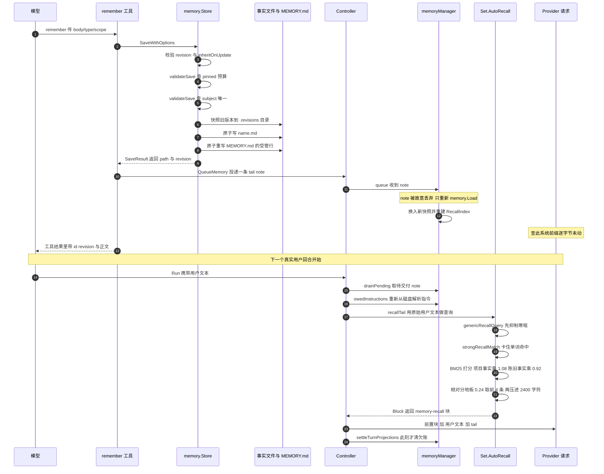

# 记忆与 Context Engine：把「可错的事实」从「必须遵守的规则」里分出去

> 本解读按 **ai-agent** 类规格产出，属 DeepSeek-Reasonix 深度解读的子文档；共 13 篇，解读基线 `v2.37.0`（`e17ef45e3`）。正文所有 `文件:行号` 引用均为 Reasonix 仓库相对路径，点开即可核对。相关篇章见 [README.md](README.md)。

本篇只讲两件事的归属与投递位置：标准指令（standing instructions）与可错事实库（background memory），外加 Context Engine v2 对**会话历史**建立的检索投影。核心问题不是「支持哪些记忆类型」，而是**每一类状态在什么时刻、以什么权威等级、花多少字节，出现在 provider 请求的哪一段**。

覆盖边界：本关注面只覆盖 `internal/state/{instruction,memory,history}` 与 `internal/session/control` 的投影侧，不含 `internal/safety/evidence`。`internal/contract/config`、`REASONIX.md`、`docs/` 下的文件只在与本关注面直接相关的行上被读取，不作全量覆盖。

## 在系统中的角色

去掉这一层，系统会以两种方式坏掉，而且坏法相反。

去掉标准指令：模型不再知道「这个仓库要求先跑 `go test ./...`」，用户每次会话重复交代项目约定；团队约定无法随仓库分发。

去掉事实库：跨会话的偏好、非代码可推导的约束、外部资源指针全部丢失，模型每轮从零重建作者画像。

去掉 Context Engine v2：模型只能看见当前窗口里的对话；「上周那条命令为什么失败」「当时放弃了哪个方案」不可再得——而这两类信息恰恰不适合被压缩成一条「事实」，因为它们需要**原始措辞与原始输出**。[docs/SESSION_MEMORY_RETRIEVAL.md:22-27]() 用一张表把四种信息按「放哪里」分开，那张表本身就是本关注面的论纲。
<!-- anchor: | Put this in | Use it for | Examples | … | Session history | Original wording, tool output, or a decision that is not yet -->

## 根因：前缀同时是缓存资产和权威位置

DeepSeek 的自动前缀缓存只在系统提示前缀字节稳定时生效。因此 canonical 状态（技能注册表、记忆库）不能直接写进前缀，必须**投影**到每一次请求上。项目把这条写成了五条不变量：前缀所有权、投影新鲜度、投影所有权、确定性、检测是语义的。

[REASONIX.md:178-200]()
<!-- anchor: ## Context projection … same question, and a change no projection renders is not a change. -->

其中「检测是语义的」是最容易被忽略、也最贵的一条：新鲜度不得依赖写者通知、mtime 或调用路径。[REASONIX.md:197-200]() 的原话是，注册表从 canonical 状态作答，所以「一个被翻转的开关」和「一次绕过所有 API 的文件编辑」是同一个问题。这条约束直接决定了后面 `@path` 导入为什么按物理身份去重、指令为什么每回合重新从磁盘解析。
<!-- anchor: - **Detection is semantic.** Freshness may not rest on writer notification, on … same question, and a change no projection renders is not a change. -->

但只有缓存这一半，还解释不了为什么事实库必须与指令分开。第二半是**权威位置**：系统提示里的内容被模型读作「必须遵守」，而事实库的定义就是「写的时候为真、现在可能已错」。[docs/SESSION_MEMORY_RETRIEVAL.md:16-18]() 把这一点说成中心设计规则——事实不应该悄悄变成命令，长寿命规则也不应该依赖检索恰好在正确的时刻找到它。所以分开是**缓存理由与权威理由的叠加**：
<!-- anchor: Keeping those layers separate is the central design rule. A fact should not … finding it at the right moment. -->

- 缓存理由要求「易变的东西离开前缀」→ 事实库离开前缀。
- 权威理由要求「永远成立的东西不依赖检索」→ 指令也不能只靠检索。

两条理由作用方向相反，落到同一个结论：指令走**投影欠账**（每回合可重新交付，且能说清为什么欠），事实走**检索**（按需、有预算、明确低权威）。

## 切分：一条边进前缀，其余全部出前缀

把一次 provider 请求按字节切开，切线由自动前缀缓存的位置划出：**线左边每会话付一次，必须在字节上稳定；线右边每次请求都可重放，允许变化**。这条线同时也是权威线——前缀里的内容被模型读作「必须遵守」，回合里的块只是「本回合的相关信息」。位置因此同时承担两个职能：缓存资产与权威等级。

于是整个记忆面只有一条跨界进入前缀的边是合法的：**用户显式 pin 的事实正文**（外加一段不含任何事实、字节恒定的协议文本）。其余一切——标准指令、可检索事实、召回尾块、工具结果、会话历史——都不许进前缀，只能在回合里交付，或者干脆等模型自己来取。本篇把这条合法的进前缀通路记作**通路 A**，把出前缀的那些路记作**通路 B**；两者不是功能分类，而是同一套读写位置的两种归属。

图前先说清它是什么：这张图是**位置图**，不是流程图。它要回答的问题只有一个——哪些状态落在稳定前缀这一侧、哪些落在回合这一侧，以及两侧之间到底有几条边。


读这张图要看三件事。第一，**被划掉的那条边是整篇的论纲**：v2.37.0 之前 `MEMORY.md` 的索引折在前缀里，位置在项目指令与技能索引之前，一次 `remember` 写入就会让它之后的每个字节在下一个会话全部重发；这条边现在是红叉。第二，**虚线（宿主投递）没有一条跨越那条竖分隔线**：指令、note、召回尾块都在右栏内部完成，其中 `<memory-recall>` 甚至是唯一落在用户文本**之后**的块。第三，**点线（模型主动拉取）不花宿主的判断权**：`memory` 与 `history` 的结果都不注入，而是作为 tool result 回到对话里，相关与否由模型自己判断。

这张图的代价面就是下面这张表：同一条切分线，也是权威与预算的分界线。

| 通路 | 触发者 | 落点 | 默认预算 | 超预算行为 |
|---|---|---|---|---|
| 标准指令 | 宿主（欠账） | 用户文本**之前**的 `<project-instructions>` 块 | 无预算 | — |
| pinned 事实 | 用户显式 pin | 系统提示前缀 | `pinned_budget_chars`，默认 **0 = 无上限** | 写入被拒（`ErrPinnedBudget`） |
| 自动召回 | 宿主（每真实回合一次） | 用户文本**之后**的 `<memory-recall>` 尾块 | 4 条 / 2400 字符 | 逐条裁剪 snippet，装不下则丢弃并记省略数 |
| 显式 `memory` 工具 | 模型 | tool result | 20 条上限 / 260 runes snippet | 截断 + 省略说明 |
| `history` 工具 | 模型 | tool result | 8 条（最大 20）/ 240 runes snippet | 相对分地板 0.15 + 截断 |
| 会话历史索引 | 宿主（后台） | 不注入，只建投影 | — | 索引未完成时返回子集并说明进度 |

pinned 预算的默认值值得单独点出：配置注释说「每一个轴出厂都是关的」，因为「前缀索引与 pinned 正文是每会话付一次、自动召回每回合付一次，这些值不值得付是用户的判断」，所以未设置意味着**不设上限**而不是由代码挑一个数。

[internal/contract/config/config.go:770-778]()
<!-- anchor: // MemoryConfig bounds what saved memory costs, and every axis ships off. The … // RecallLimit is how many facts automatic recall may inject per turn. -->

[internal/state/memory/store.go:538-542]()
<!-- anchor: // PinnedBudgetOff is the unset pinned budget. Pinned bodies do cost prefix … const PinnedBudgetOff = 0 -->

超预算的拒绝信息同时也是引导：`unpin or consolidate existing pinned facts, raise the budget, or move rules that must always hold into REASONIX.md/AGENTS.md instructions`——它把用户推回通路 B 里的指令通道。

[internal/state/memory/store_v2.go:154-171]()
<!-- anchor: // validatePinnedBudget rejects a save that would push the total pinned-body … return fmt.Errorf("pinning this fact would put pinned guidance at %d chars, over -->

## 通路 A：唯一一条进前缀的边

前缀由 `boot` 一次性组装：BASE 系统提示 → 环境段 → `memory.Compose` → skills 索引。

[internal/assembly/boot/prompt.go:88-104]()
<!-- anchor: sysPrompt = appendOfflineEnvironmentNote(sysPrompt, cfg.Environment.Offline) … timer.mark("memory") -->

`memory.Compose` **只**折叠 `BackgroundBlock`，而 `BackgroundBlock` 只输出两样东西：一段字节恒定的 `memoryProtocol`，加上用户显式 pin 的正文。

[internal/state/memory/memory.go:152-180]()
<!-- anchor: // BackgroundBlock renders the memory protocol and any pinned preferences. The … return strings.TrimSpace(b.String()) -->

[internal/state/memory/memory.go:186-192]()
<!-- anchor: const memoryProtocol = "## Background memory\n\n" + … "Save new durable facts with the `remember` tool; archive ones that turn out wro -->

这段协议文本**只讲工具、不含任何事实**，所以它对同一台机器上的每个项目、每个会话都是逐字节相同的。它替换掉的正是那份「已知事实索引」。

[internal/state/memory/memory.go:232-244]()
<!-- anchor: // Compose folds background memory onto the base system prompt and returns the … return strings.TrimRight(base, "\n") + "\n\n" + block -->

pin 是整套设计里唯一被声明的例外，而且这个例外被写进测试而不是注释：pin 是唯一允许移动前缀的记忆操作，因此它有一条专门的测试臂——**在做出 pin 的那个会话里，前缀不许动**；重启后新前缀**必须**包含该正文，且必须与之前不同（否则「既在前缀里又没改动前缀」自相矛盾）。

[internal/assembly/boot/context_projection_test.go:398-425]()
<!-- anchor: // Arm 5 is the declared exception, stated so that changing it is a decision … t.Fatal("the pinned body is in the prefix and the prefix did not move; one of th -->

代价是一次冷启动：pin 只在下一个会话生效，「我刚才 pin 了却看不到」是这套语义的必然结果而不是延迟；补偿是 `/memory` 报告当前前缀里 pinned 正文的真实成本。

这里还有一个容易踩错的例外：`StaticContext()` 会把背景记忆与指令合并成一个静态串，但那只服务于**没有回合投影可骑**的 planner 路径（它一次建好提示、从不组装用户回合），基础会话始终分两次拿这两样东西。

[internal/state/memory/memory.go:215-217]()
<!-- anchor: // StaticContext is background memory and instructions in one string, for a … // once and never composes a user turn. Base sessions take the two separately. -->

**索引为什么被搬出去**，是这一侧最重的一段历史与三道保证，放在后面「关键设计决策」里单独讲。

## 通路 B 之一：标准指令——枚举、去重与「每回合重新解析」

指令不是前缀的一部分，而是每个回合重新算出来的一段欠账。枚举顺序由 `Resolve` 一次写成，没有第二处顺序表。

[internal/state/instruction/resolver.go:130-140]()
<!-- anchor: if userDir := absolutePath(opts.UserDir); userDir != "" { … appendDir(dir, root, []string{root}, LocalDocumentNames, ScopeLocal, depth, 11+d -->

精确顺序分三步：

1. **用户全局目录**（仅当 `UserDir` 非空）：`DocumentNames` 三个文件，scope = `user`，`depth = -1`，priority = `0`。
2. **目录链**：`directoryChain(root, target)` 从 workspace root 起逐级下探到 target 所在目录；每一级先做一次 `DocumentNames`（深度 0 记 `project`，更深记 `ancestor`，priority = `10+depth*2`），再做一次 `LocalDocumentNames`（`REASONIX.local.md` / `AGENTS.local.md` / `CLAUDE.local.md`，scope = `local`，priority = `11+depth*2`）。

[internal/state/instruction/resolver.go:26-29]()
<!-- anchor: var DocumentNames = []string{"REASONIX.md", "AGENTS.md", "CLAUDE.md"} … const MaxImportDepth = 5 -->

priority 因此单调递增地编码了「越具体越靠后」：同级 `.local.md` 恰好比普通文件大 1；更深的目录每层 +2，永远压过更浅的目录。合并规则是**按展开后正文的 SHA-256 去重，同正文只保留 priority 最大的一份**。

[internal/state/instruction/resolver.go:143-159]()
<!-- anchor: // Content hashes are exact after decoding, trimming, and deterministic … result.Documents = append(result.Documents, item.doc) -->

最终 `Document.Order` 按「候选加入顺序」而不是 priority 赋值，所以输出顺序等于枚举顺序、与去重无关——这一点由 `TestResolveDuplicateReplacementPreservesPrecedenceOrder` 锁住。

[internal/state/instruction/resolver_test.go:27-44]()
<!-- anchor: func TestResolveDuplicateReplacementPreservesPrecedenceOrder(t *testing.T) { … t.Fatalf("document order metadata = %+v", got.Documents) -->

target 必须落在 workspace root 之下，否则记 `target_outside_workspace` 并**把 target 拉回 root**，而不是拒绝加载。

[internal/state/instruction/resolver.go:89-94]()
<!-- anchor: if !fileutil.AtOrUnder(target, root) { … target = root -->

root 未显式给出时用最近 git 根。

[internal/state/instruction/resolver.go:410-422]()
<!-- anchor: func nearestGitRoot(dir string) string { … return "" -->

用户全局目录的解析链是 `UserDir = config.MemoryUserDir() = Roots.userSupportDir() = Dir(RootState)`，而 RootState 的环境变量是 `REASONIX_STATE_HOME`、fallback 是 `defaultStateDir = Dir(RootHome)`，RootHome 的环境变量是 `REASONIX_HOME`、fallback 是 `defaultHomeDir`。

[internal/contract/config/storage_roots.go:64-77]()
<!-- anchor: func storageRootTable() []storageRoot { … return rootsTable -->

[internal/contract/config/storage_roots.go:282-284]()
<!-- anchor: // defaultStateDir is the home root: state that nothing relocated lives beside … func (r Roots) defaultStateDir() string { return r.Dir(RootHome) } -->

[internal/contract/config/storage_roots.go:251-269]()
<!-- anchor: // defaultHomeDir is where configuration lands when REASONIX_HOME is unset: … return "" -->

所以完整链条是 `REASONIX_STATE_HOME` → `REASONIX_HOME` → `~/.reasonix`（macOS/Linux）或 `%APPDATA%\reasonix`（Windows，`%USERPROFILE%\AppData\Roaming` 兜底）。注意 RootHome 被声明为 `relocatable: false`：家目录不能由它自己持有的配置来命名；而 RootState 是 relocatable 的——这个不对称正是「状态可以搬、家不能搬」的编码。

[internal/contract/config/storage_roots.go:36-51]()
<!-- anchor: type storageRoot struct { … owns []string -->

**为什么「同一目录下所有受支持文件都加载，`AGENTS.md` 不是回退项」是个重要决定。** 回退语义听起来更友好，实际后果是静默丢失：一个同时存在 `REASONIX.md`（本项目自有规则）、`AGENTS.md`（Codex 约定）、`CLAUDE.md`（Claude Code 约定）的仓库，回退只读第一份，另外两份**用户明确写下的规则消失且不产生任何诊断**——这正是「检测是语义的」要禁止的那类失败。三份都是独立的来源：有人把 Claude 专用的东西写在 `CLAUDE.md`，把它当回退项就等于把这份规则降级为「没人要时才生效」。

[internal/state/instruction/resolver_test.go:49-61]()
<!-- anchor: func TestResolveKeepsDistinctConventionFilesInDeterministicOrder(t *testing.T) { … t.Fatalf("document %d = %+v, want %s with stable order", i, got.Documents[i], na -->

这个决定的代价是重复，所以去重必须存在，而且必须按**正文**而不是文件名：同一个规则被镜像进 `AGENTS.md` 和 `CLAUDE.md` 时不该付两遍字节。

[internal/state/instruction/resolver_test.go:12-23]()
<!-- anchor: func TestResolveKeepsMostSpecificSourceForExactDuplicate(t *testing.T) { … t.Fatalf("duplicate winner = %+v, want project source", got.Documents[0]) -->

指令块的渲染把这条顺序写成显式文本，因为模型读到的是一段扁平字符串，不读 priority。

[internal/state/instruction/render.go:9-18]()
<!-- anchor: // Block renders resolved standing instructions in broad-to-specific order. … b.WriteString("Standing guidance resolved for this workspace and target path. La -->

每个 chunk 带 provenance 标签，但绝对路径被规范成 `workspace/...` / `user/...`，机器本地路径不进 provider。

[internal/state/instruction/render.go:46-59]()
<!-- anchor: func providerDocumentPath(doc Document, workspaceRoot string) string { … return filepath.ToSlash(filepath.Join(label, filepath.Base(doc.Path))) -->

### `@path` 导入：识别、嵌套、去重、循环

行长什么样才算导入，是一个刻意做窄的判定：单独一行、以 `@` 开头、行内无空白，且去掉 `@` 后**要么含路径分隔符、要么含 `.`**。

[internal/state/instruction/resolver.go:295-304]()
<!-- anchor: func parseImportTarget(line string) (string, bool) { … return path, true -->

最后那个条件让 `@foo` 和 `@某人` 保持为散文，而不是让每一行 `@提及` 都变成一次文件读取尝试。

**嵌套**有硬上限 5 层，超过上限直接返回未展开的原文。

[internal/state/instruction/resolver.go:217-219]()
<!-- anchor: func resolveDocumentImports(body, sourcePath string, boundaries []string, depth  … return body -->

注意这条路径**不产生 diagnostic**：第 6 层的 `@path` 会以原文留在正文里，宿主侧静默。这是「已知边界」里的一条，不是设计意图的必然结果。

**循环**的检测单位是物理身份——`physicalIdentity` 先 `EvalSymlinks` 再取绝对路径，所以 `a → b → a` 与经由符号链接的别名都能识别。

[internal/state/instruction/resolver.go:400-407]()
<!-- anchor: func physicalIdentity(path string, info os.FileInfo) string { … return "" -->

命中时记 `import_cycle` 诊断，并把该行就地替换成带 `<!-- skipped: import cycle -->` 的注释，正文照常继续。

[internal/state/instruction/resolver.go:253-263]()
<!-- anchor: if state.active[identity] { … continue -->

**菱形**（两个文档导入同一个文件）由 `expanded` 集合处理。这个集合在整次 resolution 内共享，而且「作为文档自己被加载过」也会预先写入它，所以后面的 `@REASONIX.md` 只留一行 `<!-- skipped: already loaded above -->`。

[internal/state/instruction/resolver_test.go:132-156]()
<!-- anchor: // The convention trio is the shipped layout: REASONIX.md holds the rules and … t.Fatalf("a file shared by two documents is not a defect, got %+v", got.Diagnost -->

的用例就是这个布局：`REASONIX.md` 持规则，`AGENTS.md` 和 `CLAUDE.md` 各 `@REASONIX.md` 一次；断言规则正文在全部文档中只出现一次，且两个 importer 都必须留下「我引用了什么」的痕迹。测试注释直言动机：`Expanding it once per importer put three copies of one body in the cache-stable prefix, which is paid on every request of every session.`——按 importer 各展开一次，就会把同一份正文的三份副本塞进每个会话每次请求都要付费的前缀里。

**边界**由「谁拥有这个目录」决定，而不是由路径拼写决定。导入路径相对 source 文件所在目录解析；`~` 只在用户全局文档里被展开，且用户文档的信任根不只有 `userDir`，还包括 `~/.reasonix`、`~/.agents`、`~/.agent`、`~/.claude`。

[internal/state/instruction/resolver.go:342-358]()
<!-- anchor: func userInstructionImportRoots(userDir string) []string { … return out -->

[internal/state/instruction/resolver.go:307-330]()
<!-- anchor: func confinedImportPath(target, sourceDir string, boundaries []string) (string,  … return path, boundary, "" -->

反方向被显式封死：项目文档**不得**导入用户约定根，否则一个仓库的 `AGENTS.md` 就能读走开发机的私有规则。

[internal/state/instruction/resolver_test.go:184-197]()
<!-- anchor: func TestResolveProjectInstructionsCannotImportUserConventionRoots(t *testing.T) … t.Fatalf("project external import diagnostics = %+v", got.Diagnostics) -->

越界分三类、各有自己的诊断码：`import_outside_source`（不在任何允许边界内）、`import_symlink_escape`（EvalSymlinks 后逃出边界，且在读取时用 `os.OpenRoot` 二次确认，防 TOCTOU）、`import_unreadable`。

### 交付：欠账、每回合重解析与清零时机

`Compose` 的入参里根本没有 `Docs`——指令通过 `project-instructions` 回合块交付，靠一个 `projectionDebt` 记录「模型手上是不是已经有当前版本」。

[internal/session/control/memory.go:14-50]()
<!-- anchor: // memoryManager owns the session's loaded memory snapshot, the queue of pending … writeMu sync.Mutex -->

[internal/session/control/memory.go:58-80]()
<!-- anchor: // owedInstructions returns the standing-instruction block when the model does … m.instructions.forget() -->

`projectionDebt` 的语义值得单独记：它只持两个版本串——`delivered`（已交付的版本，也就是「模型手上那一份」）与 `pending`（本回合正在携带、但还没有送到模型手上的版本）。`owed` 比较两者决定要不要发，`settle` 才把 `pending` 提升为 `delivered`；因为比的是版本原文本身，比较是精确的，不会有摘要漂移。

[internal/session/control/projection_debt.go:6-16]()
<!-- anchor: // projectionDebt is the fact behind "is this block owed": whether what the … pending atomic.Pointer[string] -->

[internal/session/control/projection_debt.go:33-38]()
<!-- anchor: // settle records what the turn actually carried. Until it is called the debt … d.delivered.Store(pending) -->

两个细节说明了「检测是语义的」如何落到代码：`owedInstructions` **每回合重新从磁盘解析**而不是读会话快照（理由是「一个越过本进程的编辑仍然是编辑，而没有人会通知」）；如果现在解析结果为空、但之前发过内容，就发一条撤回块，因为沉默会让模型已经持有的规则继续生效。

[internal/session/control/turn_projection.go:43-68]()
<!-- anchor: // turnBlocksFor is the whole set a turn can carry, in projection order. Adding … turnBlock{"active-goal", c.activeGoalTurnBlock(goal, goalStatus)}, -->

欠账只在真正交给 runner **之后**才清——在组好文本与调用 runner 之间，一个 hook 可以拦截、一个扩展可以拒绝，此时那些字节哪儿都没到；提前清欠账等于让模型持有「没有人发给它的状态」。

[internal/session/control/turn_projection.go:138-144]()
<!-- anchor: // runSettled hands the composed turn to the runner and settles what it carried. … return c.runWithRunner(ctx, input) -->

[internal/session/control/turn_projection.go:159-164]()
<!-- anchor: func (c *Controller) settleTurnProjections() { … c.refused.settle() -->

五处 `settle` 并列在 `settleTurnProjections` 里，但它们**不共用同一实现**：`date`、`skills.catalog`、`memory.instructions` 用上面这个按版本比较的 `projectionDebt`；`mcp.promptFailures` 与 `refused` 用另一个按条计数的 `promptFailureDebt`——它记的是「模型还没被告知的那几条」，`composed` 计数保证 settle 只清本回合真的携带过的那几条，不会顺手清掉组回合期间新记下的条目。

[internal/session/control/mcp_prompt_error.go:51-57]()
<!-- anchor: // promptFailureDebt holds failures the model has not yet been told about. … composed int -->

## 通路 B 之二：可错事实库——四个正交维度与一个冲突键

`Store` 是「一个事实一个文件 + 同目录 `MEMORY.md` 索引」的目录对：project 在 `<userDir>/projects/<slug>/memory`，global 在 `<userDir>/memory/global`。读写永远先看 global 再看 project，所以全局事实是**默认可见**、项目事实是**覆盖者**。

[internal/state/memory/store.go:20-33]()
<!-- anchor: // Store is the scoped auto-memory store: project and global directories of … PinnedBudgetChars int    // user ceiling on pinned-body runes; 0 = none -->

写入只有一条入口 `Save` → `SaveWithOptions`，注释说明理由：`remember` 工具、桌面编辑器、未来的导入器都必须走这里，索引才不会与文件漂移。

[internal/state/memory/store.go:177-183]()
<!-- anchor: // Save writes (or overwrites) a memory file and refreshes its MEMORY.md index … return result.Path, err -->

这条路径上依次发生：id / 名字引用解析 → `expected_revision` 校验 → 创建/更新分支 → `inheritOnUpdate` → `validateSave` → 旧版本快照 → 原子上写事实文件 → 重写 `MEMORY.md` 受管行。

[internal/state/memory/store_v2.go:109-137]()
<!-- anchor: // inheritOnUpdate keeps the update-omittable fields of an existing revision: … return m -->

`inheritOnUpdate` 的语义值得单独记一笔：更新时**省略一个可省略字段等于保留它，不等于清空它**，唯一的例外是需要显式陈述的 `clearExpiry`。这让「我只想改 body」不会顺手抹掉 `subject_key`、`keywords`、`expires_at`。

[internal/state/memory/store_v2.go:271-280]()
<!-- anchor: if err := writeMemoryAtomic(path, []byte(render(m, m.Name)), 0o644); err != nil  … return SaveResult{Path: path, Memory: m}, err -->

### 事实（fact）的模型：四个正交维度

frontmatter 的字段集合由渲染结构一次性确定：`id`、`revision`、`created_at`、`updated_at`、`name`、`title`、`description`、`keywords`、`activation`、`volatility`、`subject_key`、`expires_at`、`last_verified_at`，以及一个 `metadata` 块里的 `type` / `fact_type` / `scope`。

[internal/state/memory/render.go:17-35]()
<!-- anchor: type memoryFrontmatter struct { … } `yaml:"metadata"` -->

四个维度各自回答一个不相交的问题：

| 维度 | 回答的问题 | 取值 | 为什么不能与别的维度合并 |
|---|---|---|---|
| `type` | 这条内容**是什么** | user / feedback / project / reference | 分类不蕴含范围 |
| `scope` | 这条在**哪里**生效 | project（默认）/ global（须显式） | 范围不蕴含分类 |
| `activation` | 这条**怎么到达**模型 | relevant（检索）/ pinned（进前缀） | 到达方式与「是什么」「在哪里」无关 |
| `volatility` | 这条**多久过期** | evergreen / stable / volatile | 同一 type 的不同事实寿命可以差两个数量级 |

`type` 与 `scope` 正交的理由在代码里是一句明确的反对句：`project feedback should not silently become global merely because it is classified as feedback`——一条项目内的反馈不该仅仅因为被归类为 feedback 就悄悄变成全局事实。

[internal/state/memory/store.go:60-63]()
<!-- anchor: // FactScope controls where an auto-memory fact is active. It is intentionally … type FactScope string -->

激活维度同样写成显式正交，理由用的是同一种句式——scope 说「可以用在哪里」，activation 说「是否每会话把正文放进稳定前缀」。

[internal/state/memory/activation.go:7-14]()
<!-- anchor: // Activation controls how a fact reaches the model, orthogonal to Scope: … ActivationPinned   Activation = "pinned"   // body loads into the stable session -->

时效维度也写成正交：project 事实可能是几天就死的发布分支，也可能是能活几年的 README 位置，所以 `volatility` 必须能脱离 `type` 指定。

[internal/state/memory/freshness.go:17-25]()
<!-- anchor: // Volatility is how fast a fact ages, orthogonal to Type: a project fact may … VolatilityVolatile  Volatility = "volatile"  // 7 days fresh / 30 current -->

`activation` 的默认解析带一条 legacy 兼容规则：无字段时，**global 的 user/feedback 视为 pinned**（这些事实早于该字段出现，历史上一直被当稳定指导加载），其余一律 relevant。

[internal/state/memory/activation.go:30-43]()
<!-- anchor: // ResolveActivation defaults an unset activation. Legacy global user/feedback … return ActivationRelevant -->

`fact_type` 是一个纯兼容字段，代价很具体：`metadata.type` 写的是**路由提示**而不是真实分类——旧版本按 `metadata.type` 决定写进 project 还是 global 目录，所以 global 的 project/reference 事实必须伪装成 `user`，真实分类放进 `metadata.fact_type`。

[internal/state/memory/render.go:79-93]()
<!-- anchor: // previousReleaseRoutingType keeps scope safe when an older Reasonix binary … return TypeProject -->

一个概念因此要写三个字段加一张规则表。收益是：当新旧两个二进制共享同一个状态根时，旧版本不会把全局事实搬进项目目录。

### `subject_key`：知识的冲突模型

`subject_key` 是一个点分键，命名「这条事实回答的那个问题」（`project.package_manager`、`user.response_style`）。不变量是：**同一个 scope 下，一个 key 至多有一个活跃值**。

[internal/state/memory/subject.go:64-80]()
<!-- anchor: // validateSubjectKey enforces one active value per (scope, subject): a save … key, holder.ID, holder.Revision, holder.Name, oneLine(firstNonEmpty(holder.Descr -->

拒绝时错误信息里带持有者的 `id`/`revision`/名字，并指示「这是同一事实的新值就更新那个 id」——错误携带的是可执行动作。这让「npm → pnpm」变成一次 revision，而不是两条互相矛盾、都保持活跃的事实。`subject_key` 同时参与召回身份判定，所以两条具体措辞完全不同、但回答同一问题的事实，会被当作同一身份去压制/覆盖。

[internal/state/memory/auto_recall.go:383-394]()
<!-- anchor: func recallIdentityKeys(memory Memory) []string { … return keys -->

### `MEMORY.md` 索引：派生态，人类可见，模型不可见

结构是受管行 `- [Title](name.md) — [scope/type(pinned)] description`。

[internal/state/memory/store.go:455-462]()
<!-- anchor: func renderIndexLine(name string, m Memory) string { … NormalizeFactScope(string(m.Scope)), NormalizeType(string(m.Type)), marker, oneL -->

刷新时机就是「每一次事实变更」：`Save` 成功后 `reindexIn` 只重写该 name 的行；`Archive`/`Delete` 用 `indexLinesExceptIn` 摘掉该行再整体重写；迁移逐条重写。重写时**非受管内容原样保留**，新条目排序追加，文件原本为空时才补 `# Memory` 头。

[internal/state/memory/store.go:384-441]()
<!-- anchor: var indexLineRe = regexp.MustCompile(`(?m)^\s*-\s\[.+?\]\(([^)]+)\.md\)\s*—\s.*$ … return fileutil.AtomicWriteFile(path, []byte(result), 0o644) -->

用 `AtomicWriteFile` 的理由写在注释里：索引是派生态，但一次撕裂写仍会让事实在下一个会话「消失」。这条注释的措辞（`from the next session's prefix`）是旧世界的遗留——在 v2.37.0 里索引本来就不进前缀。

## 承托两条通路的四个数据结构

四类结构承载了这套设计，其余都是它们的投影。

**1. `Memory`：一条事实的四个正交维度。** 字段与注释逐字摘自结构声明（为压在 10 行内删去了 `CreatedAt`/`UpdatedAt`/`Title`/`Description`/`Keywords`/`ExpiresAt`/`LastVerifiedAt`）：

[internal/state/memory/store.go:79-96]()
<!-- anchor: // Memory is one stored fact. … Body           string     // the fact itself (Markdown) -->

```go
	Type           Type
	Scope          FactScope  // project by default; global only when explicitly requested
	Activation     Activation // persisted choice; "" = unset, resolved by ResolveActivation
	Volatility     Volatility // how fast the fact ages; "" = unset, type default applies
	SubjectKey     string     // which question the fact answers (project.package_manag
```

**2. `Set`：一次会话的不可变记忆快照。** 它同时持有指令文档、pinned 正文、Store 句柄、以及**预建的召回索引**（`recall *RecallIndex`），后者是「每回合召回零磁盘 IO」的全部秘密。

[internal/state/memory/memory.go:18-44]()
<!-- anchor: type Set struct { … RecallMaxChars    int -->

**3. `RecallResult`：一次召回的决定，可审计。** 它不只有命中的事实，还有两类省略计数（被 limit 截掉 vs 被字符预算截掉）、字符预算与实际用量、抑制原因，以及 V2 shadow 排名。

[internal/state/memory/auto_recall.go:53-67]()
<!-- anchor: type RecallResult struct { … block string -->

**4. `turnBlock`：回合块的最小单元。** 只剩「标签 + 正文」，顺序由切片位置表达——这是把「八个各自 prepend 的注入点」塌缩成一个有序列表之后的结果。

[internal/session/control/turn_projection.go:18-20]()
<!-- anchor: type turnBlock struct { … body string -->

## 核心流程：从 canonical 写入到 turn tail 回注

下面这张时序图是本关注面的主链路：一次 `remember` 如何**不**碰前缀、如何在同会话内立即可见、以及「下一回合的检索」与「turn tail 回注」分别发生在谁手里。注意最后一步——检索结果不是插在用户文本之前，而是**跟在用户文本之后**。



### 逐步说明

**1. 写入 canonical（磁盘是真源）。** `remember` 工具把参数规整成 `Memory` 后交给 `Store.SaveWithOptions`（[internal/state/memory/remember.go:112-130]()）。fact 文件与 `MEMORY.md` 是权威，`RecallIndex` 只是快照的派生物。
<!-- anchor: result, err := t.store.SaveWithOptions(Memory{ … ClearExpiry:             clearExpiry, -->

**2. 工具侧投递一条 note。** 保存成功后，工具从 ctx 取 `memory.Queue` 并投递一条一句话说明。

[internal/state/memory/remember.go:141-144]()
<!-- anchor: if q, ok := QueueFromContext(ctx); ok { … return fmt.Sprintf("Saved memory id=%s revision=%d (%s background) as %s (it app -->

[internal/state/memory/queue.go:8-13]()
<!-- anchor: // Queue receives a one-line note about a memory change a tool just made, so the … type Queue interface{ QueueMemory(note string) } -->

**3. Controller 收到 note，但把它丢掉。** 这是整条链路最反直觉的一步，也是刻意的：

[internal/session/control/memory.go:317-326]()
<!-- anchor: // queue refreshes the snapshot a memory panel reads after the model's own … m.applyWrite(mem, "") -->

理由是：模型自己的 `remember` 调用结果**已经在对话里**了，再说一遍是重复；而且再注入一条 note 会**抑制掉本该发生的那次自动检索**——那条检索说得比 note 更好（它带打分、时效、匹配理由）。所以 note 只用来触发快照重载，不进入模型可见字节。

**4. 快照重载与索引重建。** `memory.Load` 重新走一遍指令解析与 `StoreFor`，并 `BuildRecallIndex` 一次性把召回池读入并分词。

[internal/state/memory/recall_index.go:1-5]()
<!-- anchor: // The session recall index: the recall pool read and tokenized once per … package memory -->

这一步是性能设计的关键：`/memory` 面板与后续每一回合的自动召回**都不再碰磁盘**。

[internal/state/memory/recall_index.go:47-66]()
<!-- anchor: // AutoRecall runs automatic recall against this snapshot's prebuilt index — … return autoRecallIndexed(index, result, opts) -->

**5. 下一回合：组装的顺序与归属。** 组装入口先排空 note，再生成前置块序列，最后决定尾部长什么样。

[internal/session/control/input.go:119-136]()
<!-- anchor: func (c *Controller) composeWithGoal( … return projectTurn(blocks, text, tail) -->

块的顺序本身就是契约：越靠近用户文本的块，被读到得越晚、越具体。指令块在中段（`project-instructions`），而自动召回是**唯一跟在用户文本之后**的块。

[internal/session/control/turn_projection.go:23-40]()
<!-- anchor: // projectTurn renders what the provider sees for one turn: the owed blocks in … return strings.TrimRight(b.String(), "\n") + "\n\n" + tail -->

**6. tail 的判定：先决定要不要检索。** `recallTail` 有三道前置门：如果本回合已经带了 memory-update note，就**不检索**，改为记录一条「已由 update 提供」的抑制原因；如果检索被 ablation 关闭就返回空；否则才真正检索并把审计事件发出去。

[internal/session/control/turn_projection.go:118-135]()
<!-- anchor: // recallTail is the one block that follows the user's text rather than … return result.Block() -->

**7. 检索本身是保守的。** 默认上限与默认预算写在同一个 const 块里，且注释说明它们是**起点而不是上限**——用户配置多少就多少，因为「自己的记忆里有多少该进这一轮」是用户的判断，不是宿主的。

[internal/state/memory/auto_recall.go:16-27]()
<!-- anchor: // Automatic recall's defaults. They are starting points, not ceilings: a user … const autoRecallPreamble = "Automatically recalled low-authority background fact -->

抑制规则是穷举的寒暄表，中英并列；`#7`、`#issue` 这类普通输入不会被误伤。

[internal/state/memory/auto_recall.go:277-283]()
<!-- anchor: func genericRecallQuery(query string) bool { … return false -->

匹配门槛是「至少命中 2 个词」，或者「只命中 1 个但在 query 里是罕见词」——后者用「含数字 / 含下划线 / 含内部大写」或 `#term` 形式来判定，这正是结构化判断替代措辞表的例子。

[internal/state/memory/auto_recall.go:297-312]()
<!-- anchor: // strongRecallMatch keeps automatic recall out of one-common-word territory. … return distinctiveQueryTerm(query, term) -->

打分阶段依次叠加：项目事实 ×1.08；**过期是硬边界**（直接跳过，显式搜索仍能找到它）；陈旧事实 ×0.92 而不是被删除。

[internal/state/memory/auto_recall.go:193-203]()
<!-- anchor: if NormalizeFactScope(string(doc.memory.Scope)) == FactScopeProject { … score *= 0.92 -->

召回池本身也做过一次去重/压制：pinned 事实被排除（正文已在前缀，再召回就是重复），global 事实若被项目事实按身份键覆盖则整条移出。

[internal/state/memory/auto_recall.go:341-354]()
<!-- anchor: func recallMemories(all []Memory) []Memory { … global = append(global, memory) -->

**8. 预算不是一刀切截断，而是「先按上限取，再按字符预算逐条裁剪」。** 单条命中的公平份额是 `预算 / limit`，所以一条事实吃不下整轮配额；预算不足时逐次缩短该条的 snippet（每次砍 1/4），缩到装不下就丢弃并计入 `OmittedByBudget`；只有总计省略数能塞进剩余预算时才附一行省略说明。

[internal/state/memory/auto_recall.go:270-274]()
<!-- anchor: // recallSnippetRunes is one hit's fair share of the char budget, so no single … return recallCharBudget(opts.MaxChars) / recallLimit(opts.Limit) -->

[internal/state/memory/auto_recall.go:413-446]()
<!-- anchor: func buildRecallBlock(hits []RecallHit, budget, omittedByLimit int) ([]RecallHit … return selected, block, omittedByBudget -->

[internal/state/memory/auto_recall.go:459-473]()
<!-- anchor: func clippedRecallEntry(hit RecallHit, maxRunes int) string { … return "" -->

**9. 注入块自带权威降级声明**，而且每次召回都会把 `<local-home>` 替换掉 home 目录前缀，并省略存储路径。

[internal/state/memory/auto_recall.go:27-27]()
<!-- anchor: const autoRecallPreamble = "Automatically recalled low-authority background fact -->

[internal/state/memory/auto_recall.go:449-456]()
<!-- anchor: func recallEntry(hit RecallHit, snippet string) string { … html.EscapeString(displayTitle(memory.Title, memory.Name)), html.EscapeString(sn -->

**10. 只在这一刻清欠账。** 顺序是：前置块 + 用户文本 + tail 交给 runner，`settleTurnProjections` 才把本回合携带过的欠账标记为已交付。

## 通路 B 之三：会话历史——可丢弃投影 + 模型主动拉取

这是本关注面最容易误读的一处。Context Engine v2 对会话历史做的事**不是**像自动召回那样每回合注入，而是**建一个可丢弃的词法索引，交给模型主动调用 `history` 工具**。因此它没有 turn tail 回注，检索位置由模型的 tool call 决定。

### canonical 与投影的分工

canonical 是 session JSONL、事件日志、元数据、子代理 transcript 与归档；SQLite 里的只是投影，删掉或重建它都不会删掉对话数据，旧版本 Reasonix 继续读同一批权威文件。

[docs/HISTORY_SEARCH_CATALOG.md:9-14]()
<!-- anchor: The catalog stores normalized retrieval tokens in FTS5, not complete message … indexed; ordinary tool output remains excluded by the default search kinds. -->

投影落在 `<cache root>/history-search/v1.sqlite`，缓存根不可解析时退化为内存投影。

[internal/state/historycatalog/types.go:101-108]()
<!-- anchor: // DefaultPath returns the disposable history FTS path under CacheDir. … return filepath.Join(cache, "history-search", "v1.sqlite") -->

### 索引里存什么

存的是**分词后的 token 串**，不是原文。schema 用 contentless FTS5：`content=''`、`contentless_delete=1`、`tokenize='unicode61 remove_diacritics 2'`。

[internal/state/historycatalog/schema.go:69-79]()
<!-- anchor: CREATE VIRTUAL TABLE history_fts USING fts5( … ON history_documents(source_path,message_index,part_index,id); -->

索引的粒度是「消息的一个部分」，不是整篇会话：一条消息里的 assistant 正文、每一个 tool call 的入参、每一次 tool 结果都各自成行；tool 结果同时以 `tool_error` 与 `tool_output` 两种 kind 各存一份，所以默认搜索不含 `tool_output`（默认 kind 集合）。

[internal/state/historycatalog/documents.go:20-49]()
<!-- anchor: func documents(messages []provider.Message) []indexedDocument { … return out -->

[internal/state/history/search.go:43-47]()
<!-- anchor: var defaultKinds = map[Kind]bool{ … KindToolError:     true, -->

### 更新路径：hint + 指纹 + 增量/重建

权威文件持久化成功、且**锁已释放之后**，才发一个非阻塞、按路径合并的 hint。

[internal/state/history/indexed.go:190-219]()
<!-- anchor: // PersistObserver returns the process-wide non-blocking projection sink. The … return catalog.EnqueuePersist(selected, event) -->

`indexPath` 先用 `size:mtime` 指纹做短路；指纹变了才继续。连续 append 走一条只读新增显示索引区间的窄路，且要求 revision 恰好 +1、digest 匹配、消息数单调，任何一个不成立就退回整源重建。

[internal/state/historycatalog/catalog.go:472-494]()
<!-- anchor: func (c *Catalog) indexPath(ctx context.Context, root Root, path string, generat … return nil -->

[internal/state/historycatalog/incremental.go:14-25]()
<!-- anchor: func (c *Catalog) tryAppendPath(ctx context.Context, root Root, path string, gen … return false, nil -->

整根扫描用「路径集合 + 每个文件的 size/mtime」算一个签名，签名与状态都未变时整个 root 直接跳过；否则递增 `scan_generation`，扫完把没被本轮见到的源标 `missing`，超过 grace 期才真正删除。

[internal/state/historycatalog/catalog.go:367-390]()
<!-- anchor: func (c *Catalog) reconcileRoot(ctx context.Context, root Root) error { … return nil -->

**分词器版本变化会整库清空**，理由是：分词器变了，旧 token 就是一个更差的分词器写下的答案。

[internal/state/historycatalog/catalog.go:109-141]()
<!-- anchor: // recordTokenizerVersion stamps the projection with the tokenizer that built … return tx.Commit() -->

### 检索信号：纯词法，无向量

查询词用与索引同一个分词器切分（英文小写、CJK 重叠 bigram、孤立 CJK 单字保留），然后用 SQLite 的 `bm25()` 排序，直接把 rank 当分数。

[internal/base/retrieval/bm25.go:11-16]()
<!-- anchor: // Tokens lowercases Latin words and splits CJK runs into overlapping bigrams … func Tokens(s string) []string { -->

[internal/state/historycatalog/catalog.go:647-664]()
<!-- anchor: baseQuery := `SELECT d.id AS id,d.source_path AS source_path,s.root AS root,s.so … after.Rank, after.SessionPath, after.MessageIndex, after.PartIndex, after.RowID) -->

**没有向量、没有 embedding**。检索 V2（BM25F 字段权重 + CamelCase/snake_case 切分 + CJK 单字加 bigram）已经实现，但明确是 **shadow-only**：它的排名只进审计通道，`MemoryBench` 决定它是否有一天接管，权重是「待测量的候选，不是调好的真理」。

[internal/base/retrieval/v2.go:1-5]()
<!-- anchor: // Retrieval V2, shadow-only: BM25F field weighting, code-symbol splitting, … package retrieval -->

`shadowRankV2` 把 V2 排名写进 `RecallResult.ShadowHits`，注释强调它永不进入 `Hits`。

[internal/state/memory/auto_recall.go:244-253]()
<!-- anchor: func shadowRankV2(query string, docs []retrieval.FieldedDoc) []ShadowHit { … return out -->

### 结果怎么回到模型：作为 tool result，且要二次校验

生产工具是 indexed 版本，注释开门见山：**从不做同步目录扫描**；索引还在构建时，它返回已经索引好的子集，并在结果头部显式说明进度。

[internal/state/history/tool.go:27-39]()
<!-- anchor: // NewIndexedTool is the production history tool. It never performs a … "By default it searches user text, assistant text, tool inputs, and tool errors; -->

SQLite 选完之后，才回到权威文件读原文并生成 snippet；读之前先比 `content_digest`，不匹配就放弃这条命中、重新入队该源。

[internal/state/history/indexed.go:298-320]()
<!-- anchor: for _, candidate := range result.Items { … continue -->

这一条是本模块最值钱的设计：**投影过期只会导致「少结果」，不会导致「错内容」**。而且索引不可用时它返回空结果而不是报错——`catalog == nil` 时直接返回空命中集。

[internal/state/history/indexed.go:276-278]()
<!-- anchor: catalog := processHistoryCatalog.get() … return []Hit{}, nil -->

### `projectiondb` 扮演什么角色

它不是一个 history 专用库，而是**所有一次性 SQLite 投影的生命周期契约**：包注释第一句就规定「业务数据必须留在数据库之外，调用者必须能丢弃并重建这里打开的每一个数据库」。

[internal/state/projectiondb/projectiondb.go:1-4]()
<!-- anchor: // Package projectiondb owns the lifecycle of disposable SQLite projections. … package projectiondb -->

它把「损坏」与「暂时不可用」严格分开，这是整篇最值得抄的一处判断：

- **只有可确证损坏**（`SQLITE_CORRUPT` / `SQLITE_NOTADB` / `integrity_check` 非 ok）才把磁盘文件重命名隔离；busy、权限、IO 等暂时性错误一律只在本进程退化为内存投影，绝不重命名，理由是「一个多进程客户端不能把健康的数据库从同伴脚下搬走」。
- **未来 schema** 保留为 degraded 只读模式（内存投影 + 状态标记），启动时绝不隔离一个健康的未来 schema。

[internal/state/projectiondb/projectiondb.go:126-162]()
<!-- anchor: if err != nil && mode == ModeDisk { … db, err = open(ctx, opts, mode) -->

磁盘态的参数也是同一套「可丢弃投影」政策：WAL、`synchronous=NORMAL`、外键开、`busy_timeout=150`，并把 WAL 上限压到 4 MiB（pragma 随 DSN 走，保证连接池里每个连接都生效）；内存态则把连接数压到 1，因为 shared-cache 内存库不能安全地池化并发写者。

[internal/state/projectiondb/projectiondb.go:227-262]()
<!-- anchor: if mode == ModeDisk { … return db, nil -->

重建是「在旁边建临时库 → 校验 → 原子换入、失败回滚」，并且明确说明旧投影在构建/校验/重命名失败时原样保留（Windows 上打开着的数据库重命名会失败）。

[internal/state/projectiondb/projectiondb.go:404-419]()
<!-- anchor: // Rebuild constructs and validates a replacement beside the live database, … defer release() -->

## 与其他模块协同

**依赖方向是单向的、且被刻意做窄。** `internal/state/memory` 依赖 `internal/state/instruction`（并把指令的类型与函数作为兼容别名再导出，供面板与控制器复用），依赖 `internal/base/frontmatter`、`internal/base/fileutil`、`internal/base/retrieval`、`internal/contract/config`、`internal/contract/tool`；反方向 `instruction` 不依赖 `memory`。

[internal/state/memory/doc.go:1-14]()
<!-- anchor: // Package memory implements Reasonix's persistent memory. It mirrors Claude … package memory -->

[internal/state/memory/doc.go:22-31]()
<!-- anchor: // Scope labels where a doc source was discovered, so the assembled block can … ScopeLocal    = instruction.ScopeLocal    // *.local.md personal override -->

**装配点是唯一的。** `internal/assembly/boot` 构造 `memory.Set`、把它折进前缀、并把 `remember` / `forget` / `memory` / `history` 四个工具注册进同一个注册表。所以「记忆有哪些工具」这件事只有一处答案。

[internal/assembly/boot/tool_wiring.go:75-88]()
<!-- anchor: func registerSessionTools(reg *tool.Registry, set ablation.Set, roots config.Roo … addTurnExitTools(reg) -->

**共享状态通过「不可变快照 + 两把锁」交接。** `memoryManager` 明确把自己定义为严格叶子：它的方法只碰自己的状态，从不回调 Controller，所以「面板保存记忆」不会卡住审批或状态轮询；`set` 是不可变快照指针，磁盘 IO 在 `writeMu` 下、但**不持 `mu`**，因此一次读（`current` / `drainPending`）永远不会排在一次写之后。

[internal/session/control/memory.go:14-50]()
<!-- anchor: // memoryManager owns the session's loaded memory snapshot, the queue of pending … writeMu sync.Mutex -->

**子代理被显式切断 tail 通道。** `WithoutQueue` 用来「遮蔽祖先的队列」，注释说明理由是：子代理可以持久化记忆，但不得把 turn-tail note 注入父级正在进行的对话。

[internal/state/memory/queue.go:23-36]()
<!-- anchor: func WithQueue(ctx context.Context, q Queue) context.Context { … return q, ok && q != nil -->

在源码里能查到的**直接**调用者有三处：agent 自身没有 memQueue 时的 `withAgentContext`、子代理运行未显式传队列时的 `RunSubAgentWithSession`、以及子代理工具身份上下文的 `childToolIdentityContext`。我们确认的是这三处直接调用，**未穷举**经由接口或回调的间接路径。

[internal/runtime/agent/agent.go:139-142]()
<!-- anchor: if a.svc.memQueue != nil { … ctx = memory.WithoutQueue(ctx) -->

[internal/runtime/agent/child_run.go:42-45]()
<!-- anchor: if opts.MemoryQueue != nil { … ctx = memory.WithoutQueue(ctx) -->

[internal/runtime/delegation/task.go:797-801]()
<!-- anchor: func childToolIdentityContext(ctx context.Context) context.Context { … return planmode.WithActive(ctx, agent.PlanModeFromContext(ctx)) -->

**`history` 工具的根由装配决定，desktop 与 CLI 语义不同。** `Options` 的注释直接说明：`SessionDir` 在桌面通常按项目分，在 CLI 常常是用户全局目录；`GlobalSessionDir` 只在调用方要求 global scope 时才搜。

[internal/state/history/search.go:50-58]()
<!-- anchor: // Options binds a Searcher to the session/history roots it may read. … ArchiveDir       string -->

装配侧把这一点落到两个实参上：`SessionDir` 取 `opts.SessionDir`，为空才回落到共享的 CLI/全局会话目录 `roots.SessionDir()`；`GlobalSessionDir` 固定取全局会话目录，也就是「按项目分的那个根」与「全局那个根」是两件事。

[internal/assembly/boot/session_runtime.go:48-50]()
<!-- anchor: dir := opts.SessionDir … dir = opts.roots().SessionDir() -->

[internal/assembly/boot/tool_wiring.go:79-79]()
<!-- anchor: reg.Add(history.NewIndexedTool(history.Options{SessionDir: sessionDir, GlobalSes -->

至于「桌面端是否为每个工作区各开一个 catalog 实例」，答案是否定的：`history` 的 catalog 是**进程级单例**，工作区只是被注册进它的 root 列表；CLI 侧枚举的会话目录集合是「全局目录 + 全局工作区 + `desktop-projects.json` 里记录的每个桌面项目」，也就是说多个工作区共用同一个投影库，而不是各开一个。

[internal/state/history/indexed.go:30-30]()
<!-- anchor: var processHistoryCatalog indexedCatalogManager -->

[internal/frontend/cli/catalogs.go:44-46]()
<!-- anchor: // defaultSessionCatalogTargets lists every session directory this install … func defaultSessionCatalogTargets() []sessionDirTarget { -->

最后补一条门禁归属：`StateRootEntries`（状态根顶层写什么）确实有强制，但它**不在 `tools/repolint` 里**，而是 `internal/contract/config` 包内一个走 AST 的测试——它遍历 `internal` 下所有把字面量名字 join 到状态根（`userSupportDir()` / `MemoryUserDir()`）的调用点，发现不在清单里的名字就失败，注释直言「壁纸、主题包、更新回滚备份都曾在这个位置上被落下」。

[internal/contract/config/state_root_entries_test.go:20-30]()
<!-- anchor: func TestStateRootEntriesCoversEverythingWrittenThere(t *testing.T) { … t.Errorf("%q is written under the state root (%s) but is not in StateRootEntries -->

[internal/contract/config/storage_roots.go:170-177]()
<!-- anchor: // StateRootEntries is everything written at the top of the state root. An entry … "REASONIX.md", "AGENTS.md", "CLAUDE.md", "REASONIX.local.md", "AGENTS.local.md", -->

## 关键设计决策

### 决策一：把「已知事实索引」整体搬出稳定前缀，只留一段字节恒定的协议文本

**做法。** 前缀里的记忆只剩 `memoryProtocol`（一段说明工具、并明说「已保存的事实不在此列出」的固定文本）与 pinned 正文。事实索引改为只通过 `memory` 工具到达。

**为什么。** 旧实现把 `MEMORY.md` 的索引折进前缀，位置在项目指令与技能索引**之前**。后果是一次 `remember` 写入会改动前缀，使它之后的所有字节（项目指令、技能清单……）在下一个会话全部重发。这条历史写在效果测试的注释里，也可以看成一次真实事故的记录。

[internal/assembly/boot/effect_test.go:574-627]()
<!-- anchor: // TestEffectRememberDoesNotMoveTheCachedPrefix is the cache boundary for saved … t.Fatalf("the saved fact reached the prefix:\n%s", after) -->

**放弃的替代方案与代价。**

- 替代 A：索引留在前缀，但只在会话开始时刷新。代价是「本会话刚存的事实，模型看不见」——而模型刚刚自己存了它，这种不一致会引起重复保存与自相矛盾。[REASONIX.md:190-190]() 直接否掉这种回答：`"Right after a fold, or in the next session" is not an answer.`（「折叠之后，或者下一个会话」不算一个答案。）
<!-- anchor: or in the next session" is not an answer. -->
- 替代 B：索引留在前缀并接受缓存失效。代价按项目自己的口径是可估算的：前缀里每多一段字节，等于每会话首请求后所有请求的前缀缓存命中都少一截；但项目没有给出实测数字，这里也不编造。
- 采用的代价：模型**不再无条件知道**自己有什么记忆。补偿是三重的——协议文本诚实地说明这一点、每回合做一次词法召回、`remember` 的 schema 要求模型保存前先用 `memory` 工具搜索去重。最后一点是把去重责任推给模型：一旦模型跳过这一步，事实库里就会出现近似重复，而系统只做「同 body / 同 subject / 同 name」的机械去重。

**约束由什么保证。** 三道，覆盖三种失效面：

1. **代码结构**：`Compose` 只接 `BackgroundBlock`，索引在生产路径上没有调用者（全仓非测试代码对 `Store.Index()` 的调用为 0，只剩测试在调）。
2. **单元级不变量**：同一 `Set` 在 store 空与 store 非空两种情况下，静态上下文必须逐字节相同，且不得包含任何事实文本。
3. **最终边界**：在真实 assembly + 真实 recording provider 上比系统消息字节，并且先断言「保存确实写了索引」——一个「因为什么都没写所以前缀没动」的测试什么也没证明。

[internal/state/memory/memory_test.go:40-56]()
<!-- anchor: // MEMORY.md, and if that text were composed in, every byte after it — the … t.Fatalf("the saved-fact index reached the prefix:\n%s", fullBlock) -->

### 决策二：时效性做成「排序信号 + 一条硬边界」，而不是删除或隐藏

**做法。** 一条事实的时效由三层决定：显式 `volatility`（若设置）→ 否则 `type` 的历史默认窗口 → `last_verified_at` / `updated_at` 里较新者起算；`expires_at` 是唯一的硬边界。

[internal/state/memory/freshness.go:42-60]()
<!-- anchor: // freshnessWindows resolves the (fresh, current) aging windows: an explicit … return 30 * 24 * time.Hour, 180 * 24 * time.Hour, false -->

[internal/state/memory/freshness.go:64-97]()
<!-- anchor: // FreshnessFor exposes the freshness classification shared by automatic … return FreshnessStale -->

**为什么。** 「事实」的本质特征是**会错**，不是**会过期**。错误有两种：一种随时间自然失效（发布分支名），一种被新事实取代（包管理器从 npm 换成 pnpm）。前者用时效信号处理，后者用 `subject_key` 处理。把时效做成删除，会让「模型看到了一个陈旧事实」变成「模型再也看不到任何痕迹」，而后者无法审计、无法恢复，也剥夺了「显式搜索仍能找到它」这条出路。

**放弃的替代方案与代价。**

- 替代 A：过期即删/即隐藏。代价是无法解释「这条为什么没了」，也无法在用户要求时找回。代码选择了折中：**只有 `expires_at` 越过才从召回中彻底排除**，`stale` 只是 ×0.92 降权。
- 替代 B：只保留显式 `expires_at`，取消自动老化。代价是绝大多数事实要用户手填过期时间——没人会填，于是全部变成永不过期。
- 采用的代价：两套默认来源（`volatility` 与 `type`）必须有一套仲裁规则。代码用「显式 `volatility` 自描述、优先；未设置才回落到 type 窗口」解决，并且把窗口数值集中在一个函数里。副作用是 `volatility` 与 `type` 的组合语义要靠这一处单点维护，任何一处漏掉都会产生「同一 type 两条事实寿命不同却没人能解释为什么」。

**配套的一致性设计。** 过期事实既不进召回池，也不进 provider 可见索引（`Store.indexAt` 明确跳过 `FreshnessExpired`，理由是「自动召回已经拒绝服务它，一行模型永远无法据以行动的文字就是前缀租金」）——注意这段注释描述的正是决策一要搬走的那份索引，它现在只剩测试调用者。

[internal/state/memory/index.go:12-17]()
<!-- anchor: // Index returns the provider-visible index for the cached prefix: every live … return s.indexAt(time.Now().UTC()) -->

### 决策三：会话历史检索不做宿主自动回注，只建可丢弃投影交给模型

**做法。** 宿主在后台维护 FTS5 投影，把 `history` 工具作为唯一入口；没有「每回合自动召回历史」这条通路。

**为什么。** 三个可验证的理由：一是**预算与相关性的判断无法由宿主做出**——「上周那条失败命令」和当前请求的相关性只有模型知道，宿主只能按词法猜；二是**权威等级不可控**——自动注入的历史片段会被模型读成「宿主认为这相关」，而它可能只是一次偶然的词面重叠；三是**成本**——一个 tool call 至少一次模型往返，把它变成自动注入并不能省往返，只会省模型的判断权。项目把这条选择写成「动态召回与中途变更只追加到当前用户回合」，而**历史检索连这条都不占**。

[docs/SESSION_MEMORY_RETRIEVAL.md:318-337]()
<!-- anchor: ## Cache and privacy contract … observable and recoverable. -->

**放弃的替代方案与代价。**

- 替代 A：像自动召回那样每回合自动检索历史。代价是每回合固定多花预算、并且会把「宿主认为相关」这一判断强加给模型；在历史库远大于事实库的量级下，误注入的绝对量会大得多。
- 替代 B：不建索引，每次搜索直接扫 JSONL。这正是 legacy `Searcher` 的做法（每次调用现场索引选中文档，注释称这是为了「无依赖、缓存中立」）。代价是搜索结果随会话数量线性劣化，而 `history` 工具的说明书又鼓励模型多用它。
- 采用的代价：**模型可能不知道自己不知道**。若模型没想到去查历史，那些信息就等于不存在；宿主的补偿是 `history` 工具的描述里列出触发场景（过去的决策、失败尝试、命令、工具入参）。另一个代价是索引构建本身要一整套后台状态机（队列、代际、grace 期、指纹、checkpoint），复杂度显著高于「需要时扫一遍」。

**一致性设计：投影永不成为真源。** 只有可确证损坏才隔离、busy 绝不重命名、未来 schema 降级只读、远端路径退化为内存、重建在旁边做再原子换入——这套政策的存在前提就是「这个库可以随时丢」。

## 亮点与问题 / 已知边界

### 亮点

**1. 「不欠」和「欠」都被显式建模。** 投影不只是「发新内容」，还包括两个反方向的状态：**变成空的投影仍欠一次**（否则模型手上的旧块会继续读作当前），以及**没有变化的投影不许重发**（否则新鲜度是靠摧毁它赖以生存的稳定性买来的）。前者由 `instructionsClearedBlock` 承载，后者由 `projectionDebt` 承载，两侧都有测试。

[internal/assembly/boot/context_projection_test.go:176-202]()
<!-- anchor: // Arm 2: a memory write changes canonical state. The prefix must not move, and … t.Fatalf("cache-boundary: a memory write moved the next session's prefix:\nfirst -->

**2. 「唯一例外」被写进测试而不是注释。** pin 是唯一允许移动前缀的记忆操作，所以它有一条专门的臂：**在做出 pin 的那个会话里，前缀不许动**；重启后新前缀**必须**包含该正文，且必须与之前不同（否则「既在前缀里又没改动前缀」自相矛盾）。

[internal/assembly/boot/context_projection_test.go:398-425]()
<!-- anchor: // Arm 5 is the declared exception, stated so that changing it is a decision … t.Fatal("the pinned body is in the prefix and the prefix did not move; one of th -->

**3. 判定读结构，不读措辞。** 召回门槛用「含数字 / 含下划线 / 含内部大写 / `#term`」判断罕见词，而不是维护一张「哪些词算具体」的短语表；`subject_key` 用点分结构表达「同一个问题」，而不是比较句子相似度；`@path` 用「含分隔符或点」判断是否是导入，而不是正则猜意图。这与本项目「判断必须读结构，不能读措辞」的取向一致，也是本关注面最容易被低估的一致性。

**4. 投影的失败模式被设计成「少而不错」。** `content_digest` 二次校验 + 权威文件兜底读取，使一个过期甚至损坏的索引只能降低召回率，不能改变内容。

### 已知边界与不一致

**1. 文档与代码在三处不一致，其中两处会误导实现者。**

- [docs/SESSION_MEMORY_RETRIEVAL.md:320-322]() 写「Standing instructions and pinned memory bodies join the stable prefix at session start」。前半句与代码矛盾：`Compose` 明确不折叠指令，指令通过 `<project-instructions>` 回合块 + 欠账交付；只有 `StaticContext()`（无回合投影的 planner 路径）才把两者合并成一个静态串。
<!-- anchor: - Standing instructions and pinned memory bodies join the stable prefix at … `memory` tool. -->

[internal/state/memory/memory.go:215-217]()
<!-- anchor: // StaticContext is background memory and instructions in one string, for a … // once and never composes a user turn. Base sessions take the two separately. -->

- [docs/SESSION_MEMORY_RETRIEVAL.md:117-117]() 写 pinned 正文总量「capped at 1,500 characters — enforced when pinning」。代码里 `pinned_budget_chars` 的默认值是 **0 = 不设上限**，1,500 是另一个旋钮 `first_turn_pin_tokens`（把首个用户回合钉进前缀）的默认值，两者疑为串台。
<!-- anchor: Pinning is an explicit user choice (`/memory pin <id-or-name>`, or asking the as -->

[internal/contract/config/config.go:1119-1120]()
<!-- anchor: // fixed prefix, where it is paid for on every request. 0 selects 1500. … FirstTurnPinTokens int `toml:"first_turn_pin_tokens"` -->

- [docs/SESSION_MEMORY_RETRIEVAL.md:29-31]() 说指令文件「是 cache-stable prompt prefix 的一部分，所以每多一段都被每一回合携带」。作为**对用户的劝诫**这话是对的（它们每会话至少付一次），但作为对实现位置的描述与代码不符。
<!-- anchor: Keep instruction files short. They are part of the cache-stable prompt prefix, … memory instead. -->

**2. 死代码与过期注释。** `Store.Index()` 在生产路径零调用者，只有测试在调；它的注释仍自称「the provider-visible index for the cached prefix」。同一处旧措辞还留在 `Store` 的结构注释（「the index loads into the cached system-prompt prefix at boot」）、`internal/state/memory/store.go` 的索引原子写注释、以及 `MemoryConfig` 的注释（「The prefix index and pinned bodies are paid for once per session」）。这是一次「能力已删除、叙事未清理」的典型案例，也正是本解读必须依赖代码而非文档的原因。

**3. 删除只到归档，不真删。** `forget` 实现为 `Archive`：文件移入 `.archive/`，因此 `Delete` 不是删除。

[internal/state/memory/store.go:263-270]()
<!-- anchor: // Delete removes a memory from the active store and its MEMORY.md line — the … return err -->

[internal/state/memory/forget.go:38-66]()
<!-- anchor: func (t forgetTool) Execute(ctx context.Context, args json.RawMessage) (string,  … return fmt.Sprintf("Forgot memory %q (it no longer applies and will not load in  -->

用户若期待「删掉」，得到的是「不再加载但磁盘上还在」。这是隐私面而非功能面的边界，值得提醒。

**4. 路径泄漏的不对称。** 自动召回刻意不输出事实存储路径，并把 home 前缀改写成 `<local-home>`；而 `history` 工具的搜索结果**直接打印 `session_path` 绝对路径**。同一份「provider 可见内容」政策在两个模块上执行不一致。

[internal/state/memory/auto_recall.go:40-48]()
<!-- anchor: // RecallHit is one provider-visible fact plus the explanation needed by context … Snippet   string -->

[internal/state/history/tool.go:132-143]()
<!-- anchor: fmt.Fprintf(&b, "History search results for %s:\n", strconvQuote(query)) … return strings.TrimSpace(b.String()) -->

**5. 导入系统的两个未闭合边。** `import_unreadable`（目标打不开或内容为空）只记诊断、**不标注行**，`@path` 原文留在正文里，与渲染侧的「malformed imports are already annotated at the exact source line」自述不符；深度上限 5 是**静默截断**，不产生诊断。

[internal/state/instruction/render.go:9-11]()
<!-- anchor: // Block renders resolved standing instructions in broad-to-specific order. … // exact source line and must not become additional model instructions. -->

[internal/state/instruction/resolver.go:245-250]()
<!-- anchor: if !ok { … continue -->

**6. 约定目录清单被抄了两份。** `config.ConventionDirs` 是 `.reasonix/.agents/.agent/.claude` 的共享声明（注释说「Shared so skills and commands discover the same set」），但指令模块自己又硬编码了一遍同样的四个名字。加第五个约定目录时只改一处就会出现分裂。

[internal/contract/config/paths.go:525-532]()
<!-- anchor: // ConventionDirs are the parent directories scanned for agent assets (skills, … var ConventionDirs = []string{".reasonix", ".agents", ".agent", ".claude"} -->

[internal/state/instruction/resolver.go:342-358]()
<!-- anchor: func userInstructionImportRoots(userDir string) []string { … return out -->

**7. 检索全为词法，跨语言要靠人工 `keywords`。** 自动召回的 `Tokens` 只做小写化与 CJK bigram；跨语言查询要命中，必须由写者在 `keywords` 里显式给出「别名与翻译」。这意味着：一条没写 `keywords` 的中文事实，用英文问句找不到。V2（BM25F + 代码符号切分）仍是 shadow，权重是候选值而非调优结果。

[internal/base/retrieval/bm25.go:124-143]()
<!-- anchor: // KeepTopRelativeScore keeps the best item and drops trailing items whose score … return out -->

**8. `around` 没有走投影。** `IndexedSearcher.Around` 直接转发给 legacy searcher，即「读命中附近的消息」这一步仍是文件读取，没有投影加速，也没有 digest 校验。

[internal/state/history/indexed.go:357-358]()
<!-- anchor: func (s *IndexedSearcher) Around(ctx context.Context, req AroundRequest) ([]Mess … return s.legacy.Around(ctx, req) -->

