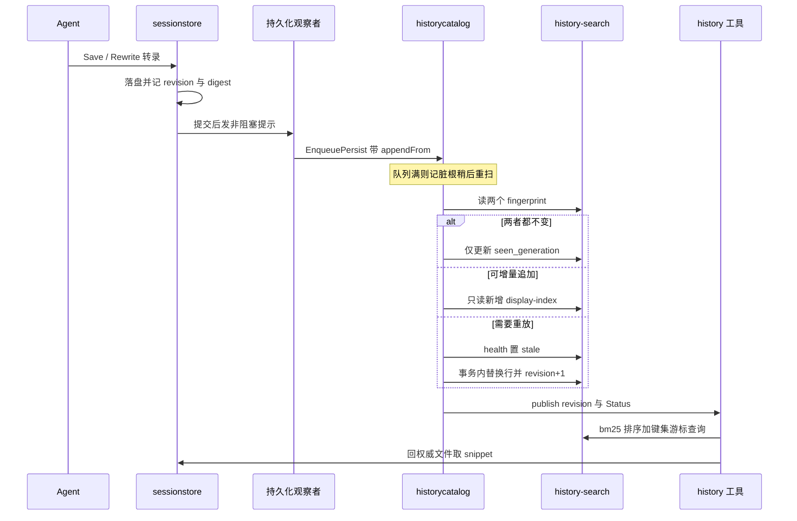

# 数据模型：权威留在文件里，数据库只是可丢弃的投影

> 本解读按 **ai-agent** 类规格产出，属 DeepSeek-Reasonix 深度解读的子文档；共 13 篇，解读基线 `v2.37.0`（`e17ef45e3`）。正文所有 `文件:行号` 引用均为 Reasonix 仓库相对路径，点开即可核对。相关篇章见 [README.md](README.md)。

## 在系统中的角色：一条公理加三层存储

Reasonix 的持久化不是"一个应用一个数据库"，而是**一条公理 + 三层存储**：业务真相永远是磁盘上的文本文件（会话 `.jsonl`、统计 JSONL、Markdown 记忆、`config.toml`），SQLite 只承担**可丢弃的派生投影**（全文检索、用量聚合），而远端 Cloudflare D1 承担**用户不拥有的那一份状态**（账号、崩溃上报）。三层的信任级别与寿命都不一样：把它们混成"一个数据层"，要么会把可重建误当可丢失，要么会把权威误当缓存。

去掉投影层会怎样：会话仍然能读——`ListSessions` 直接扫目录里的 JSONL 与 `.meta` 边车，投影库不在关键路径上。但 `history` 检索工具会失去 FTS5/BM25 排序，退化成同步全目录扫描，而设计上明确禁止这件事。

  [docs/HISTORY_SEARCH_CATALOG.md:23-25]()
<!-- anchor: The Agent `history` tool and Desktop history manager share the projection. … existing results return immediately with explicit progress. Runtime open, -->
反过来，把 SQLite 升格为权威会立刻破坏两件事：老版本 Reasonix 读不了新数据（项目承诺 "older Reasonix versions continue to read the same authoritative files"），以及跨进程、跨用户的文件级恢复能力（`.superseded` 备份、隔离恢复副本、租约）全部失效。这也是本篇与 [session-state.md](session-state.md) 的分工线：**本篇只管表、字段、索引、迁移与实体关系**；会话生命周期、检查点语义与 rewind 流程归那篇，本文只在耦合点处交叉引用。

## 根因：什么叫"可丢弃"

`internal/state/projectiondb` 的包文档把这条公理写死在代码里。

  [internal/state/projectiondb/projectiondb.go:1-4]()
<!-- anchor: // Package projectiondb owns the lifecycle of disposable SQLite projections. … package projectiondb -->
原文是："Business data must remain authoritative outside the database: callers are expected to be able to discard and rebuild every database opened here." 译：业务数据必须留在数据库之外保持权威，调用方应当能够丢弃并重建这里打开的每一个数据库。

于是所有难做的决策都被这条公理简化了：schema 变更不需要迁移（重建即可）、损坏不需要修复（隔离即可）、未来版本不需要兼容（降级读即可）。代价则集中在另一头——**你必须能随时把权威文件重放成投影**，这要求权威格式自带足够信息（内容摘要、revision、行哈希、写入者 ID），这也解释了为什么一个 JSONL 转录边上会挂十几个边车。

## 存储根：一个闭合集合，而不是拼出来的路径

运行时能写的目录是一个**闭合集合**，声明成一张表：`home` / `state` / `cache` / `worktrees` / `locks`。

  [internal/contract/config/storage_roots.go:10-29]()
<!-- anchor: // RootID names one storage root. The set is closed: every directory the runtime … RootLocks RootID = "locks" -->
表项本身携带"什么环境变量能钉住它、用户能不能搬、没人说话时落在哪"。

  [internal/contract/config/storage_roots.go:66-74]()
<!-- anchor: rootsTable = []storageRoot{ … owns: []string{"workspace-leases", "repair-mutation-locks"}}, -->
五个根里三个可搬（`state`、`cache`、`worktrees`，分别由 `REASONIX_STATE_HOME`、`REASONIX_CACHE_HOME`、`[storage]` 表控制），两个不可搬，且它们是**契约而非遗漏**：`home` 不能被它自己持有的配置文件命名（否则配置能决定配置自己住在哪），`locks` 必须让两个隔离实例汇聚到同一个位置。

  [internal/contract/config/storage_roots.go:40-43]()
<!-- anchor: // relocatable reports whether a user may move this root. False is a … relocatable bool -->
`Roots.Dir` 是唯一的优先级链：调用方钉住 → 配置选择 → 根自己的默认值。这条链只有一处，所以"某个路径到底在哪"永远只有一个答案，不会有第二个函数偷偷拼出另一套规则。

  [internal/contract/config/storage_roots.go:98-109]()
<!-- anchor: func (r Roots) Dir(id RootID) string { … return root.fallback(r) -->
## 存储拓扑：权威、投影与不可搬的两个根

下面这张图回答一个具体问题：一次会话保存之后，字节到底落在几个地方，其中哪些位置是权威、哪些位置删掉也不心疼、哪些位置**必须**待在某处而不能跟着用户搬走。它把四个本地位置（`<home>`、`<state root>`、`<cache root>`、`<locks>`）与右上角那个独立的远端信任域放在同一张画布上，正是为了让你一眼看出"本地文件"与"远端 D1"之间**一条边都没有**：远端只通过 HTTPS 连宿主进程，不碰任何本地文件。


读这张图要按三条线看。第一，**实线是权威写入**（会话 JSONL、统计 JSONL、记忆 Markdown、`config.toml`），它由 Agent 运行循环与配置写入路径产生，旧版本 Reasonix 也能读；**虚线是投影派生 / 可重建**（两个 SQLite 库及其内部表），任何一条虚线断掉，正确反应是重建而不是抢救。第二，消费方到投影层是查询边，但**还要看到那条从消费方回到权威层的二次读边**——`history` 工具与桌面面板在 SQLite 选完候选之后，必须用选中行的偏移回权威文件取 snippet；只有查询边、没有二次读边，就会误以为投影库是完整副本，而它连正文都不存。第三，图上标注的那组对比是搬迁语义：`home`（不动）vs `state`/`cache`/`worktrees`（可搬）vs `locks`（不可搬且必须跨实例汇聚）。代价也写在图上：可搬的根越多，"哪个根下的东西是可丢弃的"就越需要被显式声明，否则一次搬迁会把权威和投影一起搬错。

### 每个根下面到底有什么

`internal/contract/config/paths.go` 把每个根下的具体位置一次性解析出来，调用方只拿结果、不自己拼路径。

  [internal/contract/config/paths.go:417-428]()
<!-- anchor: // SessionDir is where chat sessions are persisted (one .jsonl per session). … return filepath.Join(dir, "sessions") -->
| 数据 | 位置 |
|---|---|
| 会话转录（权威） | `<state>/sessions/*.jsonl` |
| 压缩归档 | `<state>/archive/*.jsonl` |
| 每日用量（权威） | `<state>/stats/YYYY-MM-DD.jsonl` |
| 用户级记忆 / 项目级记忆 | `<state>/REASONIX.md`、`<state>/projects/<slug>/…` |
| 配置修复快照 | `<state>/repair/config.toml.last-known-good` |
| 全局配置 / 凭据 | `<home>/config.toml`、`<home>/.env` |
| 跨进程写租约 / 修复锁 | `<locks>/workspace-leases`、`<locks>/repair-mutation-locks` |
| 历史检索投影（可丢弃） | `<cache>/history-search/v1.sqlite` |
| 用量聚合投影（可丢弃） | `<cache>/usage-catalog/v5.sqlite` |

上表逐行的解析点：

- 会话目录 `SessionDir`。
  [internal/contract/config/paths.go:417-428]()
<!-- anchor: // SessionDir is where chat sessions are persisted (one .jsonl per session). … return filepath.Join(dir, "sessions") -->
- 归档目录 `ArchiveDir`。
  [internal/contract/config/paths.go:409-414]()
<!-- anchor: func (r Roots) ArchiveDir() string { … return filepath.Join(dir, "archive") -->
- 每日用量目录 `StatsDir`。
  [internal/contract/config/paths.go:439-444]()
<!-- anchor: func (r Roots) StatsDir() string { … return filepath.Join(dir, "stats") -->
- 用户级记忆目录 `MemoryUserDir`。
  [internal/contract/config/paths.go:520-523]()
<!-- anchor: func MemoryUserDir() string { return processRoots().MemoryUserDir() } … func (r Roots) MemoryUserDir() string { return r.userSupportDir() } -->
- 项目级会话/记忆目录 `ProjectSessionDir`。
  [internal/contract/config/paths.go:450-459]()
<!-- anchor: func ProjectSessionDir(workspaceRoot string) string { … return filepath.Join(base, "projects", WorkspaceSlug(root), "sessions") -->
- 配置的 last-known-good 快照路径。
  [internal/contract/config/lkg.go:14-24]()
<!-- anchor: func LastKnownGoodConfigPath() string { return processRoots().lastKnownGoodConfi … // loadLastKnownGoodUserConfig merges a validated LKG snapshot into cfg. -->
- 全局配置 `UserConfigPath`。
  [internal/contract/config/paths.go:33-44]()
<!-- anchor: func (r Roots) userConfigPath() string { … func (r Roots) UserConfigPath() string { return r.userConfigPath() } -->
- 凭据 `UserCredentialsPath`。
  [internal/contract/config/paths.go:384-389]()
<!-- anchor: func (r Roots) UserCredentialsPath() string { … return filepath.Join(dir, ".env") -->
- 写租约目录 `WorkspaceLeaseDir`。
  [internal/contract/config/paths.go:356-357]()
<!-- anchor: func WorkspaceLeaseDir() string { … return joinRoot(storageRootDir(RootLocks), "workspace-leases") -->
- 修复锁目录 `RepairMutationLockDir`。
  [internal/contract/config/paths.go:363-364]()
<!-- anchor: func RepairMutationLockDir() string { … return joinRoot(storageRootDir(RootLocks), "repair-mutation-locks") -->
- 历史检索投影的默认文件名 `DefaultPath`。
  [internal/state/historycatalog/types.go:103-108]()
<!-- anchor: func DefaultPath() string { … return filepath.Join(cache, "history-search", "v1.sqlite") -->
- 用量聚合投影的默认文件名 `DefaultPath`。
  [internal/state/usagecatalog/catalog.go:123-128]()
<!-- anchor: func DefaultPath() string { … return filepath.Join(cache, "usage-catalog", fmt.Sprintf("v%d.sqlite", SchemaVer -->
状态根顶层条目本身也是一个闭合列表，理由是"漏一个就等于搬迁时把它丢下"。

  [internal/contract/config/storage_roots.go:170-177]()
<!-- anchor: // StateRootEntries is everything written at the top of the state root. An entry … "REASONIX.md", "AGENTS.md", "CLAUDE.md", "REASONIX.local.md", "AGENTS.local.md", -->
```text
"sessions", "archive", "stats", "projects", "appearance", "themes", "repair",
"serve-workspaces.json", "memory", "schedules", "trusted", "machine-id.key", "mcp-global-migration-v1", "commands",
"REASONIX.md", "AGENTS.md", "CLAUDE.md", "REASONIX.local.md", "AGENTS.local.md", "CLAUDE.local.md",
```

这份列表不是靠人记得维护的：有守卫测试会把 `internal/` 下所有"拼在状态根上的顶层名字"扫出来，逐个要求出现在 `StateRootEntries`（或显式的豁免表）里，缺失即 test failure。

- 扫描路径 join 的守卫。
  [internal/state/storage/state_entries_guard_test.go:36-68]()
<!-- anchor: // A top-level name joined under the state root and absent from StateRootEntries … t.Fatalf("top-level state paths not in config.StateRootEntries (a move would str -->
- 解析状态根 join 的另一份守卫。
  [internal/contract/config/state_root_entries_test.go:20-30]()
<!-- anchor: func TestStateRootEntriesCoversEverythingWrittenThere(t *testing.T) { … t.Errorf("%q is written under the state root (%s) but is not in StateRootEntries -->
### 边界：什么时候用 SQLite，什么时候用文件

判据不是"数据量"，而是**这张表能不能被权威文件完全重放**。

| 用 SQLite | 用文件 |
|---|---|
| 需要 SQL 聚合 / FTS5 / BM25 排序（history、usage） | 需要用户可读可编辑（`REASONIX.md`、`config.toml`） |
| 需要按偏移/哈希做增量重放（usage `byte_offset` + `line_hash`） | 需要追加写入的单行原子性（JSONL `O_APPEND`） |
| 数据可全量重建，且重建成本可接受 | 数据不可再生：对话、检查点前像、记忆事实 |
| 需要跨进程只读共享（只读 `mode=ro&immutable=1` 诊断） | 需要文件级备份/替换/租约语义 |

这条判据一旦写死，两边的设计就都被约束住了：SQLite 侧的每张表都必须能从文件重放出来（所以键里全是路径、偏移、哈希），文件侧的每种格式都必须自带身份字段（所以 JSONL 边上挂满账本）。

### 非 SQL 的持久化清单（这一层最容易被忽略）

会话转录不是一个文件，而是**一个 JSONL 加一组边车**，`store` 包是唯一知道后缀约定的地方，包文档明确"Nothing else should construct a persistence path by hand"（除它之外任何代码都不该手工拼持久化路径）。

  [internal/state/store/session.go:1-10]()
<!-- anchor: // Package store is the single authority for reasonix's on-disk persistence … // store the one place that knows where a session's artifacts go. -->
完整清单（含后缀构造与枚举）在该文件的一个区间里。

  [internal/state/store/session.go:118-282]()
<!-- anchor: return sessionStem(sessionPath) + ".execution.jsonl" … return SessionBlobsDir(SessionPathForEventLog(logPath)) -->
| 边车 | 角色 |
|---|---|
| `<id>.jsonl` | 主转录（兼容检查点） |
| `<id>.events.jsonl` | 追加型权威事件日志 |
| `<id>.jsonl.meta` | 分支/清单元数据 + revision/摘要账本 |
| `<id>.context.json` | 上下文投影与缓存遥测 |
| `<id>.goal-state.json`、`<id>.recovery.json` | 目标状态、Auto 模式恢复检查点 |
| `<id>.execution.jsonl`、`<id>.adjudication.jsonl` | 委派执行记录、宿主裁决屏障记录 |
| `<id>.wire.jsonl` + `.wire.meta.json` | 前端帧日志与其截断说明 |
| `<id>.event-index.json`、`<id>.display-index.json` | 偏移/摘要索引、分页索引（不含正文） |
| `<id>.conflicts.jsonl`、`<id>.superseded.jsonl.bak` | 冲突诊断、被覆盖写入的原字节 |
| `<id>.jsonl.lock`、`.lease.lock`、`.lease.json` | 保存锁、运行时所有权锁与归属信息 |
| `<id>.ckpt/`、`<id>.outputs/`、`<id>.blobs/` | 检查点、超限工具输出、按内容哈希存图 |

一个细节值得学：`.events.jsonl.damaged` **故意不以 `.jsonl` 结尾**，否则老版本扫描目录时会把这堆受损字节当作一个"幽灵会话"重新列出来。这是"格式约定必须为旧读者设计"的少见自觉。

  [internal/state/store/session.go:162-171]()
<!-- anchor: // SessionEventLogDamaged is the salvage sidecar for event-log bytes that tail … return SessionEventLog(sessionPath) + ".damaged" -->
其余非 SQL 持久化的载体与格式：

| 载体 | 格式与版本 |
|---|---|
| 检查点 | `<id>.ckpt/` 下 JSON，`SchemaV1`/`SchemaV2`，每文件前像 + after 指纹 |
| 用量统计 | 每日 JSONL，一行一条，`O_APPEND`，容忍撕裂尾行 |
| 轨迹 | 单次运行一个 JSONL，`SchemaVersion = 1` |
| 记忆事实 | 一事实一 Markdown + YAML frontmatter + `MEMORY.md` 索引 |
| 配置修复备份 | `config.toml.broken-<ts>` / `.rewrite-<ts>` |

逐条依据：

- 检查点的 schema 版本常量。
  [internal/state/checkpoint/types.go:9-10]()
<!-- anchor: // Schema versions for on-disk checkpoint JSON. … const ( -->
- 检查点的每文件前像与 after 指纹。
  [internal/state/checkpoint/types.go:57-75]()
<!-- anchor: CaptureManual         CaptureSource = "manual" … // for legacy v1 migration paths. Persisted v2 checkpoints prefer BlobRef. -->
- 每日统计 JSONL 的追加契约。
  [internal/state/stats/record.go:9-15]()
<!-- anchor: //     they are deliberately not presented as distinct conversation sessions. … package stats -->
- 轨迹记录的 `SchemaVersion`。
  [internal/state/trajectory/recorder.go:16-36]()
<!-- anchor: "reasonix/internal/contract/event" … CompletionReport *CompletionReport    `json:"completion_report,omitempty"` -->
- 记忆事实的文档格式说明。
  [internal/state/memory/doc.go:6-7]()
<!-- anchor: //   - Auto-memory store: per-project fact files with frontmatter plus a MEMORY. … //     index, which the model maintains via the `remember` tool (see store.go). -->
- 记忆事实的 frontmatter 渲染。
  [internal/state/memory/render.go:18-35]()
<!-- anchor: ID             string `yaml:"id,omitempty"` … } `yaml:"metadata"` -->
- `config.toml` 的修复与备份路径。
  [internal/contract/config/unparsed.go:187-216]()
<!-- anchor: func RepairUnparsedConfig(path string) (backup string, err error) { … return backup, nil -->
- 被保留原字节的写入侧备份。
  [internal/contract/config/preserve.go:60-64]()
<!-- anchor: backup := resolved + ".rewrite-" + time.Now().Format("20060102-150405") … slog.Warn(msg, "path", resolved, "backup", backup) -->
## 存储选型：为什么是纯 Go 的 SQLite

### 依赖链：全仓只有一行 import

全仓**只有一个文件**引入 SQLite 驱动，`grep -rn "modernc.org/sqlite" --include=*.go` 在这里命中两行（驱动本体与它的 lib 包），除此之外没有任何非测试命中。

  [internal/state/projectiondb/projectiondb.go:20-21]()
<!-- anchor: moderncsqlite "modernc.org/sqlite" … sqlite3 "modernc.org/sqlite/lib" -->
`go.mod` 把它列为**直接依赖**（`modernc.org/sqlite v1.60.1`），不是经由某个上游传递进来的。

  [go.mod:48-48]()
<!-- anchor: modernc.org/sqlite v1.60.1 -->
所有 `database/sql` 的开关都发生在这一个文件里，逐个列出来就是这一层的全部基础设施表面：

- `diskFileDSN` 造 DSN。
  [internal/state/projectiondb/projectiondb.go:178-190]()
<!-- anchor: func diskFileDSN(path string) string { … fmt.Sprintf("&_pragma=journal_size_limit%%28%d%%29", walSizeLimit) -->
- `open` 打开连接并施加 pragma。
  [internal/state/projectiondb/projectiondb.go:198-262]()
<!-- anchor: func open(ctx context.Context, opts OpenOptions, mode Mode) (*sql.DB, error) { … return db, nil -->
- `ApplyMigrations` 建版本表并推进。
  [internal/state/projectiondb/projectiondb.go:265-312]()
<!-- anchor: func ApplyMigrations(ctx context.Context, db *sql.DB, migrations []Migration, no … return nil -->
- `Inspect` 只读诊断。
  [internal/state/projectiondb/projectiondb.go:326-351]()
<!-- anchor: func Inspect(ctx context.Context, path string) Inspection { … return out -->
- `Quarantine` 隔离损坏库。
  [internal/state/projectiondb/projectiondb.go:354-365]()
<!-- anchor: func Quarantine(path string, now time.Time) string { … return quarantined -->
- `Rebuild` 旁建替换。
  [internal/state/projectiondb/projectiondb.go:408-507]()
<!-- anchor: func Rebuild(ctx context.Context, opts OpenOptions, populate func(context.Contex … return nil -->
两个业务投影库都不 import 驱动，只 import `projectiondb`——所以"怎么连数据库"这件事在整个仓库里只有一处实现。

- history 侧的 import 面。
  [internal/state/historycatalog/catalog.go:15-17]()
<!-- anchor: "strings" … "sync/atomic" -->
- usage 侧的 import 面。
  [internal/state/usagecatalog/catalog.go:22-23]()
<!-- anchor: "reasonix/internal/contract/config" … "reasonix/internal/state/projectiondb" -->
### CGO=0 与单二进制的因果链

1. 工程契约：**Single static binary.** `CGO_ENABLED=0`，且"a third-party dependency must be pure-Go, lightweight, and must not compromise the single-binary / cross-platform / distribution story"（第三方依赖必须纯 Go、轻量，且不得损害单二进制 / 跨平台 / 分发的前提）。

  [docs/SPEC.md:12-12]()
<!-- anchor: 2. **Single static binary.** `CGO_ENABLED=0`; cross-compile with one command; -->
  [docs/SPEC.md:16-17]()
<!-- anchor: cross-platform / distribution story. TOML parsing is the one accepted dependency … 4. **Two extension tiers.** Compile-time built-ins (self-register via `init()`), -->
2. 构建把它从原则变成事实：`Makefile:14-16` 的 `build` 目标对每个产物都前置 `CGO_ENABLED=0`；`.goreleaser.yaml` 用 `env: [CGO_ENABLED=0]` 编译全部目标平台。

  [.goreleaser.yaml:11-13]()
<!-- anchor: binary: reasonix … - CGO_ENABLED=0 -->
3. 于是驱动必须是纯 Go：`modernc.org/sqlite` 是 SQLite 的机械转译版，不需要 C 工具链；相反 `github.com/mattn/go-sqlite3` 依赖 cgo，一旦引入就让 `CGO_ENABLED=0` 构建失败或失去静态性。
4. 这条约束强到改变了仓库结构。desktop 工具链需要 cgo 能力，因此被拆成一个**嵌套 module**，注释里点名动机。

  [desktop/go.mod:7-11]()
<!-- anchor: // The desktop tools are a nested module so their CGO build never touches the … // go build/test ./... skips this directory. -->
5. 它也改变了门禁的基线：类型奇偶校验（wire parity）声明的目标环境就是 `CGO_ENABLED=0, GOOS=linux, GOARCH=amd64`，也就是说**跨平台类型一致性是在无 cgo 配置下被证明的**。

  [tools/repolint/frontendtypes.go:29-29]()
<!-- anchor: var parityTarget = []string{"CGO_ENABLED=0", "GOOS=linux", "GOARCH=amd64"} -->
有一点必须说清楚，否则就是把推论说成事实：仓库里**没有**任何一处文字直接写"我们选 modernc 是因为 CGO=0"。上面这条链条是由 `docs/SPEC.md` 的依赖约束、唯一的直接依赖（[go.mod:48-48]()）、以及 desktop 拆分注释三处独立证据拼出来的**推论链**。本次定稿时额外核对过提交历史：在 `v2.37.0` 可达的提交里检索 `modernc` / `sqlite` / `CGO_ENABLED`，命中的只有依赖批量升级（`build(deps): bump the go group …`）与 desktop/studio 的无 cgo 构建修补（如 `7a509f998 fix(desktop): build the Linux desktop service without cgo`），**没有任何一条显式说明驱动选型的提交信息或 PR 级文本**。因此这条因果链读作"约束与唯一解"，不要读作作者的声明。
<!-- anchor: modernc.org/sqlite v1.60.1 -->

### 为什么不是 bbolt，也不是纯文件

**不用 bbolt / 键值库**：两个投影的核心价值恰恰是 SQL 本身。history 侧要 `MATCH` + `bm25()` 排序 + 键集游标分页，usage 侧要 `GROUP BY day,source,model_ref` 的 `SUM` 重导。换成 KV 就得把排序与聚合搬回 Go 进程，把"投影库能立刻答"变成"每次查询全量扫"，而这正是设计要避免的。

- history 侧的 FTS5 与键集游标查询。
  [internal/state/historycatalog/catalog.go:647-664]()
<!-- anchor: baseQuery := `SELECT d.id AS id,d.source_path AS source_path,s.root AS root,s.so … after.Rank, after.SessionPath, after.MessageIndex, after.PartIndex, after.RowID) -->
- usage 侧按天重导的聚合。
  [internal/state/usagecatalog/catalog.go:421-439]()
<!-- anchor: func rederiveDays(ctx context.Context, tx *sql.Tx, days []string) error { … return nil -->
**不用纯文件**：会话已经证明了纯文件的代价——为了 O(1) 列表就得维护 `.meta` 缓存字段与 `display-index.json`，而这套缓存字段自己又需要版本号与刷新判据（`session_listener` 侧的 `sessionListingCountsNeedRefresh`）。

  [internal/state/store/session.go:184-192]()
<!-- anchor: // SessionDisplayIndex is the paging sidecar for the transcript … return sessionStem(sessionPath) + ".display-index.json" -->
检索需要倒排索引与词干/双字切分（CJK bigram），这不是文件能做的。

- **混合策略**：**权威用文件（可读、可 diff、可被旧版本读），查询用 SQLite（可丢弃、可重建）**。两者之间没有事务，只有"幂等重放 + 版本号"——这是整个数据模型里最贵的那个取舍。

## 核心实体与字段

三个 SQLite 库的全部 DDL 集中在三个常量里，可完整审计：history 的 `migrationV1`、usage 的 `schema`，以及框架自带的 `schema_migrations`。

- history 的迁移常量。
  [internal/state/historycatalog/schema.go:10-79]()
<!-- anchor: const migrationV1 = ` … ON history_documents(source_path,message_index,part_index,id); -->
- usage 的建表常量。
  [internal/state/usagecatalog/catalog.go:154-182]()
<!-- anchor: const schema = ` … CREATE INDEX idx_usage_rollups_range ON usage_rollups(day,source,model_ref); -->
- framework 层的版本表建表语句。
  [internal/state/projectiondb/projectiondb.go:269-272]()
<!-- anchor: if _, err := db.ExecContext(ctx, `CREATE TABLE IF NOT EXISTS schema_migrations ( … )`); err != nil { -->
### history catalog（`<cache>/history-search/v1.sqlite`）

`history_state` 是单行版本与新鲜度闸门。

| 字段 | 类型 | 语义 | 约束 |
|---|---|---|---|
| `id` | INTEGER | 恒为 1 的单行锚 | `PRIMARY KEY CHECK(id=1)` |
| `revision` | INTEGER | 投影代数，每次提交 +1，用于失效通知 | `NOT NULL DEFAULT 0` |
| `tokenizer_version` | INTEGER | 建索引时用的分词器版本 | `NOT NULL`；与常量不符则整库清空重放 |

`history_roots` 记录被索引的目录（全局目录 vs 项目目录）。

| 字段 | 类型 | 语义 | 约束 |
|---|---|---|---|
| `path` | TEXT | 根目录绝对路径 | `PRIMARY KEY` |
| `source` / `scope` | TEXT | 来源标签 / `project`\|`global` | `NOT NULL`；非 project 一律归 global 且清空 workspace |
| `workspace_root` | TEXT | 归属工作区 | `NOT NULL DEFAULT ''` |
| `signature` | TEXT | 目录指纹（路径 + size + mtime 的 SHA-256） | 用于跳过无变化的重扫 |
| `scan_generation` / `scan_cursor` | INTEGER / TEXT | 扫描代数与断点 | 支持中断续扫 |
| `state` / `error` | TEXT | `pending`\|`ready`\|… / 最近错误 | `state` 默认 `'pending'` |
| `indexed` / `total` | INTEGER | 已索引 / 总文件数 | 驱动状态面板与 `Partial` 标记 |
| `completed_at` | INTEGER | 毫秒时间戳 | `DEFAULT 0` |

目录指纹的算法。

  [internal/state/historycatalog/catalog.go:352-364]()
<!-- anchor: func historyRootSignature(paths []string) string { … return hex.EncodeToString(hash.Sum(nil)) -->
`history_sources` 一个转录文件一行，是"新鲜度"的载体。

| 字段 | 类型 | 语义 | 约束 |
|---|---|---|---|
| `path` | TEXT | 转录绝对路径 | `PRIMARY KEY` |
| `root` / `source` / `scope` / `workspace_root` | TEXT | 来源归属与检索过滤维度 | `NOT NULL` |
| `content_revision` | INTEGER | 权威侧 `.meta` 账本里的 revision | 与 `content_digest` 一起判定是否可增量追加 |
| `content_digest` | TEXT | 内容摘要 | 权威侧身份，跨进程比对 |
| `content_fingerprint` / `meta_fingerprint` | TEXT | 内容与元数据指纹 | 两者都不变 → 直接跳过 |
| `message_count` / `indexed_message_count` | INTEGER | 权威消息数 / 已索引消息数 | 增量追加的起点 |
| `custom_title` / `topic_id` / `topic_title` / `preview` | TEXT | 列表展示字段（来自 `.meta` 边车） | 避免检索时读打开转录 |
| `created_at` / `last_activity_at` | INTEGER | 毫秒时间戳 | `last_activity_at` 进排序索引 |
| `health` | TEXT | `ok`\|`stale`\|`corrupt` | 默认 `'ok'`；搜索硬过滤 `health='ok'` |
| `missing_since` | INTEGER | 文件消失起始时间 | 与 30s `MissingGrace` 配合，避免瞬时消失被误删 |
| `seen_generation` | INTEGER | 最近一次被扫描到的代数 | 用于代数对账清理 |
| `last_error` | TEXT | 最近错误文本 | `DEFAULT ''` |

"两个指纹都不变就跳过"这条判据的读取点。

  [internal/state/historycatalog/catalog.go:487-494]()
<!-- anchor: err := c.db.QueryRowContext(ctx, `SELECT content_fingerprint,meta_fingerprint,co … return nil -->
`history_documents` 是归一化后的检索单元（不是整条消息，而是消息里的一个 part）。

| 字段 | 类型 | 语义 | 约束 |
|---|---|---|---|
| `id` | INTEGER | 行 ID，**同时是 FTS 的 rowid** | `PRIMARY KEY` |
| `source_path` | TEXT | 所属转录 | `REFERENCES history_sources(path) ON DELETE CASCADE` |
| `message_index` / `part_index` | INTEGER | 消息序号 / 段序号 | `part_index DEFAULT 0` |
| `role` / `kind` | TEXT | 角色（user/assistant/tool）/ 段类型（tool input、error、output…） | 检索按 `kind` 过滤 |
| `tool_name` | TEXT | 工具名 | `DEFAULT ''`；可按工具过滤 |
| `token_count` | INTEGER | 该段 token 数 | `DEFAULT 0` |
| — | — | 唯一性 | `UNIQUE(source_path,message_index,kind,part_index)` |

`history_fts` 是 **contentless FTS5**，只存倒排、不存文本。

```sql
CREATE VIRTUAL TABLE history_fts USING fts5(
    terms, content='', contentless_delete=1,
    tokenize='unicode61 remove_diacritics 2'
);
```

`content=''` 意味着数据库里只有词项与 rowid，正文永不落库；`contentless_delete=1` 是让 `DELETE FROM history_fts WHERE rowid IN (...)` 可行的必要开关。这既省空间，也是一条隐私边界：**投影库泄露不了对话内容**。

- 文档侧对"只存 token、snippet 回权威取"的声明。
  [docs/HISTORY_SEARCH_CATALOG.md:9-10]()
<!-- anchor: The catalog stores normalized retrieval tokens in FTS5, not complete message … text. English tokens retain the existing lowercase/code-symbol semantics and -->
- contentless FTS5 上执行删除的语句。
  [internal/state/historycatalog/catalog.go:538-540]()
<!-- anchor: if _, err := tx.ExecContext(ctx, `DELETE FROM history_fts WHERE rowid IN (SELECT … return err -->
索引两条，各自对应一个真实查询形状。

```sql
CREATE INDEX idx_history_sources_scope_activity
ON history_sources(scope,workspace_root,last_activity_at DESC,path ASC);
CREATE INDEX idx_history_documents_source
ON history_documents(source_path,message_index,part_index,id);
```

第一条服务"项目范围 + 最近活跃优先"的列表/过滤；第二条服务按来源批量删除与按序重建。

- 第一条索引服务的查询谓词。
  [internal/state/historycatalog/catalog.go:618-620]()
<!-- anchor: if req.Scope == "project" { … args = append(args, strings.TrimSpace(req.WorkspaceRoot)) -->
- 第二条索引服务的按来源删除。
  [internal/state/historycatalog/catalog.go:542-542]()
<!-- anchor: if _, err := tx.ExecContext(ctx, `DELETE FROM history_documents WHERE source_pat -->
- 第二条索引服务的按序重建连接。
  [internal/state/historycatalog/catalog.go:651-651]()
<!-- anchor: FROM history_fts JOIN history_documents d ON d.id=history_fts.rowid JOIN history -->
### usage catalog（`<cache>/usage-catalog/v5.sqlite`）

`usage_state` 与 `history_state` 同构（`id CHECK(id=1)` + `revision`）。`usage_files` 是**跨进程幂等的锚**。

| 字段 | 类型 | 语义 | 约束 |
|---|---|---|---|
| `path` | TEXT | 每日 JSONL 路径 | `PRIMARY KEY` |
| `day` | TEXT | 该文件对应的本地日 | 与路径绑定，防同日改名 |
| `size` / `mtime_ns` | INTEGER | 文件大小 / 修改时间纳秒 | 与 `indexed_offset` 一起构成"是否 Ready"判据 |
| `indexed_offset` | INTEGER | 已消化到的字节偏移 | 增量重放的游标 |
| `state` / `error` | TEXT | `pending`\|`ready` / 错误 | 默认 `'pending'` |
| `corrupt_lines` | INTEGER | 解析失败的 JSON 行数 | 上报但不阻塞 |
| `completed_at` | INTEGER | 毫秒时间戳 | — |

文件级 Ready 判据的读取点。

  [internal/state/usagecatalog/catalog.go:603-624]()
<!-- anchor: func (c *Catalog) Ready(ctx context.Context, dir string, days []string) bool { … return true -->
`usage_records` 是**行级事实表**，主键即幂等键。

| 字段 | 类型 | 语义 | 约束 |
|---|---|---|---|
| `file_path` + `byte_offset` | TEXT + INTEGER | 该行在权威 JSONL 中的位置 | `PRIMARY KEY(file_path,byte_offset)` |
| `byte_length` | INTEGER | 行长 | 用于推进偏移 |
| `line_hash` | TEXT | 整行 SHA-256 | 同偏移不同哈希 → 判定被外部改写，触发整文件重放 |
| `day` / `source` / `model_ref` / `provider` | TEXT | 聚合维度 | `provider` 由 `model_ref` 按 `/` 前缀派生 |
| `prompt` / `completion` / `reasoning` / `cache_hit` / `cache_miss` / `total` / `requests` / `turns` | INTEGER | token 与请求计数 | `total>0 且 requests<=0` 时补 1 |
| `cost` / `cost_currency` / `cost_estimated` | INTEGER / TEXT / INTEGER | 定点金额、原币种、是否估算 | `cost_currency=''` **不等于**金额为 0 |
| `valuation_cny` / `valuation_usd` | INTEGER（可空） | 发生时按汇率折算的估值 | 可空，故与 `cost` 分列 |

表中三处判据的读取点：

- 同偏移不同哈希 → 整文件重放。
  [internal/state/usagecatalog/catalog.go:318-329]()
<!-- anchor: var existingHash string … return err -->
- `provider` 由 `model_ref` 前缀派生。
  [internal/state/usagecatalog/catalog.go:462-466]()
<!-- anchor: func providerOf(model string) string { … return "default" -->
- `total>0 且 requests<=0` 时补 1。
  [internal/state/usagecatalog/catalog.go:370-371]()
<!-- anchor: if entry.Total > 0 && entry.Requests <= 0 { … entry.Requests = 1 -->
`usage_rollups` 与 `usage_cost` 是派生聚合表，主键就是聚合维度。

| 表 | 主键 | 关键列 |
|---|---|---|
| `usage_rollups` | `(day,source,model_ref)` | 同名 token 计数器（`prompt…turns`） |
| `usage_cost` | `(day,source,model_ref,view,currency)` | `cost`、`estimated`（多视角累加时取 `MAX`） |

索引 `CREATE INDEX idx_usage_rollups_range ON usage_rollups(day,source,model_ref)` 服务按天区间查询。注意 `usage_rollups` 主键里**没有 `provider`** 却有 `provider` 列——它是 `MAX(provider)` 折叠出来的展示值；这是刻意的：供应商不是聚合维度，模型引用才是。

- 按天区间查询的索引。
  [internal/state/usagecatalog/catalog.go:642-642]()
<!-- anchor: for rows.Next() { -->
- `MAX(provider)` 的折叠处。
  [internal/state/usagecatalog/catalog.go:427-427]()
<!-- anchor: SELECT day,source,model_ref,MAX(provider),SUM(prompt),SUM(completion),SUM(reason -->
### 会话侧：JSONL 记录就是"表结构"

`<id>.events.jsonl` 的每条记录是一个带版本的类型化记录。

  [internal/state/sessionstore/session_events.go:103-114]()
<!-- anchor: type sessionEventRecord struct { … ImageBlobs    []sessionEventImages `json:"image_blobs,omitempty"` -->
| 字段 | 类型 | 语义 |
|---|---|---|
| `schema_version` | int | 记录格式版本；当前写入 1 或 3（图片外置后为 3） |
| `type` | string | `replace`（全量替换）或 `append`（追加） |
| `revision` / `base_revision` | int64 | 本次写入版本 / 其基线版本，构成 CAS 链 |
| `message_index` | int | `append` 的插入位置 |
| `messages` | []Message | 消息体（图片外置时只剩引用） |
| `content_digest` | string | 内容摘要，与 `.meta` 账本对账 |
| `writer_id` | string | 写入者身份，用于判定"外来写入" |
| `reason` | string | 为何重写（compact / rewind / recovery…） |
| `created_at` | time | 写入时间 |
| `image_blobs` | []ref | 外置到 `<id>.blobs/` 的图片 |

对应约束由常量表达：`sessionEventSchemaVersion = 1`、`sessionEventImageBlobsSchemaVersion = 3`，遇到高于本 build 支持的版本就**拒绝加载**，而不是静默丢字段——理由是"丢图片再存回去就是数据损失"。

  [internal/state/sessionstore/session_events.go:22-24]()
<!-- anchor: sessionEventSchemaVersion = 1 … // blobs. A build that predates it refuses the log instead of loading those -->
`.meta` 是这些字段的**独立账本**，同一份事实写两处是为了让列表 O(1)（不必打开转录就能列出会话）。

| 字段 | 语义 |
|---|---|
| `revision` / `content_digest` / `writer_id` | 与事件日志对账的 CAS 基线 |
| `schema_version` / `turns` / `preview` | 列表字段及其可信度版本 |
| `in_flight_turn` | 未完成回合并的边界与提交摘要 |
| `archived` / `pinned` / `auto_archived_at` / `finished_at` / `viewed_at` | 归档、置顶、已读（归档是元数据，不移动文件） |
| `parent_id` / `recovery_depth` / `recovery_root_id` | 分支与恢复谱系（GC 会回收中间链接，故另存 root） |

逐条依据：

- CAS 基线的三个字段。
  [internal/state/sessionstore/branch.go:70-73]()
<!-- anchor: Revision      int64  `json:"revision,omitempty"` … // SchemaVersion records the BranchMeta version that last wrote the listing -->
- 列表字段与其版本。
  [internal/state/sessionstore/branch.go:74-94]()
<!-- anchor: // fields (Turns/Preview) FROM the session's content. It is stamped only by the … // branchMetaCountsInitialVersion introduced content-derived Turns/Preview. -->
- 未完成回合的边界与提交摘要。
  [internal/state/sessionstore/branch.go:96-113]()
<!-- anchor: branchMetaCountsInitialVersion = 1 … // persisted transcript that existed when the turn began. -->
- 归档/置顶/已读这一组元数据。
  [internal/state/sessionstore/branch.go:32-44]()
<!-- anchor: // Archived removes a finished conversation from the everyday session list … ViewedAt   time.Time `json:"viewed_at,omitzero"` -->
- `parent_id` 字段。
  [internal/state/sessionstore/branch.go:24-24]()
<!-- anchor: ParentID      string    `json:"parent_id,omitempty"` -->
- 恢复谱系与 `recovery_root_id`。
  [internal/state/sessionstore/branch.go:57-66]()
<!-- anchor: // RecoveryDepth counts how many recovery forks separate this branch from a … RecoveryRootID string `json:"recovery_root_id,omitempty"` -->

这几行就是本篇与 [session-state.md](session-state.md) 的分界：这里只登记"哪些字段存在、谁写它们"，字段驱动的生命周期（何时归档、何时写入 `in_flight_turn`、rewind 如何改 `parent_id`）在那篇展开。
### 迁移版本表（一张，服务两个库）

```sql
CREATE TABLE IF NOT EXISTS schema_migrations (
    version INTEGER PRIMARY KEY,
    applied_at INTEGER NOT NULL
);
```

`applied_at` 是毫秒时间戳，版本号是主键——也就是说**迁移天然幂等去重，且不能有"同版本不同内容"**。注意它建在每个投影库内部（不是集中在一个元数据库里），`Inspect` 靠 `SELECT COALESCE(MAX(version),0)` 就能判新旧。

  [internal/state/projectiondb/projectiondb.go:348-349]()
<!-- anchor: if err := db.QueryRowContext(ctx, `SELECT COALESCE(MAX(version),0) FROM schema_m … out.Error = err.Error() -->
### 价格：源码里的"只增不改"表

`officialRates` 不是数据文件，是 Go 源码里的一个切片，行结构为"厂商 × 模型 × 币种 × 计费方式"，每个 `Rates` 是**按时间从老到新**的代际列表。

  [internal/contract/pricing/rates.go:32-36]()
<!-- anchor: // officialRates is the price book. A price change appends a generation rather … var officialRates = []officialRateRow{ -->
| 字段 | 类型 | 语义 |
|---|---|---|
| `Provider` / `Model` | string | 厂商标识 / 模型标识（与 `usage_records.model_ref` 对齐） |
| `Currency` / `BillingMode` | string | 币种（CNY/USD）/ `PAYG` 或订阅等效 |
| `Window` | *PeakWindow | 峰谷定价窗口；单费率厂商为 nil |
| `DocURL` / `CheckedOn` | string | 官方价目页 / 核对日期——**价格的"有效期"元数据** |
| `Notes` | string | 无法从厂商页证实的状态（如 `launch_discount_no_end_date`、`not_on_vendor_page`） |
| `Rates` | []rateGeneration | 代际列表，`Base RateCard` + 可选 `Peak *RateCard`；**最后一项才是今天的价** |

设计意图写在注释里：追加而不是编辑，是为了让"历史账单上的价格"仍能被识别为**本项目的默认价**而不是用户手填的数字，这是"刷新它"和"丢掉它"的区别。甚至连"已经从厂商页消失的价格"也保留，因为删掉会让已配置模型的开销静默变成 0——"a stale rate at least reads as a number somebody can question"（一条过期的费率至少还是个能被质疑的数字）。这条规则还被工具化：[tools/pricecheck/main.go:60-60]() 把它写进错误信息。
<!-- anchor: fmt.Fprintln(os.Stderr, "A price change is an append to officialRates, never an  -->

- 为什么追加而不是编辑。
  [internal/contract/pricing/rates.go:32-35]()
<!-- anchor: // officialRates is the price book. A price change appends a generation rather … // user chose, which is the difference between refreshing one and losing it. -->
- 为什么保留厂商页上已消失的价格。
  [internal/contract/pricing/rates.go:103-105]()
<!-- anchor: // Not on the vendor's price page as of CheckedOn. Kept because removing a rate … // rate at least reads as a number somebody can question. -->
- pricecheck 把这条规则写进失败信息。
  [tools/pricecheck/main.go:60-60]()
<!-- anchor: fmt.Fprintln(os.Stderr, "A price change is an append to officialRates, never an  -->
### workers 侧：三个独立信任域的 D1

`workers/` 下是三个 Cloudflare Worker，各自绑定自己的 D1 库，与本地存储**没有任何 schema 关系**。

| Worker | 域名 / 数据库 | 表 | 迁移方式 |
|---|---|---|---|
| `accounts` | `id.reasonix.io` / `reasonix-accounts` | `users`、`sessions`、`email_tokens`、`device_grants` | `migrations/000N_*.sql` + `wrangler d1 migrations apply` |
| `crash-report` | `crash.reasonix.io` / `reasonix-crash` + `reasonix-registry`（两个库） | `reports`、`pings`、`cli_pings`、`metrics`、`cli_metrics`、`report_daily`、`report_installations`、`report_event_dimensions`、`diagnostics_meta`、`groups`、`ingest_sentinel_state`、`access`、`audit_log`、`packages`、`package_versions`、`stars`、`events` | `schema.sql` + 一堆**无编号**的 `migrate-*.sql` 手工脚本 |
| `forum` | `reasonix-forum` | `members`、`categories`、`topics`、`posts`、`reactions`、`flags`、`mod_log` | `schema.sql` |

`accounts` 侧迁移目录的声明点。

  [workers/accounts/wrangler.toml:40-43]()
<!-- anchor: # Per-IP throttle for the sensitive auth endpoints (login/register/forgot/reset) … type = "ratelimit" -->
这确实是与本地库不同的**信任域与运行时**：本地 SQLite 只放派生数据、且永不保存凭据（`REASONIX.md` 一类约定把 `.env` 锚在 `home`），远端 D1 才是密码哈希与会话令牌的所在地——`sessions` 表只存 `sha256(raw cookie token)`，注释的理由是"a DB read can't resurrect a live session"（一次数据库读取无法复活一个活跃会话）；`device_grants` 同理只存 `sha256(pepper:device_code)`。Go 侧只通过 HTTPS 访问它们。

- 凭据锚在 `home` 的约定。
  [REASONIX.md:225-228]()
<!-- anchor: latter as lower-priority compatibility guidance. The current turn receives a … ## Notes -->
- `sessions` 只存 `sha256(raw cookie token)` 的理由。
  [workers/accounts/migrations/0001_initial.sql:19-21]()
<!-- anchor-base64:LS0gU2Vzc2lvbnMgc3RvcmUgc2hhMjU2KHJhdyBjb29raWUgdG9rZW4pOyB0aGUgcmF3IHRva2VuIG9ubHkgZXZlciBsaXZlcyBpbiB0aGUKLS0gZnV0dXJlIGRlc2t0b3AvQ0xJIGRldmljZS1mbG93IGxvZ2luIHJldXNlcyB0aGlzIHNhbWUgdGFibGUu -->
- `device_grants` 只存 `sha256(pepper:device_code)`。
  [workers/accounts/migrations/0002_device_grants.sql:4-6]()
<!-- anchor-base64:Q1JFQVRFIFRBQkxFIElGIE5PVCBFWElTVFMgZGV2aWNlX2dyYW50cyAoCnVzZXJfY29kZSAgICAgICAgVEVYVCAgICBOT1QgTlVMTCBVTklRVUUsICAgICAgICAgLS0gY2Fub25pY2FsIChubyBzZXBhcmF0b3JzLCB1 -->
- 宿主访问远端的一个实例：升级通道常量。
  [internal/frontend/cli/upgrade.go:37-37]()
<!-- anchor: cliGatewayBase         = "https://crash.reasonix.io/v1/cli/releases" -->
#### 远端自成一体的三条数据建模手法

读完 `workers/crash-report/schema.sql` 与 `workers/forum/schema.sql` 之后，可以指出三处与本地库不同、但同样有意图的做法。

**一、演进策略是"只加不改"，并且明写理由。** crash-report 把 CLI 遥测单独放表，注释给了动机：CLI telemetry stays in additive tables so either the schema migration or the Worker deployment can happen first without changing the Desktop contract（CLI 遥测留在可加的表里，于是 schema 迁移与 Worker 部署可以任意先后，而桌面端契约不变）。

  [workers/crash-report/schema.sql:78-79]()
<!-- anchor-base64:LS0gQ0xJIHRlbGVtZXRyeSBzdGF5cyBpbiBhZGRpdGl2ZSB0YWJsZXMgc28gZWl0aGVyIHRoZSBzY2hlbWEgbWlncmF0aW9uIG9yIHRoZQotLSBXb3JrZXIgZGVwbG95bWVudCBjYW4gaGFwcGVuIGZpcnN0IHdpdGhvdXQgY2hhbmdpbmcgdGhlIERlc2t0b3AgY29udHJhY3Qu -->
理由值得抄：**schema 迁移与 Worker 部署可以任意先后**，桌面端契约不变。远端没有版本表，取而代之的是两条互补手段——`CREATE TABLE IF NOT EXISTS` 幂等建表，以及"新信号只是新行"的通用形状（`metrics`/`cli_metrics` 用 `(date,version,os,signal,bucket)` 做主键）。

- 通用信号表的建表与主键。
  [workers/crash-report/schema.sql:112-121]()
<!-- anchor-base64:LS0gT3B0LWluIGFnZ3JlZ2F0ZSBEZXNrdG9wIG1ldHJpY3M6IGFub255bW91cyBwZXItZGF5IChzaWduYWwsIGJ1Y2tldCkKUFJJTUFSWSBLRVkgKGRhdGUsIHZlcnNpb24sIG9zLCBzaWduYWwsIGJ1Y2tldCk= -->
- `ingest_sentinel_state` 由 worker 运行时自建，"so existing databases need no manual migration"。
  [workers/crash-report/schema.sql:101-109]()
<!-- anchor-base64:LS0gU2luZ2xlLXJvdyBjaGVja3BvaW50IHVzZWQgYnkgdGhlIHNjaGVkdWxlZCBpbmdlc3Qgc2VudGluZWwgdG8gZGV0ZWN0IHdoZW4KY2hlY2tlZF9hdCBURVhUIE5PVCBOVUxM -->
远端把"版本闸门"换成了**运行时可加性**：读者容忍表与列的缺失，写者永不假设对手方已升级。

**二、单行状态位在最远端复现了同一个模式。** `ingest_sentinel_state` 用 `id INTEGER PRIMARY KEY CHECK (id = 1)` 承载"这一次 ingest 的检查点"，与本地投影库的 `history_state` / `usage_state` 是同一个惯用法。三处独立演进却收敛到同一形状，说明"单行 + 版本/检查点 + 键约束锁死行数"是这套代码库的通用答案。

- 远端的那一处。
  [workers/crash-report/schema.sql:104-109]()
<!-- anchor: CREATE TABLE IF NOT EXISTS ingest_sentinel_state ( … checked_at TEXT NOT NULL -->
- 本地 history 侧的那一处。
  [internal/state/historycatalog/schema.go:11-16]()
<!-- anchor: CREATE TABLE history_state( … INSERT INTO history_state(id,revision,tokenizer_version) VALUES(1,0,1); -->
- 本地 usage 侧的那一处。
  [internal/state/usagecatalog/catalog.go:155-155]()
<!-- anchor: CREATE TABLE usage_state(id INTEGER PRIMARY KEY CHECK(id=1),revision INTEGER NOT -->
**三、维度事实表用超宽自然键，跨库关系靠"邮箱字符串"。** `report_event_dimensions` 的主键是 **20 列**的完整维度元组，`report_installations` 是 `(date,fingerprint,install_id)`，两者分工是"事件事实"与"设备事实"；前者的注释还明确用空 `install_id` 作哨兵——"it contributes to event totals and dimension filters but never device counts"（它计入事件总量与维度过滤，但永不计入设备数）。

- 事件事实表（20 列自然键）。
  [workers/crash-report/schema.sql:170-198]()
<!-- anchor-base64:LS0gRXZlbnQgZmFjdHMgcHJlc2VydmUgZXZlcnkgb2JzZXJ2ZWQgZGlhZ25vc3RpYyBlbnZpcm9ubWVudC4gRW1wdHkgaW5zdGFsbF9pZApydW50aW1lX2VuZ2luZSwgcnVudGltZV92ZXJzaW9uLCBmYWlsdXJlX2tpbmQsIGZhaWx1cmVfcmVhc29uLCBleGl0X2NvZGUsIHJlY292ZQ== -->
- 设备事实表。
  [workers/crash-report/schema.sql:142-164]()
<!-- anchor: CREATE TABLE IF NOT EXISTS report_installations ( … PRIMARY KEY (date, fingerprint, install_id) -->
而 forum 的 `members` 主键直接就是 `id.reasonix.io` 身份的小写邮箱。

  [workers/forum/schema.sql:9-11]()
<!-- anchor-base64:ZW1haWwgICAgICAgICAgVEVYVCBQUklNQVJZIEtFWSwgICAgICAgICAgICAgIC0tIGxvd2VyY2FzZWQgaWQucmVhc29uaXguaW8gaWRlbnQKdHJ1c3QgICAgICAgICAgSU5URUdFUiBOT1QgTlVMTCBERUZBVUxUIDAsICAgIC0tIDAgbmV3IMK3IDEgYmFzaWMgwrcgMiBtZW1iZXIgwrcgMyA= -->

crash-report 侧同理，`access` 只做 "email → role" 的映射，注释写明 "Identity (login, password, verification) lives in id.reasonix.io"（身份——登录、密码、验证——住在 id.reasonix.io）。

  [workers/crash-report/schema.sql:237-245]()
<!-- anchor-base64:LS0gRGFzaGJvYXJkIGF1dGhvcml6YXRpb24ga2V5ZWQgYnkgdGhlIHNoYXJlZCBhY2NvdW50IGVtYWlsLiBJZGVudGl0eSAobG9naW4sCmFwcHJvdmVkX2J5IFRFWFQ= -->

于是**三个 D1 库之间用 email 字符串充当跨库外键，没有任何参照完整性**：身份库删用户不会级联到论坛，论坛也无法在 SQL 层保证 `author` 存在。这是"身份服务单一化 + 数据库自治"同时成立时的必然代价，也留下了历史包袱——crash-report 里还留着一张本地 `users`（含 `password_hash`）与 `sessions`（`token` 明文主键），注释说它 "superseded by id.reasonix.io"，靠 `migrate-access.sql` 迁移角色位。

  [workers/crash-report/schema.sql:216-235]()
<!-- anchor-base64:LS0gTGVnYWN5IGxvY2FsIGF1dGgg4oCUIHN1cGVyc2VkZWQgYnkgaWQucmVhc29uaXguaW8gaWRlbnRpdHkgKyB0aGUgYGFjY2Vzc2AKQ1JFQVRFIElOREVYIElGIE5PVCBFWElTVFMgc2Vzc2lvbnNfdXNlciBPTiBzZXNzaW9ucyAodXNlcl9pZCk7 -->

注意这张遗留 `sessions.token` 是**明文主键**，与 accounts 侧"只存 sha256"的做法正好相反——迁移未完成的部分恰好是安全姿态落后的部分。

**一个可疑点**：同一份 schema 里 `exit_code` 在 `report_installations` 是 `INTEGER`（可为空），在 `report_event_dimensions` 是 `TEXT NOT NULL DEFAULT 'unknown'`。

- 可为空的那一处。
  [workers/crash-report/schema.sql:160-160]()
<!-- anchor: exit_code INTEGER, -->
- 文本且非空的那一处。
  [workers/crash-report/schema.sql:191-191]()
<!-- anchor: exit_code TEXT NOT NULL DEFAULT 'unknown', -->

同一个语义字段两种类型与可空性，跨表比较或 UNION 时必须显式转换；这更像历史遗留而非有意的哨兵设计（`install_id` 的空串哨兵有注释，`exit_code` 没有）。
#### 与本地库的演进强度不对称

本地库的迁移是**代码里的强约束**（编号连续、事务、未来版本闸门），而 `crash-report` 的迁移是**一堆没有编号、没有版本表的手工 SQL**（`workers/crash-report/migrate-*.sql`），`forum` 甚至只有一份 `schema.sql`，`accounts` 是三者里唯一使用 `wrangler d1 migrations apply` 与编号迁移目录的。

`accounts` 侧的 apply 脚本。

  [workers/accounts/package.json:10-11]()
<!-- anchor-base64:ImRiOmFwcGx5OmxvY2FsIjogIndyYW5nbGVyIGQxIG1pZ3JhdGlvbnMgYXBwbHkgcmVhc29uaXgtYWNjb3VudHMgLS1sb2NhbCIsCiJkYjphcHBseTpyZW1vdGUiOiAid3JhbmdsZXIgZDEgbWlncmF0aW9ucyBhcHBseSByZWFzb25peC1hY2NvdW50cyAtLXJlbW90ZSI= -->
这不是漏洞，但读代码的人应当知道：**远端 schema 的可加性靠约定维持，没有任何程序在拦阻一次破坏性变更**。

部署侧的实际情况（本次已核对）：工作树 `git status` 干净，没有未提交的迁移目录；三个 Worker 的部署流水线里，只有 crash-report 有一条显式的迁移步骤，而且只管 `diagnostics v2` 这一支，forum 与 accounts 的流水线都不 apply 迁移——所以"加表靠约定"这句话在 CI 里也是成立的。

- crash-report 唯一的显式迁移步骤。
  [.github/workflows/deploy-crash-worker.yml:34-38]()
<!-- anchor: - name: Apply and verify diagnostics v2 D1 migration … run: npm run migrate:diagnostics-v2 -->
- accounts 流水线：test + typecheck + deploy，没有迁移。
  [.github/workflows/deploy-accounts-worker.yml:32-40]()
<!-- anchor: - name: Deploy … npx wrangler deploy -->
- forum 流水线：test + deploy。
  [.github/workflows/deploy-forum-worker.yml:32-40]()
<!-- anchor: - name: Deploy … npx wrangler deploy -->
## 实体关系的形状：三个互不连通的子图

字段表回答了"每张表长什么样"，但回答不了"谁引用谁、约束有多硬"。下面这张 ER 图把三个实体集合画成**互不连通**的子图——本地权威（文件实体）、本地投影（表实体）、远端 D1——并用形状区分约束强度：**圆角 = 文件实体（没有 schema，约束靠约定）**，**矩形 = 表实体（有 DDL，约束由数据库执行）**。


看这张图要抓住三点。第一，**形状即论据**：同样叫"一对多"，`history_sources → history_documents` 是数据库外键级的一对多（`ON DELETE CASCADE`），而 `history_roots → history_sources` 只是按路径字符串对齐的逻辑关系，图上必须分开画，否则会以为删一个 root 会级联删掉 sources。第二，**两个投影库里唯一真正的数据库外键只有一条**（`history_sources → history_documents`），其余关系要么靠 `LastInsertId` 维持（`history_documents.id` 就是 `history_fts` 的 rowid），要么靠 `file_path` / `day,source,model_ref` 这类自然键重算——`usage_rollups` 与 `usage_cost` 因此画成"可 DELETE 重算的物化视图"而不是表间外键。第三，**A 与 C 之间没有任何边**：本地权威不会派生远端 D1，远端 D1 也不读本地文件，唯一的跨域通道是宿主进程到远端的 HTTPS 调用。代价就在第三点里：没有跨域外键，就只能用 email 字符串当跨库引用，参照完整性由应用层承担。

## Schema 演进策略

### 投影库：编号迁移 + 版本闸门 + 重建优先

`ApplyMigrations` 是全部演进规则的所在地。

  [internal/state/projectiondb/projectiondb.go:265-312]()
<!-- anchor: func ApplyMigrations(ctx context.Context, db *sql.DB, migrations []Migration, no … return nil -->
规则逐条：

1. **先建版本表**，`CREATE TABLE IF NOT EXISTS schema_migrations`。
2. **读当前版本**：`SELECT COALESCE(MAX(version), 0)`。
3. **版本闸门（在"拒绝启动"的方向上更温和：降级）**：若 `current > supported` 返回 `FutureSchemaError`。调用方不隔离文件，而是**保留文件、本进程改用内存投影并标记 degraded**。

- `FutureSchemaError` 的定义。
  [internal/state/projectiondb/projectiondb.go:76-82]()
<!-- anchor: type FutureSchemaError struct { … return fmt.Sprintf("projection schema %d is newer than supported %d", e.Found, e -->
- 触发闸门的判断。
  [internal/state/projectiondb/projectiondb.go:285-286]()
<!-- anchor: if current > supported { … return &FutureSchemaError{Found: current, Supported: supported} -->
- 闸门触发后的降级处置。
  [internal/state/projectiondb/projectiondb.go:129-139]()
<!-- anchor: case errors.As(err, &future): … db, err = open(ctx, opts, mode) -->

注释把理由写清楚了："A newer process wrote this projection. Keep the file intact and serve an empty memory projection so startup never quarantines a healthy future schema."（更新的进程写过这个投影。保留文件原样、改用空的内存投影提供服务，这样启动永远不会去隔离一个健康的未来 schema。）这是"用户可能同时跑两个版本的 Reasonix"这一真实场景的直接回应。

4. **编号必须连续**：`migration.Version != current+1` 直接报 `projection migration gap`。也就是**不允许跳号**，历史迁移不可删除——删一个旧迁移就会让所有老库无法升级。

  [internal/state/projectiondb/projectiondb.go:292-293]()
<!-- anchor: if migration.Version != current+1 || migration.Apply == nil { … return fmt.Errorf("projection migration gap after version %d", current) -->
5. **每个迁移一个事务**：`Apply` 失败回滚，版本行的 `INSERT` 与 `Apply` 在同一事务里，所以"迁移执行成功但版本没记上"这种撕裂不可能出现。

  [internal/state/projectiondb/projectiondb.go:295-308]()
<!-- anchor: tx, err := db.BeginTx(ctx, nil) … return err -->
6. **迁移必须幂等/可重放**：因为 history 的迁移就是一条建表 + 两条索引 + 一条 `INSERT ... VALUES(1,0,1)`，而 usage 的迁移只有一个 `Version: 1`。

- history 的迁移体。
  [internal/state/historycatalog/schema.go:82-85]()
<!-- anchor: func migrations() []projectiondb.Migration { … return err -->
- usage 的迁移体。
  [internal/state/usagecatalog/catalog.go:185-188]()
<!-- anchor: func migrations() []projectiondb.Migration { … return err -->
7. **`SchemaVersion` 命名文件而不是迁移**：usage 侧 `SchemaVersion = 5` 但迁移列表里只有 version 1 —— 版本前进时**不迁移，直接换文件名并删除旧库**。

  [internal/state/usagecatalog/catalog.go:26-28]()
<!-- anchor: // SchemaVersion names the projection file, so a bump retires the old one … const SchemaVersion = 5 -->

`retireOlderProjections` 删除同目录下所有其它 `v*.sqlite`（含 `-wal`/`-shm`），注释直言动机："without this every bump leaves another multi-MB orphan in the cache directory forever"（没有它，每次版本前进都会在缓存目录里永久留下一个多兆的孤儿）。

  [internal/state/usagecatalog/catalog.go:131-150]()
<!-- anchor: // retireOlderProjections deletes the versions this build no longer opens. A … _ = os.Remove(filepath.Join(dir, name)) -->

这是"可丢弃"公理换来的最大红利：**绝大多数 schema 变更根本不需要迁移代码**。

### 分词器版本：投影库内部还有第二道闸门

即使文件版本没变，**内容构建方式变了**也必须让旧索引失效。`history_state.tokenizer_version` 承担这一职责：与 `TokenizerVersion = 2` 不符时，在**一个事务里**清空 `history_fts`/`history_documents`/`history_sources`/`history_roots` 四张表并把 revision +1。

- 版本不符时的清空重建。
  [internal/state/historycatalog/catalog.go:118-139]()
<!-- anchor: func (c *Catalog) ensureTokenizerVersion(ctx context.Context) error { … return err -->
- `TokenizerVersion` 常量。
  [internal/state/historycatalog/types.go:14-19]()
<!-- anchor: const ( … MaxLimit         = 200 -->
注释点明代价："a freshly built one still carrying the schema's default is wiped by the version check the moment it is opened"（一个刚建好、还带着 schema 默认值的库，在被打开的那一刻就会被版本检查清空）——所以 `Rebuild` 必须在填充后补写 `tokenizer_version`。

- 补写分词器版本的动作。
  [internal/state/historycatalog/catalog.go:113-115]()
<!-- anchor: func (c *Catalog) recordTokenizerVersion(ctx context.Context) error { … return err -->
- Rebuild 路径里的补写点。
  [internal/state/historycatalog/rebuild.go:44-44]()
<!-- anchor: return Status{}, err -->

### 危险的时候怎么办：重建而不是修复

`projectiondb.Rebuild` 是最完整的一条"演进/恢复"路径，也是全篇最值得抄的设计：取文件锁 → 在**旁边**建 `path.rebuild-<nanos>` → 填充 → `PRAGMA integrity_check` → `wal_checkpoint(TRUNCATE)` → 关库 → 把现有库改名为 `.replaced-<nanos>` → 装新库 → 删备份；任何一步失败都回滚改名，**旧投影保持可用**。注释明确边界："Rebuild never touches authoritative business files."（Rebuild 永不触碰权威业务文件。）

  [internal/state/projectiondb/projectiondb.go:404-507]()
<!-- anchor: // Rebuild constructs and validates a replacement beside the live database, … return nil -->
### 打开时的三分类，决定了老库/坏库的命运

`Open` 把失败分成三类，处理完全不同。

  [internal/state/projectiondb/projectiondb.go:125-166]()
<!-- anchor: db, err := open(ctx, opts, mode) … return nil, err -->

| 失败类别 | 判据 | 处置 |
|---|---|---|
| 未来 schema | `FutureSchemaError` | 文件**保留**，本进程降级为内存投影 |
| 真损坏 | `SQLITE_CORRUPT` / `SQLITE_NOTADB` / `integrity_check != ok` | 改名隔离为 `<path>.corrupt-<millis>`（连同 `-wal`/`-shm`），再打开 |
| 忙 / 权限 / IO | 其它一切 | 只在本进程退化为内存模式，**绝不改名** |

第二条与第三条的分界是被显式论证过的：`isCorruptionError` 的文档说 "Temporary busy/permission/IO failures must return false so a multi-process client never renames a healthy database out from under peers"（临时的忙/权限/IO 失败必须返回 false，这样多进程客户端永远不会把一个健康的数据库从同伴脚下改名搬走）。同时 `busy_timeout` 只给 150ms，也就是**宁可降级也不长时间阻塞用户**。

- 损坏判定的边界。
  [internal/state/projectiondb/projectiondb.go:374-376]()
<!-- anchor: // isCorruptionError reports whether err proves the on-disk projection is unsafe … // multi-process client never renames a healthy database out from under peers. -->
- DSN 侧的 150ms busy_timeout。
  [internal/state/projectiondb/projectiondb.go:189-189]()
<!-- anchor: return u.String() + "?_pragma=busy_timeout%28150%29&_pragma=foreign_keys%281%29" -->
- 打开后 pragma 侧的 150ms。
  [internal/state/projectiondb/projectiondb.go:232-232]()
<!-- anchor: for _, pragma := range []string{`PRAGMA synchronous=NORMAL`, `PRAGMA foreign_key -->
### 状态侧（非 SQL）的"迁移"是什么

`internal/state/migration` 管的不是 schema，而是**把人从 1.x 搬到 2.x**，策略是"只补缺、不覆盖、不删除"。两个入口：启动时静默的 `MigrateLegacyMemorySources` / `MigrateLegacySessionSources`，以及用户显式触发的 `/migrate [--from DIR]`。

- 单文件"缺才复制"。
  [internal/state/migration/migration.go:378-378]()
<!-- anchor: func copyFileIfMissing(src, dst string) (int, error) { -->
- 逐目录"缺才复制"。
  [internal/state/migration/migration.go:340-375]()
<!-- anchor: func copyMissingTree(src, dst string) (int, error) { … return count, err -->
- 记忆只搬哪几类文件。
  [internal/state/migration/migration.go:301-337]()
<!-- anchor: func copyLegacyMemoryRoot(srcRoot, destRoot string) (int, error) { … return total, nil -->
- 启动时静默的两个入口。
  [internal/state/migration/migration.go:213-237]()
<!-- anchor: // MigrateLegacyMemorySources imports older memory stores during normal boot. … return migrateLegacySessionSources(sink, false).imports -->
- 显式的 `/migrate` 入口。
  [internal/state/migration/migration.go:127-140]()
<!-- anchor: // RunLegacyRescueCommand handles the /migrate argument form shared by the CLI … return RunLegacyRescue(sink) -->
**重定向过的运行不参与隐式迁移**，判据是 `REASONIX_HOME` 或 `REASONIX_STATE_HOME` 已设置——否则隔离实例会把生产安装的数据吸进来，这会直接推翻隔离的意义。

- 记忆侧的重定向判据。
  [internal/state/migration/migration.go:219-220]()
<!-- anchor: if config.IsolatedHomeDir() != "" || config.IsolatedStateDir() != "" { … return nil -->
- 会话侧的重定向判据。
  [internal/state/migration/migration.go:233-234]()
<!-- anchor: if config.IsolatedHomeDir() != "" || config.IsolatedStateDir() != "" { … return nil -->

搬不过来的文件不静默丢弃，而是按可枚举的原因上报并**原样留在原处**（`too_large`、`unreadable_format`、`schema_unsupported`、`permission`、`corrupt`、`copy_failed`）。

  [internal/state/sessionstore/migrate_skip.go:17-22]()
<!-- anchor: SkipTooLarge          SkipReason = "too_large" … SkipCopyFailed        SkipReason = "copy_failed" -->
配置侧另有一套更小的备份/修复机制：解析器无法识别的转义可以被修（`RepairUnparsedConfig`），但**先把原文件复制成 `config.toml.broken-<ts>` 再改写**，且结果必须能通过校验，否则拒绝；另有一条 last-known-good 快照，写在 `<state>/repair/config.toml.last-known-good`，只在活文件无法解析时作为内存里的恢复源，**永不覆盖用户原文件**。

- 修复前先备份、结果必须可校验。
  [internal/contract/config/unparsed.go:187-216]()
<!-- anchor: func RepairUnparsedConfig(path string) (backup string, err error) { … return backup, nil -->
- LKG 快照的定位与用途。
  [internal/contract/config/lkg.go:10-13]()
<!-- anchor: // LastKnownGoodConfigPath is the fixed path of the most recent verified user … // cannot be parsed. The original user config is never overwritten by a load. -->
- LKG 合并进内存配置的路径。
  [internal/contract/config/lkg.go:26-45]()
<!-- anchor: func (r Roots) loadLastKnownGoodUserConfig(cfg *Config) error { … // record time because every write of it is atomic. -->

## 读写路径与一致性

### pragma 与连接池

`diskFileDSN` 与 `open` 一起定义了全部连接级设置：DSN 里带 `busy_timeout(150)`、`foreign_keys(1)`、`journal_size_limit(4MiB)`（走 DSN 是因为 pragma 是**每连接**生效的，必须覆盖池中每一条）；打开后设 `journal_mode=WAL`（仅磁盘）、`synchronous=NORMAL`、`foreign_keys=ON`、`busy_timeout=150`，再按需 `secure_delete=ON`、`auto_vacuum=INCREMENTAL`（后两条 best-effort，失败不让 open 退化为内存）。

- DSN 与 pragma 的两个入口。
  [internal/state/projectiondb/projectiondb.go:178-196]()
<!-- anchor: func diskFileDSN(path string) string { … const walSizeLimit = 4 << 20 -->
- 连接建立与 pragma 施加。
  [internal/state/projectiondb/projectiondb.go:198-262]()
<!-- anchor: func open(ctx context.Context, opts OpenOptions, mode Mode) (*sql.DB, error) { … return db, nil -->
`MaxOpenConns` 默认 4，**内存模式强制 1**，注释给出原因："Shared-cache memory databases cannot safely pool concurrent writers."（共享缓存的内存数据库无法安全地池化并发写者。）此外文件权限被压到 `0600`（含 `-wal`/`-shm`），目录 `0700`。

- 内存模式串行化的理由。
  [internal/state/projectiondb/projectiondb.go:213-216]()
<!-- anchor: // Shared-cache memory databases cannot safely pool concurrent writers. … maxOpen = 1 -->
- 目录与文件权限。
  [internal/state/projectiondb/projectiondb.go:101-108]()
<!-- anchor: if err := os.MkdirAll(filepath.Dir(opts.Path), 0o700); err != nil { … _ = os.Chmod(filepath.Dir(opts.Path), 0o700) -->
- 打开后压权限的动作。
  [internal/state/projectiondb/projectiondb.go:257-260]()
<!-- anchor: if mode == ModeDisk { … _ = os.Chmod(opts.Path+"-shm", 0o600) -->

### 谁写、谁读、何时写

| 库 | 写者 | 触发 | 读者 |
|---|---|---|---|
| history-search | `historycatalog.Catalog` 的**单个 worker goroutine** | 会话保存提交后的非阻塞提示（`EnqueuePersist`）、根目录注册、5 分钟周期重扫、显式 `/reindex` | `history` 工具、桌面历史管理器、`reasonix doctor catalogs` |
| usage-catalog | `usagecatalog.Catalog` 的**单个 worker goroutine** | 每次成功的 JSONL 追加发一个带偏移与行哈希的 receipt；队列满则退化为"脏文件集合"稍后对账 | 统计面板、`reasonix catalogs reindex usage` |

两者都是**异步 + 合并**：队列容量 1024，溢出不是丢弃而是记录脏路径；关闭时 `Flush` 会把待办排干。目录读取本身是**懒加载**：catalog 不在启动关键路径上，第一次需要时才异步打开，打开失败也只是没有投影，不影响会话与启动。

- history 侧的入队与溢出处理。
  [internal/state/historycatalog/catalog.go:213-221]()
<!-- anchor: select { … return false -->
- usage 侧的入队与溢出处理。
  [internal/state/usagecatalog/catalog.go:221-231]()
<!-- anchor: func (c *Catalog) Enqueue(receipt AppendReceipt, entry Entry) bool { … return false -->
- history 侧排干待办。
  [internal/state/historycatalog/catalog.go:274-288]()
<!-- anchor: func (c *Catalog) Flush(ctx context.Context) error { … return ctx.Err() -->
- usage 侧排干待办。
  [internal/state/usagecatalog/catalog.go:295-309]()
<!-- anchor: func (c *Catalog) Flush(ctx context.Context) error { … return ctx.Err() -->
- history 侧的懒打开。
  [internal/state/history/indexed.go:81-99]()
<!-- anchor: func (m *indexedCatalogManager) startOpenLocked() { … go m.openGeneration(ctx, generation, done, openCatalog) -->
- usage 侧的懒打开。
  [internal/state/stats/usage_catalog.go:45-60]()
<!-- anchor: func (m *usageManager) start(dir string) { … m.mu.Unlock() -->

### 一致性的两种保证：幂等 upsert，而不是跨库事务

会话说"我变了"用的是**权威侧指纹**，投影只在两者都不同时才重做，因此重复提示、丢提示、外部改写最终都收敛。真正落库时是**单事务的三步替换**：先 `UPDATE ... SET health='stale'`（在事务**外**，立刻让旧词项不再命中搜索）→ 事务内删 FTS 行 → 删 documents → upsert sources → 逐段插入 documents 与 FTS 行 → `revision+1` → commit。搜索侧硬过滤 `s.health='ok' AND s.missing_since=0`，于是"重建中"这个中间态对读者是**不可见**的——代价是同一来源在重建窗口内查不到，而不是查到半份。

- 指纹比对判据。
  [internal/state/historycatalog/catalog.go:487-494]()
<!-- anchor: err := c.db.QueryRowContext(ctx, `SELECT content_fingerprint,meta_fingerprint,co … return nil -->
- 单事务三步替换。
  [internal/state/historycatalog/catalog.go:529-587]()
<!-- anchor: // Hide stale terms as soon as the authoritative fingerprint changes. Rows … return nil -->
- 搜索侧的硬过滤。
  [internal/state/historycatalog/catalog.go:616-616]()
<!-- anchor: where := []string{`history_fts MATCH ?`, `s.health='ok'`, `s.missing_since=0`} -->

usage 侧靠主键与 `INSERT OR IGNORE` 实现精确一次；同一偏移但哈希变了说明**文件被外部改写**，立刻升级为整文件重放；聚合用 `ON CONFLICT ... DO UPDATE SET total=total+excluded.total` 增量累加，但一旦需要重放某一天，就走 `rederiveDays`：**先 DELETE 再 `INSERT ... GROUP BY` 重算**，注释明说理由 "Adding to what was there would count a reindexed file once per pass."（在既有值上累加会让一个被重建的文件每轮被计一次。）读路径另有一道门：只有当天文件的大小/偏移/mtime/state 全部吻合，才允许用 SQL 聚合回答，否则回退到权威 JSONL 精确查询。

- 精确一次的写入。
  [internal/state/usagecatalog/catalog.go:377-383]()
<!-- anchor: _, err := tx.ExecContext(ctx, `INSERT OR IGNORE INTO usage_records(file_path,byt … return err -->
- 哈希变化触发整文件重放。
  [internal/state/usagecatalog/catalog.go:318-329]()
<!-- anchor: var existingHash string … return err -->
- `rederiveDays` 的先删后重算。
  [internal/state/usagecatalog/catalog.go:418-439]()
<!-- anchor: // rederiveDays rebuilds the rollups and costs of the given days from every … return nil -->
- SQL 快路径的门槛。
  [internal/state/usagecatalog/catalog.go:603-624]()
<!-- anchor: func (c *Catalog) Ready(ctx context.Context, dir string, days []string) bool { … return true -->
- 文档对同一门槛的表述。
  [docs/USAGE_CATALOG.md:15-15]()
<!-- anchor: SQL aggregation is used only when every selected day is complete. Otherwise the -->

### 一致性的真实边界

**没有跨存储事务。** 会话 JSONL 落盘与投影更新之间只能做到最终一致，这一点被显式暴露给调用者而不是掩盖：`SearchResult.Partial` 在 `Status().Pending > 0` 时为真。

  [internal/state/historycatalog/catalog.go:600-600]()
<!-- anchor: out := SearchResult{Items: []Candidate{}, Revision: c.revision.Load(), Partial:  -->

文档也写明 "While indexing is incomplete, existing results return immediately with explicit progress"（索引未完成期间，已有结果立刻返回并附带显式进度）。

  [docs/HISTORY_SEARCH_CATALOG.md:19-20]()
<!-- anchor: external writers, or fingerprint mismatches rebuild that source in the … background. Only one full transcript decoder runs at once, checkpoints are -->

也就是说系统选择**把新鲜度当数据上报**，而不是把读者阻塞在一个假想的强一致上。

### 写入链路

`<id>.jsonl` 提交后，投影异步跟进，版本号是唯一的失效信号。


## 与其他模块协同

- **依赖方向**（本关注面内部）：`projectiondb` ← `historycatalog` / `usagecatalog` ← `internal/state/history` / `internal/state/stats` ← 前端与工具。`projectiondb` 只依赖 `internal/base/filelock` 与驱动本身，是这一层唯一的"基础设施"。
  [internal/state/projectiondb/projectiondb.go:18-21]()
<!-- anchor: "reasonix/internal/base/filelock" … sqlite3 "modernc.org/sqlite/lib" -->
- **写入触发来自会话层，且"重写必然降级为全量重放"**：`EnqueuePersist` 接收 `sessionstore.SessionPersistEvent`，一看到 `event.Rewrite` 就把 `appendFrom` 置为 `-1`；而入队合并时只要任一侧是 `-1`，合并结果就是 `-1`。
  [internal/state/historycatalog/catalog.go:186-191]()
<!-- anchor: func (c *Catalog) EnqueuePersist(root Root, event sessionstore.SessionPersistEve … return c.enqueuePath(root, event.Path, appendFrom) -->
  [internal/state/historycatalog/catalog.go:194-205]()
<!-- anchor: func (c *Catalog) enqueuePath(root Root, path string, appendFrom int) bool { … queued.appendFrom = appendFrom -->
这条耦合是"投影正确性依赖会话语义"的关键点：事件里同时携带 `Revision`、`ContentDigest`、`MessageCount`、`AppendFrom`、`Rewrite`、`Removed`，投影侧不需要理解会话生命周期，只需要相信这些字段；而**压缩/回滚这类重写会让 `appendFrom` 归零，从而自动降级为全量重放**——增量路径永不假设"文件只是变长了"。会话侧的写入顺序、rewrite 触发条件与 rewind 语义见 [session-state.md](session-state.md)，本篇不展开。

- 事件类型本身（观察者只许入队后立刻返回）。
  [internal/state/sessionstore/session_persist_observer.go:9-19]()
<!-- anchor: // SessionPersistEvent is emitted only after the authoritative transcript, … Removed       bool -->
- **状态根守卫**：`internal/` 下任何"拼在状态根上的顶层名字"都必须出现在 `StateRootEntries` 里，否则守卫测试直接失败——这条约束把"搬迁不丢东西"从人的记忆变成了编译期之外的机器检查（断言位置见上文《每个根下面到底有什么》）。
- **`doctor catalogs` 是唯一的显式读健康入口**：`reasonix doctor catalogs [--json]`、`reasonix catalogs reindex history|usage`，实现落在 `internal/frontend/cli/catalogs*.go`，并复用 `projectiondb.Inspect`。
  [docs/HISTORY_SEARCH_CATALOG.md:39-40]()
<!-- anchor-base64:cmVhc29uaXggZG9jdG9yIGNhdGFsb2dzIFstLWpzb25dCnJlYXNvbml4IGNhdGFsb2dzIHJlaW5kZXggaGlzdG9yeSBbLS1kaXIgUEFUSCAuLi5dIFstLWpzb25d -->
  [docs/USAGE_CATALOG.md:21-22]()
<!-- anchor-base64:cmVhc29uaXggZG9jdG9yIGNhdGFsb2dzIFstLWpzb25dCnJlYXNvbml4IGNhdGFsb2dzIHJlaW5kZXggdXNhZ2UgWy0tanNvbl0= -->
- **`internal/platform/` 不持有本地状态目录布局**（本次已核对）：路径解析集中在 `internal/contract/config`，`internal/state/storage` 只做搬迁与体量调查（`survey.go`、`move.go`）；platform 侧唯一沾到缓存目录的是环境探测快照，而它把文件写进**调用方注入**的目录参数里，自己不做根解析。
  [internal/platform/environment/snapshot.go:40-46]()
<!-- anchor: func probeSnapshotPath(dir, fingerprint string) string { … return filepath.Join(dir, "environment", fmt.Sprintf("probes-%x.json", sum[:8])) -->
## 关键设计决策

### 决策一：权威在文件，SQLite 只是可丢弃投影

**为什么**：会话与统计必须能被旧版本读、能被文件级工具处理、能在崩溃后靠文本与校验和自救；同时检索与聚合又必须有索引。把两件事分开，是唯一能同时满足的办法。

**放弃了什么**：放弃了"一次事务保证全系统一致"。代价具体有四处——(1) 投影必须能被完整重放，于是权威格式被迫携带冗余身份字段（`content_revision`、`content_digest`、`line_hash`、`writer_id`）。(2) 需要两套语义必须等价的读路径（SQL 快路径 + JSONL 精确回退），`Ready()` 这类函数就是为对齐二者而存在的。(3) 磁盘上存在重复数据（正文一份，倒排一份）。(4) 索引滞后的窗口必须被产品化，于是有了 `Partial` 与 `LagBytes` 两个状态字段。

**替代方案**：把 SQLite 当权威。立刻失去旧版本兼容、文件级恢复与用户可读性，且单文件损坏即全损。bbolt 之类 KV 则失去 FTS5/BM25 与 SQL 聚合，把代价从"重放"转移到"每次查询全量扫描"。

### 决策二：纯 Go SQLite 驱动被 CGO=0 的发行承诺锁死

**为什么**：`docs/SPEC.md` 把单静态二进制列为设计原则，第三方依赖必须纯 Go，构建与发行（`Makefile:15`、[.goreleaser.yaml:13-13]()）都在 `CGO_ENABLED=0` 下执行，于是 `modernc.org/sqlite` 是唯一可行选择，并且被收拢到单一文件单一 import。
<!-- anchor: - CGO_ENABLED=0 -->

- 原则侧的两条。
  [docs/SPEC.md:12-12]()
<!-- anchor: 2. **Single static binary.** `CGO_ENABLED=0`; cross-compile with one command; -->
  [docs/SPEC.md:16-17]()
<!-- anchor: cross-platform / distribution story. TOML parsing is the one accepted dependency … 4. **Two extension tiers.** Compile-time built-ins (self-register via `init()`), -->
- 发行侧的强制点。
  [.goreleaser.yaml:13-13]()
<!-- anchor: - CGO_ENABLED=0 -->
**代价**：转译版 SQLite 带来更大的二进制与更长的编译时间（未实测，不编数字）；更要紧的是**这条约束会外溢到别的模块**——desktop 工具链需要 cgo，只得拆成嵌套 module 才能不污染主模块的构建承诺；门禁的类型校验基线也被钉在 `CGO_ENABLED=0`。这就是"发行约束改变仓库结构"的实例：一个依赖选型决定了一个目录是不是独立 module。

- 嵌套 module 的动机注释。
  [desktop/go.mod:7-11]()
<!-- anchor: // The desktop tools are a nested module so their CGO build never touches the … // go build/test ./... skips this directory. -->
- 被钉在 `CGO_ENABLED=0` 的门禁基线。
  [tools/repolint/frontendtypes.go:29-29]()
<!-- anchor: var parityTarget = []string{"CGO_ENABLED=0", "GOOS=linux", "GOARCH=amd64"} -->

**替代方案**：`mattn/go-sqlite3` 性能与成熟度更好，但需要 cgo，等于放弃交叉编译与单二进制；纯文件或 bbolt 则回到决策一被否掉的那条路。

### 决策三：价格表"只增不改"，让历史账单可回溯

**为什么**：用量记录里存的是**发生时按当时费率算出的金额**（`usage_records.cost` + `cost_currency` + `valuation_cny`/`valuation_usd`）。如果改了费率表，历史记录里的数字就再也无法判断"这是本项目给的默认价，还是用户手填的价"，也就无法安全地重新折算。把每次变更追加成一代（`Rates` 最老在前、最后一项是今天的价），历史就有了可判定的来源。

  [internal/contract/pricing/rates.go:28-29]()
<!-- anchor: // Rates is oldest first; the last entry is what this costs today. … Rates []rateGeneration -->

**代价**：代码里永久保留已下架与已过期的费率，并用 `Notes` 标注其不可证实性；表只会变长，读方必须显式选代际而不是读"唯一值"。`CheckedOn` 成为必需字段，因为价格是有保质期的数据。

- `Notes` 用来标注不可证实性。
  [internal/contract/pricing/rates.go:78-80]()
<!-- anchor: // LongCat's launch discount, for which the vendor publishes no end date. List … // CheckedOn earns its place here. -->
- 保留过期费率的完整理由。
  [internal/contract/pricing/rates.go:103-109]()
<!-- anchor: // Not on the vendor's price page as of CheckedOn. Kept because removing a rate … Rates: []rateGeneration{{Base: RateCard{CacheHit: 0.07, Input: 0.70, Output: 2.1 -->

**替代方案**：只保留当前价。省事，但会让所有历史用量在费率变更的那一刻变成不可解释的数字——这正是注释里说的 "the difference between refreshing one and losing it"（刷新一条费率与丢掉一条费率的区别）。
## 亮点与已知边界

**亮点**

- **把"可丢弃"写成包级契约并让它承担复杂度**：不需要迁移、不需要修库、不需要兼容旧 schema，只需要 `Rebuild` + 三个失败分类。
  [internal/state/projectiondb/projectiondb.go:1-4]()
<!-- anchor: // Package projectiondb owns the lifecycle of disposable SQLite projections. … package projectiondb -->
- **同一契约的处置入口**：打开失败的三分类与降级都在这一处。
  [internal/state/projectiondb/projectiondb.go:125-166]()
<!-- anchor: db, err := open(ctx, opts, mode) … return nil, err -->
- **失败分类的保守方向选对了**：只有能证明损坏（`SQLITE_CORRUPT`/`SQLITE_NOTADB`/`integrity_check`）才改名，忙/权限/IO 一律不动文件。多进程共享缓存目录时这是唯一安全的取向。
  [internal/state/projectiondb/projectiondb.go:374-392]()
<!-- anchor: // isCorruptionError reports whether err proves the on-disk projection is unsafe … return errors.Is(err, ErrIntegrityCheckFailed) -->
- **未来版本 schema 不隔离而是降级读**，把"用户同时装了新旧两版"从数据损坏降级为功能缺失。
  [internal/state/projectiondb/projectiondb.go:129-139]()
<!-- anchor: case errors.As(err, &future): … db, err = open(ctx, opts, mode) -->
- **投影库用 contentless FTS5**：正文不落库，`contentless_delete=1` 让删除可行，snippet 回权威文件取——同时买到空间与隐私。
  [internal/state/historycatalog/schema.go:69-73]()
<!-- anchor: CREATE VIRTUAL TABLE history_fts USING fts5( … tokenize='unicode61 remove_diacritics 2' -->
- **`usage_records` 用 `(file_path,byte_offset)` + `line_hash` 做跨进程幂等键**，比"记录已读行数"更抗外部改写。
  [internal/state/usagecatalog/catalog.go:319-329]()
<!-- anchor: err = tx.QueryRowContext(ctx, `SELECT line_hash FROM usage_records WHERE file_pa … return err -->
- **迁移只补缺不覆盖**，且跳过原因可枚举上报。
  [internal/state/migration/migration.go:378-378]()
<!-- anchor: func copyFileIfMissing(src, dst string) (int, error) { -->
- 这条规则的另一半：跳过原因枚举本身。
  [internal/state/sessionstore/migrate_skip.go:17-22]()
<!-- anchor: SkipTooLarge          SkipReason = "too_large" … SkipCopyFailed        SkipReason = "copy_failed" -->
- **边车命名考虑旧读者的行为**：`.events.jsonl.damaged` 与 `.superseded.jsonl.bak` 都刻意不以 `.jsonl` 结尾，避免被老版本当成会话列出来。
  [internal/state/store/session.go:162-171]()
<!-- anchor: // SessionEventLogDamaged is the salvage sidecar for event-log bytes that tail … return SessionEventLog(sessionPath) + ".damaged" -->
- 另一处同款约定：被覆盖写入的原字节。
  [internal/state/store/session.go:205-213]()
<!-- anchor: // SessionSuperseded holds what a leaseholder's overriding write replaced. The … return sessionStem(sessionPath) + ".superseded.jsonl.bak" -->

**已知边界 / 问题**

- **本地库与远端 D1 的演进强度不对等**：本地有版本表、编号连续、事务、未来闸门；`crash-report` 只有一堆无编号 `migrate-*.sql`，`forum` 只有 `schema.sql`，且三条部署流水线里只有 crash-report 有一条只管 `diagnostics v2` 的迁移步骤（见上文《与本地库的演进强度不对称》）。
- **`busy_timeout=150ms`** 很短，多进程并发写时会较快地退化为内存投影（即"检索能力暂时消失"而不是"卡住"）。这是选择，但用户侧表现为静默降级，只有 `Status.LastError` 与 `doctor` 能看出来。
- **没有跨库事务**，只能最终一致；一致性窗口被暴露为 `Partial`/`LagBytes`，需要读方自己处理。
- **文档与代码不一致（三处，本次逐条核对）**：
  1. `docs/CONFIG_PATHS.md` 声称存在 `<cache root>/session-catalog/v3.sqlite`，但在本基线工作树里对全仓 `*.go` 搜索 `session-catalog` **零命中**——它在本基线不存在。
  [docs/CONFIG_PATHS.md:43-43]()
<!-- anchor: | Disposable session catalog | `<cache root>/session-catalog/v3.sqlite` | -->
  2. 同一份文档声称存在 `<cache root>/task-catalog/v1.sqlite`，对全仓 `*.go` 搜索 `task-catalog` 同样**零命中**。
  [docs/CONFIG_PATHS.md:46-46]()
<!-- anchor: | Disposable task catalog | `<cache root>/task-catalog/v1.sqlite` | -->
  3. `docs/CONFIG_PATHS.md` 与 `docs/USAGE_CATALOG.md` 都写 usage catalog 是 `v1.sqlite`，而代码是 `SchemaVersion = 5` → 实际文件为 `v5.sqlite`。读文档的人会照着去找不存在的文件。
  [docs/CONFIG_PATHS.md:45-45]()
<!-- anchor: | Disposable usage catalog | `<cache root>/usage-catalog/v1.sqlite` | -->
  [docs/USAGE_CATALOG.md:3-3]()
<!-- anchor: Reasonix stores disposable usage rollups at `<cache root>/usage-catalog/v1.sqlit -->
  [internal/state/usagecatalog/catalog.go:26-28]()
<!-- anchor: // SchemaVersion names the projection file, so a bump retires the old one … const SchemaVersion = 5 -->
  [internal/state/usagecatalog/catalog.go:128-128]()
<!-- anchor: return filepath.Join(cache, "usage-catalog", fmt.Sprintf("v%d.sqlite", SchemaVer -->
- **远端 `exit_code` 类型不一致**：同一份 crash-report schema 里，同一语义字段在两张事实表上分别是 `INTEGER`（可空）与 `TEXT NOT NULL DEFAULT 'unknown'`；跨表比较或 UNION 必须显式转换，且看不出这是有意设计。另外遗留表 `sessions.token` 是明文主键，与 accounts 侧"只存 sha256"相反——迁移未完成的部分正是安全姿态落后的部分（详见上文《workers 侧》）。
- **`Rates` 只增不减**使费率表随时间单调变长，且"今天用哪一代"依赖"最后一项"这一位置约定；数组顺序一旦被误排序，全站计费会静默漂移。
- **`history_fts` 的 `rowid` 与 `history_documents.id` 强耦合**（用 `LastInsertId` 做 FTS 的 rowid）。这意味着任何绕过 `INSERT INTO history_documents` 的批量导入都会破坏对应关系——是一个隐式不变量，没有约束（如外键）在数据库层兜底。
  [internal/state/historycatalog/catalog.go:562-575]()
<!-- anchor: result, err := tx.ExecContext(ctx, `INSERT INTO history_documents(source_path,me … return err -->
- **`projectiondb.Inspect` 用 `mode=ro&immutable=1` 打开**。`immutable` 假定文件不会被并发修改，因此对正在被另一个进程写入的投影做诊断，可能读到偏旧或需要 WAL 才能理解的视图；只有 `integrity_check` 与版本号被读取，风险受控但值得知道。
  [internal/state/projectiondb/projectiondb.go:338-338]()
<!-- anchor: db, err := sql.Open("sqlite", diskFileDSN(path)+"&mode=ro&immutable=1") -->
