# 交付与部署：单静态二进制契约、两条发布线与四类更新通道

> 本解读按 **ai-agent** 类规格产出，属 DeepSeek-Reasonix 深度解读的子文档；共 13 篇，解读基线 `v2.37.0`（`e17ef45e3`）。正文所有 `文件:行号` 引用均为 Reasonix 仓库相对路径，点开即可核对。相关篇章见 [README.md](README.md)。

## 这一层在系统里是什么

交付与部署是 Reasonix 最容易被忽略、但缺了它整个项目就不存在的一层：它把 `internal/` 里那套"宿主可裁决、可回退、可审计"的引擎，变成用户机器上一个能安装、能升级、能卸载、能诊断的东西。去掉这一层，代码仍然正确，但没有任何人拿得到它。

这一层同时回答三个互相牵扯的问题：**二进制的形态**（单静态二进制、六个交叉目标）、**通道的所有权**（2.x 与 1.x 谁写 npm、谁写 Homebrew、谁写更新指针）、**失败之后怎么回来**（原子替换、探针式健康确认、卡住的更新如何退役）。三者的耦合是本文的主线，而贯穿它们的是同一条契约：**交付承诺在构建系统、依赖选择、目录布局与发布流水线上各有一个落点，但这些落点被自动化验证的位置，普遍比承诺本身晚得多**。下面先讲清楚这条契约链，再逐个环节看它在哪里被验证、哪里只是被假设。

## 根因：一条承诺把依赖树锁死，两条线把通道变成竞争资源

第一条根因是"零摩擦分发"。项目把 `CGO_ENABLED=0` 单二进制正面写成卖点，并给出了一句相当强的断言：目标机器上除二进制本身外无需安装任何东西。这句话不是市场措辞，它在 `docs/SPEC.md` 里是编号第二的设计原则，在 README 里是 feature 列表的最后一条。

[README.md:134-136]()
<!-- anchor: - **Zero-friction distribution.** `CGO_ENABLED=0` single binary; cross-compile … binary — nothing to install on the target machine beyond the binary itself. -->

第二条根因是发布线分裂。2.x 在 `studio` 分支上活跃开发，1.x 在 `main-v2` 上维护，而 CLI 的安装通道（npm、Homebrew、更新指针）**在切换之前属于 1.x**。这直接催生了一整套"开关 + 冻结"的仪式：不先把 1.x 冻住，两条线会同时写同一个通道。

[docs/ROADMAP.md:26-34]()
<!-- anchor: | ID | Rule | … | R7 | Planned, not in place: Studio offers a `stable` and a `latest` update cha -->

第三条根因是"更新必须能被撤回，但更新进程无法判断自己是否成功"。换掉自己文件的进程已经死了，它没有资格宣布新版本是好的；于是项目把"宣布健康"这件事交给**下一个启动的自己**，并在那之前一直保留回滚材料。这条约束决定了后面所有原子替换与探针设计。

[internal/platform/repair/update_health.go:12-23]()
<!-- anchor: // CaptureUpdateHealth reads the pending transaction this launch is the target … transactionID: UpdateTransactionID(tx), -->

## 契约链：一条承诺如何穿过构建、依赖、目录与流水线

### CGO_ENABLED=0 在五处被显式钉死，覆盖所有真实产物路径

这一条值得按"产物路径"而不是按"文件"来数，因为只有把五处都列出来，才能看出哪一处是别人可以绕过的、哪一处不能。五处分别是：本地构建（Makefile 的 `build` 与 `cross` 各一处）、GoReleaser 配置、npm 平台包构建、以及发布流水线的 CLI 归档作业。前四处是开发者与发布者能看到的，第五处是发布时唯一无法绕过的一道。

- 本地构建把 `CGO_ENABLED=0` 写在命令前缀上（`Makefile` 第 15-16 行）。
- 交叉编译循环里同样逐目标显式设置（`Makefile` 第 109 行）。
- GoReleaser 的 `builds.env` 里钉死，并且注释说明 `buildTimeUTC` 取的是构建时刻而不是 VCS 时间。

[.goreleaser.yaml:10-13]()
<!-- anchor: main: ./cmd/reasonix … - CGO_ENABLED=0 -->

- npm 平台包构建把它放进 `execFileSync` 的 `env`，与 `GOOS`/`GOARCH` 一起覆盖整个进程环境。

[npm/build.mjs:60-62]()
<!-- anchor: cwd: ROOT, … env: { ...process.env, CGO_ENABLED: "0", GOOS: t.goos, GOARCH: t.goarch }, -->

- 发布流水线的 CLI 归档作业对六个目标逐个重设。

[.github/workflows/release-studio.yml:886-890]()
<!-- anchor: os="${target%/*}"; arch="${target#*/}"; ext="" … -o "reasonix$ext" ./cmd/reasonix -->

另外还有一处**检查**（不是产出）：CI 的 Studio 工作流对 `cmd/reasonix-studio-host` 做 `CGO_ENABLED=0` 的空构建。它与上面五处的区别很关键——它是对已产出的东西做验证，而上面五处是决定产出物形态。下一节会说明为什么这个区别在本项目里没有被补齐。

六个交叉编译目标是 `darwin|linux|windows × amd64|arm64`，在 Makefile 里以一个 `for` 循环列出（`Makefile` 第 104-110 行），同时也是 npm 平台包、GoReleaser 的 `goos/goarch`、发布作业的归档清单、以及 1.x CLI 自更新所校验的资产清单这四处共同的事实来源。四处各写一遍而不是从一个地方生成，是这个项目在交付面上最典型的重复。

[.goreleaser.yaml:20-21]()
<!-- anchor: goos: [darwin, linux, windows] … goarch: [amd64, arm64] -->

[npm/build.mjs:11-17]()
<!-- anchor: const TARGETS = [ … { node: "win32-x64", goos: "windows", goarch: "amd64" }, -->

[internal/frontend/cli/upgrade.go:64-71]()
<!-- anchor: requiredCLIAssets   = [...]string{ … "SHA256SUMS", -->

### 承诺对依赖树的约束：纯 Go 是硬要求，唯一的重依赖被限定在可丢弃投影里

这条承诺对依赖树的约束写在 SPEC 里，措辞比 README 更严：第三方依赖必须**纯 Go**、轻量，且不得损害单二进制/交叉编译/分发这条线；TOML 解析被点名为唯一被接受的例外。

[docs/SPEC.md:13-15]()
<!-- anchor: CLI works out of the box. … must be pure-Go, lightweight, and must not compromise the single-binary / -->

唯一一处非标准库的重依赖是 SQLite 投影库，选的是 `modernc.org/sqlite`（纯 Go 转写），它只服务于"可丢弃、可重建的投影数据库"这一个包。把重依赖限定在可丢弃数据上，是这条契约能被守住的核心取舍：即使这个库拖慢了构建或增大了体积，它也不会污染权威状态那条路径。

[go.mod:48-48]()
<!-- anchor: modernc.org/sqlite v1.60.1 -->

[internal/state/projectiondb/projectiondb.go:1-4]()
<!-- anchor: // Package projectiondb owns the lifecycle of disposable SQLite projections. … package projectiondb -->

这里有一处**本次未独立验证的证据**：`modernc.org/sqlite` 的"纯 Go、无需 cgo"属性，本文只由 `go.mod` 的依赖行、`projectiondb` 的 import 与 SPEC 的依赖规则三者间接支持，没有从依赖自身源码独立确认。补一条限定：本次会话可以读到 Go module cache（`go env GOMODCACHE` 可用），但缓存里只有 `modernc.org/sqlite@v1.23.1`，而 `go.mod` 钉的是 `v1.60.1`，被钉版本不在本机缓存中；邻近版本 v1.23.1 的源码里没有 `import "C"`，但那不是被钉的版本。所以这条只能算间接证据，要作为因果链基石仍需在能取到 `v1.60.1` 的环境里确认。

### 嵌套 module：承诺最直接的代价，写在 `desktop/go.mod` 的注释原文里

`desktop/` 是独立 module，原因写在它自己的 go.mod 注释里，原文点明是为了让 desktop 工具的 CGO 构建永远不触碰 CLI 的"单静态二进制"保证。也就是说：为了保住 CLI 的 CGO-free，项目主动放弃了"一个 module 管所有 Go 代码"的简单性。

[desktop/go.mod:7-11]()
<!-- anchor: // The desktop tools are a nested module so their CGO build never touches the … // go build/test ./... skips this directory. -->

代价是真实的、并且被项目自己承认：根 module 的 `go build/vet/test ./...` 看不到这个目录，所以 Makefile 专门为它和 `sdk/go` 各设一个 target，注释里的理由是一次真实事故——shell 的 route 允许清单曾在一次发布中一直是坏的，而根目录跑 `go test ./...` 看不见它（`Makefile` 第 84-98 行）。

### 承诺的机器门禁只覆盖 studio host，CLI 本体的 CGO-free 只在发布时被验证

`.github/workflows/studio.yml` 里有一条专门为 `cmd/reasonix-studio-host` 设的 "host stays pure Go and platform-neutral" 步骤，用 `CGO_ENABLED=0` 对 windows/linux/darwin 三个 GOOS 各构建一次到 `/dev/null`。这是"单静态二进制"在 CI 中**唯一的强制检查点**，而它只覆盖 studio host 这一个 main。

[.github/workflows/studio.yml:186-192]()
<!-- anchor: # is host-independent, so once is enough. … CGO_ENABLED=0 GOOS=$os GOARCH=amd64 go build -o /dev/null ./cmd/reasonix-studio- -->

值得注意的是，`cmd/reasonix`（CLI 本体）在 CI 里**没有**等价检查：`test` 作业的 build 步骤是裸的 `go build ./...`，会按宿主的默认（macOS/Linux 上 cgo 开启）编译。

[.github/workflows/ci.yml:154-156]()
<!-- anchor: - name: build … run: go build ./... -->

CLI 的 CGO-free 属性实际只在发布时被验证——发布作业用 `CGO_ENABLED=0` 编六个目标，而本地 `make cross` 没有任何 workflow 调用，`scripts/verify-embedded-docs.sh` 虽然也带 `CGO_ENABLED=0` 构建，但全仓库没有任何 workflow 或 Makefile target 调用它。这就是"验证点落得比承诺晚"的第一个具体位置：承诺在开发机上就成立，检查却在打 tag 之后。

[.github/workflows/ci.yml:499-511]()
<!-- anchor: # The step above only type-checks the linux/amd64 build, so every … echo "::endgroup::" -->

## 两条发布线：产物不同，命名空间不同，通道只有一个

README 的 Versions 表与 ROADMAP 的 Release lines 表描述的是同一件事，但口径不同：README 面向用户（"2.x 是活跃开发，1.x 是维护/稳定"），ROADMAP 面向发布者（写明 1.x 的最后一个 npm/Homebrew CLI 是 1.39.0，且 1.x 不再发布 CLI）。

[README.md:100-103]()
<!-- anchor: | Line | Branch | Status | Get it | … | **Reasonix 1.x** | [`main-v2`](https://github.com/esengine/DeepSeek-Reasonix/t -->

[docs/ROADMAP.md:19-22]()
<!-- anchor: | Line | Branch | Status | Ships | … | 1.x | `main-v2` | Maintenance / stable | The 1.x desktop app. The last 1.x CLI -->

两条线的产物差异是结构性而非程度性的：2.x 的主产物是 **Studio 桌面应用**（tag `studio-v*`），CLI 归档只是搭车的附属物；1.x 的主产物是 **npm 上的 CLI + 1.x 桌面应用**。

[docs/ROADMAP.md:28-31]()
<!-- anchor: | R1 | A `studio-v2.*` tag builds Studio for macOS, Windows and Linux, and `reas … | R4 | 1.x no longer publishes the CLI to npm, Homebrew or the CLI update pointe -->

**tag 命名规律（本次实测）**：本工作树共 561 个 tag，按前缀分布为 273 个裸 `v*`、121 个 `desktop-*`、110 个 `npm-*`、44 个 `studio-*`，另有 1 个 `sdk/go/v1.0.0` 与若干 `dsnix-*`。44 个 `studio-*` **全部**形如 `studio-vMAJOR.MINOR.PATCH`，从 `studio-v2.0.0` 到 `studio-v2.37.0`，**没有任何一个带 prerelease 后缀**。另一条值得记下的分布是：`npm-*` 前缀的 tag 全部是 1.x（最新 `npm-v1.39.8`），2.x 的 CLI 走的是裸 `v*` tag——这是下文"通道切换"在 tag 命名空间上的痕迹。

[docs/ROADMAP.md:28-28]()
<!-- anchor: | R1 | A `studio-v2.*` tag builds Studio for macOS, Windows and Linux, and `reas -->

代码对 tag 形状的接受面比这宽：resolve 作业接受 `studio-vMAJOR.MINOR.PATCH[-PRERELEASE]`，并从语法（而非拼写）里读出 prerelease 段来判定 candidate。

[.github/workflows/release-studio.yml:60-82]()
<!-- anchor: IN_TAG: ${{ inputs.tag }} … candidate=true -->

CLI 侧则用 `isCLITag` 把 `desktop-v*`、`npm-v*` 排除在 CLI 命名空间之外——这是"三条 tag 命名空间共存于一个仓库"的显式代码表达。

[internal/frontend/cli/upgrade.go:360-364]()
<!-- anchor: // isCLITag reports whether a tag belongs to the CLI release namespace (v*). … return len(tag) >= 2 && tag[0] == 'v' && tag[1] >= '0' && tag[1] <= '9' -->

由此得到一处**未被行使的能力**：README 告诉用户候选版本形如 `-rc.N` 且标为预发布，release 作业也确实为 candidate 建了完整分支（跳过 npm 的 Homebrew、不进 Studio catalog、标 prerelease）；但在本工作树可见的 44 个 `studio-v*` tag 中，这条路径一次也没有被使用过，所以它对读者而言是**未被验证过的路径**，而不是一条已知可用的退路。

[README.md:146-148]()
<!-- anchor: [Studio release](https://github.com/esengine/DeepSeek-Reasonix/releases?q=studio … pre-releases): -->

[.github/workflows/release-studio.yml:1250-1257]()
<!-- anchor: notes_key="studio/notes/${VERSION#v}.md" … notes_arg=(20 "https://dl.reasonix.io/${notes_key}") -->

## 四形态各自的交付方式

同一条承诺最终落在四种形态上：**Studio 桌面**（Electron 应用）、**CLI 归档**（六个 tar.gz/zip）、**npm 包**（薄壳 + 六个平台包）、**编辑器扩展**（不在本树的 VSIX）。四者的交付机制不同，验证强度也不同。

### CLI 归档：GoReleaser 配置在，但没有任何东西调用它

本树里有 `.goreleaser.yaml`，它声明了纯 CLI 的产物形态：`CGO_ENABLED=0`、`-trimpath`、GoReleaser 变量注入版本身份、tar.gz（Windows 用 zip）、`SHA256SUMS`，外加一个 Homebrew cask 发布到 `esengine/homebrew-reasonix`。

[.goreleaser.yaml:8-34]()
<!-- anchor: builds: … algorithm: sha256 -->

但**全仓库（`.github/`、`scripts/`、`Makefile`、`docs/`）没有任何一处调用 goreleaser**。也就是说这条路径在 `studio` 分支上是死的配置：2.x 的 CLI 归档实际由 `.github/workflows/release-studio.yml` 的 `cli` 作业用一个 bash `for` 循环手工产出。

[.github/workflows/release-studio.yml:854-896]()
<!-- anchor: # The kernel a Studio installs on another machine. This line publishes it … rm -f "reasonix$ext" -->

[.goreleaser.yaml:36-44]()
<!-- anchor: homebrew_casks: … skip_upload: "auto" -->

[.goreleaser.yaml:42-42]()
<!-- anchor: # npm is a separate line (release-npm.yml, `npm-v*`), so an npm prerelease no -->

[npm/build.mjs:25-25]()
<!-- anchor: // npm ships on its own `npm-v*` tag (release-npm.yml); also accept a bare `v*`. -->

两处注释都提到一个 `release-npm.yml`，而本树的 `.github/workflows/` 目录里**没有 release-npm.yml，也没有 release-desktop.yml**——它们属于 `main-v2` 线（该目录下的其余工作流是站点/worker 部署与自动化，不是产物发布）。这是"两条线"在文件系统上的直接痕迹：同一份 `.goreleaser.yaml` 与 `.signpath/` 目录被两条线共享，而使用者只在一侧。

[npm/build.mjs:25-27]()
<!-- anchor: // npm ships on its own `npm-v*` tag (release-npm.yml); also accept a bare `v*`. … const binaryVersion = `v${version}`; -->

### npm 包：主包只做分发，平台二进制走 optionalDependencies，没有安装脚本

npm 包的形态是"薄壳 + 六个平台包"。主包 `reasonix` 只有 39 行，`bin` 指向一个 21 行的 JS 启动器，把六个平台包声明为 `optionalDependencies`，并且**没有 `scripts` 字段**——即没有 `postinstall` 下载步骤。

[npm/reasonix/package.json:2-12]()
<!-- anchor: "name": "reasonix", … "node": ">=18" -->

[npm/reasonix/package.json:31-37]()
<!-- anchor: "optionalDependencies": { … "@reasonix/cli-win32-x64": "0.0.0" -->

平台选择在运行期完成：启动器用 `require.resolve` 找 `@reasonix/cli-<platform>-<arch>/bin/reasonix`，找不到就报错并指向源码构建，然后把 `argv` 原样 `spawnSync` 给真二进制。

[npm/reasonix/bin/reasonix.js:1-21]()
<!-- anchor: #!/usr/bin/env node … process.exit(res.status === null ? 1 : res.status); -->

这个设计的收益和代价都很清楚：收益是没有安装脚本、没有网络依赖、npm 自己的 `os`/`cpu` 字段就能把不匹配的平台包跳过；代价是二进制以子进程方式运行，父进程多一层（`stdio: inherit` 保住了终端行为，但退出码要显式透传）。平台包的内容由 `npm/build.mjs` 现写一个 `package.json` 再打包，所以"六个目标"这件事在 npm 侧是第三份副本。

[npm/build.mjs:66-85]()
<!-- anchor: writeFileSync( … )}\n`, -->

发布侧的纪律比打包侧更严：immutable 包必须先全部发布成功，才允许推进公共 dist-tag；dist-tag 与版本形状强绑定（stable→`latest`、带 prerelease→`next`、`-canary.N`→`canary`），形状不对直接抛错。

[npm/publish.mjs:58-76]()
<!-- anchor: function requireVersionForDistTag(distTag, version) { … throw new Error(`invalid npm release version: ${version}`); -->

### 桌面应用：electron-builder、签名与公证，自建更新通道

Studio 的打包配置在 `desktop/electron/electron-builder.yml`。它明确**关掉了 electron-builder 自带的更新元数据**（`publish: null`），理由是"更新通道是 studio-manifest 写出的签名清单，再加一个就是第二个'当前版本是什么'的答案"。

[desktop/electron/electron-builder.yml:15-18]()
<!-- anchor: # No electron-updater metadata: the update channel is the signed manifest … publish: null -->

目标平台与产物形态：Windows 出 NSIS 安装器（`oneClick: false`、`perMachine: false`）与便携 zip 两件；macOS 出 dmg（给人拖）与 zip（给更新器）；Linux 出 deb 与 rpm。

[desktop/electron/electron-builder.yml:55-61]()
<!-- anchor: target: … artifactName: ReasonixStudio-windows-${arch}.${ext} -->

[desktop/electron/electron-builder.yml:78-79]()
<!-- anchor: target: … # The zip is what the updater downloads; the dmg is what a person drags. -->

[desktop/electron/electron-builder.yml:96-97]()
<!-- anchor: linux: … target: -->

macOS 侧开了 hardened runtime 并挂 entitlements，系统下限被抬到 `13.0`，注释直言这个数字是 Electron 44 的下限，而不是从 Wails 时代继承下来的 10.13。

[desktop/electron/electron-builder.yml:84-93]()
<!-- anchor: # Electron 44's own floor. The 10.13 this inherited from the Wails packaging … entitlementsInherit: assets/entitlements.plist -->

Linux 侧有两处"命名即契约"的细节：deb/rpm 的包名被显式写成 `reasonix-studio` 而不是跟着 package.json 的 name 走，因为 `update.StudioLine` 用这个名字向 dpkg 反查归属，不匹配会把自更新推到便携归档路径上、绕开包管理器；两个包还必须各自在**绝对系统路径**放置 polkit 动作与更新 helper，因为策略文件本身把 `exec.path` 注释成那个 helper 的路径。

[desktop/electron/electron-builder.yml:106-118]()
<!-- anchor: # Named, not defaulted. electron-builder takes the package name from … # keeps a dpkg upgrade from removing what the new package still needs. -->

[desktop/electron/electron-builder.yml:127-132]()
<!-- anchor-base64:LSAtLWRlYi11c2VyCi0gLi4vcGFja2FnaW5nL2xpbnV4L2lvLnJlYXNvbml4LnN0dWRpby51cGRhdGUucG9saWN5PS91c3Ivc2hhcmUvcG9sa2l0LTEvYWN0aW9u -->

**签名与公证**：macOS 复用桌面线同一张 Developer ID 与公证凭据（注释里写明一张证书可以签它团队拥有的任何 bundle id，所以 Studio 不需要第二张），设置里没找到身份时 electron-builder 会 ad-hoc 签名——而 Gatekeeper 正是拒绝打开那种包。

[.github/workflows/release-studio.yml:216-224]()
<!-- anchor: # not this shell's. … # keychain, and ad-hoc signs when it finds none — which is what Gatekeeper -->

Windows 走 Certum SimplySign 云签名，并且分成**两阶段**：先签应用树里的每个 PE 文件，再签包住它们的安装器。理由写在 workflow 头部注释里：只签容器会让文件在安装后落盘时仍未签名，而声誉启发式隔离的正是那种文件。开关是仓库变量 `STUDIO_SIGNING_ENABLED`，一旦打开，签不出来的 release 就不发布。

[.github/workflows/release-studio.yml:15-19]()
<!-- anchor: # Windows artifacts are Authenticode-signed with a Certum SimplySign cloud … # repository variable STUDIO_SIGNING_ENABLED=true turns it on; once on, a -->

[.github/workflows/release-studio.yml:140-144]()
<!-- anchor: # The switch alone decides the path, never the presence of credentials: … strategy: -->

**自动更新通道**：不是 electron-updater，而是自建的 `dl.reasonix.io/studio/versions.json` 目录 + 每版本不可变 manifest。catalog 的 URL 在代码里是**常量**而不是调用方传入的参数，注释给出的原因是"一个能被指到别处的 catalog，就是会把 Studio'更新'成另一个产品的 catalog"。

[internal/platform/update/hub.go:14-18]()
<!-- anchor: // StudioCatalog is Studio's own rollback catalog, published by … const StudioCatalog = StudioMirror + "/studio/versions.json" -->

Studio 的发布矩阵是**五条腿**：windows/amd64、windows/arm64（跑在原生 `windows-11-arm` runner 上）、darwin/amd64、darwin/arm64、linux/amd64。**没有 linux/arm64**——这一点与 README 的安装表一致（Linux 只列 x64），但与 CLI 的六个目标不对称。

[.github/workflows/release-studio.yml:148-171]()
<!-- anchor: # beside the release one rather than mapped in a step: the two … - platform: darwin/arm64 -->

[README.md:150-154]()
<!-- anchor: | Platform | Package | Architecture | … | Linux | `.deb` | x64 | -->

### 编辑器扩展：不在本树里，本树只提供协议端点

`studio` 分支上**没有任何 VS Code 扩展源码**（`find -iname '*vscode*'` 零命中）。扩展由外部仓库 `SivanCola/reasonix-vscode` 维护、以 VSIX 形式发到 Visual Studio Marketplace 与 Open VSX，Extension ID 是 `SivanLiu.reasonix-agent`。本树提供的是协议侧：`reasonix acp`。

[README.md:176-184]()
<!-- anchor: ### VS Code extension … - **Extension ID:** `SivanLiu.reasonix-agent` · [source and usage guide](https:/ -->

扩展与 CLI 的耦合方式在 MIGRATING 里说得比 README 更准：扩展启动的是 **PATH 上第一个** `reasonix`，所以它跑哪条线取决于 PATH 顺序，而不是 README 的"先装 1.x CLI"。

[docs/MIGRATING.md:71-71]()
<!-- anchor: | VS Code extension | Starts the `reasonix` found on `PATH`, so it runs whicheve -->

README 与 MIGRATING 的这一处分歧会在下面"文档与实现的漂移"里再展开；这里先记住它的结构含义：**扩展形态没有一个被本树拥有的交付通道**，它的交付在别的仓库，它的运行依赖则是"谁先在 PATH 上出现"。

## 通道所有权：位置即论据

交付面真正难画的那一层不是"有哪几个通道"，而是**哪一条线拥有哪一个通道，以及哪几条边是被开关关掉的**。在切换发生之前，npm registry 与 Homebrew tap 由 1.x 拥有：README 明写 1.x 的 CLI 通过 npm（任意平台）或 Homebrew（macOS）安装，而 2.x 的同一句发布纪律是 R3——"同一个 release 把 CLI 发布到 npm 与 `esengine/reasonix` tap；稳定版移动 npm `latest`，候选版跳过 Homebrew"。

[README.md:162-169]()
<!-- anchor: ### Reasonix 1.x (stable) … brew install esengine/reasonix/reasonix   # macOS -->

[docs/ROADMAP.md:30-32]()
<!-- anchor: | R3 | The same release publishes the CLI to npm and to the `esengine/reasonix`  … | R5 | The next stable `studio-v2.*` release MUST NOT be tagged until every gate -->

这个所有权关系用文本表达会退化成几句同质的"发布到 X"，用 Mermaid 又会退化成几条一模一样的箭头——因为它的核心信息在**位置与分组**上：`npm i -g reasonix` 站在 1.x 泳道里，2.x 的 CLI 归档站在另一侧，而它到 npm 与 Homebrew 的两条边要穿过一个闸门才存在。下图把四形态、两条发布线、三条更新通道画在一张坐标上，虚线边的存在取决于仓库变量 `STUDIO_PUBLISHES_CLI`，并且必须先满足 `CLI_PUBLISH_FROZEN=true`。

这张图在说什么：**读法是"从产物往上找通道，从通道往左找主人"**。四个形态框各自只有一条（或一组）交付边——Studio 桌面走自更新 catalog，npm 包走 registry，编辑器扩展走外部市场，CLI 归档走 `studio-v*` release 资产；而 `2.x CLI 归档 → npm / Homebrew / CLI 指针` 这三条边全部是虚线，它们不经过 1.x 泳道，而是经过右侧那个 `risk` 色的闸门，闸门上写着打开条件。对照之下，1.x 泳道到 npm 与 Homebrew 是实线：这是"拥有"而不是"借道"。

着落：把这张图和发布纪律对着读，会看到一处结构性的不对称。**1.x 拥有通道但主产物在别处（1.x 桌面应用走 reasonix.io 下载页与 `dl.reasonix.io/versions.json`，2.x 永不写它）；2.x 拥有主产物（Studio 桌面）与自己的 catalog，却只能靠开关借 CLI 通道。**这个不对称正是 R5 存在的原因，也是下面"G3 仍是 Open"那一节的风险来源。如果哪天开关状态与 tag 状态不一致，图上的虚线会变成实线而文档不会自动更新——所有权在这个项目里是**配置态**，不是代码态。

[docs/ROADMAP.md:28-34]()
<!-- anchor: | R1 | A `studio-v2.*` tag builds Studio for macOS, Windows and Linux, and `reas … | R7 | Planned, not in place: Studio offers a `stable` and a `latest` update cha -->

## 安装布局：五个根，只有一个不可搬

安装根与数据根不是散落在各处的 `filepath.Join`，而是一张声明表。它把"哪个环境变量钉住它、用户能不能搬、没人说话时落在哪、它在共享目录里能占哪些条目"都当成数据放在一处，于是 `Roots.Dir` 是整个进程唯一的优先级链。

[internal/contract/config/storage_roots.go:32-51]()
<!-- anchor: // storageRoot declares one root. What separates roots — the variable that pins … owns []string -->

[internal/contract/config/storage_roots.go:94-109]()
<!-- anchor: // Dir is the whole precedence chain: what holds this root in place, then what … return root.fallback(r) -->

五个根分别是 `home`（config.toml 与凭据 .env）、`state`（transcript/archive/stats/memory）、`cache`（列表目录与所有派生物）、`worktrees`（Delivery 检出的隔离 git worktree）、`locks`（跨进程锁）。

[internal/contract/config/storage_roots.go:16-29]()
<!-- anchor: const ( … RootLocks RootID = "locks" -->

[internal/contract/config/storage_roots.go:64-77]()
<!-- anchor: func storageRootTable() []storageRoot { … return rootsTable -->

两个根被声明为**不可搬**，且理由被写成契约而不是疏漏：`home` 不能被它自己持有的配置命名（"没有什么能命名那个命名位置的文件的位置"）；`locks` 必须跨实例收敛，所以它钉在操作系统用户上而不是某个 profile 上。

[internal/contract/config/storage_roots.go:17-19]()
<!-- anchor: // RootHome holds config.toml and the credentials .env — kilobytes that must … // the location of the file that names locations. -->

[internal/contract/config/storage_roots.go:27-29]()
<!-- anchor: // RootLocks holds the cross-process locks two isolated runtimes must both … RootLocks RootID = "locks" -->

`locks` 的默认落点是 `osCacheBase()`，并且**故意不读任何 Reasonix 环境变量**——因为两个隔离的 runtime 必须找到同一把锁。代价注释里也写了：锁文件会比它的用途活得更久，删掉一把正在被持有者打开的锁会破坏互斥，所以每一个跑过的 home 都会留下几个空文件。

[internal/contract/config/storage_roots.go:286-291]()
<!-- anchor: // defaultLocksDir ignores the binding on purpose — two isolated runtimes must … func (Roots) defaultLocksDir() string { return osCacheBase() } -->

`cache` 的默认值有一个容易被忽略的规则：如果 home 是被**显式钉住**的（`REASONIX_HOME` 或调用方声明），cache 跟着变成 `<home>/cache`；否则就是操作系统自己的 cache 位置。`state` 的默认值干脆就是 home 根——"没有搬走的 state 就住在那个本可以命名它新位置的配置旁边"。

[internal/contract/config/storage_roots.go:272-284]()
<!-- anchor: // defaultCacheDir is where derived data lands when no variable names it. A … func (r Roots) defaultStateDir() string { return r.Dir(RootHome) } -->

这与 `docs/CONFIG_PATHS.md` 的用户可见描述一致（macOS/Linux `~/.reasonix`、Windows `%APPDATA%\reasonix`，`REASONIX_HOME` 生效时一切自包含），但文档只讲了 home/state/cache 三个根，没有讲 worktrees 与 locks。

[docs/CONFIG_PATHS.md:9-27]()
<!-- anchor: | Platform | Reasonix home | … non-destructively when `<Reasonix home>/.env` is missing them. -->

根解析在拿不到 home 或 cache 时返回空字符串，而不是拼一个相对路径，并且 `joinRoot` 有一条显式守卫：`filepath.Join("", "x")` 会得到相对路径 `"x"`，那会把运行时状态丢进当前工作目录，所以解析不到就返回空，让调用方降级。这是"五个根"这条契约在失败方向上的边界。

[internal/contract/config/storage_roots.go:223-248]()
<!-- anchor: // RootDir resolves one root's absolute directory, "" when it cannot be resolved … return filepath.Join(base, sub) -->

### `reasonix setup` 做什么：只写两个文件，不碰 shell 配置

`setupConfig` 的职责被注释限定得很窄：config.toml 写到用户全局目录（`--local` 时写 `./reasonix.toml`，或显式路径参数），API key 写到 Reasonix 全局 `.env`——**绝不写项目自己的 `.env`**。

[internal/frontend/cli/cli.go:627-641]()
<!-- anchor: // setupConfig runs the configuration wizard (the `reasonix setup` command), … // file no longer needs an overwrite confirmation. -->

行为上还有两条：非交互式（管道）时若目标 config 已存在就拒绝覆盖并返回 1，避免静默清空；非 TTY 时走 `writeDefaultConfig` 写一份带注释的默认配置。

[internal/frontend/cli/cli.go:642-656]()
<!-- anchor: if !isInteractive() { … return writeDefaultConfig(t.config) -->

全仓库搜索 shell 配置写入（`zshrc` / `bashrc` / `fish/config` / `profile.d`）在 Go 代码里**零命中**：`reasonix setup` 不改 PATH、不加 shell 别名、不写任何 rc 文件。这与 1.x 时代"npm 全局安装 + npm 的 install hook"是不同时代的设计，pre-push 钩子的注释直接把它称为"退役的 v1 npm 钩子"（`.githooks/pre-push`，第 1-6 行）。

### 卸载：只拆装的那棵树，不碰 Reasonix home

Linux 的 rpm after-remove 脚本只做两件事：移除命令链接（优先用 `update-alternatives`），以及移除 apparmor profile。注释还处理了一个真实时序问题：rpm 会在新包 post-install 之后才跑旧包的 post-uninstall，所以 `$1 >= 1`（还剩一份安装）时必须直接退出，否则会删掉新包刚建立的链接。

[desktop/packaging/linux/rpm-after-remove.sh:1-23]()
<!-- anchor: #!/bin/bash … rm -f "$APPARMOR_PROFILE_DEST" -->

Windows 侧 `winuninstall` 的职责被限定为"协调卸载注册项"：给已安装树算出安全的注册表变更，便携树（没有自己的注册项、没有 root uninstaller）**故意产出 no-op**。

[desktop/internal/winuninstall/plan.go:25-37]()
<!-- anchor: type ReconcilePlan struct { … return ReconcilePlan{}, fmt.Errorf("Windows install root is empty") -->

没有任何卸载路径会删除 `<Reasonix home>`：配置、凭据、sessions、memory 在卸载后原样留下。这是有意的——`docs/CONFIG_PATHS.md` 描述的迁移与 `/migrate` 救援都建立在"旧数据还在"之上。

[docs/CONFIG_PATHS.md:274-291]()
<!-- anchor: ## Manual Migration Rescue … 5. prints a final summary. -->

## 自更新：两条完全不同的链，共用一个签名承诺

必须先分清两件事，因为文档经常把它们混在一起：

- **`reasonix upgrade`**：CLI 自己的自更新，走 GitHub Releases API + `SHA256SUMS`。
- **Studio in-app update**：桌面应用的自更新，走自建 catalog + minisign 签名清单。

两者都由 `internal/platform/update` 提供同一把内嵌 minisign 公钥，但只有后者真正使用它；前者用的是归档资产的 SHA-256 清单。

[internal/platform/update/verify.go:23-46]()
<!-- anchor: // Verify reports whether sig (the contents of a .minisig file) is a valid minis … return nil -->

### CLI 自更新：GitHub 元数据即信任边界

`reasonix upgrade` 的信任边界写在常量里：只要 GitHub 的 assets，且下载 URL 必须精确等于 `https://github.com/<owner>/<repo>/releases/download/<tag>/<name>`（主机名、端口、EscapedPath、无 query、无 fragment 逐一比对），不允许自己拼 URL。

[internal/frontend/cli/upgrade.go:32-39]()
<!-- anchor: const ( … maxCLIReleaseAssetSize = int64(1 << 30) -->

[internal/frontend/cli/upgrade.go:386-399]()
<!-- anchor: func isExpectedCLIAssetURL(raw, tag, name string) bool { … parsed.Fragment == "" -->

流程是七步，其中"校验失败即失败"被注释明确标为 fail-closed；发布还必须携带完整的 7 件资产（六个归档 + `SHA256SUMS`）才被认为可用。

[internal/frontend/cli/upgrade.go:290-316]()
<!-- anchor: // 6. Find the checksum asset from the same validated release metadata. Do … return 1 -->

[internal/frontend/cli/upgrade.go:411-417]()
<!-- anchor: func releaseHasCompleteCLIAssets(rel ghRelease) bool { … seen := make(map[string]bool, len(requiredCLIAssets)) -->

**替换动作**是三平台分歧最明显的地方：Unix 是"写 `.new` 再 rename"，Windows 因为运行的 exe 被内存映射而必须两阶段——先把正在运行的 exe rename 成 `.old`，再把 `.new` rename 到目标名，最后尽力删 `.old`（被锁住就隐藏）。Windows 分支还有一条显式回滚：第二步失败时尝试把 `.old` 恢复回去，并把"替换失败且回滚也失败"这个复合错误原样报出。

[internal/frontend/cli/upgrade.go:679-715]()
<!-- anchor: // replaceBinary writes newBin to the running executable's path atomically. … return nil -->

[internal/frontend/cli/upgrade.go:718-748]()
<!-- anchor: // commitWindows performs the two-phase rename on Windows: … return nil -->

### 拒绝替换被包管理器拥有的二进制

这是本项目一个值得单独说的设计：`reasonix upgrade` 在动手之前先判断自己是不是被 npm 或 Homebrew 装出来的——npm 的判据是"exe 在 `bin/` 下，且上一级 package.json 的 name 以 `@reasonix/cli-` 开头"；Homebrew 的判据是路径里出现 `Caskroom/reasonix`。命中就拒绝，并给出正确的补救命令。

[internal/frontend/cli/upgrade_install_source.go:29-55]()
<!-- anchor: // npmOwnedExecutable reports whether exe is the prebuilt binary of an npm … return false -->

代价是行为分叉：同一句 `reasonix upgrade`，在 npm 安装上是错误信息，在手动解压的归档上是真的替换。换来的是不把包管理器的记录改成谎言——注释原话是"在那个管理器背后替换它，会让记录指向一个磁盘上已经不存在的版本"。

[internal/frontend/cli/upgrade_install_source.go:17-26]()
<!-- anchor: // managedInstallError marks an executable that a package manager owns and keeps … return "executable is owned by " + e.manager -->

### Studio 自更新：catalog → 不可变 manifest → minisign → 应用

数据结构只有三个，且职责不重叠。**Index**（`versions.json`）故意不携带任何资产 URL 或签名，每个条目只指向该版本自己的 manifest，这样回滚与前进走完全相同的解析与校验路径。

[internal/platform/update/index.go:15-33]()
<!-- anchor: // Index is versions.json. It deliberately carries no asset URLs or signatures — … Notes string `json:"notes,omitempty"` -->

**Manifest** 是每个版本不可变的 `latest.json`：版本、备注、平台资产表、可选的系统包表（`native_packages`，Linux 的 deb）、可选的人工下载表、以及可选的增量（`deltas`）。`Asset` 里带 `InstallLayout`，空值表示 v1.20 之前的扁平布局；新客户端要求 `versioned-v1`，未知值直接拒绝且不改变当前安装。

[internal/platform/update/manifest.go:10-23]()
<!-- anchor: // Manifest is the latest.json published alongside a desktop release. The update … Deltas          map[string]Delta `json:"deltas,omitempty"`            // optiona -->

[internal/platform/update/manifest.go:45-58]()
<!-- anchor: type Asset struct { … FallbackSig string `json:"fallback_sig,omitempty"` -->

**校验顺序被写死在代码注释里**：先验签名再比摘要。理由是"摘要只是 manifest 对字节的主张，而 manifest 只有在它的资产被验过之后才可信"。这条顺序在 `DownloadManifest` 里体现为先 `verifyArtifact` 再 `cache.Save`（`Save` 内部才做 `CheckSHA256`）。

[internal/platform/update/download.go:113-120]()
<!-- anchor: // Signature first: the digest is only the manifest's claim about the bytes, … return Cached{}, fmt.Errorf("%w: %w", ErrStore, err) -->

平台键是 `<GOOS>-<GOARCH>`（不是机器架构），所以 x64 构建跑在 ARM64 模拟下会继续要 amd64 安装器，不会被"迁移"到原生构建；`.rpm` 用单独的后缀键 `-rpm`，与 deb 区分开。

[internal/platform/update/manifest.go:74-84]()
<!-- anchor: // PlatformKey is the map key used in Manifest.Platforms for the given OS/arch. … func CurrentPlatform() string { return PlatformKey(runtime.GOOS, runtime.GOARCH) -->

[internal/platform/update/manifest.go:92-99]()
<!-- anchor: // NativePackage returns the OS package artifact for the running platform, if li … return a, ok -->

**下载与缓存**：缓存是"一次一个已验资产"，这是刻意的——更新和回滚都先下载再安装，后一次下载覆盖前一次。断点续传的 partial 文件**用它最终必须匹配的摘要命名**，所以另一个 release 留下的 partial 永远不会被续到这一个里。

[internal/platform/update/cache.go:55-58]()
<!-- anchor: // Cache holds one verified artifact at a time in Dir, beside the metadata that … type Cache struct{ Dir string } -->

[internal/platform/update/download.go:158-181]()
<!-- anchor: // fetchArtifact downloads through a partial file in the cache, so an attempt … return data, nil -->

缓存命中也重新哈希磁盘上的字节，而不是相信元数据；`Verified` 还要同时比对平台与版本，因为"只检查平台和摘要而不检查版本，会把回滚交给缓存碰巧持有的任何一个 release"。

[internal/platform/update/cache.go:144-156]()
<!-- anchor: // Holds reports whether the cache already contains exactly this artifact, so a … fileSHA256Matches(rec.Path, rec.SHA256) -->

### 三平台的"原子替换"是三件不同的事

Linux 采用版本目录 + 指针后交换：解归档、写进 staging 目录、`ActivateVersion` 最后才换 `current.json`，所以中途死掉不会动到正在运行的版本。注释点明 Linux 可以在运行中的进程底下替换文件，所以安装在这里就完成了。

[internal/platform/update/apply_linux.go:15-64]()
<!-- anchor: // apply publishes the tarball into a new version directory and swaps the … return nil -->

Windows **不做 swap**：它把下载好的安装器交给 ShellExecute 就返回，然后自己退出——因为 Windows 不会替换一个活进程还持有句柄的 exe，而安装器会等那个句柄清掉。启动动词由产品线声明决定：`runas`（申请管理员的、装到 Program Files）与 `open`（per-user）不可互换，注释解释了两个方向的错法都很难看。

[internal/platform/update/installer_run_windows.go:14-61]()
<!-- anchor: // RunInstaller starts a downloaded installer and returns once it is running. … return nil -->

[internal/platform/update/line.go:36-51]()
<!-- anchor: // WindowsInstaller names the shape of a line's Windows installer, because the … WindowsInstallerPerUser WindowsInstaller = "per-user" -->

macOS 两种都不是：单位是整个 `.app` bundle，所以它做一个**分离的子进程**（重新执行自己、带 `--reasonix-mac-update-handoff`），由那个子进程持有共享的 repair mutation 锁跨过 rename 窗口。注释解释了为什么不能用 shell helper：shell 无法共享 Go 的 flock 键。

[internal/platform/update/apply_darwin.go:63-67]()
<!-- anchor: // apply swaps the whole app bundle. macOS has no versioned directory layout — … return applyMac(c.Path, c.Version, v.Current, v.Line.Mac, v.App) -->

[internal/platform/update/apply_darwin.go:139-151]()
<!-- anchor: // Detach a self-subprocess that holds the shared repair mutation lock for … cmd.ExtraFiles = []*os.File{readyWriter, proceedReader} -->

这条 Mac 交接路径还有一份**契约测试**在守着，因为一次真实事故：Electron host 发布时漏了那个调用，它的 macOS 更新子进程落到 host 自己的 flag 解析上直接退出，父进程从 readiness 管道读到 EOF——而这个问题**无法靠更新修复**，因为启动 helper 的正是已经装好的那个进程。

[internal/platform/update/handoff_contract_test.go:10-31]()
<!-- anchor: // hostMains are the mains that assemble a Studio. Declared rather than … "child would reach this host's own flag parsing and exit there", rel) -->

其他平台干脆声明不支持：`internal/platform/update/apply_other.go` 直接返回"self-update is unsupported on %s"，树交换（`StartTreeHandoff`）在非 Windows 上返回 `ErrTreeHandoffUnsupported`。

[internal/platform/update/apply_other.go:11-12]()
<!-- anchor: func (v VersionedInstaller) apply(_ context.Context, _ Cached) error { … return fmt.Errorf("update: self-update is unsupported on %s", runtime.GOOS) -->

[internal/platform/update/tree_handoff_other.go:7-12]()
<!-- anchor: // ErrTreeHandoffUnsupported is a platform whose update channel replaces a whole … func StartTreeHandoff(TreeHandoff, string) error { return ErrTreeHandoffUnsuppor -->

### 失败回滚与"探针式"健康确认

回滚材料由一个写在前面的 `UpdateTransaction` 描述，它记录 from/to 版本、平台、目标种类（file / app-bundle）、目标路径、备份路径与备份摘要；`Files` 列表存在的理由是"只恢复主二进制会留下新旧混装的安装"。macOS 的交接字段全部是 optional，以便旧版本写的 pending 事务仍可读。

[internal/platform/repair/update.go:33-64]()
<!-- anchor: SchemaVersion int    `json:"schemaVersion"` … OrphanedBackupTreeID string `json:"orphanedBackupTreeId,omitempty"` -->

健康确认是本项目对"更新进程无权判断更新成功"这个根因的答案：`CaptureUpdateHealth` 在启动时**只读一次** pending 事务，并且要求 `ToVersion` 等于正在运行的版本；不满足就捕获到空，而空的 `Acknowledge` 是**无操作**——"一个应用无法为它没有在跑的那个替换背书"。

[internal/platform/repair/update_health.go:12-34]()
<!-- anchor: // CaptureUpdateHealth reads the pending transaction this launch is the target … return MarkUpdateHealthyExact(runningVersion, w.createdAt, w.transactionID) -->

这个捕获时机同样由注释给出了理由：必须在任何东西能改写 pending 事务之前读，否则稍后的确认可能提交的是"另一个"事务。`appupdate.New` 就是在构造时捕获这个 witness 的。

[internal/platform/appupdate/appupdate.go:62-78]()
<!-- anchor: // Read now, before a concurrent update can rewrite it: what this launch may … return c -->

前端侧的探针是 2 秒：一个启动后活不过 2 秒的构建不该成为那个扔掉回退路径的构建。`desktop/frontend-next/src/ui/launchhealth.ts` 的注释还记录了一次完整的事故复盘——端点存在但没有调用方，于是事务永远关不上，第一次之后的每次安装都被"a pending update already exists"拒绝。

[desktop/frontend-next/src/ui/launchhealth.ts:4-22]()
<!-- anchor: // How long a launch has to stay up before it may retire the update it booted … *  for by anyone, and a launch that booted from no update has nothing to retire. -->

同一次启动还要结算上一轮的移动记录：`move.json` 只有在"前进"时才写，因为回滚可能落在一个比它更旧的构建上，那个构建会把记录误读；`settleLastMove` 消费记录与 swap 失败原因，并且只在 `m.From` 等于当前运行版本时才把它报告为"没落地"。

[internal/platform/appupdate/move_record.go:12-51]()
<!-- anchor: // The handover ends this process, so whether a move landed is only knowable by … return update.Progress{Version: m.To, Phase: update.PhaseFailed, Code: FailNotAp -->

### repair 修什么、何时触发、幂等性从哪来

`repair` 包不是"崩溃恢复"，它修三类东西：**配置与快照**（`InspectAndRepairConfig`，可选 `--apply` 隔离无效配置并恢复 last-known-good 快照）、**派生态**（`RebuildDerivedState`）、以及**卡住的更新事务**。

[internal/platform/repair/config.go:29-38]()
<!-- anchor: Checks  []ConfigCheck `json:"checks"` … Now            func() time.Time -->

[internal/platform/repair/derived.go:15-21]()
<!-- anchor: func RebuildDerivedState(target string) ([]string, error) { … unlockTransaction, err := lockRepairTransaction() -->

它的触发面很窄：`doctor repair` 是显式入口，`internal/platform/repair/diagnose.go` 也会在诊断时调用一次只读版本（`Apply` 未设）。运行时的自动部分不是"启动就修"，而是**更新路径自己**在 prepare/handoff/commit 各步调用 pending 事务的读写与回收。

[internal/frontend/cli/doctor.go:86-106]()
<!-- anchor: func doctorRepairCommand(args []string) int { … return 1 -->

[internal/platform/repair/diagnose.go:77-78]()
<!-- anchor: configReport, err := InspectAndRepairConfig(ConfigOptions{Root: root}) … if err != nil { -->

幂等与并发安全靠一层显式的事务 + 文件锁：先 `lockRepairTransaction`（并在等待后重新校验 pending 事务没有变），再 `reconcilePreparedRepairTransaction` 收尾上一次可能中断的意图，最后才按目标逐个 `lockRepairMutations`。`RepairPlan` 自身带 `schemaVersion`，它的所有动作都是"先算出计划、把文件状态 ID 绑进计划、再执行时重新校验"的形式。

[internal/platform/repair/mutation_lock.go:44-56]()
<!-- anchor: return nil, fmt.Errorf("lock repair transaction: %w", err) … // exact node and consumes the backup in one operation. Recreating a link/file -->

[internal/platform/repair/plan.go:24-40]()
<!-- anchor: const RepairPlanSchemaVersion = 1 … type RepairPlanPreview struct { -->

版本化安装布局给 Windows/Linux 的回滚提供了物理基础：`installlayout` 把每次发布放进 `versions/<version>/`，并且**只在版本目录发布完全之后才换 `current.json`**；launcher 只读 `current.json`，"它从不数崩溃次数、不选旧版本、也不进入产品级 safe mode"。

[internal/platform/installlayout/current.go:1-7]()
<!-- anchor: // Package installlayout implements the Reasonix v1.20+ versioned install layout … // only swaps current.json after the version directory is fully published. -->

保留旧版本目录的规则是"活跃版本 + 至多一个旧版本"，且注释明确它只服务于**手工恢复包**——launcher 不会自动选旧版本。

[internal/platform/installlayout/activate.go:421-424]()
<!-- anchor: // RetainPreviousVersions keeps the active version plus at most one previous … // recovery packages only. -->

## 构建与发布流水线

三个 workflow 分工清晰：`.github/workflows/ci.yml` 管 kernel（`main-v2` 与 `studio` 双分支），`.github/workflows/studio.yml` 管 Studio 自己的面（SPA、Electron 壳、打包契约），`.github/workflows/release-studio.yml` 只在 `studio-v*` tag 上跑。

[.github/workflows/ci.yml:1-11]()
<!-- anchor: name: CI … branches: [main-v2, studio] -->

[.github/workflows/studio.yml:1-14]()
<!-- anchor: name: Studio … permissions: -->

发布侧的作业依赖是一条线性多阶段主干：tag → 门禁 → 五腿构建与 CLI 归档 → Windows 四段签名流水线 → publish → 四个受开关控制的 CLI 通道作业。它没有交叉分支，也没有回边，所以适合用 Mermaid 表达；真正承载所有权论据的那张图在上一节。

```mermaid
graph LR
  tag["push studio-v*"] --> resolve
  resolve --> signingContract["signing-contract"]
  resolve --> build["build: 5 legs"]
  resolve --> cli["cli archives: 6 targets"]
  signingContract --> build
  build --> signPayload["windows-sign-payload"]
  signPayload --> pkg["windows-package"]
  pkg --> verifyPkg["windows-verify-package"]
  verifyPkg --> signInstaller["windows-sign-installer"]
  build --> smoke["windows-install-smoke"]
  signInstaller --> smoke
  cli --> publish["publish: sign, mirror, catalog"]
  smoke --> publish
  publish --> cliGate["cli-gate: require 1.x frozen"]
  cliGate --> cliTag["cli-tag: create vX.Y.Z"]
  publish --> cliTag
  cliTag --> cliChannels["cli-channels: npm + Homebrew"]
  cliTag --> cliPointer["cli-pointer: cli/*/latest.json"]
  cliChannels --> cliPointer
```

这张流水线图要看的不是"有哪些作业"，而是**门禁落在哪一段**：`resolve` 与 `signing-contract` 在 tag 之后、构建之前；资产完整性检查在 `publish` 里；而四个 CLI 通道作业全部在发布之后，且只有 `cli-gate` 通过才继续。

### ci.yml 的 11 个作业：三个规范门禁都在这里

`.github/workflows/ci.yml` 有 11 个作业：`changes`（PR 路径门）、`release-notes-scripts`、`test`（三 OS 矩阵）、`race`、`sdk`（三 OS 矩阵）、`desktop`、`desktop-macos`、`desktop-windows`、`lint`、`govulncheck`、`coverage`。

[.github/workflows/ci.yml:21-39]()
<!-- anchor: # Cheap path gate for pull requests. PRs confined to docs/release-notes … platform: ${{ steps.filter.outputs.platform }} -->

`changes` 作业是整个 CI 的路径门。它的设计注释比实现更值得读：PR 只改文档时可以跳过重型 Go 作业，但**不能用 workflow 级 `paths-ignore`**——那会让必需检查永远停在 pending 并卡住合并；所以门放在 job 级，被跳过的作业报 skipped。还有一个坑被显式处理：被 `always()` 包住的作业，如果 `changes` 本身失败或输出缺失，会**跑完整矩阵**而不是静默通过必需检查（fail-open：空输出不等于 false）。

[.github/workflows/ci.yml:21-31]()
<!-- anchor: # Cheap path gate for pull requests. PRs confined to docs/release-notes … # scripts/ci-platform-scope.sh and fails toward running them. -->

`lint` 作业是项目把"架构由门禁持有"落地的位置：`go run ./tools/repolint`（仓库规范）、`go run ./tools/covergate`（声明的敏感路径按已有覆盖率棘轮）、golangci-lint（版本从 `.golangci-version` 读，本地 `make lint-install` 读同一个文件）、对 darwin/windows 的交叉构建标签 lint、以及用 actionlint 对发布工作流做语法契约检查。

[.github/workflows/ci.yml:466-520]()
<!-- anchor: # repolint scans desktop/ and sdk/ too, so this job also runs for diffs the … .github/workflows/ci.yml -->

`coverage` 作业只跑 `go test -coverprofile` 并把 `coverage.out` 作为 artifact 上传——**没有覆盖率百分比门禁**。真正的覆盖率门禁是 `tools/covergate`，它只跑"项目声明的敏感路径"那些包，而不是全量套件。

[.github/workflows/ci.yml:541-561]()
<!-- anchor: coverage: … retention-days: 7 -->

[.github/workflows/ci.yml:483-486]()
<!-- anchor: # The paths the project declared sensitive, held to the coverage they … run: go run ./tools/covergate -->

`govulncheck` 被显式标成 `continue-on-error: true`，注释写明它是 informational——理由是 stdlib 漏洞需要一次 Go 补丁发布，不应阻塞合并。

[.github/workflows/ci.yml:522-526]()
<!-- anchor: govulncheck: … continue-on-error: true # informational — stdlib vulns need a Go patch release -->

### release-studio.yml 的 14 个作业：十四个里四道硬门禁

`.github/workflows/release-studio.yml` 按顺序是十个固定作业——`resolve`、`signing-contract`、`build`（5 腿矩阵）、`windows-sign-payload`、`windows-package`、`windows-verify-package`、`windows-sign-installer`、`windows-install-smoke`、`cli`、`publish`——外加四个只在 `STUDIO_PUBLISHES_CLI=true` 时才跑的 CLI 通道作业：`cli-gate`、`cli-tag`、`cli-channels`、`cli-pointer`。

这个清单是**完整的一层**，不需要再往下展开：全仓库没有任何 reusable workflow（没有任何 `uses: ./.github/workflows/…`），唯一的本地 composite action 是 `.github/actions/setup-certum`，它只出现在三处（release-studio.yml 两处、studio-certum-signing-smoke.yml 一处），展开后是安装 Certum SimplySign 工具链，不加任何检查。所以读这些 `jobs:` 就是读完整的发布面。

[.github/workflows/release-studio.yml:501-501]()
<!-- anchor: uses: ./.github/actions/setup-certum -->

[.github/workflows/release-studio.yml:763-763]()
<!-- anchor: uses: ./.github/actions/setup-certum -->

[.github/workflows/release-studio.yml:42-42]()
<!-- anchor: resolve: -->

[.github/workflows/release-studio.yml:105-105]()
<!-- anchor: signing-contract: -->

[.github/workflows/release-studio.yml:133-133]()
<!-- anchor: build: -->

[.github/workflows/release-studio.yml:420-420]()
<!-- anchor: windows-sign-payload: -->

[.github/workflows/release-studio.yml:546-546]()
<!-- anchor: windows-package: -->

[.github/workflows/release-studio.yml:630-630]()
<!-- anchor: windows-verify-package: -->

[.github/workflows/release-studio.yml:677-677]()
<!-- anchor: windows-sign-installer: -->

[.github/workflows/release-studio.yml:810-810]()
<!-- anchor: windows-install-smoke: -->

[.github/workflows/release-studio.yml:854-857]()
<!-- anchor: # The kernel a Studio installs on another machine. This line publishes it … # of them with nothing to name but npm's, which is another line's. -->

[.github/workflows/release-studio.yml:922-922]()
<!-- anchor: publish: -->

`resolve` 是第一个硬门禁，它做三件事：tag 必须匹配 `studio-vMAJOR.MINOR.PATCH[-PRE]`、tag 的 commit 必须是 `origin/studio` 的祖先（注释：从这里发布 main-v2 的 commit 会产出一个里面没有 Studio 的 Studio 构建）、以及**该 commit 里必须存在 `release-notes/studio/<version>.md`**。

[.github/workflows/release-studio.yml:60-93]()
<!-- anchor: IN_TAG: ${{ inputs.tag }} … notes="release-notes/studio/${VERSION#v}.md" -->

本次实测（用 `git show <tag>:release-notes/studio/<semver>.md` 逐个核对）：44 个 `studio-v*` tag 里 41 个真的带着这份备注文件，3 个例外是 `studio-v2.13.0`、`studio-v2.20.1`、`studio-v2.20.2`，而这三个都早于门禁本身——"Require versioned release notes" 这一步首次进入 workflow 是在 `studio-v2.20.3`，带门禁之后的 tag 无一例外。

[.github/workflows/release-studio.yml:88-96]()
<!-- anchor: - name: Require versioned release notes … exit 1 -->

第二个硬门禁是 `signing-contract`：它用 `cmd/signpath-contract validate` 对**两棵树**（tag 的与被构建的、以及 workflow 自己那份）校验 `.signpath/contracts/release-signing.yml`，并打印指纹。注释的理由是"谁可以碰发布证书"这件事要从 workflow 自身读出来，否则第二个学会用这组凭据的 workflow 会先构建成功再失败。

[.github/workflows/release-studio.yml:96-131]()
<!-- anchor: exit 1 … echo "workflow fingerprint=$(go run ./cmd/signpath-contract fingerprint)" >> "$G -->

**产品线的身份声明**：`StudioLine()` 把 Studio 自己的路径、包名、polkit 动作、bundle id 与 Windows 安装器种类集中在一处，注释理由是"两行并装时若共享任何文件，dpkg 会看到两个包互相覆盖对方的 helper"。

[internal/platform/update/studio_line.go:5-26]()
<!-- anchor-base64:Ly8gU3R1ZGlvTGluZSBpcyBTdHVkaW8ncyBpZGVudGl0eSB0byB0aGUgc2hhcmVkIHVwZGF0ZSBwYXRoLCBiZXNpZGUKV2luZG93czogV2luZG93c0xpbmV7SW5zdGFsbGVyOiBXaW5kb3dzSW5zdGFsbGVyUGVyVXNlciwgSW5zdGFsbGVyQXJnczogIi0tdXBkYXQ= -->

`publish` 的 `if` 条件本身就是门禁表达：它要求 resolve/build/cli/windows-install-smoke 全部成功，**且**四个 Windows 签名作业全部成功，或者在开关关闭时全部 skipped。也就是说"签名开关打开 = 签不出来就不发布"是机器强制的，不是流程约定。

[.github/workflows/release-studio.yml:924-937]()
<!-- anchor: needs: [resolve, build, cli, windows-sign-payload, windows-package, windows-veri … # Owner approval for the whole line. The gate sits here rather than before -->

里面还有两处 fail-closed 检查。第一处是资产完整性：Windows 与 macOS 的每个架构**按文件名点名**（注释解释为什么不用 glob——glob 会在只出了其中一个时通过，于是那个平台被静默留在旧版本上），Linux 的 `.deb`/`.rpm` 用 glob（Linux 只出 amd64 一种），另加一个"至少 10 个 `ReasonixStudio-*` 文件"的总量下限，以及一次同名冲突检查（两个 artifact 带同一个文件名会失败，而不是让搬运顺序决定谁赢）。第二处是签名作业把安装器与便携包的 SHA-256 记进 output，`publish` 下载后逐一重新核对。

[.github/workflows/release-studio.yml:1077-1092]()
<!-- anchor: echo "::error::expected 10 artifacts (Windows installer + zip per architecture,  … 'ReasonixStudio-windows-amd64.zip' 'ReasonixStudio-windows-arm64.zip' \ -->

[.github/workflows/release-studio.yml:996-1007]()
<!-- anchor: if: needs.windows-sign-installer.result == 'success' … INSTALLER_SHA256_AMD64: ${{ needs.windows-sign-installer.outputs[format('install -->

catalog 写入的顺序同样是有意的：chunks 先于任何命名它们的 index；notes 对象先于指向它的 catalog 条目（失败只警告并把条目写成没有 notes，而不是把新版本挡在 catalog 外）；candidate 被镜像但不进 catalog。

[.github/workflows/release-studio.yml:1205-1273]()
<!-- anchor: - name: Mirror to R2 and update the Studio catalog … "$(date -u +%Y-%m-%dT%H:%M:%SZ)" "${notes_arg[@]}" > "$next" -->

artifact 的产出与搬运也被点名：Windows arm64 的构建产物名与 CLI 归档的 artifact 名都在 `publish` 的下载清单里显式列出。

[.github/workflows/release-studio.yml:1047-1052]()
<!-- anchor: name: studio-build-windows-arm64 … name: cli-archives -->

### "发布前必须通过 X"：机器门禁与手工前置要分开看

这是本关注面最容易被误读的一点。三个仓库规范门禁（`repolint`、`covergate`、`golangci-lint`）**都在 `.github/workflows/ci.yml` 的 `lint` 作业里，不在 release-studio.yml 里**——后者全文没有任何一处调用 `make check`、`repolint`、`covergate`，也没有查询 CI 状态的步骤。

[.github/workflows/ci.yml:480-497]()
<!-- anchor-base64:LSBuYW1lOiByZXBvIHN0YW5kYXJkcwphcmdzOiAtLXRpbWVvdXQ9NW0= -->

[.github/workflows/release-studio.yml:514-520]()
<!-- anchor: - name: Disconnect from Certum … # so a PE file the list missed fails here unsigned. -->

所以"发布前必须先通过 CI"是**写成发布手册的 P2 前置条件**，靠发布者用 `gh run list --branch studio --commit <sha>` 人工核对，而不是流水线自己拦下来的。

[docs/STUDIO_RELEASE.md:19-27]()
<!-- anchor: ## 2. Preconditions … | P5 | The Windows signing mode is known. `true` signs with Certum and blocks th -->

`.github/workflows/release-studio.yml` 里真正拦人的是另外几条：tag 形状与所属分支、版本备注文件必须存在、签名契约必须有效、资产集合必须完整、CLI 指针作业要求 R2 凭据存在（否则直接失败而不是写出一个指向不存在对象的指针）、以及 `CLI_PUBLISH_FROZEN` 必须为 true。

[.github/workflows/release-studio.yml:1490-1492]()
<!-- anchor: if [ "$HAS_R2" != "true" ]; then … exit 1 -->

[.github/workflows/release-studio.yml:1283-1300]()
<!-- anchor: cli-gate: … # identity the 1.x line also uses, because only that identity may create v* -->

`studio-release` 这个 environment 允许 `studio-v*` tag 与 `studio` 分支，手册明确写它**没有必需审阅者**，并列出三条替代控制（这是发布手册的声明；environment 的真实配置在仓库 settings 里，本次无法从仓库内容独立核对）。

[docs/STUDIO_RELEASE.md:69-75]()
<!-- anchor-base64:VGhlIGBzdHVkaW8tcmVsZWFzZWAgZW52aXJvbm1lbnQgYWxsb3dzIHRoZSBgc3R1ZGlvLXYqYCB0YWcgYW5kIHRoZSBgc3R1ZGlvYCBicmEKLSBgbnBtIHB1Ymxpc2ggLS1wcm92ZW5hbmNlYCBhdHRhY2hlcyBhIFNpZ3N0b3JlIGF0dGVzdGF0aW9uIG5hbWluZyB0aGlzIHJlcG9zaXQ= -->

### tools/ 下六个工具，只有三个进流水线

`tools/` 有 `covergate`、`pricecheck`、`repolint`、`trajectory`、`workgroupassay`、`write_heartbeat`。参与门禁的只有三个：

- `repolint`：`.github/workflows/ci.yml` 的 `lint` 作业 + pre-push 钩子 + Makefile 三个 target。
- `covergate`：`.github/workflows/ci.yml` 的 `lint` 作业 + Makefile 两个 target。
- `trajectory`：`.github/workflows/ci.yml` 用 `python3 -m unittest discover -s tools/trajectory` 跑，注释说它是 `todo_progress` frame 的最后一个消费者，所以上游改名必须在这里失败。

[.github/workflows/ci.yml:158-163]()
<!-- anchor: # The trajectory analyzer is the last consumer of the todo_progress frame, … run: python3 -m unittest discover -s tools/trajectory -t tools/trajectory -->

明确**不参与**的：`pricecheck` 会访问网络（去厂商页面读费率并与表对比），Makefile 的注释直接写了"它离开 lint 也离开 CI"（`Makefile` 第 69-74 行）。

`workgroupassay` 与 `write_heartbeat` 在整个仓库里除了自身目录之外**零引用**（只有 `tools/repolint/baseline.json` 第 1699 行提到了前者的 README 路径，以及 `.gitignore` 各一行）。

[tools/repolint/baseline.json:1699-1699]()
<!-- anchor: "tools/workgroupassay/README.md": { -->

`.gitignore:24-26`

[tools/repolint/baseline.json:1697-1700]()
<!-- anchor: "doc-prose": 11 … "doc-owner": 1, -->

### 本地门禁：pre-push 只跑两个 Go 原生检查

`core.hooksPath` 指向 `.githooks`，pre-push 钩子只有两行实际动作：`go vet ./...` 与 `go run ./tools/repolint`。注释解释了为什么不是完整测试："完整测试跑在 CI，vet 是快速的跨平台本地检查。"钩子还自称是"取代已退役的 v1 npm 钩子的 Go 原生 pre-push 门禁"（`.githooks/pre-push`，第 1-6 行）。

`make check` 被单独设成一个 target 而不是让开发者自己粘贴 `go run`，理由写在 Makefile 里且相当具体：宿主把 `make check` 识别为一个**它能读懂结果的验证**，而任意的 `go run ./tools/...` 是它必须假设会写盘的未知程序——所以只有这个形式才能被引用为"规范门禁通过"的证据（`Makefile` 第 48-54 行）。

## 遥测与崩溃上报：README 没有任何隐私声明

**这是最明确的一处文档缺口。** README 全文（318 行）没有 telemetry、privacy、crash、opt-in 任何一节；它对隐私的唯一表述是一句产品定位："程序跑在你的电脑上；AI 模型是你配置的服务，它收到它读到的东西。"

[README.md:64-68]()
<!-- anchor: ## What it is … You pick the model: a DeepSeek preset is built in, any OpenAI-compatible service -->

而 2.x 产品线**实际默认开启**遥测。桌面配置结构里 `Telemetry *bool` 的注释写着"匿名每日 ping + 清理过的下次启动原生崩溃诊断 + 每包市场安装计数（匿名、无内容）；nil = 启用"。

[internal/contract/config/desktop_config.go:117-117]()
<!-- anchor: Telemetry               *bool            `toml:"telemetry"`                  //  -->

渲染到用户可见的配置注释里，这一条同样被写出来（"never content"），说明它是被有意暴露的用户面设置，只是没有出现在 README。

[internal/contract/config/render_desktop.go:71-71]()
<!-- anchor: fmt.Fprintf(b, "telemetry = %v   # desktop: anonymous daily ping + scrubbed next -->

CLI 侧的策略更保守，且是 fail-closed：`Enabled` 先看 mode（`off` 直接否）、再看版本是否为 release 形状（开发构建一律否）、再看环境层拒绝（`DO_NOT_TRACK` 或 `REASONIX_TELEMETRY∈{0,false,off,no}`）、再看是否在 CI（9 个 CI 环境变量任一存在即否）；只有 `mode == "on"` 才允许本地 headless 上报，否则要求交互式 TTY。

[internal/platform/telemetry/policy.go:12-26]()
<!-- anchor: // Enabled applies the fail-closed CLI telemetry policy. Explicit "on" permits … return interactive -->

[internal/platform/telemetry/policy.go:40-61]()
<!-- anchor: func envOptOut() bool { … return false -->

上报面在 `docs/GUIDE.md` 里写得比 README 细得多：一次/天的匿名活跃安装 ping 与有界无内容计数、首次符合条件的交互会话**只问一次**（`[Y/n]`，回车即 `auto`，`n` 即 `off` 且删除待发送计数）、保存失败则什么都不上传、网络失败静默且不影响退出码。

[docs/GUIDE.md:184-224]()
<!-- anchor: The CLI can send a once-per-day anonymous active-install ping and bounded, … Provider/model names, base URLs, or environment variables. -->

**崩溃上报分两套，策略相反**，这一点 GUIDE 也写了：

- CLI：未处理的 panic 会在 `<Reasonix home>/cli-crash-reports` 存一份清理过的本地报告（最多 10 个、owner-only、绝对路径变成 `<path>/<file>.go:<line>`、函数参数被删），**永远不会自动上传**，靠 `reasonix report` 五条子命令显式审阅与发送。
- 服务端 worker 的入口注释确认了这个分工："前端报告是用户发起的；原生 fatal 与生命周期报告在下次启动时发送，走与 ping 相同的 opt-out 桌面遥测门。"

[docs/GUIDE.md:226-249]()
<!-- anchor: ### CLI crash reports … not produce this local report. -->

[workers/crash-report/src/index.ts:1-4]()
<!-- anchor: // Ingest + dashboard for desktop crash/feedback/performance reports and the … // telemetry gate as pings. -->

服务端路由是三个：`POST /v1/report`、`POST /v1/ping`、`POST /v1/metrics`，且注释里说明了写路由出 5xx 时读路由仍可用。

[workers/crash-report/src/index.ts:1406-1408]()
<!-- anchor: if (path === "/v1/report" && method === "POST") return handleReport(request, env … if (path === "/v1/metrics" && method === "POST") return handleMetrics(request, e -->

**`reasonix doctor` 的作用面**：一个无子命令的聚合报告，覆盖版本/OS/arch/CWD、配置来源、providers、plugins、LSP、sessions、sandbox、network、permission、git、warnings，可 `--json`。子命令另有 `catalogs`、`quality`、`session`、`redact-sessions`、`capabilities`、`runtime`、`billing`、`repair`。`doctor repair` 默认只报告，`--apply` 才隔离无效配置并恢复 last-known-good 快照，`--project` 是允许它动项目 `reasonix.toml` 的额外闸门。

[internal/frontend/cli/doctor.go:41-83]()
<!-- anchor: func doctorCommand(args []string, version string) int { … return 0 -->

[internal/frontend/cli/doctor.go:86-97]()
<!-- anchor: func doctorRepairCommand(args []string) int { … return 2 -->

[internal/frontend/doctor/report.go:33-47]()
<!-- anchor: type Report struct { … Warnings   []string         `json:"warnings,omitempty"` -->

这与 `docs/RECOVERY.md` 的定位一致：它开篇就声明产品不再有 `reasonix-guard` 恢复外壳，崩溃记录、pending-update 状态与配置问题**都不会**把下次启动变成全局 Safe Mode。

[docs/RECOVERY.md:1-18]()
<!-- anchor: # Recovery and diagnostics (v1.20+) … - Crash reports remain opt-in and never force a degraded product mode. -->

## 运行前置条件：真的"除二进制外无需安装任何东西"吗

这句话需要分层看。

**成立的部分**：CLI 是 CGO-free 静态二进制，不需要运行时、不需要 libc 版本、不需要 Node/Python；桌面应用把 Chromium（Electron）连同 SPA 与 Go kernel 一起打进包，也不需要用户另装 webview 运行时。

[desktop/electron/electron-builder.yml:37-52]()
<!-- anchor: # The shell only. The kernel and the SPA are resources rather than app files: … to: frontend-next/dist -->

**不成立或至少有条件成立的部分**：

目标机器需要**一个可用的 OS cache 目录**——这正是上一节 `joinRoot` 守卫要处理的失败方向。

[internal/contract/config/storage_roots.go:223-248]()
<!-- anchor: // RootDir resolves one root's absolute directory, "" when it cannot be resolved … return filepath.Join(base, sub) -->

目标机器需要 **bash 或 PowerShell**，因为 shell 执行是内置工具的一部分；Windows 上 PowerShell 5.1 被单列成一个受测契约（UTF-8 输出、非零退出码、拒绝 `&&` 链接）。

[.github/workflows/ci.yml:217-223]()
<!-- anchor: # Shell execution contract: PowerShell identity, Chinese workspace paths, … run: go test -count=1 -timeout=3m -run '^TestBashPowerShellExecuteDetailedContra -->

需要 **git** 才能用 worktree/Delivery 与依赖 git 的功能；`doctor` 会报告 git 是否可用与版本，但代码里**没有任何声明的最低 git 版本**，也找不到"缺 git 就拒绝启动"的路径。

[internal/frontend/doctor/report.go:335-339]()
<!-- anchor: "workspace changes list (shows nothing instead of your edits)", … return GitReport{Available: true, Version: strings.TrimPrefix(strings.TrimSpace( -->

同样地，**没有声明的最低 shell 版本**；`docs/GUIDE.md` 也没有 requirements 一节。这两条是"找不到证据"，不是"确认不需要"。

**网络**：首次启动不强制联网。`reasonix setup` 在非交互模式下只是写一份默认配置；首次交互会话会触发一次遥测同意提示（这本身是一次网络请求的**前置**，不是网络依赖），离线时用户仍可启动 TUI 并配置本地/代理 provider。唯一的网络硬依赖来自功能本身（模型请求、`reasonix upgrade`、market 安装）。

**Windows 的已知缺口（沙箱三维全不强制）**：沙箱不可用时给出的用户可见解释里，Windows 分支的英文原文是"Windows 当前不提供 Reasonix OS 级 Bash 沙箱；有效设置固定为 `off`，shell 命令无约束运行"，其错误码身份是 `sandbox.unsupported_on_windows`。

[internal/safety/sandbox/sandbox.go:123-134]()
<!-- anchor: // UnavailableRemediation is split out so status surfaces can append the same … return "Set [sandbox] bash = \"off\" in config.toml / Settings -> Sandbox to run -->

[internal/safety/sandbox/sandbox.go:138-150]()
<!-- anchor: // UnavailableCode is that explanation's identity. A frontend says it in the … return "sandbox.unsupported_platform" -->

GUIDE 用更直白的口径重复了这件事：Windows 没有 Bash 沙箱，所以那里的读工具拒绝之外都不强制；平台对照表里 Windows 一行的备注是"不承诺匹配（例如 Git Bash 的 `/tmp`）"。

[docs/GUIDE.md:1088-1090]()
<!-- anchor: - Hooks that `core.hooksPath` points outside `.git`, and files `include.path` … - Windows has no Bash sandbox, so none of this is enforced there. -->

[docs/GUIDE.md:1118-1127]()
<!-- anchor: | Linux + bubblewrap | Virtual `/tmp` (bound to the private dir) | Shared for th … **Windows note:** Reasonix does not ship an OS-level Bash sandbox on Windows. -->

这一条要按欠账读，不能按"刻意的设计选择"读：它是**声明不支持**，而 `[platform-capabilities.md](platform-capabilities.md)` 会从沙箱三维的角度展开同一个事实。

## 版本与兼容性闸门：G3 仍是 Open，而通道已经移动

ROADMAP 把 GA 拆成六个门，其中 **G3（"会话与配置格式携带版本与迁移路径，并在 2.x 线上冻结"）状态是 Open**，G1/G4/G5 也是 Open；G2 与 G6（签名且可自更新的三平台构建）已 Met。而 R5 规定"下一个稳定 `studio-v*` 在 GA 全部门满足前**不得打 tag**"，因为 R3 会让它成为把 `npm i -g reasonix` 与 `brew install` 从 1.x 切到 2.x 的那个版本。

[docs/ROADMAP.md:36-47]()
<!-- anchor: ## General availability … | G6 | Signed, self-updating builds on macOS, Windows and Linux | Met | -->

[docs/ROADMAP.md:32-32]()
<!-- anchor: | R5 | The next stable `studio-v2.*` release MUST NOT be tagged until every gate -->

代码现状是**部分满足**，而且两半严重不对称：

**配置这一半有真实的版本与迁移路径**。`config_version` 是 config.toml 的顶层字段，有 `lastUpgradeConfigVersion`（本构建应用的最新升级）与 `freshConfigVersion`（本构建从零写出一份新文件时记的值），升级按版本号分档应用。

[internal/contract/config/config.go:22-26]()
<!-- anchor: // Config is Reasonix's runtime configuration. … Language         string              `toml:"language"` // ui/model language tag  -->

[internal/contract/config/pricing.go:218-228]()
<!-- anchor: const ( … freshConfigVersion = 12 -->

**会话这一半有多个各自为政的 schema 版本号**，但没有一个"2.x 会话格式版本 + 冻结"的声明：事件日志的图片 blob schema 是 3、compaction state 是 v3、branch meta counts 是 2、DAG 事件是 2。它们更像内部结构版本，而不是对外的迁移契约。

[internal/state/sessionstore/session_events.go:24-27]()
<!-- anchor: // blobs. A build that predates it refuses the log instead of loading those … sessionEventTypeReplace             = "replace" -->

[internal/state/sessionstore/compaction_state.go:157-160]()
<!-- anchor: compactionStateSchemaV2      = 2 … // compactionStateSchema1xV4 is what 1.x writes from 1.36.0: schema 3 plus -->

[internal/state/sessionstore/branch.go:97-99]()
<!-- anchor: // BranchMetaCountsVersion certifies that zero turns came from a successful, … BranchMetaCountsVersion = 2 -->

[internal/state/sessionstore/session_dag_read.go:18-20]()
<!-- anchor: // rewinds, forks, patches and redactions are markers appended behind the … const sessionDAGSchemaVersion = 2 -->

更关键的是**没有降级路径**：读到比自己支持的更新 schema 时直接报错（"session event log for %s uses schema %d; this build supports up to %d"），而不是尝试解释。这与"冻结"是相反方向的承诺——它保证旧构建拒绝新数据，而不是保证新数据能被旧构建读。

[internal/state/sessionstore/session_content.go:66-72]()
<!-- anchor: func loadSessionUserMessagesWithLimits(path string, limits sessionReplayLimits)  … return nil, fmt.Errorf("session event log for %s uses schema %d; this build supp -->

[docs/MIGRATING.md:49-58]()
<!-- anchor: | 2.x | `sessions/`, event log schema 1 | Yes | … | S5 | 1.x lists the `.wire.jsonl`, `.adjudication.jsonl` and `.execution.jsonl` -->

**对 1.x `sessions-v4` 的支持是严格只读的**，并且这一点写在包文档第一句里：它只读、**不加锁**、不写 cache、也从不截断撕裂的尾部——"1.x 拥有这个根下的每一个字节，而没有结束记录的 batch 就只是还没写完"。读取的格式是 manifest + `events.frames`（zstd 压缩的 JSON 记录按 checksum 分组），大 payload 与图片放在根旁边的共享 content-addressed 池里。

[internal/state/sessionv4/doc.go:1-11]()
<!-- anchor: // Package sessionv4 reads the session store Reasonix 1.x writes from 1.38.8: … package sessionv4 -->

后果是导入是**拷贝**而不是接管：2.x 打开一个 `sessions-v4` 会话时把它导入成 `sessions/v4-<id>.jsonl`；如果 1.x 之后又继续了它，而导入副本还没有 2.x 回合，2.x 会在下次打开时刷新导入；一旦有了 2.x 回合，两份就各自走开。

[docs/MIGRATING.md:51-58]()
<!-- anchor: | ID | Rule | … | S5 | 1.x lists the `.wire.jsonl`, `.adjudication.jsonl` and `.execution.jsonl` -->

一行要点：G3 的欠账是**格式冻结与降级契约**，不是"没有版本号"。项目已经有版本号、有配置迁移、有只读兼容读取；缺的是把 2.x 会话格式钉死并给出向后兼容承诺——而这恰恰是把它放到 `npm latest` 之前必须付的账。

### 为什么这条现在就是风险，而不是一条待办

因为**通道已经移动了**。外部核对（本节数据来自本次会话直接查询 registry 与公共对象存储，不是仓库内证据）：

- npm registry 上 `reasonix` 的 `latest` 现在是 `2.37.0`，`next`/`canary` 停在 1.x 的最后一批（`1.39.7`），1.x 另有一组 `legacy-v1`/`legacy-v1-staging` 指向 `1.39.8`。
- npm 上仅有的 2.x 版本是 `2.28.0` 到 `2.37.0` 这 10 个，第一个是 2026-10-05 发布的——也就是**切换发生在 `studio-v2.28.0`**。
- Homebrew tap `esengine/homebrew-reasonix` 的 `Casks/reasonix.rb` 由 release-studio.yml 从 `studio-v2.37.0` 的 `SHA256SUMS` 生成，version 为 `2.37.0`；该文件的提交历史里，最后一条 1.x 是 2026-10-02 的 `1.39.7`，第一条 2.x 是 2026-10-05 的 `reasonix 2.28.0`，提交信息正是 `cli-channels` 里那句 `reasonix ${VERSION#v}`。
- CLI 更新指针 `dl.reasonix.io/cli/stable/latest.json` 当前 `tag_name` 为 `v2.37.0`。

而 `docs/ROADMAP.md` 在 `studio-v2.27.0` 与 `studio-v2.28.0` 两个 tag 里的 R5 文本与今天完全一致，G3/G4 在那两个 tag 里也已经是 Open（本次通过 `git show <tag>:docs/ROADMAP.md` 核对）。把两件事放在一起：**门没有满足，通道却已经移动；`npm i -g reasonix` 与 `brew install` 现在交付的就是 2.x CLI，而它的会话格式既没有冻结声明，也没有降级路径。**所以 G3 不是一道"以后要补的前置条件"，而是一笔已经生效的敞口——这也解释了为什么 R5 的原话（"R3 会让那个版本成为切换版本"）今天读起来是滞后的：切换早在 `2.28.0` 就发生了，而当时应当拦住它的门还是 Open。

补充一条需要标明的边界：这是**外部状态核对**，不是仓库内证据，因此它不进正文引用体系；仓库内可核的是 R3/R4/R5 与 G3 的文本、gate 的实现、以及 `cli-channels`/`cli-pointer` 的开关条件。

[docs/ROADMAP.md:30-32]()
<!-- anchor: | R3 | The same release publishes the CLI to npm and to the `esengine/reasonix`  … | R5 | The next stable `studio-v2.*` release MUST NOT be tagged until every gate -->

[.github/workflows/release-studio.yml:1411-1415]()
<!-- anchor-base64:LSBuYW1lOiBQdWJsaXNoIHRvIG5wbQpydW46IG5vZGUgbnBtL2J1aWxkLm1qcyAiJFZFUlNJT04iIC0tcHVibGlzaA== -->

[.github/workflows/release-studio.yml:1455-1458]()
<!-- anchor: cli-pointer: … if: vars.STUDIO_PUBLISHES_CLI == 'true' -->

## 文档与实现的漂移

交付面的文档量远小于内核面，所以这里的每一条不一致都可以逐条核到行。下面 15 条按"会不会误导操作"排序；只有一条是反向的（文档比实现更严）。

1. **`.github/workflows/release-studio.yml` 不含任何仓库规范门禁。** repolint、covergate、golangci-lint 全在 `.github/workflows/ci.yml`；"发布前必须通过 CI"是发布手册里的人工前置 P2，不是流水线强制。这一条在上面已经展开，是本文的第一号欠账。

[docs/STUDIO_RELEASE.md:19-27]()
<!-- anchor: ## 2. Preconditions … | P5 | The Windows signing mode is known. `true` signs with Certum and blocks th -->

2. **CI 里没有对 `cmd/reasonix` 的 CGO-free 检查**，只有对 `cmd/reasonix-studio-host` 的。承诺的自动化落点比承诺本身窄。

[.github/workflows/studio.yml:186-192]()
<!-- anchor: # is host-independent, so once is enough. … CGO_ENABLED=0 GOOS=$os GOARCH=amd64 go build -o /dev/null ./cmd/reasonix-studio- -->

[.github/workflows/ci.yml:154-156]()
<!-- anchor: - name: build … run: go build ./... -->

3. **README 说 CLI 构建需要 "Go 1.25+"，而 `go.mod` 钉的是 `go 1.26.0` + `toolchain go1.26.9`。** 按 README 装 Go 1.25 会依赖 `GOTOOLCHAIN=auto` 去下载被钉的 toolchain，而 README 把这句话写在了下一段——两句话分开读会得出错误结论。

[README.md:196-199]()
<!-- anchor: #### CLI … keep `GOTOOLCHAIN=auto` so Go downloads the pinned toolchain, or install it. -->

[go.mod:1-5]()
<!-- anchor: module reasonix … toolchain go1.26.9 -->

4. **README 宣传 `-rc.N` 预发布候选，而本树 44 个 `studio-v*` tag 全是无后缀稳定版。** 候选路径在代码里完整存在（resolve 解析、candidate 分支、跳过 Homebrew、不进 catalog），但在本工作树可见的历史里一次也没有被行使过——读者会以为它是一条被验证过的退路。

[README.md:143-148]()
<!-- anchor: ### Reasonix Studio (2.x) … pre-releases): -->

[.github/workflows/release-studio.yml:60-82]()
<!-- anchor: IN_TAG: ${{ inputs.tag }} … candidate=true -->

5. **README 的 Studio 安装表漏了发布作业强制要求的 `.rpm` 与 `windows/arm64`。** 表里只有 `.dmg`/`.zip`、`-installer.exe`/`.zip`、`.deb`；而 `publish` 的完整性检查把 `.rpm` 与 windows arm64 产物逐个点名。也就是说 README 描述的不是发布矩阵的完备集合。

[README.md:150-154]()
<!-- anchor: | Platform | Package | Architecture | … | Linux | `.deb` | x64 | -->

[.github/workflows/release-studio.yml:1086-1090]()
<!-- anchor: # whichever one shipped, and the missing one is a platform left on … for required in 'ReasonixStudio-linux-*.deb' 'ReasonixStudio-linux-*.rpm' \ -->

6. **README 对编辑器扩展说 "Install the 1.x CLI first"，而 `docs/MIGRATING.md` 说这个扩展 "runs whichever line's CLI comes first there"。** 前者是推荐（1.x），后者是事实（PATH 顺序）；两句话都写在同一棵树里，读者会以为扩展钉在 1.x 上。

[README.md:176-184]()
<!-- anchor: ### VS Code extension … - **Extension ID:** `SivanLiu.reasonix-agent` · [source and usage guide](https:/ -->

[docs/MIGRATING.md:71-71]()
<!-- anchor: | VS Code extension | Starts the `reasonix` found on `PATH`, so it runs whicheve -->

7. **README 让 Studio 构建者去 `desktop/README.md` 看"平台 webview 依赖与 Linux build tags"，而那份 README 的 Prerequisites 只有 Go 与 Node 24+/pnpm 10**，并且同一份文档刚说过"该 module 是 CGO-free 的，所以没有任何平台自带构建依赖"。这是 Wails 时代的残留指引。

[README.md:206-216]()
<!-- anchor: #### Studio … webview dependencies and Linux build tags. -->

[desktop/README.md:46-57]()
<!-- anchor: ## Why a nested module … - Node 24+ and **pnpm 10** (`npm install -g pnpm@10`). -->

8. **`.goreleaser.yaml` 在全树没有调用者**，而它自己第 42 行与 `npm/build.mjs` 第 25 行共同引用的 `release-npm.yml` 也不存在。两者都是"另一条线"的文件：配置在、使用者在别处。

[.goreleaser.yaml:36-44]()
<!-- anchor: homebrew_casks: … skip_upload: "auto" -->

[.goreleaser.yaml:42-42]()
<!-- anchor: # npm is a separate line (release-npm.yml, `npm-v*`), so an npm prerelease no -->

[npm/build.mjs:25-27]()
<!-- anchor: // npm ships on its own `npm-v*` tag (release-npm.yml); also accept a bare `v*`. … const binaryVersion = `v${version}`; -->

9. **`.github/workflows/release-studio.yml` 里 `publish` 的版本备注注释与它自己的代码互相矛盾**：注释说"没有备注文件也照发，只带标准安装文案"，紧接着的 `else` 分支却是 `::error::no …; every Studio release requires user-visible notes` + `exit 1`。而 `resolve` 更早就有一次 `git cat-file -e` 的硬门禁，所以这段 `else` 实际走不到——注释描述的是加门禁之前的行为。

[.github/workflows/release-studio.yml:1152-1164]()
<!-- anchor: # A version's own notes live in release-notes/studio/<semver>.md, named … exit 1 -->

[.github/workflows/release-studio.yml:88-96]()
<!-- anchor: - name: Require versioned release notes … exit 1 -->

10. **`docs/RECOVERY.md` 教用户点一个不存在的按钮。** 那一节列出的三个错误字符串——`a pending update already exists`、`awaiting startup health`、`handoff backup`——都能在 `internal/platform/repair/update.go` 里对到；但第 1 步要点的 "Discard previous update" **全树只有这一行文档提到**（Go 代码与 SPA 里都搜不到任何对应实现）。**那个按钮走不通，它自己的第 2 步（完全退出再启动一次，让启动提交或退役那个观察期事务）才是真正有效的路径。**

[docs/RECOVERY.md:62-62]()
<!-- anchor: 1. Click **Discard previous update** in the banner or Settings, then **Retry**. -->

[internal/platform/repair/update.go:104-106]()
<!-- anchor: // roll it back merely to start another update; the normal startup health … var ErrPendingUpdateAwaitingHealth = errors.New("previous update is awaiting sta -->

[internal/platform/repair/update.go:1114-1129]()
<!-- anchor: // target-to-backup rename before the replacement bundle is copied into place. … return fmt.Errorf("inspect handoff backup path: %w", err) -->

[internal/platform/repair/update.go:1405-1410]()
<!-- anchor: return fmt.Errorf("prepare update: quarantine unusable transaction: %w", err) … case pendingUpdateDebris: -->

11. **`docs/CONFIG_PATHS.md` 的四行 "Disposable … catalog" 里有两行全仓库零命中。** 第 43 行的 `session-catalog/v3.sqlite` 与第 46 行的 `task-catalog/v1.sqlite` 在 Go 代码里没有任何落点；另外两行有落点，但 usage 的版本号对不上——文档写 `usage-catalog/v1.sqlite`，而代码里的常量是 `SchemaVersion = 5`，路径按 `v%d.sqlite` 拼出。

[docs/CONFIG_PATHS.md:43-43]()
<!-- anchor: | Disposable session catalog | `<cache root>/session-catalog/v3.sqlite` | -->

[docs/CONFIG_PATHS.md:46-46]()
<!-- anchor: | Disposable task catalog | `<cache root>/task-catalog/v1.sqlite` | -->

[internal/state/historycatalog/types.go:105-108]()
<!-- anchor: if cache == "" { … return filepath.Join(cache, "history-search", "v1.sqlite") -->

[internal/state/usagecatalog/catalog.go:26-28]()
<!-- anchor: // SchemaVersion names the projection file, so a bump retires the old one … const SchemaVersion = 5 -->

[internal/state/usagecatalog/catalog.go:126-128]()
<!-- anchor: return "" … return filepath.Join(cache, "usage-catalog", fmt.Sprintf("v%d.sqlite", SchemaVer -->

12. **`docs/CONFIG_PATHS.md` 的 Windows 缓存示例多了一层 `\cache`。** 代码在未设置 `REASONIX_CACHE_HOME` 且未显式钉住 home 时，cache 根就是 `os.UserCacheDir()` 拼上应用名本身；`<home>/cache` 只在 home 被显式钉住时出现。macOS 与 Linux 两个示例与代码一致，只有 Windows 这一行多了后缀。

[docs/CONFIG_PATHS.md:218-223]()
<!-- anchor: Caches remain in the OS cache directory, for example … `REASONIX_CACHE_HOME` is also set, which takes precedence). -->

[internal/contract/config/storage_roots.go:272-284]()
<!-- anchor: // defaultCacheDir is where derived data lands when no variable names it. A … func (r Roots) defaultStateDir() string { return r.Dir(RootHome) } -->

[internal/contract/config/paths.go:24-29]()
<!-- anchor: osUserCacheDir = func() string { … return dir -->

13. **`docs/INSTALL_LAYOUT.md` 不存在。** 安装布局只在 `docs/RECOVERY.md`（版本目录、`current.json`、`.previous` 指针）与 `internal/platform/installlayout/current.go` 里被描述，没有独立的布局文档。

[docs/RECOVERY.md:36-45]()
<!-- anchor: The thin launcher only reads `current.json` and starts the active desktop. It … replace `Reasonix.app`). Do not uninstall first: keeping the existing install -->

[internal/platform/installlayout/current.go:1-7]()
<!-- anchor: // Package installlayout implements the Reasonix v1.20+ versioned install layout … // only swaps current.json after the version directory is fully published. -->

14. **`docs/CONFIG_PATHS.md` 只描述三个根（home / state / cache），代码声明五个**（另有 `worktrees` 与 `locks`）。两个被漏掉的恰好是"无环境变量、不可搬"的那两个，也就是最需要文档说明的两个。

[docs/CONFIG_PATHS.md:9-27]()
<!-- anchor: | Platform | Reasonix home | … non-destructively when `<Reasonix home>/.env` is missing them. -->

[internal/contract/config/storage_roots.go:16-29]()
<!-- anchor: const ( … RootLocks RootID = "locks" -->

15. **`desktop/README.md` 的 Layout 表里有一行是主 module 的路径却被写成相对 `desktop/` 的形式**：表里其他行（`electron/`、`frontend-next/`、`cmd/update-helper/`、`internal/winuninstall/`）都能在 `desktop/` 下找到，只有 `internal/platform/update/` 在 `desktop/` 下不存在。同一行对"shared by the shell and the helper"的描述是准确的，只有路径写法有歧义。

[desktop/README.md:34-41]()
<!-- anchor: | Path | What it is | … | `internal/winuninstall/` | taking a previous Windows install over | -->

[desktop/go.mod:7-11]()
<!-- anchor: // The desktop tools are a nested module so their CGO build never touches the … // go build/test ./... skips this directory. -->

还有一条**反向**的：`docs/ROADMAP.md` 第 22 行写"1.x 的最后一个 npm/Homebrew CLI 是 1.39.0"，而外部核对显示 npm 上 1.x 到过 `1.39.8`（挂在 `legacy-v1` tag 下）、Homebrew cask 到过 `1.39.7`。这一条属于外部状态与文档的偏差，不是仓库内可核的漂移，所以单列在这里而不是计入上面 15 条。

[docs/ROADMAP.md:19-22]()
<!-- anchor: | Line | Branch | Status | Ships | … | 1.x | `main-v2` | Maintenance / stable | The 1.x desktop app. The last 1.x CLI -->

## 关键设计决策与代价

### 决策一：把 CGO-free 当成外部契约，用逐目标显式设置去守，而不是靠开发者记得

**选择**：在每一个真实产物路径上显式写 `CGO_ENABLED=0`（本地 build、cross、GoReleaser、npm 平台包、发布归档），让"忘记设置"只可能发生在写新产物路径的人身上，而不是发生在每个开发者机器上。

**放弃的替代方案**：把它放进 `//go:build` 约束或一个 `go env -w` 提示（无效——cgo 是否启用不是源码属性）；或者只依赖 CI 检查（更弱，因为检查发生在产出之后）。

**代价**：① 五处副本，任何一处漏掉都会让"单静态二进制"变成"某一条通道的包是动态链接的"——而 npm 那条通道的失败要到用户机器上才暴露；② 为了让它成立，`desktop/` 必须拆成嵌套 module，于是根 module 的 `./...` 看不见它，为此多付两个 Makefile target（`Makefile` 第 84-98 行）；③ Windows 有第二套、更硬的约束：`.signpath/` 与 CI 的安装冒烟是"发布流水线比仓库规范管得严"的例子——`release-studio.yml` 有安装冒烟作业，而 `ci.yml` 没有。

[.github/workflows/studio.yml:186-192]()
<!-- anchor: # is host-independent, so once is enough. … CGO_ENABLED=0 GOOS=$os GOARCH=amd64 go build -o /dev/null ./cmd/reasonix-studio- -->

[.github/workflows/release-studio.yml:1077-1092]()
<!-- anchor: echo "::error::expected 10 artifacts (Windows installer + zip per architecture,  … 'ReasonixStudio-windows-amd64.zip' 'ReasonixStudio-windows-arm64.zip' \ -->

### 决策二：把"更新的成功判定"外包给下一个启动，并保留回滚材料

**选择**：更新进程只负责换文件；"新版本是好的"由**从新版本启动起来的那次启动**在 2 秒后通过 `POST /update/health` 宣布；在此之前 pending 事务与备份都留着。

**放弃的替代方案**：更新后立即删除备份（更简单、磁盘更干净）；由更新进程自己校验新版本可执行（不成立——它已经死了）。

**代价**：① 需要一套持久化的事务格式（`UpdateTransaction` 的 `Files` 列表、可选 handoff 字段、`BackupTreeID`），复杂度不低；② 必须处理"存在未退役事务"这个中间态，于是有了 `ErrPendingUpdateAwaitingHealth`、`a pending update already exists`、以及文档里那条"卡住的更新"流程；③ 探针本身有真实事故史——端点先有、调用方后到，导致第一次之后的每次安装都被拒绝，这段复盘就写在 `launchhealth.ts` 的注释里。

[internal/platform/repair/update.go:33-64]()
<!-- anchor: SchemaVersion int    `json:"schemaVersion"` … OrphanedBackupTreeID string `json:"orphanedBackupTreeId,omitempty"` -->

[desktop/frontend-next/src/ui/launchhealth.ts:4-22]()
<!-- anchor: // How long a launch has to stay up before it may retire the update it booted … *  for by anyone, and a launch that booted from no update has nothing to retire. -->

### 决策三：CLI 通道的所有权用"开关 + 冻结变量"表达，而不是用分支隔离

**选择**：同一份 `.github/workflows/release-studio.yml` 里放四个 CLI 通道作业，全部由仓库变量 `STUDIO_PUBLISHES_CLI` 控制；打开之前必须先把 1.x 的 `CLI_PUBLISH_FROZEN` 设为 true，否则 `cli-gate` 直接失败、后续 CLI 作业一个都不跑。三个受开关控制的通道分别落在 npm registry、Homebrew tap 与 `crash.reasonix.io/v1/cli/releases/<channel>/latest.json` 这三个对象上。

[internal/frontend/cli/upgrade.go:36-39]()
<!-- anchor: ghDownloadBase         = "https://github.com/" + ghOwner + "/" + ghRepo + "/rele … maxCLIReleaseAssetSize = int64(1 << 30) -->

[.github/workflows/release-studio.yml:1283-1296]()
<!-- anchor: cli-gate: … exit 1 -->

**放弃的替代方案**：把 CLI 发布放在独立 workflow 里（更清晰，但两条线仍会争同一个 npm dist-tag 与同一个 Homebrew cask）；或者让 Studio 的 release 一直不管 CLI（但 R3 要求同一个 release 同时发 CLI，否则安装通道会指向另一条线的归档）。

**代价**：① 通道状态变成一个跨仓库的隐式耦合，只有读文档才知道要先冻结 1.x；② `cli-tag` 需要 `RELEASE_TAG_TOKEN`，而手册自己承认该 secret 是仓库级、`studio-release` environment 只限制作业在哪里跑、不保护 secret（"任何能推送 workflow 的人都能读到它"）；③ 三处 fail-closed 检查（R2 凭据、冻结变量、tag 身份）都必须人工设置，任何一处缺失都是发布失败而不是降级——这是有意的取舍。

[docs/STUDIO_RELEASE.md:71-75]()
<!-- anchor-base64:UHVibGlzaGluZyB0byB0aGUgQ0xJIGNoYW5uZWxzIG5lZWRzIG5vIGh1bWFuIGFwcHJvdmFsLiBUaHJlZSBjb250cm9scyBzdGFuZCBpbiAKLSBgbnBtIHB1Ymxpc2ggLS1wcm92ZW5hbmNlYCBhdHRhY2hlcyBhIFNpZ3N0b3JlIGF0dGVzdGF0aW9uIG5hbWluZyB0aGlzIHJlcG9zaXQ= -->

[docs/STUDIO_RELEASE.md:84-92]()
<!-- anchor: The tag identity: … - The 1.x identity script is not reused: it pins `main-v2` and would need a chec -->

## 亮点与已知边界

**亮点**

- **签名与验证共用同一份代码**：`internal/platform/update` 的包注释明确写着"CI 签名工具（`desktop/cmd/sign`）与运行中的更新器（`internal/platform/update/updater.go`）都 import 这个包，所以签名路径与验证路径永远不会漂移"，公钥内嵌在 `internal/platform/update/verify.go` 且注释里带着 key ID 与轮换规程。
- **文档级的失败归因**：`publish` 作业里"Windows 那句话说与不说，是跟着**真正完成签名的作业**走，而不是跟着请求签名的开关走"——写死一句会告诉用户去点 SmartScreen 通过一个已经签好的包，或者反过来。
- **资产完整性对 Windows/macOS 逐架构点名、对同一文件名跨 artifact 冲突直接失败**，注释给出了 glob 会静默漏平台的完整因果。

[.github/workflows/release-studio.yml:996-1007]()
<!-- anchor: if: needs.windows-sign-installer.result == 'success' … INSTALLER_SHA256_AMD64: ${{ needs.windows-sign-installer.outputs[format('install -->

- **契约测试守护无法靠更新修复的问题**：`handoff_contract_test.go` 用 AST 检查守住了 macOS 交接子进程的调用点，理由是一次真实的 Electron host 事故。

[internal/platform/update/handoff_contract_test.go:10-31]()
<!-- anchor: // hostMains are the mains that assemble a Studio. Declared rather than … "child would reach this host's own flag parsing and exit there", rel) -->

- **明确的"未知值即拒绝"**：`InstallLayout` 不是 `versioned-v1` 就拒绝且不动当前安装；更新 catalog 的 URL 是常量而不是参数。

[internal/platform/update/manifest.go:45-58]()
<!-- anchor: type Asset struct { … FallbackSig string `json:"fallback_sig,omitempty"` -->

[internal/platform/update/hub.go:14-18]()
<!-- anchor: // StudioCatalog is Studio's own rollback catalog, published by … const StudioCatalog = StudioMirror + "/studio/versions.json" -->

**问题 / 已知边界（必须作为欠账陈述）**

- **`.github/workflows/release-studio.yml` 不含任何仓库规范门禁**：repolint、covergate、golangci-lint 全在 `.github/workflows/ci.yml`；"发布前必须通过 CI"是发布手册里的人工前置 P2，不是流水线强制。
- **CI 里没有对 `cmd/reasonix` 的 CGO-free 检查**，只有对 `cmd/reasonix-studio-host` 的。
- **遥测默认开启（桌面）而 README 零声明**：README 没有任何隐私/遥测一节，用户只能从 `config.toml` 的渲染注释或 GUIDE 里知道。
- **G3 Open 且没有降级路径**：新 schema 会被旧构建直接拒绝，2.x 会话格式未冻结——而按 R5，这原本是切 npm/Homebrew 的前置门。
- **`.rpm` 不自更新**：`RPMPackageKey` 只被发布工具写入，更新器侧零读者，手册也承认"尚无已发布客户端读它"；rpm 装用户只能手动下载新包。

[desktop/cmd/studio-manifest/main.go:206-206]()
<!-- anchor: return update.RPMPackageKey("linux", arch), true -->

- **Windows 沙箱三维全不强制**，且这是**声明不支持**而不是刻意设计选择。
- **Studio 只覆盖 linux/amd64**，没有 linux/arm64（CLI 有）——README 表与发布矩阵都一致，但对 arm64 Linux 用户意味着必须走 CLI。
- **没有声明最低 Git / shell 版本**，也没有对应的启动期检查（只有 `doctor` 的报告）。
- **`docs/INSTALL_LAYOUT.md` 并不存在**，安装布局只在 `docs/RECOVERY.md` 与 `internal/platform/installlayout/current.go` 里被描述。
- **Studio 的发布矩阵包含 `.rpm` 与 `windows/arm64`，README 的安装表两者都没写**——而发布作业把它们作为强制资产逐个点名。

[README.md:150-154]()
<!-- anchor: | Platform | Package | Architecture | … | Linux | `.deb` | x64 | -->

[.github/workflows/release-studio.yml:1086-1090]()
<!-- anchor: # whichever one shipped, and the missing one is a platform left on … for required in 'ReasonixStudio-linux-*.deb' 'ReasonixStudio-linux-*.rpm' \ -->

## 证据边界：读过什么，没读什么

这一节是"不许粉饰"的落点。本文的结论只依赖**逐行读完**的那批文件（表 A 共 5419 行，覆盖率 100%）：三个 workflow、`Makefile`、`.goreleaser.yaml`、README 与 `README.zh-CN.md` 的安装表段、`docs/{ROADMAP,RECOVERY,CONFIG_PATHS,STUDIO_RELEASE,MIGRATING}.md`、两份 `go.mod`、npm 三个脚本与主包、`desktop/electron/electron-builder.yml`、`desktop/README.md`、`desktop/packaging/linux/rpm-after-remove.sh`、`npm` 侧入口，以及 `internal/{frontend/cli,platform/update,platform/repair,platform/installlayout,contract/config}` 里被引用的那些文件。

表 A + 表 B 共 22410 行，实际读了 8883 行，**整体覆盖率 40%**。未读的大块头是明确的：`internal/platform/repair` 的主体（18000+ 行）、`internal/platform/update` 的测试（4770 行）、`tools/` 下六个工具的实现、`scripts/` 下的 shell 脚本主体、SPA 主体（`desktop/frontend-next`）与 Electron 打包 JS。这些都不是本文结论的直接依据——本文凡涉及它们的地方（例如 SPA 的探针）都从**被读过的调用方或契约注释一侧**取证，而不是从实现细节推断。

唯一一处真正的**证据空白**是 `internal/platform/update/tree_handoff_windows.go`（123 行未读）：它是 Windows 树交换的实现主体，而本文所有 Windows 结论都来自 workflow 侧与 `installer_run_windows.go`。也就是说"Windows 上更新到底怎么换树"这个问题本文**没有证据**，不能替它下结论。同样需要标注的是 `desktop/cmd/sign` 与 `desktop/cmd/studio-manifest` 之外的工具实现，本文只用到它们的调用点与产物名。

最后一条限定与上文呼应：`modernc.org/sqlite@v1.60.1` 的纯 Go 属性在本机没有独立证据（module cache 里只有 v1.23.1），这条只由依赖行、import 与 SPEC 规则间接支持。

## 与其他关注面的边界

本文讲"怎么构建、怎么发布、怎么更新到用户机器上"；**远端工作区、LSP、browser/computer 归 `[platform-capabilities.md](platform-capabilities.md)`**。

自更新的**信任链**（catalog → 不可变 manifest → minisign 验签 → 原子替换 → 健康确认）两篇都会碰到：本文写全链路（因为它同时是"发布"与"交付"的收口），另一篇写"安装布局 × 事务状态"的对位。两条链的接缝正好是本关注面与平台能力层的共享物，也是本关注面最重要的跨模块安全边界：

`internal/platform/update` 被两个 module 共享——主 module（`cmd/reasonix-studio-host` 经由 `appupdate`）与嵌套 module `desktop/`（`cmd/sign`、`cmd/studio-manifest`）。

[desktop/go.mod:7-11]()
<!-- anchor: // The desktop tools are a nested module so their CGO build never touches the … // go build/test ./... skips this directory. -->

更新能力注册进 HTTP 的唯一入口是 `appupdate.New`：`Owner == nil` 返回 nil，而 `serve` 侧用 `h.opts.Update == nil` 决定**是否注册任何 update 路由**——注释明确这是为了让 `reasonix serve` 不会因为与桌面应用共享引擎而获得替换桌面应用的能力。

[internal/platform/appupdate/appupdate.go:54-60]()
<!-- anchor: // nothing owns the application. That nil is the gate: a kernel with no owner … return nil -->

[internal/frontend/serve/update.go:45-52]()
<!-- anchor: func (h *Hub) registerUpdateRoutes(mux *http.ServeMux) { … mux.HandleFunc("POST /update/restart", h.commitInstall) -->

`repair` 则同时被 CLI（`doctor repair`）与 Studio（更新事务）使用，共享同一套 `filelock` 键与 mutation 锁；`<state root>/repair` 是 `StateRootEntries` 里被显式命名的条目之一，所以 state 根搬迁时它必须一起走，漏一个条目就会在搬迁后变成"项目列表、指令与记忆看起来被删了"。

[internal/contract/config/storage_roots.go:170-177]()
<!-- anchor: // StateRootEntries is everything written at the top of the state root. An entry … "REASONIX.md", "AGENTS.md", "CLAUDE.md", "REASONIX.local.md", "AGENTS.local.md", -->

[internal/platform/repair/mutation_lock.go:44-56]()
<!-- anchor: return nil, fmt.Errorf("lock repair transaction: %w", err) … // exact node and consumes the backup in one operation. Recreating a link/file -->

