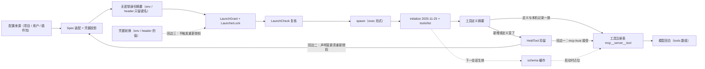
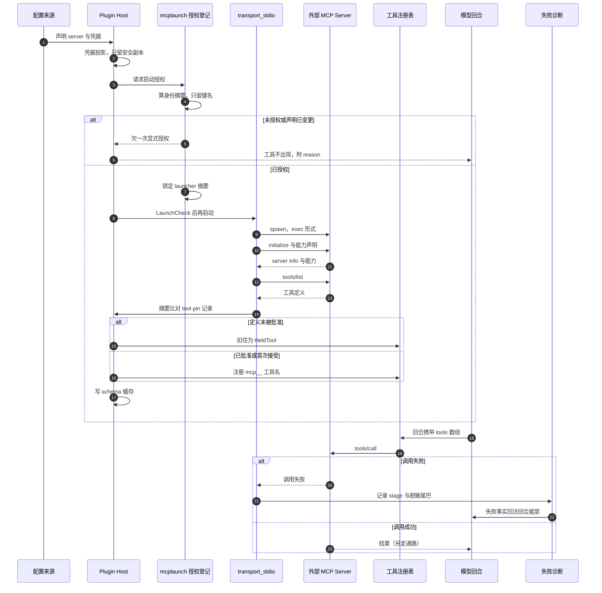

# 扩展体系：Extension Runtime v2、插件包、MCP 与 Skill 的四层边界

> 本解读按 **ai-agent** 类规格产出，属 DeepSeek-Reasonix 深度解读的子文档；共 13 篇，解读基线 `v2.37.0`（`e17ef45e3`）。正文所有 `文件:行号` 引用均为 Reasonix 仓库相对路径，点开即可核对。相关篇章见 [README.md](README.md)。

## 在系统中的角色：唯一的"外部代码影响内部决策"入口

`internal/ext` 是整个宿主里唯一允许"外部代码影响内部决策"的地方。去掉它，Reasonix 仍然是一个能跑、能审批、能回退的编码代理；但会退化成**能力封闭**的工具：模型只能用内置工具，只能读 `internal/tools/builtin` 里写死的那批能力，无法接入用户已有的 MCP server，也无法把自己的团队约定变成可复用的 playbook。

它是"宿主可裁决"这条根因在**能力供给侧**的落点。宿主对模型的失控有两个来源：模型自己乱来，和**别人塞给模型的东西乱来**。扩展体系负责后者——它必须回答一个比"怎么装进来"难得多的问题：**装进来之后，谁在什么时刻拥有对哪个字节的最终解释权。**

这个包的体量本身就是论据：`internal/ext` 非测试 Go 代码 47.5K 行，其中 `extension`（13.5K）、`plugin`（10.1K）、`pluginpkg`（4.1K）、`installsource`（5.0K）、`hook`（4.0K）、`skill`（3.7K）、`configbackup`（1.9K）、`market`（1.6K）。规模几乎全部花在**校验、投影、代际、回滚**上，而不是花在"能力"上。

## 根因：四条互相冲突的约束，推出四层分离

四层之所以必须分开，不是因为历史遗留，而是因为它们各自受**不同的一条约束**支配，而这几条约束两两冲突——读者必须先接受这四条约束的冲突，后面的四个机制才读得懂（每个机制只解一处冲突，不解决另外三处）：

**约束一 · 进程与协议边界（MCP 的主导约束）。** 外部 server 是别人的进程、别人的生命周期、别人的 schema。宿主不能把它编译进来，只能声明式地连上去，于是"连上去了"与"我能控制它"天然是两件事。MCP 受这条约束，所以它的设计重心在 transport 与授权，而不在能力。[internal/ext/plugin/plugin.go:1-6]()
<!-- anchor: // Package plugin is Reasonix's MCP client. It connects to external MCP servers  … // logic — handshake, tools/list, tools/call — is written once. -->

**约束二 · 裁决时机（Extension Protocol 的主导约束）。** 要"拦截"，就必须在宿主自己决定的那一刻**之前**拿到决定权。这使得声明式配置不够用——配置只能描述"做什么"，描述不了"把宿主的这个决定改成另一个"；也使得 in-process 接口不够用——那会让扩展的 panic 变成宿主的 panic，且无法语言无关。于是它必须是**代码**、必须在进程外、必须有一份冻结的 wire 契约。这是四层里唯一能改变宿主行为的一层。

**约束三 · 分发与不可变性（Plugin Package 的主导约束）。** 上面两层的产物要能被人安装、升级、审计、回滚，就必须有一个可寻址的包边界和一份声明式清单。它的职责是**在装之前就把能力说清楚**，而不是在跑起来之后再问；一旦"安装"允许含糊，上面两层的所有授权记录都失去了可比较的基准。[internal/ext/pluginpkg/pluginpkg.go:400-408]()
<!-- anchor: func ParseDir(root string) (Package, []string, error) { … return Package{}, nil, err -->

**约束四 · 上下文预算与前缀缓存（Skill 的主导约束）。** Skill 是给模型的**指令资产**，不是可执行能力。它的全部设计难点不在加载，而在"这些字节放在模型可见上下文的哪个位置、什么时候该放"——因为 DeepSeek 的自动前缀缓存只在前缀字节稳定时命中，而 skill 目录恰恰是**按项目变化**的。

四条约束的冲突是具体的，不是修辞：约束一要求"别人说了算"，约束二要求"宿主的决定时刻不能被绕过"，约束三要求"装之前就冻结能力"，约束四要求"任何按运行时发现变化的东西都不能进前缀"。把任意两层合并，都会立刻产生一个无法回答的问题——把 MCP 和插件包合并，就无法回答"没有包的裸 server 凭什么能启动"；把 Skill 和 MCP 合并，就无法回答"一段纯文本 playbook 为什么需要一个进程"；把 Extension Protocol 和插件包合并，就会让"安装"直接等于"授权任意代码改写系统提示"，而项目明确拒绝了这个等号（见下文信任模型）。

换个说法：MCP 和 Skill 解决"模型能做什么"，Plugin Package 解决"谁能把东西放进来"，Extension Protocol 解决"东西跑起来之后宿主还剩下多少裁量权"。

同一套"贡献"抽象把四层收进一个目录，种类是封闭的：

[internal/ext/extension/catalog.go:8-22]()
<!-- anchor: // ContributionKind names one category of runtime capability. The wire names … KindInterceptor ContributionKind = "interceptor" -->

### 四层能力对照表

| 维度 | MCP | Extension Protocol | Plugin Package | Skill |
|---|---|---|---|---|
| 解决的问题 | 接外部工具 / 资源 / prompt | 拦截运行时事件，贡献 Provider 与结构化 UI | 分发、版本化、安装与回滚的边界 | 给模型的指令资产 |
| 声明形态 | `Spec`（transport + command/url + env/headers），来自配置或插件包 | Manifest v2 `runtime` 块 + `extension/initialize` 握手回执 | `reasonix-plugin.json`（`apiVersion` 精确 `reasonix.io/plugin/v2`）或 Claude/Codex 兼容清单 | 带 frontmatter 的 `SKILL.md` |
| 执行体 | 外部 server 进程（stdio / HTTP / SSE） | out-of-process sidecar，NDJSON JSON-RPC | 无（声明式），或承载 runtime 可执行文件 | 无（纯文本，按需注入） |
| 生效位置 | 工具注册表 `mcp__<server>__<tool>`，进入 provider 请求的 tools 数组 | 宿主循环内部 17 个 hook point，可改 payload | 文件系统布局 + `plugin-packages.json` 信任记录 | 回合尾部（turn tail）的 `<available-skills>` 块 |
| 权限等级 | 与内置工具同级，但要过 launch 授权与 tool pin | **full trust**：进程外、继承环境、可越过宿主 permission 的 deny | 安装即授权（含 `--link` 持续信任变更内容） | 受 `allowed-tools` / `read-only` 收窄，不越权 |
| 是否变更缓存前缀 | 变更（tools 数组是前缀的一部分） | 取决于 slot：interceptor/UI 不变，provider/MCP 后端轮换不变前缀 | 安装后重启才生效 | **永不变更**（前缀所有权） |
| 主要代码 | `internal/ext/plugin`、`mcplaunch`、`mcpregistry` | `internal/ext/extension`、`extensioncontract` | `pluginpkg`、`pluginspec`、`installsource`、`market` | `internal/ext/skill` + `internal/session/control` |

这张表还有一个位置版本（下图把"生效位置"从文字变成坐标，因此能看出文字表格看不出的那件事）：


这张图要看的是那条虚线的位置，而不是四个盒子的并列关系：**沙箱不是第五个盒子，而是一条穿过两个盒子的线**。MCP 块的上半是 `confined` 模式（保留给内部受管部署与测试），下半是产品默认的 `host` 模式 stdio MCP——后者不继承 agent 的命令沙箱；Extension Protocol 块的上半是宿主进程内的握手校验与契约裁决，下半是 sidecar 子进程——它继承未经过滤的环境，从第一次启动尝试起就被打上进程级标记。也就是说，"扩展体系里哪些东西在命令沙箱内"**没有块级的答案**：同一个 MCP 机制、同一个 Extension 机制，都是块内一半在内、一半在外。代价正落在这里——外围只能靠三条约束兜（runtime 不能由项目配置声明、项目 MCP 需要逐条启动授权、工具定义要过 pin），而不是靠沙箱本身。

还有一层必须一起看：`internal/ext/hook` 是**声明式**的拦截层（settings.json 里的 shell 命令，退出码即裁决，原生只有 `PreToolUse` / `UserPromptSubmit` 阻塞），而 Extension Protocol 是**代码**拦截层。两者语义相近但信任等级完全不同：

[internal/ext/hook/hook.go:1-9]()
<!-- anchor: // Package hook runs user-configured shell-command hooks around the agent loop: … // and surfaced to the user. This package only loads, matches, and runs hooks; -->

[internal/ext/hook/hook.go:78-79]()
<!-- anchor: // it only contributes guidance via stdout.) This governs native Reasonix hooks; … // see claudePermissionBlocking for the Claude-imported PermissionRequest case. -->

判定函数本身在 [internal/ext/hook/hook.go:80-80]()（`IsBlocking` 只对 `PreToolUse` / `UserPromptSubmit` 返回 true）。
<!-- anchor: func IsBlocking(e Event) bool { return e == PreToolUse || e == UserPromptSubmit  -->

区分它们的是**谁能写**：hook 来自用户自己的 settings.json（受项目审批约束），sidecar 只能来自走过安装流程的插件包。这就是为什么"拦截"这件事被拆成两个包，而不是一个。

顺手把两类常被误读成"第五层"的东西归位：`internal/ext/command` 与 `internal/ext/theme`。两者都是**纯文本 / 纯数据的载荷**，不构成能力层。它们没有进程、没有 hook point、不进 provider 的工具表，因此四条约束一条都不落在它们身上——这正是"四层而不是六层"的理由。

- `command` 把 Markdown 当 prompt 模板加载，注释里写明加载是 "pure and dependency-free"：连 frontmatter 都用自己写的 `key: value` 解析器，以免为一个 YAML 解析器破坏"只有一个 TOML 依赖"的承诺。
  [internal/ext/command/command.go:1-5]()
<!-- anchor: // Package command loads custom slash commands from Markdown files. A command is … // rather than pulling in a YAML library. -->
- `theme` 把主题包明确约束成数据——"no code, stylesheet, or script in it, so anything that can write a JSON file can author one and no frontend has to trust what it loads"。
  [internal/ext/theme/theme.go:1-4]()
<!-- anchor: // Package theme reads installed theme packs. A pack is data — named colours … // trust what it loads. -->
- 插件包可以把两者当载荷分发；themes 甚至以 `plugin:<plugin>:<dir>` 前缀**原地读取**，随插件卸载一起消失，永不复制进用户库。
  [internal/ext/theme/plugin.go:11-14]()
<!-- anchor: // A pack an enabled plugin package contributes is read in place from the … // and it goes away with the plugin rather than lingering after an uninstall. -->

## 内核对扩展的承重结构

在进入四层细节之前要先说清宿主侧的三件承重物，否则后面的取舍读不懂。

**贡献目录（Catalog）** 把四种来源（内置、项目、用户、插件）折叠成一个冻结视图，冲突按 tier 判决，加性种类允许同名共存，而被 shadow 的种类要求唯一赢家：

[internal/ext/extension/catalog.go:38-42]()
<!-- anchor: // additiveKind reports whether every contribution of this kind survives … func additiveKind(k ContributionKind) bool { -->

构建管线是线性的：Discover → Parse → Validate → Resolve → Assemble → Freeze → Activate。注册顺序不影响结果——因为目录、赢家规则、拦截链全部按**贡献数据**排序，而不是按到达顺序：

[internal/ext/extension/builder.go:35-38]()
<!-- anchor: // AddContributor registers contributors. Registration order never influences … // order. -->

**能力契约（Capability）** 让"我提供什么 / 我需要什么"变成可比较的结构，而不是散文。带版本与可选 schema pin，`SatisfiedBy` 同时校验 key、pin 与 semver 区间：

[internal/ext/extensioncontract/capability.go:46-51]()
<!-- anchor: // Capability is a concrete provided capability with a version and optional … SchemaHash string        `json:"schemaHash,omitempty"` -->

[internal/ext/extensioncontract/capability.go:116-136]()
<!-- anchor: // SatisfiedBy reports whether provided meets this requirement (key match, … return matchVersionRange(rangeExpr, pv) -->

**代际（Generation）** 是所有回退语义的载体：

[internal/ext/extension/snapshot.go:13-18]()
<!-- anchor: // RuntimeSnapshot is the frozen, effective runtime configuration produced by … // provenance differs. -->

快照一旦 Freeze 就不可变，跨轮次、跨 subagent、跨前端共享而不加锁；`WithGeneration` 只推进代号，provider 可见字段逐字节保留：

[internal/ext/extension/snapshot.go:37-46]()
<!-- anchor: // WithGeneration returns a shallow copy of the snapshot with a new generation. … return &cp -->

这样设计的直接后果是：**同一个 CacheHash 的两个快照对 provider 缓存而言可以互换**，provenance 不同不影响语义。整套 v2 运行时都建立在这个不变量上。

### 关键数据结构

三个类型承载了本文后续所有取舍，值得先记住形状（下面是**压平后的字段形状**，不是原文逐字，字段名与类型均逐行核对过）：

```go
// 一次拦截的裁决：Permission 为 nil 表示所有拦截器都 continue，宿主判决生效。
type Result struct {
    Blocked     bool
    BlockReason string
    Permission  *bool
    Applied     []string   // 替换了 payload 的 plugin ID，按链序
    Audit       []string   // 已脱敏的审计注记
}

// 欠账：delivered 是"模型手上那份版本"，pending 是本回合将要送出的版本。
type projectionDebt struct{ delivered, pending atomic.Pointer[string] }

// 计划：旧代际 → 新代际的子图转移；PrefixChanged 是构建后的观测事实。
type RuntimePlan struct {
    FromGeneration, ToGeneration uint64
    Kind                         SubgraphKind
    PrefixChanged, ProviderChanged bool
}
```

## Extension Protocol：sidecar 的 transport 与裁决权

### transport

协议是 **stdio 上的严格 JSON-RPC 2.0，NDJSON 分帧**，不是 socket、不是 HTTP。这个选择把"扩展"变成了一个**由宿主 spawn 的子进程**，于是三件事自动成立：生命周期归宿主、崩溃可观测、诊断有界。帧上限 8 MiB，超限是 connection-fatal 的 `frame_too_large`；`params` 必须是对象，帧级容忍未知成员、DTO 级拒绝未知字段（打错字立刻暴露）：

[docs/EXTENSION_PROTOCOL.md:25-32]()
<!-- anchor: - Strict JSON-RPC 2.0 over **NDJSON**: one complete JSON object per line on … rejected) so typos surface immediately. -->

stderr 归扩展做诊断，宿主只保留**有界且已脱敏**的尾巴。启动是 **exec 形式，永不过 shell**——理由写在代码里：走 shell 会把管道、`&&`、`$` 展开偷渡进一个承诺"没有这些"的契约：

[internal/ext/extension/sidecar/process.go:37-45]()
<!-- anchor: // shellExecutables are interpreter names a runtime command may not resolve … "pwsh": true, "pwsh.exe": true, -->

必须说清一个容易被文档掩盖的事实：sidecar **不在 Reasonix 的命令沙箱里**，它继承未经过滤的环境。代码把这个事实变成一个**不可重置的进程级标记**，因为从第一次尝试启动 sidecar 起，模型能调用的工具就可能写到用户能写的任何地方：

[internal/ext/extension/sidecar/unconfined.go:7-11]()
<!-- anchor: // LaunchedUnconfinedProcess reports whether this process has ever tried to … func LaunchedUnconfinedProcess() bool { return unconfinedLaunch.Load() } -->

### 有设计含义的消息种类

协议共 17 个方法（9 个 host→extension 请求、3 个 extension→host 请求、3 个 host→extension 通知、2 个 provider 流通知），注册表把方向与计数**冻结**在代码里，改一个方法名就会改变生成的 schema hash，从而改变握手身份：

[internal/ext/extension/protocol/registry.go:14-40]()
<!-- anchor: MethodExtensionInitialize       Method = "extension/initialize" … MethodHostContentRead Method = "host/content/read" -->

[internal/ext/extension/protocol/registry.go:74-76]()
<!-- anchor: // frozenRegistry is the Extension Protocol v2 method set. Adding, renaming, … // pins the counts and the generated schema hash changes. -->

按设计含义分，只有四类值得讲（不罗列方法名）：

1. **握手类**：宿主先发期望（manifest 的 intercepts/replaces/providers/uiActions/tools 上限），sidecar 回执它**实际激活**的子集，宿主校验"回执 ⊆ manifest"，越界的答案是 `capability_not_declared`。契约的身份是协议 ID + major：
   [internal/ext/extension/protocol/protocol.go:20-29]()
<!-- anchor: // ProtocolID is the immutable identity string peers exchange during the … const ProtocolVersion = "2" -->
2. **裁决类（阻塞）与观察类（非阻塞）**：`extension/intercept` 阻塞并返回裁决，`extension/event` 是同一批 hook point 的 fire-and-forget 观察。观察用**有界非阻塞写队列**，饱和时丢观察并告警，而不是卡住 Agent——这是一个明确的价值排序：**永不因为观测而阻塞被观测的东西。**
   [internal/ext/extension/protocol/dto_lifecycle.go:106-114]()
<!-- anchor: // EventParams is the fire-and-forget observation of one of the 17 hook … Externalized []ExternalizedField `json:"externalized,omitempty"` -->
3. **内容引用类**：超过 64 KiB 的 externalizable 字段被离线到宿主 content store，帧里只带 JSON pointer + content ref + 字节数 + SHA-256，对端用 `host/content/read` 分块取回并校验。这是"大 payload 不该进 JSON-RPC 帧"的结构性回答。
4. **Provider / UI 反向类**：provider 目录与 stream open/cancel 走 host→extension，chunk/end 走 extension→host 通知；UI 的 publish/request 是 extension→host 请求。方向本身是设计：**扩展不能主动推送模型输出，只能应答宿主的开流请求。**

### "拦截运行时事件"到底能改什么

宿主的策略是"链上的每个拦截器都能裁决，但只有声明过的 slot 有最终替换权"。17 个 hook point 是**封闭枚举**——拼错一个点位的拦截器会静默躺在链里永不被执行，所以未知点位在**校验期**就失败：

[internal/ext/extension/intercept.go:13-30]()
<!-- anchor: const ( … PointFrontendEvent      InterceptorPoint = "frontend.event" -->

裁决语义有两级，且**语义边界是明确的**：

- **观察 / 否决**：每个拦截器对某次调用返回 `continue` / `block`（带用户可见理由）/ `replace`（改 payload）。`allow` / `deny` 只在 `permission.decision` 这一个点位上合法，在别处出现就是契约违规。宿主对每一次 `replace` 都按该 point 的 DTO 重新严格解码，失败即违规：
  [internal/ext/extension/dispatch/dispatch.go:62-76]()
<!-- anchor: type Result struct { … Audit []string -->
  注意 `Permission` 后面的注释：**宿主 deny + 扩展 allow ⇒ allow（对 full-trust 扩展）**。这是一个必须承认的信任后果——full trust 的扩展在权限点位上确实可以推翻宿主。
- **替换（slot）**：`system_prompt`、`context`、`provider_request`、`provider_response`、`compaction`、`session_policy`、`permission`、`frontend_events`，加 `tool:<name>` 与 `provider:<ref>` 两个带命名空间的形态。slot 是**单所有者**：第二个认领者不会静默覆盖，而是拿到一个同时点名两个 owner 的 `SlotConflictError`，构建失败：
  [internal/ext/extension/replace.go:11-14]()
<!-- anchor: // Slot names a replaceable runtime seam. Unlike additive contributions, a … // refuses the combination instead of picking one silently. -->
  [internal/ext/extension/replace.go:98-109]()
<!-- anchor: // SlotConflictError reports a second claimant for an already-owned slot. … return fmt.Sprintf("extension: replacement slot %q claimed by %v", e.Slot, label -->

执行顺序是**确定性**的（否则"同一 canonical 状态 ⇒ 逐字节相同的模型可见字节"不成立）：priority 升序，然后 plugin ID、注册顺序、ID、Origin 逐级 tiebreak；priority 被限制在 [-1000, 1000]，理由写得很直接——无界优先级会让某个贡献者挤到所有未来拦截器之前，包括运行时自己必须最先跑的那些：

[internal/ext/extension/intercept.go:58-65]()
<!-- anchor: // ValidatePriority bounds interceptor priorities. Unbounded priorities would … return nil -->

[internal/ext/extension/intercept.go:68-77]()
<!-- anchor: // SortInterceptors orders an interceptor chain for execution: ascending … sort.SliceStable(out, func(i, j int) bool { -->

错误策略是**按扩展分级**的，这是这条链最容易被忽略的设计：`required:true` 的 runtime 或任何 slot 所有者一旦报错/超时，当前操作**失败**；只有"可选且仅观察"的扩展才会被警告一次然后跳过本次调用。崩溃的 sidecar 在 client 层就直接 fail fast，派发器根本看不到：

[internal/ext/extension/dispatch/dispatch.go:1-16]()
<!-- anchor: // Package dispatch is the host-side interceptor dispatcher for Extension … // concurrent turns safely for the life of its snapshot generation. -->

超时预算按点位分级：`input` / `tool` / `permission` 这类延迟敏感点是 5s，session/context/system-prompt/compaction 家族是 30s，任何 manifest 覆盖都被钳到 60s 上限：

[internal/ext/extension/sidecar/client.go:22-43]()
<!-- anchor: // Lifecycle budgets. … slowInterceptTimeout = 30 * time.Second -->

[internal/ext/extension/sidecar/client.go:33-43]()
<!-- anchor: defaultWriteStallBound = 10 * time.Second … slowInterceptTimeout = 30 * time.Second -->

崩溃的语义是**显式失败而不是静默降级**：`readyErr` 把三种未就绪状态映射成结构化 reason，宿主不会替你换一个模型或换一个策略：

[internal/ext/extension/sidecar/client.go:424-438]()
<!-- anchor: // readyErr reports whether the client can serve calls right now. … return &protocol.ProtocolError{Reason: protocol.ErrProtocolError, Message: "exte -->

### 为什么有 `.generated.md`：生成链与代价

生成链是**单向**的，源只有一处——Go 侧的 `frozenRegistry`。四个产物全部由同一次反射遍历产出：schema JSON、schema hash 常量、方法/事件/上限/错误索引 Markdown、以及 Go SDK 的 DTO 镜像：

[internal/ext/extension/protocolgen/generate.go:20-25]()
<!-- anchor: SchemaArtifactPath   = "internal/ext/extension/protocol/schema.generated.json" … SDKTypesArtifactPath = "sdk/go/types_generated.go" -->

入口支持 `-check`，只比对不写入，因此"生成物漂移"能被 CI 抓住：

[cmd/extension-protocol-gen/main.go:11-15]()
<!-- anchor: func main() { … log.SetFlags(0) -->

hash 不是文档装饰，而是握手身份的一部分：schema 文档的规范化字节做 SHA-256，冻结进一个生成常量，`SchemaHash()` 直接返回它：

[internal/ext/extension/protocol/schema_hash.generated.go:5-8]()
<!-- anchor: // GeneratedSchemaHash is the SHA-256 of schema.generated.json. Handshake … const GeneratedSchemaHash = "sha256:085c014bb6d1713f722177dda5d79b1224d9bf611cb3 -->

[internal/ext/extension/protocol/schema.go:266-270]()
<!-- anchor: // SchemaHash returns the committed SHA-256 of the canonical schema document. … return GeneratedSchemaHash -->

生成的 Markdown 索引因此必须携带 hash，也必须自带"不要编辑"的横幅：

[docs/EXTENSION_PROTOCOL.generated.md:1-12]()
<!-- anchor-base64:PCEtLSBDb2RlIGdlbmVyYXRlZCBieSBjbWQvZXh0ZW5zaW9uLXByb3RvY29sLWdlbjsgRE8gTk9UIEVESVQuIC0tPgpzZW1hbnRpY3MgbmV2ZXIgY2hhbmdlLg== -->

**代价有三条，都很真实**：

1. **散文文档是二等公民。** 手写文档自己写明"两者不一致时以生成的 schema 为准"，这意味着手写文档的正确性**没有机器保障**，只有一句从属声明：

[docs/EXTENSION_PROTOCOL.md:20-21]()
<!-- anchor: This document is the prose companion to the generated index. Where they … disagree, the generated schema wins. -->

2. **`$defs` 的名字进入公共 API。** SDK 的类型与常量名是从 Go 类型名机械推导的，工程里甚至维护了一张"缩写大写化"表和一张常量名例外表，因为机械改写会与已发布的公共 API 不一致：
   [sdk/go/README.md:149-152]()
<!-- anchor: `types_generated.go` is produced from the host's frozen protocol registry by … constructors, enum helpers) lives in `types_ext.go`. -->
   也就是说：**Go 类型名成了对外契约的一部分**，重命名一个内部 DTO 会变成一次协议级破坏性变更。
3. **major 只能加不能改。** v2 内只允许加可选字段/新枚举值/新方法；已有必需字段、方向、上限、错误理由、语义永不变。这条纪律的收益是稳定，代价是**早期设计失误无法修正**，只能等一个新 major。

### 关于"Protocol v1"的前提修正

`internal/ext` 里**没有 Extension Protocol v1**。协议 ID 是 `reasonix.extension.v2`，`ProtocolMajor = 2`，而且 `reasonix.extension.v1` 出现在测试里是**被拒绝的反例**（`unsupported_version`）：

[internal/ext/extension/protocol/protocol.go:20-29]()
<!-- anchor: // ProtocolID is the immutable identity string peers exchange during the … const ProtocolVersion = "2" -->

[internal/ext/extension/protocol/protocol_test.go:25-29]()
<!-- anchor: reason  ErrorReason … {"wrong major", ProtocolID, "1", ErrUnsupportedVersion}, -->

docs 同样声明扩展 manifest 在 v1 上从未公开发布，v2 是第一个受支持的 runtime manifest：

[docs/EXTENSION_RUNTIME_V2.md:14-19]()
<!-- anchor: - Plugin manifest: exact `apiVersion: reasonix.io/plugin/v2` only (no `v2.0`/`v2 … - Handshake `provides` must be a subset of the manifest provides ceiling. -->

所谓"v1"，在本仓库里只以三种形态存在：**被拒绝的异己协议 ID**、"没有 apiVersion"的 legacy 原生 manifest（`manifest_v1.go`）、以及一个**从未公开发布的 runtime v1**。因此"v2 相对 v1 改了什么"这个问题，只能按下面这条线来回答。

**但仓库自己的顶级 README 还在写 v1，这是一处版本号过期。** 中英文两版都把这一层介绍成 "Extension Protocol v1 sidecars"：

[README.md:128-130]()
<!-- anchor: - **Plugin-driven.** MCP servers contribute tools, prompts, and resources; … Providers and structured UI, and ship versioned plugin packages. -->

[README.zh-CN.md:121-122]()
<!-- anchor: - **插件驱动**：MCP server 提供工具、提示词和资源；Extension Protocol v1 … Sidecar 还可以拦截运行时事件、提供 Provider 与结构化 UI，并通过版本化插件包分发。 -->

这条不一致值得单独记下来，因为它不是笔误级别的命名漂移：读者若按 README 去找 "Extension Protocol v1" 的规范，会在 `docs/` 与代码里同时扑空——协议 ID 是 v2、manifest 的 `apiVersion` 只有 `reasonix.io/plugin/v2` 一个精确取值、连 `reasonix.extension.v1` 都只是一个被拒绝的测试反例。README 里唯一正确的那半句是 "share versioned plugin packages"——包确实是版本化的，wire protocol 不是 v1。

## Extension Runtime v2：把"配置"和"活着的资源"拆开

### v2 改的根因问题

v1 式的扩展模型有一个结构性缺陷：**它把"配置"和"活着的资源"当成同一个东西**。扩展一旦激活，它的进程、它的拦截链、它占用的 slot、它发起的 provider 流、它带来的前端绑定，全部挂在同一个生命周期上；任何一处变化都只能整体重启。三个后果随之而来——一次 provider 能力变更会连带重启拦截链；另一个会话的 publish 会把本会话正在跑的流一起 drain；而失败之后"能不能回退"只能靠猜。

v2 用五个显式概念把这个混合体切片，切法本身就是答案：

[docs/EXTENSION_RUNTIME_V2.md:24-28]()
<!-- anchor: RuntimeSnapshot = immutable config + dependency view … Controller = published generation consumer (admission bound to RuntimeOwner) -->

- **Snapshot 不可变**，所以"回退"有可比较的对象；
- **EffectScope 归代际**，所以"这次激活到底创建了什么"是可枚举的；
- **RuntimePlan 是显式的 old→new 转移**，所以"哪些子图需要重做"是可以分类的，而不是靠启发式；
- **RuntimeOwner 归会话谱系**，所以两个独立会话永不共享 publish/drain 状态与恢复证据；
- **Controller 的准入绑定到 owner**，所以"谁有权接受新回合"是一个查得到的判定。

组件状态机是一条**闭合**的转移关系，非法转移返回错误并保持原状态不变——不是"记一条警告继续走"：

[internal/ext/extension/lifecycle.go:132-148]()
<!-- anchor: func legalTransition(from, to ComponentState) bool { … return false -->

依赖不是凭名字对齐，而是凭 **epoch**：capability key + provider 组件 ID + provider 版本 + schema hash 四元组。注释里给了理由——**光有 fiber UID 不够**：provider 换了 schema 但组件 ID 没变时，消费者必须重载。这直接回答了"扩展升级后为什么消费者要跟着重载"：

[internal/ext/extension/dependency.go:42-53]()
<!-- anchor: // ComponentEpoch is the dependency identity that forces consumer reload when … return fmt.Sprintf("%s|%s|%s|%s", e.CapabilityKey.String(), e.ProviderComponentI -->

组件状态只有 Inactive/Preparing/Active/Draining/Failed 五个，缺依赖的组件**留在 Inactive 并给出结构化缺失项**，而不是伪造一个空实现让启动继续：

[internal/ext/extension/dependency.go:20-24]()
<!-- anchor: ComponentInactive  ComponentState = "Inactive" … ComponentFailed    ComponentState = "Failed" -->

### 性能主张背后的机制

`EXTENSION_RUNTIME_V2_PERF.md` 里的三条软上限（依赖图、no-op diff、EffectScope 释放）本身不是重点，**重点是它们之所以能被压住，靠的是四条结构性机制**，而不是调优。

**机制一：真子图补丁，而不是"快一点的整机重建"。** Plan 被分类成 `SubgraphNone` / `InterceptorOnly` / `ProviderOnly` / `UIOnly` / `MCPOnly` / `Sidecar` / `Full`，no-op 与 interceptor/UI/provider/MCP-only 走 `RebuildFrom` 且**必须不调用 `BuildRuntime`**；指标 `NoOpRebuilds` / `SubgraphRebuilds` 与 `FullRebuilds` 把这个区别变成可观测事实：

[docs/EXTENSION_RUNTIME_V2_PERF.md:21-24]()
<!-- anchor: ## Incremental vs full rebuild … - **Full** (`SubgraphSidecar` / `SubgraphFull`): `FullRebuilds` + full `BuildRun -->

[internal/ext/extension/runtimeplan.go:11-29]()
<!-- anchor: // SubgraphKind classifies which assembly subgraph a RuntimePlan touches so … SubgraphFull -->

**机制二：前缀稳定性由构造保证，不由补丁的副作用保证。** `CacheHash` 只由**系统提示 + 规范化后的工具 schema** 两部分算出，两者各自也单独哈希，好让缓存未命中能被归因到"是提示变了还是工具变了"：

[internal/ext/extension/snapshot.go:198-208]()
<!-- anchor: // computeCacheShape hashes the system prompt and the canonical tool schemas. … return systemHash, toolsHash, cacheHash -->

于是 provider/MCP 只有后端轮换时，走 `WithLiveContributions`：代号推进、拦截链与 slot 所有者按活跃贡献重建、catalog overlay 重建，但**系统提示、工具 schema、CacheHash 逐字节不动**：

[internal/ext/extension/snapshot.go:49-56]()
<!-- anchor: // WithLiveContributions returns a copy with generation advanced and interceptor … return nil -->

这里有一个刻意的**真假分离**：`MayChangePrefix` 是构建前的保守规划信号，而 `PrefixChanged` 是构建后比较两个快照 CacheHash 得出的**观测事实**。所以"provider 只换了后端"会报 `prefixChanged=false, providerChanged=true`，而不是按图差异猜：

[internal/ext/extension/runtimeplan.go:67-79]()
<!-- anchor: // MayChangePrefix is the conservative pre-build planning signal for whether a … return true -->

[internal/ext/extension/runtimeplan.go:44-56]()
<!-- anchor: DrainOrder     []ComponentID … Graph *DependencyGraph -->

与之对照的是**刻意选择不做补丁**的那一类：MCP 工具 schema 的新增、移除或改名**被有意归类为 full rebuild**。理由与懒启动那条一致——工具 schema 是前缀的一部分，一次静默的工具表变化会让整段对话的 provider 缓存失效；与其在后端悄悄换掉，不如在前端明确付一次重建：

[docs/EXTENSION_RUNTIME_V2_PERF.md:34-38]()
<!-- anchor: ## Cache hit expectation … MCP schema additions, removals, or renames are classified as full rebuilds and i -->

**机制三：adopt 而不是 restart。** `StartPackagesWithPlan` 只启动 Added/Reloaded，Unchanged 的活 client 从旧 Manager **detach 出来再 adopt**（先 detach 是为了让随后的 `previous.Close` 不会杀掉仍在服役的包），并且记录 adopt 集合，以便激活失败时**只回滚这些**：

[internal/ext/extension/sidecar/plan.go:32-46]()
<!-- anchor: // StartPackagesWithPlan starts Added/Reloaded packages and adopts Unchanged … return adoptAll(previous), warnings, nil -->

[internal/ext/extension/sidecar/plan.go:86-91]()
<!-- anchor: // Adopt unchanged clients from previous. Detach so previous.Close after … m.RollbackPlanStart(previous) -->

启动并发与预算也是结构性的：一个代际内最多 4 个 sidecar 并行、共享同一个 30s 启动预算。理由写得很清楚——**没有代际级预算，N 个卡住的可选 runtime 会把启动延迟放大成 N 倍的握手超时**：

[internal/ext/extension/sidecar/manager.go:20-24]()
<!-- anchor: maxConcurrentPackageStarts = 4 … packageStartupBudget = defaultHandshakeTimeout -->

启动的入口被收窄到**唯一来源**：已安装且启用的、声明了 native runtime 的包。这是"项目配置永远不能声明一个 runtime"这条安全前提的落点，而不是一句文档承诺：

[internal/ext/extension/sidecar/manager.go:53-64]()
<!-- anchor: // LoadRuntimePackages returns the installed, ENABLED packages that declare a … return out, warnings -->

**机制四：有界证据 + 保守截断。** 效果只有四类（可逆 / 可取消 / 可补偿 / 不可逆），且**不可逆效果在 dispose 时永远写 `not_applicable`**——"取消了"从不等于"撤销了"：

[internal/ext/extension/effectscope.go:13-24]()
<!-- anchor: // EffectClass classifies how an effect may be undone during scope disposal. … Irreversible -->

[internal/ext/extension/effectscope.go:200-202]()
<!-- anchor: if e.Class == Irreversible { … compStatus = "not_applicable" -->

发布/排空顺序由 `PublishGate` 强制：同一时刻只有一个 Published 代际，旧代际进入 Draining；**只有 published 代际接纳新回合**，Draining 代际拒绝：

[internal/ext/extension/publish.go:10-13]()
<!-- anchor: // PublishGate enforces the activate → publish → drain order for runtime … type PublishGate struct { -->

[internal/ext/extension/publish.go:71-89]()
<!-- anchor: func (g *PublishGate) Publish(gen uint64) { … DefaultLifecycleMetrics.Publishes.Add(1) -->

[internal/ext/extension/publish.go:131-135]()
<!-- anchor: // AdmitNewWork reports whether a new turn may be admitted for gen. Only the … return true -->

这套机制最值得学的一处，是**它如何把"证据不足"变成结论的一部分**：receipt 只保留最近 32 个代际、每代 256 条——这两个数字是代码常量，不是文档口径，而且常量旁边就写着"retention is not persistence"：

[internal/ext/extension/receipt_store.go:8-14]()
<!-- anchor: const ( … defaultReceiptPerGenerationLimit = 256 -->

淘汰时把桶标记为 truncated，`AssessRecoverability` 于是把这一代判成 **`Clean = false`**，阻塞项写成 `receipt-history-truncated`，理由一句话："receipt history was evicted; clean rollback cannot be proven"——诊断**拒绝**声称一次干净的 rollback，而不是掩盖缺失的证据：

[internal/ext/extension/receipt_store.go:231-239]()
<!-- anchor: // AssessRecoverability reports whether checkpoint resume can claim a clean … out.Notes = append(out.Notes, "receipt history was evicted; clean rollback canno -->

文件先验同样有上限，代码常量为 8 MiB/条、32 MiB/owner；未保留时被补偿状态写成 `prior_truncated`，于是这一条补偿在多代际恢复判定里同样不能算作"干净"：

[internal/ext/extension/file_compensate.go:10-14]()
<!-- anchor: const ( … defaultFilePriorMaxEntryBytes = 8 << 20 -->

[internal/ext/extension/runtime_owner.go:137-153]()
<!-- anchor: // RecordFileWrite captures prior state under a unique receipt ID. Repeated … CompensationStatus: status, -->

文档对这套界限的描述与代码一致，可以放心作为口径引用：

[docs/EXTENSION_RUNTIME_V2.md:66-70]()
<!-- anchor: Recovery never claims successful rollback for irreversible effects; use the owne … Eviction also drops associated file-prior bytes and marks the affected generatio -->

排空路径也做了同构的处理（adopt 未变、只启动新增、drain TTL 30s、force-expire 触发已注册的取消回调并写 `drain-timeout-<gen>`）：

[docs/EXTENSION_RUNTIME_V2_PERF.md:42-44]()
<!-- anchor: `StartPackagesWithPlan` adopts Unchanged clients (`SidecarAdopts` metric) and on … Cold publishes allocate no watcher. While drains exist, rapid publishes share on -->

最后是一个很有辨识度的诊断设计：`RuntimeOwner` 有包级默认实例，但产品启动路径**必须**绑定一个隔离 owner；一旦有代码走到共享默认 owner，就递增一个进程内计数器。于是"某处漏了接线"从静默的共享状态污染，变成了 doctor 里一个可读的数字：

[internal/ext/extension/runtime_owner.go:10-13]()
<!-- anchor: // RuntimeOwner owns generation-scoped lifecycle state for one logical … type RuntimeOwner struct { -->

[internal/ext/extension/runtime_owner.go:52-61]()
<!-- anchor: // RuntimeOwnerOrDefault returns owner when it is explicitly bound and records … return DefaultRuntimeOwner -->

[internal/ext/extension/component_status.go:16-22]()
<!-- anchor: // RuntimeStatus is the host-facing runtime component status document for … Receipts            []EffectReceipt   `json:"receipts,omitempty"` -->

**v2 的代价必须写清**：receipt 账本是**进程内**的，不持久化，所以进程崩溃后的恢复**不在** runtime-v2 的范围内。这不是漂亮话，而是一处明确的欠账，只覆盖 in-process rebuild/resume；代码常量旁边的注释与文档口径一致：

[internal/ext/extension/receipt_store.go:8-12]()
<!-- anchor: const ( … // outside this PR's contract. -->

[docs/EXTENSION_RUNTIME_V2.md:68-68]()
<!-- anchor: The receipt ledger supports **in-process rebuild/resume only**. It is not persis -->

---

## 插件包与 Manifest：把"装之前"说清楚

### 包结构与声明形态

一个原生插件包的边界是 `reasonix-plugin.json`；同一个位置还识别 Codex 的 `.codex-plugin/plugin.json` 与 Claude 的 `.claude-plugin/plugin.json`，已安装记录写在 `<Reasonix home>/plugin-packages.json`：

[internal/ext/pluginpkg/pluginpkg.go:29-34]()
<!-- anchor: NativeManifest = "reasonix-plugin.json" … PluginStatusDisabledIncompatible = "disabled_incompatible" -->

三个 manifest 位置不是"随便挑一个能解析的"，而是**优先级链 + 失败即终止**：只要某个 manifest **存在但解析失败**，就立刻带着真实错误返回（原生 v2 的拼写错误会点名出错字段），只有文件**不存在**才继续尝试下一种。这条顺序把"我以为装的是原生包，其实被 Claude 兼容层静默接管了"这种误判排除掉了：

[internal/ext/pluginpkg/pluginpkg.go:400-420]()
<!-- anchor: func ParseDir(root string) (Package, []string, error) { … return Package{}, nil, fmt.Errorf("no %s, %s, or %s found", NativeManifest, Code -->

包内可声明的东西收敛成**两组**：一组的形态是**文件路径**，另一组的形态是**内联配置**。前者（skills/agents/commands/prompts/themes）与后者（hooks/mcpServers）共用一个 `contributes` 对象：

[internal/ext/pluginpkg/manifest_v1.go:115-125]()
<!-- anchor: // v1Contributes is the shared strict-decoded contributes object used by the v2 … MCPServers map[string]json.RawMessage   `json:"mcpServers"` -->

`runtime` 块单独走，因为它是唯一一个会带来**可执行代码**的声明。它的形态被刻意约束成 exec form，`Command` 可以以 `${REASONIX_PLUGIN_ROOT}` 开头来指向包内二进制，展开发生在启动时刻、**永不经过 shell**：

[internal/ext/pluginpkg/manifest_v1.go:26-31]()
<!-- anchor: // RuntimeSpec declares a plugin-owned runtime process (Manifest v2). The … // diagnostics-time equivalent). -->

runtime 声明的工具必须**在 manifest 里就写下 schema**，而不是只在握手时给：

[internal/ext/pluginpkg/manifest_v1.go:60-68]()
<!-- anchor: // RuntimeTool is one tool a runtime serves. The model sees it under a name the … ReadOnly bool `json:"readOnly,omitempty"` -->

这是一处很见功力的设计：它是"安装预览能列出这个 runtime 会提供哪些工具、宿主在进程启动之前就知道它们的 schema"的前提。代价是**manifest 与 sidecar 实现可能不一致**，所以握手时必须校验回执是 manifest 的子集。

包内路径有一条比"词法检查"更强的约束：**任何已存在的贡献路径都必须解析在插件根之内**，否则一个 symlink 就能把包外内容偷渡进会话；缺失路径只降级为 warning，因为"一个可选资源不该让整个包不可用"：

[internal/ext/pluginpkg/manifest_v1.go:489-498]()
<!-- anchor: // validateV1Paths enforces the v2 on-disk path contract — stronger than the … if err != nil { -->

清单解析本身是**严格解码**：未知字段一律报错，并把出错位置（root / `contributes` / `runtime` / `hooks.<event>[i]` / `mcpServers.<name>`）写进错误，因为"`{"paht": "skills"}` 这种拼写错误必须失败，而不是静默什么都不贡献"：

[internal/ext/pluginpkg/manifest_v1.go:91-102]()
<!-- anchor: // strictDecode decodes one manifest object with unknown-field rejection … return nil -->

解析产物是一个**清单快照，而不是包内容的快照**：`finishParse` 在返回前把这次解析用的 skill 扫描结果丢掉，于是"活过一个 `ParseDir` 调用"的 `Package` 对后续每次查询都从当时的磁盘回答：

[internal/ext/pluginpkg/pluginpkg.go:423-429]()
<!-- anchor: // finishParse derives the name warnings from the skill scan that … return pkg, append(warnings, pkg.agentNameWarnings()...), nil -->

这是一个刻意的选择：包目录可以在会话运行期间被用户改（新增一个 skill 文件、删掉一个 command），而"要不要重新发现"因此不需要写者通知，也不需要 mtime——它由"每次问都读盘"来保证。代价是每次查询都要碰文件系统，这也是 `LoadInstalled` 每次调用都重新 `ParseDir` 的原因。

安装期不执行第三方脚本，这一点也写进了文档与实现：相对路径在插件根内解析，安装过程不跑 install script：

[docs/PLUGIN_PACKAGES.md:297-298]()
<!-- anchor: Relative paths are resolved inside the plugin root. Reasonix does not run … third-party install scripts during plugin installation. -->

Claude/Codex 兼容层不是"解析同一个文件"，而是**映射**：它认得 Claude 的 `hooks/hooks.json` 与 `.mcp.json`，并把 Claude 的事件名映射到自己的事件集合——这套映射是单向的、只读的：

[internal/ext/pluginpkg/claude_compat.go:21-25]()
<!-- anchor: claudeMCPPath   = ".mcp.json" … "PreToolUse": true, "PostToolUse": true, "PostToolUseFailure": true, -->

### 版本与兼容性策略

`apiVersion` 只接受**精确的一个字符串**，没有 `v2.1`、`v2.0` 之类的别名：

[internal/ext/pluginpkg/manifest_v2.go:64-70]()
<!-- anchor: // checkAPIVersionV2 gates the v2 parser. Only the exact frozen string … return fmt.Errorf("%s: unsupported apiVersion %q: want exact %s", NativeManifest -->

[internal/ext/pluginpkg/manifest_v2.go:16-21]()
<!-- anchor: // ManifestAPIVersionV2 is the only native plugin manifest apiVersion Reasonix … const ManifestAPIVersionV2 = "reasonix.io/plugin/v2" -->

拒绝的理由不是"我们只支持 v2"，而是**v1 从未公开发布**，所以"双读 + 自动迁移"要为一个不存在的用户群付永久成本：

[internal/ext/pluginpkg/manifest_v2.go:79-84]()
<!-- anchor: // rejectNonV2Native explains why a non-v2 native manifest is refused. … return checkAPIVersionV2(apiVersion) -->

**但 docs 与源码在这里不一致，必须点出来。** `docs/EXTENSIONS.md` 与 `docs/PLUGIN_PACKAGES.md` 的 Compatibility 一节都写"没有 v1 双读、也没有自动迁移路径"，然而 `LoadInstalled` 在读到"缺 apiVersion"且该包位于**受管插件目录**时，会**自动重写 manifest**：

[internal/ext/pluginpkg/installed_compat.go:49-53]()
<!-- anchor: if err != nil && errors.Is(err, ErrMissingAPIVersion) && managedPluginRoot(reaso … warnings = append(warnings, migratedWarning(installed.Name)) -->

读完实现需要把这句话说得比"文档不准确"更精确——**自动迁移确实存在，但它的触发面被收窄成四个条件同时成立**，而且它自带互斥与回退：

- **只在受管目录内**：`managedPluginRoot` 先拒掉绝对路径的 `Root`，再把 root 解析到 `<home>/plugins` 之下，逐段 `Lstat` 拒绝路径上任何 symlink，最后还要求 manifest 本身不是 symlink。换句话说，`--link` 进来的包**不**享受自动迁移，因为它的 root 在用户自己那里：
  [internal/ext/pluginpkg/installed_compat.go:143-161]()
<!-- anchor: func managedPluginRoot(reasonixHome string, installed InstalledPlugin, root stri … return err == nil && info.Mode()&os.ModeSymlink == 0 -->
- **只在缺 `apiVersion` 时**：其它解析错误照旧被写成 `disabled_incompatible` 状态并附上修复建议，不动磁盘：
  [internal/ext/pluginpkg/installed_compat.go:56-66]()
<!-- anchor: if err != nil { … continue -->
- **并发只有一方能改写**：`migrateLock` 让第二个 loader 直接重解析并读到赢家的结果，而不是两个进程同时覆盖同一个 manifest：
  [internal/ext/pluginpkg/installed_compat.go:80-102]()
<!-- anchor: // migrateLock keeps two loaders from rewriting the same manifest at once; the … return pkg, warnings, err == nil, err -->
- **手动回退路径是显式的**：迁移失败时报 "automatic managed-plugin migration failed"，而用户被告知的命令是 `reasonix plugin migrate <name> --to-v2`——也就是说，"没有自动迁移路径"这个说法的正确版本是"有一条自动路径，加一条手动路径"：
  [internal/ext/pluginpkg/installed_compat.go:15-20]()
<!-- anchor-base64:ZnVuYyBtaWdyYXRlZFdhcm5pbmcobmFtZSBzdHJpbmcpIHN0cmluZyB7CnJldHVybiBmbXQuU3ByaW50ZigicmVhc29uaXggcGx1Z2luIG1pZ3JhdGUgJXMgLS10by12MiIsIHRleHR1dGlsLlNob3duSWRlbnRpdHko -->

这条不一致值得记下来的原因不是措辞：文档的绝对化表述会让读者以为"受管目录里的旧包永远不会被自动改写"，从而低估了 Reasonix 会在 `LoadInstalled` 这个看似只读的入口里**写盘**这件事——写盘发生在受管目录、带 `.bak` 备份、有锁，但确实不是只读。

### 安装来源与市场的信任模型

安装来源被归一化成统一 source：本地路径、`.zip`、`git:github.com/...`、HTTP(S) URL、GitHub 上的插件子目录、marketplace 对象。安全控制是分层加上的，而不是一层兜底：**SSRF 守卫在 dial 时刻对已解析 IP 做检查并只拨那个已审查 IP**（因此 DNS rebinding 也拦得住），同时显式允许 loopback，因为 bash 本来就能访问 localhost：

[internal/ext/installsource/ssrf.go:10-20]()
<!-- anchor: // ssrfGuardClient wraps base so every fetch refuses to connect to private, … // the one un-guarded path. Kept in sync by hand — both block the same set. -->

解压只重建**普通文件**，归档里的 symlink 不会被还原：

[internal/ext/installsource/archive.go:43-46]()
<!-- anchor: // Only regular files are recreated. A symlink inside an archive from … continue -->

市场的信任模型是这一层最清醒的部分，而且它给出的答案不是"我们签名了"，而是**"市场是来源，永远不是信任根"**：

[internal/ext/market/doc.go:1-16]()
<!-- anchor: // Package market reads the Reasonix community registry and installs what it … //     does only with anonymous usage statistics switched on. -->

可执行的信任链只有一条，而且是**内容摘要链**而不是身份链：只有**已批准**的版本可安装；若该行带审阅者绑定的 content digest，这个 digest 会成为 `expectDigest` 传进 `install_source`，在写入之前拒绝任何不同的材料：

[internal/ext/installsource/digest.go:93-108]()
<!-- anchor: // checkExpectedDigest refuses a plan whose material is not the pinned one. Both … return newErr(ErrDigestMismatch, "source now resolves to %s, the pinned version  -->

没有 digest 的版本**只能靠用户显式 `trust` 安装**，并把 pin 设为用户确认的那次 preview 自己的 digest，同时明确标注这是 unreviewed。这条设计的代价很清楚：**信任锚从"发布者身份"移到了"我确认过的那一次字节"**，所以它防不住"第一次看到的就是恶意版本"，只防得住"确认后材料被换掉"。

**两个包的职责边界（本次已把两侧读通，不再是单侧推断）**：`market` 决定"**哪个版本、哪个摘要**"，`installsource` 决定"**哪些动作、票据对不对**"。

- `market` 侧：`Service.Plan` / `Service.Install` 走同一条 `run`，先问注册表拿 detail，`installable` 判定"是不是已批准版本、审阅者有没有绑定 content digest"；没有 pin 且用户没给 `trust` 就直接以 `ErrUnpinned` 拒绝。已 pin 的版本把审阅者的 `ContentHash` 作为 `expectDigest` 传下去；未审阅的版本则先 preview 一次、把 preview 自己的 digest 当作 pin：
  [internal/ext/market/install.go:74-106]()
<!-- anchor: // Plan previews the approved version of slug without writing anything. … return s.previewPinned(ctx, detail.Package, v, false, req, apply) -->
- `installsource` 侧：source 解析成一组确定性 action，`computePlanID` 把**完整未投影的** action 集合摘要成 `planId`；apply 时票据不匹配就 `ErrApprovalDenied`("planId mismatch … re-plan and re-approve")，而且一个不带票据的 apply 会**返回 plan 而不是报错**——调用方想装，它缺的正是这份 plan：
  [internal/ext/installsource/install_source.go:246-276]()
<!-- anchor: // An apply with no ticket is answered with the plan instead of an error: the … return "", newErr(ErrApprovalDenied, "planId mismatch (got %s, expected %s); re- -->

这带来一个容易被忽略但很关键的设计：**预览是被投影过的，审批不是。** 计划里的每个字符串与列表都先过 `preview.go` 的一次投影（标识符 128 字素、定位符 1024、散文 600 与 6 行、列表 100/64/50 项，超限置 `previewTruncated`），而 `planId` 摘要的是**未投影的**计划原文，注释把这件事写得很直白——"what is approved is the plan itself, never the text shown"：

[internal/ext/installsource/doc.go:15-22]()
<!-- anchor: // Preview text: every string and list a plan shows is projected once, in … // so what is approved is the plan itself, never the text shown. -->

代价是两边必须同步：任何新的 action 字段都要同时进 `computePlanID` 的摘要载荷，否则"显示变了、票据没变"会让审批失效而无人察觉——这是投影与摘要分离的必然账单，不是可以省掉的细节。

## MCP 接入：一边是进程信任，一边是工具身份

### transport 与协议版本

Reasonix 声明的 MCP 版本是 `2025-11-25`，三类 transport 在同一个 `transport` 接口后面，所以握手 / `tools/list` / `tools/call` 只写一遍：

[internal/ext/plugin/plugin.go:1-6]()
<!-- anchor: // Package plugin is Reasonix's MCP client. It connects to external MCP servers  … // logic — handshake, tools/list, tools/call — is written once. -->

[internal/ext/plugin/plugin.go:34-35]()
<!-- anchor: // protocolVersion is the MCP revision Reasonix advertises during initialize. … const protocolVersion = "2025-11-25" -->

transport 选择是**显式 switch**，空值/未知回落到 stdio，未知类型直接报错而不是静默降级：

[internal/ext/plugin/plugin.go:1278-1287]()
<!-- anchor: func newTransport(ctx context.Context, s Spec) (transport, error) { … return nil, fmt.Errorf("unknown transport type %q (want stdio|http|sse)", s.Type -->

### 生命周期：谁 spawn、谁授权

**spawn 在 `internal/ext/plugin/transport_stdio.go`**，不在 `mcplaunch`。这一点容易看反：`mcplaunch` 不启动任何进程，它是**授权与锁的记录簿**——它存的是"用户授权过启动哪个确切身份的项目 MCP"和"可变 launcher 的确切解析结果"：

[internal/ext/mcplaunch/launch.go:71-77]()
<!-- anchor: // State stores server-level launch grants and exact mutable-launcher locks. … LegacyImports json.RawMessage `json:"legacy_imports,omitempty"` -->

授权 key 是**无密钥的身份摘要**：server、transport、命令路径、命令文件 SHA-256、args、dir、URL、env **键名**、header **键名**、launcher digest。环境与 header 的**值**被刻意排除——理由是"凭据轮换不应让一份本来等价的授权失效"：

[internal/ext/mcplaunch/launch.go:33-47]()
<!-- anchor: // ProjectLaunchIdentity is the secret-free canonical input to an exact project … LauncherDigest string   `json:"launcher_digest,omitempty"` -->

[internal/ext/mcplaunch/launch.go:59-68]()
<!-- anchor: // LaunchGrant is durable consent to start one exact project-provided MCP. … CreatedAt            time.Time `json:"created_at"` -->

对 stdio 的项目 server，身份摘要会**把真实可执行文件路径与文件内容都钉住**：

[internal/ext/plugin/security.go:17-26]()
<!-- anchor: // projectLaunchIdentityDigest resolves a secret-free identity before a project … return mcplaunch.ProjectLaunchIdentityDigest(identity) -->

进程模式是另一个必须讲明的边界：**产品默认是 host 模式**——stdio MCP 作为受信宿主进程运行、**不继承** agent 的命令沙箱，为的是让 chrome-devtools-mcp 这类 server 能碰到真实浏览器、Keychain 与本地应用服务；`confined` 模式保留给内部受管部署与测试，**永不作为自动回落**：

[internal/ext/plugin/plugin.go:42-49]()
<!-- anchor: // MCPProcessHost runs authorized stdio MCP as a trusted host process that … MCPProcessConfined MCPProcessMode = "confined" -->

这条选择把"扩展"的信任等级又抬高了一档：hook 跑在沙箱里，sidecar 与 host 模式 MCP 站在沙箱外。

### 凭据如何"投影"而不下发

这是本文最值得单独记的一处机制。规则的所有者是 `internal/base/secrets`，它做的不是"正则脱敏"，而是**结构性投影**：

- 键先做**百分号解码**（循环，直到稳定），再做 **NFKC**，再在大小写边界与所有非字母数字分隔符处切开，最后 Unicode fold，按**完整组件**比对：

[internal/base/secrets/endpoint.go:16-28]()
<!-- anchor: func CredentialKey(key string) bool { … key = decoded -->

敏感组件表是穷举的（token/password/passwd/secret/key/auth/authorization/credential/signature/sig/session/cookie/bearer/jwt/apikey/access/private），并有两个刻意保留的例外：`pwd`/`oldpwd` 保持"工作目录"含义，所以裸 PWD 不算凭据：

[internal/base/secrets/endpoint.go:42-48]()
<!-- anchor: for _, part := range strings.FieldsFunc(folded, func(r rune) bool { return !unic … return false -->

投影的粒度是**结构**：URL userinfo 整个移除；query/fragment 的键与值都被检查（包括值里嵌的 URL 或 query string）；path 里带凭据的段被隐藏；header/env 里凭据类名字的**整个值**隐藏，无论用什么认证方案；解析失败、命令有歧义、深度耗尽时，**隐藏整个受影响的值**；递归有 32 层上限。为什么叫"投影"而不是"脱敏"：因为它不是把敏感子串抹掉，而是**从一个规范对象生成一个只保留结构的安全副本**——运维配置始终是权威，显示与导出消费副本：

[docs/MCP_CREDENTIAL_PROJECTION.md:10-11]()
<!-- anchor: Operational config remains the authority for installation, approval hashing, … persistence and connections. Display and export consume copies. -->

诊断侧的对应约束是"**依赖方的散文不是凭据语法**"：HTTP/SSE body、RPC message、子进程尾巴、OAuth 拒绝描述**永不**变成诊断文本；生产者只暴露 typed identity 与有界事实（status、RPC code、读过/保留了多少字节）；未知 cause 只暴露 Go 类型，**永不暴露 message**：

[internal/base/secrets/diagnostic.go:32-37]()
<!-- anchor: // DiagnosticError keeps identities while omitting untrusted error prose. … return diagnosticError{cause: err} -->

[internal/base/secrets/diagnostic.go:40-45]()
<!-- anchor: // OmittedText exposes only the byte count of unstructured dependency output. … return fmt.Sprintf("dependency output omitted (%d bytes)", len(text)) -->

### 失败与诊断治理

失败被建模成**一个带类型的事实行**，而不是一段错误字符串：名称、transport、摘要错误、失败阶段、耗时、被脱敏的 stderr 尾巴、HTTP 状态码，以及两个语义布尔——是否只是欠一次启动授权、以及是否因为"声明变了"而欠：

[internal/ext/plugin/failures.go:13-23]()
<!-- anchor: // Failure records one MCP server that was configured but could not connect. … DeclarationChanged     bool // the approval is owed because what it launches cha -->

"欠授权"与"连接失败"是**两个不同的事实**，错误文本会明确区分，并且实现了 `DiagnosticFacts()` 以便在脱敏后仍然可读：

[internal/ext/plugin/failures.go:46-53]()
<!-- anchor: func (e *launchApprovalError) Error() string { … func (e *launchApprovalError) DiagnosticFacts() string { return e.Error() } -->

OAuth 只在能确定归属时才由 Reasonix 接管：transport 必须是 http/streamable-http、URL 是无 userinfo 无 fragment 的 https（或 loopback http）、且配置里没有显式凭据——legacy SSE、stdio、畸形 URL、带显式凭据的配置都必须走原来的重试/凭据路径：

[internal/contract/mcpdiag/auth.go:20-32]()
<!-- anchor: // CanUseHTTPMCPOAuth reports whether Reasonix's native authorization-code flow … return false -->

接管之后的流程是 RFC 9728 保护资源发现 → RFC 8414 授权服务器元数据 → RFC 7591 动态客户端注册 → RFC 7636 PKCE S256 → loopback 回调 → resource indicators → 私有 token 持久化；授权状态存在 server 的 `StateDir` 下、**不进项目目录、也不进别的客户端的 keychain**：

[internal/ext/plugin/oauth.go:30-35]()
<!-- anchor: // Protocol sources: MCP Authorization (2025-11-25), RFC 9728 protected … // Versioned JSON gives future readers an explicit migration boundary. -->

[internal/ext/plugin/oauth.go:92-95]()
<!-- anchor: // AuthorizeHTTPMCP performs the user-initiated OAuth authorization-code flow … // loopback callback, resource indicators, and private token persistence. -->

### tool / resource / prompt 三元如何映射进内部

映射靠**命名空间**，而不是靠一张注册表映射表：MCP 工具是 `mcp__<server>__<tool>`，插件 runtime 工具是 `ext__<plugin>__<tool>`，并且有一个判别函数把两者归为"连接起来之后才知道的命名空间"，供目录在连接前读取时区分：

[internal/contract/tool/tool.go:477-488]()
<!-- anchor: // MCPNamePrefix is the namespace every MCP tool name carries: the … return strings.HasPrefix(name, MCPNamePrefix) || strings.HasPrefix(name, Extensi -->

[internal/contract/tool/tool.go:491-503]()
<!-- anchor: // SplitMCPName splits a model-visible MCP tool name "mcp__<server>__<tool>" int … return parts[0], parts[1], true -->

工具**身份**在这里被进一步钉住。`toolpin` 记录每个 server 已批准的工具定义摘要；与本机记录不符的工具会被**扣住不给模型**，并分类（新增 / 定义变了），直到用户显式 `mcp trust <server>` 接受：

[internal/ext/plugin/toolpin.go:27-36]()
<!-- anchor: // HeldTool is one tool withheld from the model because its definition is not … Approved string -->

判定发生在一个**唯一的收口**上：`client.listTools` 一旦列过就返回缓存，而真正把一次 `tools/list` 响应变成可注册工具的地方只有 `relistToolsLocked`——注释写明"Anything that refreshes a catalog must come through it, or it skips the judgement"。这条路径依次做四件事：按 `ToolEnabled` 过滤、校验名字（空名 / 重名即报错，因为重名会让模型的两个工具共享一个可调用名）、`judgeToolPins` 判批准、把被扣留的名字从可注册集合里删掉：

[internal/ext/plugin/plugin.go:1323-1341]()
<!-- anchor: // relistToolsLocked is the one path from a tools/list response to registrable … held = slices.DeleteFunc(held, func(h HeldTool) bool { return !c.spec.ToolEnable -->

模型可见名由 `toolName` 拼成，前缀是 `mcp__<server>__`；留一个 `StripRawPrefix` 是为了避免 `mcp__search__server_search` 这种冗余（原始名仍保留给 MCP 协议调用）：

[internal/ext/plugin/plugin.go:1479-1488]()
<!-- anchor: // toolName builds Reasonix's canonical model-visible name … return "mcp__" + normalizeName(server) + "__" -->

这批记录按 server 名摘要命名、放在 state 目录里，作者注释直接点明了它防的是什么——**远程 server 与非交互式升级**（并诚实地承认：一个不受限的本地 server 能改写它）：

[internal/ext/plugin/toolpin.go:81-88]()
<!-- anchor: // toolPinsPath is a server's approval record, named by a digest of its name. A … return toolPinsPathIn(s.StateDir, s.Name, config.MCPConfigSource(strings.TrimSpa -->

接受命令本身也做了注入防护：server 名不合法时**绝不拼进建议命令**，因为它可能带终端或 shell 语法：

[internal/ext/plugin/toolpin.go:323-329]()
<!-- anchor: // trustCommand is the suggested acceptance command. A name that is not a valid … return "`reasonix mcp trust` with this server's name" -->

schema 缓存让"启动"和"模型已经见过的工具表"解耦：cache key 只哈希 Spec 里**承重的非密钥部分**（密钥不进 key，因此轮换凭据不会造成缓存抖动）：

[internal/ext/plugin/cache.go:89-95]()
<!-- anchor: // SchemaCacheKey hashes the load-bearing, non-secret parts of a Spec. Secret … return schemaCacheKeyForURL(s, normalizeIdentityURL(s.URL)) -->

`resource` 与 `prompt` 不进 tools 数组：prompt 在聊天 UI 里作为 slash command 出现，resource 作为 `@server:uri` 引用被直接读取（`ReadResource` 不要求 uri 先出现在 `resources/list` 里，因为 server 可以暴露模板化 uri）。`prompt` 失败会被**回注到回合尾部**，而不是写进前缀：

[internal/session/control/turn_projection.go:52-58]()
<!-- anchor: blocks = append(blocks, … turnBlock{"refused-calls", c.refusedCallsBlock()}, -->

[internal/session/control/mcp_prompt_error.go:46-48]()
<!-- anchor: func (e *MCPPromptError) turnNote() string { … promptNoteEscaper.Replace(e.Prompt), promptNoteEscaper.Replace(e.Server), e.Stag -->

最后是 MCP 的懒启动，它与缓存前缀的关系是整个 ext 里最尖锐的一处取舍。启动时注册**廉价占位工具**（有 schema 缓存就用缓存），同时立刻踢真正的 spawn/handshake。**命中缓存的占位符在整会话内被钉住**：即使 live 握手与缓存不一致（描述改了、schema 升级了、多了工具），也不替换注册表条目——因为 provider 请求的 tools 数组是缓存前缀的一部分，中途换掉会作废整段对话的 provider 缓存，代价是 10 倍 miss 定价。live 漂移落进 schema 缓存，**下一会话**才呈现：

[internal/ext/plugin/lazy.go:1-10]()
<!-- anchor: // MCP placeholder tools. Background startup registers cheap placeholder entries … // prompt prefix, so swapping in live tools mid-session — whenever the live -->

[internal/ext/plugin/lazy.go:164-181]()
<!-- anchor: // trySwap publishes the real tools after a successful spawn. Caller must hold … // environment-probe snapshot makes for the system prompt. -->

这是"**把新鲜度推迟一个会话，换本次会话内逐字节稳定**"的显式交易。只有 cache-miss 的 connect stub 会真的替换一次，因为那时本来就没有真实工具表可呈现。

另外，MCP 官方 registry 的浏览/安装是**显式路径**，永不在 boot 或工具发现时被调用——所以一个慢或不可用的 registry 不可能影响会话：

[internal/ext/mcpregistry/registry.go:1-3]()
<!-- anchor: // Package mcpregistry provides the explicit browse/install path for the … // tool discovery, so a slow or unavailable registry cannot affect a session. -->

### 信任链与三条回边

前面这些机制单看都是零散的开关，合起来才是一条**四跳都在新增独立授权决定**的链：Spec 装配（凭据投影）→ 无密钥身份摘要 → LaunchGrant + LauncherLock → LaunchCheck 复核 → spawn / initialize / tools/list → 工具定义摘要 → HeldTool 扣留或注册。用一张线性图看它，比用散文更清楚，因为三条**回边**的形状不同：



三条回边的差别就是这一层的设计要点：**回边一**（`HeldTool` → `mcp trust` → 注册表）是"人接受一次"的局部修补，走完就结束；**回边二**（声明变更 → 重新授权）必须回到链条起点的 `Spec`，因为它改变的是身份摘要本身，之后每一跳的结论都作废；**回边三**（凭据轮换 → 不重授权）刻意**不是一条真正的回边**——它被画在这里是为了说明它不该发生：身份摘要只含 env/header 的**键名**，所以换一个 token 值不会让任何一步重新判定。

这也解释了为什么回边二不能省：`LaunchCheck` 的注释写明它"runs before every process start or connection and refuses one whose project declaration no longer reads as it did when the spec was built; a lazy start can come long after the decision was read"——懒启动把"读声明"和"用声明"之间的时间差拉长到了几分钟甚至跨会话，没有这条回边，一次延迟启动就会执行一个用户从未看过的声明。

[internal/ext/plugin/plugin.go:122-125]()
<!-- anchor: // LaunchCheck, when set, runs before every process start or connection and … LaunchCheck func() error -->

代价随之而来：这条链的每一跳都会产生本机状态（grant 文件、launcher 锁、pin 记录、schema 缓存），所以"换机器/清 state 目录"等于重新开始信任；而链上最弱的一跳依然是第一跳——**第一次握手就是信任的全部内容**，摘要只能防"之后被换掉"。

---

## Skill 体系：一段 Markdown 如何进入模型视野

### 发现机制与优先级

Skill 是**目录约定 + 文件约定**，没有注册表。根目录是四类 convention dir 在项目根与 home 下的组合，容器目录固定是 `skills`，条目固定是 `<name>/SKILL.md`（在 `.claude` 根下，扁平的 `<name>.md` 也接受，但**必须带 skill frontmatter**）；symlink 会被跟随：

[docs/SKILLS.md:18-28]()
<!-- anchor: ## Where skills are found … | Built-in | shipped with Reasonix (`explore`, `research`, `review`, `security-r -->

冲突策略是"**先扫到的赢**"，而扫描顺序被写进 scope 语义里：project > custom > global > builtin：

[internal/ext/skill/skill.go:40-48]()
<!-- anchor: // Scope records where a skill was loaded from. Higher-priority scopes win on a … ScopeBuiltin Scope = "builtin" -->

实现上不是"按 scope 排序后去重"，而是**用扫描顺序本身表达优先级**：`roots()` 从最高优先级往下建列表，priority 就是列表下标，因此"后面的根永远不能覆盖前面的根"：

[internal/ext/skill/skill.go:417-421]()
<!-- anchor: // roots returns the discovery directories, highest priority first: the … func (s *Store) roots() []discoveryRoot { -->

[internal/ext/skill/skill.go:431-449]()
<!-- anchor: if s.projectRoot != "" { … dirs = append(dirs, de{dir, ScopeGlobal, c == ".claude"}) -->

有一个容易被忽略但很关键的点：`disabled` 是一个**回调**而不是构造时的切片。因为"哪些 skill 被关掉"是 canonical state，会话跑着的时候就能变，构造期绑定会让关掉一个 skill 到下一个会话才生效。

### 注入位置与优先级（本节重点）

Skill 的全部可见面被拆成三段，各有各的位置：

1. **目录（names + 一行描述）** —— 进**回合尾部**，不进系统前缀；
2. **正文** —— 调用时才加载；
3. **调用结果** —— 带上 `SKILL.md` 的绝对路径。

第 1 段的位置是整个设计的核心，它由"前缀所有权"这条规则决定：

[REASONIX.md:184-187]()
<!-- anchor: - **Prefix ownership.** Only declared prefix configuration may move the … pinning is a request to pay one cold start. -->

理由不是美学，而是 DeepSeek 的自动前缀缓存：**只要系统提示前缀字节稳定，缓存就命中**。而 skill 目录是**按项目变化**的——换一个仓库就换一批 skill，把目录塞进系统前缀等于每次切项目都付一次冷启动。所以目录必须骑在回合上：

[internal/session/control/skill.go:26-32]()
<!-- anchor: slashSeq             atomic.Uint64 // numbers the synthetic call a slash-invoked … pathHits *skill.PathHits -->

（注释原文写的是 "It rides the turn, never the prefix, which a per-project catalog would diverge"。）

在回合内的**位置也不是随意的**：块按"离用户文本越近、权限越具体"排序，所以 owed 块先渲染、用户文本在中间、尾部状态在最后：

[internal/session/control/turn_projection.go:14-16]()
<!-- anchor: // turnBlock is one host-owned block on a user turn: the transient tag it is … // An empty tag marks a marker that is not an XML block (the plan-mode line, -->

[internal/session/control/turn_projection.go:23-26]()
<!-- anchor: // projectTurn renders what the provider sees for one turn: the owed blocks in … // its authority, the later it belongs. -->

这里有一个**代码与文档不一致**的地方必须报告：

[internal/ext/skill/skill.go:5-6]()
<!-- anchor: // only its final answer. Project scope wins over global; only names+description … // enter the cache-stable system-prompt index (see index.go) — bodies load on -->

包注释仍写着"只有 name+description 进入 cache-stable 的 system-prompt 索引"，而实现和设计意图都明确是**回合尾部**——三处证据各自成立：

[REASONIX.md:184-187]()
<!-- anchor: - **Prefix ownership.** Only declared prefix configuration may move the … pinning is a request to pay one cold start. -->

[docs/SKILLS.md:52-54]()
<!-- anchor: Reasonix projects the catalog into user-turn context when first needed, when … prefix stays unchanged. -->

[internal/session/control/skill.go:27-28]()
<!-- anchor: // catalog is what the model has of the listing. It rides the turn, never … // the prefix, which a per-project catalog would diverge. -->

这是**注释层面的陈旧命名**，不是行为不一致：实际注入点是 `turn_projection.go` 的 `available-skills` 块。

### 前缀所有权为什么要求 Skill 的写入不能碰前缀

"前缀所有权"是一条**权限规则**，不只是性能优化：只有**被声明为前缀配置**的东西才可以动缓存稳定前缀，其余（普通记忆写入、skill 写入、运行时事实）都骑回合。因为一旦任何"运行时发现"的写入都能改前缀，缓存稳定性就不可证明了——你无法枚举出所有能改前缀的代码路径。Skill 正是最容易违反这条的模块：它的目录内容取决于工作区里存在什么文件，天然是"运行时事实"。

于是 Skill 侧必须做到两件事：**投递位置不在前缀**（上文），以及**投递内容的变化必须是可判定的事件**，而不是"每回合重算一遍"。后者由 `projectionDebt` 承担——它把"模型手上那份版本"当作**版本本身**来比较（而不是摘要），因此不存在摘要与内容漂移的可能：

[internal/session/control/projection_debt.go:6-16]()
<!-- anchor: // projectionDebt is the fact behind "is this block owed": whether what the … pending atomic.Pointer[string] -->

关键在于**什么时候算"已经送达"**：不是渲染时，而是回合真正交给 runner 之后。因为一次回合在渲染完之后仍可能被 hook 拦住、被扩展拒绝，此时欠账不能被清掉——**被拦掉的回合没有把状态交给模型**：

[internal/session/control/projection_debt.go:33-38]()
<!-- anchor: // settle records what the turn actually carried. Until it is called the debt … d.delivered.Store(pending) -->

[internal/session/control/turn_projection.go:138-144]()
<!-- anchor: // runSettled hands the composed turn to the runner and settles what it carried. … return c.runWithRunner(ctx, input) -->

[internal/session/control/turn_projection.go:159-164]()
<!-- anchor: func (c *Controller) settleTurnProjections() { … c.refused.settle() -->

`forget()` 用于新会话与 fold：内容不在上下文里了，"欠不欠"回到未知：

[internal/session/control/projection_debt.go:49-54]()
<!-- anchor: // forget returns the debt to unknown: what was sent is no longer in the context … d.delivered.Store(nil) -->

### `skillSet.owedCatalog` 做什么

`owedCatalog` 是"这一回合欠模型哪份目录"的**唯一判定点**。它的返回值有三态，第三态是精华：

1. 有变化 → 返回新的 `IndexBlock`；
2. 内容没变 → 返回空串（`projectionDebt.owed` 的比较结果），不重复投递；
3. **内容变空但之前投递过 → 返回一段显式的"作废块"**（全关 / 本会话无适用），因为"沉默会让模型手上那份目录继续被当成当前的"。

它还有一个反直觉但正确的性质：**它去问 canonical registry，而不是读一个"脏标记"**——所以一个没有对外宣告自己的写入者也无法让模型的视野变陈旧。代价是每次都要算一遍，这个代价被单独的 benchmark 度量：

[internal/session/control/skill.go:52-70]()
<!-- anchor: // owedCatalog returns the listing this turn owes, empty when the model already … return s.catalog.owed(block) -->

[internal/ext/skill/index.go:11-13]()
<!-- anchor: // IndexMaxChars caps the skills listing so a large catalog cannot dominate the … const IndexMaxChars = 4000 -->

目录本身有**三段式降级**，这是纯粹的上下文预算工程：先给"名字 + ≤130 字符截断描述 + subagent 标记"；如果拼接超过 4000 字符，就退化成纯名字列表，并用 `use_capability` 搜索作为兜底；再不够就整条省略并给出剩余数量。任何一步都**不切断一个标识符**：

[internal/ext/skill/index.go:46-49]()
<!-- anchor: if joined := strings.Join(lines, "\n"); runeLen(joined) <= IndexMaxChars { … return header + "\n\n" + fmt.Sprintf(namesOnlyNote, len(listed)) + "\n\n```\n" + -->

[internal/ext/skill/index.go:52-55]()
<!-- anchor: // namesOnlyNote replaces descriptions when they would not fit: every skill stay … "To learn what a skill is for, search by the task: `use_capability({ action: \"s -->

[internal/ext/skill/index.go:96-110]()
<!-- anchor: // indexLine renders one skill as "- name [tag] — description", clipped to a … return "- " + sk.Name + tag + " — " + clipped -->

目录头本身也承担教学职责：它区分 inline 与 subagent 两种调用形态，并明确 `run_skill` 的 `name` 只取标识符：

[internal/ext/skill/index.go:19-20]()
<!-- anchor: const indexHeader = "# Skills — playbooks you can invoke\n\n" + … "One-liner index. Before non-trivial work, scan it: if an untagged (inline) skil -->

### 命中触发判据

"哪些 skill 现在该被列出来"由三个正交的开关决定：

- **作者侧声明**：`invocation: manual` 从模型列表里消失但保留 `/<name>` 与 `run_skill` 可达；`disable-model-invocation: true` 拒绝模型调用。解析**fail closed**——一个既不是布尔也不缺省的取值会**限制**而不是放开，并把原值记进 `Invalid` 供 doctor 读：
  [internal/ext/skill/invocation_flags.go:9-18]()
<!-- anchor: // ErrModelInvocationDisabled marks a model-side call to a skill whose author … // DisableUserInvocation hides the skill from the slash surface and refuses -->
  [internal/ext/skill/invocation_flags.go:32-41]()
<!-- anchor: v, ok := parseStrictBool(raw) … if !ok { -->
  [internal/ext/skill/index.go:57-67]()
<!-- anchor: // modelListed drops manual-invocation skills (e.g. user-authored subagent … return out -->
- **文件路径命中**：声明了 `paths:` 的 skill 只有在会话碰过的文件里有匹配时才可见；`PathGated()` 的判定是"**声明过就算 gate**"，即使全部 pattern 都被拒也一样——所以一个 typo 会让 skill **隐藏**，而不是**放开**：
  [internal/ext/skill/paths.go:20-23]()
<!-- anchor: // PathGated reports whether the skill declared `paths:`. A declaration whose … func (s Skill) PathGated() bool { return len(s.Paths)+len(s.InvalidPaths) > 0 } -->
  [internal/ext/skill/paths.go:249-258]()
<!-- anchor: // Visible keeps the skills the model may be shown now: those that declared no … out = append(out, sk) -->
  pattern 被锚在 workspace 根，拒绝负向（`!`）、`..` 穿越、非法 doublestar 与超预算 brace，glob 长度与展开数都有上限：
  [internal/ext/skill/paths.go:75-83]()
<!-- anchor: const ( … // directory. Negation, parent traversal and over-budget braces are refused. -->
- **运行时能力就绪**：`requires:`（例如 `mcp-server:github`）未满足时，调用必须以 `ErrInvocationUnavailable` **点名缺失能力**失败，而不是让模型拿到一段注定失败的身体：
  [internal/ext/skill/skill.go:375-386]()
<!-- anchor: if err := sk.modelCallError(); err != nil { … return nil -->
  这条约束由 store 的 session-local 钩子接上内核能力目录，**不改发现、也不改 provider 可见的 tool schema**：
  [internal/ext/skill/skill.go:249-256]()
<!-- anchor: // ConfigureInvocationPolicy installs session-local runtime constraints for … s.requiresReady = requiresReady -->
  [internal/assembly/boot/prompt.go:126-129]()
<!-- anchor: func gateSkillsOnCatalog(store *skill.Store, catalog func() capability.Catalog)  … return missing -->

### 与内置工具、插件、权限的关系

Skill 有两条 provider 可见的工具形态：`run_skill`（inline 折叠进当前上下文；`runAs: subagent` 时**必须**有一个 SubagentRunner，否则报错而**不是静默 inline**——静默 inline 会让作者要求的隔离消失）：

[internal/ext/skill/tools.go:19-23]()
<!-- anchor: // SubagentRunner runs a runAs=subagent skill: it spawns an isolated child loop … // silently inlining, which would lose the isolation the author asked for). -->

`run_skill` 的 `ReadOnly()` 刻意返回 **false**，理由是与 `task` 对齐的**保守分类**：一个被调用的 subagent skill 可能去调写工具，所以不能让它与写操作并行派发：

[internal/ext/skill/tools.go:67-70]()
<!-- anchor: // ReadOnly is false: an invoked subagent skill could call writer tools, so … func (*runSkillTool) ReadOnly() bool { return false } -->

`runAs` 只有 inline 与 subagent 两种，后者对应 Claude 的 `context: fork` / `agent:`：

[internal/ext/skill/skill.go:51-58]()
<!-- anchor: // RunAs selects how an invoked skill executes. Inline folds the body into the … RunSubagent RunAs = "subagent" -->

与插件的接口是**只读注入**：插件可以把自己的 skills 目录登记进来（带上 provenance，于是 `/<plugin>:<name>` 可寻址），但 Skill 从不反向调用插件。与权限的关系是 `ReadOnly` 属于**工具边界契约而不是提示词承诺**，`allowed-tools` 只收窄、不放宽。

---

## 核心流程

这一节只画一张图。两段候选链路都成立：**MCP 工具从注册到失败诊断与回注**，与 **sidecar 启动与事件拦截**。选前者，理由是它每一跳都在新增一个**独立的授权决定**（授权 grant → launcher lock → 工具定义 pin → 凭据投影），而"信任边界"正是本关注面的主题；sidecar 那条链的设计含量主要在**时序**（stage → ready → commit → drain），用文字与 `publish.go` / `sidecar/plan.go` 的行号已经能精确交代，画成时序图的边际信息更少。



导读：这张图想说明的是"**能力可见性**和**授权**是两个独立轴"。授权失败时工具干脆不出现（`AUTH-->>MODEL` 那条最右边的箭头），而调用失败时工具仍在表里、只是失败事实被回注——两者都作用于前缀之外的位置。

## 与其他模块协同

- **依赖方向**：`internal/ext/*` 依赖 `internal/contract/*`（工具契约、能力契约、config），反向不成立；`extensioncontract` 是刻意剥掉业务依赖的叶子包，好让 manifest 解析器与内核共享同一份 capability 身份而不成环。
- **共享状态**：`RuntimeOwner`（代际、receipt、file prior、消息去重、通知）是会话谱系的共享状态；`PublishGate` 归 owner，因此一个会话 publish 不会 drain 另一个会话。`CacheHash` 是跨模块最重要的隐式契约：provider 侧、缓存侧、doctor 侧都靠它对齐。
- **装配侧**：`internal/assembly/boot` 负责把 skill store、MCP host、plugin package 加载进 controller，并把 `RequiresReady` 接到内核能力目录（[internal/assembly/boot/prompt.go:126-129]()）。runtime v2 的 `boot.RebuildFrom(previousBuildResult, opts)` 复用 assembly（`ReuseAssembly`），所以本地 plan 不需要重跑 skill/command/hook 发现。
<!-- anchor: func gateSkillsOnCatalog(store *skill.Store, catalog func() capability.Catalog)  … return missing -->
- **前端**：UI actions 与 provider 流最终落到同一个 `internal/session/control` 控制器，因此 chat TUI / HTTP+SSE serve / Electron 桌面看到的是同一份代际。

这一节收口的四条跨模块结论，本次都做了双侧补读（不再有单侧推断），逐条结论如下：

1. **`RequiresReady` 已查证，且只有一个调用点。** 实现在 capability 包的目录查询之后，语义是"每个 required 依赖都在目录里且状态为 ready，否则把缺失项原样返回"。
   [internal/runtime/capability/catalog.go:296-308]()
<!-- anchor: // RequiresReady reports whether every required dependency is ready. … return len(missing) == 0, missing -->
2. **唯一调用点在装配侧**，包在 `gateSkillsOnCatalog` 里传给 skill store 的调用策略，所以"skill 能不能被调用"是一次**查询时判定**，而不是注册期缓存：
   [internal/assembly/boot/prompt.go:124-129]()
<!-- anchor: // gateSkillsOnCatalog lets a skill be invoked only once what it requires is … return missing -->
3. **hook 的 `contextFile` 注入位置已端到端走通**，链路完整（细节见下一条）。
4. **`market` 与 `installsource` 的职责边界已两侧读通**：`market` 定版本与摘要、`installsource` 定动作与票据（详见"安装来源与市场的信任模型"一节）。

**hook 的 `contextFile` 注入链（本次补读把这条链补完整）。** 这条链一共五跳，每一跳都决定了"这些字节为什么不进系统前缀"：

- **声明与校验在插件包**：`contextFile` 必须是包内相对路径，且 `command` 与 `contextFile` 至少有一个。
  [internal/ext/pluginpkg/pluginpkg.go:787-801]()
<!-- anchor: for _, h := range hooks { … return err -->
- **加载时展开到包根**：`LoadInstalled` 列出的每个已启用包，其 `contextFile` 被 `expandPluginRoot` 展开为绝对路径并做 `FromSlash` 归一。
  [internal/ext/hook/hook.go:346-354]()
<!-- anchor: for _, h := range pkg.Manifest.Hooks[eventName] { … contextFile = filepath.Clean(contextFile) -->
- **可运行性有共用谓词**：`ContextFileUsable` 是机器状态与诊断共用的谓词（存在、是普通文件、能打开），避免把一个目录当成可运行的 hook 广告出去。
  [internal/ext/hook/hook.go:196-213]()
<!-- anchor: // ContextFileUsable reports whether a plugin contextFile can take the same … return file.Close() == nil -->
- **运行入口只返回一段文本**：`Runner.SessionStart` 明确"can't block; successful stdout may contribute one-shot context for the next model request"，返回值就是 `additionalContexts`。
  [internal/ext/hook/runner.go:277-290]()
<!-- anchor: // SessionStart fires when a session becomes active. It can't block; successful … return r.additionalContexts(rep) -->
- **控制器把它排队**：`maybeSessionStart` 每个会话只触发一次（懒触发在第一个回合，此时 sink/notify 已接好；恢复的会话也会在 resume 后的第一个回合触发），然后 `enqueueHookContexts` 收下这段文本。
  [internal/session/control/session_lifecycle.go:41-54]()
<!-- anchor: // maybeSessionStart fires the SessionStart hook exactly once per session, lazil … c.extensionSessionEvent(extension.PointSessionStart, dispatch.PhaseStart, c.Sess -->
- **投影到回合尾部**：`drainHookContextBlock` 把它渲染成 `<hook-context event="SessionStart">…</hook-context>`，带上两道预算（单条 10000 字符、总计 20000 字符）并对 `</hook-context>` 做转义，最后由 `turnBlocksFor` 作为**用户回合的第一个块**排进投影顺序。
  [internal/session/control/input.go:44-46]()
<!-- anchor: const ( … maxTotalHookContextChars = 20000 -->
  [internal/session/control/input.go:145-191]()
<!-- anchor: func (c *Controller) enqueueHookContexts(contexts []string) { … return b.String() -->
  [internal/session/control/turn_projection.go:47-58]()
<!-- anchor: func (c *Controller) turnBlocksFor(source string, includeOwed bool, notes []stri … turnBlock{"refused-calls", c.refusedCallsBlock()}, -->

于是"进第一个用户回合的 hook context、刻意不进缓存系统提示"这句话是**实现层面成立的**，不只是文档承诺：注入点是 `turnBlock{hookContextTag, …}`，与 `available-skills`、`memory-update` 同级；而且它只在真实回合被 drain（合成回合不消耗用户的欠账），注册在 `sessionstore.StripTransientUserBlocks` 的 transient 标签表里，所以显示层能把它剥掉而不污染用户气泡。

**一条必须写进边界的负面发现（本次全文 grep 得到）。** `internal/ext/plugin/registration_scope.go` 的 `RegistrationScope` / `HostClientRef` / `RemoveIfInstance` / `RollbackRegistration` 这套"按构建代际回滚 MCP 连接"的机制，在本基线的工作树上**只有测试调用点**（`internal/ext/plugin/registration_journal_test.go` 计 23 处），生产路径里的 `noteClientFromContext` / `claimClientFromContext` 拿到的 ctx 从不携带 scope，于是 `noteClientLocked` 在 `scope == nil` 时直接把 client 标记为 Host-owned：

[internal/ext/plugin/registration_scope.go:198-232]()
<!-- anchor: // noteClientLocked assigns an instance ID and records ownership on scope. … return h.noteClientLocked(c, RegistrationScopeFromContext(ctx)) -->

也就是说：注释里写的"Desktop generation-rollback uses RemoveIfInstance"在本 tag 上**没有可点开的生产调用点**，`AbortAndRollback` 的拒绝语义目前只被测试保护。这不是"设计如此"，而是一处**已实现但未接线**的欠账：它不影响当前行为（因为没接线就不会误回滚），但它意味着"桌面端重建控制器时会干净地收回自己刚建立的 MCP 连接"这句话，在 v2.37.0 上无法用生产代码证明。

## 关键设计决策

**决策一：把"拦截"做成 out-of-process 的代码，而不是 in-process 的接口或声明式配置。**

收益：语言无关、崩溃隔离、可以给每个点位独立超时预算、可以用一份冻结的 wire 契约（含生成物与 schema hash）把兼容性变成可验证事实。

代价与放弃的替代方案：（a）放弃 in-process 插件——那会让扩展的 panic 变成宿主的 panic，且无法语言无关；（b）放弃"只声明式"——hook 已经承担了声明式那一档，再补一层只能表达"命令行 + 退出码"，无法表达"替换 system prompt"或"提供 streaming provider"；（c）代价是**必须自己实现一个协议**：帧上限、背压、握手、内容外部化、错误理由表、生成物漂移检查，全部是自建成本，而且**早期协议失误无法在 major 2 内修正**；（d）代价是**信任等级被迫拉满**：sidecar 出沙箱（[internal/ext/extension/sidecar/unconfined.go:7-11]()），于是"v2 扩展 manifest 不能由项目配置声明"这条约束成为必需，而不是可选项。
<!-- anchor: // LaunchedUnconfinedProcess reports whether this process has ever tried to … func LaunchedUnconfinedProcess() bool { return unconfinedLaunch.Load() } -->

**决策二：把 Skill 目录放在回合尾部，并把它交给一个"送达即版本"的欠账对象。**

收益：系统前缀只由**声明式前缀配置**驱动，因此前缀缓存的可证明性从"枚举所有写入者"降到"检查前缀配置"；`owedCatalog` 直接问 registry，于是漏宣告的写入者也无法让模型视野陈旧。

放弃的替代方案是把 skill 目录放进系统提示——那样"每个项目各自的 skill 集合"就会让切项目等于付一次冷启动；另一个被放弃的方案是每回合重投目录，那会持续消耗 turn 预算并在内容未变时制造无意义的差异。

代价：需要一套**额外状态机**（`projectionDebt` 的 delivered/pending/forget、只有真正交给 runner 才 settle），而且它必须与 hook、扩展拒绝、compaction、会话 fold **逐一对齐**——任何一处提前 settle 都会静默丢失一次注入。这类 bug 不会崩溃，只会让模型少知道一件事，属于最难发现的一类缺陷。

**决策三：把工具身份钉在**定义摘要**上，而不是钉在 server 名或版本号上。**

收益：一个 server 在原地替换工具定义（描述改语义、schema 加危险参数）时，本机有记录可比，未批准的定义会被扣住并要求显式接受；而凭据轮换、header 值变化不会触发重新授权（因为授权 key 只含键名）。

放弃的方案是信任"server 名 + 版本"——那正好绕过工具定义这一层，而工具定义恰恰是模型行为真正被塑造的地方。

代价：（a）**首次接触仍然是盲的**——没有任何 pin 记录时第一次握手就是信任的全部内容，摘要只能防"之后被换掉"；（b）**新鲜度被推迟一个会话**——命中的 schema 缓存在整会话内被钉住，live 漂移下一会话才可见（[internal/ext/plugin/lazy.go:164-181]()，前文已锚定），这是为前缀稳定性付的明确代价；（c）pin 文件是**本机状态**，换机器或清 state 目录等于重新开始信任，且作者自己承认一个不受限的本地 server 能改写它。
<!-- anchor: // trySwap publishes the real tools after a successful spawn. Caller must hold … // environment-probe snapshot makes for the system prompt. -->

## 亮点

亮点（都能追到行）：

- **把"证据不足"当作结论**：receipt 淘汰时把桶标记为 truncated，`AssessRecoverability` 于是判 `Clean = false` 并写明 "clean rollback cannot be proven"，而不是把缺失证据当成功。
  [internal/ext/extension/receipt_store.go:231-239]()
<!-- anchor: // AssessRecoverability reports whether checkpoint resume can claim a clean … out.Notes = append(out.Notes, "receipt history was evicted; clean rollback canno -->
- **把接线错误变成可读数字**：`RuntimeOwnerFallbacks` 让"某处漏了绑定隔离 owner"从静默的共享状态污染变成 doctor 里的一行。
- **观察永不阻塞被观察者**：`extension/event` 用有界非阻塞队列，饱和丢观察并告警。
- **fail closed 的配置解析**：`disable-model-invocation` 的非法取值会**限制**而不是放开；`paths:` 的 typo 会**隐藏**而不是放开。
- **结构性凭据投影**：按 NFKC + 完整组件匹配，而不是短语表；未知错误只暴露 Go 类型。
- **生成物漂移**：`-check` 模式让"文档/schema/SDK 与注册表不一致"成为 CI 失败。
- **审批绑到未投影的计划本身**：预览文本被投影截断，票据摘要的却是完整计划，所以"显示被裁剪"无法顺带放宽"被批准的东西"。
  [internal/ext/installsource/doc.go:15-22]()
<!-- anchor: // Preview text: every string and list a plan shows is projected once, in … // so what is approved is the plan itself, never the text shown. -->
- **重复写入不覆盖上一代的证据**：file-write 的 receipt ID 带代际与自增序号，注释写明 "Repeated writes to the same path never overwrite an earlier generation's evidence"。
  [internal/ext/extension/runtime_owner.go:137-139]()
<!-- anchor: // RecordFileWrite captures prior state under a unique receipt ID. Repeated … func (o *RuntimeOwner) RecordFileWrite(path string, hadPrior bool, prior []byte) -->

## 覆盖范围与已知边界

### 已知边界：实现里的欠账

这一节写的是**欠账**，不是可以包装成"刻意的设计选择"的东西：

- **sidecar 与 host 模式 MCP 不在命令沙箱内。** 这是明确的信任缺口，只靠"manifest 不能由项目配置声明 + 启动授权 + 工具定义 pin"三条外围约束兜。
  [internal/ext/extension/sidecar/unconfined.go:7-11]()
<!-- anchor: // LaunchedUnconfinedProcess reports whether this process has ever tried to … func LaunchedUnconfinedProcess() bool { return unconfinedLaunch.Load() } -->
  [internal/ext/plugin/plugin.go:42-49]()
<!-- anchor: // MCPProcessHost runs authorized stdio MCP as a trusted host process that … MCPProcessConfined MCPProcessMode = "confined" -->
- **效果账本是进程内的**，进程崩溃后的恢复不在覆盖范围，也不是"等下一版补"能含糊过去的：它意味着 runtime v2 的"可回退"只覆盖 in-process rebuild / resume。
  [internal/ext/extension/receipt_store.go:8-12]()
<!-- anchor: const ( … // outside this PR's contract. -->
  [docs/EXTENSION_RUNTIME_V2.md:68-68]()
<!-- anchor: The receipt ledger supports **in-process rebuild/resume only**. It is not persis -->
- **市场没有签名机制**。所谓完整性是"已批准版本 + 审阅者绑定 digest + 用户确认的 preview digest"，防的是"确认后材料被换掉"，不防"第一次看到的版本本身是恶意的"。
- **递归脱敏有深度上限（32 层）**；命中上限时隐藏整个受影响的值——安全方向正确，但会让极深嵌套的导出配置丢信息。
- **`RegistrationScope` 的代际回滚没有生产调用点**（本次对全仓库 grep 得到：`BeginRegistrationScope` / `AbortAndRollback` / `RemoveIfInstance` / `RollbackRegistration` 只出现在 `internal/ext/plugin/registration_journal_test.go` 与本文件自身的注释里）。因此"桌面端重建控制器时会干净地收回自己刚建立的 MCP 连接"这句话在 v2.37.0 上无法用生产代码证明。详见"与其他模块协同"一节。
- **`transport_http.go` / `transport_sse.go` / `mcplaunch` 的锁主体 / `secrets` 的递归投影主体本次仍未读完**——这不是发现，是本次阅读的欠账，逐条列在下面的表里。

### 文档与代码不一致（四处，逐条可核对）

1. **顶级 README 的版本号过期**：`README.md` 与 `README.zh-CN.md` 都把这一层介绍成 "Extension Protocol v1 sidecars"，而协议 ID 只有 `reasonix.extension.v2`，`reasonix.extension.v1` 只是被拒的测试反例。
   [README.md:128-130]()
<!-- anchor: - **Plugin-driven.** MCP servers contribute tools, prompts, and resources; … Providers and structured UI, and ship versioned plugin packages. -->
   [README.zh-CN.md:121-122]()
<!-- anchor: - **插件驱动**：MCP server 提供工具、提示词和资源；Extension Protocol v1 … Sidecar 还可以拦截运行时事件、提供 Provider 与结构化 UI，并通过版本化插件包分发。 -->
   [internal/ext/extension/protocol/protocol_test.go:25-29]()
<!-- anchor: reason  ErrorReason … {"wrong major", ProtocolID, "1", ErrUnsupportedVersion}, -->
2. **"没有自动迁移路径"不准确**：`docs/EXTENSIONS.md` 与 `docs/PLUGIN_PACKAGES.md` 的 Compatibility 一节都写"没有 v1 双读、也没有自动迁移路径"，而 `installed_compat.go` 在受管插件目录里做的正是自动迁移（含锁与 `.bak`）。
   [docs/EXTENSIONS.md:151-153]()
<!-- anchor: - Native `reasonix-plugin.json` manifests must declare the exact … migration path because extension manifests were not publicly released on v1. -->
   [docs/PLUGIN_PACKAGES.md:388-391]()
<!-- anchor: - Native `reasonix-plugin.json` manifests must declare the exact … - v2 is strict: any unknown field — at the root or nested under -->
   [internal/ext/pluginpkg/installed_compat.go:49-53]()
<!-- anchor: if err != nil && errors.Is(err, ErrMissingAPIVersion) && managedPluginRoot(reaso … warnings = append(warnings, migratedWarning(installed.Name)) -->
3. **包注释陈旧**：`internal/ext/skill/skill.go` 的包注释把 skill 目录描述成进入 cache-stable 的 system-prompt 索引，与"回合尾部"的实现相反；行为以实现为准。
   [internal/ext/skill/skill.go:5-6]()
<!-- anchor: // only its final answer. Project scope wins over global; only names+description … // enter the cache-stable system-prompt index (see index.go) — bodies load on -->
   [internal/session/control/skill.go:27-28]()
<!-- anchor: // catalog is what the model has of the listing. It rides the turn, never … // the prefix, which a per-project catalog would diverge. -->
4. **散文层自认从属**：`docs/EXTENSION_PROTOCOL.md` 自己写明生成 schema 优先于散文，因此散文层没有机器保障。这条不是缺陷报告，而是**保障边界**：只在散文里成立的约定都可能与生成物漂移。
   [docs/EXTENSION_PROTOCOL.md:20-21]()
<!-- anchor: This document is the prose companion to the generated index. Where they … disagree, the generated schema wins. -->

### 本次阅读的范围与欠账

诚实口径先行：本关注面（`internal/ext` 加相关的会话控制与装配）非测试 Go 代码约 **47.5K 行**；下表是**实际读到的文件与行数**，不是预算，也不是"分给我的文件集"的理论值。深度模式目标（核心 ≥90%、次要 ≥30%）**未达成**。

| 文件 | 总行数 | 已读行数 | 覆盖率 | 未读原因 |
|---|---|---|---|---|
| `internal/ext/extension/protocol/registry.go` | 188 | 110 | ~58% | 中部被读取工具裁剪，方法与计数已确认 |
| `internal/ext/extension/protocol/protocol.go` | 52 | 52 | 100% | — |
| `internal/ext/extension/protocol/dto_lifecycle.go` | 121 | 121 | 100% | — |
| `internal/ext/extension/protocol/schema.go` | 271 | 146 | ~54% | 反射遍历中段被裁剪 |
| `internal/ext/extension/protocol/validate.go` | 418 | 0 | 0% | 未读 |
| `internal/ext/extension/protocol/schema_hash.generated.go` | 8 | 8 | 100% | — |
| `internal/ext/extension/protocolgen/generate.go` | 179 | 179 | 100% | — |
| `internal/ext/extension/protocolgen/sdkgo.go` | 421 | 80 | ~19% | 只读到常量表与入口 |
| `cmd/extension-protocol-gen/main.go` | 34 | 34 | 100% | — |
| `internal/ext/extension/intercept.go` | 94 | 94 | 100% | — |
| `internal/ext/extension/replace.go` | 150 | 150 | 100% | — |
| `internal/ext/extension/dispatch/dispatch.go` | 490 | 113 | ~23% | 派发主体被裁剪 |
| `internal/ext/extension/builder.go` | 451 | 128 | ~28% | 管线中段被裁剪 |
| `internal/ext/extension/snapshot.go` | 209 | 209 | 100% | — |
| `internal/ext/extension/catalog.go` | 253 | 40 | ~16% | 只读种类与加性判定 |
| `internal/ext/extension/runtimeplan.go` | 374 | 374 | 100% | — |
| `internal/ext/extension/dependency.go` | 357 | 357 | 100% | — |
| `internal/ext/extension/lifecycle.go` | 150 | 150 | 100% | — |
| `internal/ext/extension/publish.go` | 417 | 417 | 100% | — |
| `internal/ext/extension/runtime_owner.go` | 191 | 191 | 100% | — |
| `internal/ext/extension/effectscope.go` | 237 | 237 | 100% | — |
| `internal/ext/extension/receipt_store.go` | 280 | 130 | ~46% | 本次补读上下限常量、淘汰路径与 `AssessRecoverability`；记录主体未读 |
| `internal/ext/extension/file_compensate.go` | 121 | 20 | ~17% | 本次补读上下限常量与 `Capture` 签名 |
| `internal/ext/extension/component_status.go` | 53 | 53 | 100% | — |
| `internal/ext/extension/contributor.go` | 32 | 32 | 100% | — |
| `internal/ext/extensioncontract/capability.go` | 227 | 227 | 100% | — |
| `internal/ext/extension/sidecar/client.go` | 785 | 221 | ~28% | 握手校验与派发细节未读完 |
| `internal/ext/extension/sidecar/process.go` | 286 | 155 | ~54% | close 路径细节未读 |
| `internal/ext/extension/sidecar/manager.go` | 325 | 131 | ~40% | 生命周期主体未读 |
| `internal/ext/extension/sidecar/plan.go` | 278 | 138 | ~50% | drain 细节未读 |
| `internal/ext/extension/sidecar/unconfined.go` | 11 | 11 | 100% | — |
| `internal/ext/plugin/plugin.go` | 1666 | 560 | ~34% | 本次补读握手、批量启动、`relistToolsLocked` 与 HeldTool 扣留收口；transport、OAuth、代理主体仍未读 |
| `internal/ext/plugin/lazy.go` | 476 | 260 | ~55% | 占位符、替换策略与影子状态机已读，执行后半未读 |
| `internal/ext/plugin/toolpin.go` | 330 | 206 | ~62% | pin 读写与 trust 建议已读，恢复/迁移段未读 |
| `internal/ext/plugin/security.go` | 281 | 124 | ~44% | 身份构造主体未读完 |
| `internal/ext/plugin/failures.go` | 114 | 114 | 100% | — |
| `internal/ext/plugin/cache.go` | 305 | 30 | ~10% | 只读 cache key |
| `internal/ext/plugin/oauth.go` | 774 | 60 | ~8% | 只读协议来源与入口签名 |
| `internal/ext/plugin/registration_scope.go` | 389 | 255 | ~66% | 本次补读所有权记录、拒绝与回滚；`claimClientFromContext` 细节未读 |
| `internal/ext/plugin/transport_stdio.go` | 680 | 40 | ~6% | 只定位 spawn 点 |
| `internal/ext/plugin/transport_http.go`, `internal/ext/plugin/transport_sse.go` | 842 | 0 | 0% | 未读 |
| `internal/ext/pluginpkg/manifest_v1.go` | 659 | 150 | ~23% | 解析与校验主体未读完 |
| `internal/ext/pluginpkg/manifest_v2.go` | 429 | 140 | ~33% | 同上 |
| `internal/ext/pluginpkg/installed_compat.go` | 162 | 162 | 100% | 本次补读全文 |
| `internal/ext/pluginpkg/claude_compat.go` | 604 | 30 | ~5% | 只读事件映射表 |
| `internal/ext/pluginpkg/pluginpkg.go` | 1169 | 180 | ~15% | 本次补读 `ParseDir`/`finishParse`/`validateManifest`；逐字段解析主体未读 |
| `internal/ext/installsource/install_source.go` | 785 | 170 | ~22% | 本次补读 plan/apply 票据分叉；各 apply 分支未读 |
| `internal/ext/installsource/preview.go` | 184 | 30 | ~16% | 本次补读投影入口与限制常量 |
| `internal/ext/installsource/doc.go` | 27 | 27 | 100% | 本次补读全文 |
| `internal/ext/installsource/types.go` | 239 | 50 | ~21% | 只读 request/response 结构 |
| `internal/ext/installsource/digest.go` | 111 | 40 | ~36% | `checkExpectedDigest` 与 `computePlanID` |
| `internal/ext/installsource/ssrf.go` | 82 | 25 | ~30% | 本次补读守卫设计与 dial 时机 |
| `internal/ext/installsource/archive.go` | 129 | 13 | ~10% | 只读 symlink 拒绝 |
| `internal/ext/market/doc.go` | 35 | 35 | 100% | — |
| `internal/ext/market/install.go` | 316 | 160 | ~50% | 本次补读 pin/preview/execute 主体 |
| `internal/ext/market/client.go` | 373 | 20 | ~5% | 只读签名 |
| `internal/ext/mcplaunch/launch.go` | 474 | 145 | ~31% | 锁与授权主体未读完 |
| `internal/ext/mcpregistry/registry.go` | 440 | 60 | ~14% | 只读包注释与默认值 |
| `internal/contract/mcpdiag/auth.go` | 203 | 203 | 100% | — |
| `internal/base/secrets/endpoint.go` | 259 | 120 | ~46% | 投影递归主体未读完 |
| `internal/base/secrets/diagnostic.go` | 46 | 46 | 100% | — |
| `internal/base/secrets/redact.go`, `internal/base/secrets/credpaths.go` | 331 | 30 | <10% | 以 grep 定位 scheme 表与凭据路径规则 |
| `internal/contract/tool/tool.go` | 600 | 60 | ~10% | 只读命名空间前缀与拆分函数 |
| `internal/ext/skill/skill.go` | 1348 | 280 | ~21% | 发现与 roots 已读，解析/frontmatter 主体未读 |
| `internal/ext/skill/index.go` | 117 | 117 | 100% | — |
| `internal/ext/skill/paths.go` | 340 | 170 | ~50% | glob 展开主体未读完 |
| `internal/ext/skill/invocation_flags.go` | 132 | 60 | ~45% | 后半未读 |
| `internal/ext/skill/tools.go` | 698 | 40 | ~6% | 只读工具契约与分类 |
| `internal/session/control/skill.go` | 295 | 295 | 100% | — |
| `internal/session/control/turn_projection.go` | 165 | 165 | 100% | — |
| `internal/session/control/projection_debt.go` | 55 | 55 | 100% | — |
| `internal/session/control/mcp_prompt_error.go` | 82 | 82 | 100% | — |
| `internal/session/control/input.go` | 486 | 220 | ~45% | 本次补读 hook context 预算、转义与投影顺序；goal/plan 部分不属本关注面 |
| `internal/session/control/session_lifecycle.go` | 692 | 70 | ~10% | 只读 `maybeSessionStart` 与 `NewSession` 头部 |
| `internal/ext/hook/hook.go` | 1588 | 290 | ~18% | 本次补读事件表、`ContextFileUsable` 与插件 hook 装载；matcher 与执行主体未读 |
| `internal/ext/hook/runner.go` | 544 | 120 | ~22% | 本次补读 `SessionStart` 与 outcome 渲染 |

对照用的外围文件（不计入核心）：

| 文件 | 总行数 | 已读行数 | 覆盖率 | 未读原因 |
|---|---|---|---|---|
| `internal/runtime/capability/catalog.go` | 309 | 30 | ~10% | 只用于查证 `RequiresReady` |
| `internal/assembly/boot/prompt.go` | 131 | 24 | ~18% | 只用于查证 `RequiresReady` 调用点 |
| `internal/ext/command/command.go` | 215 | 40 | ~19% | 本次只确认它与四层框架的关系 |
| `internal/ext/command/slashtool.go` | 157 | 30 | ~19% | 同上 |
| `internal/ext/theme/theme.go` | 361 | 45 | ~12% | 同上 |
| `internal/ext/theme/plugin.go` | 57 | 57 | 100% | 本次补读全文 |

零覆盖（清单级）：

| 文件 | 总行数 | 已读行数 | 覆盖率 | 未读原因 |
|---|---|---|---|---|
| `internal/ext/theme/asset.go`、`install.go`、`remove.go`、`tokens.go`、`internal/ext/command/inspect.go`、`internal/ext/configbackup/*`、`sdk/go/*`（除 README） | — | 0 | 0% | 未读 |

**汇总口径（三者分母不同，不要混读）**：

- **核心 = 约 36%**：第一张表（协议冻结层、extension 内核、sidecar、plugin/MCP、pluginpkg、installsource、market、hook、skill、会话投影）按行数加权，已读 9817 / 27519 行。其中 **21 个文件达到 100%**，但 `plugin.go`（34%）、`hook.go`（18%）、`pluginpkg.go`（15%）、`cache.go`（10%）、`oauth.go`（8%）、`transport_stdio.go`（6%）仍是主体未读。
- **次要 = 约 18%**：第二张表（`capability`、`assembly/boot`、`command`、`theme`）只读了与本文论断相关的那几段，已读 226 / 1230 行。
- **全量 = 约 21%（上界）**：把两张表记录的已读行数（10043 行）摊到 `internal/ext` 全部非测试 Go 代码 47.5K 行上。这是**上界**，因为"已读行数"里包含 grep 级暴露（只看到匹配行与少量上下文）的部分。

**结论：未达标，这是本篇最大的交付风险。** 本次补读把四条跨模块结论与 hook 注入链做完，并把 `plugin.go`、`pluginpkg.go`、`hook.go`、`install_source.go`、`market/install.go`、`receipt_store.go` 从"定位级"抬到"主体已读"，但没有改变"核心文件加权只有三成多"这个事实。若要把本关注面补到深读门槛，剩余预算的优先级是：`internal/ext/plugin/transport_stdio.go` 与 `transport_http.go` 的进程与错误路径 → `internal/ext/pluginpkg/manifest_v2.go` 的逐字段校验 → `internal/ext/extension/dispatch/dispatch.go` 的派发主体 → `internal/base/secrets/endpoint.go` 的递归投影 → `internal/ext/mcplaunch/launch.go` 的锁与授权主体。
