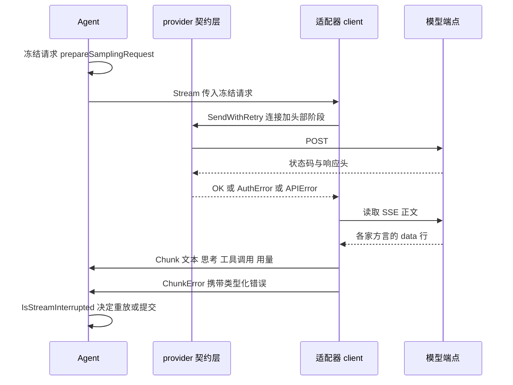
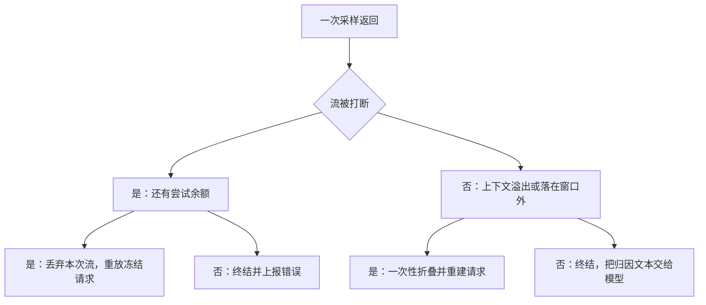

# Reasonix LLM Provider 层：把模型差异关进适配器，用契约边界守住内核

> 本解读按 **ai-agent** 类规格产出，属 DeepSeek-Reasonix 深度解读的子文档；共 13 篇，解读基线 `v2.37.0`（`e17ef45e3`）。正文所有 `文件:行号` 引用均为 Reasonix 仓库相对路径，点开即可核对。相关篇章见 [README.md](README.md)。

## 在系统中的角色：一个方法替代一张 kind 分支表

Provider 层是 Agent 内核与"外面那个会胡说八道的模型"之间的唯一接口面。它的存在理由是减法：内核只认识一个方法——"给一段请求，返回一串类型化增量"，其余一切（哪家的 JSON 字段叫 `max_completion_tokens`、思考内容挂在哪、缓存计数在顶层还是嵌套、400 的错误体怎么读）都被关在这一层以下。

[internal/contract/provider/provider.go:1-5]()
<!-- anchor: // Package provider defines the model-backend abstraction and a registry mapping … package provider -->

契约层的注册表本身也很小：`kind` 是配置里的一个字符串，工厂是 `func(Config) (Provider, error)`，`New` 只按 `kind` 查表，查不到就把已注册的 kind 列表报出来。

[internal/contract/provider/provider.go:664-699]()
<!-- anchor: type Factory func(cfg Config) (Provider, error) … return p, nil -->

全仓注册的 kind 一共四个：`openai`、`anthropic`、`responses`、`dashscope-responses`，后两个共用同一个工厂。

[internal/model/responses/responses.go:32-34]()
<!-- anchor: func init() { … provider.Register("dashscope-responses", newFromConfig) -->

[internal/model/openai/openai.go:58-58]()
<!-- anchor: provider.Register("openai", New) -->

"内核不认识具体适配器"这句需要精确到可核对的形态：全仓**非测试代码****里 `internal/runtime/**` 对四个对话适配器的引用是零**；真正 import 它们的地方分三类——两个 `main` 包与三个 benchmarks 的空导入（自注册）、适配器自己对外围判据函数的复用、以及 setup/诊断这类外围功能。

[cmd/reasonix/main.go:14-16]()
<!-- anchor: _ "reasonix/internal/model/anthropic" … _ "reasonix/internal/model/responses" -->

[cmd/reasonix-studio-host/main.go:48-50]()
<!-- anchor: _ "reasonix/internal/model/anthropic" … _ "reasonix/internal/model/responses" -->

[benchmarks/compaction/main.go:26-26]()
<!-- anchor: _ "reasonix/internal/model/openai" -->

适配器之间也有引用：`anthropic` 与 `responses` 都 import `openai`，只为两个**厂商判据**（`IsDeepSeek`、`DeepSeekTakesImages`），而不是复用 wire 实现。

[internal/model/anthropic/anthropic.go:98-106]()
<!-- anchor: officialDeepSeek := openai.IsDeepSeek(root) … vision = vision && (!officialDeepSeek || openai.DeepSeekTakesImages(cfg.Model)) -->

[internal/model/responses/responses.go:167-167]()
<!-- anchor: vision = vision && provideropenai.DeepSeekTakesImages(cfg.Model) -->

setup 向导用 `openai.FetchModels` 去问端点提供哪些模型，`model/catalog` 也复用同一份抓取实现——这是"非内核、非组装"的几处真实引用。

[internal/frontend/cli/wizard_models.go:14-14]()
<!-- anchor: "reasonix/internal/model/openai" -->

[internal/frontend/cli/wizard_models.go:50-55]()
<!-- anchor: models, err := openai.FetchModels(ctx, u, apiKey, nil) … if !openai.IsModelFetchEndpointMiss(err) && firstHardErr == nil { -->

[internal/model/catalog/fetch.go:12-12]()
<!-- anchor: "reasonix/internal/model/openai" -->

去掉这一层，`internal/runtime/agent` 就必须按 kind 分支：那意味着每加一家 provider，改动会落在 1997 行的 `agent.go` 与 797 行的 `run_loop.go` 里，而不是新增一个几百行的适配器文件。这层就是为此存在的。

## 根因：为什么"抹平差异"在这个项目里格外难

**第一，前缀缓存对字节敏感。** 请求字节里任何一处按端点或模型变化，都会让缓存命中范围从变化点开始截断。所以适配器对请求体的改写必须由"端点身份驱动、确定性完成"，而不能"每次请求现算"。这条约束解释了为什么 `openai` 适配器把 `deepseek/minimax/zhipu/longcat/ollamaCloud/kimiK3` 六个布尔在**构造期**算好、存进 `client` 结构体，而不是在 `buildRequest` 里每次判一次。

[internal/model/openai/openai.go:276-304]()
<!-- anchor: type client struct { … learned            endpointFacts -->

前者让"同一 config 的同一请求"逐字节可复现；后者会把端点探测结果、时间、外部状态渗进前缀。

**第二，模型会编造失败原因。** 项目把"失败归因"视为宿主拥有的状态。

[REASONIX.md:70-76]()
<!-- anchor: - Failure attribution is host-owned state. When the host can determine why an … to stop batching calls that were never the problem. -->

Provider 层是这条铁律的第一个执行点：一次 200 之后才失败、一次读到一半断掉、一次参数被截断，都必须以**类型**而不是**句子**往上传，否则上层就只能"从措辞里读判断"，而项目已明确把措辞匹配列为已废止的做法。

**第三，同一条 HTTP 语义在不同家不等价。** 400 可能是一个未知模型引用，也可能是上一轮的 `previous_response_id` 过期，也可能是工具 schema 不合法。项目选择的是：**能读结构就读结构**。`responses` 适配器判"上一轮续写 id 是否只是过期"时，读的是错误对象里的 `param`/`code` 字段，而不是消息文本。

[internal/model/responses/responses.go:318-335]()
<!-- anchor: // isStalePreviousResponseError reads the error object, not its prose: the … return body.Error.Param == "previous_response_id" || body.Error.Code == "previou -->

## 分层：谁允许知道差异

这张图要回答的不是"支持哪些模型"，而是**差异被允许存在于哪一层、哪条边不允许存在**。位置本身即论据：契约层只放与 transport 无关的类型，端点级偏差全部下沉进适配器，而内核与适配器之间那条最容易顺手加上去的 import 边，在代码里不存在——但**守住它的不是一条门禁规则**，这一点图上有一处专门的注记。

看图时按三个问题走。**第一，谁认识谁。** 宿主进程只用空导入把 kind 注册进注册表；`internal/assembly/boot` 是唯一知道"配置 → 模型引用 → 条目 → kind → 工厂"整条链的地方；内核只 import 契约层的 `Provider` 与三个窄接口，从不 import 任何一家适配器。**第二，差异住在哪。** 四个适配器框并列，每一家把自家的 SSE 方言、字段名、缺失 id、截断判据全部关在框内；它们共同向下依赖契约层，所以新增一家厂商不需要动内核一行。**第三，哪条边被禁止。** 图右侧有一条灰色虚线，方向是内核指向适配器——它标注的是"**这条 import 边不存在，靠的是约定而不是门禁**"；真正被 `repolint layer-order` 拒绝的是**反方向**（适配器不得向上 import 内核），图中用红色虚线加叉标出。这个不对称是本章最值得记住的发现：分层秩表把 `internal/model` 放在 `internal/runtime` 之下，门禁只禁止向上依赖，所以"内核不认识具体模型"是一份**被纪律维持的事实**，而不是一份被检查维持的约束。

图上另外两条容易被忽略的线：`providerbroker` 与"远端内核"之间穿过 SSH 隧道的那条虚线说明只有 `Descriptor` 与 chunk 过隧道，凭据与端点地址留在本机；三个对话适配器向下汇入 `endpointclient`，说明"带凭据的请求"和"沙箱子进程的请求"走的是两套完全不同的出网设施。

## 契约层定义了什么，适配器各自实现了什么

契约层的清单可以从它的文件构成读出来：消息与角色、工具调用与工具 schema、图片、思考内容与签名，都在这一个包里。

[internal/contract/provider/provider.go:21-212]()
<!-- anchor: // Role is the role of a message. … return DefaultReasoningOutputTokens -->

其中 `ReasoningSignature` 的注释解释了为什么签名要跟着思考块一起回传。除类型之外，契约层还持有横切逻辑——`SendWithRetry`、schema 规范化与方言改写、工具参数修复、工具配对修复、消息投影、密钥脱敏；以及**错误类型的闭集**：`AuthError` / `APIError` / `StreamPayloadError` / `StreamInterruptedError` / `ContinuationRecoveryError`，加上 `RetryCause`、`StreamFailureCause`、`StreamInterrupt*` 三套枚举。

[internal/contract/provider/chunk.go:5-18]()
<!-- anchor: // ChunkType identifies the kind of a streamed increment. … ChunkProviderTool                       // a tool the provider ran server-side,  -->

[internal/contract/provider/chunk.go:21-35]()
<!-- anchor: // Chunk is a single streamed event. Read the field matching Type. … Err             error           // ChunkError -->

适配器要产出的只有一种东西：带判别式的增量 chunk，判别式是 `ChunkType`，读哪个字段由它决定。值得单独指出 `ChunkToolCallArgsDelta` 上的 `ArgChars`：它是"这次调用的参数累计已收到多少字符"，只为进度展示而存在，不携带部分参数内容——这避免了让前端去拼接半截 JSON。

[internal/contract/provider/chunk.go:31-32]()
<!-- anchor: ToolCall        *ToolCall       // ChunkToolCallStart (ID+Name only), ChunkToolC … ArgChars        int             // ChunkToolCallArgsDelta: cumulative argument c -->

用量结构把"缓存命中/未命中/写缓存"三者显式建模，并且 `CacheWriteBilledTokens` 用 float 表示"折算成多少普通输入 token 计费"，这是为了表达 Anthropic 的 1.25x/2x 缓存写价格。

[internal/contract/provider/usage.go:19-33]()
<!-- anchor: type Usage struct { … RequestCount int -->

`Provider` 接口本体只有 `Name` 与 `Stream` 两项；接口刻意做小，因为接口越大，内核越容易通过接口渗入厂商语义。

[internal/contract/provider/provider.go:530-546]()
<!-- anchor: type Provider interface { … // unset; callers must treat it as false. -->

`internal/model` 目录的实际构成是：`openai`（含 `fetch_models.go`/`effort.go`/`think.go`/`glm_effort.go`/`kimi_k3.go`/`downgrade.go`/`host.go`/`stream_failure.go`/`output_budget.go`）、`anthropic`（含 `reasoning.go`/`web_search.go`/`stream_error.go`）、`responses`（含 `stream.go`/`vendor.go`/`terminal_calls.go`/`output_budget.go`）、`providerbroker`（`client.go`/`server.go`/`wire.go`/`local.go`）、`catalog`、`billing`、`boundedllm`、`visionimage`、`laya`。这里有两点常见误解需要纠正。

[internal/model/providerbroker/doc.go:1-23]()
<!-- anchor: // Package providerbroker keeps a remote session's model credentials on the … // errors.As on the remote matches what the local provider actually returned. -->

**`laya` 不是 provider。** 它没有 `provider.Register`，而是一个把 `typesafe.Request` 交给本地 Python 子进程求值的决策模型客户端；包注释明确写了"自托管网关不在这里，它只是同 wire 不同地址的一个普通 provider entry"。

[internal/model/laya/client.go:1-4]()
<!-- anchor: // Package laya runs a Laya decision model as a local process. A self-hosted … package laya -->

**`responses` 注册了两个 kind 但只有一个工厂**，`dashscope-responses` 与 `responses` 的差别落在 `vendorCapabilities` 表里而不是代码分支里。那张表自称是"wire 级厂商差异的唯一真源"，承载全部端点级偏差：无状态与否、会话缓存头、是否必须回传思考、是否忽略 temperature、默认输出上限、思考 item 的 id 处理、summary 形状。

[internal/model/responses/vendor.go:10-26]()
<!-- anchor: // vendorCapabilities describes how a Responses-compatible endpoint deviates … stateless bool -->

把它和"在 `responses.go` 里散落字符串比较"对比，就是这张表存在的理由：后者每加一家厂商，都要在多个分支里同步修改。

## 抹平责任在适配器：三处把方言折成统一词表

`anthropic` 把它的 `stop_reason` 翻译成内核认识的统一 `finish_reason`：`max_tokens → length`、`tool_use → tool_calls`、`end_turn/stop_sequence → stop`。

[internal/model/anthropic/anthropic.go:731-742]()
<!-- anchor: // mapStopReason translates Anthropic stop reasons to the OpenAI-style finish … return s // "refusal", "pause_turn", "" — pass through -->

`responses` 把 `response.incomplete` 的原因翻译成同一套词表：`max_output_tokens → length`。

[internal/model/responses/stream.go:335-342]()
<!-- anchor: func incompleteFinishReason(reason string) string { … return "incomplete" -->

`openai` 把四家不同的用量形状（DeepSeek 顶层 `prompt_cache_*`、OpenAI/MiMo 的 `prompt_tokens_details.cached_tokens`、Anthropic 式 `input_tokens`/`cache_*_input_tokens`）折成同一个 `Usage`。

[internal/model/openai/openai.go:1050-1101]()
<!-- anchor: // normaliseUsage folds the cache shapes used by OpenAI-compatible providers int … ReasoningTokens:  reasoning, -->

`anthropic` 还自己处理"原生 Claude 拒绝 temperature/top_p、DeepSeek 兼容端点接受"这种不对称，并把签名思考块的回传规则写进包文档；`openai` 一个包则覆盖 DeepSeek / MiMo / MiniMax-M3 / Zhipu GLM / LongCat / Ollama Cloud / Kimi K3 以及一切"看起来像 OpenAI"的网关，包文档把每家的偏差逐条列出。

[internal/model/anthropic/anthropic.go:1-21]()
<!-- anchor: // Package anthropic implements the Anthropic Messages API provider (POST … package anthropic -->

[internal/model/openai/openai.go:1-22]()
<!-- anchor: // Package openai implements the OpenAI-compatible /chat/completions provider. … package openai -->

## "没有硬编码 `switch model`"只在解析层成立

项目自述说核心"从不硬编码某个具体模型"。这句话在**解析层**完全成立：从配置里的模型引用到具体适配器实例，全程只有 `kind` 参与分发。但在**适配器内部**并不成立——端点身份与少量模型名会让 wire 形状分叉，例如官方 DeepSeek 的 `deepseek-v4-flash` 是唯一允许 `effort=low` 的 DeepSeek 思考模型。

[internal/model/openai/openai.go:145-152]()
<!-- anchor: switch effort { … return nil, fmt.Errorf("openai: provider %q uses DeepSeek thinking; effort must  -->

同类的模型名判断还有：Anthropic 适配器用 `deepseek-v4-pro` 或 `claude-opus` 前缀决定 effort 映射。

[internal/model/anthropic/anthropic.go:193-195]()
<!-- anchor: func deepSeekAnthropicUsesProEffortMapping(model string) bool { … return model == "deepseek-v4-pro" || strings.HasPrefix(model, "claude-opus") -->

以及思考模型名的子串匹配表（`deepseek-v4-flash` / `deepseek-v4-pro` / `deepseek-v3.2` / `deepseek-reasoner` / `deepseek-r1`）用来决定是否必须回传工具调用的思考内容。

[internal/model/openai/openai.go:321-330]()
<!-- anchor: func expectsDeepSeekToolCallReasoning(model, thinkingType string) bool { … strings.Contains(model, "deepseek-r1") -->

诚实的结论是：**分发层无模型硬编码，适配器层有模型名分支**。这不是缺陷——端点确实在不同模型上有不同的 wire 契约；但它与"每个模型都只是 config 实例"的口号之间有落差，应当在解读里写明。这一点也影响了下面这张 SVG 的读法：适配器框内标注"内部仍有模型名分支"，就是为了不让"抹平差异"被读成"适配器内部没有模型知识"。

## 谁不允许知道差异：窄接口代替类型断言

这是本关注面最值得学的一条边界设计：**能力差异通过接口扩展"向上暴露一点点"，而不是通过类型断言暴露"是哪一家"**。适配器可以实现额外的窄接口，内核按能力问它，永远不问它是谁。三个窄接口是 `OutputBudgetProvider`、`SharedWindowOutputProvider`、`SharedWindowInputPolicyProvider`。

[internal/contract/provider/output_budget.go:3-23]()
<!-- anchor: // OutputBudgetProvider reports the output budget used when a request leaves it  … SharedWindowInputPolicy() SharedWindowInputPolicy -->

内核侧唯一的探测点就是把 provider 断言成这些窄接口。

[internal/runtime/agent/output_budget.go:109-125]()
<!-- anchor: func sharesContextWindow(p provider.Provider) bool { … return policy.SharedWindowInputPolicy() -->

`responses` 适配器只对官方 DeepSeek 返回"输入输出共享同一窗口"，因此只有它会走共享窗口的输出预算收窄路径。

[internal/model/responses/output_budget.go:5-17]()
<!-- anchor: // OutputBudget reports the default total output budget sent by this client. … ReplaysResponsesItems:    replay, -->

反面清单同样重要：**`Descriptor` 不含凭据、不含 base URL、不含密钥字段**，远程机器通过 broker 拿到的只有"有哪些模型、叫什么、上下文多大、是否视觉、价格"。这条边界让 `providerbroker` 能成立：远端进程只知道 ref，不知道 key，也不知道端点地址。

[internal/contract/provider/resolver.go:17-53]()
<!-- anchor: type Descriptor struct { … // Selection identifies a catalog provider and an optional session-local -->

## 门禁把什么写成了结构约束

`internal/contract/pricing` 与 `provider` 之间靠"镜像结构"而不是 import 解耦：`RateCard`/`UsageTokens` 重复声明 provider 的字段，注释直接写明"镜像 provider.Pricing 但不 import 那个包（billing 是叶子）"。

[internal/contract/pricing/quote.go:128-146]()
<!-- anchor: // RateCard is the per-1M-token price used to compute original cost. It mirrors … Estimated              bool -->

这处镜像在代码里可以一眼验证：`internal/contract/pricing` 的全部非测试文件只 import 标准库，`internal/model/billing` 只额外 import 一个 `redirectguard`。

[internal/contract/pricing/quote.go:1-9]()
<!-- anchor: package pricing … "time" -->

[internal/model/billing/balance.go:1-7]()
<!-- anchor: // Package billing queries a provider's wallet balance for the status line. The … package billing -->

`internal/model/billing` 与 `internal/model/visionimage` 被声明为 utility 层的叶子包，规则是"叶子包不得 import 非叶子包"，因此它们不能引用内核。

[tools/repolint/layers.go:25-30]()
<!-- anchor: var leaves = []string{ … "internal/model/billing", -->

[tools/repolint/layers.go:64-64]()
<!-- anchor: "internal/model/visionimage", -->

[tools/repolint/layers.go:96-99]()
<!-- anchor: func violates(pkg, dep string) string { … return fmt.Sprintf("%s is a utility-layer package and must not import %s", pkg,  -->

代价是两份结构要人工保持同步；收益是 `pricing` 可以被任何层引用（含 frontend 与门禁工具）而不拖入内核依赖图。分层门禁本身的完整机制（秩表、`layering` 的四条规则、`leaves` 集合的例外语义）见 [architecture-guardrails.md](architecture-guardrails.md)，本篇只讨论与 Provider 层相关的那一侧。

### 一条并不存在的边，和一条真实的禁止边

这一节要澄清一处常见误读：Provider 层的分层**不是**由 `repolint layering` 守住"内核不许 import 适配器"的。

[tools/repolint/layers.go:96-107]() 的 `violates()` 只有四条规则：叶子包不得 import 非叶子、非前端不得 import `session/control`、非前端侧不得 import 前端、未达前端线者不得 import host adapter——没有任何一条提到 provider 适配器。
<!-- anchor: func violates(pkg, dep string) string { … return "" -->

[tools/repolint/layers.go:96-107]()
<!-- anchor: func violates(pkg, dep string) string { … return "" -->

[tools/repolint/layer_order.go:22-34]() 的秩表把 `model` 定为 3、`runtime` 定为 6，规则是"一个包只能 import 同秩与更低秩"，于是 `internal/runtime/agent → internal/model/openai` 被明确**允许**。
<!-- anchor: var layerRank = map[string]int{ … "frontend": 9, -->

[tools/repolint/layer_order.go:22-34]()
<!-- anchor: var layerRank = map[string]int{ … "frontend": 9, -->

[tools/repolint/layer_order.go:48-71]()
<!-- anchor: func checkLayerOrder(imports map[string][]importRef) []Finding { … fmt.Sprintf("%s (%s) may not import %s (%s): a layer depends only on itself and  -->

`layering` 与 `layer-order` 两条规则的容忍度都被钉在 0（仓库级 baseline 里没有一条历史遗留），也就是说这两条规则是"当前零违规"的严格门禁；而它们能挡的只是**反方向**——适配器（秩 3）向上 import 内核（秩 6）。

[tools/repolint/baseline.json:20-21]()
<!-- anchor: "layer-order": 0, … "layering": 0, -->

仓库对外声明的依赖方向原则同样只写到"子包通过 `init()` import 父包自注册；父包永不 import 子包"。

[CONTRIBUTING.md:45-52]()
<!-- anchor: ### Dependency direction … Parents never import children. -->

所以准确表述分两半：**"内核只认识契约"目前靠约定维持**（全仓非测试代码零引用，且没有门禁在看着它）；**"适配器不许依赖内核"才是被门禁守住的那一半**。这处不对称是本篇发现的真实欠账，不能包装成"架构由门禁持有"的胜利。

## 一次轮次在 Provider 边界的生命周期

下面这张时序图把一次模型轮次拆到可以逐段对账的粒度：请求在**发出去之前**就冻结，连接与头部阶段由契约层重试，正文一旦开始就只有两条出路——干净终止，或作为类型化中断上行、由 Agent 决定是否重放同一份冻结请求。它是本章后面所有小节（重试预算、错误分类、截断归因）共同的时间轴。

"同一次轮次的所有重试重放同一份字节"这条约定写在冻结类型上：没有合成恢复消息、没有 schema 重排、失败尝试也不会让 `previous_response_id` 漂移。

[internal/runtime/agent/sampling_request.go:13-27]()
<!-- anchor: // samplingRequest is a once-prepared, frozen provider request for one model … sent usageAnchor -->

连接与头部阶段的重试在契约层完成，且**只覆盖头部阶段**：正文一旦开始流式输出就不再重试，因为模型已经吐了 token。

[internal/contract/provider/retry.go:304-314]()
<!-- anchor: // SendWithRetry POSTs a streaming request built by newReq and returns the OK … func SendWithRetry(ctx context.Context, httpClient *http.Client, opts SendOption -->

冻结请求在真正发出前还要过一次输出预算收窄。

[internal/runtime/agent/sampling_request.go:76-96]()
<!-- anchor: func (a *Agent) prepareSamplingRequest(ctx context.Context) (samplingRequest, er … if budget2, clipped2, err2 := a.window().effectiveOutputBudget(rebuilt.req); err -->

图里"适配器 client"与"provider 契约层"是两个不同的包，这个划分本身就是本篇的主题：适配器知道自己的 SSE 方言，契约层只知道 HTTP 的状态码、头部与一个纯函数式的重试判据。

## 装配路径：配置 → 模型引用 → 条目 → kind → 工厂

第一步，模型引用解析成 `ProviderEntry`；解析器（可能是 broker）优先，配置兜底，失败时错误里列出所有可用引用。

[internal/assembly/boot/resolver.go:251-273]()
<!-- anchor: // resolveModelEntry synthesizes only non-secret metadata from the resolver … return nil, "", fmt.Errorf("%w %q (configured: %s); note: defining [[providers]] -->

第二步，条目 → `provider.Config`：这里把 `api_key_env`、`api_key_source`、`thinking`、`effort`、`reasoning_protocol`、`max_output_tokens`、`idle_timeout_seconds`、`headers`、`extra_body`、`vision`、`web_search`、`stateful` 等全部装进一个 `Extra map[string]any`。

[internal/assembly/boot/provider_config.go:53-84]()
<!-- anchor: func providerConfig(e *config.ProviderEntry, proxy netclient.ProxySpec) provider … "stateful": e.ResponsesStateful, -->

第三步，`NewProviderWithProxy` 先问"这个 kind 是不是一个对话来源"，再交给注册表。

[internal/assembly/boot/provider_config.go:43-50]()
<!-- anchor: // NewProviderWithProxy builds a provider.Provider with the configured ordinary … return provider.New(e.Kind, providerConfig(e, proxy)) -->

这种"弱类型 Extra 袋"是要付代价的：适配器只能 `.(string)` 断言再判零值，键名没有编译期检查。换来的是契约层不需要为每家 provider 新增字段——加一家厂商不动 `provider.Config`。

[internal/model/responses/responses.go:37-62]()
<!-- anchor: func newFromConfig(cfg provider.Config) (provider.Provider, error) { … }), nil -->

更值得学的是这个决策的**边界**：`Extra` 只用来传"构造适配器需要的东西"，不用来传"每次请求变化的东西"。请求级的变化走 `provider.Request`（含 `EffortOverride`、`ResponseFormat`、`Mode`），而且注释明确规定"适配器只发它自己 config 声明过的 mode，所以未知 mode 到不了 wire"。

[internal/contract/provider/request.go:3-19]()
<!-- anchor: // Request is a single completion request. … Summary bool `json:"-"` -->

## 双模型协作：两套前缀，互不干扰

Coordinator 用两个**独立会话**跑 planner 与 executor，理由写在构造处：为了让各自的缓存稳定，"会话从不混合，因此谁的前缀都不会被对方的回合扰动"。

[internal/runtime/coordinator/coordinator.go:93-96]()
<!-- anchor: // Coordinator runs two models in separate sessions to keep each one's prompt … // neither model's prefix is disturbed by the other's turns. -->

**两个会话的系统提示并不相同。** executor 的前缀由 `buildPromptAssembly` 组装（基础系统提示 + 输出风格 + 核心策略 + 环境段 + 记忆 + 技能索引），组装顺序被注释明确声明为契约，"顺序决定每一轮复用的前缀字节"。

[internal/assembly/boot/prompt.go:38-42]()
<!-- anchor: // buildPromptAssembly resolves the base system prompt and folds in, in order, … func buildPromptAssembly(ctx context.Context, opts Options, cfg *config.Config,  -->

planner 的前缀则是它自己的小提示词加上共享的静态记忆上下文，`PlannerPromptWithContext` 把静态上下文追加在 planner 专用提示之后。

[internal/runtime/coordinator/coordinator.go:85-90]()
<!-- anchor: func PlannerPromptWithContext(context string) string { … return DefaultPlannerPrompt + "\n\n# Planning context\n\n" + context -->

装配处传入的正是 executor 记忆里同一份 `StaticContext()`。

[internal/assembly/boot/roles.go:63-63]()
<!-- anchor: plannerSess := sessionstore.NewSession(coordinator.PlannerPromptWithContext(stat -->

[internal/assembly/boot/build.go:427-427]()
<!-- anchor: runner, label, err := t.roles.planner(b.opts, executor, b.model.entry.Model, b.p -->

所以准确表述是：**两套前缀不同（一个 planner 专用小提示 + 静态记忆；一个是完整 executor 前缀），彼此独立、各自字节稳定；共用的只有那一份静态上下文**。这比"两个会话共享系统提示"更符合代码，也更能解释为什么 planner 的缓存不会被 executor 的工具 schema 变动拖冷。

**工具面的差异同样必须写清楚，这是"独立会话"能成立的另一半。** planner 拿到的是一个专门构建的只读注册表：排除 subagent 元工具与 `ask`、`bash_output`、`complete_step`、`slash_command`、`todo_write`、`wait`，只保留只读研究工具，另外**只在这里**加入 `submit_plan` 与 `conclude_no_changes`；直接 MCP schema 与部分 workflow 工具被隐藏。注释把理由说破了：`submit_plan` 只加在 planner，"所以 planner 获得一个结构化出口，而 executor 的 cache-stable 工具前缀纹丝不动"。

[internal/runtime/agent/planner_registry.go:10-18]()
<!-- anchor: // ask is deliberately absent: a planner that needs a user-owned decision asks … "wait", -->

[internal/runtime/agent/planner_registry.go:21-51]()
<!-- anchor: // PlannerToolRegistry returns read-only research tools, submit_plan, and an … return sub -->

只读性本身也不是列举出来的，而是从父注册表按 `ReadOnly()` 过滤出来的；未授权的 MCP 工具与带破坏性提示的 MCP 工具在这一步被剔除。

[internal/runtime/agent/child_registry.go:451-474]()
<!-- anchor: func FilterReadOnlyRegistry(parent *tool.Registry, exclude ...string) *tool.Regi … return sub -->

planner 会话的稳定性还靠一个细节兜住：重置 planner 会话时要保住它自己的系统提示，否则每轮 planner 都要冷启动一次缓存。

[internal/runtime/coordinator/coordinator.go:183-199]()
<!-- anchor: // ResetPlannerSession discards turn-local planner history when the owning … c.plannerAgent.SetSession(next) -->

前缀稳定性的验收不靠注释而靠"打到最后边界"的效果测试：两个不同项目的系统消息与工具面必须逐字节相同，否则报出第一个不同的字节位置。

[internal/assembly/boot/effect_test.go:462-484]()
<!-- anchor: // TestEffectPrefixCarriesNoProjectText asserts the property the goldens can … t.Fatal("tool surface differs between projects") -->

版本控制状态这类"看着像环境、其实是每项目不同"的事实被明确赶到回合尾部，因为放前缀"会让每个字节之后的共享前缀全部失效"。

[internal/assembly/boot/effect_test.go:530-535]()
<!-- anchor: // TestEffectVersionControlRidesTheTurnNotThePrefix pins the cache boundary at … func TestEffectVersionControlRidesTheTurnNotThePrefix(t *testing.T) { -->

## 两个"目录"，别混

`internal/model/catalog` 是**端点自省**：问一个地址它提供哪些模型、它的列表更像哪种协议。它没有运行时状态，也不参与请求路由。

[internal/model/catalog/doc.go:1-5]()
<!-- anchor: // Package catalog asks an endpoint what it serves: the models a configured … // Configuration only describes providers; this is where they are asked. -->

`provider.Descriptor` 列表是**运行时可选模型目录**，由 resolver 提供；本地实现遍历配置里每个 provider 的 chat 模型列表，逐个解析成 ref 并去重，标出默认项。

[internal/assembly/boot/resolver.go:25-62]()
<!-- anchor: // Catalog lists every chat model the config declares, one ref per model, and … return out -->

`providerbroker` 站在两者之间：它把"本机的 resolver"通过 loopback + SSH 反向转发给远端内核，远端只拿到 `Descriptor` 与流，密钥与端点详情留在本机。

[internal/model/providerbroker/doc.go:1-23]()
<!-- anchor: // Package providerbroker keeps a remote session's model credentials on the … // errors.As on the remote matches what the local provider actually returned. -->

它在 loopback 上监听，注释把"只能经由用户自己的 SSH 转发到达"当作设计的全部而不是默认值。

[internal/model/providerbroker/local.go:28-34]()
<!-- anchor: // Listen starts a broker on loopback. Loopback is not a default but the whole … return nil, err -->

远端拿不到目录时会用上一次的缓存而不是清空，因为"隧道瞬时中断不该清空一个正在跑的会话的模型选择器"。

[internal/model/providerbroker/client.go:64-86]()
<!-- anchor: // Catalog returns the local machine's model list. The interface has no error … return append([]provider.Descriptor(nil), list...) -->

端点自省的产物是"可纠正的猜测"：`Probe` 的每个字段都标注为可由用户修正，理由是"卖你 Claude 的 OpenAI 兼容网关和卖你 GPT 的网关对同一个 `/models` 调用会给出同样形状的回答"。

[internal/model/catalog/probe.go:12-38]()
<!-- anchor: // Probe is what an endpoint turned out to be. Every field is a guess a user may … NoProxy bool -->

探测会**把所有协议形状都试完**再汇总，而不是首胜即停：一个同时接受 Bearer 的网关对 OpenAI 与 Anthropic 列表都答，停在第一个会把所有这类端点静默判成 OpenAI。

[internal/model/catalog/probe.go:61-67]()
<!-- anchor: // probeShapes are tried in full rather than first-wins: a gateway accepting … {kind: "anthropic", authHeader: true}, -->

探测失败也被分类成身份：`unauthorized` / `payment_required` / `rate_limited` / `path_not_found` / `no_chat_models` / `upstream_error` / `timeout` / `unreachable` / `not_compatible` / `redirect_refused`；注释写明理由——"每个原因把用户送去不同的修法，一句话带不了这个信息"。

[internal/model/catalog/probe_failure.go:15-31]()
<!-- anchor: // ProbeReason names why probing failed. Each one sends the user to a different … ProbeRedirectRefused ProbeReason = "redirect_refused" -->

多种失败同时到达时按"诊断收窄程度"排序，最含糊的不能赢：`no_chat_models` 排在 `unauthorized` 前面，`not_compatible` 排最后。

[internal/model/catalog/probe_failure.go:56-70]()
<!-- anchor: // probeReasonRank orders diagnoses by how far each narrows the fix. Every shape … ProbeNotCompatible:   8, -->

## 流式解析住在适配器里，一家一个文件

契约层没有 SSE 解析器，因为它没有资格知道"一行 `data:` 里该有什么"。三家的解析位置：`openai` 在 `readStream`，`anthropic` 在自己的 `readStream`，`responses` 在 `stream.go` 的 `readStream`。

[internal/model/openai/openai.go:826-826]()
<!-- anchor: func (c *client) readStream(ctx context.Context, resp *http.Response, out chan<- -->

[internal/model/anthropic/anthropic.go:506-506]()
<!-- anchor: func (c *client) readStream(ctx context.Context, resp *http.Response, out chan<- -->

[internal/model/responses/stream.go:386-386]()
<!-- anchor: func (c *client) readStream(ctx context.Context, resp *http.Response, out chan<- -->

三者共享的只是"扫描行 → 只看 `data:` → 解析 JSON → 产出 `provider.Chunk`"这个骨架。差别恰好落在最有信息量的地方：`openai` 认 `[DONE]` 哨兵。

[internal/model/openai/openai.go:885-891]()
<!-- anchor: line := strings.TrimSpace(scanner.Text()) … sawDone = true -->

`anthropic` 不认哨兵，因为它的终止信号是 `message_stop` 事件，而且它**在收到终止事件后立刻停止读取**，理由是"这样终止之后到来的连接重置就不能把一个完整响应重新归类成被打断"。

[internal/model/anthropic/anthropic.go:674-682]()
<!-- anchor: case "message_stop": … return -->

`responses` 则把"协议定义的终止事件"当作硬要求：连接在终止事件之前关闭，本次尝试就一律不提交——包括已经作为推测输出转发的完整工具调用。

[internal/model/responses/stream.go:445-450]()
<!-- anchor: // Protocol-defined terminal response events are required. Connection close … return -->

契约层这边对应的是同一件事的另一半：`ReadCut` 报告"响应头成功之后读取失败"，因为那里除了传输之外没有别的东西能失败（鉴权、4xx、schema 拒绝都在正文打开之前就定了），所以这一轮没到达终态、Agent 可以重放它；它只额外区分一件事——调用方是否主动取消。

[internal/contract/provider/stream_error.go:32-42]()
<!-- anchor: // ReadCut reports a read that failed after the response headers succeeded. … return StreamInterrupt(wrapped, ClassifyStreamInterrupt(err)) -->

## 增量如何映射为类型化事件

适配器产出的是 `provider.Chunk`；把它映射为 `internal/contract/event` 的类型化事件是 Agent 的职责，一个 `switch chunk.Type` 就是全部映射逻辑。

[internal/runtime/agent/agent.go:1267-1287]()
<!-- anchor: switch chunk.Type { … sink.Emit(event.Event{Kind: event.Text, Text: chunk.Text}) -->

工具调用被拆成三段事件：名字一到就发 `ToolDispatch`（带 `Partial: true`）让前端立刻出卡片。

[internal/runtime/agent/agent.go:1288-1297]()
<!-- anchor: case provider.ChunkToolCallStart: … ID: tc.ID, Name: tc.Name, ReadOnly: a.toolReadOnly(tc.Name), Partial: true, Atte -->

参数流式期间按累计大小重发带 `ArgChars` 的部分事件，但**限流到 250ms 一次**，避免大参数变成事件洪水。

[internal/runtime/agent/agent.go:1300-1313]()
<!-- anchor: case provider.ChunkToolCallArgsDelta: … ID: tc.ID, Name: tc.Name, ReadOnly: a.toolReadOnly(tc.Name), Partial: true, ArgC -->

最后一个完整的 `ChunkToolCall` 才进入 `calls`，成为权威列表。

[internal/runtime/agent/agent.go:1316-1322]()
<!-- anchor: case provider.ChunkToolCall: … maxArgChars = n -->

事件类型本身是 wire-stable 的枚举，新类型只能追加，注释反复强调这一点。

[internal/contract/event/event.go:26-33]()
<!-- anchor: const ( … // Text is an answer-text delta (Text). -->

[internal/contract/event/event.go:84-89]()
<!-- anchor: // Retrying fires before each backoff sleep while the provider re-attempts the … Retrying -->

## 工具调用参数：按索引累加，不按到达顺序拼接

参数按 **content index / tool index** 累加到一张表里，而不是按到达顺序拼接；`openai` 用 `acc map[int]*ToolCall` 加一个 `order []int` 保持最终顺序。

[internal/model/openai/openai.go:869-872]()
<!-- anchor: acc := map[int]*provider.ToolCall{} … var order []int -->

[internal/model/openai/openai.go:947-960]()
<!-- anchor: for _, tc := range delta.ToolCalls { … cur.Arguments += tc.Function.Arguments -->

`anthropic` 用 `content_block` 的 `index` 作键（`tools map[int]*provider.ToolCall`），并同样按 2KB 桶发进度事件。

[internal/model/anthropic/anthropic.go:551-552]()
<!-- anchor: tools := map[int]*provider.ToolCall{} // tool_use blocks, keyed by content index … argBuckets := map[int]int{}           // last emitted 2KB progress bucket per bl -->

`anthropic` 的进度事件注释里有一句很能说明设计取向的自我批评："不做进度 tick，因为没人在等我们"——指的是 provider 自己执行的 server tool 分支。

[internal/model/anthropic/anthropic.go:646-648]()
<!-- anchor: case "input_json_delta": … continue -->

两个适配器都会为**缺失 id** 的调用合成稳定 id（`call_%d`），理由写得很直接：空 `tool_call_id` 会在下游把多工具轮次折叠掉。

[internal/model/openai/openai.go:1031-1041]()
<!-- anchor: slices.Sort(order) … return emitted, ctx.Err() -->

## 参数被截断的处理：三层，分层是刻意的

**第一层，流层判断"这次响应是不是干净的终止"。** `openai` 的判据是"要么见过 `[DONE]`，要么拿到了合法的 `finish_reason`"；两者都没有，就是被中间代理干净地 FIN 掉了——此时**绝不能提交**，因为半截参数会在后续每次重放时 400。

[internal/model/openai/openai.go:1010-1015]()
<!-- anchor: // A proxy that idle-closes with a clean FIN ends the scan with no error. Withou … return emitted, prematureCut(c.name) -->

**第二层，把截断的 JSON 补成合法 JSON**（仅在历史即将发往 provider 时），补不出合法结构就降级成 `{}`；这是"复制后修改"，绝不改调用方历史。

[internal/contract/provider/tool_args.go:31-51]()
<!-- anchor: // repairToolCallArgs returns m with any undecodable tool-call Arguments closed … return m -->

[internal/contract/provider/tool_args.go:54-106]()
<!-- anchor: // closeTruncatedJSON best-effort completes a JSON document cut off mid-stream … return out -->

**第三层，由宿主分类"这条响应边界能提交什么"**：截断只可能截到最后一次调用，所以"尾部调用不完整"是宿主事实，"非尾部调用不合法"才是模型自己的错。

[internal/runtime/agent/response_boundary.go:13-50]()
<!-- anchor: // responseBoundary is one sampling terminal classified against the tool calls … fact:      truncationFact(reason, last, calls[last].Name), -->

关键判据不依赖 `finish_reason` 是否到达：参数在 JSON 值中间断掉（解码器返回 `io.ErrUnexpectedEOF`）本身就是宿主自己的证据。

[internal/runtime/agent/response_boundary.go:54-63]()
<!-- anchor: // argumentsCutOff reports arguments that stop mid-value: the decoder ran out of … return errors.Is(err, io.ErrUnexpectedEOF) -->

## 失败分类跨越边界：身份过去，句子留在本地

`APIError` 保留 `Provider`/`Status`/`Body`/`TraceID`/`ToolContext`，而重试判据是一个纯函数：408、429、5xx 才可重试。

[internal/contract/provider/retry.go:213-238]()
<!-- anchor: type APIError struct { … return s == http.StatusRequestTimeout || s == http.StatusTooManyRequests || (s > -->

401/403 走另一条路：变成 `AuthError`，并且**只对曾经认证成功过的 key 重试**（最多 2 次），理由是"MiMo 这类网关在负载下会返回瞬时 401"；从未成功过的 key 是配置错误，快速失败。

[internal/contract/provider/retry.go:38-42]()
<!-- anchor: // maxAuthRetries bounds how many times a 401/403 is retried for a key that has … const maxAuthRetries = 2 -->

`AuthError` 的 `Error()` 明确**不包含响应体**，并且把"有没有 key"与"key 从哪来"分开携带，以便把"被拒绝"和"没配置"讲成两件事。

[internal/contract/provider/provider.go:633-660]()
<!-- anchor: // message is already user-facing and actionable — it names the provider and, … e.Provider, e.Status, key) -->

重试原因也是身份而不是句子，闭集是 `connection_closed` / `timeout` / `upstream_status` / `stream_idle` / `upstream_error`。

[internal/contract/provider/retry.go:63-78]()
<!-- anchor: // RetryCause says why the attempt that just failed is being retried. It is an … RetryCauseUpstreamError RetryCause = "upstream_error" -->

### 什么条件下不重试

- **永久性传输失败**：连接被拒、DNS 名字不存在、证书校验失败——一律第一次就失败，不浪费退避。

[internal/contract/provider/retry_permanent.go:10-27]()
<!-- anchor: // permanentTransportErr reports a transport failure no backoff can fix: the … errors.As(err, &invalid) || errors.As(err, &verification) -->

- **超时只给 1 次重试**：注释把代价写清楚了——还在 prefill 的模型每次都会同样超时，而每次重试都会重启那份工作，用满预算等于把一个空闲超时窗口乘以 11 倍才让用户听到消息。

[internal/contract/provider/retry.go:44-48]()
<!-- anchor: // maxTimeoutRetries bounds how many times a transport timeout is retried. A … const maxTimeoutRetries = 1 -->

- **正文阶段不重试**：`SendWithRetry` 只管头部阶段，正文中断由上层决定重放。

[internal/contract/provider/retry.go:311-313]()
<!-- anchor: // statuses become *APIError. A RetryNotify in ctx fires before each sleep. … // failures are not retried (the model has already emitted tokens). -->

- **上下文溢出只折叠一次**：`overflowFolded` 是单次位，第二次拒绝意味着折叠得不够，而不是再折一次。

[internal/runtime/agent/sampling_request.go:18-27]()
<!-- anchor: // overflowFolded records that this round already answered a context-overflow … sent usageAnchor -->

### 三种"把判断打字化"的手段

**手段一：闭集原因枚举 + 只在产生它的层赋值。** 传输层能分辨"空闲超时"与"连接重置"，但只有读循环知道这次是它判定超时的，所以超时原因由 `stallCut` 在原地贴上，`ClassifyStreamInterrupt` 只作为兜底。

[internal/contract/provider/streaminterrupt.go:98-113]()
<!-- anchor: // ClassifyStreamInterrupt maps a transport error onto a fixed reason enum from … return StreamInterruptPrematureEOF -->

[internal/model/openai/stream_failure.go:58-69]()
<!-- anchor: // stallCut is the end only this read loop can recognise: the deadline it set … return provider.StreamInterrupt(err, provider.StreamInterruptPrematureEOF) -->

`openai/stream_failure.go` 是一份极短的"归因表"：在没输出过任何字节时，错误可以被重放；已经输出过就只能作为终止错误上报。

[internal/model/openai/stream_failure.go:29-55]()
<!-- anchor: // streamFailure decides whether a stream that stopped can be attempted again. … return err -->

`anthropic` 的等价判断写在它自己的薄适配层里，注释把权衡讲透了："输出前可以重来，输出后重放会让用户看第二遍。"

[internal/model/anthropic/stream_error.go:10-21]()
<!-- anchor: // anthropicStreamError types an in-stream `error` event. Before any output the … return payload -->

`streampayload.go` 处理最刁钻的一类：HTTP 已经 200、流也开着，但端点自己在流里报错——它必须作为类型上行，不能被压成字符串。

[internal/contract/provider/stream_payload.go:1-22]()
<!-- anchor: // A gateway reporting its own failure inside a stream it already answered 200 … return e.Provider + ": " + e.Message -->

**手段二：上下文溢出只认有文档的错误码，不认"看起来像"。**

[internal/contract/provider/context_overflow.go:8-33]()
<!-- anchor: // contextOverflowCodes are the codes an error envelope sets when the request's … return contextOverflowCodes[apiErr.ErrorCode()] -->

**手段三：跨进程时给错误建一个 tagged union。** broker 的 wire 层把 provider 错误投影成 `errKind` 判别式并保留 `Wrapped` 因果链，注释说明了为什么必须保真："上下文溢出的折叠靠 `*provider.APIError` 的状态码和它错误体里的 code，被压成字符串的失败什么都分类不出来。"

[internal/model/providerbroker/wire.go:64-96]()
<!-- anchor: // errKind names the concrete error a chunk carried. Callers tell these apart … Wrapped     *wireError `json:"wrapped,omitempty"` -->

解码时引入未知 kind 的降级策略也是明确的："宁可丢分类，不可丢错误。"

[internal/model/providerbroker/wire.go:146-176]()
<!-- anchor: // decode rebuilds the error the local provider returned. An unknown kind — a … return errors.New(w.Message) -->

## 重试/退避的两级预算，以及重放所有权

**第一级在契约层**：连接+头部阶段最多重试 10 次，退避上限 15 秒，服务端给的 `Retry-After` 单独放宽到 60 秒——注释解释了为什么不能把它压到自己的退避上限：限流窗口通常比我们的上限长，压上去只是拿次数去撞同一扇关着的门。

[internal/contract/provider/retry.go:17-27]()
<!-- anchor: // MaxRetries is the number of times SendWithRetry re-attempts the connection + … const maxRetryAfter = 60 * time.Second -->

它还有一个容易忽略的防御：读非 OK 响应体带 10 秒超时，因为"网关在压力下会先发头再挂住正文"，而 `http.Client` 没有总超时、`ResponseHeaderTimeout` 在头部到达后就不再适用。

[internal/contract/provider/retry.go:29-36]()
<!-- anchor: // errorBodyReadTimeout bounds how long draining a non-OK response body may … var errorBodyReadTimeout = 10 * time.Second -->

**第二级在 Agent**：正文阶段最多 5 次重放（共 6 次尝试），退避 0.5s/1s/2s/4s/8s 各加最多 250ms 抖动。

[internal/runtime/agent/agent.go:47-50]()
<!-- anchor: // maxStreamRecoveries is the number of body-phase stream retries after the … const maxSamplingAttempts = maxStreamRecoveries + 1 -->

[internal/runtime/agent/run_loop.go:556-561]()
<!-- anchor: // streamRetryDelay is the backoff before replaying failed attempt n (1-based): … return base + time.Duration(rand.IntN(250))*time.Millisecond -->

分两级的理由在 `openStream` 的注释里：provider 不得再叠一层正文重试预算，否则两个预算相乘，而重放、UI 回滚与工具执行必须各自单点拥有。

[internal/model/openai/openai.go:488-493]()
<!-- anchor: out := make(chan provider.Chunk) … return out, nil -->

**决策二的另一个代价**：重放要求请求可复现，因此 Agent 必须先"冻结"请求。

[internal/runtime/agent/sampling_request.go:42-56]()
<!-- anchor: ) (retry bool, terminal streamedTurn) { … return true, streamedTurn{} -->

而且即使一次尝试完全失败，也可能已经产生计费，所以每次尝试的用量都要累加进"可计费用量"，同时把"最近一次请求的形状"单独存给上下文仪表——不能拿多尝试聚合去喂压缩决策。

[internal/runtime/agent/run_loop.go:451-458]()
<!-- anchor: result := runAttempt(attemptID, attemptSink) … last.usage = finalizeSamplingUsage(billable, result.usage) -->

## 一次轮次失败之后的判定树

把上面几条规则放在一起看，一次采样失败之后的去向其实是一棵很小的树：只有"被打断"和"上下文溢出"两种情形会重试，而且两者都受同一个尝试次数上限约束；其余失败一律终结，并把归因文本交给模型。这张图是"决策二"的另一种画法——它解释的是为什么一次正文中断会被重放，而一次 400 不会被。

这棵树就是 `handleSamplingError` 的分支顺序：先判是否流被打断且还有尝试余额，再判上下文溢出能否一次性折叠，最后落回"不丢弃已经流出的推测输出、把错误与用量一起上交"。

[internal/runtime/agent/sampling_request.go:34-70]()
<!-- anchor: func (a *Agent) handleSamplingError( … return false, last -->

注意 `streamSink.Discard()` 只在前两条重试路径上调用：重试时把已经发到前端的部分文本丢掉，终结时反而保留——这样 LocalOnly 前端可以把最后一份推测输出镜像出来。

[internal/runtime/agent/sampling_request.go:43-65]()
<!-- anchor: if provider.IsStreamInterrupted(result.err) && attempt < maxSamplingAttempts { … streamSink.Flush() -->

## 输出上限与截断：宿主归因，不是模型的自我反省

自动输出预算是一条显式的阶梯，DeepSeek 的空 effort 视为 high（64K），low 为 32K，关闭思考回到普通 16K，而且注释三次强调 **128K 永不自动**：用户在经历长度截断之后要自己显式设置。这条策略与 `compact_ratio` 完全无关。

[internal/contract/provider/provider.go:195-212]()
<!-- anchor: // Auto ladder for max_output_tokens=0. Bounds completion only; never compact_ra … return DefaultReasoningOutputTokens -->

[internal/model/openai/openai.go:222-229]()
<!-- anchor: // max_output_tokens=0 means automatic (not unlimited). DeepSeek reasoning … maxOutputTokens = provider.AutoOutputBudget(reasoningOn, effort) -->

`responses` 复刻了同一条阶梯，包括"关闭思考时走普通预算"的同一个分支。

[internal/model/responses/responses.go:199-210]()
<!-- anchor: // responsesAutoOutputBudget mirrors Chat Completions: DeepSeek defaults empty … return provider.AutoOutputBudget(true, e) -->

`anthropic` 的不同在于 `max_tokens` 是必填：原生 Anthropic 用保守的普通默认值，只有开启思考时才抬到自动阶梯。

[internal/model/anthropic/anthropic.go:110-125]()
<!-- anchor: maxOutputTokens, _ := cfg.Extra["max_output_tokens"].(int) … maxOutputTokens = provider.AutoOutputBudget(true, effort) -->

收窄发生在发出前的最后一刻，并且**只在 provider 声明"输入输出共享一个窗口"时才做**；不共享窗口的 provider 返回"不收窄"，一个字段都不改。

[internal/runtime/agent/output_budget.go:287-306]()
<!-- anchor: // effectiveOutputBudget clips completion tokens at send time only; it never … return available, true, nil -->

保留量随窗口放大而放大（窗口的 1/32，至少 8K），理由是把估算误差按窗口规模等比放大：固定余量能护住 200K 窗口，在 1M 窗口上会每轮撞 400。

[internal/runtime/agent/output_budget.go:13-19]()
<!-- anchor: const outputBudgetReserve = 8 * 1024 … return max(outputBudgetReserve, window/32) -->

收窄失败（估算的 prompt 已经吃掉全部余量）返回的是**本地的 `ErrCompactionRequired`，而不是等端点回 400**。

[internal/runtime/agent/output_budget.go:298-301]()
<!-- anchor: est := a.estimatedRequestTokens(req) … return 0, false, fmt.Errorf("%w: estimated prompt %d leaves no shared-window out -->

当 `finish_reason` 落在 `length` 或 `repetition_truncation` 上时，宿主生成一段明确标注为"这是我的事实、不是你调用错了"的归因文本交给模型。

[internal/runtime/agent/response_boundary.go:66-84]()
<!-- anchor: // truncatedTerminal reports the finish reasons that end a response before the … return "hit the model's output-token limit" -->

[internal/runtime/agent/response_boundary.go:88-107]()
<!-- anchor: // truncationFact carries what only the host knows: the response ended at a … return b.String() -->

这段文字里有三件只有宿主知道的事：被截断的是哪一次调用（名字）、它没有被修补也没被执行、已经完成的其他调用正常跑了。最后还显式撤销一个错误学习结果——"一次批量调用本身仍然是对的，这是大小上限，不是批量失败"。

[internal/runtime/agent/response_boundary.go:98-106]()
<!-- anchor: switch executed { … b.WriteString("\n\nRe-emit only the work that did not run. Batching independent  -->

同样的归因也给了空回答的重试提示：如果宿主看到是截断导致的空回答，就告诉模型"是撞了输出上限被截断，请用更短的推理给出可见答案"，否则模型会在同一个长度上重复自己。

[internal/runtime/agent/response_boundary.go:125-133]()
<!-- anchor: // emptyFinalRetryMessage asks for a visible answer. When the host saw the … return "The previous assistant response finished without any visible answer text -->

**除了截断，宿主还有一份"归因账本"要交付。** 上一轮没跑完的审批问题、没跑完的委派，会被重新推导成一段 `interrupted-adjudication` 文本随下一个请求下发，措辞明确要求模型"把它当作用户可能提及的上下文，而不是一个要回答的问题或要继续的工作"。

[internal/session/control/adjudication.go:277-293]()
<!-- anchor: func (c *Controller) RequestContext() []string { … b.WriteString(": " + item.Summary) -->

这类"宿主欠请求的事实"由一个接口统一供给，且注释强调它们**每次请求现推导、从不存储**，所以没有任何东西能把它们折进历史或让一份过期副本复活。

[internal/runtime/agent/host_context.go:9-22]()
<!-- anchor: // HostContext supplies facts the host owes the request being built and keeps … func (a *Agent) withHostContextTail(visible []provider.Message) []provider.Messa -->

### 一处破了"读结构不读措辞"的例外

`AnnotateToolSchemaError` 用正则 `tool\s+(\d+)\s+function` 去 provider 返回的错误**正文**里抓工具序号，再映射回工具名。这是全仓少见的对 provider 散文做模式匹配的地方。

[internal/contract/provider/schema_error.go:11-38]()
<!-- anchor: var providerToolIndexPattern = regexp.MustCompile(`(?i)\btool\s+(\d+)\s+function … return &annotated -->

它没有被 `error-text` 门禁覆盖：那个门禁只追踪"某个值的文本来自 `err.Error()`"这一条污点路径，并且只在污点值进入 `strings.*` 匹配器时报告。

[tools/repolint/errortext.go:12-14]()
<!-- anchor: var textMatchers = map[string]bool{ … "Index": true, "EqualFold": true, "Cut": true, "Split": true, -->

[tools/repolint/errortext.go:20-33]()
<!-- anchor: func checkErrorText(s *sourceFile) []Finding { … return out -->

[tools/repolint/errortext.go:98-104]()
<!-- anchor: func isStringsMatcher(fun ast.Expr) bool { … return ok && id.Name == "strings" -->

可以辩护的一面是：它抓的是序号（结构），不是判断"这句话意味着什么"；不能辩护的一面是：序号藏在散文里，厂商换措辞就失效。这属于已知边界，不应包装成纯结构判断。它与 [tool-system.md](tool-system.md) 里 `internal/runtime/recovery/rules.go` 的那处逃逸属于同一类，因此本项目"读措辞"门禁的**已确认逃逸实例至少有两个**；门禁设计与其余横切规则见 [architecture-guardrails.md](architecture-guardrails.md)。

### `boundedllm` 到底约束什么

`boundedllm` **不是** provider 的 `max_tokens` 计算器，也不在 `provider.Register` 名单里。它是宿主独立审查者（Auto Guard 恢复审查者与 Goal 评估器）共用的"有界无工具调用"基础设施：单次 temperature=0 的请求、硬性时间与输出预算，而且它的用量归到审查者自己的来源上，**永不进入主会话的前缀缓存**。

[internal/model/boundedllm/bounded.go:1-6]()
<!-- anchor: // Package boundedllm provides the shared bounded no-tool provider call … // to the reviewer's own source, never the main session's prompt cache. -->

"永不进入主会话前缀缓存"这一条是设计目的而非副作用：审查调用如果带着主会话的历史、或算进主会话的缓存，就会改变主会话前缀的字节，从而毁掉缓存。

[internal/model/boundedllm/bounded.go:2-6]()
<!-- anchor: // infrastructure used by independent host reviewers (the Auto Guard recovery … // to the reviewer's own source, never the main session's prompt cache. -->

四道预算都是字节口径的常量：整次请求 30 秒、补全 token 256、输出字节 4KiB（注释写明"provider 忽略 MaxTokens 时用它中止流"）、系统策略 2KiB、system+evidence 合计 8KiB。

[internal/model/boundedllm/bounded.go:20-31]()
<!-- anchor: const ( … DefaultMaxTotalBytes = 8 * 1024 -->

**超限的处置是三处不同的失败，而不是一个统一的错误码**：请求体超限在发出前直接失败（注释解释为什么不能"从中间裁剪"——证据是调用方按字段预算好的，剩下的溢出只可能来自策略膨胀，所以 fail closed）；输出字节超限在流中取消并报 output exceeded；推理字节超限只记录一个溢出位，留到最后判断。

[internal/model/boundedllm/bounded.go:101-104]()
<!-- anchor: if len(system)+len(evidence) > maxTotalBytes { … return "", fmt.Errorf("bounded reviewer request exceeds %d bytes", maxTotalBytes -->

[internal/model/boundedllm/bounded.go:141-145]()
<!-- anchor: case provider.ChunkText: … return "", fmt.Errorf("bounded reviewer output exceeded %d bytes", maxOutputByte -->

[internal/model/boundedllm/bounded.go:180-187]()
<!-- anchor: func (r *reasoningAnswer) add(s string) { … r.text.Reset() -->

这里有一处值得单独学的设计：**推理只在它变成答案时才计入输出预算**，所以"先长篇推理再写内容"的模型不会被拒绝。

[internal/model/boundedllm/bounded.go:170-177]()
<!-- anchor: // reasoningAnswer holds the reasoning stream of a caller that accepts it as the … overflow bool -->

代价写在同一个判断里：只有干净的 `stop` 才能让推理成为答案，被截断的流的推理是**未完成的思考**，直接丢弃；如果它已经溢出了字节上限，就以 `bounded reviewer reasoning exceeded %d bytes` 报错，而不是裁剪后返回半截思考。

[internal/model/boundedllm/bounded.go:191-200]()
<!-- anchor: // answer is the reasoning when the provider reported a clean stop; a truncated … return r.text.String(), nil -->

`boundedllm` 取的是字节上界而不只是 token 上界，理由是"一个不守 `max_tokens` 的端点仍要被一道墙拦住"。这个双保险对任何 provider 都成立，代价是正常的完整回答也可能被这道 4KiB 墙切掉——所以它只用于审查调用，不用于主对话。

## 计费与价格：两个互不依赖的包

这一节的第一个任务是把两个常被混为一谈的包分开。`internal/contract/pricing` 是**价格书 + 报价**：每 1M token 的缓存/输入/输出价、峰谷时段、固定点金额、覆盖率；`internal/model/billing` 是**钱包余额查询**，只实现 DeepSeek 的 `GET /user/balance` 形状，而且"严格可选"——没有 `balance_url` 的 provider 永远不被查询。

[internal/model/billing/balance.go:1-7]()
<!-- anchor: // Package billing queries a provider's wallet balance for the status line. The … package billing -->

两者在代码上没有任何依赖关系：`pricing` 的全部非测试文件只 import 标准库；`billing` 只额外 import 一个 `redirectguard`。把它们描述成"有关系"是误导——它们只是都跟钱有关，而依赖方向、权威来源、失败语义完全不同。

余额解码按**主机名精确匹配**选形状（DeepSeek / Moonshot / OpenRouter），没被表覆盖的地址按 DeepSeek 形状读。判断依据与定价一致："只有厂商自己的端点才知道该用什么形状回答。"

[internal/model/billing/shape.go:11-19]()
<!-- anchor: // walletShapes maps a vendor's own API hostname to the decoder for its balance … "openrouter.ai":    decodeOpenRouter, -->

余额读取的失败也被分成四个用户可行动的原因（凭证被拒 / 端点不可达 / 响应不合法 / 正常），并明确"不合形状的响应绝不能渲染成零余额"。

[internal/model/billing/balance.go:24-31]()
<!-- anchor: // A wallet read fails in ways the reader must tell apart: a rejected credential … ErrUnreadable   = errors.New("wallet response not in this endpoint's shape") -->

价格"只增不改"的判据分两半，一半在注释与工具，一半在测试。价格变更是**追加一个 generation**，不编辑旧的；理由是"被取代的价还要在，才能让一个已存的价格被认作本项目的默认值，而不是用户自己填的数——这是'刷新它'和'弄丢它'的区别"。

[internal/contract/pricing/rates.go:32-36]()
<!-- anchor: // officialRates is the price book. A price change appends a generation rather … var officialRates = []officialRateRow{ -->

`CurrentRate` 取最后一代，`SupersededRates` 返回除最后一代以外的全部。

[internal/contract/pricing/rates.go:214-244]()
<!-- anchor: // CurrentRate is what a vendor's model costs in a currency today — the off-peak … return out -->

对应的测试把"追加错了"变成 CI 红灯：同一行内不允许重复的 generation（否则当前价会被当成被取代价，每次刷新都改一遍还报告"有变化"）；四个识别字段不允许重复行；被取代集合不许包含当前价；每个价格行必须真的到达 catalog。

[internal/contract/pricing/rates_test.go:5-22]()
<!-- anchor: // The history answers one question: is a stored price the current default, or a … t.Errorf("%s/%s/%s holds a rate filed as %q", row.Provider, row.Model, row.Curre -->

[internal/contract/pricing/rates_test.go:28-55]()
<!-- anchor: // CurrentRate returns the first row it matches, so two rows sharing all four … t.Errorf("%s/%s/%s lists its current rate as superseded", row.Provider, row.Mode -->

[internal/contract/pricing/rates_test.go:75-84]()
<!-- anchor: // Every row the table declares has to reach the catalog, which is what a quote … t.Errorf("%s/%s/%s/%s is declared but never published", row.Provider, row.Model, -->

`tools/pricecheck` 是**外部对账**而不是门禁：它去读厂商的定价页，比对当前价，并且注释明确"它报告，它不 gate：它要联网，页面改形状是给人看的事情，不是要让构建失败的事情"。

[tools/pricecheck/main.go:1-8]()
<!-- anchor: // pricecheck compares the rates in billing's table against what each vendor … // verdicts and neither counts as agreement. -->

但它确实会在两种情况下 `exit 1`：页面与表**不一致**，或页面**读不出来**；退出前的提示词正是那句设计口号。

[tools/pricecheck/main.go:57-62]()
<!-- anchor: reportCheckedOn() … os.Exit(1) -->

缓存命中的计价差异被真实建模：`Usage` 把命中/未命中/写缓存分成三个字段，`CacheWriteBilledTokens` 表达"写缓存折算成多少普通输入 token 计费"。

[internal/contract/provider/usage.go:23-26]()
<!-- anchor: CacheHitTokens         int     // prompt tokens served from cache … CacheWriteBilledTokens float64 // cache-write charge expressed in ordinary input -->

计价公式是：命中 token 按 `CacheHit` 单价，未命中部分要**先把写缓存扣出来、再按折算后的计费单位加回**，然后加输出。

[internal/contract/pricing/quote.go:168-196]()
<!-- anchor: // OriginalCostAmount computes the fixed-point original cost from rates + tokens … // PricingFingerprint hashes a rate card for ledger keys. -->

Anthropic 的 1.25x 五分钟写缓存倍率就落在适配器里，且**只对原生 Anthropic 生效**。

[internal/model/anthropic/anthropic.go:706-721]()
<!-- anchor: finalize: … ServerToolRequests:     serverTools, -->

峰的建模把窗口当作**结构**而不是两个修饰字段：一个 `PeakWindow`（时区偏移、小时区间、周末免峰生效日期、法定假日列表），报价据此选择 base 或 peak 卡；DeepSeek 的中国法定假日被逐日列举。

[internal/contract/pricing/catalog.go:13-60]()
<!-- anchor: type CatalogEntry struct { … "2026-06-19", "2026-06-20", "2026-06-21", -->

代价很直白：假日表每年要人工续写，注释也这么说了（"下一份公告出来就延长它"）。这是"价格正确性靠人工核验而不是靠 API"的必然结果——同一段注释把这句话说破："这里没有任何厂商通过 API 提供价格，所以这个日期是价格变化与静默错误读数之间唯一的东西。"

[internal/contract/pricing/catalog.go:30-33]()
<!-- anchor: // CheckedOn is when a person last read DocURL and confirmed these numbers. … CheckedOn string -->

而"什么算官方价目"的判据是**主机名精确相等**：经销商或代理即使提供同一个模型，也是按自己的条件计费；一个只是名字像厂商的条目，不构成"这是厂商端点"的证据。这就是为什么一个套壳网关不会被套上 DeepSeek 的峰谷时段。

[internal/contract/pricing/catalog.go:88-98]()
<!-- anchor: // officialEndpointHosts maps a vendor's own API hostnames to the catalog … "token-plan-ams.xiaomimimo.com": "mimo", -->

峰谷重定价有一条容易被忽略的边界：**只有被识别为厂商自己的价目才能被按时段重算**。自定义价格是用户与网关之间的商业安排，把别人的峰谷时段投射到它上面等于凭空造出一个没人公布过的数字，所以 `applyOfficialSchedule` 在 `!isOfficial` 时直接返回。

[internal/contract/pricing/quote.go:276-290]()
<!-- anchor: // applyOfficialSchedule re-prices the turn at the vendor's rate for the hour it … return -->

同一节的另一条取舍是**跨币种换算被刻意删除**：没有官方价目可参照的自定义价就留在原币，并在展示层标记"显示不可用"，而不是用运行时汇率折算出一个看似精确的数。两条合起来说明这套计价的取向——**宁可少显示一个数，也不显示一个无法追溯"是谁公布的"数**。

[internal/contract/pricing/quote.go:334-343]()
<!-- anchor: func (s *quoteBuildState) addTargetValuation(target string) { … s.valuationFailures[target] = "display_unavailable" -->

计价口径的兼容层是显式的：`provider.Pricing.Cost` 被标注为"兼容适配器，新的宿主代码必须用 `pricing.CostQuote`，不许再聚合浮点数"。

[internal/contract/provider/usage.go:68-79]()
<!-- anchor: // Pricing is a provider's per-1M-token rates, used to estimate spend. Currency … func (p *Pricing) Cost(u *Usage) float64 { -->

`CostQuote` 区分"原币事实"与"估值"，并把覆盖率做成四态（none/complete/partial/incomplete），理由是一个布尔装不下"只给部分调用定到价"和"一次都没花钱"这两种情况。

[internal/contract/pricing/quote.go:70-90]()
<!-- anchor: // CostQuote is the host-side quoted cost for one model call (or an aggregate). … // request. Complete is retained as the old wire alias. -->

[internal/contract/pricing/coverage.go:3-12]()
<!-- anchor: // Coverage says how much of the usage behind a quote carries a complete price … CoverageIncomplete = "incomplete" -->

## 凭据与出网：两条完全不同的路

**凭据只有一处来源：Reasonix 全局 `.env`。** `ProviderEntry.APIKey()` 的实际读法是 `storedCredentialValue(roots, APIKeyEnv)`。

[internal/contract/config/config.go:1611-1623]()
<!-- anchor: // APIKey resolves the entry's API key from its api_key_env. … return value -->

`storedCredentialValue` **只读**全局凭据文件（`$REASONIX_HOME/.env`），读不到就返回空。

[internal/contract/config/credentials.go:574-580]()
<!-- anchor: func storedCredentialValue(r Roots, key string) (string, CredentialSource, bool) … return "", CredentialSource{}, false -->

[internal/contract/config/paths.go:384-389]()
<!-- anchor: func (r Roots) UserCredentialsPath() string { … return filepath.Join(dir, ".env") -->

keyring 只作为**遗留迁移**路径存在，`credentials_store` 被渲染成"遗留兼容；provider 密钥保存在 Reasonix 的全局 .env"。

[internal/contract/config/render.go:57-57]()
<!-- anchor: fmt.Fprintf(&b, "credentials_store = %q   # legacy compatibility; provider keys  -->

[internal/contract/config/credentials.go:21-27]()
<!-- anchor: const ( … credentialClearedPrefix   = "# reasonix-cleared " -->

进程环境只在**setup 探针**这一条路径被读，注释写明"正常运行时不会调用它；已加载的 provider 条目仍然只从 Reasonix 全局 .env 解析"。

[internal/contract/config/config.go:1626-1643]()
<!-- anchor: // ResolveAPIKeyFromProcessEnvForProbe pins a setup-time, user-entered key onto … e.resolvedSource = CredentialSource{Kind: CredentialSourceEnvironment, Label: "s -->

一个需要点明的现实：全局 `.env` 会被写进进程环境（`os.Setenv`），所以随手 `export` 一个同名变量并不会"覆盖"provider 的密钥解析——密钥解析根本不看 `os.Getenv`。

[internal/contract/config/dotenv.go:106-122]()
<!-- anchor: func loadDotEnvFileAs(path string, source CredentialSource) { … recordCredentialSource(key, val, source) -->

多 Provider 的凭据隔离靠三个机制。**每个条目一个 `api_key_env`**，条目之间不共享密钥，而且 `api_key_env` 要过合法性校验（"用字母数字下划线，不要拿模型名当变量名"）。

[internal/contract/config/config.go:1715-1719]()
<!-- anchor: if strings.TrimSpace(e.APIKeyEnv) != "" && !IsValidCredentialKey(e.APIKeyEnv) { … return fmt.Errorf("provider %q: no stored key for %s in %s; run 'reasonix setup' -->

**工作区 `.env` 故意不写进进程环境**，注释给的理由就是隔离本身："多个桌面/ACP 工作区之间不能互相泄漏 token，项目文件也不能重定向 Reasonix 自己的配置/凭据路径。"

[internal/contract/config/dotenv.go:34-37]()
<!-- anchor: func (r Roots) loadDotEnvForRoot(root string) map[string]string { … return projectEnv -->

**无 key 的判断不是"没配置"，而是"这个地址需不需要"**：官方几个 host 视为必需；loopback / 私有 / 链路本地地址允许无 key 运行。

[internal/contract/config/config.go:1656-1668]()
<!-- anchor: // RequiresAPIKey reports whether this provider should be hidden/validated when … return !providerBaseURLAllowsMissingAPIKey(e.BaseURL) -->

[internal/contract/config/config.go:1680-1693]()
<!-- anchor: func providerBaseURLAllowsMissingAPIKey(raw string) bool { … return addr.IsLoopback() || addr.IsPrivate() || addr.IsLinkLocalUnicast() -->

**出网有两条完全不同的路，交叉点只有"代理"这个同名概念。** provider 流量走用户配置的代理，并与"重定向不得离开原 origin"绑定在一起，因为请求带着凭据；三个对话适配器都通过同一个构造器建 HTTP client。

[internal/safety/endpointclient/endpointclient.go:1-20]()
<!-- anchor: // Package endpointclient builds the HTTP client for requests that carry a … return c, nil -->

[internal/model/openai/openai.go:266-272]()
<!-- anchor: func newHTTPClient(cfg provider.Config) (*http.Client, error) { … ResponseHeaderTimeout: provider.IdleTimeoutFromExtra(cfg.Extra), -->

`anthropic` 复用同一个构造器，只调了 `ResponseHeaderTimeout`。

[internal/model/anthropic/anthropic.go:156-158]()
<!-- anchor: func newHTTPClient(cfg provider.Config) (*http.Client, error) { … return endpointclient.New(spec, netclient.TransportOptions{ResponseHeaderTimeout -->

代理规格（auto/env/custom/off、`no_proxy`、直连主机）是 `netclient.ProxySpec`，注释写明"直连主机在任何模式下都绕过代理"。

[internal/base/netclient/netclient.go:28-41]()
<!-- anchor: // ProxySpec is the resolved proxy configuration used by network clients. URL is … DirectHosts []string -->

**沙箱子进程的流量走 egress 策略**（allow/deny 列表 + 解析地址检查）。egress 的原因码会作为 `X-Proxy-Error` 头跨到客户端，再由宿主归因给模型。

[internal/safety/egress/policy.go:8-30]()
<!-- anchor: // Reason is why a connection was refused. It crosses to the client as the … Deny  []string -->

从引用关系看，egress 的非测试引用者只有 `internal/tools/builtin/bash_egress.go` 与 `internal/assembly/boot/tool_environment.go`——两处都在做同一件事："给被沙箱的 bash 子进程装代理"。它与 provider 的 HTTP client 没有交集，`providerbroker` 也不在 `endpointclient` 的引用者名单里（它自带一个 `http.Client`）。

### 自定义 endpoint 与 `reasonix login` 无关

`reasonix login` 属于 account 命令族，文件开头的注释把边界写得很清楚："account 是为那些天生联网的部分准备的——论坛、跟进崩溃报告、发布技能。运行 agent 从不需要账号。"

[internal/frontend/cli/account.go:16-18]()
<!-- anchor: // An account is for the parts of Reasonix that are inherently networked — the … // never needs one, so these commands are the only place it comes up. -->

登录确实复用了同一份网络代理设置（"一台机器需要代理才能连 DeepSeek，也需要它才能连 id.reasonix.io"），但它的凭据与 provider 密钥是两套东西：一个是系统浏览器 OAuth 的账号授权，一个是全局 `.env` 里的 `api_key_env` 值。

[internal/frontend/cli/account.go:20-31]()
<!-- anchor: func accountClient(version string) (*account.Client, error) { … return account.New(os.Getenv("REASONIX_ACCOUNTS_URL"), "reasonix-cli/"+version,  -->

因此"自定义 endpoint 需要先 login"这个说法在本仓库里没有依据：自定义端点由 `[[providers]]` 条目 + `api_key_env` 决定，与账号无关。

## 能力探测：视觉靠声明与白名单，工具调用没有建模

三类能力的来源不同，这个项目把它们分得很清楚。

**视觉：配置声明优先，预设按地址声明，命名推断是最后手段。** 判定链是"显式 `vision_models` 优先 → 预设里按 base URL 匹配的 `vision_models` → 命名推断"，且命名推断要过 `IsLikelyChatModel` 与 `IsLikelyVisionModel` 两道筛。

[internal/contract/config/vision.go:16-40]()
<!-- anchor: // input. It is the last resort: an explicit vision_models list answers first, a … if mimoVisionModels[lower] { -->

探测路径复用同一条链：先看预设对**这个地址**声明了什么，没有预设覆盖时才回落到命名推断，最后还要过 `config.CanConfigureVision`。

[internal/model/catalog/probe.go:214-226]()
<!-- anchor: func inferVisionModelsForEndpoint(baseURL, kind string, models []string) []strin … return out -->

[internal/model/catalog/probe.go:239-266]()
<!-- anchor: // declaredVisionModels is what the presets for this address say reads images, … return out, true -->

**适配器仍然自己守最后一道。** 官方 DeepSeek 的视觉能力是一张**声明出来的白名单**（`deepseek-flash` / `deepseek-v4-flash` / `deepseek-v4-flash-vision-exp`），注释记录了它是**测出来的**而不是推断出来的：pro 会接受图像、返回 200、然后当作没看见——"拒绝会是证据，一个名字不是"。

[internal/contract/provider/vendor.go:26-41]()
<!-- anchor: // deepSeekImageModels are the official DeepSeek models that accept image input. … return deepSeekImageModels[strings.ToLower(strings.TrimSpace(model))] -->

`openai` 因此在构造期做一次 `vision = vision && visionReachesModel(...)`，注释给出的理由是"任何持久化的或扩展提供的 capability 标志都不能把像素放到会被拒绝的 wire 上"。

[internal/model/openai/openai.go:91-102]()
<!-- anchor: vision, _ := cfg.Extra["vision"].(bool) … visionDetail = "" // auto — omit the field -->

`anthropic` 做同样的守门，只是条件是"非官方 DeepSeek 或模型在白名单内"。

[internal/model/anthropic/anthropic.go:102-106]()
<!-- anchor: vision, _ := cfg.Extra["vision"].(bool) … vision = vision && (!officialDeepSeek || openai.DeepSeekTakesImages(cfg.Model)) -->

**工具调用能力没有建模。** `Descriptor` 的 `Tools` 字段在本地 resolver 里被无条件写成 `true`，没有任何探测或声明输入。这是一个诚实的欠账：如果一个端点不支持工具调用，当前没有字段能让上层事先知道，只能靠发出去失败。

[internal/assembly/boot/resolver.go:65-69]()
<!-- anchor: func descriptorFor(e *config.ProviderEntry, ref string) provider.Descriptor { … Tools: true, DefaultEffort: config.EffectiveEffort(e), -->

**推理能力由 effort 阶梯声明。** `descriptorFor` 的优先级是"条目显式 `SupportedEfforts` → `EffortCapabilityForEntry` 的模型阶梯"，并从同一处取默认值；DeepSeek 协议还额外置上 `ToolCallReasoning`。

[internal/assembly/boot/resolver.go:77-95]()
<!-- anchor: // The catalog must expose the same model-specific ladder as /effort. … return d -->

**协议能力由端点列表自述。** 一个把 Claude 藏在 OpenAI 形状列表后面的中继，靠读取每行模型自报的 `endpoints` 才能被发现；不认识的词被直接丢弃，理由是"为它发明一个映射就是在猜一个词"。

[internal/model/catalog/protocol_declared.go:13-33]()
<!-- anchor: // ProtocolsDeclaredBy reads the wires a model listing names for itself. A relay … return protocolsInDisplayOrder(out) -->

## 测试纪律：三条不同高度的测试带

**第一条：契约层的表驱动边界测试。** 重试语义被逐条钉住——哪些状态可重试、客户端错误快速失败、认证重试的次数上限、头部超时只给一次机会、调用方 deadline 到期要停、被挂住的错误体要能解锁。

[internal/contract/provider/retry_test.go:32-45]()
<!-- anchor: func TestRetryableStatus(t *testing.T) { … func TestTransientErr(t *testing.T) { -->

[internal/contract/provider/retry_test.go:94-112]()
<!-- anchor: func TestSendWithRetryFailsFastOnClientErrors(t *testing.T) { … func TestSendWithRetryHonorsPerRequestRetryLimit(t *testing.T) { -->

"分类不看措辞"被单独测为一个用例名，用例注释还记下了它替换掉的具体做法——**曾经靠匹配 `stalled` 与 `forcibly closed` 这类短语**，前者是我们自己的措辞随时可改，后者是 Windows 的措辞且会随系统语言变化，所以用例里专门放了"说有 stalled 其实不是"和一句中文的"远程主机强迫关闭了一个现有的连接"来钉住这条边界。

[internal/contract/provider/stream_interrupt_test.go:13-30]()
<!-- anchor: // The classifier used to match phrases like "stalled" and "forcibly closed". … t.Fatalf("ClassifyStreamInterrupt = %q, want %q", got, tc.want) -->

而且"原因优先取产生它的位置"也有独立用例，对应 `StreamInterruptReason` 先读 `EmitSite` 再回落的实现；反向的一半同样被断言——**从消息里推断出空闲超时必须继续失败**，用例直接把这条写成 `an idle timeout was inferred from the message again`。

[internal/contract/provider/stream_interrupt_test.go:61-74]()
<!-- anchor: // An idle timeout is not visible in a transport error, so the read loop that … t.Fatalf("unlabelled reason = %q, want %q", got, StreamInterruptConnectionReset) -->

**第二条：适配器自己的假端点测试。** `openai` 的测试里能看到典型模式：用 `httptest` 起一个假端点，让 503 返回两次再给一条合法 SSE 流，断言退避确实发生、重试通知每次触发、最终文本与**用量里的请求计数等于 3**（把重试计进计费口径）。

[internal/model/openai/openai_test.go:18-76]()
<!-- anchor: // TestStreamRetriesThenSucceeds drives the real retry path end-to-end: the … t.Errorf("usage request count = %+v, want 3", usage) -->

测试名本身就是一份规范清单，下面这些名字各自钉住一个边界：普通 DeepSeek 请求字节必须保持"前缀友好"、前缀续写只对官方 DeepSeek chat URL 启用、`length` 时用 assistant 前缀续写、只推理不产内容时也续写、Beta 端点失败时要保留已被截断的回答、重复 `length` 必须被上限拦住、工具调用轮次不做前缀续写。

[internal/model/openai/openai_test.go:195-195]()
<!-- anchor: func TestBuildRequestOrdinaryDeepSeekBytesStayPrefixFree(t *testing.T) { -->

[internal/model/openai/openai_test.go:247-247]()
<!-- anchor: func TestNewScopesPrefixContinuationToOfficialDeepSeekChatURL(t *testing.T) { -->

[internal/model/openai/openai_test.go:268-268]()
<!-- anchor: func TestStreamContinuesDeepSeekLengthWithAssistantPrefix(t *testing.T) { -->

[internal/model/openai/openai_test.go:348-348]()
<!-- anchor: func TestStreamContinuesReasoningOnlyDeepSeekLength(t *testing.T) { -->

[internal/model/openai/openai_test.go:417-417]()
<!-- anchor: func TestStreamKeepsTruncatedAnswerWhenDeepSeekBetaFails(t *testing.T) { -->

[internal/model/openai/openai_test.go:458-458]()
<!-- anchor: func TestStreamBoundsRepeatedDeepSeekLengthContinuation(t *testing.T) { -->

[internal/model/openai/openai_test.go:496-496]()
<!-- anchor: func TestStreamDoesNotPrefixContinueToolCalls(t *testing.T) { -->

**第三条：真实装配下的 provider 边界效果测试**（项目自称的标准模式）。它的做法是把一个记录用的假 provider 注册成一个 kind，再用真实的 `Build` 装配跑一轮，然后直接读**到达 provider 的请求对象**，而不是读某个中间产物。

[internal/assembly/boot/effect_test.go:31-48]()
<!-- anchor: type effectRecordingProvider struct { … return ch, nil -->

[internal/assembly/boot/effect_test.go:63-110]()
<!-- anchor: // effectRun builds the real stack around a recording provider, runs one prompt, … return reqs -->

注册假 provider 的方式说明这条测试带依赖的就是"kind → factory"这一个契约点。

[internal/assembly/boot/effect_test.go:82-83]()
<!-- anchor: provider.Register(kind, func(provider.Config) (provider.Provider, error) { … return rec, nil -->

与 provider 边界直接相关的断言里，最有价值的是"前缀不带项目文字"：两个不同项目必须产生逐字节相同的系统消息，失败时打印第一个不同的字节位置与上下文。

[internal/assembly/boot/effect_test.go:467-484]()
<!-- anchor: func TestEffectPrefixCarriesNoProjectText(t *testing.T) { … t.Fatal("tool surface differs between projects") -->

配套的是它的反命题——前缀不带项目路径，不等于模型不知道自己在哪个目录：工作区必须仍然出现在回合里，且**不能**出现另一个项目的根。

[internal/assembly/boot/effect_test.go:488-501]()
<!-- anchor: // Moving the workspace out of the prefix must not stop the model being told … t.Fatalf("project A carried project B's root %q", rootB) -->

`context_projection_test.go` 把同样的手法用在上下文投影上，开头就写明它区分两种失败："cache-boundary 是 canonical 状态进入了系统前缀；freshness 是 canonical 状态没有进入下一轮"，因为两者的修法相反。

[internal/assembly/boot/context_projection_test.go:1-5]()
<!-- anchor: package boot … // the system prefix, freshness is canonical state not reaching the next turn. -->

它的 harness 也直接说明了为什么必须打到最后边界："每个断言读的是真正到达边界的字节，而不是宿主恰好暴露出来的中间产物。"

[internal/assembly/boot/context_projection_test.go:26-36]()
<!-- anchor: // projectionHarness drives real turns through the real Build assembly against a … clock  func() time.Time -->

**覆盖缺口（诚实记账）**：覆盖率下限门禁只覆盖被声明为 `sensitive:` 的路径。本关注面里落在名单上的是 `internal/model/providerbroker/**`、`internal/base/netclient/**`、`internal/safety/redirectguard/**`、`internal/safety/endpointclient/**`——也就是说"凭据与出网的边界"有下限，而这四个路径被 declare 成"sensitive"的含义是"改这里需要 review + security_review 才能完成一个回合"。

[REASONIX.md:359-372]()
<!-- anchor: - sensitive: internal/safety/permission/** … - sensitive: internal/safety/endpointclient/** -->

[REASONIX.md:374-381]()
<!-- anchor: - sensitive: internal/platform/browser/** … part. Floors ratchet like repolint's budgets: raising one is free, lowering one -->

没被覆盖的是**三个对话适配器本体**（`openai` / `anthropic` / `responses`）：它们的测试很厚（`openai_test.go` 2535 行、`anthropic_test.go` 1131 行、`responses_test.go` 1220 行），但没有任何百分比下限。这是一个真实的门禁缺口而不是刻意设计——按本项目的做法（"架构由门禁持有，不靠记忆"），适配器的 wire 契约本应有对应的结构性门禁。现有的 `wire-parity` 只管桌面手写 wire 类型与 Go 类型的一致性，不覆盖适配器的 SSE 解析。

[tools/repolint/wireparity.go:14-20]()
<!-- anchor: // Where the desktop re-declares the kernel's wire types by hand. … tsVersionFile   = "desktop/frontend-next/src/port/version.ts" -->

这条门禁的自我说明值得引用，因为它解释了为什么它必须是**声明式而不是推断式**：两侧由不同工具链编译、只在 JSON 上相遇，所以树里没有别的东西能发现其中一侧多了一个字段。

[REASONIX.md:103-109]()
<!-- anchor: - A wire type the desktop re-declares by hand is held to the kernel's by … contract from a struct that merely carries json tags. -->

同一个道理可以直接搬到本关注面的缺口上：适配器与网关之间同样只通过 SSE 的 JSON 相遇，而没有任何门禁声明"这家的哪些事件必须被读懂"——换一家网关改一个事件名，只有运行时才可能发现。

## 关键设计决策

### 决策一：把"差异"做成适配器内部数据，而不是契约层字段

**选择**：契约层只保留 transport 无关的类型；端点级差异（无状态与否、思考字段名、缓存头、默认输出上限、是否忽略 temperature）全部落在适配器内部的表或构造期布尔里。

**放弃的替代方案**：在 `provider.Config` 上为每家新增显式字段（`Stateless bool`、`ThinkingField string`…）。这条路在契约层可读性更好、编译期能检查键名；代价是每加一家厂商都要改契约层与所有实现，而且契约层会开始积累只有一家用得到的字段。

**代价**：`Extra map[string]any` 的弱类型断言散落在三个适配器的 `New` 里，键名拼错只会在运行时表现为"配置没生效"。另一处代价在 `Provider` 接口本身：它刻意只有两个方法，能力差异全靠可选窄接口，于是"某个 provider 到底支持什么"无法从类型签名一眼看全。

### 决策二：重放的所有权收归 Agent，provider 只负责如实报告被打断

**选择**：`SendWithRetry` 只重试连接+头部阶段；正文阶段一旦开始就绝不重试，改为向上抛 `StreamInterruptedError`，由 Agent 重放**同一份冻结请求**。

**放弃的替代方案**：在 provider 内部做正文重连（很多客户端这么做，对用户最透明）。注释给了拒绝的理由："provider 不得再叠一层正文重试预算"，因为那会与 Agent 的预算相乘，并且会破坏 UI 回滚与工具执行的单点所有权。

**代价**：重放要求请求可复现，因此 Agent 必须先冻结请求；重放期间产生的任何本地副作用（比如已经发到前端的部分文本）都要被 `deferredStreamSink` 丢弃；而且即使一次尝试完全失败，也可能已经产生计费，所以每次尝试的用量都要累加进可计费用量，同时把"最近一次请求的形状"单独存下来给上下文仪表。

### 决策三：身份跨边界，句子不跨边界（并为此造了一整套机制）

**选择**：Go 内用 sentinel + `errors.Is`/`errors.As`；跨进程用 dotted/tagged kind；跨到"模型可见"的一侧用**宿主事实文本**，且明确标注"这是我的事实，不是你调用错了"。

**放弃的替代方案**：把 provider 的错误体或状态码文本直接透给模型。项目对这条的批判在根因里已经写过：模型会自造规则并长期沿用。

**代价**：需要维护多套闭集枚举的一致性（`RetryCause`、`StreamInterrupt*`、`StreamFailureCause`、`errKind`），而且每加一种失败都要在四个地方同步。broker 的 `wireError` 是这套代价最集中的地方。

**这套决策最漂亮的一处**是"截断"的归因：宿主不只报告"失败了"，还把"这次失败意味着什么、不意味着什么"写清楚——被丢掉的调用没有运行、没有修补、不在对话里、任何它引发的错误都不存在，并且显式撤销"批量调用有错"这个错误结论。

[internal/runtime/agent/response_boundary.go:88-107]()
<!-- anchor: // truncationFact carries what only the host knows: the response ended at a … return b.String() -->

## 亮点与已知边界

**亮点一：窄接口代替类型分支。** 内核想知道"你共享窗口吗""你的默认输出预算是多少""你回放哪些历史 item 吗"，答案是三个可选接口而不是三个 `if kind == ...`。加一个 provider 不需要改内核一行。

**亮点二："只在产生它的层赋值"这条纪律。** 超时原因由判定超时的循环写，传输分类只做兜底；`StreamInterruptReason` 先读 `EmitSite` 再回落，让原因不会因为经过一层包装就漂移。

[internal/contract/provider/streaminterrupt.go:85-95]()
<!-- anchor: // StreamInterruptReason returns the fixed reason when err is a stream … return ClassifyStreamInterrupt(interrupted.Err) -->

**亮点三：错误体里的结构被优先读取。** "上一轮 id 是否只是过期"读 `param`/`code`；"工具 schema 是否非法"读工具序号。两条路径都没有去猜"这句话是什么意思"——第二条的代价见上文的正则破例。

**亮点四：改字节的地方都要付缓存税。** `NormalizeLegacyTupleItemsForDraft202012` 明确不做记忆化，并给出两条理由：MCP schema 是外部字节，进程级缓存会无界增长；同时用一个词法门（先查 `"items"` 子串）保住常见情况零解析。

[internal/contract/provider/schema_dialect.go:22-41]()
<!-- anchor: // NormalizeLegacyTupleItemsForDraft202012 rewrites only the pre-2020-12 tuple … return raw -->

**边界一：broker 的 wire 编码器不填 `Ref`。** `encodeError` 对未知模型只写 `Message`，不写 `Ref`。

[internal/model/providerbroker/wire.go:135-143]()
<!-- anchor: switch { … return &wireError{Kind: errKindOpaque, Message: err.Error()} -->

这条错误的价值恰恰是告诉用户"那个 ref 在本机不存在"，所以解码侧必须能拿到它；`server` 在写错误之前显式把请求里的 ref 补进 wire 错误。

[internal/model/providerbroker/server.go:77-82]()
<!-- anchor: prov, err := s.resolver.Resolve(req.Selection) … return -->

[internal/model/providerbroker/wire.go:173-174]()
<!-- anchor: case errKindUnknownModel: … return &UnknownModelError{Ref: w.Ref} -->

并且有测试钉住这条路径的保真度：远端 resolver 拒绝时，流错误必须是 `*UnknownModelError` 且 `Ref` 等于原始引用。

[internal/model/providerbroker/broker_test.go:321-329]()
<!-- anchor: t.Fatalf("Resolve: %v", err) … t.Fatalf("Stream error = %#v, want *UnknownModelError naming the ref", err) -->

所以剩下的只是一处更窄的缺口：`encodeError` 自身是无状态投影，同类错误若以 **chunk** 形式过线（例如远端 provider 本身又是一个 broker），`Ref` 仍会丢。这属于潜在欠账，而不是当前主路径的缺陷。

**边界二：工具能力（`Tools`）没有建模。** 见"能力探测"一节。

**边界三：`pricecheck` 的 `unread` 与自述行为不一致。** Makefile 注释与 `REASONIX.md` 都写"读不了的页面退出非零"，但代码里 `Read == nil`（声明为 unread）只打印 `unread` 并继续，不置失败位；当前恰好有一个这样的源（MiMo 定价页）。

`Makefile:69-74`

[tools/pricecheck/main.go:39-43]()
<!-- anchor: for _, s := range sources() { … continue -->

[tools/pricecheck/sources.go:50-53]()
<!-- anchor: Provider: "mimo", Currency: "CNY", … Unread: "the page renders its prices in the browser; fetching it returns no tabl -->

只有 `UNREADABLE`（抓取或解析失败）才 `exit 1`。

[tools/pricecheck/main.go:45-53]()
<!-- anchor: rates, err := readSource(s, *offline, *timeout) … failed = true -->

值得注意的是，工具**对"页面改形状"这件事本身是相当严格的**：它按标签（而不是列号）定位单元格，标签消失就报"读不出来"，注释把取舍讲得很清楚——"用一个它停用的标签会被读成不可读，这正是重点：另一个选择是一个悄悄什么都不比较、然后报告一致的检查器"。所以真正自相矛盾的只是"声明为 unread 的源"这一种情况，而不是工具的整体态度。

[tools/pricecheck/sources.go:100-102]()
<!-- anchor: // Labelled cells, in both languages the vendor publishes. A label it stops … // checker that quietly compares nothing and reports agreement. -->

**边界四：适配器没有覆盖率下限门禁。** 见"测试纪律"。

**边界五：`Extra` 袋没有键名检查。** 见"决策一"的代价。

**边界六：`provider.Pricing.Cost` 这条浮点兼容路径仍然在。** 注释要求新代码必须用 `pricing.CostQuote`，但没有任何门禁禁止新增对旧路径的调用——这是一个"靠约定而不是靠门禁"的残留。

[internal/contract/provider/usage.go:77-79]()
<!-- anchor: // Cost estimates the spend for a usage record. Compatibility adapter only — … func (p *Pricing) Cost(u *Usage) float64 { -->

**边界七（本篇新发现的欠账）：`repolint layering` 与 `layer-order` 都不约束"内核不得 import 具体适配器"。** 秩表把 `model`（3）放在 `runtime`（6）之下，规则只禁止向上 import，因此 `internal/runtime/agent → internal/model/openai` 是被允许的；两条规则的容忍度都是 0，也就是说这个方向一旦有人写出 import，构建不会拦。当前全仓零引用是事实，但它不在门禁的视野里。这正是本篇标题里"用契约边界守住内核"要打的折扣：**守住内核的是接口设计与纪律，不是门禁。**

## 与项目自述不一致的地方

1. **"never hardcodes a specific model" 只在解析层成立。** [internal/contract/provider/provider.go:3-4]() 的包注释说的是核心按 kind 解析；适配器内部确实按模型名分叉。
<!-- anchor: // (e.g. provider/openai) and self-register via init(). The core resolves … // providers by kind from config and never hardcodes a specific model. -->

[internal/contract/provider/provider.go:3-4]()
<!-- anchor: // (e.g. provider/openai) and self-register via init(). The core resolves … // providers by kind from config and never hardcodes a specific model. -->

[internal/model/openai/openai.go:106-106]()
<!-- anchor: deepseekV4Flash := strings.EqualFold(strings.TrimSpace(cfg.Model), "deepseek-v4- -->

[internal/model/anthropic/anthropic.go:193-195]()
<!-- anchor: func deepSeekAnthropicUsesProEffortMapping(model string) bool { … return model == "deepseek-v4-pro" || strings.HasPrefix(model, "claude-opus") -->

[internal/model/responses/responses.go:251-251]()
<!-- anchor: return !strings.Contains(model, "flash") -->

[internal/model/openai/kimi_k3.go:8-8]()
<!-- anchor: return protocol == "kimi-k3" || (IsKimiAPI(baseURL) && strings.EqualFold(strings -->

这不违背注释的字面（"核心"确实没做），但容易被读成"全仓无模型名判断"；准确口径是**分发层没有，适配器里有**。

2. **"失败的分类不看措辞"有一个例外。** [internal/contract/provider/schema_error.go:11-38]() 对 provider 错误正文做正则抓工具序号；`error-text` 门禁只覆盖"`err.Error()` 的文本进入 `strings.*`"这条路径，覆盖不到 `Body` 上的正则。
<!-- anchor: var providerToolIndexPattern = regexp.MustCompile(`(?i)\btool\s+(\d+)\s+function … return &annotated -->

[internal/contract/provider/schema_error.go:11-38]()
<!-- anchor: var providerToolIndexPattern = regexp.MustCompile(`(?i)\btool\s+(\d+)\s+function … return &annotated -->

[tools/repolint/errortext.go:20-33]()
<!-- anchor: func checkErrorText(s *sourceFile) []Finding { … return out -->

3. **`pricecheck`"读不了就退非零"与代码不一致。** `REASONIX.md` 的同句里"报告每个价格上次被人工确认是多久以前"是成立的，代码确实有 `reportCheckedOn`；不成立的是"读不了退出非零"对 `Read == nil` 的那一档。

[REASONIX.md:250-251]()
<!-- anchor: touching a rate and when a vendor announces a change. A page it cannot read … exits non-zero — unread is its own verdict and never counts as agreement. -->

[tools/pricecheck/main.go:57-57]()
<!-- anchor: reportCheckedOn() -->

## 覆盖范围与已知边界

本篇的读集口径：**核心 98%**（本文主要论断直接依赖的文件，最低 93%）、**次要 28 个文件全部 ≥30%**（最低 30%）；另有 13 个跨章旁证文件只读了 5%，明确不计入达标口径，也不据此写出超过所读行的论断。合计打开 89 个文件、27,433 行中的 11,521 行。低覆盖率不等于结论无据：正文每一个引用区间都逐行读过，并由锚点校验程序逐字对齐到真实源码——未读部分没有产出任何论断。

[internal/assembly/boot/effect_test.go:462-484]()
<!-- anchor: // TestEffectPrefixCarriesNoProjectText asserts the property the goldens can … t.Fatal("tool surface differs between projects") -->

**本次仍未自证到的四点，如实列出：**

1. **桌面端如何消费 provider 层的产物**：本篇只看 Go 侧，`desktop/` 目录一行未读，"桌面端怎么用这些 chunk/错误"本次仅验证到它经由 `wire-parity` 与内核手写类型对齐这一层。

2. **`providerbroker/server.go` 的 `handleStream`**：本次已逐行读完（125 行的全文），并把 `Ref` 的补齐点与测试定位到了具体行；但"远端 provider 若自身又是 broker 时 `Ref` 是否真的会丢"只有静态推理，没有可跑的嵌套场景。

3. **Agent 层余下的失败归因路径**：本次只验证到两条——截断归因（`response_boundary.go`）与"宿主欠请求的事实"（`host_context.go` + `adjudication.go`）；`execute_one.go` 一线是否还有别的归因文本，本次仅验证到未读。

4. **`providerbroker` 的生命周期归属**：谁在什么条件下关闭 broker 的监听、它随哪个宿主进程退出，本篇仅验证到 `Listen` 起在 loopback 且"只能经用户自己的 SSH 转发到达"这一层。

[internal/model/providerbroker/local.go:28-34]()
<!-- anchor: // Listen starts a broker on loopback. Loopback is not a default but the whole … return nil, err -->
