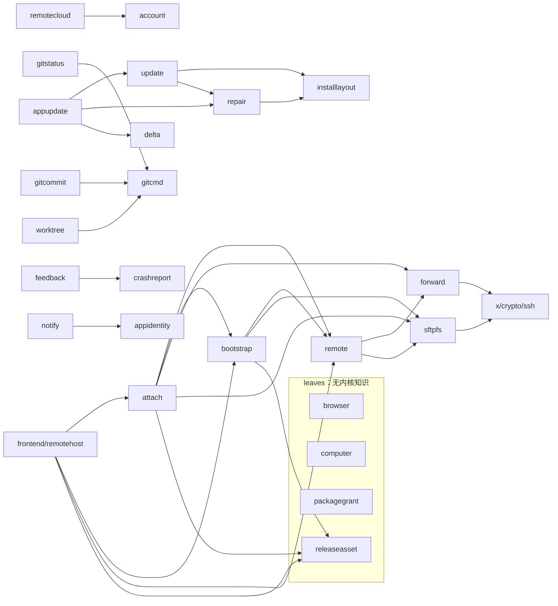
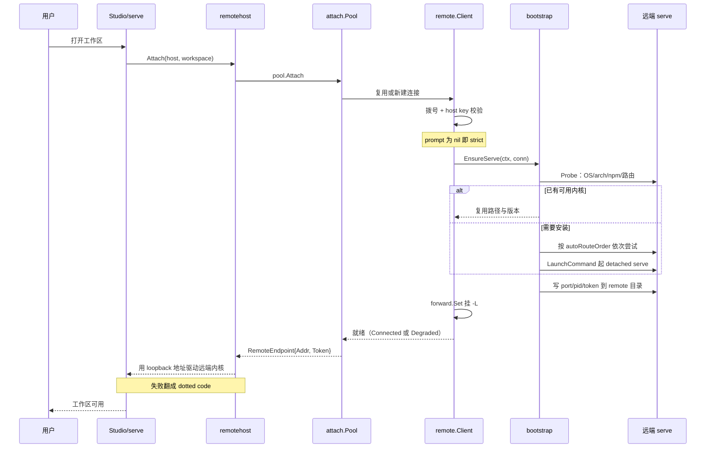
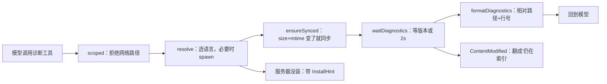
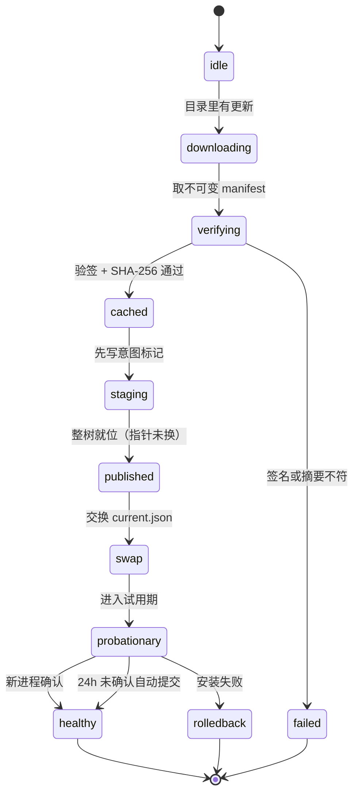

# 平台能力面：机制归属、信任边界与退化路径

> 本解读按 **ai-agent** 类规格产出，属 DeepSeek-Reasonix 深度解读的子文档；共 13 篇，解读基线 `v2.37.0`（`e17ef45e3`）。正文所有 `文件:行号` 引用均为 Reasonix 仓库相对路径，点开即可核对。相关篇章见 [README.md](README.md)。

## 论点：要回答的不是"支持哪些平台"，而是每个能力以什么机制存在、退化时谁还能用

`internal/platform/*` 是 Reasonix 唯一的**宿主环境接触面**。内核（`runtime`/`session`/`contract`）不知道浏览器、SSH、语言服务器、`current.json`、minisign 的存在；这些全部沉在这一层，并通过**窄接口 + 回调**暴露给上层。去掉它，`reasonix` 仍然能装配出一个完整的、只操作工作区文件的编码 Agent；但 Remote-SSH、浏览器/Computer Use、LSP 诊断、自更新、安装布局迁移与 `doctor` 全部消失。

这一域同时回应三个**性质不同**的根因，且三者的解法互不相似——这正是它为什么必须是 26 个包而不是 3 个：

1. **Agent 要越出工作区，但越界必须可裁决**。浏览器与 Computer Use 让模型触碰"工作区之外的本机状态"（网页、别人的应用窗口、密码框）。解法不是拒绝，而是把越界变成**宿主拥有的、带 dotted code 的失败面**：`browser.Code` 与 `computer.Code` 各是一套封闭枚举，`Failure.Is` 按 code 而非句子匹配。
   [internal/platform/browser/failure.go:52-56]()
<!-- anchor: // Is matches another Failure by code alone, so errors.Is(err, &Failure{Code: c} … return ok && other.Code == f.Code -->
2. **被驱动的机器可能没有 Reasonix，版本也可能不对**。远端工作区的前提是"那台机器上有一个能被本机驱动的 `reasonix serve`"，而它可能不存在、可能太旧、可能装了但解析 provider 的方式与本次连接冲突。解法是一套**幂等自举协议 + 分档版本地板 + 一次问清全部先决条件的探针**。
   [internal/platform/remote/bootstrap/bootstrap.go:43-62]()
<!-- anchor: // MinPaneVersion is the oldest kernel a pane can be driven by: a pane drives … return MinPaneVersion -->
3. **自更新必须能被打断而不损坏安装**。更新进程会杀掉自己正在运行的那份二进制，中途掉电、被 TCC 拦住、被 dpkg 抢锁都会留下"半新半旧"的安装。解法是**写前意图 + 事务身份 + 启动健康确认**三件一起，缺一件这条链就不成立。
   [internal/platform/repair/update.go:196-216]()
<!-- anchor: // lockPendingUpdateStrict serializes cross-process pending-update transitions: … return unlock, nil -->

**"平台能力"在这里有三层含义，它们必须分开谈**：机制归属（这个能力由哪个包的哪段代码实现）、信任边界（它读谁的文件、用谁的凭据、过了几条网络）、退化路径（缺依赖、缺权限、平台没有对应原语时，**是报错、是换机制、还是这个能力根本不出现**）。把三层压成一张"平台支持矩阵"会立刻丢掉最有价值的信息：同一个"自更新"在三平台上既不是同一种机制，也不是同一套失败语义。

### 门禁先钉死这一层的位置

`tools/repolint/layers.go` 把这一层的定位写成了机器可查的规则：其中 4 个包被声明为 **utility leaf**（`leaves`），即"不含内核知识、任何层都可以 import、互相之间可闭合互引"——`browser`、`computer`、`packagegrant`、`releaseasset`。
[tools/repolint/layers.go:21-25]()
<!-- anchor: // Utility layer: these packages carry no knowledge of the kernel and must … var leaves = []string{ -->

`browser` 与 `computer` 之所以被列入 `leaves`，不是因为它们简单（合计 5,264 行），而是因为它们**只依赖 `internal/base/*` 与标准库，绝不反向 import 内核任何东西**：工具接口的封装在 `internal/tools/builtin/`，配置解读与 Session 构造在 `internal/assembly/boot/`，驱动层因此能被规则机械验证为"无内核知识"。
[internal/tools/builtin/browser.go:3-12]()
<!-- anchor: import ( … "reasonix/internal/safety/permission" -->

`internal/frontend/remotehost` 被单列为 `hostAdapters`（全仓唯一一个），语义是"坐在 frontend 旁边、由宿主组装、内核不可达"的驱动端口实现。
[tools/repolint/layers.go:75-76]()
<!-- anchor: var hostAdapters = []string{ … "internal/frontend/remotehost", -->

另一条结构事实是**没有一条规则是专门为 `internal/platform/*` 写的**：本域完全靠通用分层规则被治理，`"platform": 4` 只是把它与 `base` 分开，且没有任何 platform 包 import `internal/session/control`（门禁会拦），所以本域不能自己变成控制器。
[tools/repolint/layer_order.go:28]()

### 26 个子包的机制归属

下表是"这个能力住在哪个包"的索引；行数为本次实测的非测试 `.go` 行数（口径：`find` + `wc -l`，含少量测试脚手架，见文末覆盖欠账），不是源码中的常量。

| 子包（仓库相对路径） | 非测试行数 | 一句话职责 |
|---|---|---|
| internal/platform/repair | 7,712 | 修复"更新事务 / 配置 / 派生状态"三类可恢复损坏：写前意图、仲裁锁、快照、隔离与撤销 |
| internal/platform/browser | 4,163 | 驱动本机已装的 Chromium 系浏览器（CDP），把页面呈现为带 ref 的无障碍树并注入真实指针/键盘事件 |
| internal/platform/update | 4,009 | manifest + minisign 校验 + 分块/断点下载 + 三平台各自的原子替换与回滚 |
| internal/platform/remote（含 3 个嵌套子包） | 7,069 | SSH 传输：主机解析、认证、known_hosts、复用连接、端口转发、SFTP、自举 reasonix serve |
| internal/platform/remotecloud | 1,069 | 让已登录的 Studio 被远端驱动：经 Reasonix 消息中继（WSS）+ 端到端加密 |
| internal/platform/lsp | 1,095 | 拉起/复用语言服务器，把 definition/references/hover/diagnostics 翻成模型可读文本 |
| internal/platform/computer | 1,101 | 经原生 helper 操作本机其他应用（无障碍树 + 截图 + 输入），含拒绝清单与效果分级 |
| internal/platform/installlayout | 834 | v1.20+ 版本化安装布局：current.json 指针、versions/<v> 原子发布、指针最后交换 |
| internal/platform/worktree | 843 | 为并行会话创建受管的 Git worktree，永不自动删除 |
| internal/platform/appupdate | 835 | "拥有 Studio"与"替换 Studio"的交界：把已下载版本搬到可替换状态 |
| internal/platform/gitcmd | 773 | 构造 Reasonix 自己发的每一条 git 命令，并钉死仓库身份与仓库配置里的可执行项 |
| internal/platform/gitstatus | 578 | 问 git 要工作树真实差异（状态/统计/分支），而不是从 agent 行为推断 |
| internal/platform/gitcommit | 383 | 生成 commit 输入（与桌面 TS 侧的 CommitFile 做 wire parity） |
| internal/platform/releaseasset | 401 | 按平台下载并校验官方 CLI release（SHA256SUMS + redirect guard），供远端自举使用 |
| internal/platform/packagegrant | 236 | 从 Windows 应用目录里移除"授予特定 AppContainer 包"的 DACL allow 项 |
| internal/platform/environment | 722 | 启动期探测本机开发环境并渲染成稳定的模型可见摘要 |
| internal/platform/telemetry | 1,207 | 遥测采集/上报 |
| internal/platform/feedback | 1,747 | 应用内反馈（含附件、回执、限额） |
| internal/platform/crashreport | 749 | 崩溃记录（含 watchdog/进程角色） |
| internal/platform/delta | 663 | 分块增量更新（zstd 索引 + chunk store） |
| internal/platform/account | 505 | 账号/登录态客户端 |
| internal/platform/notify | 311 | 系统通知（三平台 sender） |
| internal/platform/clipimage | 187 | 剪贴板图片读写（三平台） |
| internal/platform/editor | 185 | 外部编辑器调用 |
| internal/platform/instanceid | 42 | 本机实例标识 |
| internal/platform/appidentity | 13 | 应用身份常量 |

**表里没有 `sysproxy`，因为任务清单点名的这个包不在本域**：它在 `internal/base/sysproxy/`（含 `system_windows.go`），是 leaf 层包，被 `internal/base/netclient/netclient.go` 消费；`internal/platform/*` 里没有任何包 import 它。把 `sysproxy` 当成本域成员会连带把"代理"这一关注面挂错层。
[internal/base/sysproxy/sysproxy.go:1-8]()
<!-- anchor: // Package sysproxy resolves the OS-level proxy (Windows system/PAC settings) … "net/url" -->
[internal/base/netclient/netclient.go:1-12]()
<!-- anchor: // Package netclient builds HTTP clients and proxy resolvers that share Reasonix … "strconv" -->
[tools/repolint/layers.go:60]()

### 本域内部的依赖形状：边极少，且 `repair` 是 `update` 的下游

下面这张图是本域实测的跨包 import 边（把嵌套子包提升为 `remote` 的成员来看）。它要说明的不是"模块很多"，而是三件形状：`leaves` 是**闭合**的（它们与任何其他子包之间没有边）；`update → repair → installlayout` 是一条**单向链**，因为"替换自己"必须先有"记录下我正在替换什么"的能力；`remotehost` 是唯一从 `frontend` 反向指进来的适配器。

注意图里 `repair` 箭头指向 `installlayout` 而 `update` 指向 `repair`，顺序不能反：`repair` 不知道"版本从哪来、签名怎么验"，它只知道"磁盘上现在这条事务凭什么成立"。



图中每条边都来自真实的 import 语句，逐条可核：
[internal/platform/remote/bootstrap/bootstrap.go:22-24]()
<!-- anchor: "reasonix/internal/platform/releaseasset" … "reasonix/internal/platform/remote/sftpfs" -->
[internal/platform/remote/attach/attach.go:19-23]()
<!-- anchor: "reasonix/internal/contract/config" … "reasonix/internal/platform/remote/forward" -->
[internal/platform/remotecloud/host.go:24-25]()
<!-- anchor: "reasonix/internal/contract/provider" … "reasonix/internal/platform/account" -->
[internal/platform/update/apply_darwin.go:21]()
[internal/platform/gitstatus/summary.go:8]()
[internal/platform/worktree/worktree.go:19]()
[internal/frontend/remotehost/remotehost.go:15-23]()
<!-- anchor: "reasonix/internal/assembly/boot" … "reasonix/internal/platform/remote/bootstrap" -->

## 远端工作区：远端跑内核，本地只做 SSH 传输、自举 serve 与 `-L` 转发

### 这条边界的形状由一句包注释钉死

`remote` 的包注释把架构一句话写完，值得先读原文再展开：

```go
// The agent itself never runs through this package — remote workspaces are driven by a `reasonix serve`
// process bootstrapped on the remote host and reached through a forwarded loopback port.
```

[internal/platform/remote/remote.go:1-8]()
<!-- anchor: // Package remote is the SSH transport for Reasonix's remote module: host … // reached through a forwarded loopback port. -->

也就是说：**不是**"本地内核通过 SFTP 读写远端文件"，而是"远端跑一个完整内核，本地把它当 HTTP 服务打"。SSH 通道只承担三件事：(a) 登录与 host key 校验；(b) 启动/复用远端 `reasonix serve`；(c) `-L` 端口转发，把远端 loopback 端口映射到本机 loopback。

推论有两条，都是反直觉的。第一条：`attach` 的包注释写"一条连接承载该主机上打开的每个 workspace，一条转发承载该 workspace 上打开的每个 pane"，两者都做引用计数，最后一个持有者退出才拆；而**远端 serve 不随之停止**——它按设计比特意活得久，下一次连接复用它。
[internal/platform/remote/attach/attach.go:1-9]()
<!-- anchor: // Package attach turns a configured SSH host into a reachable kernel: it dials … package attach -->

第二条：本地什么时候第一次能碰到远端内核？不是拨号成功、不是自举完成，而是**第 6 步的 `-L` 转发建立之后**。此前的所有步骤都只是在"把对面的内核准备好"。

### 四域信任边界：谁读谁的文件，哪一段是明文

下面这张图是本域唯一一张需要**空间归属**而不是时序推进的图：它把远端工作区分成四个信任域（本地宿主进程 / SSH 通道 / 远端主机 / Reasonix 中继），并标明每条边属于哪一类流量。选 SVG 而不是 Mermaid 的理由很具体：`graph` 能把节点与箭头画出来，但画不出**边界**——"token 存在谁的文件系统上"、"`~/.reasonix/remote` 里的东西本地能不能读"、"`-L` 与 `-R` 的端点分别落在哪个 loopback"这三个结论全靠位置关系承载。


读这张图时请沿着**加粗的那条线**走：它是唯一真实的 agent 循环流量——`Studio/serve 内核 → 本地 loopback → SSH 通道 → 远端 serve`。其余从域 A 指向域 C 的箭头都只是"准备工作"：`remote/bootstrap` 的安装与启动编排、`forward.Set` 的 `-L` 转发、`providerbroker` 的 `-R` 反向转发。注意所有本地→远端的箭头都从**域 B 的右半区**穿过，这不是排版巧合：它们确实由同一条 SSH 连接承载，只是落在 `x/crypto/ssh` 的不同 channel 上（exec / SFTP subsystem / direct-tcpip）。图的左下角是三个必须记住的落点：远端跑内核而本地不读远端文件、token 只走文件而 `ps` 里看不到、远端 serve 不随链路关闭而停止；右上角的域 D 用一条方向相反的第二信道（中继拨入本机）提醒：`remotecloud` 与 `remote` 不是同一个东西的两半，而是两套独立信任模型。

代价也在这张图上：域 A 里同时躺着"拨出侧"与"被拨入侧"两套实现（`remote.Client` 与 `remotecloud.Host`），它们共享的只有"凭据存储"这一个节点，而**没有任何共享的传输代码**。这意味着任何一个"远端连接"相关的改动，都要先判断它属于哪一侧，判错的代价是改到一个与本次问题无关的信任模型里。

### 连接建立：拨号、认证、host key 三件事都在链路层

`remote.Client` 的语义是"受监督的 SSH 连接"：拨号 → 校验 host key → 挂上转发 → keepalive → 指数退避重连，整个生命周期共享一个 SFTP session 与一个 `forward.Set`。
[internal/platform/remote/client.go:42-44]()
<!-- anchor: // Client is a supervised SSH connection: it dials, verifies the host key, … // shares one SFTP session and one forward.Set across its lifetime. -->

- **多跳**：`Options.JumpHosts` 是已解析的 ProxyJump 链（按顺序）。每个跳有自己的 `AuthOptions`，而 `hopAuthFor` 刻意**不继承目标的 `Password`/`Passphrase` 闭包**，并给每个跳独立 secret 缓存——注释的原话是目标的 `password_env` 绝不发给跳板机，一个跳上手输的密码也不会被另一个跳复用。这个 `AuthOptions` 实例在 `Client` 生命周期内持久，所以重连不会重新弹密码。
  [internal/platform/remote/client.go:35-39]()
<!-- anchor: // JumpHostOptions binds one resolved ProxyJump host to credentials owned by … Auth AuthOptions -->
- **认证**：`agentAuth` 在 Unix 上用 `SSH_AUTH_SOCK`；在 Windows 上先看 `SSH_AUTH_SOCK`（给 Unix agent 的移植版），否则用固定命名管道 `\\.\pipe\openssh-ssh-agent`，并且**先探一次管道再决定是否提供该 method**——理由是"一个只会失败的方法不值得每次握手都拨、也不值得调用方以为真提供了什么"。
  [internal/platform/remote/agent_windows.go:20-39]()
<!-- anchor: func agentAuth(identityFiles []string, identitiesOnly bool) (ssh.AuthMethod, fun … return agentAuthOver(dial, identityFiles, identitiesOnly) -->
- **host key**：系统 `known_hosts` **只读** + Reasonix 自己管理的 TOFU 文件（可写），路径是 `config.RemoteKnownHostsPath()` = `<Reasonix home>/remote/known_hosts`。首次见到的指纹交给 `HostKeyPrompt`；**prompt 为 nil 即 strict：不认识就拒**。指纹与已记录冲突时返回 `HostKeyMismatchError`，`Unwrap` 到 `ErrHostKeyMismatch`，并且**永不可弹窗绕过**。
  [internal/platform/remote/knownhosts.go:66-74]()
<!-- anchor: // HostKeyPolicy verifies presented host keys against the user's OpenSSH … ManagedPath string -->

**连接状态是一个封闭枚举**：`idle / connecting / connected / reconnecting / degraded / stopped`。其中 `degraded` 的定义值得单独记：**"已连接，但至少一条 forward 挂载失败"**——它把"SSH 通了但功能不全"做成一个独立可见状态，而不是报成功。
[internal/platform/remote/remote.go:21-37]()
<!-- anchor: // Status is the supervised connection state. … StatusStopped -->

断线重连的关键机制是 **generation 计数器**：每次（重）连接 `generation++`，SFTP 句柄携带它；跨代使用旧句柄返回 `ErrDisconnected`（"连接已重建，请重新取句柄"），而不是静默操作到一个已死的通道。重连退避用 `rand.Int64N(ceil+1)` 做抖动，`Backoff` 与 `Clock` 都是注入项，所以可测。
[internal/platform/remote/client.go:524-530]()
<!-- anchor: func (c *Client) installConn(cl *ssh.Client, hops []*ssh.Client) { … c.mu.Unlock() -->

错误分类是"该不该重试"的判据，而不是文案匹配的副产品：`classifyDialError` 把 `unable to authenticate` / `no supported methods remain` / `permission denied` 判为**不可恢复**（`ErrAuthFailed`），重连就此停止，而不是在后台反复弹密码；其余视为可重试的网络故障。
[internal/platform/remote/remote.go:87-91]()
<!-- anchor: // classifyDialError maps an ssh handshake error to a typed error where the … func classifyDialError(err error) error { -->

端口转发自身的生命周期也有区分：**本地监听器跨 Detach/Attach 存活**（这样重连期间端口仍被占住），**远端监听器在 Detach 时拆除、Attach 时重建**。`Replace` 是"先起新的、成功后再换旧的"——替换失败时旧转发仍在线。
[internal/platform/remote/forward/set.go:28-31]()
<!-- anchor: // Set is the port-forward registry for one Client. It is safe for concurrent … // recreated on Attach. -->

### 自举：把 `reasonix serve` 送到对端并驯服它

`bootstrap` 的职责是一串有顺序的副作用：检测远端 OS/arch → 找到或安装 reasonix → 以随机 loopback 端口启动 detached serve，token 走**文件而不是 argv**（argv 在 `ps` 里世界可读）→ 把结果记到远端 `~/.reasonix/remote` 供下次复用。Linux/macOS/Windows 三种远端都支持，"是哪一种"决定每条命令用哪种 shell 写。
[internal/platform/remote/bootstrap/bootstrap.go:1-8]()
<!-- anchor: // Package bootstrap starts and manages a detached `reasonix serve` process on … package bootstrap -->

**四种安装路由**的顺序被写死在唯一一处，理由是"花的是那台机器的上行而不是你的"：

```go
var autoRouteOrder = []string{routeRemoteFetch, InstallUpload, routeDownload, InstallNPM}
```

[internal/platform/remote/bootstrap/install.go:14-19]()
<!-- anchor: // autoRouteOrder is the order auto tries a machine in, and the only place that … var autoRouteOrder = []string{routeRemoteFetch, InstallUpload, routeDownload, In -->

npm 排在最后，是因为它需要在对面有 Node 才能送达**同一个静态二进制**；之所以仍然保留，是因为"npm 镜像可达而 GitHub 被限速"是真实存在的网络形态。四条全失败时的错误与只失败一条时不同：只试了一条就是那条自己的原因，四条都试了才是"这台机器的一个新事实"。
[internal/platform/remote/bootstrap/install.go:66-71]()
<!-- anchor: // One route asked for by name failed for its own reason, which the caller … return fail(fmt.Errorf("%w: %w", ErrNoInstallPath, errors.Join(attempts...))) -->

**版本地板是分档的，不是唯一常量**：`MinPaneVersion = "2.0.0"`（pane 驱动 `/runtimes` 的 hub 面，1.x 内核会 405），`MinBrokeredPaneVersion = "2.18.1"`（模型经 broker 解析时；更旧的内核会在自己的 `default_model` 上开会话并列出自己的 provider，被 broker 拒）。`PaneFloor(brokered)` 是唯一决定处，**连接与探针都读它**，因此不可能出现"一边说可用、另一边要替换它"的分歧。
[internal/platform/remote/bootstrap/bootstrap.go:43-62]()
<!-- anchor: // MinPaneVersion is the oldest kernel a pane can be driven by: a pane drives … return MinPaneVersion -->

**探针 `Probe` 是"一次会话内把所有先决条件一次问清"**：OS/arch/home、已有的内核算不算可驱动、npm 版本、download 工具（curl/wget/PowerShell）、以及每条路由的阻挡原因。注释点出它与冷连接的区别——冷连接一次只走一条、第一个失败就停，所以每次失败只教读者一个缺口；探针一次回答全部。但 `Report.Ready()` 只承诺"存在一条路由"，**不承诺它会落地**（npm 仍可能拒绝写入）。
[internal/platform/remote/bootstrap/probe.go:20-38]()
<!-- anchor: // Report is what one machine can and cannot do, read in a single session. A … env        loginEnv -->

启动命令那一行承载了这段设计密度最高的工程细节：

```go
"$SX nohup %s serve --addr 127.0.0.1:0 --auth token --token-file %s --port-file %s --pid-file %s%s </dev/null >>%s 2>&1 & echo $!",
```

[internal/platform/remote/bootstrap/launch.go:56-70]()
<!-- anchor: func LaunchCommand(spec LaunchSpec, p StatePaths) string { … shellQuote(p.LogFile), -->

三个取舍都写在这行里：`setsid` 能彻底脱离，但 stock macOS 没有，所以只在检测到存在时用（`$SX`），否则 `nohup` + 后台 + `</dev/null` 足以应付非交互 SSH exec；日志 0600（`umask 077` + 显式 chmod），且 serve 以 `--port-file` 启动会**抑制打印 token 那一行**，所以 token 不进日志；回显 `$!` 让调用方立刻记下 pid。

停止与存活检查都是**先证明"这是我们那个 serve"再动手**：`ServeAliveCommand` 不只看 `kill -0`，还要求 `/proc/<pid>/exe` 或命令行里同时出现 token 文件路径与 port 文件路径——这是防 pid 复用后被误杀。`StopCommand` 先 TERM、等约 5 秒、再 KILL，且每次都要先过 `ours()`。
[internal/platform/remote/bootstrap/launch.go:84-108]()
<!-- anchor: // StopCommand builds a script that TERMs the pid, waits up to ~5s, then KILLs … shellQuote(p.TokenFile), shellQuote(p.PortFile), pid, pid, pid, -->

**provider broker 是这条链上最容易被漏掉的一个前提**：`Broker{Addr,Token}` 指向"发起连接那台机器上的 provider broker"，远端 serve 通过 `-R` 反向转发访问它。零值意味着对端用自己的配置解析 provider——也就是"需要它自己的 API key"。broker token 同样走文件（`--provider-broker-file`），理由与 serve token 相同。
[internal/platform/remote/bootstrap/bootstrap.go:65-74]()
<!-- anchor: // Broker points a bootstrapped serve at the provider broker on the machine … func (b Broker) configured() bool { return b.Addr != "" && b.Token != "" } -->

### 本地侧怎么把这一切接起来：`remotehost` 作为 host adapter

`remotehost` 是 `serve.RemoteAttacher` 的标准实现，包注释刻意强调"这不是任何一个窗口的事，所以两个 shell 都不拥有它"。
[internal/frontend/remotehost/remotehost.go:1-4]()
<!-- anchor: // Package remotehost dials the machines a Studio can open a workspace on. It … // wrong. None of it is a window's business, so neither shell owns it. -->

组装关系是 `New(ctx, version, asks) → Link{pool, broker}`，其中一行代码决定了远端能不能复用本机的模型解析能力：

```go
broker, err := providerbroker.Listen(boot.LiveProviderResolver{})
```

[internal/frontend/remotehost/remotehost.go:36-53]()
<!-- anchor: func New(ctx context.Context, version string, asks *serve.AskBroker) *Link { … ResolveDownload: resolveRemoteDownload, -->

即 Studio 在自己机器上开一个 provider broker，把本机可用的模型解析能力**借给**远端内核；broker 起不来只打一条 warn 就继续（"远端可能仍能用自己的凭据"），而不是让远端功能失败。`Link.Attach` 把 `attach.Pool` 的端点转成 `serve.RemoteEndpoint{Host,Workspace,Addr,Token}` 交给 serve 层——**本地内核之后就是拿这个 loopback 地址 + token 去调用远端内核**：serve 侧用一个 `httputil.ReverseProxy` 反代到 `http://ep.Addr` 并把 base path 设成 `ep.Base`，token **只作为 `Cookie` 头带上、不参与任何重新签名**；broker 的生命周期跟着 `Link` 走（`Link.Close()` 里关掉它），没有独立的守护进程。
[internal/frontend/remotehost/remotehost.go:73-83]()
<!-- anchor: func (r *Link) Attach(ctx context.Context, host, workspace string) (serve.Remote … }, ep.Release, nil -->
[internal/frontend/serve/hub_remote.go:420-442]()
<!-- anchor: func remoteProxy(ep RemoteEndpoint) http.Handler { … "the remote kernel is not answering", map[string]any{"host": ep.Host}) -->
[internal/frontend/serve/hub_remote.go:431]()
[internal/frontend/remotehost/remotehost.go:64-68]()
<!-- anchor: // Close stops the broker this link published. The pool's connections belong to … return nil -->

这里的失败归因被翻译成 HTTP 语义的 **dotted code**，是本项目"错误携带身份不携带句子"原则的跨进程版本：host key 变更 → 409 `remote.host_key_changed`（带 file/line 供安全详情视图）；内核太旧 → 502 `remote.kernel_too_old`；host key 被拒 → 403；认证失败 → 401；远端 OS 不支持 → 501 `remote.unsupported_os`（**故意不带 detail**，因为那是对面 shell 用自己的代码页说的话）；`install_disabled` / `serve_provider_mismatch` / `serve_not_attachable` → 409（"机器已就位或被占用，本次连接不会覆盖"）；其余一切 → 502 `remote.attach_failed` 并保留 `detail`，因为"裸 502 会被读成请求没到达，而实际上事情发生在链路另一端"。
[internal/frontend/remotehost/remotehost.go:242-283]()
<!-- anchor: func identify(host string, err error) error { … map[string]any{"host": host, "detail": err.Error()}) -->

交互性全部是回调：`prompts` 把链路层的阻塞式回调翻成 `serve.AskBroker` 的规范问题（hostkey / secret），并且**"没有任何东西持有它：broker 持有"**——还没开始轮询的窗口只是"还没看"。若 broker 不存在，两个 prompt 都是 nil，于是走 strict 路径：首次见到的 key 被拒而不是被默默接受。
[internal/frontend/remotehost/remotehost.go:286-298]()
<!-- anchor: // prompts turns the link layer's blocking callbacks into canonical … return attach.Prompts{Secret: p.secret, HostKey: p.hostKey} -->

### 凭据落在哪里：一张必须能背下来的表

| 凭据 | 存储位置（纯文本，行号见表下） |
|---|---|
| 密码/密钥口令 | 不落盘：名字在配置里（`PasswordEnv`/`PassphraseEnv`），值由闭包或 `SecretPrompt` 现取，取到后只缓存在进程内 `AuthOptions.cache` |
| SSH agent | 由 agent 持有，本进程不复制 |
| 已接受的 host key（TOFU） | `<Reasonix home>/remote/known_hosts`（Reasonix 管理、读写） |
| 系统 known_hosts | 只读，不改写 |
| 远端 serve token | 远端 `~/.reasonix/remote/`（0600），本地不留 |
| remotecloud 设备身份 | 本机凭据存储，键 `REASONIX_REMOTE_DEVICE_IDENTITY` |

这张表的每一行都可以点开核对：
[internal/platform/remote/host.go:25-26]()
<!-- anchor: PassphraseEnv    string   // credential env var name for the key passphrase … PasswordEnv      string   // credential env var name for password auth -->
[internal/platform/remote/auth.go:249-270]()
<!-- anchor: if opts.cache.havePw { … return v, nil -->
[internal/platform/remote/agent_unix.go:13-20]()
<!-- anchor: // agentAuth offers whatever the agent named by SSH_AUTH_SOCK is holding. … return agentAuthOver(dial, identityFiles, identitiesOnly) -->
[internal/platform/remote/knownhosts.go:69-74]()
<!-- anchor: // SystemKnownHosts are OpenSSH known_hosts files consulted read-only. … ManagedPath string -->
[internal/platform/remote/bootstrap/launch.go:8-24]()
<!-- anchor: // StatePaths are the absolute remote-side paths for one workspace's serve … LockOwner      string -->
[internal/platform/remotecloud/identity.go:14]()

这里有一个值得学的点：`config.RemoteStateDir()` 的注释说明它**必须走 home 解析器**，这样 `REASONIX_HOME` 隔离才成立；又因为"serve 把自己的 launch token 放在那里"，所以 runtime sandbox **拒绝读取它**——同一个目录同时是"必须可写"和"必须不可读"的，取决于谁在问。
[internal/contract/config/paths.go:316-318]()
<!-- anchor: // RemoteStateDir is <home>/remote under these roots. A serve launched over SSH … func (r Roots) RemoteStateDir() string { -->

### 这条链的完整时序（跨机器、跨进程）

下面这张时序图回答"我在 Studio 里点开一台 SSH 机器上的目录，到我能编辑文件，中间发生了什么"。它的读法是**从左到右三层递增**：SSH 传输层 → 自举层 → 宿主组装层，每一步都在为下一步准备前提。



逐步依据（与图上的编号无关，按可信度排序）：

1. 入口是 `serve.RemoteAttacher` 的实现，`New` 同时尝试起本机 provider broker。
   [internal/frontend/remotehost/remotehost.go:36-43]()
<!-- anchor: func New(ctx context.Context, version string, asks *serve.AskBroker) *Link { … broker = nil -->
2. `pool.Attach` 把"一条连接承载多 workspace、一条转发承载多 pane"的引用计数落在 `attach` 内。
   [internal/platform/remote/attach/attach.go:1-8]()
<!-- anchor: // Package attach turns a configured SSH host into a reachable kernel: it dials … // it outlives the link by design, and the next connect reuses it. -->
3. host key：系统 `known_hosts` 只读，Reasonix 管理的 TOFU 文件可写；冲突时不可弹窗。
   [internal/platform/remote/knownhosts.go:66-74]()
<!-- anchor: // HostKeyPolicy verifies presented host keys against the user's OpenSSH … ManagedPath string -->
4. 自举：`Probe` 先只读地探一遍，再按 `autoRouteOrder` 安装；`Probe.Ready()` 只承诺存在路由。
   [internal/platform/remote/bootstrap/probe.go:67-69]()
<!-- anchor: // Probe reads everything a first connect depends on, and changes nothing over … func Probe(ctx context.Context, conn Conn, opts Options) (Report, error) { -->
   [internal/platform/remote/bootstrap/install.go:14-19]()
<!-- anchor: // autoRouteOrder is the order auto tries a machine in, and the only place that … var autoRouteOrder = []string{routeRemoteFetch, InstallUpload, routeDownload, In -->
5. 启动命令：`setsid` 仅在存在时用，token 走 `--token-file`，日志 0600。
   [internal/platform/remote/bootstrap/launch.go:49-55]()
<!-- anchor: // Detachment: `setsid` fully divorces the process from any session, but it is … // It echoes the shell's $! so the caller can record the pid immediately. -->
6. 转发建立后，本地内核才第一次有可达端点；跨代旧句柄会被 `ErrDisconnected` 拒掉。
   [internal/platform/remote/client.go:524-530]()
<!-- anchor: func (c *Client) installConn(cl *ssh.Client, hops []*ssh.Client) { … c.mu.Unlock() -->
7. 失败翻译成 dotted code 的清单在 `identify` 里。
   [internal/frontend/remotehost/remotehost.go:242-283]()
<!-- anchor: func identify(host string, err error) error { … map[string]any{"host": host, "detail": err.Error()}) -->
8. 远端 serve 的默认存活语义是"比特意活得久"。
   [internal/platform/remote/attach/attach.go:5-8]()
<!-- anchor: // One connection carries every workspace opened on that host, and one forward … // it outlives the link by design, and the next connect reuses it. -->

## `remote` 与 `remotecloud`：方向相反的两条信道，不共享一行代码

两者都叫 "remote"，但**主客关系完全相反**，且 import 图里没有任何交集（`remote` 不含 `account`，`remotecloud` 不含 `ssh`）：

| | internal/platform/remote | internal/platform/remotecloud |
|---|---|---|
| 谁主动 | 本机主动拨出 | 本机（Studio）被动被拨入 |
| 传输 | golang.org/x/crypto/ssh | gorilla/websocket 到 wss://remote.reasonix.io |
| 对面是谁 | 一台 SSH 主机 | Reasonix 消息中继 + 一个已登录的 Web 端控制器 |
| 认证 | SSH 密钥/密码/agent + host key | 账号 token 换 device 身份，之后每会话 X25519 派生 |
| 加密 | SSH 自带 | 自建：X25519 + HKDF-SHA256 + AES-GCM，中继只见路由与密文 |
| 端点 | 远端 reasonix serve 的 loopback 端口（经 -L 转发） | Studio 自己的内核，被远端控制器调用 |

这张对照表的依据：
[internal/platform/remotecloud/host.go:1-3]()
<!-- anchor: // Package remotecloud keeps a signed-in Studio reachable through the Reasonix … // relay sees only routing identities, capability scopes and ciphertext. -->
[internal/platform/remotecloud/host.go:28]()
[internal/platform/remotecloud/host.go:30]()
[internal/platform/remotecloud/crypto.go:18-30]()
<!-- anchor: const protocolVersion = 1 … Ciphertext string `json:"ciphertext"` -->

握手与会话密钥这一段有一个值得抄的细节：控制器发 `hello{v,type:publicKey,salt}`，Studio 用设备 X25519 私钥做 ECDH，`info = "reasonix-remote-v1|" + deviceID` 既做 HKDF 的 info 也做 AEAD 的 AAD；`open` 维护"已见 nonce 集合"并拒绝重复，也就是说**中继上的重放由接收端自己挡掉**，而不是依赖中继不重放。
[internal/platform/remotecloud/crypto.go:39]()
[internal/platform/remotecloud/crypto.go:63]()
[internal/platform/remotecloud/crypto.go:76]()
[internal/platform/remotecloud/crypto.go:97]()

设备身份（`deviceID` + `DeviceCredential` + X25519 私钥）不是明文文件，而是走凭据存储：`config.SetCredential(identityCredentialKey, ...)`，键名 `REASONIX_REMOTE_DEVICE_IDENTITY`。
[internal/platform/remotecloud/identity.go:38-47]()
<!-- anchor: func saveIdentity(saved *identity) error { … func clearIdentity() error { return config.RemoveCredential(identityCredentialKe -->

**与项目自述不一致（1）**：`docs/SPEC.md` 把 Remote-SSH 写成 `internal/remote/`，并声明依赖方向是 `cli → remote/bootstrap → remote → {forward, sftpfs, config, netclient}`。当前工作树里目录是 `internal/platform/remote/`，且 SPEC 自己也说 `remote` 不 import `cli`；但 SPEC 完全没提真正承担 Studio 侧组装职责的 `internal/frontend/remotehost`，也没提 `remotecloud` 这条反向链路。SPEC 里那句 "See §Remote below" 指向的小节在文件中不存在（全文只有 §1–§9）。
[docs/SPEC.md:47]()
[docs/SPEC.md:56-60]()
<!-- anchor: self-register; parents never import children. The Remote-SSH module layers … prompts) so the desktop module consumes the same surface. See §Remote below. -->

## LSP：会话级拉起，诊断由模型拉取而不是宿主推送

### 拉起与路由：纯配置就能加一门语言

`Manager` 是**会话级**的：语言服务器**首次被查询时才启动**并复用，其生命周期由会话级 context 界定，**不是单个 turn**。`DefaultSpecs()` 内置 15 种语言（go/rust/typescript/python/cpp/csharp/java/ruby/php/lua/bash/zig/kotlin/swift/haskell），命令全部**只在 PATH 上解析，绝不随包分发**；`Extensions` 驱动"文件 → 语言"路由，所以加语言只改配置不改代码。
[internal/platform/lsp/manager.go:33-35]()
<!-- anchor: // Manager owns the lazily-spawned language servers for a session. Servers start … // (cancelled by Close) bounds their lifetime, not a single turn. -->
[internal/platform/lsp/manager.go:81-100]()
<!-- anchor-base64:Ly8gRGVmYXVsdFNwZWNzIG1hcHMgYSBsYW5ndWFnZSBrZXkgdG8gaXRzIGNvbnZlbnRpb25hbCBzZXJ2ZXIuIENvbW1hbmRzIGFyZSB0cmkKImhhc2tlbGwiOiAgICB7Q29tbWFuZDogImhhc2tlbGwtbGFuZ3VhZ2Utc2VydmVyLXdyYXBwZXIiLCBBcmdzOiBbXXN0cmluZ3siLS1sc3A= -->

并发首次使用（例如一个并行只读工具批里两个工具同时问同一门语言）通过 `starting` 门共享一次 spawn，不会拉起重复服务器；`spawn` 先跑 `spec.Verify()`（来自 `config.ProjectProgramVerifier`），再 `exec.LookPath`，找不到就返回 `notInstalledError`，里面**带 InstallHint**——"让工具能告诉模型怎么把这个能力装上"。
[internal/platform/lsp/manager.go:122-171]()
<!-- anchor: // resolve returns the running client for the file's language, spawning it on … return startClient(m.root, bin, spec.Args, spec.Env, spec.LanguageID, m.wsRoot) -->

### 生命周期归属：两条并存的清理路径

装配在 `registerLSP`：受 `cfg.LSP.Enabled` 控制，注册工具并返回 `*lsp.Manager`。
[internal/assembly/boot/mcp_registration.go:113-130]()
<!-- anchor: // registerLSP adds the LSP tools. Servers resolve on PATH and spawn on first … return mgr -->

`boot.Build` 里那句注释就是问题清单里问的那条——"The LSP manager is session-scoped: its servers stop with the controller"，紧跟的闭包把 `mgr.Close()` 挂到 `b.cleanup` 链上。
[internal/assembly/boot/build.go:411-414]()
<!-- anchor: // The LSP manager is session-scoped: its servers stop with the controller. … b.cleanup = func() { prev(); mgr.Close() } -->

同时 `wireRuntimeScopeCleanup` 在 `RuntimeSet` 非空时把 LSP 也登记成一类 scope 资源（`extension.TrackWatcher(runtimeSet.Scope(), "lsp-manager", ...)`），最终在 `boot.Build` 里统一合成 `b.cleanup`。
[internal/assembly/boot/scope_wire.go:12-43]()
<!-- anchor: // wireRuntimeScopeCleanup folds MCP host / LSP / session-temp inventory into … return func() { _ = runtimeSet.Close() } -->
[internal/assembly/boot/build.go:647]()

**两条路径不会重复关闭，也不是"哪个先跑"的竞态**：`scope_wire.go` 的分支条件是"`RuntimeSet` 为空或长度为 0"，此时它返回的闭包调用传入的 `cleanup` **再**调 `runtimeSet.Close()`；非空时它只返回 `runtimeSet.Close()`，把传入的 cleanup 丢掉。而 `mgr.Close()` 走的是 scope 的 dispose 路径（`extension/effectscope.go` 里带 `closed` 标志、幂等、按注册逆序执行）。所以 `mgr.Close()` 恰好执行一次：空集合时经 cleanup 链，非空时经 scope 观察者。
[internal/assembly/boot/scope_wire.go:15-43]()
<!-- anchor: func wireRuntimeScopeCleanup(runtimeSet *extension.RuntimeSet, cleanup func(), s … return func() { _ = runtimeSet.Close() } -->
[internal/ext/extension/runtimeset.go:84-88]()
<!-- anchor: func (s *RuntimeSet) Close() error { … return s.scope.Dispose(context.Background()) -->
[internal/ext/extension/effectscope.go:159-182]()
<!-- anchor: func (s *LiveScope) Dispose(ctx context.Context) error { … return errors.Join(errs...) -->

`Close()` 先把 `clients` 表清空再逐个关，最后 `cancel()`；单个 client 的关闭顺序是 `shutdown`（2 秒超时）→ `exit` → `Kill` → `Wait`——**先礼后兵**，保证能优雅退出的服务器不会留下孤儿进程。
[internal/platform/lsp/manager.go:67-78]()
<!-- anchor: func (m *Manager) Close() { … m.cancel() -->
[internal/platform/lsp/client.go:258-266]()
<!-- anchor: func (c *client) close() { … _ = c.cmd.Wait() -->

### 诊断怎么回到模型：一次同步拉取，加一个版本号守卫

**是模型拉取，不是宿主推送**。`lsp.Tools(mgr)` 暴露的诊断工具，`Description` 写着 "Report compiler/linter diagnostics ... Use after editing to check the change compiles"，schema 只有一个 `file` 参数。
[internal/platform/lsp/tool.go:77-94]()
<!-- anchor: func (diagTool) Description() string { … return t.m.Diagnostics(ctx, p.File) -->

`Manager.Diagnostics` 的链路是：`scoped(file)`（拒绝网络路径）→ `resolve`（按扩展名选语言、必要时 spawn）→ `ensureSynced`（把磁盘内容 didOpen/didChange 给服务器）→ `waitDiagnostics(ctx, uri, docVersion, 2s)` → `formatDiagnostics`。
[internal/platform/lsp/manager.go:260-274]()
<!-- anchor: func (m *Manager) Diagnostics(ctx context.Context, file string) (string, error)  … return formatDiagnostics(m.rel(path), diags), nil -->

两个"为什么这样做"的细节：

1. **新鲜度靠 stat，不靠写者通知**。`docState{version,size,mod}` 记录上次发给服务器的内容；`ensureSynced` 只比较 size+mtime，因此**任何工具（包括 bash）在带外改文件都能被 stat 检测到**并重新 didChange。这与项目"检测是语义的、不依赖写者通知"的原则一致，但此处用的是 mtime/size 而不是内容哈希——是一个明确的成本/精度取舍点。
   [internal/platform/lsp/client.go:153-187]()
<!-- anchor: func (c *client) ensureSynced(uri, path string) error { … return err -->
2. **版本号守卫**避免把"编辑前内容算出的诊断"当成编辑后的结果返回：`handleNotify` 缓存 `publishDiagnostics` 时同时记 version（服务器不给 version 就退回本地 doc version），`waitDiagnostics` 只在 `diagVer[uri] >= minVer` 或超时后返回，**超时也返回最新缓存**而不是报错。
   [internal/platform/lsp/client.go:114-135]()
<!-- anchor: // handleNotify caches diagnostics. The version guards waitDiagnostics against … c.mu.Unlock() -->
   [internal/platform/lsp/client.go:199-213]()
<!-- anchor: // waitDiagnostics blocks until a publishDiagnostics for uri at version >= minVe … case <-time.After(40 * time.Millisecond): -->

初始化期还有一处**必须回答服务器请求**的细节：`handleRequest` 对 `workspace/configuration` 回一个等长空数组，注释是"某些服务器会因此阻塞初始化（rust-analyzer 没有 workspace/configuration 回复就会卡住）"。
[internal/platform/lsp/client.go:138-149]()
<!-- anchor: // handleRequest answers the server→client requests that block initialization on … _ = c.conn.reply(id, nil) -->

### 四层降级：全部给"能行动的信息"而不是异常

- **服务器没装** → `language server "gopls" not found on PATH. Install it: go install golang.org/x/tools/gopls@latest`。
  [internal/platform/lsp/manager.go:104-112]()
<!-- anchor: // notInstalledError carries the install hint so a tool can tell the model exact … return fmt.Sprintf("language server %q not found on PATH. Install it: %s", e.com -->
- **扩展名无对应语言** → `no language server configured for .xyz`。
  [internal/platform/lsp/manager.go:174-184]()
<!-- anchor: // scoped is the absolute path of a model-supplied file, or the refusal for one … return path, nil -->
- **服务器正在重建索引**（JSON-RPC `-32801 ContentModified`）：请求层 `callRetry` 做 5 次 × 400ms 的有界重试（"掩盖 didOpen/didChange 之后的短暂窗口，更长的重建仍要浮出来让调用方决定"）；仍然失败时 `indexingOr` 把它翻成可行动的建议——"the language server is still indexing this workspace — run the query again in a few seconds"，而不是把 `ContentModified` 抛给模型。
  [internal/platform/lsp/client.go:218-240]()
<!-- anchor: // callRetry retries a request while the server answers ContentModified (-32801) … return errors.As(err, &e) && e.Code == -32801 -->
- **模型给出网络路径**：`scoped` 用 `fileutil.NetworkScope` 在**任何 stat/read 之前**拒绝；注释点明理由：在 Windows 上对一个网络路径 stat 就是"连接那台命名的机器"。
  [internal/platform/lsp/manager.go:174-184]()
<!-- anchor: // scoped is the absolute path of a model-supplied file, or the refusal for one … return path, nil -->

下面这张流程图是"单进程、无环、仅作对照"的一条链——它存在的意义是与上面两条跨机器/跨进程流程形成对照组：这里没有任何回边，也没有任何后台推送。



[internal/platform/lsp/manager.go:174-184]()
<!-- anchor: // scoped is the absolute path of a model-supplied file, or the refusal for one … return path, nil -->
[internal/platform/lsp/manager.go:260-274]()
<!-- anchor: func (m *Manager) Diagnostics(ctx context.Context, file string) (string, error)  … return formatDiagnostics(m.rel(path), diags), nil -->
[internal/platform/lsp/client.go:153-187]()
<!-- anchor: func (c *client) ensureSynced(uri, path string) error { … return err -->
[internal/platform/lsp/client.go:199-213]()
<!-- anchor: // waitDiagnostics blocks until a publishDiagnostics for uri at version >= minVe … case <-time.After(40 * time.Millisecond): -->
[internal/platform/lsp/manager.go:104-112]()
<!-- anchor: // notInstalledError carries the install hint so a tool can tell the model exact … return fmt.Sprintf("language server %q not found on PATH. Install it: %s", e.com -->
[internal/platform/lsp/client.go:218-240]()
<!-- anchor: // callRetry retries a request while the server answers ContentModified (-32801) … return errors.As(err, &e) && e.Code == -32801 -->

## `browser` 与 `computer`：两个越界能力面，六维对照

这两个包是本域唯一"让模型触碰工作区之外的本机状态"的能力面，因此它们的每一层设计都在回答同一个问题：**越界的那一步由谁裁决、失败怎么被表达、退化时模型看到什么**。下面这张表把六个维度逐行对照。

| 维度 | browser | computer |
|---|---|---|
| 传输 | CDP over `--remote-debugging-pipe`（尾随 NUL 分帧），Windows 退化为 loopback WebSocket | stdio 上的逐行 JSON-RPC，含 `event:"stop"`，1 MiB/64 MiB 扫描器缓冲 |
| 引擎来源 | Discovery：Chrome → Edge → Chromium，本机已装，绝不下载 | 原生 helper（macOS Swift / Windows C++），由宿主进程提供路径 |
| 定位方式 | 带 ref 的无障碍树快照；ref 发一次、永不复用，导航后 retire | 最新截图 + 无障碍树编号；模型不做显示算术，点击由本包换算屏幕坐标 |
| 隔离边界 | 专属 profile、`setDownloadBehavior=deny`、`checkURL`（`file:` 仅 workspace 内、其他 scheme 全拒）、秘密字段需确认 | 硬编码 `refusedApps` 拒绝清单（Studio/终端/钥匙串/系统设置/UAC/注册表/任务管理器，批准不解开） |
| 效果判定 | 命中判定：点在别处报 `browser.covered`，找不到可见中心报 `browser.not_visible` | `confirmed` / `suspected_noop` / `unverifiable`，判据是 helper **事后读回的证据串** |
| 失败面与平台降级 | 22 个 `browser.*` code，`Failure.Is` 按 code 匹配；非 Windows 用 pipe 时**没有任何东西在监听端口**，Windows 退化为端口后**进程运行期间任何本地进程都能驱动该浏览器** | 18 个 `computer.*` code，其中 `CodeUnsupported` 是全仓无引用的死 sentinel；无 helper 的宿主上工具**根本不出现**（不是调用失败） |

**为什么 `browser` 能被列入 `leaves` 而 `computer` 不能**：前者把"驱动"与"接线"彻底拆开了——`internal/platform/browser` 只 import `internal/base/proc`、`internal/base/fileutil`、`gorilla/websocket` 与标准库，不认识 tool 接口、不认识 config、不认识 controller，工具封装在 `internal/tools/builtin/browser.go`，Session 构造与 `[browser]` 配置解读在 `internal/assembly/boot/browser.go`，所以"无内核知识"这条能被规则机械验证；`internal/platform/computer` 同为 `leaves` 成员，但它必须**在装配期拿到宿主给的 helper 路径**才能真正工作（`boot.SetComputerHelper` 是全仓唯一注入点），这个"能力是否存在"的判断落在 `internal/assembly/boot/computer.go`，不在本包内——也就是说 `computer` 的 `leaves` 身份成立，但它比 `browser` 多了一层**必须由装配期决定的存在性**，这正是它最终在 wire 上留下一个死 code 的成因。
[tools/repolint/layers.go:25]()
[tools/repolint/layers.go:31]()
[internal/tools/builtin/browser.go:3-12]()
<!-- anchor: import ( … "reasonix/internal/safety/permission" -->
[internal/assembly/boot/browser.go:22-43]()
<!-- anchor: func bindBrowser(reg *tool.Registry, conf *config.Config, root string, reused *b … return session -->
[internal/tools/builtin/computer.go:14-23]()
<!-- anchor: func init() { … return []tool.Tool{computerRead{session: session}, computerAct{session: session} -->
[internal/assembly/boot/computer.go:11-35]()
<!-- anchor: // computerHelper is the native helper of a host that can operate this … return bindBrowser(reg, cfg, root, reused) -->
[cmd/reasonix-studio-host/main.go:146]()
[internal/platform/computer/failure.go:12-14]()
<!-- anchor: const ( … CodeUnsupported       Code = "computer.unsupported" -->
[internal/tools/builtin/computer.go:41]()

### `browser`：绝不下载浏览器，也绝不用用户日常 profile

`Discover` 依次找 Chrome → Edge → Chromium（macOS 看 `/Applications` 与 `~/Applications`，Windows 看 `ProgramFiles`/`ProgramFiles(x86)`/`LocalAppData`，Linux 走 PATH），**从不下载**；配置项优先且是唯一候选，配了但不可执行就报 `browser.engine_missing`。
[internal/platform/browser/discover.go:11-32]()
<!-- anchor: // Discover finds a Chromium-family browser already installed on this machine: … return "", fail(CodeEngineMissing, "no Chrome, Edge or Chromium is installed; in -->

启动参数里三处刻意的隔离/稳定化：`--user-data-dir=<自己的 profile>`（**永不使用用户的日常 profile**）、macOS `--use-mock-keychain`、Linux `--password-store=basic`、`--disable-sync`、`--disable-features=Translate,MediaRouter`。
[internal/platform/browser/engine.go:27-32]()
<!-- anchor: // LaunchSpec is what one browser process starts with. ProfileDir is its own: … Headless   bool -->

传输层的分叉是由一行平台判断决定的，也是本域最值得写成欠账的一处退化：

```go
var usePipe = runtime.GOOS != "windows"
```

[internal/platform/browser/engine.go:35-37]()
<!-- anchor: // usePipe is false where a child cannot inherit descriptors 3 and 4. The port … var usePipe = runtime.GOOS != "windows" -->

- pipe 路径：自建 `os.Pipe()` 对、塞进 `cmd.ExtraFiles`（即 fd 3/4），用 `--remote-debugging-pipe`。CDP 在 pipe 上以**尾随 NUL** 分帧。注释明说这样"**没有任何东西在监听端口，所以其他本地进程无法驱动这个浏览器**"。
  [internal/platform/browser/transport.go:21-57]()
<!-- anchor-base64:Ly8gcGlwZVRyYW5zcG9ydCBmcmFtZXMgbWVzc2FnZXMgd2l0aCBhIHRyYWlsaW5nIE5VTCwgdGhlIC0tcmVtb3RlLWRlYnVnZ2luZy1waXAKcmV0dXJuIGZpcnN0 -->
- 端口路径（Windows）：`--remote-debugging-port=0`，从 profile 下的 `DevToolsActivePort` 读出实际端口，再用 `gorilla/websocket` 连上。注释自己承认代价："进程运行期间任何本地进程都能访问它"。
  [internal/platform/browser/engine.go:86-131]()
<!-- anchor: activePort := filepath.Join(spec.ProfileDir, "DevToolsActivePort") … e.conn = newConn(tr) -->

还有第三条路径 `Endpoint`：宿主（Studio 窗口）可以自己提供浏览器，Reasonix 只负责"整条协议消息来回搬"，并在计入"已启动"之前对它提**同样的要求**（`Browser.getVersion`、`Target.setDiscoverTargets`、`Browser.setDownloadBehavior=deny`）。`ErrNoHost` 表示当前没有宿主浏览器，于是回退到自己拉一个。
[internal/platform/browser/endpoint.go:29-50]()
<!-- anchor: // attachEndpoint drives a hosted browser with the same connection a launched … return e, nil -->

**能力面是三个内置工具，且只在两个条件同时成立时绑定**：`[tools] browser_tools = true`，且 workspace root 与 profile 目录都存在。三个工具是 `browser_open`、`browser_read`（只读）、`browser_act`（非只读、强制 `Sequential` 串行）；`browser_act` 的动作集合就是能力面本身（click/type/fill/press/select/scroll/wait/dialog/eval/drag/upload/resize 等）。
[internal/tools/builtin/browser.go:46-48]()
<!-- anchor: // BrowserTools binds the browser tools to one agent's browser session. … return []tool.Tool{browserOpen{session: session}, browserRead{session: session}, -->
[internal/tools/builtin/browser.go:182-183]()
<!-- anchor: func (browserRead) ReadOnly() bool                                   { return tr … func (browserRead) Sequential(context.Context, json.RawMessage) bool { return tr -->

页面的呈现形式是**带 ref 的无障碍树**，而不是 DOM dump 或截图：`Snapshot{Lines, Dialog}` 每行一个元素、按嵌套缩进、可操作元素带 ref。ref 的设计要点是"**发一次、永不复用**"：同一元素在一个文档的多份快照里保持同一 ref，而元素随文档导航消失后其 ref 被 retire，于是陈旧 ref 会失败成 `browser.stale_ref`，**而不是落到占据了它位置的新元素上**。
[internal/platform/browser/snapshot.go:17-22]()
<!-- anchor: // Snapshot is a page as its accessibility tree presents it: one line per … Dialog *Dialog -->
[internal/platform/browser/refs.go:9-16]()
<!-- anchor: // refTable names elements for the model. A ref is issued once and never … byNode map[refKey]string -->

输入是**真实指针与键盘事件**，并且点击前会做命中判定；失败面是 22 个封闭 code。
[internal/platform/browser/hit.go:54]()
[internal/platform/browser/failure.go:12-34]()
<!-- anchor: const ( … CodeUnconfirmedSecret Code = "browser.unconfirmed_secret" -->

隔离边界可以压成四句话，每句都有对应的拒绝点：URL 只允许 `http`/`https` 任意主机、`about:blank`、以及**解析软链后仍在 workspace roots 内**的 `file:`，其他 scheme 一律拒绝；网络路径在任何 lookup 之前就被答掉（在 Windows 上解析一个共享名本身就是连接到命名它的机器）；下载被禁；凭据不放行——`CredentialEntry` 从页面标记判断这串步骤是否会输入到持有秘密的字段（password input，或 `autocomplete` 属于 `current-password`/`new-password`/`one-time-code`/`cc-*`），未经确认的输入失败成 `browser.unconfirmed_secret`。
[internal/platform/browser/policy.go:13-52]()
<!-- anchor: // checkURL decides whether a page may be loaded. http and https go anywhere … return "", fail(CodeURLRefused, "the %s: scheme is not a page the agent may open -->
[internal/platform/browser/policy.go:109-117]()
<!-- anchor: // judgeFile places path against roots. A network path is told apart by its … return networkVerdict(path, roots) -->
[internal/platform/browser/credential.go:8-50]()
<!-- anchor: // secretAutocomplete are the autocomplete tokens that mark a field holding a … return false -->
[internal/platform/browser/session.go:112-126]()
<!-- anchor: func (s *Session) tabsChanged() { … s.mu.Unlock() -->

所以对"它能访问本机文件与凭据吗"的回答是：**能**读 workspace 内的本地文件（刻意的——能看到自己写的 HTML 渲染成什么样），**不能**读 workspace 外、不能用 `file://host/share` 触达别的机器、不能下载、不能在未被确认时把内容打进密码框；它跑的 profile 与用户日常 profile 隔离。

### `computer`：helper 不做决定，效果判定以"事后读回"为准

一个 helper，两种实现，一套协议：macOS 用 Swift、Windows 用 C++。helper **不做任何决定**；"模型能看到什么、能触达什么"全部归本包。
[internal/platform/computer/doc.go:1-4]()
<!-- anchor: // Package computer operates other applications on this machine for an agent, … // protocol for both. -->

**拒绝清单是安全清单，且是"无论如何都不操作"**（不因为用户批准而解开）：Studio 自己、终端（Terminal/iTerm2/Warp/kitty/ghostty/Alacritty/Windows Terminal/cmd/PowerShell/ConEmu 等）、钥匙串与密码管理器、系统设置与授权提示（System Settings、SecurityAgent、consent.exe、UAC broker）、注册表编辑器、MMC、任务管理器、Windows Security。macOS 用 bundle id，Windows 用进程文件名或 Store 应用的 package family name；`refusedFolded` 再做一层大小写折叠，因为"Windows 文件名不区分大小写，而拒绝不该因为一个字母的大小写而漏掉"。
[internal/platform/computer/session.go:26-82]()
<!-- anchor: var refusedApps = map[string]string{ … return m -->

**效果分级是这一包最有价值的设计**：一步"通过"说出的只是"关于它的效果我们知道什么"，且**判据是 helper 事后读回什么，绝不是调用被接受**。`confirmed` 只在读回一个值时给出，`suspected_noop` 只在值保持不变时给出，其余一律 `unverifiable`——**旧 helper 的沉默也会被判为 unverifiable 而不是乐观默认为成功**。
[internal/platform/computer/effect.go:91-103]()
<!-- anchor: // settle grants the helper's class only when its evidence is there; anything … return e -->
[internal/platform/computer/doc.go:24-29]()
<!-- anchor: // A step that went through says what is known of its effect, graded on what … // modals holding an application's input. -->

与 `browser` 对称的三点差异：

1. **点按在最新截图的像素里定位，再由本包换算成屏幕坐标**，所以模型从不做显示算术；实际点击是"对那个点下元素的无障碍动作"，元素没有这种动作就报 `computer.no_action`，**绝不用别的方式点**。
   [internal/platform/computer/doc.go:9-14]()
<!-- anchor: // family name. Some are never operated at all: this window, terminals, the … // coordinates here, so the model never does display arithmetic. -->
2. **停止信号**：helper 光标在屏上时按 Escape 会在步骤之间停止。实现里 `stops` 是**计数而不是时钟**——注释解释了为什么："Windows 按定时器 tick 推进 `time.Now`，所以一次与 run 开始落在同一个 tick 内的 stop 会比较相等而被漏掉"。
   [internal/platform/computer/doc.go:17-22]()
<!-- anchor: // the helper's own cursor, and an element that has no such action answers … // between steps. -->
3. **权限缺失不是静默降级**：`call()` 遇到 `computer.permission_missing` 会用 `firstAsk` 保证**每个 helper 只请求一次**，并让失败文本告诉模型"请人去 System Settings → Privacy & Security → 屏幕录制/辅助功能 打开它，然后重试"。
   [internal/platform/computer/session.go:458-476]()
<!-- anchor: var permissionNames = map[string]string{"accessibility": "Accessibility", "scree … return fail(CodePermissionMissing, "Reasonix Studio has not been granted %s. Ask -->

**是不是内置工具**：`computer_read` / `computer_act` 在 `init()` 里注册为 builtin，但**只有宿主调过 `boot.SetComputerHelper(path)` 才会绑定到 registry**；helper 的权限属于**启动它的那个应用**，所以这只能由宿主决定。
[internal/assembly/boot/computer.go:15-18]()
<!-- anchor: // SetComputerHelper gives every assembly in this process the computer-use … func SetComputerHelper(path string) { -->

**已知欠账（本域最重要的一条死代码）**：`computer.CodeUnsupported = "computer.unsupported"` 在**全仓（含测试）没有任何构造点或引用**。实际的不支持路径是"工具根本不存在"（`computerHelper == nil` 时不注册，`errNoComputer` 用的是 `CodeUnavailable`）。也就是说"某个平台上 computer use 不支持"这件事，**在 wire 上无法被表达为一个 code**——CLI/TUI 里 `computer_read` 这个工具名压根不出现在 registry 中，于是一个写死"遇到 `computer.unsupported` 就换路径"的调用方永远走不到那个分支。
[internal/platform/computer/failure.go:12-14]()
<!-- anchor: const ( … CodeUnsupported       Code = "computer.unsupported" -->
[internal/tools/builtin/computer.go:41]()

## 安装布局与更新事务：写前意图、事务身份、启动健康确认

### 三个根目录，和一份不能截断的指针

更新链的第一性问题是"我要装到哪里"。本域有三个根，分别由不同机制决定：

| 根 | 决定者 | 覆盖方式 |
|---|---|---|
| 安装根（`current.json` 所在） | `installlayout.ResolveInstallRoot(fromPath)`：从可执行文件**向上走**找 `current.json`；找不到就把原目录当"扁平安装根"；走到名为 `versions` 的目录就把它的父目录当 InstallRoot | 无环境变量，纯位置推导 |
| 数据/状态根（Reasonix home） | `config.ReasonixHomeDir()` → `processRoots().Home()` | `REASONIX_HOME`；`REASONIX_STATE_HOME`、`XDG_CONFIG_HOME` 在它生效时被忽略 |
| cache 根 | `config.CacheDir()`；update 用 `<cache>/updates`，取不到就 `os.UserCacheDir()/Reasonix/updates`，再不行 `os.TempDir()` | `REASONIX_CACHE_HOME`；`REASONIX_HOME` 生效时 cache 放到 `$REASONIX_HOME/cache` |

三个根各自的证据：
[internal/platform/installlayout/current.go:295-328]()
<!-- anchor: // ResolveInstallRoot walks upward from path (usually the running executable) … cur = parent -->
[internal/contract/config/paths.go:299]()
[internal/platform/update/cache.go:78-86]()
<!-- anchor: func defaultCacheDir() (string, error) { … return filepath.Join(base, "Reasonix", "updates"), nil -->
[docs/CONFIG_PATHS.md:15-21]()
<!-- anchor: Set `REASONIX_HOME` to override Reasonix home for tests, CI, or portable … are skipped so no data leaks in from a system-wide production install. -->

`update.Layout` 把其中两个绑在一起，注释给出理由："这是同一个问题的三个答案，而一个安装器把 A 安装的 root 和 B 安装的 launcher 配在一起，就写出一个坏安装。"**无 exe 可用时三个字段全空**，注释强调"调用方必须把它当'不要安装'，而不是'装进当前目录'"。
[internal/platform/update/layout.go:12-18]()
<!-- anchor: // Layout is where this build lives on disk. The three are resolved together … Launcher   string // thin launcher to restart through; else Executable -->

`Layout.Versioned()` = "root 非空 且 `installlayout.HasCurrent(root)`"，用来区分"v1.20+ 版本化布局（发布进自己的目录、`current.json` 最后交换）"与"需要事务式 apply 路径的扁平安装"。
[internal/platform/update/layout.go:58-62]()
<!-- anchor: // Versioned reports whether this install carries the v1.20+ versioned layout, … return l.Root != "" && installlayout.HasCurrent(l.Root) -->

### `current.json` 的契约：解析即拒绝，写入无回退

```go
type CurrentPointer struct {
	SchemaVersion int    `json:"schemaVersion"`
	ActiveVersion string `json:"activeVersion"`
	ActiveDir     string `json:"activeDir"`
}
```

[internal/platform/installlayout/current.go:41-47]()
<!-- anchor: // CurrentPointer is the on-disk content of current.json (schema 1). … ActiveDir string `json:"activeDir"` -->

约束是**解析即拒绝**：`DisallowUnknownFields`、拒绝尾随 JSON、`schemaVersion` 必须等于 1、`activeVersion` 必须匹配 `^v[0-9]+(\.[0-9]+){1,3}(-[0-9A-Za-z.-]+)?$` 且全 ASCII 可打印、`activeDir` 必须**逐字等于** `versions/<version>`、必须落在 installRoot 内、**路径上任何一段都不能是软链**。写入用 `AtomicWriteFileStrict`，注释解释为何**不能**用带跨设备拷贝回退的普通原子写："截断这个文件会让**所有**已安装版本经 launcher 不可达。"
[internal/platform/installlayout/current.go:71-95]()
<!-- anchor: // DecodeCurrent parses a current.json payload without checking the install tree … return ptr, nil -->
[internal/platform/installlayout/current.go:126-129]()
<!-- anchor: // current.json is the layout commit point. Never use AtomicWriteFile's … return fileutil.AtomicWriteFileStrict(filepath.Join(installRoot, CurrentFileName -->

`ActivateVersion` 是"一次性发布 + 指针交换"，顺序被固定为：产物拷进同卷唯一 staging → 校验白名单与"必需成员都是普通文件（无软链）" → 若目标版本目录已存在就先 `rename` 到 `.replaced-<nonce>` → `rename(staging, versions/<v>)` → 发布 root 入口（带自己的 rollback/commit）→ **最后**才提交指针。**"指针交换之前的任何失败都让上一个活动版本保持不变"**——这句话是整条更新链的地基。
[internal/platform/installlayout/activate.go:69-72]()
<!-- anchor: // ActivateVersion copies members into a unique staging directory on the same … // previous active version unchanged. -->
[internal/platform/installlayout/activate.go:141-182]()
<!-- anchor: // Ensure every required name exists as a regular file (no symlinks). … return fmt.Errorf("installlayout: publish version directory: %w", err) -->

白名单只认三个名字：`reasonix-desktop` / `reasonix-cli` / `reasonix-update-helper`（Windows 加 `.exe`）。这把"哪些文件属于一次发布"从"产品线"交给"布局"。
[internal/platform/installlayout/current.go:52-59]()
<!-- anchor: installRoot, err := cleanInstallRoot(installRoot) … return CurrentPointer{}, err -->

### 磁盘布局 × 事务状态：一张必须对位看的图

上一节的 `current.json` 只说了"切换动作"是什么，但一次更新会在磁盘上同时存在五组文件（不可变 manifest 缓存、staging 目录、版本目录、`.replaced-*`、`pending-update.json`），它们与事务状态**不是一对一**的。下面这张图就是为这个对位关系画的：左侧是 `InstallRoot` 的目录树，右侧是事务状态链，中间用细虚线把"这个状态动的是哪份文件"绑起来。


它要解决一个纯文字很难说清的歧义：**"staging 完成"与"指针已换"之间隔着一次 `rename` 与一次配置快照之外的一切**，所以"更新失败"这四个字在三段不同的位置上有三种完全不同的后果。注意图上两种刻意区分的线型：**粗虚线**表示指针交换之前的失败——退回 `idle`，上一个活动版本一直没被动过，不需要任何回滚材料；**实线回边**表示指针交换之后的失败——必须走 rollback 事务，把 `.replaced-<nonce>` 里那份旧版按事务身份还原回来。这两种情形在日志里都读作"更新失败"，但对磁盘的承诺完全不同。

第二件要看的是**每个状态绑定的是哪一份文件**：`downloading`/`cached` 动的是 `<cache>/updates`（不可变、可丢弃），`staging` 动的是 `versions/.staging-*`（永不直接发布），`pointer-swapped` 动的只有 `current.json` 一个文件，`probationary` 动的是 `repair/pending-update.json`（写前意图）。底部的平台分叉说明同一份 `pending-update.json` 在各平台上对应四套不同的落盘方式——这就是下一节表格的内容。

代价在图上也看得见：为了"指针交换前的失败不需要回滚"，更新链必须在磁盘上**同时**维持版本目录、staging 目录、让位目录与意图标记四种命名状态，并且每一种都要有自己的清理与隔离规则（`repair` 7,712 行里很大一部分是这个复杂度的直接成本）。

### 状态机本身（带回边的那条）

下面这张 Mermaid 是上图的逻辑视图：读的时候注意**只有一条回边属于"故障"**（`probationary → rolledback`），其余回边都是"重试/自动提交"的正常路径。



**这条图的边界必须说清楚**：`pending-update.json` 这条"写前意图—试用期"链在本仓库里只对 **app-bundle（macOS）** 与 Studio 的健康确认两条路自证；Linux 的 `VersionedInstaller.apply`（版本目录 + 换指针）与 Windows 的 installer 路都**不写** repair 事务，所以对它们来说 `probationary/healthy/rolledback` 三个状态不存在，恢复靠的是各自的原子性与安装器本身。
[internal/platform/update/apply_darwin.go:109]()
[internal/platform/update/apply_linux.go:15-17]()
<!-- anchor: // apply publishes the tarball into a new version directory and swaps the … // process, so the install completes here and the caller relaunches. -->
[internal/platform/update/installer_run_windows.go:14-18]()
<!-- anchor: // RunInstaller starts a downloaded installer and returns once it is running. … // version directories, the installer is the helper. -->

### manifest、签名与下载：校验顺序本身就是一条论断

**manifest 是 `latest.json`，按平台分资产**，并带一组"给未来留门"的字段：`InstallLayout`（空 = v1.20 之前的扁平布局；新客户端对自更新**要求** `versioned-v1`，未知值**拒绝且不改动当前安装**）、`Fallback`/`FallbackSig`（同一份字节的第二个地址，第一个放弃后只试一次）、`NativePackages`（如 linux-amd64 → `.deb`）、`Deltas`（每平台的 zstd 索引 + chunk store）。
[internal/platform/update/manifest.go:10-31]()
<!-- anchor: // Manifest is the latest.json published alongside a desktop release. The update … Chunks string `json:"chunks"` // base URL; a chunk is Chunks + "/" + delta.Objec -->

**签名校验**用 `aead.dev/minisign`，公钥**硬编码在源码里**（key ID `AF12CA46F4A9EBB0`），私钥只在 CI secrets；注释明确"如果轮换签名密钥，必须与 CI secret 同步改这个常量"。校验函数上写死了调用契约：**"Callers MUST verify before touching disk — never apply an update whose signature has not checked out."**
[internal/platform/update/verify.go:15-27]()
<!-- anchor: // publicKey is the minisign public key that desktop release artifacts are signe … func Verify(data, sig []byte) error { return verifyWith(publicKey, data, sig) } -->

顺序是关键：`DownloadManifest` 先取资产字节（失败包 `ErrFetch`）→ 再取 detached `.minisig`（同样 `ErrFetch`）→ 然后才 `verifyArtifact(data, sig)`（失败包 `ErrVerify`）→ 最后 `cache.Save` 里做 SHA-256（失败包 `ErrStore`）。报告阶段在取签名之前就从 `PhaseDownloading` 切到 `PhaseVerifying`，所以界面上显示的 "verifying" 确实是在验签。注释把"为什么签名在前"写清楚了："摘要只是清单对字节的主张，而清单只有在它的资产被验证之后才可信。"
[internal/platform/update/download.go:96-123]()
<!-- anchor: if cache.Holds(m.Version, asset, kind) { … return c, nil -->

第二道完整性 SHA-256 的理由不是"再确认签名"，而是防"签名正确但资产条目被换掉"；已缓存的文件会被**重新哈希校验**，所以"写完之后被编辑/截断"的文件不会被当作已下载。
[internal/platform/update/verify.go:39-46]()
<!-- anchor: // CheckSHA256 is the second integrity check, after the signature: the manifest … return nil -->
[internal/platform/update/verify.go:49-61]()
<!-- anchor: // fileSHA256Matches re-hashes a cached artifact in place, so a file edited or … return strings.EqualFold(hex.EncodeToString(h.Sum(nil)), want) -->

**下载走"目录是唯一入口"的模型**：`FetchIndex` 拿到版本列表，每个条目给出该版本**不可变**的 `<tag>/latest.json`，所以"解析一个旧版本与解析最新版本是同一套检查"。`Download` 的注释给出一个关键判断：**回滚与更新只在"要哪个版本"上不同，所以两者都该走完这条路上的每一项检查**——回滚因此不是一个独立命令，而是"要哪个版本"的参数化。
[internal/platform/update/download.go:47-71]()
<!-- anchor: // ManifestFor resolves a published version to its own immutable manifest. The … return nil, fmt.Errorf("update: %s is not in the published catalog", version) -->
[internal/platform/update/download.go:74-83]()
<!-- anchor: // Download fetches one published version's artifact for this platform, verifies … return u.DownloadManifest(ctx, m, r) -->

**缓存只有一个槽位**（`Cache holds one verified artifact at a time`），因为"更新与回滚都先下载后安装，后者取代前者"。缓存身份里 `Kind`（tarball/deb）是身份的一部分："同版本的 `.deb` 与 tarball 走不同安装路径，所以一个永远不能顶替另一个"；用 deb 时**必须**带 detached 签名一起存，因为"系统 helper 在安装时会重新校验它，而它没法从空无一物里校验"。
[internal/platform/update/cache.go:55-58]()
<!-- anchor: // Cache holds one verified artifact at a time in Dir, beside the metadata that … type Cache struct{ Dir string } -->
[internal/platform/update/cache.go:17-22]()
<!-- anchor: // Artifact kinds. Which one the cache holds is part of its identity: a .deb and … KindDeb     = "deb" -->
[internal/platform/update/cache.go:104-107]()
<!-- anchor: // Save verifies data against the asset digest and stores it as the cached … func (c Cache) Save(version string, asset Asset, data []byte, kind string, signa -->

传输层是"上限 + 分类 + 换路"三件事：尝试次数 3；`Transient(err)` 把"重试是否有意义"收敛成一个函数（`ErrTooLarge`/`ErrStore`/`ErrSizeMismatch` 明确非 transient，带状态码的错误只在 408/429/5xx 时 transient）；`Fallback` 客户端**从第二次尝试起**接管，理由具体到网络层——"传输中途被重置通常意味着默认（常常是 IPv6）路由是问题所在，所以重试换一条路"；`MaxAssetSize = 1 GiB` 在**读之前**用声明的 `ContentLength` 拒绝，读的时候再用 `LimitReader(maxBytes+1)` 兜一次。
[internal/platform/update/transport.go:12-31]()
<!-- anchor: // MaxAssetSize caps a release artifact. A response that declares more is … // error read as transient and burned every retry before surfacing. -->
[internal/platform/update/transport.go:40-51]()
<!-- anchor: // Transient reports whether retrying err could plausibly succeed. … statusErr.Code >= 500 -->
[internal/platform/update/transport.go:70-107]()
<!-- anchor: // Retry runs attempt 1..Attempts of fetch until one succeeds, pausing between … return nil, errors.Join(errs...) -->

断点续传的错误分层同样是判决书而不是重试开关：`ErrStalled` 是传输层超时内零字节（transient，下次续传）；`ErrSizeMismatch` 是"地址用一个 manifest 尺寸排除掉的 body 作答"（**那个地址的判决书，所以换下一个地址而不是重试这个**，且已收字节被丢弃而不参与续传）；`errRangeReset` 是服务器无法从已保存的字节满足续传（transient，但已保存的丢弃、下次从头开始）。
[internal/platform/update/resume.go:14-26]()
<!-- anchor: // ErrStalled is a download connection that delivered nothing for the … var errRangeReset = errors.New("update: the kept download does not match the ser -->

### 平台替换：四套机制，不是一套机制的四个实现

| 平台 | 机制 | 关键约束 |
|---|---|---|
| macOS | 把整个 `.app` 视作单位：解压并校验新 bundle → 由**被重新 exec 的同一个二进制**以 detached 子进程持有 repair 锁完成 rename，当前进程退出 | 需 `mac.SelfUpdate`；必须过 `verifyMacApp`（CFBundleIdentifier 匹配 + `codesign --verify --deep --strict` + `spctl --assess`） |
| Windows（installer 路） | **不 stage 任何东西**：把下一个 installer 交给它自己跑 | "Windows 不能替换正在运行的可执行文件，所以 installer 才是活下来的那个"；`Line` 未声明时**拒绝而不是猜**（`runas` 给 per-machine，`open` 给 per-user） |
| Windows（tree swap 路） | `TreeHandoff`：写出版本/staging/备份/每文件 SHA-256 清单 → **把 helper 复制出即将被替换的安装目录**再启动 → helper 等 PID 退出后整树替换，任何一步失败按反序还原 | `TreeHandoffSupported()` 在 Windows 为真、其他平台恒假 |
| Linux（.deb） | 经 `pkexec` 调 helper 安装 `.deb`，并**在安装时重新校验签名** | 非 Linux 上 `InstallDeb` 直接返回 `package installs are Linux-only`；`OwnsInstalledPath` 在非 Linux 恒 false |
| 其它 | `VersionedInstaller.apply` 返回 `self-update is unsupported on %s` | 明确不支持而不是静默成功 |

逐行依据：
[internal/platform/update/apply_darwin.go:63-67]()
<!-- anchor: // apply swaps the whole app bundle. macOS has no versioned directory layout — … return applyMac(c.Path, c.Version, v.Current, v.Line.Mac, v.App) -->
[internal/platform/update/apply_darwin.go:92-100]()
<!-- anchor: if err := exec.Command("/usr/bin/ditto", "-x", "-k", zipPath, staging).Run(); er … return err -->
[internal/platform/update/application_darwin.go:99-114]()
<!-- anchor: func verifyMacApp(appPath, bundleID string) error { … return nil -->
[internal/platform/appupdate/apply_windows.go:15-16]()
<!-- anchor: func (c *capability) applyDownloaded(_ context.Context, _ update.Install, _, _ s … return c.opts.Line.RunInstaller(cached.Path) -->
[internal/platform/update/installer_run_windows.go:14-35]()
<!-- anchor: // RunInstaller starts a downloaded installer and returns once it is running. … return fmt.Errorf("update: this line declares no Windows installer to run") -->
[internal/platform/update/tree_handoff.go:17-57]()
<!-- anchor: // treeHandoffArg makes a copied host binary the process that swaps a staged … func SwapBackupDir(installDir string) string { return filepath.Join(installDir,  -->
[internal/platform/update/tree_handoff_windows.go:63-77]()
<!-- anchor: func waitForExit(pids []int) { … _ = windows.CloseHandle(h) -->
[internal/platform/update/tree_handoff_windows.go:94-118]()
<!-- anchor: // afterTreeInstalled brings the installer's own record of the version along, … k.Close() -->
[internal/platform/update/deb_linux.go:31-41]()
<!-- anchor: if l.Deb.HelperPath == "" { … cmd := exec.Command(pkexecPath, l.Deb.HelperPath, "install", -->
[internal/platform/update/deb_other.go:8-15]()
<!-- anchor: // have a package to upgrade, and every other platform reaches its own apply … // ownership to claim, and a portable copy must not read as a managed install. -->
[internal/platform/update/apply_other.go:11-12]()
<!-- anchor: func (v VersionedInstaller) apply(_ context.Context, _ Cached) error { … return fmt.Errorf("update: self-update is unsupported on %s", runtime.GOOS) -->

**macOS 的交接协议是本域最复杂的一段**，它解决的是一个真实的空窗："父已死、子未起"时安装处于无人持有的状态。握手用三个 fd：`macHandoffReadyFD = 3`（子进程报"准备好了"）、`macHandoffProceedFD = 4`（父进程说"你可以动手"）、`macHandoffReadyWait = 5s`——即**父进程先等到子进程就绪才退出**。锁超时 `macUpdateHandoffLockTimeout = 2 * time.Minute`，注释解释了为什么 PID 等待放在持锁之前："长时间的退出等待不该饿死无关的 repair"。rename 用 `unix.RenameatxNp(..., RENAME_EXCL)`——**不允许替换既有目标**，把"目标已被别人占位"变成失败而不是覆盖。
[internal/platform/update/apply_darwin.go:24-32]()
<!-- anchor: const ( … macUpdateHandoffLockTimeout = 2 * time.Minute -->
[internal/platform/update/apply_darwin.go:48-52]()
<!-- anchor: macHandoffCopy               = func(oldPath, newPath string) error { … return unix.RenameatxNp(unix.AT_FDCWD, oldPath, unix.AT_FDCWD, newPath, unix.REN -->

`MaybeRunMacHandoff` 的注释是一条**对宿主的硬约束**："每个 host 的 main 都必须在启动前调用它，否则这个子进程会启动第二个 UI。"
[internal/platform/update/apply_darwin.go:246-249]()
<!-- anchor: // MaybeRunMacHandoff runs the detached bundle swap when this process was … func MaybeRunMacHandoff(args []string) (handled bool, exitCode int) { -->

**"三平台机制不统一"的准确说法**是：三条路各自解决"正在运行的自己不能被替换"的方式不同——macOS 走 app-bundle 事务（失败可回到旧 `.app`，有 backup 树摘要可验）；Linux 走"把新版本发布到自己的目录、最后换指针"（失败后指针没动，所以旧版本完好）；Windows 的 installer 路**根本不做替换**，把控制权交给安装器后本进程退出。`Line` 的声明就是这三条路的选择依据，而**未声明时是拒绝**——注释："一条没说自己发的是哪种安装器的产品线不能猜——把不该提权的那个提权是静默的。"
[internal/platform/update/line.go:25-51]()
<!-- anchor: // WindowsLine is what starting this line's installer needs to know. … WindowsInstallerPerUser WindowsInstaller = "per-user" -->
[internal/platform/update/studio_line.go:22-26]()
<!-- anchor-base64:TWFjOiBNYWNMaW5le0J1bmRsZUlEOiAiaW8ucmVhc29uaXguc3R1ZGlvIiwgU2VsZlVwZGF0ZTogdHJ1ZX0sCldpbmRvd3M6IFdpbmRvd3NMaW5le0luc3RhbGxlcjogV2luZG93c0luc3RhbGxlclBlclVzZXIsIEluc3RhbGxlckFyZ3M6ICItLXVwZGF0 -->

**一处必须标注的边界**：`RunInstaller`、`StartTreeHandoff`、`ApplyTree`、`InstallDeb` 在本仓库里**都没有非测试调用方**——它们是被宿主 shell 调用的库接口，而"何时选 installer 路、何时选 tree swap 路"的选择点在模块外，本仓库无法自证。模块内能自证的只有 `VersionedInstaller.apply` 这一条（macOS/Linux），它由 `appupdate.install.go` → `internal/frontend/serve/update.go` 的 HTTP 路由驱动。
[internal/platform/update/apply.go:30-44]()
<!-- anchor: // Install applies a verified artifact. It returns only if the handover failed: … return v.apply(ctx, c) -->
[internal/frontend/serve/update.go:45-52]()
<!-- anchor: func (h *Hub) registerUpdateRoutes(mux *http.ServeMux) { … mux.HandleFunc("POST /update/restart", h.commitInstall) -->

### 健康确认：只有"从这次更新启动起来的那个进程"能宣布成功

这一段是把"新版本启动了但立刻崩"变成可回滚状态的关键，它的写者与时机必须拆成两半，否则很容易读成"进程自己说自己健康"：

- **读一次、记住身份**：`CaptureUpdateHealth` 全仓库只有一个生产调用点——`appupdate.New`，即宿主构造 update 能力的那一刻。它把 `createdAt` 与 `transactionID` 收进一个字段全非导出的 witness；witness 自己不带路径、不带版本，所以调用方"没有东西可以告诉它"。
  [internal/platform/appupdate/appupdate.go:62-67]()
<!-- anchor: // Read now, before a concurrent update can rewrite it: what this launch may … witness: repair.CaptureUpdateHealth(opts.Running), -->
  [internal/platform/repair/update_health.go:7-23]()
<!-- anchor: type UpdateHealthWitness struct { … transactionID: UpdateTransactionID(tx), -->
- **真正提交**：`POST /update/health` → `AcknowledgeLaunchHealth` → `Acknowledge` → `MarkUpdateHealthyExact`。这一层的注释把规矩讲得比实现更清楚："swap 由一个无法评判它的进程执行，这是另一半：从替换品启动起来的那个应用说它在工作，只有到那时回滚材料才被退役。"
  [internal/frontend/serve/update.go:45-63]()
<!-- anchor: func (h *Hub) registerUpdateRoutes(mux *http.ServeMux) { … w.WriteHeader(http.StatusNoContent) -->
  [internal/platform/appupdate/appupdate.go:87-93]()
<!-- anchor: // AcknowledgeLaunchHealth retires the update this launch booted from, and only … return c.witness.Acknowledge(c.opts.Running) -->
- **写失败怎么办**：提交用的是 `removePendingUpdateExactVerified`——把标记 no-replace rename 到唯一清理名，**读回、重新解析、比对 `UpdateTransactionID`、再跑一遍 verify 回调**；任何一步失败都把标记原样放回。所以"写失败"等价于"什么都没发生"，不会留下半个已提交事务，也不会丢掉回滚材料。
  [internal/platform/repair/update.go:1344-1384]()
<!-- anchor: func removePendingUpdateExactVerified(expected *UpdateTransaction, verify func() … return nil -->
- **失败可区分、且默认沉默**：witness 为 nil（本次启动不是任何事务的目标）时 `Acknowledge` 直接返回 nil；`MarkUpdateHealthyExact` 在 `expectedCreatedAt` / `expectedTransactionID` 为空时同样返回 nil——两者都是**静默 no-op**；只有"事务已被改写"或"装上的目标/备份已漂移"才是错误，而后者**不删标记**，把决定权交回下一次启动的 `Reconcile`。
  [internal/platform/repair/update_health.go:30-34]()
<!-- anchor: func (w *UpdateHealthWitness) Acknowledge(runningVersion string) error { … return MarkUpdateHealthyExact(runningVersion, w.createdAt, w.transactionID) -->
  [internal/platform/repair/update.go:1921-1927]()
<!-- anchor: func MarkUpdateHealthyExact(runningVersion, expectedCreatedAt, expectedTransacti … return markUpdateHealthyInvocation(runningVersion, expectedCreatedAt, expectedTr -->

超时的兜底是一个变量而不是硬编码：`pendingUpdateHealthStaleAfter = 24h`（测试可覆盖）。超过它之后，仍带着标记运行的目标会被**自动提交**，避免"永远悬着"。
[internal/platform/repair/update.go:110-112]()
<!-- anchor: // pendingUpdateHealthStaleAfter bounds how long Reconcile waits for startup … var pendingUpdateHealthStaleAfter = 24 * time.Hour -->

### `Reconcile`：先分类、再取消、最后回滚

`Reconcile` 是"启动或新安装之前执行的安全迁移"，三态出口是 `Cleared`（发布前取消）/ `RolledBack`（已验证的恢复）/ `Healthy`（有安装证据后提交试用目标）。它的决策顺序值得完整记下来，因为每一步都在跨进程 pending 锁下**重读整条事务**，而不是拿第一次读到的快照动手。
[internal/platform/repair/update.go:114-126]()
<!-- anchor: // PendingUpdateReconcileResult describes the safe transition performed before … TargetPath     string `json:"targetPath,omitempty"` -->

- 分类结果决定四岔：无标记 → 什么都不做；垃圾（`pendingUpdateDebris`）→ 带着标记摘要一起隔离；自描述但"不属于本安装"（`tx == nil`）→ 也隔离，但要求它**仍然**是外来事务（摘要与分类都在锁内复核）；其余 → 进入候选事务的处置。
  [internal/platform/repair/update.go:1655-1703]()
<!-- anchor: switch { … return PendingUpdateReconcileResult{Pending: true, Cleared: true}, nil -->
- 候选事务先问"这次启动是不是它的目标"：**版本相等还不够**，必须同时满足 `pendingUpdateInstalledForHealth`——app-bundle 要同时验"装上的整棵树"与"回滚备份树"，file 事务要验完整的 installed-state 侧车。注释的理由是："仅版本相等不是安装证据：同版本的手工启动可能观察到一次被放弃的 prepare。"
  [internal/platform/repair/update.go:1646-1649]()
<!-- anchor: // A transaction targeting runningVersion is left untouched only when the … // evidence: a same-version/manual launch may observe an abandoned prepare. -->
- 是目标且证据成立时**不立刻回滚**：未超过 24h 就返回 `ErrPendingUpdateAwaitingHealth`，让这次启动带着试用期继续跑；注释同时禁止调用方"为了开始下一次更新"而取消/回滚它。
  [internal/platform/repair/update.go:1872-1888]()
<!-- anchor: // pendingUpdateInstalledForHealth requires transaction-bound evidence for the … return false -->
- 只有"不是目标"才走"取消优先于回滚"：取消的前置条件是"每个原目标仍等于 prepare 时捕获的状态，且没有已经落地的替换状态"；取消一旦失败就**不改事务、不改发布单元**。
  [internal/platform/repair/update.go:1711-1726]()
<!-- anchor: if UpdateVersionsEqual(runningVersion, tx.ToVersion) && … return result, ErrPendingUpdateAwaitingHealth -->
- 取消不成立才回滚；回滚在锁内重读并比对 `UpdateTransactionID`，"另一个 exact owner 已经提交或取消"时返回 `RolledBack=false`，此时标记还在就报 `transaction could not be cancelled or rolled back`，标记已消失就当无事发生。
  [internal/platform/repair/update.go:1729-1749]()
<!-- anchor: // Cancel is deliberately attempted before rollback. For app bundles it … return result, fmt.Errorf("reconcile pending update: transaction remained after  -->

**重试的入口是"下一次启动再调一次 `Reconcile`"，不是函数内部的循环**。幂等不靠"多跑几次总会自己变好"，而靠三件事叠加：提交/取消/回滚三族在 `os.IsNotExist` 时都返回成功，所以重复调用天然收敛；每次转型都在锁内 `reflect.DeepEqual` 重读比对，"等锁期间被改写"变成明确失败而不是误操作；回滚本身能识别"崩在两次 rename 之间"的中间态（target 已是旧版、新版还在固定 aside 上）并从那里续做，而不是把补偿材料覆盖掉。
[internal/platform/repair/update.go:1933-1934]()
<!-- anchor: if os.IsNotExist(err) { … return nil -->
[internal/platform/repair/update.go:2053-2054]()
<!-- anchor: if os.IsNotExist(err) { … return nil -->
[internal/platform/repair/update.go:2694-2726]()
<!-- anchor: // A crash can leave an old-version target beside the retained new-version … alreadyRestored[i] = true -->

### 写前意图本身是怎么做到原子且可撤销的

- **写前意图**：`RepairChange.Prepared` 明写"这是一个 write-ahead 的文件系统变更意图；精确的先前状态可能仍在 `TargetPath`（rename 未执行）也可能在 `PreviousPath`（rename 已提交）。撤销要能解析两种状态而**不猜**"。`Undone` 标记"已被中断的撤销反转过的变更"，让重试可以**从剩余的变更继续**。
  [internal/platform/repair/transaction.go:19-46]()
<!-- anchor: type RepairChange struct { … UndoneAt                  string         `json:"undoneAt,omitempty"` -->
- **标记自身的落盘与撤销都"原子 + 可回滚"**：新建走 `createPendingUpdate` → `fileutil.AtomicCreateFile`，即 **create-only**——路径已存在就失败，不会覆盖上一条尚未处置的意图。
  [internal/platform/repair/update.go:1322-1341]()
<!-- anchor: func createPendingUpdate(tx *UpdateTransaction) error { … return fileutil.AtomicWriteFile(path, append(b, '\n'), 0o600) -->
- **有一个被明确预期的中间窗口**：`PrepareAppBundleUpdateHandoff` 的顺序是"算三份树摘要 → 验源与验原目标 → 隔离**已存在**的残留备份 → 再确认一次备份路径缺席 → 最后才写标记"。因此"残留备份已隔离、标记还没写"是真实存在的中间态；事务结构体为此专门留了 `OrphanedBackupPath` / `OrphanedBackupTreeID` 字段。**标记是这条链上唯一的意图凭证**，而不是"意图的一部分"。
  [internal/platform/repair/update.go:224-288]()
<!-- anchor: func PrepareAppBundleUpdateHandoff(fromVersion, toVersion, appPath, backupPath,  … return tx, nil -->
- **仲裁锁**：`repairMutationLockTimeout = 5s`，`lockRepairTransaction` 在拿到锁之后**再验一次** pending repair transaction 的 state，"等锁期间它变了"就拒绝。
  [internal/platform/repair/mutation_lock.go:40-50]()
<!-- anchor: func lockRepairTransaction() (func(), error) { … return unlock, nil -->
- **跨进程 pending-update 锁**：注释给出真实的并发场景——"一次失败的更新会让启动变慢，所以双击 Guard 是现实的"，而不串行化时"输家的补偿会把新二进制重新盖回赢家已完成的回滚之上"。
  [internal/platform/repair/update.go:196-216]()
<!-- anchor: // lockPendingUpdateStrict serializes cross-process pending-update transitions: … return unlock, nil -->

`repair.UpdateTransactionID` 是**整个事务的不透明身份**，注释说明"平台交接进程用它，所以复制出来的标量字段（version、createdAt）无法授权一个被改写过的 pending update"。它的算法是 `repairPlanStateID(tx)`，也就是对整个事务结构体做 `json.Marshal` 之后的 SHA-256——**不是随机数、不是 UUID**：唯一性来自字段本身，其中时间字段是创建时写入的 `time.Now().UTC().Format(time.RFC3339Nano)`（纳秒）。也就是说它是**内容身份**而非事件身份，完整字段相同的两条事务会得到同一个 ID；消费侧对它有硬长度要求（installed-state 侧车路径要求 64 位十六进制，发布时保留的 aside 名只取前 16 位）。
[internal/platform/repair/update.go:178-185]()
<!-- anchor: // UpdateTransactionID returns a stable, opaque identity for the complete … return repairPlanStateID(tx) -->
[internal/platform/repair/plan.go:94-97]()
<!-- anchor: func repairPlanStateID(value any) string { … return hex.EncodeToString(sum[:]) -->
[internal/platform/repair/update.go:736-745]()
<!-- anchor: func installedFileUpdateStatePath(tx *UpdateTransaction) string { … return filepath.Join(root, "repair", "updates", transactionID+".installed.json") -->

**它不做什么**（每条否定都是读出来的，不是推断的）：

- **不挑版本、不下载、不校验签名**：`repair` 不 import `internal/platform/update`，依赖方向是反的——是 `update/apply_darwin.go` import `repair`。
  [internal/platform/update/apply_darwin.go:21]()
- **不删标记**：卡住的标记一律隔离成 `pending-update.json.unusable-<UTC 时间戳>`（重名再加 `-N`）。注释写明理由："标记是到底出了什么事的唯一证据，报卡住更新的用户还应该留着它。"
  [internal/platform/repair/update.go:1513-1537]()
<!-- anchor: // quarantinePendingUpdate moves an unusable marker aside and returns where it … return aside, nil -->
- **不认第三种目标类型**：`file` / `app-bundle` 之外一律拒绝，而且在校验、取消、回滚、健康确认四处**分别**拒绝。
  [internal/platform/repair/update.go:2570-2571]()
<!-- anchor: default: … return result, fmt.Errorf("rollback update: unsupported target kind %q", tx.Targ -->
- **不静默地留下混合安装**：补偿失败时返回 `MixedInstall = true`，注释明确要求 launcher 在这种状态下**不得**启动桌面。
  [internal/platform/repair/update.go:3112-3113]()
<!-- anchor: default: … return fmt.Errorf("pending update target kind is invalid") -->
- **file 事务的目标白名单是硬编码的 desktop/Guard 名字**：主可执行文件只允许 `reasonix-desktop[.exe]`；兄弟文件只允许 `reasonix.exe` / `reasonix` / `reasonix-guard[.exe]` / `reasonix-launcher.exe` / `reasonix-update-helper.exe` / `reasonix-cli.exe`。**白名单里没有任何 `reasonix-studio*` 名字**——Studio 的 `Line`（`studio_line.go`）与这条 file 事务路径没有交集，这与 `docs/RECOVERY.md` 所说的"macOS 之外不再有 Guard 进程"是同一个事实的两面。
  [internal/platform/repair/update.go:2960-2972]()
<!-- anchor: // allowedUpdateTargetBase whitelists the packaged binaries an update … return false -->
  [internal/platform/update/studio_line.go:10-26]()
<!-- anchor-base64:ZnVuYyBTdHVkaW9MaW5lKCkgTGluZSB7CldpbmRvd3M6IFdpbmRvd3NMaW5le0luc3RhbGxlcjogV2luZG93c0luc3RhbGxlclBlclVzZXIsIEluc3RhbGxlckFyZ3M6ICItLXVwZGF0 -->

### "垃圾"与"可行动事务"的界线画在自我描述上

`classifyPendingUpdate` 的注释是本域最精炼的一段判决：

```go
// The line between debris and an actionable transaction is deliberately drawn
// at self-description. A transaction that cannot be parsed, or that does not
// say which release it targets, for which platform, and when it was opened,
// names nothing to roll back to — discarding it loses nothing. ... IO failures
// are errors, never debris: an unreadable marker is not an absent one.
```

[internal/platform/repair/update.go:1441-1455]()
<!-- anchor: // classifyPendingUpdate reads the marker and decides what can be done with it. … func classifyPendingUpdate() (pendingUpdateDisposition, *UpdateTransaction, erro -->

翻译成可核对的判定表（顺序即代码顺序）：

- 标记路径本身拿不到（状态目录不可用）→ **硬错误**；`Lstat` 失败且不是 `NotExist`（例如权限错误）→ **硬错误**。注释："不可读的标记不等于不存在的标记。"
  [internal/platform/repair/update.go:1460-1464]()
<!-- anchor: if _, err := os.Lstat(path); err != nil { … return pendingUpdateNone, nil, fmt.Errorf("inspect pending transaction: %w", err -->
- 读取/解析失败，且错误是 JSON 语法错误、JSON 类型错误或 `io.ErrUnexpectedEOF` → **垃圾**。prepare 写到一半留下的截断对象正好落进这一类。
  [internal/platform/repair/update.go:1493-1496]()
<!-- anchor: func isPendingUpdateContentError(err error) bool { … return errors.As(err, &syntax) || errors.As(err, &unmarshalType) || errors.Is(er -->
- 解析成功但自我描述不成立 → **垃圾**。这四个字段是"自我描述"的全部内容：`SchemaVersion` 必须等于 1、`ToVersion` 非空、`Platform` 非空、`CreatedAt` 非空**且能被 `time.Parse(time.RFC3339Nano, ...)` 解析**。注意 `FromVersion` **不在**这四项里。
  [internal/platform/repair/update.go:1502-1510]()
<!-- anchor: func pendingUpdateSelfDescribing(tx *UpdateTransaction) bool { … return err == nil -->
- 自描述成立后的结构校验失败分两类：`errPendingUpdateForeignInstall`（目标不在当前安装目录内）→ **可行动但 `tx == nil`**，只能隔离标记；**其余校验错误**（备份路径不在 repair 目录内、缺 SHA-256、目标名不在白名单上等）→ **硬错误**，既不是垃圾也不是可行动。
  [internal/platform/repair/update.go:3017-3028]()
<!-- anchor: root := filepath.Clean(filepath.Join(config.MemoryUserDir(), "repair")) … return fmt.Errorf("pending update backup hash is missing") -->
- 无标记 → `pendingUpdateNone`。
  [internal/platform/repair/update.go:1480-1484]()
<!-- anchor: if err := validateUpdateTransaction(tx); err != nil { … return pendingUpdateNone, nil, fmt.Errorf("validate pending transaction: %w", er -->

这条界线同时拒绝了两种更省事的做法：**"文件读不出来就当它不存在"**（会因一次瞬时权限错误丢掉可恢复事务）与**"环境校验失败就当垃圾清理掉"**（会因为"从错误的安装视角观察"而销毁真正的回滚材料）。判据被归结为**"它有没有说清自己是什么"**——一个能自我描述的事务是资产，不能的是垃圾，而**环境相关的判断永不参与这个二分**。

这条界线在"写侧"还有一个互补的用法：`ensureNoPendingUpdate`（prepare 用）与 `ReconcilePendingUpdate` 走**同一个** `classifyPendingUpdate`——注释写明共用分类函数正是为了避免"reconcile 动不了的标记却让 prepare 永久拒绝"这类分歧。但两者处置不同：prepare 遇到**垃圾**或**外来安装**就隔离标记并继续（注释："在这里拒绝等于永久拒绝"），只有遇到**可行动**的事务才拒绝新建（因为新建会覆盖固定备份路径、毁掉那条事务仍拥有的回滚材料）。
[internal/platform/repair/update.go:1387-1418]()
<!-- anchor: // ensureNoPendingUpdate runs with the pending-update lock held. Preparing a new … return nil -->

**一个仍未闭合的角**：自我描述通过、但失败原因不是 `errPendingUpdateForeignInstall` 的结构校验错误，会走成"`pendingUpdateNone` + error"的硬错误；而仓库里没有任何路径会隔离这种标记——`quarantinePendingUpdateAfterReconcile` 只接受 `debris` 或 `foreign` 两种前置条件。结合 `docs/RECOVERY.md` 的"不要手工删 `pending-update.json`"，这类标记在本模块内**没有自愈出口**，应作为已知边界记下，而不是读成"故意失败关闭"。
[internal/platform/repair/update.go:1421-1438]()
<!-- anchor: // pendingUpdateDisposition is what the pending-update marker on disk currently … pendingUpdateDebris -->
[internal/platform/repair/update.go:1549-1586]()
<!-- anchor: // quarantinePendingUpdateAfterReconcile rechecks an unusable marker while … return true, nil -->

### 第二条恢复路径：装好了，但"谁来推进它"在本仓库里无法自证

除了 `pending-update.json`，`repair` 还有一条**独立标记**：`<state>/repair/update-apply-failed.json`。它的写入口注释直接写明来源是"更新 helper 在 NSIS 安装器非零退出之后写它"；内容同时记下 `toVersion`、`updateCreatedAt`、`updateTransactionId` 与 reason。也就是说"安装器失败"不是靠读 pending 事务的版本猜出来的，而是一条带事务身份的独立证据。
[internal/platform/repair/apply_failure.go:15-31]()
<!-- anchor: // UpdateApplyFailure records that an update installer failed after the desktop … return filepath.Join(root, "repair", "update-apply-failed.json") -->

它的匹配判据是"版本 + 事务身份"而不是版本：`applyFailureMatchesUpdate` 要求 `toVersion` 相等**且** `UpdateTransactionID` 非空且相等；缺 ID 的旧格式标记永远不匹配。注释解释了为什么必须这么严："一个标记可能在 helper 无法重启 Guard 时存活下来，绝不能让这个陈旧标记回滚掉后来的、无关的事务。"
[internal/platform/repair/apply_failure.go:62-79]()
<!-- anchor: func markUpdateApplyFailed(toVersion, updateCreatedAt, updateTransactionID, reas … return fileutil.AtomicWriteFile(path, append(b, '\n'), 0o600) -->

恢复顺序是"读标记并记摘要 → 抢 pending 锁 → 锁内重读并比对摘要（变了就拒绝）→ 无事务或不匹配则只清标记；匹配则走持锁形式的回滚，把'失败标记关联 + 回滚 + 清标记'做成**一次序列化的状态转换**"。
[internal/platform/repair/apply_failure.go:135-144]()
<!-- anchor: func applyFailureMatchesUpdate(failure *UpdateApplyFailure, tx *UpdateTransactio … return transactionID != "" && transactionID == UpdateTransactionID(tx) -->

它与 `Reconcile` 的区别是**触发者**：`Reconcile` 由"下一次启动"驱动，且试用期内的目标**不许**被取消/回滚；失败标记路径由**安装器退出码**驱动，能在崩溃循环发生之前就回滚。第三条是用户显式放弃：`AbandonPendingUpdate` 的顺序是"先试着提交 → 提交失败也继续 → 走 `Reconcile` → 仍是 AwaitingHealth 就 `forceRetireProbationaryPendingUpdate`"，后者只要"目标已安装"一条证据就退役标记；注释写明"损坏的回滚备份不得阻塞显式丢弃"。
[internal/platform/repair/update.go:1793-1805]()
<!-- anchor: // forceRetireProbationaryPendingUpdate retires a probationary marker when the … return false, nil -->

**但这条链路在本仓库里没有生产接线**——这是本次补读最重要的发现，也是一条必须落进"已知边界"的欠账，**不能**写成"刻意把恢复交给外部进程"：

- 在 v2.37.0 的工作树里，`pending-update` 这个字面量在 `internal/platform/repair/` 之外只出现在两处文档与一个测试文件里：`docs/RECOVERY.md`、`release-notes/studio/2.11.0.md`、`internal/platform/installlayout/fault_inject_test.go`；也就是说**没有任何非测试产品代码在讨论或触碰这个标记**。
  [docs/RECOVERY.md:53]()
  [release-notes/studio/2.11.0.md:20]()
- import `repair` 包的**非测试**文件全仓库只有 4 个，且各自只用到一段：配置修复、`RecordHealthyConfig`、macOS 交接、启动健康确认——`ReconcilePendingUpdate`/`AbandonPendingUpdate`/`RecoverFailedInstall` 都不在其中。
  [internal/frontend/cli/doctor.go:99]()
  [internal/assembly/boot/healthy_config.go:17]()
  [internal/platform/update/apply_darwin.go:109]()
  [internal/platform/appupdate/appupdate.go:62-67]()
<!-- anchor: // Read now, before a concurrent update can rewrite it: what this launch may … witness: repair.CaptureUpdateHealth(opts.Running), -->
- 具体到函数：`RecoverFailedInstall`、`AbandonPendingUpdate`、`HasPendingUpdate`、`MarkUpdateApplyFailed`、`MarkUpdateApplyFailedExact`、`ClearUpdateApplyFailureExact`、`RollbackPendingUpdateMatching`、`CancelPendingUpdateMatching`、`MarkUpdateHealthyMatching`、`PrepareFileUpdate`、`ClaimPendingFileUpdate`、`ClaimPendingFileUpdateExact`、`PublishClaimedFileUpdateMember`、`RecordClaimedFileUpdateInstalled`、`PrepareAppBundleUpdate`、`ClaimPendingAppBundleUpdateHandoff`、`CancelPendingAppBundleUpdateHandoff` 这 17 个导出函数，**全部只声明在 `internal/platform/repair/legacy_update_support_test.go` 里**。`_test.go` 不参与库构建，所以它们不在任何随包发布的二进制里；本仓库的非测试代码也从不调用它们。
  [internal/platform/repair/legacy_update_support_test.go:193]()
- 同理，pre-v1.20 的两个"被取代事务归档"入口虽然是生产文件里的导出函数，但在本仓库里只有测试调用。
  [internal/platform/repair/update_legacy.go:28]()
  [internal/platform/repair/update_legacy.go:269]()
- 所以准确的表述是：**待更新事务的"状态机与判据"可以在本仓库自证，但"谁来推进它"在本模块内只对两条链路成立**——macOS app-bundle 交接与 Studio 的健康确认。
  [internal/platform/update/apply_darwin.go:109]()
  [internal/platform/appupdate/appupdate.go:62-93]()
<!-- anchor: // Read now, before a concurrent update can rewrite it: what this launch may … return c.witness.Acknowledge(c.opts.Running) -->
- 由此产生第四条"文档与实现对不上"：`docs/RECOVERY.md` 给用户的第一步建议是"点 **Discard previous update**，然后 Retry"，并在第二步说"启动一次让 startup 提交或退役试用事务"；后者在本模块有实现（`ReconcilePendingUpdate`）但没有调用方，前者在本模块连入口都找不到（最接近的实现是测试文件里的 `AbandonPendingUpdate`）。按本仓库的证据，**"恢复动作由谁触发"这一环无法自证**。
  [docs/RECOVERY.md:56-64]()
<!-- anchor: ## In-app update stuck … startup can commit or retire the probationary transaction, then retry the -->

## `repair` 的计划—预览—确认：把"所见即所动"做成哈希

`repair` 不是"给个命令就改文件"，而是**先算出一个规范计划，把计划与所见预览各自哈希，再要求确认**——这是宿主可裁决原则在这个域最完整的形态：对外只有三个动作 `PreviewRepairPlan`（只读地算出预览与它的 ID）、`ApplyRepairPlan`（执行）、`UndoLastRepair`（撤销最后一次事务），"看一眼"与"动手"之间被一个基于内容与所见状态的哈希绑定。
[internal/platform/repair/plan.go:351]()
[internal/platform/repair/plan.go:431]()

三层哈希各自绑定不同的输入，逐层拆开才知道"防重放"防的是什么：

- 第一层 `RepairPlanID(plan)`：把 `schemaVersion + summary + actions` 重新序列化后哈希，注释点明动机是"不信任调用方提供的 ID"——它**不哈希调用方传进来的任何 ID 字段**，而是自己重建一个规范结构。
  [internal/platform/repair/plan.go:67-78]()
<!-- anchor: // RepairPlanID identifies the canonical plan content without trusting an ID … return hex.EncodeToString(sum[:]) -->
- 第二层 `RepairPlanPreviewID(plan, previews)` 把 planID 与**整个 previews 数组**一起哈希，理由是："这包含当前**由文件系统推导出的描述与 diff**，所以一个被改过的文件或动作集合不能复用早先的确认。"
  [internal/platform/repair/plan.go:84-91]()
<!-- anchor: func RepairPlanPreviewID(plan RepairPlan, previews []RepairPlanPreview) string { … return hex.EncodeToString(sum[:]) -->
- 第三层（每个动作各自的 `StateID`）才真正绑定"所见状态"，且按动作类型分别绑不同的输入集合：`repair_config` 绑 `{before, after}`；`restore_snapshot` 绑 `{当前配置, 快照内容, 快照元数据, 快照集合}` **四件**；`rebuild_derived_state` 绑目标集合里每个文件的 state ID。
  [internal/platform/repair/plan.go:374-377]()
<!-- anchor: preview.StateID = repairPlanStateID(struct { … }{before.StateID, after.StateID}) -->
  [internal/platform/repair/plan.go:401-406]()
<!-- anchor: preview.StateID = repairPlanStateID(struct { … }{before.StateID, after.StateID, metadata.StateID, collection.StateID}) -->

`repairPlanFileSnapshotFor(readPath, identityPath)` 把**真实目标身份**绑进 `StateID` 而只把预览读自 quarantine 路径，注释给出两句关键理由：(a) "确认 A 项目的修复不能被重放到 B 项目，**即使两个文件内容完全相同**"；(b) 已确认的 rename 之后，quarantine 路径仍能证明原目标的内容。而 `repairPlanReadStateIDFor` 指出一个容易被忽略的 TOCTOU：**"读之前和读之后各检查一次路径是不够的：不配合的写者可以在读取期间临时替换内容，并在第二次检查之前把期望的节点换回来。"** 所以身份绑定的是**实际被消费的字节**，不是路径在某两个时刻的状态。
[internal/platform/repair/plan.go:112-157]()
<!-- anchor: // repairPlanFileSnapshotFor reads the node at readPath but binds identityPath … // and restore the expected node before the second path-based check. -->

特殊的是 `rollback_update`：`pendingUpdateBoundPreview` = `repairPlanStateID(整条事务)` **加上** live 发布单元的每个节点状态——每个 file 的 target 与 backup、installed-state 侧车、app-bundle 的 target 与 backup 全树摘要。注释给出的理由是："只有事务不够：另一个安装器可以在 pending JSON 不变的情况下替换当前二进制。"app-bundle 因此绑的是**全树摘要**而不是目录节点，因为"内部可执行文件可以在不触碰根节点的情况下变化"。
[internal/platform/repair/plan.go:570-614]()
<!-- anchor: // pendingUpdateBoundPreview binds the pending transaction identity and the … }{repairPlanStateID(tx), current}), fileStates -->
[internal/platform/repair/plan.go:617-632]()
<!-- anchor: // repairPlanReleaseNodeState binds either a single-file identity or a full … return repairPlanFileSnapshotFor(readPath, identityPath).StateID -->

**计划本身先被规范化并封住**，所以被哈希的从来不是一个放任的输入：`DecodeRepairPlan` 用 `DisallowUnknownFields` 且拒绝尾随 JSON；`ValidateRepairPlan` 把动作数上限定为 8、summary 上限 1000、reason 上限 500、禁止控制字符，并把 action type 与参数做成封闭枚举（每种 type 只允许它自己的那几个字段非空）。"预览哈希可信"的前提是"被哈希的 plan 已被规范化"，这两件事必须一起读。
[internal/platform/repair/plan.go:262-287]()
<!-- anchor: func DecodeRepairPlan(data []byte) (RepairPlan, error) { … return plan, nil -->
[internal/platform/repair/plan.go:290-339]()
<!-- anchor: func ValidateRepairPlan(plan RepairPlan) error { … return nil -->

**`ExpectedPreviewID` 为空不等于跳过校验**——这是一个容易读错的地方：`ApplyPlanOptions.ExpectedPreviewID` 的注释说留空是为"不建模审批边界的直接包调用方"保留的兼容口，但 `ApplyRepairPlan` 在拿到事务锁之后，会为**每个动作**用本次调用自己算出的预览重算一遍并比对。也就是说：留空只跳过"跨调用的确认"这一层，**本次调用内的"所见即所动"从不跳过**。
[internal/platform/repair/plan.go:248-255]()
<!-- anchor: type ApplyPlanOptions struct { … ExpectedPreviewID string -->
[internal/platform/repair/plan.go:436-440]()
<!-- anchor: expected := strings.TrimSpace(opts.ExpectedPreviewID) … return ApplyPlanResult{Applied: []string{}}, fmt.Errorf("repair plan preview cha -->

反过来，`ReadLastRepair` 会**拒绝**含 pending-only 状态的最后事务（`PreparedLastRepairStateID` 非空即报错），而不是把它当作一个可读的历史记录——因为那是一个**未完成的意图**，不是事实。
[internal/platform/repair/transaction.go:383-400]()
<!-- anchor: func ReadLastRepair() (*RepairTransaction, error) { … return nil, fmt.Errorf("last repair transaction contains pending-only state") -->

### 配置快照保留 5 份：是硬编码，不是可配置策略

必须按事实写：`configSnapshotRetention = 5` 是一个无注释的 `const`，全包只有一处使用（`pruneConfigSnapshots(configSnapshotRetention)`）；**没有环境变量、没有配置文件项、没有 CLI 开关能改它**。它是一个写死的保留上限，而不是"刻意留给用户的选择"。
[internal/platform/repair/snapshot.go:20]()

淘汰方向是**保留 `RecordedAt` 最新的 5 份**（列表按 `RecordedAt` 倒序、再按 ID 倒序打破平局），淘汰动作本身很重：先 `moveRepairNodeToUniqueCleanup` 把元数据移走再读回校验，通过后才移内容，最后**先删元数据再删内容**——注释解释了顺序的理由："崩溃或内容清理失败只会留下一个被忽略的孤儿内容文件，而永远不会留下可见的半对。"
[internal/platform/repair/snapshot.go:440-450]()
<!-- anchor: func pruneConfigSnapshots(keep int) error { … return nil -->

`repair` 修的三类损坏里，配置这一类把**年龄**摆在决策之前，注释的理由值得抄："一个静默地把几个月前的配置重新装上的 repair，比它替换掉的那个坏文件更糟。"
[internal/platform/repair/config.go:14-30]()
<!-- anchor: type ConfigCheck struct { … Applied []string      `json:"applied"` -->

## Git 与工作区感知：钉死仓库身份，绝不运行仓库配置指定的程序

### `gitcmd` 的安全论点

它是"Reasonix 自己发的每一条 git 命令"的唯一构造处：状态读出、工作区变更列表与 diff、worktree 管理、插件源码 checkout。核心安全论点是**宿主 git 永不运行仓库配置指定的程序**。注释把威胁模型摊开："仓库的 `.git/config`、它的 include 和 hook 是'生产这个仓库的人、或任何能在它里面写文件的命令'写下的数据，而 git 在普通只读工作期间就会执行其中若干项。"
[internal/platform/gitcmd/doc.go:1-3]()
<!-- anchor: // Package gitcmd builds every git invocation Reasonix runs on its own behalf: … // management, and plugin source checkouts. -->

对策分三层：

1. `-c` 覆盖固定键（`-c` 优先于仓库配置）：`core.fsmonitor`（**空**而不是 `false`——"git 2.35.2 之前把 'false' 读成 hook 名"）、`core.hooksPath=$(os.DevNull)`、`log.showSignature=false`、`merge.verifySignatures=false`、`gpg.program`/`gpg.ssh.program`/`gpg.x509.program`（签名格式说明符会为**任何**签名对象运行这些程序，无论仓库怎么命名）、`diff.submodule=short`、`safe.bareRepository=explicit`，以及 `maintenance.auto=false` / `gc.auto=0`（"让一次探测不会启动 git 的后台维护守护进程"）。
   [internal/platform/gitcmd/gitcmd.go:17-42]()
<!-- anchor: // baseConfig is the -c override set every invocation carries. … "safe.bareRepository=explicit", -->
2. 子命令级加固：diff/log/show 带 `--no-ext-diff` 与 `--no-textconv`；status/diff 带 `--ignore-submodules=dirty`（"检查子模块的工作树会在它自己的配置下在它里面启动 git"）。
   [internal/platform/gitcmd/doc.go:11-23]()
<!-- anchor: //     core.fsmonitor (empty: old git reads "false" as a hook name), … //     never converts content (driverFree) is not listed. -->
3. **局部/工作树范围的 filter 与 merge driver 由 git 自己在每次调用前列出（跟随 include）并覆盖为空**，而 user/system 范围的 driver 保持有效；`-c` 无法寻址的名字会直接中止这次调用（`ErrRepositoryDrivers`）。
   [internal/platform/gitcmd/drivers.go:1-19]()
<!-- anchor: package gitcmd … var repositoryScopes = []string{"local", "worktree"} -->

**环境也是钉死的**：`GIT_OPTIONAL_LOCKS=0`（只读探测不拿 index 锁）、`GIT_TERMINAL_PROMPT=0`（"不要在 TUI 拥有、而桌面应用没有的终端上阻塞等凭据"）、`GIT_NO_LAZY_FETCH=1`（"缺失对象是错误，绝不通过仓库 remote 配置去 fetch"）。
[internal/platform/gitcmd/gitcmd.go:221-233]()
<!-- anchor: // Env is the environment a git subprocess runs with. GIT_EXTERNAL_DIFF and … "GIT_NO_LAZY_FETCH=1", -->

**仓库身份**由 `Open` 用一次 `rev-parse --absolute-git-dir --git-common-dir --show-toplevel` 落定为 `Repo{Dir, GitDir, CommonDir, WorkTree}`；之后每条命令都**显式命名** git dir、common dir 与 work tree，所以"之后工作区里新增的 `.git`、一个 commondir 文件、或被写坏的 HEAD 都不能替换成另一个仓库的配置"。
[internal/platform/gitcmd/repo.go:17-35]()
<!-- anchor-base64:Ly8gUmVwbyBpcyBhIHJlcG9zaXRvcnkgaWRlbnRpdHkgcmVzb2x2ZWQgb25jZSwgd2hlbiBhIHdvcmtzcGFjZSBpcyBvcGVuZWQuCm91dCwgZXJyIDo9IENvbW1hbmQoY3R4LCBhYnMsICJyZXYtcGFyc2UiLCAiLS1hYnNvbHV0ZS1naXQtZGlyIiwgIi0tZ2l0LWNvbW1vbi1k -->

### 身份在装配期落定，之后不再重新发现

`boot.buildState` 里的字段注释是 `repo gitcmd.Repo // root's git identity, settled in load`，在 `load` 阶段由 `workspaceRepo` 落定，并从 `BuildResult` 暴露为 `WorkspaceRepo`。
[internal/assembly/boot/build.go:49]()

`workspaceRepo` 的三条规则就是"settled before the session runs any command"的实现：
[internal/assembly/boot/workspace_repo.go:15-36]()
<!-- anchor: // workspaceRepo is root's git identity for the session being built, settled … return repo -->

- **重建同一个工作区时沿用会话打开时的身份**（`carried.Dir` 与 abs 相同就直接返回 `carried`），而不是"从那个会话之后可能已经写过的文件里重新发现"。
  [internal/assembly/boot/workspace_repo.go:19-36]()
<!-- anchor: func workspaceRepo(ctx context.Context, carried gitcmd.Repo, root string) gitcmd … return repo -->
- 先用 `environment.WorkspaceVCS(abs) != "git"` 做一个**读文件系统**的判断，不是 git 的判断。
  [internal/platform/environment/workspace_vcs.go:10-12]()
<!-- anchor: // WorkspaceVCS names the version control the workspace is under, or "" for … // the filesystem rather than asking any of them, so it cannot flap on a slow -->
- 只有通过上面两步才真正 `gitcmd.Open`，失败就返回 `Repo{Dir: abs}`（**未解析身份**，而不是一个错——下游用 `repo.Valid()` 判断并降级）。
  [internal/platform/gitcmd/repo.go:132-133]()
<!-- anchor: // Valid reports whether r names a resolved repository. … func (r Repo) Valid() bool { return r.GitDir != "" && r.CommonDir != "" && r.Wor -->

这条"降级而不是报错"的设计在下游是全程成立的：`gitstatus` 对未解析仓库返回 `ok=false` 且不返回 error（"一个降级信号而不是失败"），`serve/changes.go` 拿不到类型断言就退回 `gitcmd.Repo{Dir: ctl.WorkspaceRoot()}`，`boot/reload.go` 在 `WorkspaceRepo.Dir == ""` 时沿用上一个身份——**没有任何消费方假设 `Repo` 一定有效**。
[internal/platform/gitstatus/gitstatus.go:36-44]()
<!-- anchor: func (c Change) Added() bool { return strings.Contains(c.Status, "A") || c.Statu … return nil, false, nil -->
[internal/frontend/serve/changes.go:80-86]()
<!-- anchor: // workspaceRepo is the git identity the controller's session opened with. A … return gitcmd.Repo{Dir: ctl.WorkspaceRoot()} -->
[internal/assembly/boot/reload.go:75-76]()
<!-- anchor: if opts.WorkspaceRepo.Dir == "" { … opts.WorkspaceRepo = old.WorkspaceRepo() -->

### `gitstatus` 为什么问 git 而不是记账

包注释给出它存在的理由，而这个理由正是全项目"判断必须读结构不能读措辞"的一个实例："一个 agent 创建、随后某条 shell 命令删掉的文件，会在 tool 事件里留下两条记录、磁盘上零个变更，**只有工作树能说出这一点**。"
[internal/platform/gitstatus/gitstatus.go:1-5]()
<!-- anchor: // Package gitstatus reports what a working tree currently differs by, asking … package gitstatus -->

两个细节值得记：`Change.Insertions/Deletions` 用 `*int` 而不是 `int`，注释解释"Nil 是'git 没有说'——二进制文件，或没有东西计数——它保持 nil 而不变成 0，因为 0 读作'按零改变'，那是另一个事实"；porcelain 前缀由 `git rev-parse --show-prefix` 取而不是 `filepath.Rel`，因为"Windows 把一个目录写成 8.3 和长路径两种形式"。
[internal/platform/gitstatus/gitstatus.go:19-29]()
<!-- anchor: // Change is one path git reports as differing from HEAD. Status is the … Deletions  *int `json:"deletions,omitempty"` -->
[internal/platform/gitstatus/gitstatus.go:38-53]()
<!-- anchor: // Status lists the changes under repo.Dir, the workspace repo was resolved for … prefix := strings.TrimSpace(string(prefixRaw)) -->

`Branches` 额外把 `worktreepath` 一起列出，使菜单能在"切换会失败"之前就关掉那一行——"git 拒绝在工作树存活期间在别处 checkout 该分支"。`worktree` 建在 Reasonix 受管状态之下、**永不放在源仓库里、永不自动删除**；分支名 `reasonix/delivery-<时间戳>-<随机>`，目录键取 `sha256(CommonDir)` 前 8 字节。`--no-checkout` + 在新 worktree 内 `populate` 的顺序是刻意的：注释说"`worktree add` 期间的 checkout 跑在 driver 列举之外的子进程里"。
[internal/platform/gitstatus/branches.go:16-45]()
<!-- anchor: // Branch is one local branch of the work tree's repository, as a branch menu … ErrSwitchFailed = errors.New("gitstatus: git refused to switch branches") -->
[internal/platform/worktree/worktree.go:80-119]()
<!-- anchor: repoSum := sha256.Sum256([]byte(info.repo.CommonDir)) … return Result{}, fmt.Errorf("populate Git worktree: %w%s", resetErr, stderrSuffi -->

## 与项目自述不一致的四处

这四处都是**文档落后于代码**，不是代码违约；写在这里是为了让读者不要按文档去找不存在的目录或入口。

**（1）`docs/SPEC.md` 的目录与依赖描述已过期**。它把 Remote-SSH 写成 `internal/remote/`，而工作树里是 `internal/platform/remote/`；它声明依赖方向是 `cli → remote/bootstrap → remote → {forward, sftpfs, config, netclient}`，但 `remote` 包不 import `cli`（SPEC 自己也这么说）；它完全没提真正承担 Studio 侧组装职责的 `internal/frontend/remotehost`，也没提 `remotecloud` 这条反向链路；"See §Remote below" 指向的小节在文件中不存在。
[docs/SPEC.md:43]()
[docs/SPEC.md:46]()
[docs/SPEC.md:56-60]()
<!-- anchor: self-register; parents never import children. The Remote-SSH module layers … prompts) so the desktop module consumes the same surface. See §Remote below. -->

**（2）`docs/RECOVERY.md` 的安装布局树与实现白名单不一致**。文档目录树里列的是 `reasonix-launcher[.exe]` / `Reasonix.exe` / `reasonix[-cli.exe]`，而 `installlayout.AllowedVersionMembers()` 实际白名单是 `reasonix-desktop`、`reasonix-cli`、`reasonix-update-helper` 三个名字（Windows 加 `.exe`）。文档里的 `reasonix-launcher` 是 launcher（在 InstallRoot 而非 `versions/` 内），但 `Reasonix.exe` 作为"Windows portable / Start Menu 别名"不在任何白名单里。
[docs/RECOVERY.md:36-37]()
<!-- anchor: The thin launcher only reads `current.json` and starts the active desktop. It … never selects a previous version or enters Safe Mode. -->
[internal/platform/installlayout/current.go:52-59]()
<!-- anchor: installRoot, err := cleanInstallRoot(installRoot) … return CurrentPointer{}, err -->

**（3）`docs/RECOVERY.md` 漏记 `repair` 的两项能力**：文档只字未提"派生状态重建"（`RebuildDerivedState` 的 `tabs|projects|window|zoom|all` 四个目标）与"配置快照保留 5 份"（`configSnapshotRetention = 5`）。用户按文档无法知道这些存在。
[internal/platform/repair/derived.go:40-56]()
<!-- anchor: func rebuildDerivedStateBoundUnlocked( … return nil, fmt.Errorf("unknown derived-state target %q (want tabs|projects|wind -->
[internal/platform/repair/snapshot.go:20]()

**（4）`docs/ROADMAP.md` 的 G6 标为 Met，但"同一种自更新语义在三平台成立"不成立**。从代码看三条路径确实都存在（macOS bundle 交换 / Windows installer 或 tree 交换 / Linux dpkg 包），但它们**不是同一种机制**，且 Windows 上这两个机制由 `Line` 的声明选择；如果某一行的 `Windows.Installer` 未声明，`runInstaller` 会**拒绝而不是猜**（"给错的那个提权是无声的"）。所以 "Met" 成立的是"三平台都有签名自更新"，不成立的是"三平台共享一套自更新语义"。
[docs/ROADMAP.md:47]()
[internal/platform/update/installer_run_windows.go:25-35]()
<!-- anchor: func (l Line) runInstaller(path string, shellExecute shellExecuteFunc) error { … return fmt.Errorf("update: this line declares no Windows installer to run") -->

## 已知边界与欠账

### 四条必须写成欠账的事

1. **Windows 上浏览器调试通道从"只有父子进程能访问"退化为"任何本地进程可访问"**，且包注释把这个退化写在包级文档里（`browser/doc.go`），而不是藏在实现里——**没有任何运行时告警**。一个在 Windows 上开着浏览器的会话，其 CDP 端口对同机其他进程是可连的。
   [internal/platform/browser/doc.go:14-17]()
<!-- anchor: // time. The browser runs on a profile of its own, never the person's everyday … // loopback port, which any local process can reach while it runs. -->
   [internal/platform/browser/engine.go:35-37]()
<!-- anchor: // usePipe is false where a child cannot inherit descriptors 3 and 4. The port … var usePipe = runtime.GOOS != "windows" -->
2. **`computer.CodeUnsupported` 是死代码**（全仓含测试无引用）。"平台不支持 computer use"无法表达为一个 code，实际表现是工具名不存在。
   [internal/platform/computer/failure.go:12-14]()
<!-- anchor: const ( … CodeUnsupported       Code = "computer.unsupported" -->
3. **非原子的 no-replace rename 让"一步完成恢复并消费备份"在部分平台不再成立**。darwin 用 `renameatx_np(RENAME_EXCL)`、linux 用 `renameat2(RENAME_NOREPLACE)`，其余平台退化为 `Lstat` + `rename`，注释自认"未打包的移植版保留 best-effort 存在性检查"。
   [internal/platform/repair/rename_noreplace_darwin.go:8-8]()
<!-- anchor: return unix.RenameatxNp(unix.AT_FDCWD, oldPath, unix.AT_FDCWD, newPath, unix.REN -->
   [internal/platform/repair/rename_noreplace_other.go:7-13]()
<!-- anchor: // Unpackaged ports retain a best-effort existence check. Reasonix's packaged … return err -->
4. **`repair/update.go` 是 3,290 行 / `complexity: 109` / 单函数 308 行的文件**，且这些超限**被棘轮记账**而不是被隐藏：`tools/repolint/baseline.json` 里这条记着 `file-size: 2490`、`function-size: 308`、`orphan: 4`，`baseline.go` 的注释规定"两者都只能由人手放松，在一个 reviewer 看得见的 diff 里"。它不违反门禁，但它是**这个域最难读、最难改动的一处**。
   [tools/repolint/baseline.json]()
   [tools/repolint/baseline.go:10-15]()
<!-- anchor: // Ratchet snapshot, in weighted units: no file may exceed its budget and no … Files  map[string]map[string]int `json:"files"` -->

### 三条"没有出口"或"没有入口"的边界

- **没有 CLI 能直接报告安装根与活动版本**：`installlayout.ResolveInstallRoot` 只被 `update`/`repair` 内部调用；`docs/RECOVERY.md` 让用户在 "Settings → Updates 显示已安装版本" 里确认，也就是说这个事实**只在 GUI 里可见**。
  [docs/RECOVERY.md:47-48]()
<!-- anchor: 3. Start Reasonix once and confirm **Settings > Updates** shows the installed … version before trying another in-app update. -->
- **`lsp` 的新鲜度用 mtime+size 而不是内容哈希**：这在一秒内被两次写入且大小相同的场景下会漏检 didChange。这是明确的成本/精度取舍，不是 bug，但它与项目别处"检测是语义的、不依赖 mtime"的表述**存在张力**。
  [internal/platform/lsp/client.go:153-187]()
<!-- anchor: func (c *client) ensureSynced(uri, path string) error { … return err -->
- **"版本面板与 pin 的语义"本次没有补齐**：`internal/platform/update/hub.go` / `pin.go` 只读到文件头与常量（见下节覆盖口径）。
  [internal/platform/update/hub.go:1-20]()
<!-- anchor: package update … // Install is what a shell knows about itself that the kernel cannot work out. -->

### 未找到证据，不能写成结论的三件事

- 本域没有任何代码或注释提到 Linux 上浏览器/computer 的额外隔离（如 xdg-desktop-portal）；`computer` 的非 macOS/Windows 行为没有实现文件（`helper.go` 只 `exec.Command(h.path)`，helper 由宿主提供）。
  [internal/platform/computer/helper.go:27-28]()
<!-- anchor: // NewHelper returns a helper that runs the executable at path when needed. … func NewHelper(path string) *Helper { return &Helper{path: path} } -->
- macOS 的手动安装兜底（`DownloadPage`）在代码里只作为 manifest 字段存在，其消费方在 `desktop/`（**不在本域**，未读）。
  [internal/platform/update/manifest.go:18]()
- `internal/platform/remote/sshconfig.go` 完全未读，所以"`~/.ssh/config` 的解析语义"只能引用 `remote.go` 的包注释而不能自证。
  [internal/platform/remote/remote.go:1-8]()
<!-- anchor: // Package remote is the SSH transport for Reasonix's remote module: host … // reached through a forwarded loopback port. -->

### 覆盖欠账（如实口径）

口径：只统计**非 `_test.go` 的 Go 文件**；分母是本域 26 个直接子包（另有 remote 下的 5 个嵌套目录 attach / bootstrap / forward / sftpfs / sshtest，以及 browser / computer / lsp 各一个 testdata）的 218 个文件、37,432 行。这个数字里混入了**测试脚手架**——`internal/platform/remote/sshtest/`（463 行，只被 `_test.go` 引用的非 `_test` 包）、`computer/testdata/wintarget/main.go`（231 行）、`lsp/testdata/lsp/golang/main.go`（9 行），合计 703 行 / 1.9%。剔除后"真产品代码"约 36,729 行。**任何用 `find -name '!*_test.go'` 统计本域行数的口径都会被这三处污染**，本文所有行数与上表都沿用含脚手架的口径，以便与任务给定数字对齐。

| 口径 | 结果 | 达标情况 |
|---|---|---|
| 必读清单（任务点名的核心文件 29,040 行） | 约 15,800 行 / 54% | ❌ 不达标（要求 ≥90%） |
| 本域整体 | 约 16,170 / 37,432 ≈ 43% | ❌ |
| `lsp` | ≈93% | ✅ 唯一达标 |
| `repair` | ≈80%（`update.go` 3,290 行已逐段通读） | ❌ |
| `installlayout` ≈84%、`gitcmd` ≈71%、`packagegrant` ≈61%、`update` ≈54% | — | ❌ |
| `browser` ≈40%、`releaseasset` ≈40%、`remotecloud` ≈39%、`computer` ≈39%、`gitstatus` ≈36%、`remote` ≈31% | — | ❌ |
| `appupdate` ≈19%、`worktree` ≈17%、`environment` ≈6%、`gitcommit` **0%**、其余十个包 ≈1% | — | ❌（次要） |

**这是欠账，不是"精选覆盖"。** 未达标的主因有两个：一是与九项清单无关的 10 个包（`telemetry`/`feedback`/`crashreport`/`delta`/`account`/`notify`/`clipimage`/`editor`/`instanceid`/`appidentity`，合计 5,609 行）只读到包注释；二是三处与本文主线直接相关的未读点——`appupdate/install.go`（"何时选 installer 路 / tree swap 路 / VersionedInstaller 路"的选择点）、`update/hub.go` + `pin.go`（版本面板与 pin 语义）、`repair/{transaction,diagnose,config,mutation_lock}.go` 的中段。`gitcommit/gitcommit.go`（383 行）**完全未读**，本文只把它当作 `CommitFile` 的 wire parity 对来引用。

对"未读部分可能推翻某条论断"的风险判断是：`remote` 的链路层、`browser`/`computer` 的拒绝与效果判定、`update` 的签名与下载、`repair` 的事务与计划、`installlayout` 的指针契约这六条主线的核心文件均已通读，未读部分主要是装配、编排与其他关注面；**但"谁在什么时候选哪条平台替换路径"这条判断确实仍未能自证**，它已经在上文按边界写出，而不是被当作结论。

反过来，如果要把核心口径推到 ≥90%，最短路径是补读 `internal/platform/remote/sshconfig.go`（441 行，`~/.ssh/config` 解析）、`internal/platform/appupdate/install.go`（341 行，替换路径的选择点）与 `internal/platform/update/apply_darwin.go` 的主体（723 行里约 560 行）——**本文没有做这件事**。

## 亮点与可借鉴

1. **`repair` 的"不猜"工程**：`Prepared` 写前意图 + `PreviousStateID`/`CreatedStateID` 状态指纹 + no-replace rename + "验证失败就放回"的清理，构成一套**每一步都可被中断、且中断后不产生错误所有权判断**的文件事务。四个具名测试缝（`repairMutationBeforeLock` / `..BeforeRename` / `..AfterRename` / `..AfterPrepare`）把中断点显式建模，其中最后一个专门模拟"写前意图已持久但 rename 尚未发生"。这在开源 Agent 项目里罕见。
   [internal/platform/repair/mutation_lock.go:22-36]()
<!-- anchor: // repairMutationBeforeLock is a test seam for forcing competing repair … var repairMutationAfterPrepare = func(string) {} -->
2. **跨进程错误的 dotted code 化**：`remotehost` 把链路层错误翻成 `remote.host_key_changed` / `remote.kernel_too_old` / `remote.unsupported_os` 等，并**刻意在 `unsupported_os` 上不带 detail**——"那是对面 shell 用自己的代码页说的话，贴到屏幕上不解释任何东西"。这与 [tool-system.md](tool-system.md) 里 `refusal` 的 dotted code 是同一套原则的两个落点。
   [internal/frontend/remotehost/remotehost.go:242-283]()
<!-- anchor: func identify(host string, err error) error { … map[string]any{"host": host, "detail": err.Error()}) -->
3. **`gitcmd` 的仓库配置对抗**：不是"小心一点"，而是一份**逐条列举的、带理由的覆盖清单**，包含 `core.fsmonitor` 用空串而不是 `false` 这种只有踩过坑才知道的细节。
   [internal/platform/gitcmd/gitcmd.go:17-42]()
<!-- anchor: // baseConfig is the -c override set every invocation carries. … "safe.bareRepository=explicit", -->
4. **`packagegrant` 的判定口径**：读 SID 的**结构**（authority 15 / base RID 2 / 子权威数）而不是账号名，且只删 allow 项——"一次执行只会收窄权限、永不放宽"；继承来的项无法在源头删除时，改为把继承者设成 protected DACL，而不是删掉不属于这棵树的东西。
   [internal/platform/packagegrant/acl.go:42-75]()
<!-- anchor: // rewrite returns acl without the allow entries that name a specific package. … if !changed { -->
5. **`browser`/`computer` 的 ref 与效果身份**：ref 发一次永不复用、导航后 retire，所以陈旧 ref 失败成 `browser.stale_ref` 而**不会落到替代元素上**；`computer` 的效果判据是"helper 事后读回的证据串"，旧 helper 的沉默也算 `unverifiable`。两者都是用**身份**而不是**位置**来避免误操作。
   [internal/platform/browser/refs.go:9-16]()
<!-- anchor: // refTable names elements for the model. A ref is issued once and never … byNode map[refKey]string -->
   [internal/platform/computer/effect.go:91-103]()
<!-- anchor: // settle grants the helper's class only when its evidence is there; anything … return e -->
6. **"探测为假就缺席"比"运行时返回失败"强**：本域没有统一的 `XxxSupported()` API，而是三种变体——探针报告（`bootstrap.Probe`，只承诺存在一条路由）、构建期声明 + 拒绝而不是猜（`Line.Windows.Installer`、`TreeHandoffSupported()`）、装配期缺席（`computerHelper == nil` 不注册工具、`cfg.LSP.Enabled == false` 连管理器都不建、root/profile 缺失时 `bindBrowser` 返回 nil）。第三种最强：能力不存在时模型看到的是**schema 里没有这个工具**，而不是一个会在运行时失败的 stub。
   [internal/platform/remote/bootstrap/probe.go:52-56]()
<!-- anchor: // Ready reports whether a connect would find or install a kernel. It promises … if r.Kernel != "" { -->
   [internal/platform/update/installer_run_windows.go:30-35]()
<!-- anchor: switch l.Windows.Installer { … return fmt.Errorf("update: this line declares no Windows installer to run") -->
   [internal/assembly/boot/mcp_registration.go:115-117]()
<!-- anchor: func registerLSP(reg *tool.Registry, cfg *config.Config, root string) *lsp.Manag … return nil -->
   [internal/assembly/boot/browser.go:23-25]()
<!-- anchor: profiles := conf.Roots().BrowserProfilesDir() … return nil -->

这六条合起来是本域的可迁移结论：**平台能力的正确表达方式不是"支持/不支持"的布尔，而是"机制 + 边界 + 缺席"的三元组**——机制决定它在每个平台上怎么落地，边界决定它什么时候必须失败，缺席决定它根本不该出现在模型面前。第三元最难做对，因为它要求工程上承认"有些能力在这台机器上不存在"，而不是给它一个永远失败的壳；本域的四处退化（Windows 的 CDP 端口、死掉的 `CodeUnsupported`、非原子 rename、只在 GUI 可见的安装根）全部出现在第三元上，这也说明它是本域最薄的一环。
