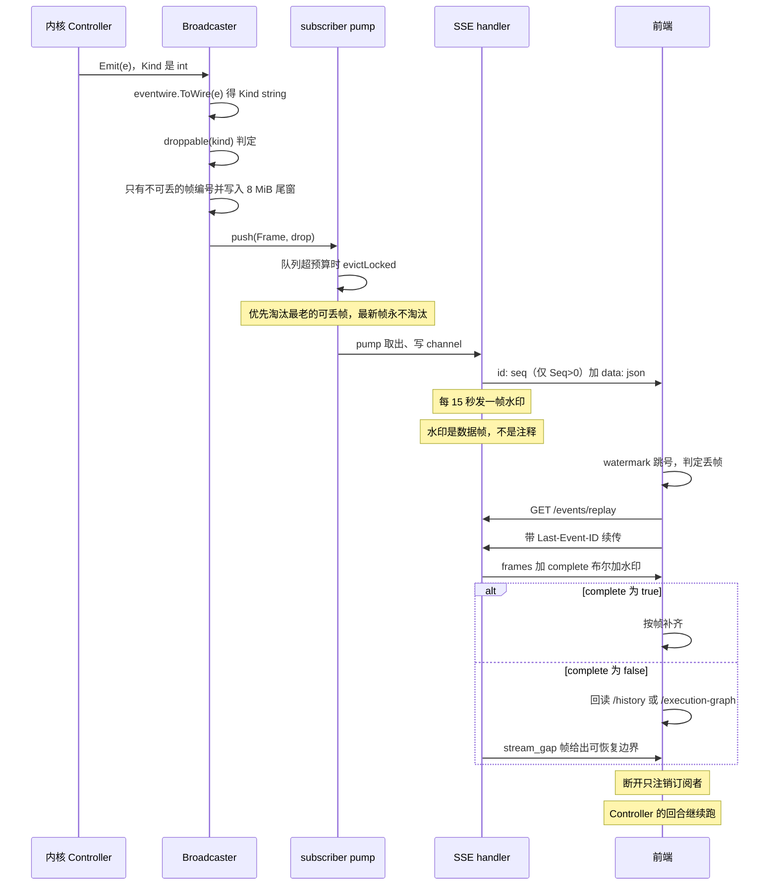

# 本机 HTTP/SSE 服务端与 Studio 通道：信任边界是一叠包裹层

> 本解读按 **ai-agent** 类规格产出，属 DeepSeek-Reasonix 深度解读的子文档；共 13 篇，解读基线 `v2.37.0`（`e17ef45e3`）。正文所有 `文件:行号` 引用均为 Reasonix 仓库相对路径，点开即可核对。相关篇章见 [README.md](README.md)。

## 这一层在系统中的角色

Reasonix 有四个传输前端：终端 chat/TUI、ACP（编辑器）、本机 HTTP+SSE（serve）、Electron 桌面。它们的共同下游是唯一一个与传输无关的 `control.Controller`。`internal/frontend/serve` 就是"把控制器换成一种可以通过网络复述的东西"的那一层：事件流变成 Server-Sent Events，命令变成一组小的 JSON POST。

它的包注释把职责写得很清楚：一个 server 驱动一个会话，多个浏览器标签页共享它。

[internal/frontend/serve/serve.go:1-6]()
<!-- anchor: // Package serve exposes a control.Controller over HTTP: the typed event stream … package serve -->

去掉它，Electron 桌面就没有可打开的地址（渲染进程与内核分属两个进程），`reasonix web` 也不存在，而 TUI 会退回到直接持有 `*control.Controller` 的旧形态——因为 TUI 现在也是通过这一层的 HTTP surface 在进程内驱动内核的。

[internal/frontend/cli/tui_command.go:115-122]()
<!-- anchor: serveCfg := config.ServeConfig{AuthMode: "none"} … Client:        &tui.Client{HTTP: hub.InProcessClient(), Base: tuiBase}, -->

同一条证据也说明了一件事：这一层不只是"给浏览器用的前端"，它是**控制器之上的一层稳定 wire 面**，TUI 已经吃到了它的红利。这决定了后文很多取舍：任何只对浏览器有意义的复杂度（鉴权、CSRF、重放、ETag）都会背上 TUI 的进程内路径，所以它们必须能在"没有 listener"的情况下退化。

## 根因：它要解决什么问题

`control.Controller` 是进程内的 Go 对象：事件通过 `event.Sink.Emit` 推给调用方，命令通过方法调用下达。要做成网络服务，需要在两处补上进程内调用天然具备、跨进程调用不具备的性质。

**第一，事件流有一条会断的边。** 进程内 `Emit` 是同步函数调用，不可能丢；HTTP 上是一条 TCP 连接，慢客户端、代理超时、浏览器标签页休眠都会让帧丢失。而这一层的订阅者可能是 Agent 正在跑的同一台机器上的另一个进程——丢一帧 `turn_done` 或 `approval_request`，前端就会永远等一个已经结束的状态。所以这里的核心问题不是"如何把事件序列化成 JSON"，而是**如何让'丢了一帧'变成客户端可以发现、并且可以补救的事**。

**第二，一个"本机端口"不等于"本机操作者"。** 绑定 `127.0.0.1` 只说明数据包没离开这台机器，不说明发起请求的进程是人。任何用户访问过的网页都能向 `http://127.0.0.1:<port>` 发简单跨源 POST；DNS rebinding 能让一个外部域名解析到 127.0.0.1 并以自己的 `Host` 到达这个 socket；同 uid 的恶意进程可以直接读 cookie 文件和 token 文件。这一层的第二个核心问题是**在"绑定 loopback"和"可信"之间补上多少检查，以及补在哪一层**。

这两个问题的答案贯穿全文，也是本关注面所有复杂性（帧编号、replay log、水印、四层门、grant、lease）的来源。

## 设计思路：三层叠加，而不是一个大 mux

整体形状是三层叠加，而不是一个大 mux：

- **`Server`**（`serve.go`）：一个控制器 + 一组路由 + 一个 `Broadcaster`。它的路由表是"裸的"，不带任何中间件。
- **`Hub`**（`hub.go`）：把 N 个 `Server` 挂在 `/rt/{id}/` 下，并为它们共有的东西（auth gate、workspace 树、approval 姿态、wallet）持有唯一实例。网关（auth / CSRF / logging）在 hub 这一层包一次。
- **宿主门**（`loopback.go`、`device_gate.go`、`inprocess.go`）：包在 hub 之外，由"谁打开了这个 listener"决定装哪一道。

为什么把网关放在 hub 而不是每个 runtime 上：路由本身按 runtime 隔离（每个 `Server` 自己的 mux），但**鉴权、CSRF、Host 校验是"这个 listener 的"属性，不是"这个会话的"属性**。同一个进程里两个会话共享一个 socket，对 socket 的信任判断只应做一次。

[internal/frontend/serve/hub.go:537-539]()
<!-- anchor: // Handler routes hub endpoints and mounts every runtime under /rt/{id}/. Auth, … // bare muxes. -->

这也是为什么 `Server` 的路由表被刻意做成"裸 mux"——`routes()` 的注释说得很直白：把它写成独立文件是为了让读者能一眼扫完，而不是让它成为"组装服务器那个文件"的一节。

[internal/frontend/serve/routes.go:5-11]()
<!-- anchor: // routes is this server's bare mux, and the whole of it: every path this … mux := http.NewServeMux() -->

放弃的替代方案是常见的"每个端点自己校验"，代价在这一层被明确拒绝：`refuse_common.go` 的开头记了一笔账——172 处手写 `http.Error` 的代价是"同一个 bad body 有十二种说法"。于是这一层把所有拒绝收敛成 **dotted code + 结构化 params**，HTTP 状态码只表达"读的人该做什么"（400 = 请求本身错，403 = 你不该做这件事，409 = 现在不行）。

[internal/frontend/serve/refuse_common.go:11-31]()
<!-- anchor: // The recurring kinds. A frontend that has wording for these can say most … codeSessionOpenFailed = "session.open_failed" -->

[internal/frontend/serve/refuse_common.go:47-53]()
<!-- anchor: // notFound answers 404, which is the trap in it: a name that is merely invalid … map[string]any{"kind": kind, "name": name}) -->

响应体的形状就是这三个字段，且 `Message` 被明确定义为"日志用的英文兜底，永远不是译文"——一个 code 的重命名被声明为**与重命名路由同级的破坏性改动**。

[internal/frontend/serve/fail.go:13-28]()
<!-- anchor: // Reason is a machine-readable refusal: the kernel decides what happened, a … _ = json.NewEncoder(w).Encode(Reason{Code: code, Message: message, Params: param -->

拒绝的传播靠一个实现了 `error` 的 `coded` 包装：控制器知道"有一个回合在跑"，mux 不知道，`coded` 的作用是把那个判断送到边界，而不让中间层学会 HTTP 的概念。

[internal/frontend/serve/fail.go:39-54]()
<!-- anchor: // coded carries a Reason out through call sites that only return `error`. … return &coded{reason: Reason{Code: code, Message: err.Error(), Params: params},  -->

## 信任边界是一叠包裹层，而不是一条线

这一层最容易被误读成"一张路由表 + 每个端点自己校验"，但实现不是这个形状。真正的形状是三层叠加：**`Server` 的路由表是裸的，`Hub` 把网关包一次，宿主门包在 hub 之外**。于是一个请求穿过了哪几层，决定了它能看见什么、能改什么——门不是流程里的一步，而是嵌套在 listener 与路由之间的包裹层。

三条证据决定了这个形状：

- 网关（auth / CSRF / logging）在 hub 这一层只包一次。注释把理由写死了：鉴权、CSRF 与 logging 是"这个 listener 的属性"，不是"这个会话的属性"，所以 runtime 被挂上去时是裸 mux。
  [internal/frontend/serve/hub.go:537-539]()
<!-- anchor: // Handler routes hub endpoints and mounts every runtime under /rt/{id}/. Auth, … // bare muxes. -->
- 正因为外层已经包过，`Server.routes()` 是一张刻意"裸"的 mux——注释说把它写成独立文件是为了让读者一眼扫完，而不是让它成为"组装服务器那个文件"的一节。
  [internal/frontend/serve/routes.go:5-11]()
<!-- anchor: // routes is this server's bare mux, and the whole of it: every path this … mux := http.NewServeMux() -->
- 宿主门不由配置决定：`LoopbackGateOptions` 的两个字段（token 与 origin）都属于打开 listener 的那个宿主，"没有任何配置文件参与其中，所以用户能编辑的任何东西都不会关掉这个边界"。
  [internal/frontend/serve/loopback.go:22-24]()
<!-- anchor: // LoopbackGateOptions is the whole policy. Both fields belong to the host that … // a user can edit turns this boundary off. -->

下面这张图把五个来源与三道宿主门画在同一组同心层上。**位置本身就是论据**：箭头从哪个开口进入、又穿过了哪条框线，直接读作"一个请求先遇到谁、能绕过谁"。


### 这张图在说什么

图的读法只有两条：**从框的开口进入 = 这一层检查了这个请求；箭头穿过框线 = 绕过了这一层**。于是五条启动路径一眼可分：

- **S1 Electron 主进程**先过 `G1 loopback gate`（Host、Origin、常量时间比较的本次启动 token 三层），再进 `G2`。它的凭据是宿主自己写进 `ready.origin` 的 `HttpOnly + SameSite=Strict` cookie。
  [desktop/electron/src/main.js:268-276]()
<!-- anchor: async function armCredential(ready) { … sameSite: "strict", -->
- `G1` 与"内核是宿主的子进程"是同一个决定的两半：先 `ListenLoopback` 拿到端口、再铸 token、最后把 `NewLoopbackGate` 包在 `hub.Handler()` 外面——顺序在代码里就是理由（拿不到端口就没人能命名 origin），而 gate 的注释明确说它在 hub 之外，所以不改变 hub 自己的 auth 与 CSRF 行为。
  [cmd/reasonix-studio-host/main.go:239-256]()
<!-- anchor: // because nothing can name the origin until the kernel owns a port, and the … handler:  serve.NewLoopbackGate(next, serve.LoopbackGateOptions{Token: token, Or -->
- **S2 浏览器标签页**穿过 `G1`、`G3` 的框线，只走 `G2`（token 或 password，默认 token）。
  [internal/frontend/cli/web_runtime.go:24-33]()
<!-- anchor: // serveConfigWithCommandDefaults authenticates serve with a per-launch token … return cfg -->
- **S3 已配对设备**过 `G3`、绕过 `G1`，并被 `G3` 打上 device reach 标记；它拿到的 `grants` 是零值，host-only 路由对它返回 404。
  [internal/frontend/serve/reach.go:54-60]()
<!-- anchor: // at is what the host opened, as seen by r. A grant is a window's decision … return g -->
- **S4 TUI 同进程**穿过两道宿主门的框线——因为根本没有 listener，`handlerTransport` 直接把请求交给 `hub.Handler()`；它仍然要过 `G2`，只是由 `provenOperator(r)`（in-process 标记）放行。
  [internal/frontend/serve/inprocess.go:48-53]()
<!-- anchor: // InProcessClient reaches this hub's routes without a listener, for a … return &http.Client{Transport: &handlerTransport{handler: h.Handler()}} -->
- `provenOperator` 读的三个标记（in-process、host-gated、device reach）**只能由 transport 自己设置**，网络来的请求无法用任何它发送的内容伪造。
  [internal/frontend/serve/launch_token.go:22-32]()
<!-- anchor: // provenOperator reports a request some boundary already authenticated: the … return ok && id != "" -->
- **S5 远端内核**不是这个 listener 的客户端：窗口 `POST /remotes/open` 建立 `RemoteEndpoint{Addr, Token, Base}`，此后 Hub 用 `httputil.ReverseProxy` 把 `/rt/{id}/` 转过去（`FlushInterval = -1` 让 SSE 立刻过，502 被换成 dotted code `remote.unreachable`，token 走 `Cookie` header 而不是 URL）。
  [internal/frontend/serve/hub_remote.go:419-442]()
<!-- anchor: // remoteProxy forwards a pane's requests to the remote kernel. … "the remote kernel is not answering", map[string]any{"host": ep.Host}) -->

这张图最该被记住的不是任何一道门，而是**包裹次序本身**：`G1`/`G3` 在 `Hub.Handler()` 之外（Studio host 与 device share 各自把 gate 包在自己的 listener 上），`G2` 与 `hostOnly` 在 `Hub.Handler()` 之内。这道内外之分解释了后面所有看起来零散的规则——为什么设备请求对 host-only 路由得到 404、为什么在进程内反而最安全、为什么同一个 token 在两个宿主里有两种落点。

### 三道宿主门各自守什么

| 门 / 层 | 谁经过 | 能绕过什么 | 失败时返回什么 |
|---|---|---|---|
| `G1` loopback gate（Studio 宿主，`Hub.Handler()` 之外） | Electron 主进程：HTTP + `HttpOnly` cookie | 什么都绕不过：Host、变更请求的 Origin、常量时间比较的本次启动 token，三层都要过 | 500 `loopback.misconfigured`（门缺 origin 或 token 时拒绝一切）；403 `loopback.host_rejected` / `loopback.origin_rejected`；401 `loopback.unauthorized` |
| `G3` device gate（私有地址 listener，`Hub.Handler()` 之外） | 已配对设备（手机） | 未配对设备只能拿页面与 `/pair`；通过它的一切被打上 device reach 标记 | 500 `device.misconfigured`；403 `device.host_rejected` / `device.origin_rejected` / `device.pairing_invalid`；401 `device.unauthorized`；404 `device.not_a_device` |
| `G2` auth gate · `hostGuard`（仅 `auth_none` 生效） | `G1`/`G3` 之后的请求 | 带 launch token 的请求，或已被某道门证明为操作者的请求（`provenOperator`） | 421 `serve.host_rejected` |
| `G2` auth gate · `csrfGuard` | 所有 POST | 非 POST 不受影响；`/login` 在更外层的 auth gate 里就被直接处理，不走这里 | 415 `request.bad_content_type` |
| `G2` auth gate · `mutationGate`（仅 `auth_none` 生效） | 所有非安全方法（含审批） | GET / HEAD / OPTIONS，以及 `provenOperator` 的请求 | 403 `auth.launch_token_required` |
| `hostOnly(hostMux, mux)`（`Hub.Handler()` 之内） | 命中 host-only 路由的请求 | 未命中 host-only 的请求直接落到普通 mux | 404 `device.host_only`（只对带 device reach 标记的请求） |

**"loopback 客户端 = 操作者"这个假设，在 `G1` 与 device reach 的 grant 归零这两处被明确拒绝，而它只在 `hostGuard` 的一条放行条件（"已被某道门证明是操作者"）里被间接接受一次。** 这条不对称正是下一节那条越权读路径能成立的前提：`/workspace/file` 既不在 `G2` 的凭据判定里，也不在 sandbox 的读约束里，它落在"能到达这个 listener 就能读"这个被别处否掉的假设上。

三道宿主门的拒绝码都被刻意拆成四个以上，理由在注释里：一个共享码会让测试分不清"一次守住的 rebinding 防御"和"一次恰好先回答的凭据检查"。
[internal/frontend/serve/loopback.go:12-19]()
<!-- anchor: // Each refusal names the invariant that fired. One shared code would leave a … codeLoopbackMisconfigured = "loopback.misconfigured" -->

### 六道门的顺序，以及顺序为什么是论据

网关的组装是一行嵌套调用，从外到内：log → auth → hostGuard → withPage → csrf → mutationGate → watchTreeWrites → hostOnly。
[internal/frontend/serve/hub.go:577]()

- `hostGuard` 在 `auth.middleware` **之内**、`csrfGuard` **之外**：Host 检查必须先于任何凭据比较（loopback gate 的注释把这个原则写得更明确——"一个用别的名字到达 socket 的调用者，在凭据被比较之前就已经被地址判定了，所以什么也没学到"）。
- `withPage` 在 CSRF 之外：静态资源是 GET，不需要过 CSRF；而 `GET /` 的 SPA 回退要能拿到 index.html。
- `mutationGate` 在 `csrfGuard` 之内：Content-Type 先判定"这是一个跨源不可能发出的请求"，再判定"这个请求带没带 launch token"。
- `hostOnly` 在最内：`hostMux` 与 `mux` 是两个独立的 mux，只有前者命中的请求才要求"这是窗口"；设备请求对 host-only 路由得到 404，一个前端已经把它读作"这个内核没有窗口"。
  [internal/frontend/serve/reach.go:63-75]()
<!-- anchor: // hostOnly serves the routes a window registers for itself and refuses them to … host.ServeHTTP(w, r) -->

三个子层各自的判据也值得记一句：`hostGuard` 只在 `auth_none` 时检查 `Host`，且把"带着 launch token"也算作放行条件；`csrfGuard` 只要求 POST 的 `Content-Type: application/json`（跨源简单请求发不出这个类型，于是强制了一次浏览器不会替它完成的 preflight）；`mutationGate` 用**方法**而不是路由清单决定要不要 launch token，这样后加的路由自动落进门里。
[internal/frontend/serve/host_guard.go:93-103]()
<!-- anchor: // hostGuard applies the allowlist while authentication is off. A request that … next.ServeHTTP(w, r) -->
[internal/frontend/serve/launch_token.go:53-63]()
<!-- anchor: // mutationGate holds an auth-disabled serve's mutations to the launch token. … next.ServeHTTP(w, r) -->

### 同一个"token"词，两种落点

图上那条虚线值得在正文里说清，因为它是"信任边界不止一条线"的最后一个证据：两个宿主里的 token 不是同一种东西。

- `G1`/`G3` 的 token 由宿主**每次启动铸出 32 字节**，从不读配置、从不落盘——注释的原话是"一个用户可以设置的凭据，就是一个能读到他配置的页面也能出示的凭据"。
  [cmd/reasonix-studio-host/main.go:266-274]()
<!-- anchor: // launchCredential mints what this launch is guarded by. Never read from … return hex.EncodeToString(buf), nil -->
- 它的传递通道是 stdout 上的一行 JSON 握手（`version` / `origin` / `token`），因为"文件或环境变量会比这次启动活得更久，并且能被不止一个进程读到"。
  [cmd/reasonix-studio-host/main.go:277-287]()
<!-- anchor: // handshake is what the parent process needs and nothing else. It goes down the … return json.NewEncoder(w).Encode(handshake{Version: handshakeVersion, Origin: b. -->
- 载体只有 cookie 或 `Authorization: Bearer`，**query 被显式拒绝**：query token 会把凭据写进请求行、历史与 referrer。
  [internal/frontend/serve/loopback.go:96-104]()
<!-- anchor: // loopbackTokenPresented reads the cookie the host set. Cookie only: the query … return subtle.ConstantTimeCompare([]byte(c.Value), []byte(token)) == 1 -->
- 而 `auth_none` 的 `reasonix serve` 的那个 launch token（`mutationGate` 用的）确实会落盘：`<Reasonix home>/remote/launch-<pid>.token`，0600。它被登记为 host secret 是为了让 **agent 自己的沙箱**拒绝读它（"一个沙箱命令可以读回多路复用器的 scrollback"，这也是终端里不打印 token 的理由）；它防不住同 uid 的非沙箱进程。
  [internal/frontend/cli/serve_launch_token.go:15-18]()
<!-- anchor: // writeLaunchTokenFile leaves the token an auth-disabled serve's changes need … // multiplexer's scrollback. -->
- Studio 必须清空用户 `[serve]` 配置里的 auth，否则 hub 的 token 与 gate 的 token 是两个东西，每个请求都会被拒。
  [cmd/reasonix-studio-host/main.go:478-488]()
<!-- anchor: // hostServeConfig is the user's serve settings with their authentication taken … return cfg -->

## 关键数据结构

三张"账本"决定了这一层的行为：帧的编号与重放、会话文件的写权限、宿主的 grant。

```go
type Broadcaster struct {
	mu              sync.Mutex
	subs            map[*subscriber]struct{}
	ledger          *pricing.Ledger
	displayCurrency string
	seq                    int64
	replay                 replayLog
	initialNoticesReplayed bool
	onTreeChanged          func()
}
```

[internal/frontend/serve/broadcaster.go:18-29]()
<!-- anchor: type Broadcaster struct { … onTreeChanged          func() -->

`seq` 属于传输而非会话，这一点是个不显然但重要的选择：`/new` 与 `/resume` 会清空 replay 尾窗，但**不重置编号**，于是"跨会话恢复"的客户端会落在日志第一帧之前，得到 `complete=false`，从而被明确要求重读 transcript，而不是拿到另一段对话的帧却以为编号连续。

[internal/frontend/serve/broadcaster.go:74-86]()
<!-- anchor: // ResetSession clears the usage ledger for /new, /resume and /fork, and drops … b.mu.Unlock() -->

```go
type hostGrants struct {
	workspaceSwitch bool // POST /workspace
	accountAuth     bool // /account
	providerEdit    bool // /providers 写、权限、沙箱、shell、storage
	localDesktop    bool // POST /workspace/editor、GET /workspace/locate
	installReport   bool // market 安装上报
}
```

[internal/frontend/serve/providers.go:22-31]()
<!-- anchor: // hostGrants are the surfaces a host opens on behalf of its one local client. … installReport   bool // market installs may be reported; see AllowMarketInstallR -->

这五个 bool 是"这个服务器是一个窗口，不是一个网络服务"这一个决定的展开。注释解释了为什么不是一个端点一个 bool：三个独立 bool 能拼出"能登录但不能换目录"这种没有任何宿主想要的状态。而它们的**作用域是请求**——`grants.at(r)` 在请求来自已配对设备时返回零值，因为"窗口对自己客户端的授权"不适用于网络来的设备。

[internal/frontend/serve/reach.go:54-60]()
<!-- anchor: // at is what the host opened, as seen by r. A grant is a window's decision … return g -->

## 服务形态与启动：三个宿主，三种姿态

| 宿主 | 监听 | 地址交付 | 门 |
|---|---|---|---|
| `reasonix serve` | `--addr`，默认 127.0.0.1 的 8787 端口，不重试 | `--port-file` / `--pid-file` / `--token-file` | auth gate（默认 token）+ hostGuard + CSRF + mutationGate |
| `reasonix web` | 同上，但 **EADDRINUSE 时端口 +1 重试**（上限 100） | 同上，外加 instances 心跳文件 | 同上，且强制 `auth_mode=token` |
| Studio（`reasonix-studio-host`） | **强制** `tcp4 127.0.0.1:0`（内核分配端口） | stdout 一行 JSON handshake | loopback gate（Host + Origin + cookie token）+ auth gate |

三个宿主的默认地址都在 `internal/frontend/cli/serve_frontend.go` 里：`--addr` 的默认值是 127.0.0.1 的 8787 端口，`--web` 打开浏览器。

[internal/frontend/cli/serve_frontend.go:257-266]()
<!-- anchor-base64:cHJvZmlsZUZsYWcgOj0gZnMuU3RyaW5nKCJwcm9maWxlIiwgIiIsICJkZXByZWNhdGVkOiB1c2UgLS1wcmVzZXQgKGVjb25vbXl8YmFsYW4KYXV0aEhlbHAgOj0gImF1dGggbW9kZTogbm9uZSwgdG9rZW4sIG9yIHBhc3N3b3JkIChkZWZhdWx0OiBjb25maWcsIGVsc2UgYSBnZW5lcmE= -->

**`serve` 与 `web` 不强制 loopback。** 传 `--addr 0.0.0.0:8787` 是允许的，代码不做拒绝，只给一条警告。

[internal/frontend/serve/auth.go:693-704]()
<!-- anchor: // PlainHTTPAuthWarning reports whether serve is exposing authenticated access … return "warning: authenticated serve is listening on non-loopback HTTP; use HTTP -->

这条警告本身也泄露了设计意图：非 loopback 且 `auth_mode=none` 时，提示说"launch token 是明文穿过这个网络的"。也就是说项目承认这种部署存在（受信任的 LAN / 反向代理之后），只是要求用户明确看到风险。`hostAllowlist` 在通配绑定时会展开为本机所有接口地址的 IP 字面量（而不是接受任意名字），这是为了不让解析器决定这道门保护谁。

[internal/frontend/serve/host_guard.go:22-35]()
<!-- anchor: // ListenOn records the address serve is bound to. A wildcard bind answers for … h.addLocked(a) -->

**端口回退只在 `web` 上存在，且只对 EADDRINUSE 生效。** `listenWebWithPortRetry` 在端口为 0 时保持内核分配语义（不递增），非 EADDRINUSE 的错误立即返回。

[internal/frontend/cli/web_runtime.go:43-67]()
<!-- anchor: // listenWebWithPortRetry binds addr, walking port+1 only when a concrete port … port++ -->

注意任务清单里假设的 `--port` 并不存在：对外只暴露 `--addr`（`host:port`）与 `--port-file`。

**随机端口回退之后，地址怎么交给调用方**，是三种不同的答复：

`serve`/`web` 用文件：`--port-file` 拿到真实的 `host:port`（0600、原子写），`--pid-file` 拿到 pid，token 写进 `<Reasonix home>/remote/launch-<pid>.token`（0600，并登记为 host secret 以便沙箱拒绝读取）。

[internal/frontend/cli/serve_files.go:72-82]()
<!-- anchor: // writeServeAddrFile records the actual bound listen address (host:port) so a … return fileutil.AtomicWriteFile(path, []byte(strconv.Itoa(os.Getpid())+"\n"), 0o -->

[internal/frontend/cli/serve_launch_token.go:15-32]()
<!-- anchor: // writeLaunchTokenFile leaves the token an auth-disabled serve's changes need … return path, nil -->

`web` 额外维护一份 `instances/` 目录下的心跳记录（server_id / pid / host / port / heartbeat_at，15 秒一次），供独立的运维读者发现"这台机器上有哪些 web 实例在跑"。这不是给 Electron 用的通道。

[internal/frontend/cli/web_runtime.go:36-40]()
<!-- anchor: const ( … webInstanceDirectoryName = "instances" -->

[internal/frontend/cli/web_runtime.go:112-120]()
<!-- anchor: // webInstanceRecord is stable for independent operator-facing readers. … HeartbeatAt int64  `json:"heartbeat_at"` -->

Studio 则完全不写文件：它在 stdin/stdout 上做一次握手的父子协议。内核往 stdout 写一行 JSON（含 version、origin、token），Electron 侧用 4096 字节上限与 60 秒超时读这第一行，之后的每一行是"交接动作"。stdin 是租约：这一端关闭时内核会排空退出，所以一个没有被告知退出的父进程死掉不会留孤儿内核。

[desktop/electron/src/host.js:4-6]()
<!-- anchor: const PROTOCOL_VERSION = 1; … // while it waits, nor hold the launch open forever. -->

[desktop/electron/src/host.js:23-30]()
<!-- anchor: // start spawns the kernel and reads the handshake it writes to stdout. Every … if (systemLanguage) env.REASONIX_SYSTEM_LANG = systemLanguage; -->

[cmd/reasonix-studio-host/main.go:55-60]()
<!-- anchor: const ( … handshakeVersion = 1 -->

这个"stdio 握手 + stdin 租约"是三种里唯一**不依赖文件系统权限**的通道：没有 token 文件需要 0600，没有端口文件可能被猜。代价是它只对"内核是宿主 spawn 出来的子进程"这一种拓扑成立，`reasonix serve` 那种"先起服务、调用方稍后连"的场景用不了。

**Studio 的握手协议本身也是一道边界。** 内核往 stdout 写第一行 JSON（`version` / `origin` / `token`），Electron 侧读它时给了两个上限，理由是"一个永远不发握手的子进程不能一边占着这个进程一边把启动挂住"：4096 字节与 60 秒。
[desktop/electron/src/host.js:6-8]()
<!-- anchor: // while it waits, nor hold the launch open forever. … const HANDSHAKE_TIMEOUT_MS = 60000; -->

解析是拒绝式的，而且拒绝的理由都不带原文——"没有任何消息会带上这一行：凭据就在里面"。它要求握手版本等于 1、token 是长度 ≥32 的字符串、`origin` 能解析、协议必须是 `http:`、主机名必须是 `127.0.0.1`、必须有端口。
[desktop/electron/src/host.js:141-166]()
<!-- anchor: function parse(line) { … if (!url.port) throw new Error("the handshake named no port"); -->

失败被分成 5 个 code：`timeout` / `exited` / `spawn` / `overflow` / `malformed`，调用方按 code 分支而不按句子；而重试只允许一次，且只对"刚起来就停住或起不来"的内核（`exited` / `spawn`，10 秒内）。
[desktop/electron/src/host.js:11-12]()
<!-- anchor: // HostStartError says why a launch has no kernel. code is one of "timeout", … // "exited", "spawn", "overflow" or "malformed"; callers branch on it, never on -->
[desktop/electron/src/host.js:170-175]()
<!-- anchor: const RETRY_WITHIN_MS = 10000; … return attempt < 2 && (err?.code === "exited" || err?.code === "spawn") && elaps -->

## 鉴权与信任边界：loopback 不等于可信

这是本关注面最厚的一章，因为这里有**六道独立的门，各自守不同的东西**。

### 1. auth gate：凭据

四种模式：`authInvalid`（配置非法，拒绝一切）、`authNone`（显式退出，但改动仍需 launch token）、`authToken`、`authPassword`。配置解析失败会落到 `authInvalid` 并 fail-closed——一个输错 `auth_mode` 的部署不会静默变成 `none`。

[internal/frontend/serve/auth.go:35-39]()
<!-- anchor: const ( … authPassword                 // login page with bcrypt password -->

[internal/frontend/serve/auth.go:139-142]()
<!-- anchor: mode, err := NormalizeAuthMode(cfg.AuthMode) … return ag -->

[internal/frontend/serve/auth.go:219-221]()
<!-- anchor: if ag.mode == authInvalid { … return -->

**实际默认是 `token`，不是 `none`。** 这是 `serveConfigWithCommandDefaults` 做的，而且 `web` 会**忽略用户配置里的 `none`**。理由是 `web` 是"打开浏览器"的形态，用户以为它只在自己机器上，但 `--addr` 可能是 `0.0.0.0`。

[internal/frontend/cli/web_runtime.go:24-33]()
<!-- anchor: // serveConfigWithCommandDefaults authenticates serve with a per-launch token … return cfg -->

**token 的传递方式迁移过。** 现在的主路径是：URL fragment（`#token=...`，不进入请求行、日志、历史与 referrer）→ 页面把它 POST 到 `/auth/token`（有长度上限的 JSON body）→ 换成 `HttpOnly` cookie。query 参数仍被接受，但被明确标为 legacy，为了让已经分享出去的链接继续能用。

[internal/frontend/serve/auth.go:270-273]()
<!-- anchor: // handleTokenBootstrap validates a token delivered from the URL fragment by … func (ag *authGate) handleTokenBootstrap(w http.ResponseWriter, r *http.Request) -->

[internal/frontend/serve/auth.go:316-319]()
<!-- anchor: // checkToken validates the token from a cookie or the legacy query parameter. … func (ag *authGate) checkToken(w http.ResponseWriter, r *http.Request, next http -->

代价是双路径的额外状态：`tokenBootstrapPublicPath` 要在"还没有 cookie"的窗口里放行 shell 的静态资源与 `/auth/token`，这个判断必须窄。

[internal/frontend/serve/auth.go:256-258]()
<!-- anchor: func tokenBootstrapPublicPath(r *http.Request) bool { … return false -->

密码模式另有独立的细节：bcrypt cost 12、HMAC 签名的 30 天会话、每 IP 每分钟 5 次的登录限速（含定期清理，避免长跑进程的内存无界增长）、`X-Forwarded-For` 只在 `behind_proxy=true` 时被信任。会话 key 由 password hash 确定性派生（PBKDF2 4096 轮），所以重启不会让所有会话失效——代价是改密码才会。

[internal/frontend/serve/auth.go:42-49]()
<!-- anchor: const ( … pbkdf2Iter      = 4096                // deterministic session-key derivation fr -->

[internal/frontend/serve/auth.go:88-117]()
<!-- anchor: // cleanupLoop periodically purges expired rate-limit windows so the map does no … return w.count <= rateLimitMax -->

[internal/frontend/serve/auth.go:643-647]()
<!-- anchor: // clientIP extracts the client IP from the request. When behindProxy is true, … func (ag *authGate) clientIP(r *http.Request) string { -->

### 2. hostGuard：DNS rebinding

只在 `auth_none` 时生效，且只检查 `Host` header 是否在这个 listener 的允许集合里。它绕过的条件是"这个请求已经被更前面的某道门证明是操作者"——loopback gate、device gate、in-process transport，或者带着 launch token。

[internal/frontend/serve/host_guard.go:10-13]()
<!-- anchor: // codeHostRejected refuses an auth-disabled request addressed to a name this … const codeHostRejected = "serve.host_rejected" -->

[internal/frontend/serve/host_guard.go:93-103]()
<!-- anchor: // hostGuard applies the allowlist while authentication is off. A request that … next.ServeHTTP(w, r) -->

这里能看到一个重要的层间约定：`provenOperator(r)` 从 request context 读三种标记（in-process、host-gated、device reach），而**这些标记只能由 transport 自己设置**，网络来的请求无法用任何它发送的内容伪造。

[internal/frontend/serve/launch_token.go:22-32]()
<!-- anchor: // provenOperator reports a request some boundary already authenticated: the … return ok && id != "" -->

### 3. CSRF：Content-Type

一个非常朴素的规则：**POST 必须 `Content-Type: application/json`**。理由是跨源"简单请求"只能发出 `text/plain` / `form-urlencoded` / `multipart`，而要求 JSON 就强制了一次浏览器不会替它完成的 CORS preflight。这条规则没有 token、没有 nonce、没有同源 header 比对——因为它要挡的是"用户访问的任意网页"，而这一类攻击者无法设置跨源请求的 Content-Type。

[internal/frontend/serve/serve.go:406-425]()
<!-- anchor: // csrfGuard rejects state-changing requests that don't carry a JSON content typ … next.ServeHTTP(w, r) -->

绕行点被显式记录：`/login` 不走 CSRF guard，因为登录表单是 `application/x-www-form-urlencoded`，所以在 `auth.middleware` 里被提前拦截。

[internal/frontend/serve/auth.go:214-217]()
<!-- anchor: // middleware returns an http.Handler that wraps next with authentication checks … func (ag *authGate) middleware(next http.Handler) http.Handler { -->

### 4. mutationGate：launch token

`auth_none` 时读操作完全开放，但**任何非安全方法都要求 launch token**——包括审批。这里的设计判断是"到达这个 listener 不等于你是操作者，而任何改动都可能扩大 agent 能做的事，所以由 HTTP 方法决定，而不是由一张路由清单决定"。用方法而不是清单，是为了让新加的路由自动落进门里。

[internal/frontend/serve/launch_token.go:53-63]()
<!-- anchor: // mutationGate holds an auth-disabled serve's mutations to the launch token. … next.ServeHTTP(w, r) -->

token 的载体只有 cookie 或 `Authorization: Bearer`，**不接受 query**——loopback gate 的注释把这个理由说透了：query token 会把凭据写进请求行、历史和 referrer。

[internal/frontend/serve/loopback.go:96-104]()
<!-- anchor: // loopbackTokenPresented reads the cookie the host set. Cookie only: the query … return subtle.ConstantTimeCompare([]byte(c.Value), []byte(token)) == 1 -->

### 5. loopback gate：Studio 专用的一道额外门

这是"loopback 不等于可信"这个判断最直接的证据：Studio 自己就是在 loopback 上的，但它仍然装了一道门，三层检查——`Host` 必须等于这个 listener 的 authority、状态变更请求的 `Origin` 必须等于它、cookie 里必须有本次启动铸出来的 token（常量时间比较）。

[internal/frontend/serve/loopback.go:49-81]()
<!-- anchor: // NewLoopbackGate guards a control plane that has become reachable through a … next.ServeHTTP(w, withHostGated(r)) -->

几处细节值得记下来：

- **门是"两个半边都缺就拒绝一切"**：没有 loopback origin 或没有 token 时，它返回 500 `loopback.misconfigured`，而不是放行。
- **Origin 的规则按方法分**：GET/HEAD 允许不带 Origin（顶层导航本来就不发），其他方法必须带上。
- **authority 必须是 IP 字面量**（`netip.ParseAddrPort` + `IsLoopback`），域名被拒绝——"一个名字会让解析器决定这道门保护谁"。
- **不回包 `w`**：注释明确说 `w` 必须原样透传，因为 `/events` 会对它做 `http.Flusher` 断言，一个不转发 `Flush` 的 wrapper 会把每条流变成"回合结束后才显示"的响应。

[internal/frontend/serve/loopback.go:53-58]()
<!-- anchor: func NewLoopbackGate(next http.Handler, opts LoopbackGateOptions) http.Handler { … "this gate was built without a loopback origin and a token", nil) -->

[internal/frontend/serve/loopback.go:85-93]()
<!-- anchor: // loopbackOriginAllowed splits the rule by what the request can do. A read may … return sent == want -->

[internal/frontend/serve/loopback.go:107-119]()
<!-- anchor: // loopbackAuthority is the host:port an origin answers for, and reports whether … return u.Host, true -->

[internal/frontend/serve/loopback.go:78-81]()
<!-- anchor: // w passes through undecorated: /events asserts http.Flusher on it, and … next.ServeHTTP(w, withHostGated(r)) -->

Electron 侧对应的实现是 `armCredential`：把 token 以 `HttpOnly + SameSite=Strict` 的 cookie 写进 `ready.origin`。而 Studio host 的 `hostServeConfig` **清空**用户 `[serve]` 配置里的 auth，因为 hub 的 token 与 gate 的 token 是两回事，不这样每个请求都会被拒。

[desktop/electron/src/main.js:268-276]()
<!-- anchor: async function armCredential(ready) { … sameSite: "strict", -->

[cmd/reasonix-studio-host/main.go:478-488]()
<!-- anchor: // hostServeConfig is the user's serve settings with their authentication taken … return cfg -->

**这一节的结论：** 本机其它进程能不能驱动你的 Agent，答案分两半。它不能靠"我在本机"来驱动——Studio 的 gate 要求本次启动铸的 token，`serve` 的 mutationGate 要求 launch token，两者都经常量时间比较，且 token 只经 cookie/Bearer 传递。但它能靠"我以同一个 uid 运行"来驱动——token 文件（0600，`<Reasonix home>/remote/launch-<pid>.token`）与 cookie 文件对同 uid 进程都是可读的。代码把 token 文件登记为 host secret 是为了让 **agent 自己的沙箱**拒绝读它（"一个沙箱命令可以读回多路复用器的 scrollback"，这是终端里不打印 token 的理由），它防不住同 uid 的非沙箱进程。

[internal/frontend/cli/serve_launch_token.go:15-18]()
<!-- anchor: // writeLaunchTokenFile leaves the token an auth-disabled serve's changes need … // multiplexer's scrollback. -->

### 6. device gate：第二道门，用于手机

`DeviceShare` 是"窗口的第二道门"：一个绑在**私有地址**上的 listener（拒绝通配与公网地址），由坐在窗口前的人主动打开，关掉它会解除所有配对。它用 `NewDeviceGate` 守，规则与 loopback gate 同形（Host、Origin、凭据），额外多两条：未配对的设备只能看到页面与 `/pair`；通过它的一切都被标记为 device reach。

[internal/frontend/serve/device_share.go:28-49]()
<!-- anchor: // ErrShareUnattached is a share opened before the host named what it serves. … mu              sync.Mutex -->

[internal/frontend/serve/device_gate.go:56-93]()
<!-- anchor: // NewDeviceGate guards a kernel reached by paired devices. Every request must … refuse(w, http.StatusUnauthorized, codeDeviceUnauthorized, "this device is not p -->

device reach 的意义不是"限制"，而是"不继承窗口的授权"：`grants.at(r)` 对 device 请求归零，`hostOnly` 对 device 请求返回 404。所以一台配对的手机可以读会话、提交回合、批准审批，但不能改 provider 密钥、不能换工作区、不能在宿主机器上开编辑器。

[internal/frontend/serve/reach.go:10-13]()
<!-- anchor: // codeDeviceHostOnly refuses a paired device a capability that belongs to the … const codeDeviceHostOnly = "device.host_only" -->

## 安全与沙箱的落点：只有扩大权限需要授权

**改边界的写端点统一在 `providerEdit` grant 后面。** 权限规则、沙箱设置、shell 解释器、browser tools 都是——理由在注释里：它们决定"运行内核的那台机器的文件"会被怎么对待，所以一个网络客户端不应能扩大自己的边界。

[internal/frontend/serve/boundary.go:37-44]()
<!-- anchor: // savePermissions writes the deny/ask/allow lists and rebuilds. These decide … return -->

[internal/frontend/serve/boundary.go:161-166]()
<!-- anchor: // saveBrowserToolsSettings rides the provider-edit grant: switching the tools o … return -->

[internal/frontend/serve/shell.go:20-26]()
<!-- anchor: // shares the provider-edit grant with the other routes that write the config of … return -->

一个例外被明确区分出来：**收回权限不需要授权**。`POST /permissions/revoke` 不走 grant，因为"拿走权限永远是读者可以做的事"。

[internal/frontend/serve/boundary.go:68-71]()
<!-- anchor: // revokeSessionGrant takes back what a prompt allowed for this session. It is … func (s *Server) revokeSessionGrant(w http.ResponseWriter, r *http.Request) { -->

同一条不对称规则也被用在额外工作区根目录上：**加一个根需要 `providerEdit` grant（它扩大工具可写范围），去掉一个不需要**。而且它把变更传播到同一工作区上的其他 pane——正在跑的 pane 保留旧根直到下一次重建，并被计入 `pending`，因为"撤销一个根会收窄它们全部"。

[internal/frontend/serve/workspace_roots.go:65-71]()
<!-- anchor: // Adding a root widens where tools may write, so a network-reachable kernel … return -->

[internal/frontend/serve/workspace_roots.go:38-51]()
<!-- anchor: // rebuildSiblings applies the grant to every other pane on the workspace, so … return pending -->

[internal/frontend/serve/workspace_roots.go:121-129]()
<!-- anchor: pending := s.rebuildSiblings(r.Context()) … writeJSON(w, view) -->

这个模式值得单独记为一条原则：**在"扩大权限"和"收窄权限"之间，只有扩大需要授权**。`/permissions`、`/workspace/roots`、`/sandbox` 三处都遵循它，而 `POST /permissions/remembered/revoke` 是唯一带额外限制的收窄（它要重建运行时，所以必须没有在跑的回合）。

[internal/frontend/serve/boundary.go:83-104]()
<!-- anchor: // A remembered project approval is read by boot when it builds the permission … model := currentModelRef(ctrl) -->

## 一条绕过权限门的读路径（欠账）

这是本关注面最重要的一条负面结论，也是全文唯一一处"某条路径能到达别的路径到不了的地方"。它和上一章的嵌套模型是同一件事的两面：**门是按"请求从哪条路进来"装的，而 `/workspace/file` 这条路上的门只约束了路径的形状，没有约束读的权限。**

一句话版本：`GET /workspace/file` 与 `PUT /workspace/file` 只做三重路径约束与一个 SHA-256 revision CAS，**既不调用 `internal/safety/permission`，也不受 sandbox 的读约束**；持有 launch token 的客户端因此能读工作区根下任意 ≤2 MiB 的文本文件——包括 `.env` 这类连 agent 自己都会被权限规则或 `ForbidReadRoots` 挡住的文件。
[internal/frontend/serve/workspace_files.go:72-105]()
<!-- anchor: func (s *Server) workspaceFileRead(w http.ResponseWriter, r *http.Request) { … _ = json.NewEncoder(w).Encode(workspaceFile{Path: filepath.ToSlash(path), Conten -->

### 它做了什么约束

**文件读写端点用的是路径约束，不是权限门。** `/workspace/file`（GET/PUT）的约束是三重的：

1. `workspacePath` 要求 `filepath.Clean` 后 `filepath.IsLocal` —— 拒绝 `..`、绝对路径、`.`；
2. `os.OpenRoot(root)` + `root.Open/ReadFile/OpenFile` —— Go 1.26 的 rooted 文件操作，符号链接不能逃出 root；
3. 大小与类型检查（2 MiB、拒二进制）、写回时用 SHA-256 revision 做 CAS（"打开之后文件变了"，409）。

[internal/frontend/serve/workspace_files.go:28-33]()
<!-- anchor: func workspacePath(raw string) (string, error) { … return path, nil -->

[internal/frontend/serve/workspace_files.go:78-84]()
<!-- anchor: root, err := os.OpenRoot(s.ctl().WorkspaceRoot()) … file, err := root.Open(path) -->

[internal/frontend/serve/workspace_files.go:91-102]()
<!-- anchor: if err != nil || info.IsDir() || info.Size() > maxWorkspaceFile { … return -->

[internal/frontend/serve/workspace_files.go:130-132]()
<!-- anchor: if fileRevision(current) != in.Revision { … return -->

列目录走另一条路，因为列表要展示符号链接是否指回树内：`insideRealRoot` 用 `EvalSymlinks` 比较真实路径，`linkInTree` 决定一个 symlink 是显示成目录、文件还是干脆不显示。

[internal/frontend/serve/workspace_listing.go:14-16]()
<!-- anchor: // errListingOutsideTree is a folder whose real path leaves the workspace: a … var errListingOutsideTree = errors.New("that folder is not inside the workspace" -->

[internal/frontend/serve/workspace_listing.go:38-47]()
<!-- anchor: func listFolder(root, rel string, dots bool) (workspaceListing, error) { … return out, errListingOutsideTree -->

### 它不经过什么

[internal/frontend/serve/workspace_listing.go:142-149]()
<!-- anchor: func insideRealRoot(root, dir string) (bool, error) { … return false, err -->

**但这条路径不经过 `internal/safety/permission`，也不经过 sandbox。** 证据是整个包对 safety 层的 import：只有 `boundary.go` 引 `internal/safety/permission` 但只用它的 `UnknownToolError` 类型；`provider_check.go` / `provider_check_decision.go` / `providers.go` 引的是出网相关的 `redirectguard` / `typesafe` / `endpointclient`；没有任何文件端点调用权限策略或沙箱。

[internal/frontend/serve/boundary.go:11-12]()
<!-- anchor: "reasonix/internal/safety/permission" … "reasonix/internal/session/control" -->

[internal/frontend/serve/boundary.go:52-53]()
<!-- anchor: var unknown *permission.UnknownToolError … if errors.As(err, &unknown) { -->

这意味着：一个持有 launch token 的 HTTP 客户端（浏览器标签页、已配对设备、`reasonix web` 的用户）可以读工作区根下的任意文本文件，**包括 agent 自己会被权限规则或 sandbox 的 `ForbidReadRoots` 挡住的那些**（`.env`、凭据文件等）。还有一个 2 MiB 与"非二进制"的限制，但它不是保密边界。

这不必然是缺陷——它服务于"窗口的文件浏览器"，而窗口的客户端是坐在机器前的人，读自己喜欢的目录是合理的。但它是**一条真实的越权窗口**，且没有任何注释承认它：写在这里作为已知边界，不包装成刻意的设计选择。

**为什么这是欠账，而不是设计选择。** 三个理由都能落到代码上：

- **它与同层的其它决策自相矛盾。** "loopback 客户端 = 操作者"这个假设在这一层被拒绝了两次：Studio 自己在 loopback 上仍然要求本次启动铸出的 token，device reach 的请求拿到的 grant 是零值。而 `/workspace/file` 恰好建立在这个假设上——只要请求过了 listener 的门，读什么就由路径决定。
  [internal/frontend/serve/loopback.go:22-24]()
<!-- anchor: // LoopbackGateOptions is the whole policy. Both fields belong to the host that … // a user can edit turns this boundary off. -->
- **它与本项目对子 Agent 的纪律相反。** 项目的纪律是执行者与子 Agent **共用同一道权限门**：`control.Options.SubagentGate` 直接取执行者自己的 gate，skill runner 与 task tool 也都用同一个 `w.gate`；文档口径同样是"子 Agent 走正常 runner，permission deny 规则与沙箱限制依然适用"。也就是说，模型自己开的子 Agent 读不到的东西，一个带 launch token 的 HTTP 客户端反而读得到——这是一条比模型更弱的路径。
  [internal/assembly/boot/build.go:525-526]()
<!-- anchor: Policy:                         t.policy, … SubagentGate:                   t.gate, -->
  [internal/assembly/boot/delegation.go:74]()
  [docs/SUBAGENT_PROFILES.md:94]()
- **它的两个"限制"不是边界。** 2 MiB 与"非二进制"是实现细节：前者是 `maxWorkspaceFile` 的取值，后者是"内容里有没有 NUL 字节"这一个判断；它们决定"这个文件能不能在编辑器里打开"，不决定"这个文件该不该被读"。
  [internal/frontend/serve/workspace_files.go:91-102]()
<!-- anchor: if err != nil || info.IsDir() || info.Size() > maxWorkspaceFile { … return -->

**缓解措施是真实存在的，但它们不是针对这条路径的。** 默认 `auth_mode=token`（未配置时 `serveConfigWithCommandDefaults` 会补上 token，`web` 更是忽略配置里的 `none`）；Studio 宿主强制 `tcp4 127.0.0.1:0`，地址经 stdout 的 JSON 握手交付，stdin 作父进程租约（只有管道才算租约：终端或 `/dev/null` 要么永不结束、要么立刻结束，都说不出父进程还在不在）。这些措施把"这个 socket 谁能连上"收得很紧，代价是它们同时也让"连上之后能读什么"变得更少人审查——因为能连上的人已经被假定是自己人了。
[internal/frontend/cli/web_runtime.go:24-33]()
<!-- anchor: // serveConfigWithCommandDefaults authenticates serve with a per-launch token … return cfg -->
[internal/frontend/serve/loopback.go:34-38]()
<!-- anchor: // ListenLoopback opens the only listener this gate is meant to guard. Spelled … return net.Listen("tcp4", "127.0.0.1:0") -->
[cmd/reasonix-studio-host/main.go:277-287]()
<!-- anchor: // handshake is what the parent process needs and nothing else. It goes down the … return json.NewEncoder(w).Encode(handshake{Version: handshakeVersion, Origin: b. -->
[cmd/reasonix-studio-host/main.go:290-301]()
<!-- anchor: // parentLease is the pipe a parent holds open for as long as it wants this host … return f -->

**声明的边界：本次未做端到端渗透验证，结论来自读码。** 具体证据是"整个包里只有 `boundary.go` 引 `internal/safety/permission`，且只用了 `UnknownToolError` 这一个类型"这一静态事实，而不是读完了那 101 个次要文件的实现；它足以排除"某处调用了权限门"，不足以排除"某处用 `os.Open` 打开了别的路径"。

一个小的对照：`POST /workspace/editor` 反而更保守——它**不接受客户端给的路径**，只打开控制器当前的工作区根，"从请求里取一个路径会让它变成打开机器上任意东西的方式"。

[internal/frontend/serve/editor.go:24-27]()
<!-- anchor: // openInEditor opens this runtime's workspace, not a path the client names: … func (s *Server) openInEditor(w http.ResponseWriter, r *http.Request) { -->

## HTTP 面：一个裸 mux 的形状

**路由表的位置**是 `Server.routes()`，一个文件、一个函数、111 行，把 263 个 `mux.HandleFunc` 注册里的属于单会话的那部分集中在一起；Hub 级与 host-only 的路由在 `Hub.Handler()` 里另起。

[internal/frontend/serve/routes.go:10-110]()
<!-- anchor: func (s *Server) routes() http.Handler { … return mux -->

**没有版本前缀。** 唯一的路径命名空间是 hub 给每个 runtime 的 `/rt/{id}/`。之所以不需要 `/v1`，是因为前后端**同版本发布**（Electron 打包内嵌内核），而 wire 兼容性由三个门禁测试事后保证，不由 URL 版本保证。

[internal/frontend/serve/hub.go:41-43]()
<!-- anchor: // runtimePrefix is where a hub publishes its runtimes. The frontend builds … const runtimePrefix = "/rt/" -->

**请求/响应体：** 命令与查询是 JSON；事件流是 SSE；唯一例外是 `GET /workspace/image` 之类返回字节的端点。响应体一律由 `writeJSON` / `writeJSONStatus` / `writeJSONCached` 出口。

[internal/frontend/serve/serve.go:583-618]()
<!-- anchor: func writeJSON(w http.ResponseWriter, v any) { … _, _ = w.Write(body) -->

**按功能归类的代表端点**（完整清单见 `routes.go` 与各 `register*Routes`）：

- 会话生命周期：`GET /sessions`、`POST /resume`、`POST /new`、`POST /delete-session`、`POST /rewind`、`POST /summarize`、`POST /forget`
- 消息与回合：`POST /submit`、`POST /cancel`、`POST /steer`（经 inbox）、`GET /history`、`GET /trajectory`
- 审批与提问：`POST /approve`、`POST /answer`、`POST /plan-decision`、`POST /tool-approval-mode`、`GET /adjudications`
- 事件流：`GET /events`、`GET /events/replay`
- 配置与运行参数：`POST /preset`、`POST /effort`、`POST /model-mode`、`POST /compact`、`POST /context/window`、`POST /workspace-trust`、`POST /auto-approve-tools`、`POST /bypass`
- 模型与 provider：`GET /models`、`GET /providers`、`GET /provider-setup`、`POST /providers`、`POST /provider-setup/test`
- 文件与工作区：`GET /workspace/files`、`GET /workspace/file`、`PUT /workspace/file`、`GET /workspace/image`、`POST /workspace`、`POST /drop`、`POST /attachments`、`GET /workspaces`
- 安全边界：`GET/POST /permissions`、`POST /permissions/revoke`、`GET/POST /sandbox`、`GET/POST /workspace/roots`、`GET/POST /browser-tools`
- 工具与扩展：`GET/POST /hooks`、`POST /hooks/dry-run`、`GET /skills`、`POST /skills/enabled`、`POST /extensions/reload`、`GET /mcp`
- 统计与诊断：`GET /status`、`GET /balance`、`GET /usage`、`GET /context`、`GET /storage`、`GET /jobs`、`GET /execution-graph`、`GET /wirelog` 之外的 `GET /trajectory`
- Hub 级：`GET/POST /runtimes`、`POST /runtimes/{id}/close`、`GET /tree`、`POST /tree/workspaces`、`POST /tree/sessions/*`
- 仅窗口（host-only）：`GET /remotes`、`POST /remotes/open`、`POST /host/pick-folder`、`GET /host/capabilities`、`GET /studio/logs`、`POST /update/install`

**"宽响应"的模式：`GET /status` 是一个 additive 快照。** 它总是给基础字段（used/window、cache hit/miss、running/plan、goal、workspaceRoot、sessionPath），然后**按控制器是否实现某个可选接口**追加更多字段——`decisionViewer`（plan 阶段与待裁决项）、`ModelFace`（effort、vision、以及 `visionDeclared` 用来区分"模型不能读图"与"没有声明"）、`ModelModes`（只有声明了模式的模型才列出模式）。注释解释了为什么用可选接口而不是端口方法："只有这个前端今天渲染它"。

[internal/frontend/serve/settings.go:191-250]()
<!-- anchor: // status returns a combined status snapshot. … writeJSON(w, sess) -->

[internal/frontend/serve/settings.go:332-338]()
<!-- anchor: // decisionViewer is the projection surface: what waits on the user, and where … Decisions() []control.Decision -->

这个"absent 不等于 no"的约定贯穿这一层，它是"内核与前端可以有一次版本差"的代价最小的实现方式——没有协商、没有版本号，靠的是**旧前端忽略它不认识的字段，新前端把缺失读作"未声明"而不是"否"**。

[internal/frontend/serve/settings.go:214-220]()
<!-- anchor: // Additive: planPhase absent means outside the workflow, so a client that … sess["planPhase"] = phase.String() -->

[internal/frontend/serve/settings.go:236-239]()
<!-- anchor: // And whether that false is an answer or a silence: a relay forwards … sess["visionDeclared"] = face.VisionDeclared -->

## SSE 面

**端点：** `GET /events` 是长连接；`GET /events/replay` 是同一个日志的一次性快照，为"这一端根本没有连接可重连"的宿主（例如 Electron 的宿主进程自己重放 panes）准备。

[internal/frontend/serve/broadcaster.go:248-266]()
<!-- anchor: return b.seq … return frames, ok -->

**投影**发生在 `eventwire.ToWire`：内核的 `event.Event`（一个 `Kind int` + 一组指针字段）被映射成 `eventwire.Event`（`Kind string` + omitempty 字段），kind 名字表在同一个文件里，34 个条目。

[internal/contract/eventwire/wire.go:136-137]()
<!-- anchor: func ToWire(e event.Event) Event { … w := Event{Kind: kindNames[e.Kind], Text: e.Text, Detail: e.Detail, Reasoning: e -->

[internal/contract/eventwire/wire.go:724-758]()
<!-- anchor: var kindNames = map[event.Kind]string{ … event.ProgressWatchEvent:      "progress_watch", -->

`event.Kind` 是 iota 枚举，新 kind 必须追加在 `KindCount` 之前，所以**旧客户端遇到未知 kind 只会忽略**，而 Go 侧的 `KindNames()` 让"有没有漏掉一个 kind"变成可测的。

[internal/contract/event/event.go:23-26]()
<!-- anchor: // Kind tags an Event. Read the field(s) documented for that kind. … const ( -->

[internal/contract/event/event.go:158-160]()
<!-- anchor: // KindCount is a sentinel one past the last real Kind. New event kinds must … KindCount -->

**续传的机制是帧编号 + 有界重放窗口**，而不是"可靠流"：

- 只有"客户端不能承受丢失"的帧才被编号；`text` / `reasoning` / `tool_progress` / `compaction_progress` 四种是可丢的流式增量，不编号。
- 编号的帧同时进入 `replayLog`（8 MiB 上限，按字节淘汰最老的）。
- 客户端重连时带 `Last-Event-ID` header 或 `lastEventId` query，`/events/replay` 用它取回缺失的帧，并回一个 `complete` 布尔。

[internal/frontend/serve/broadcaster.go:37-47]()
<!-- anchor: // droppable reports whether losing this frame degrades the view rather than … return false -->

[internal/frontend/serve/eventstream.go:53-60]()
<!-- anchor: // Bytes, not frames: frames here span three orders of magnitude, so a count … queueBudget  = 4 << 20 -->

[internal/frontend/serve/eventstream.go:38-50]()
<!-- anchor: // lastEventID reads the resume point a client carries. The header is … return seq -->

`complete=false` 的语义被刻意写得很重：它不是"数据可能不全"，而是"你的下一帧在我能记住的范围之前就已经被淘汰了，所以任何量的重放都不能让你完整，你必须从权威来源重读"——transcript 归 transcript（`GET /history`），run graph 归 run graph（`GET /execution-graph`）。

[internal/frontend/serve/eventstream.go:21-24]()
<!-- anchor: // eventsReplay answers what a client missed. `complete` false means the log no … // another. Said plainly, because a hole looks like a quiet turn. -->

这是本层最值得学的一个设计：**它没有假装可靠**。放弃的是"保证不丢帧"（需要每客户端一个无界缓冲，或者把 agent 的产出阻塞在慢客户端上，两者都不可接受），换来的是"丢失可被发现、可被补救"。而补救的成本被压在客户端——只对编号帧。

**背压**的处理有三层，且方向都是"丢帧不阻塞 agent"：

- `Emit` 永不阻塞。
- 每个订阅者有一个 `pump` goroutine 独占输出 channel，所以慢客户端只让**自己的**队列变长。
- 队列超预算时 `evictLocked` **优先淘汰最老的 droppable 帧**，只有在没有 droppable 帧时才淘汰最老的编号帧；最新的帧永远不是候选（它承载让客户端停止等待的状态）。

[internal/frontend/serve/broadcaster.go:13-17]()
<!-- anchor: // Broadcaster is the event.Sink the controller emits to in server mode: one … // same numbers on either transport. See SubscribeFrom. -->

[internal/frontend/serve/eventstream.go:121-141]()
<!-- anchor: // subscriber is one client's outbound queue, drained onto ch by a single pump … drop bool -->

[internal/frontend/serve/eventstream.go:178-194]()
<!-- anchor: // evictLocked removes the oldest frame the client can most afford to lose, … s.queue = append(s.queue[:at], s.queue[at+1:]...) -->

还有一个细节值得单独指出：`push` 里 droppable 帧在队列已经满 channel 深时**直接丢弃**，理由是"落后一整条 channel 深度的增量，描述的是屏幕上已有的文本，而它会连带丢掉它后面所有编号帧"。这是把"哪一种丢失更便宜"编进了代码，而不是留给调优。

[internal/frontend/serve/eventstream.go:159-164]()
<!-- anchor: // A queue a whole channel deep means this client is out of step: a delta … return -->

**心跳**每 15 秒发一次 `: ping`（对抗 nginx/ALB/Cloudflare 的 30–60 秒空闲上游超时），并且——这一点是设计的核心而非附加——**同一个 tick 还发一个真正的 `stream_watermark` 数据帧**，因为注释注释（SSE comment）永远不会到达 `onmessage`，而"一个回合的最后一帧丢了"是没有任何别的东西会揭示的故障。

[internal/frontend/serve/eventstream.go:237-241]()
<!-- anchor: // sseKeepaliveInterval is how often /events emits a `: ping`. Reverse proxies … const sseKeepaliveInterval = 15 * time.Second -->

[internal/frontend/serve/eventstream.go:299-305]()
<!-- anchor: case <-keepalive.C: … flusher.Flush() -->

发现缺口之后，`gapFrame` 告诉客户端"可恢复的流从哪里开始"，因为"一帧丢失看起来就像一个安静的回合"。

[internal/frontend/serve/broadcaster.go:269-281]()
<!-- anchor: // gapFrame tells a client where the recoverable stream starts. Seq is the first … return data, from -->

**持久化重放**是另一条独立的路径：`wireLog` 把编号帧按"trajectory 面板要画行的那几种 kind"落盘（8 MiB 上限），`GET /trajectory` 读回它并回答 `complete` / `truncated` / `not_recorded`。这条路径不经过 SSE，供冷加载的窗口重建 trajectory 面板。

[internal/frontend/serve/wirelog.go:17-22]()
<!-- anchor: // kept: replaying them reproduces the pane row for row, with no second schema … // Only the kinds the pane draws a row for. Streamed text and reasoning arrive -->

[internal/frontend/serve/wirelog.go:222-252]()
<!-- anchor: // session, and a log that could not be read supports no claim at all. … view.Events = append(view.Events, json.RawMessage(line)) -->

### 一次事件从内核到客户端的投影、编号与丢失补救

上面的规则（哪些帧编号、尾窗多大、缺口怎么暴露）单看每条都不难，难的是它们在同一条链路上的先后关系——尤其是"投影"发生在哪一步、编号发生在哪一步、以及发现缺口之后谁负责重读。这张时序图把这条链路按一次真实发送的顺序铺开：`Emit` 是同步调用，`ToWire` 是投影点，`droppable` 是分类点，编号与尾窗写入只发生在"不可丢"的那一类上，而后端的补救只到"告诉你缺了多少"为止——重建权利被推给客户端。



这张图要看清的是三个"只有这里有"的位置：**编号只发生在分类之后**（所以可丢帧永远不会占据尾窗），**心跳同时是数据帧**（SSE 注释永远到不了 `onmessage`），以及**"完整"这个判断由后端给出、由客户端承担后果**（`complete=false` 不是"数据可能不全"，而是"你必须从权威来源重读"）。代价也随之可见：客户端要实现两套读取路径，而重放窗口按字节界定，所以"还能恢复多久"取决于那段会话说了多少话——这个代价被接受，是因为它有一个确定的后备：`/history`。
[internal/frontend/serve/eventstream.go:53-60]()
<!-- anchor: // Bytes, not frames: frames here span three orders of magnitude, so a count … queueBudget  = 4 << 20 -->

## 与内核的接线

**服务端持有 `control.SessionAPI`，不是 `*control.Controller`。** 这是接口隔离的落点：`port.go` 把控制器的驱动面切成 20 个子端口（`SessionAPI` 嵌了 20 个，而包本身定义的端口更多），注释说这是"给 `Controller` 自身的后续拆分留的规范"，而且 `port_segregation_test` 让前端看不见不该看见的方法。

[internal/session/control/port.go:24-33]()
<!-- anchor: // This file defines the driving port: the typed, segregated interface surface … // SessionAPI composition will accrete here as the remaining frontends migrate. -->

[internal/session/control/port.go:432-452]()
<!-- anchor: type SessionAPI interface { … Commits -->

但 serve 经常需要具体类型：换模型、换工作区、重载扩展都要"造一个新控制器再发布"，而重建路径只对 `*control.Controller` 成立。所以这一层有一批类型断言，且它们是**能力探测**而非风格瑕疵——例如"只有 `*control.Controller` 能把后台 job 交给替代者，其他实现会在关闭时取消它们"。

[internal/frontend/serve/serve.go:1030-1041]()
<!-- anchor: return nil -->

**一个 Server 一个控制器，但控制器会被替换。** 所有"换控制器"的路径（`/preset`、`/effort`、`/model-mode`、模型切换、工作区切换、扩展重载、权限/沙箱保存）都遵循同一个三步时序：**先造新的 → 迁移状态（job、lease、sink）→ 在短发布锁里换指针**，并且旧控制器的 `Close()`（可能等 `jobs.CloseWithGrace` 15 秒 + SessionEnd hook）在锁外执行。注释解释了为什么：持写锁跑这些会让每个 handler 卡在 `s.ctl()` 的读锁上。

[internal/frontend/serve/serve.go:198-218]()
<!-- anchor: // switchModel rebuilds the controller with a new model, carrying over the … func (s *Server) switchModelLocked(ctx context.Context, ref string) error { -->

**`bindMu` 串行化所有会改变"当前会话路径或控制器代际"的入口**：`/resume`、`/new`、`/fork`、`switchModel`、扩展重载。注释给出了具体故障：两个交错的 rebind 会让控制器写一个会话而 lease keeper 守另一个。

[internal/frontend/serve/serve.go:43-51]()
<!-- anchor: // bindMu serializes every entry point that changes the active session … bindMu sync.Mutex -->

**命令进内核的形态**是"一小段 JSON POST → 立即 202 / 204 → 结果走 SSE"。`POST /submit` 把 `format` 与 `via`（配对设备身份）一起交给控制器；`via` 只改变回执上写谁，不改变答案允许什么。

[internal/frontend/serve/attribution.go:10-19]()
<!-- anchor: // submitAs runs a submitted line as the one who sent it: a paired device's … return ctrl.SubmitHTTPFormat(input, format) -->

[internal/frontend/serve/serve.go:449-453]()
<!-- anchor: // submit runs raw user input as a turn (slash commands and @-references … func (s *Server) submit(w http.ResponseWriter, r *http.Request) { -->

一个真实的欠账已被修掉，值得记下来当反面教材：`/submit` 曾经在回合正在运行时也回 202，让客户端以为消息被接受了。现在的行为是：能进 inbox（steer 队列）就 202，否则 409 `busy.session_running`。

[internal/frontend/serve/serve.go:497-507]()
<!-- anchor: if err := s.promoteSessionLease(); err != nil { … return -->

而"能进 inbox"不是一句空话：`/inbox/items` 是一条**持久队列**，有幂等键、容量上限（条数与字节两个维度各自一个拒绝码）、暂停/恢复、重试、以及 11 个互相区分的拒绝码。注释把这条路径的动机写在拒绝码表前面：把所有条件共享一个状态，会让"队列暂停了"和"那条目没了"只在英文里不同，而三个 sentinel 曾经**根本没有 case**，所以一个已知拒绝被当成内部故障回答。

[internal/frontend/serve/inbox.go:13-23]()
<!-- anchor: func (s *Server) registerInboxRoutes(mux *http.ServeMux) { … mux.HandleFunc("POST /inbox/items/{id}/refresh", s.inboxRefresh) -->

[internal/frontend/serve/inbox.go:30-65]()
<!-- anchor: // writeInboxError gives every condition the store refuses an identity a … writeErr(w, http.StatusInternalServerError, err) -->

队列的每次改动都先 `promoteSessionLease`，理由与 `/submit` 相同；并且它会在控制器的第一条会话路径刚刚 mint 出来时把 lease 追上去——"keeper 从没见过在这里 mint 的路径，而一个对自己会话没有 authority 的控制器会把工作丢掉"。

[internal/frontend/serve/inbox.go:135-152]()
<!-- anchor: func (s *Server) enqueueLocked(w http.ResponseWriter, req control.InboxRequest)  … return -->

**审批往返**是本层最需要小心的一条链，因为它跨越了"HTTP 请求-响应"这个模型的一个缺口：审批是**服务器主动发起、客户端异步应答**的，方向与其余命令相反。

时序是：内核的 `ApprovalRequest` 事件（wire kind `approval_request`）走 `Broadcaster` → SSE → 客户端渲染卡片 → `POST /approve {id, allow, session, persist}` → `approveAs` → `ctrl.Approve(id, allow, session, persist)`。`session=true` 让这个允许在本会话内记住，`persist=true` 写进项目规则。

[internal/contract/eventwire/wire.go:734-734]()
<!-- anchor: event.ApprovalRequest:         "approval_request", -->

[internal/frontend/serve/serve.go:541-553]()
<!-- anchor: func (s *Server) approve(w http.ResponseWriter, r *http.Request) { … w.WriteHeader(http.StatusNoContent) -->

[internal/frontend/serve/attribution.go:22-29]()
<!-- anchor: // approveAs answers a prompt as the one who answered it. The device changes … ctrl.Approve(id, allow, session, persist) -->

**这里有一个必须每个重建路径都记得的坑：交互式审批是控制器上的一个开关，不是内核的默认。** `Run` / `RunGraceful` / `RunGracefulListener` 都调 `s.ctl().EnableInteractiveApproval()`，而**每一个替代控制器也必须重新打开它**，否则"ask 决策"会走自动路径而不是落到 `approval_request`。

[internal/frontend/serve/listen.go:16-19]()
<!-- anchor: func (s *Server) Run(addr string) error { … return http.ListenAndServe(addr, s.Handler()) -->

[internal/frontend/serve/listen.go:36-39]()
<!-- anchor: func (s *Server) RunGracefulListener(ctx context.Context, ln net.Listener) error … return runGracefulListener(ctx, ln, s.Handler()) -->

这个问题在 TUI 侧有对称的补救：`ReplayPendingPrompts` 在 sink 被替换后重新发一遍还没答的提示，正是为了修"后端换了、卡片还没画"这类窗口。

[internal/session/control/port.go:89-90]()
<!-- anchor: ReplayPendingPrompts() … ReplayPendingPromptsWith(sinkFactory func() event.Sink) -->

**超时**分两处，且它们不是一回事：

- **工具审批的超时**属于内核的审批管理器（`internal/session/control`），不在本层。
- **`AskBroker` 的 `askPatience = 3 分钟`** 是本层自己的。它管的不是工具审批，而是**远端的链路提问**（首次连接的 SSH 主机密钥、加锁密钥的指纹确认）——这条链是 `remotehost` 建的，而它需要一条能穿过 SSH 到大后方的通道，于是 `AskBroker` 成为唯一的"问题存在的地方"，一个 shell 可以被告知有问题但从不拥有它。

[internal/frontend/serve/ask.go:15-18]()
<!-- anchor: // askPatience bounds a question nobody answers. The operation is blocked while … const askPatience = 3 * time.Minute -->

[internal/frontend/serve/ask.go:80-86]()
<!-- anchor: // AskBroker holds the questions this launch is blocked on. It is the one place … notify func(Ask) -->

`AskBroker` 的标识设计值得单独学：一个问题携带三个身份——`epoch`（内核这次启动）、`operationId`（它在阻塞哪次操作）、`askId`（它自己）。第一个是"重启后恰好编号相同的问题不会收到错误答案"，第二个是"区分两次拨号"。答案的拒绝码分四种（not_found / stale_epoch / cancelled / already_resolved），因为客户端能据此采取不同行动；而 `operationId` 由**调用方**铸造（`X-Reasonix-Operation-ID` header），因为问题可能在响应之前就到达，服务器生成的 id 到那时才知道就太晚了。

[internal/frontend/serve/ask.go:43-58]()
<!-- anchor: // Ask is a question the link layer stopped for. It carries three identities: … CreatedAt    time.Time `json:"createdAt"` -->

[internal/frontend/serve/ask.go:25-33]()
<!-- anchor: // Codes a late or misdirected answer is refused with. Four rather than one, … codeAskAlreadyResolved = "ask.already_resolved" -->

[internal/frontend/serve/ask.go:20-23]()
<!-- anchor: // operationHeader is how a caller names the operation it is about to start. … const operationHeader = "X-Reasonix-Operation-ID" -->

[internal/frontend/serve/ask.go:166-197]()
<!-- anchor: // Answer settles a question. Repeating the same answer succeeds: a POST whose … return nil -->

## 多工作区 / 多会话

**隔离单位是"会话文件"，不是会话对象。** `Hub` 持有 `map[string]*Runtime`，每个 `Runtime` 是一个**完整的 `Server`**（自己的控制器、自己的 `Broadcaster`、自己的 title cache、自己的会话 lease），发布在 `/rt/{id}/` 下。Hub 只拥有它们共享的东西。

[internal/frontend/serve/hub.go:45-48]()
<!-- anchor: // Hub serves several sessions at the same time. Each Runtime is a complete … // the workspace tree, and the rule that one session file gets one runtime. -->

[internal/frontend/serve/hub.go:104-118]()
<!-- anchor: // Runtime is one open session: the server driving it, the stream it emits, and … stop    context.CancelFunc -->

**"一个会话文件一个 runtime"是硬规则**，由 `findSession` 用 canonical path 比较保证。理由写在注释里：会话路径会以多种拼法到达，绑定第二个写者到同一个 transcript 就是"每次保存都 fork 出一个恢复分支"。

[internal/frontend/serve/hub.go:681-683]()
<!-- anchor: // findSession returns the runtime already driving path. Session paths reach us … // writer to one transcript is what forks a recovery branch on every save. -->

**工作区与会话的绑定是双向可推的。** 打开新 pane 时，根目录的解析顺序是：请求里指定的 → `OpenRequest.SessionPath` 的 sidecar 里记的 `WorkspaceRoot` → 第一个 runtime 的；都没有时退回到"记住的工作区列表"，因为这个场景（刚关掉最后一个 pane）的下一步动作恰好是"打开一个会话"。

[internal/frontend/serve/hub.go:702-732]()
<!-- anchor: // resolveRoot decides which folder a new runtime opens against: the one asked … return "", refusal(http.StatusConflict, "workspace.none", errors.New("no workspa -->

[internal/frontend/serve/hub_tree.go:703-710]()
<!-- anchor: // workspaceRootForSession recovers which folder a transcript belongs to from … return strings.TrimSpace(meta.WorkspaceRoot) -->

**只读 pane 是派生的，不是存储的**：`Runtime.writable()` 问 lease keeper 是否持有那个路径，而不是读一个 flag。所以"另一个窗口正在写这个会话"这件事不需要同步，它就是 lease 的状态。

[internal/frontend/serve/hub.go:523-526]()
<!-- anchor: // writable reports whether this pane holds the write lease for the session it … func (rt *Runtime) writable() bool { -->

**Hub 级的共享状态是刻意选择的**，其中 `approvalStance` 最值得注意：Ask/Auto/YOLO 姿态属于**窗口**而不是会话——一个稍后打开的 pane 从用户离开其他 pane 时的姿态开始，而在设置它的那个 pane 关闭之后也不会把它带走。

[internal/frontend/serve/hub.go:75-81]()
<!-- anchor: // approvalStance is the Ask/Auto/YOLO posture the frontend is in, held by the … mode string -->

**远程 pane 走反向代理，不走第二套 API。** `remotehost.Link` 是 `RemoteAttacher` 的标准实现：它用 `attach.Pool` 拨号、通过 `providerbroker` 把本机的 provider 借给远端内核（远端因此可以不带自己的凭据）、必要时在远端安装/复用 `reasonix serve`，最后交回一个 `RemoteEndpoint{Addr, Token, Base}`。Hub 侧只是 `httputil.ReverseProxy`：把 inbound path 追加到 `ep.Base`（因为远端的 hub 也把 runtime 发布在 `/rt/{id}/` 下），把 token 放进 `Cookie` header（而不是 URL），`FlushInterval = -1` 让 SSE 立刻过，并且把代理的默认 502 页面换成 dotted code `remote.unreachable`——因为前端必须能区分"链路断了"和"内核拒绝了"。

[internal/frontend/remotehost/remotehost.go:1-5]()
<!-- anchor: // Package remotehost dials the machines a Studio can open a workspace on. It … package remotehost -->

[internal/frontend/remotehost/remotehost.go:36-53]()
<!-- anchor: func New(ctx context.Context, version string, asks *serve.AskBroker) *Link { … ResolveDownload: resolveRemoteDownload, -->

[internal/frontend/serve/hub_remote.go:419-442]()
<!-- anchor: // remoteProxy forwards a pane's requests to the remote kernel. … "the remote kernel is not answering", map[string]any{"host": ep.Host}) -->

这就是 `RemoteEndpoint` 里 `Host` / `Workspace` / `Addr` / `Token` / `Base` / `RemoteID` / `SessionPath` 七个字段各自的来处：它是一个"已经可达的远端 serve"，不是一个连接。注释说明了这个切分的好处：SSH 留在这个文件之上，而这些 pane 可以用 httptest 测。

[internal/frontend/serve/hub_remote.go:21-39]()
<!-- anchor: // RemoteEndpoint is a `reasonix serve` on another machine, already reachable at … SessionPath string -->

一个反向的守卫：远程 pane 的 `/workspace/locate` 被 `refuseLocalOnly` 拦掉，因为"远端内核的答案命名的是**它**的磁盘，或者一个被攻陷的内核随便给的东西，而这里的 shell 会照着做"。

[internal/frontend/serve/workspace_locate.go:64-73]()
<!-- anchor: // refuseLocalOnly answers for a remote pane the routes whose answer is a path … next.ServeHTTP(w, r) -->

**侧栏（`/tree`）是 hub 级的单次请求**：每个记住的工作区 + 它下面保存的会话，标题从各项目的 title cache 读、绝不在这里生成（生成是打开会话的那个 pane 的事），而未被 pane 打开的会话还带出它的"版本"（每次 rewind 切之前的整份对话）与"恢复副本"。

[internal/frontend/serve/hub_tree.go:78-91]()
<!-- anchor: func (h *Hub) registerTreeRoutes(mux *http.ServeMux) { … mux.HandleFunc("POST /tree/sessions/import-legacy", h.importLegacySessions) -->

[internal/frontend/serve/hub_tree.go:94-97]()
<!-- anchor: // tree answers the whole sidebar in one request: every remembered workspace … func (h *Hub) tree(w http.ResponseWriter, r *http.Request) { -->

[internal/frontend/serve/hub_tree.go:124-135]()
<!-- anchor: // attachVersions hangs each conversation's earlier versions under its row. It … continue -->

## 静态资源与前端交付

**没有 `go:embed` 整页资产。** 只有两个素材被编译进去：logo wordmark 与登录页（后者必须在认证之前可服务）。

[internal/frontend/serve/serve.go:36-37]()
<!-- anchor: //go:embed logo-wordmark.svg … var logoWordmarkSVG []byte -->

[internal/frontend/serve/auth.go:29-30]()
<!-- anchor: //go:embed login.html … var loginHTML []byte -->

页面是通过文件系统找到的：`FindPage` 优先用宿主显式给的 `--page` 目录，否则在**可执行文件旁边**找 `frontend-next/dist`（以及另外两个开发树相对路径）。找不到就返回 `(nil, nil)`，宿主只提供 API。

[internal/frontend/serve/page.go:12-36]()
<!-- anchor: // FindPage resolves the built page a host serves. An explicit directory holding … return nil, nil -->

**挂载规则是"问页面自己，而不是维护一张内核路由清单"**：请求路径在 page FS 里是一个真实文件 → 交给 `http.FileServer`；否则交给内核，由内核的 `GET /` 把 shell 交回去。这解决了 SPA 的深层路由（`/sessions/{id}` 必须由前端路由处理，而不是 404）。

[internal/frontend/serve/page.go:44-64]()
<!-- anchor: // withPage serves the files the built page brought with it and leaves every … kernel.ServeHTTP(w, r) -->

[internal/frontend/serve/routes.go:13-14]()
<!-- anchor: mux.HandleFunc("GET /", s.index) … mux.HandleFunc("GET /sessions/{id}", s.index) -->

**同一份资产。** `reasonix serve`/`web` 与 Studio 都用同一个 `FindPage`（Studio 通过 `HubOptions.Page` 注入，hub 把它挂在 gate 之内），而开发时的 `desktop/frontend-next` 就是 Studio 的渲染层——所以"浏览器里的 Reasonix"和"Studio 窗口里的 Reasonix"是同一份前端产物，只有外面的门与宿主能力不同。

[internal/frontend/serve/hub.go:140-145]()
<!-- anchor: // under a frontend the person never ran. … Page fs.FS -->

[cmd/reasonix-studio-host/main.go:202-204]()
<!-- anchor: // After the socket has drained, never before: a pane torn down under a live … defer hub.Shutdown() -->

device gate 对 page 的处理是一个有意的例外：**未配对的设备也拿得到页面**（否则没法从它配对），但它被标记为 device reach，所以拿到的 shell 不会附带窗口的 grant。

[internal/frontend/serve/device_gate.go:40-42]()
<!-- anchor: // Page is the built frontend. Its files are public here, because a device … Page fs.FS -->

[internal/frontend/serve/device_gate.go:87-91]()
<!-- anchor: if devicePublicPath(r, opts.Page) { … return -->

**dev 模式的入口是"声明的代理前缀"，不是热更新。** `desktop/frontend-next/vite.config.ts` 里有一张 `ROUTES` 常量列出所有要代理到 `REASONIX_SERVE` 的前缀，其余路径由 Vite 用 SPA shell 回答。这不是"顺便写一下"的配置：`route_parity_test.go` 用 AST 读内核注册的每一条路径，断言它在这张清单里——因为**一个漏掉的路由在 `vite dev` 下会返回 HTML 而不是 JSON，与"端点坏了"无法区分，而只有开发时才会发生**。

[desktop/frontend-next/vite.config.ts:11-33]()
<!-- anchor: const ROUTES = [ … const serve = loadEnv(mode, ".", "REASONIX").REASONIX_SERVE; -->

[internal/frontend/serve/route_parity_test.go:22-27]()
<!-- anchor: var routesArray = regexp.MustCompile(`(?s)const ROUTES = \[(.*?)\]`) … func notProxied(path string) bool { -->

反方向由 `frontend_contract_test.go` 守：它正则读 TS 的 port 层，断言每一处 `/path` 调用都有真实注册的路由。注释明确了单向性：**"一个没有调用方的路由不是缺陷，而一个没有路由的调用永远是"**。

[internal/frontend/serve/frontend_contract_test.go:12-16]()
<!-- anchor: // Both sides write these paths as strings, and nothing compares them until a … // call with no route always is. -->

## 生命周期与清理

**客户端断开不会停止回合。** `/events` 的 handler 在 `r.Context().Done()` 时只是 `return`，订阅者被注销；控制器继续跑。这是有意的：这是一个 headless server 的语义，而且 TUI 也在通过同一 surface 运行。

[internal/frontend/serve/eventstream.go:306-307]()
<!-- anchor: case <-r.Context().Done(): … return -->

**Hub 关闭一个 runtime 的顺序**是：从 map 里摘出（先摘，所以新请求不会再找到它）→ 调宿主的 `OnClose`（关掉该 pane 的远程链路）→ 取消该 pane 的 recovery GC → `Snapshot()`（在 lease 仍被持有时落盘）→ `Controller().Close()` → 释放 lease。注释强调"先摘出 map"是为了让对话对下一个窗口立即可开。

[internal/frontend/serve/hub.go:396-437]()
<!-- anchor: // Close retires a runtime: the conversation is persisted, the assembly torn … return nil -->

**装配层的清理链是 `boot.Build` 的 `b.cleanup`。** 它是一个不断被追加的 `func()`：MCP host、LSP manager、egress proxy 各自在装配成功时就挂上去；并且在最终 `freeze` 时被**再链接**上 runtime set 与 session temp，最后作为 `control.Options.Cleanup` 交给控制器，由 `Controller.Close()` 执行。

[internal/assembly/boot/build.go:407-418]()
<!-- anchor: b.cleanup = t.host.Close … b.cleanup = func() { prev(); _ = proxy.Close() } -->

[internal/assembly/boot/build.go:645-650]()
<!-- anchor: providerResolver = b.providers.extension … hub = nil -->

这个形状的意思是：**清理的所有权跟着"谁造出来的"走，而不是跟着"谁用了它"**。`build()` 的注释一句话说清："控制器拥有插件子进程，直到 `Controller.Close()` 释放它们"——所以 serve 换模型时造新控制器、关旧控制器，插件子进程也就随之轮换。

[internal/assembly/boot/build.go:102-105]()
<!-- anchor: // build is the assembly behind BuildRuntime: it loads config, resolves the … // Controller.Close releases them. -->

**删会话是两段式的，为了 Windows。** `removeSessionFiles` 先把会话标成 cleanup-pending（"隐藏"），再擦文件；成功后再清除标记。理由是一个真实故障：扫描可以死在中间——Windows 拒绝 unlink 一个读者还打开的 event log——而 transcript 是第一个被删的文件，于是对话处于"既不在也不没了"的状态。标记把它变成**一个动作**：残留文件保留标记，下次启动由 `ReconcileCleanupPending` 收尾。

[internal/frontend/serve/serve.go:998-1003]()
<!-- anchor: // removeSessionFiles erases a conversation: hidden first, swept second. The … func removeSessionFiles(absDir, abs string) error { -->

这一步不能后台做，会阻塞最后一次请求，所以 serve 里有一条"延迟删除"的路径专门跑它。

[internal/frontend/serve/serve.go:986-994]()
<!-- anchor: func delayedSessionDelete(absDir, abs string, destroy control.SessionDestroyHand … destroy.Finish() -->

[internal/frontend/serve/session_sweep.go:12-25]()
<!-- anchor: var sweepsInFlight sync.Map … slog.Warn("serve: session cleanup sweep incomplete", "dir", dir, "err", err) -->

同理，session 目录的清理扫描被明确定义为"必须在回答之前做完吗"的否：它按每个 transcript 统计与读 sidecar，"随历史规模而非装配需要"增长，所以 `BackgroundCleanupReconciler` 把它扔进 goroutine，并**按目录去重**（同一个目录不并发跑两次），失败只 warn，下一次 build 会重试。

[internal/frontend/serve/session_sweep.go:12-25]()
<!-- anchor: var sweepsInFlight sync.Map … slog.Warn("serve: session cleanup sweep incomplete", "dir", dir, "err", err) -->

**关闭时先排空再拆。** `runGracefulListener` 用 10 秒的 `srv.Shutdown` 排空活动连接，然后才返回；Studio host 在 socket 排空之后才 `hub.Shutdown()`，并用有界的等待给 Linux 内核一点时间关掉残余 fd。

[internal/frontend/serve/listen.go:49-79]()
<!-- anchor: // runGracefulListener serves handler until ctx ends, then drains for up to ten … return err -->

[cmd/reasonix-studio-host/main.go:293-301]()
<!-- anchor: func parentLease(f *os.File) io.Reader { … return f -->

**Studio host 的退出由父进程的管道决定**：stdin 的 EOF 触发退出，这样"父进程没打招呼就死了"不会留下孤儿内核。

[cmd/reasonix-studio-host/main.go:178-183]()
<!-- anchor: if lease != nil { … stop() -->

**空闲回收存在，但只回收磁盘，不回收 pane。** `StartRecoveryGC` 是这一层的清洁工，起头一句就是它的来历："CLI 与桌面宿主早就在做的恢复卫生，serve 完全没有——于是 Studio 窗口做过的每个 fork 都永远留着"。它的节奏是：启动后先等一个 grace，然后清一次 backlog，此后每 6 小时一次；它把"可证明冗余、无人继续、无 lease、且空闲超过 grace"的恢复分支移进会话回收站（可恢复，不是删除），并在覆盖关系上重新取证（"有人在扫描与现在之间继续过它"就放过）。

[internal/frontend/serve/sessions_recovery.go:12-14]()
<!-- anchor: // recoveryGCInterval bounds how often the background sweep repeats after the … const recoveryGCInterval = 6 * time.Hour -->

[internal/frontend/serve/sessions_recovery.go:28-53]()
<!-- anchor: // StartRecoveryGC runs the recovery hygiene the CLI and desktop hosts already … s.sweepInactiveSessions() -->

[internal/frontend/serve/sessions_recovery.go:59-92]()
<!-- anchor: // sweepRecoveryBranches trashes every recovery branch in the session directory … return swept -->

同一个 ticker 还调 `sweepInactiveSessions`，它把超过阈值的会话自动归档（并且**只在 pin 已经同步过之后**才动手，避免在一个刚启动的进程里按错误的 pin 状态归档）。

[internal/frontend/serve/sessions_recovery.go:43-53]()
<!-- anchor: s.sweepRecoveryBranches(sessionstore.RecoveryGCStartupGracePeriod) … s.sweepInactiveSessions() -->

[internal/frontend/serve/auto_archive_settings.go:19-27]()
<!-- anchor: func (s *Server) sweepInactiveSessions() int { … return n -->

但**没有 pane 级回收**：一个打开但无人连接的 runtime 不会被自动关闭，`Hub.Close` 只在显式调用时发生。`webInstanceRegistration` 的心跳与 `Release` 是给外部运维读者发现实例用的，不是自动回收。

[internal/frontend/cli/web_runtime.go:279-310]()
<!-- anchor: func (r *webInstanceRegistration) heartbeat() { … _ = os.Remove(r.path) -->

## 测试纪律

serve 包的测试量比生产代码更大：147 个非测试文件、21,033 行，对 37,075 行测试。策略是四层。

**第一层：真装配 + 假 provider。** `trace_parity_test.go` 的 `traceScript` 只替掉 provider，"下游的一切都是生产装配，这正是用这种方式驱动 fixture 的意义"。它把同一个回合读两遍——连着的客户端实时看到的，和冷加载从持久日志读回来的——然后断言两者一致。这是本包最重要的测试，因为它守的是"实时投影与持久重放是同一个东西"这个不变量。

[internal/frontend/serve/trace_parity_test.go:23-29]()
<!-- anchor: // traceScript is one stubbed model: round i answers with script[i]. It stands … script [][]provider.Chunk -->

[internal/frontend/serve/trace_parity_test.go:54-59]()
<!-- anchor: // traceReading is one turn read twice: what a connected client saw as it … availability trajectoryAvailability -->

[internal/frontend/serve/trace_parity_test.go:74-76]()
<!-- anchor: // runTrace drives one turn through control -> eventwire -> broadcaster -> … func runTrace(t *testing.T, tc traceCase) traceReading { -->

**第二层：静态门禁（AST / 正则读自己的源码）。** 这是本包最有特色的部分，四个门禁都是"把一张必须手工维护的对应关系变成可失败的断言"：

- `route_parity_test.go`：内核注册的每条路径都必须出现在 vite 的代理清单里；且它**先从语法读路由**，因为"从某个人记得更新的清单里读"就是它要防的缺陷本身。
- `frontend_contract_test.go`：TS 侧每个 `/path` 调用都必须有路由；并有两个下界断言——如果只读到 60 条以下的调用或路由，测试直接失败，因为"一次几乎没比较什么的运行本身就是漂移，而不是干净的通过"。
- `refusal_parity_test.go`：用 go/ast 收集所有 dotted code，断言每一个都在 i18n 目录里有译文。它同时扫描 `remotehost` 目录，因为"只盯着自己目录的守卫会放过下一个"。
- `wirelog_coverage_test.go`：`eventwire.KindNames()` 里每个 kind 必须**要么在 `wireLogKinds`、要么在 `wireLogSkipped`**，在两边或在两边都不算失败——"一帧从日志里缺失是一个决定，而区分'决定'与'疏忽'的唯一办法是让每个 kind 都声明一个清单"。注释直接给了这个门禁的来历：plan 判决由内核发出却不在任何重放里，因为"添加这个 kind 时没有任何东西强迫做出这个选择"。

[internal/frontend/serve/route_parity_test.go:32-50]()
<!-- anchor: // than from a list someone remembers to update. … ast.Inspect(file, func(n ast.Node) bool { -->

[internal/frontend/serve/frontend_contract_test.go:50-60]()
<!-- anchor: if len(missing) > 0 { … t.Fatalf("only %d routes were read; registration no longer states its paths wher -->

[internal/frontend/serve/refusal_parity_test.go:16-21]()
<!-- anchor: // codeArg is where each helper carries the dotted code, so a new one is added … // one outside this package, and a guard that only watches its own directory -->

[internal/frontend/serve/wirelog_coverage_test.go:9-23]()
<!-- anchor: // A frame's absence from the log is a decision, and the only way to tell a … t.Errorf("%q is on neither list; decide whether a replay needs it and say so abo -->

[internal/frontend/serve/wirelog.go:53-69]()
<!-- anchor: // wireLogSkipped names the kinds deliberately left out, so every kind is … "browser_tabs_changed": true, -->

**第三层：跨包的效应测试（`effect_*_test.go`）。** 在 `internal/assembly/boot` 下，模式是"断言真正到达 provider 请求 / 前端 sink / trajectory 的字节"。与桌面/serve 姿态相关的是 `effect_desktop_posture_test.go`：它用 `surface.Desktop` 装配，用一个拒掉所有审批的 sink，记录**哪些工具开口问了**，据此断言"窗口在派生姿态下的默认值与终端一致，而窗口里做出的信任决定会移动它"。

[internal/assembly/boot/effect_desktop_posture_test.go:47-87]()
<!-- anchor: // buildDesktopRun opens a window's session the way the studio host does and … return run -->

[internal/assembly/boot/effect_desktop_posture_test.go:90-94]()
<!-- anchor: // A window using the derived posture opens in the same default the terminal … func TestEffectDesktopDefaultPostureFollowsSandboxAndTrust(t *testing.T) { -->

还有一条负例值得记：把工作目录设成 home 时，`Posture().Trustable` 必须为 false，`DecideWorkspaceTrust(trusted)` 必须返回 `ErrUntrustableFolder`，且姿态必须停在 ask。

[internal/assembly/boot/effect_desktop_posture_test.go:207-219]()
<!-- anchor: ctrl, err := Build(context.Background(), Options{Sink: event.Discard, StatsSourc … t.Fatalf("home opens in %q, want ask", got) -->

**第四层：httptest 端点测试。** 大量的单端点测试（`auth_test.go`、`loopback_test.go`、`csrf_test.go`、`serve_lease_test.go`、`serve_lock_test.go`、`switch_recovery_test.go` 等）用 `httptest` 直接打 handler。`serve_test.go` 同时用 `fakeRunner` 与假 provider 驱动控制器，并用一个 `serveApprovalWriter` 让审批路径可达。

[internal/frontend/serve/serve_test.go:60-70]()
<!-- anchor: if got := s.generateTitle(context.Background(), "hello"); got != "Short title" { … // observable signal. -->

## 规模与结构

147 个非测试文件、21,033 行、**没有子目录**。按行数分布看，这是典型的"大量小 handler + 少数大文件"形状：最大的 10 个文件占约 6,400 行（30%），而 100+ 个文件在 20–150 行之间。

最大的几个文件及其职责：

- `serve.go` 1,059：`Server` 类型、路由的中继、控制器重建（switchModel / reloadExtensions）、会话删除、通用 JSON 出口
- `hub.go` 750：`Hub`/`Runtime` 类型、多 runtime 生命周期、`Handler()` 的组装
- `hub_tree.go` 724：侧栏树（工作区 + 会话 + 版本 + 恢复副本 + 删除守卫）
- `auth.go` 705：四种鉴权模式、登录页、会话签名、限速
- `catalog.go` 676：MCP 面
- `providers.go` 582 / `provider_check.go` 519 / `provider_edit.go` 497：provider 的增删改与连通性测试
- `hub_remote.go` 445：远端 pane 的代理与请求
- `plugins.go` 378 / `remote_book.go` 361 / `settings.go` 349 / `device_share.go` 334

**关注面的切分靠文件名的动词/名词前缀，不靠目录**：`hub_*`（hub 级能力）、`provider_*`（provider 管理）、`device_*`（配对设备）、`workspace*`（文件与工作区）、`*_settings.go`（一组 `GET`/`POST` 的配置端点，每个文件一个主题）、`sessions_*`（会话列表/恢复）、`market_*`（插件市场）。这是一致的，但它把"按目录分层"能自动提供的边界变成了"靠命名约定 + 门禁测试"。

**包注释已经落后于实现。** `serve.go` 顶部仍然说"One server drives one session; multiple browser tabs share it"，而同一个包里已经有一个驱动多个会话、每个挂 `/rt/{id}/` 的 `Hub`。

[internal/frontend/serve/serve.go:1-6]()
<!-- anchor: // Package serve exposes a control.Controller over HTTP: the typed event stream … package serve -->

[internal/frontend/serve/hub.go:45-48]()
<!-- anchor: // Hub serves several sessions at the same time. Each Runtime is a complete … // the workspace tree, and the rule that one session file gets one runtime. -->

这是本次解读发现的与项目自述最明显的不一致：文档停留在"serve 是一个前端"的早期形态，而实现已经是"一个多会话宿主 + 一层可由 TUI 复用的 wire 面"。

## 关键设计决策

### 决策一：帧编号 + 有界重放 + 允许丢弃，而不是可靠流

**选择：** 把事件分成"必须送达"与"可被后继取代"两类；前者编号、进 8 MiB 尾窗、可被重放请求取回；后者不编号、可在背压时丢弃。缺口不被隐藏，而是通过 `complete=false` 与 `stream_watermark` 主动暴露给客户端。

**为什么：** 另一条路是"可靠"——每客户端一个无界队列，或者让 `Emit` 在队列满时阻塞。前者把内存交给最慢的客户端，后者把 agent 的产出速度交给最慢的客户端。两条对于一个"产出可能是几百 KB 的流式文本"的系统都不可接受。

**放弃了什么：** 客户端必须实现两套读取路径（增量 + 权威重读）。`complete=false` 的含义是"你确实需要重读 transcript 或 run graph"，代码把这个责任明确推过去，而不是悄悄返回一份不完整的流。

**代价：** replay 窗口按字节而不是按帧来界定（注释给了理由：帧的大小跨三个数量级，按帧数设上限没有意义），所以"还能恢复多久"取决于那段会话说了多少话。这个代价被接受是因为它有一个确定的后备：`/history`。

[internal/frontend/serve/eventstream.go:53-60]()
<!-- anchor: // Bytes, not frames: frames here span three orders of magnitude, so a count … queueBudget  = 4 << 20 -->

### 决策二：loopback 不是操作者证明，所以 Studio 自己在 loopback 上再加一道门

**选择：** `127.0.0.1` 绑定只作为"数据包没出机器"的**一个**条件；操作者身份由一次启动铸出、只经 cookie/Bearer 传递的 token 证明。这道门由打开 listener 的宿主拥有，**任何配置文件都不能关掉它**（"这两个字段都属于打开 listener 的宿主：没有配置文件参与其中，所以用户能编辑的任何东西都不会关掉这个边界"）。

[internal/frontend/serve/loopback.go:22-24]()
<!-- anchor: // LoopbackGateOptions is the whole policy. Both fields belong to the host that … // a user can edit turns this boundary off. -->

**为什么：** 三条具体的攻击面在注释里被点到：DNS rebinding 让外部页面以自己的 `Host` 到达 loopback；跨源简单 POST 不需要 preflight；以及"任何用户访问过的页面"都能打到 127.0.0.1。

[internal/frontend/serve/host_guard.go:10-13]()
<!-- anchor: // codeHostRejected refuses an auth-disabled request addressed to a name this … const codeHostRejected = "serve.host_rejected" -->

[internal/frontend/serve/serve.go:406-412]()
<!-- anchor: // csrfGuard rejects state-changing requests that don't carry a JSON content typ … // sends JSON) is unaffected. -->

**放弃了什么：** 放弃了"同机即操作者"这个便利。代价在三处可见：

- Electron 必须主动把 token 写进 cookie（`armCredential`），否则一个请求都过不去；
- Studio host 必须**丢掉**用户 `[serve]` 配置里的 auth（否则 hub 的 token 和 gate 的 token 不同）；
- 门的错误码必须分四种（`loopback.host_rejected` / `origin_rejected` / `unauthorized` / `misconfigured`），因为"一个共享码会让测试分不清一次守住的 rebinding 防御和一次恰好先回答的凭据检查"。

[internal/frontend/serve/loopback.go:12-19]()
<!-- anchor: // Each refusal names the invariant that fired. One shared code would leave a … codeLoopbackMisconfigured = "loopback.misconfigured" -->

**仍然存在的洞：** 同 uid 的进程可以读 token 文件。这一层没有声称解决它——但它确实把 token 从终端移走了，因为"一个沙箱命令可以读回多路复用器的 scrollback"。

[internal/frontend/cli/serve_launch_token.go:15-18]()
<!-- anchor: // writeLaunchTokenFile leaves the token an auth-disabled serve's changes need … // multiplexer's scrollback. -->

### 决策三：一个会话文件一个 runtime，用 OS 级 lease 而不是内存锁

**选择：** Hub 按 canonical session path 去重；写权限由 `control.SessionLeaseKeeper` 持有（它落在 sessionstore 的 lease 上，携带 pid/hostname），而不是一个进程内的 mutex。第二个想写同一个文件的窗口得到一个**只读** pane，而不是一个错误。

[internal/frontend/serve/hub.go:681-683]()
<!-- anchor: // findSession returns the runtime already driving path. Session paths reach us … // writer to one transcript is what forks a recovery branch on every save. -->

[internal/frontend/serve/resume.go:88-93]()
<!-- anchor: // Take the write lease when it is free. A session another runtime writes … return http.StatusInternalServerError, fmt.Errorf("session lease: %w", err) -->

**为什么：** 内存锁只在"所有窗口在同一个进程里"时成立，而 Reasonix 的实际拓扑是：CLI、TUI、一个或多个 `reasonix serve` 进程、Studio——都可能在同一个项目上工作。lease 里的 pid/hostname 让拒绝能说出"是谁在持有"，`sessionHolder` 据此区分"另一个进程持有"（`session.in_use_by`，带 pid/host）和"本进程正在写"。

[internal/frontend/serve/hub_tree.go:531-538]()
<!-- anchor: // sessionHolder names the process holding a conversation, and only when it is … return map[string]any{"pid": held.Info.PID, "host": held.Info.Hostname} -->

**放弃了什么：** "两个窗口可以同时看同一个对话并且都能写"这件事被放弃。留下来的是只读查看，且只读状态是**派生的**（`writable()` 问 keeper，不读 flag），所以它不需要任何失效逻辑。

**代价：** 需要一条补救路径。一个 pane 可能在另一个进程内 pane 正在离开同一个 transcript 时合法地 attach，然后永久停在只读——所以有 `promoteSessionLease`，在**每一个改动型端点之前**调用（"admission 之前"），并且 hub 的 runtime 对账也会调它，让修补可见。

[internal/frontend/serve/session_write_authority.go:69-93]()
<!-- anchor: // promoteSessionLease repairs a read-only attachment whose previous holder has … return s.leases.BindControllerAuthority(ctrl) -->

还有一个边角：控制器自己创造的第一条会话路径没有经过任何端点，所以曾经在整个窗口生命周期里没有归属。`followSessionLease` 挂在 `SetOnSessionPathChanged` 上补住这个洞，并且**拒绝就被接受**——"一次需要 authority 的保存会被拒绝，而不是 fork"。

[internal/frontend/serve/session_write_authority.go:27-38]()
<!-- anchor: // followSessionLease takes the lease on a path the controller just moved to — … "session", filepath.Base(path), "err", err) -->

## 亮点与问题 / 已知边界

### 亮点

**编号 + 水印 + 缺口帧这一套，把"流式通道会丢帧"从隐性假设变成了协议的一部分。** 大部分 SSE 实现要么假设不丢，要么只在应用层重发快照。这里区分了"可被取代的帧"（丢了无所谓）与"必须送达的帧"（编号 + 尾窗 + 可重放 + 主动暴露缺口），并且把"哪一种丢失更便宜"直接编进队列淘汰策略里。

**门禁测试把"两个必须同步的清单"变成了失败条件。** `route_parity`（内核路由 ↔ vite 代理前缀）、`frontend_contract`（TS 调用 ↔ 内核路由）、`wirelog_coverage`（每个 wire kind ↔ 记录/跳过二选一）、`refusal_parity`（每个 dotted code ↔ i18n 译文）——四个门禁各自守一条"人容易忘记维护"的对应关系，而且都**从语法读自己的源码**，不依赖手工清单。

**拒绝面是 dotted code + 结构化 params，状态码只表达"读的人该做什么"。** 4 种 loopback 拒绝码、4 种 ask 拒绝码，理由都是"客户端能据此采取不同行动"，而不是"日志更好看"。

**Studio 通道的 stdio 握手 + stdin 租约**是一个不依赖文件权限的启动协议：没有 token 文件要 0600，没有端口文件会被猜，父进程死掉不会留孤儿。用 stdin 做租约是一个便宜且可靠的父子存活信号。

### 问题与欠账

**`internal/frontend/serve` 的路径约束不经过权限/沙箱。** `/workspace/file` 与 `/workspace/files` 只做 `filepath.IsLocal` + `os.OpenRoot` + 符号链接真实路径检查，**不调用 `internal/safety/permission`，也不受 sandbox `ForbidReadRoots` 约束**。持有 launch token 的 HTTP 客户端可以读取工作区根下的敏感文本文件（`.env` 等），2 MiB 与"非二进制"不是保密边界。这是本次解读发现的一条真实越权窗口，且代码里没有注释承认它。它落在"loopback 客户端 = 操作者"这个假设上，而这个假设在别处恰恰被拒绝了（见"决策二"）。**这是欠账，不是设计选择。**

[internal/frontend/serve/workspace_files.go:72-105]()
<!-- anchor: func (s *Server) workspaceFileRead(w http.ResponseWriter, r *http.Request) { … _ = json.NewEncoder(w).Encode(workspaceFile{Path: filepath.ToSlash(path), Conten -->

**包注释与实现不一致。** `serve.go` 说"One server drives one session"，同一个包里的 `Hub` 已经驱动多个会话并发布在 `/rt/{id}/`。

[internal/frontend/serve/hub.go:41-48]()
<!-- anchor: // runtimePrefix is where a hub publishes its runtimes. The frontend builds … // the workspace tree, and the rule that one session file gets one runtime. -->

**`config.ServeConfig` 的字段注释三处过时。** 注释说 `auth_mode` 的 `"none" (default)`，但实际默认是 `token`；说 token 模式是"URL query string 里的预共享 token"，但主路径已经是 fragment + POST → HttpOnly cookie，query 只是 legacy；说生成的 token 会被"printed"，但实际写进 0600 文件且明确不在终端显示。

[internal/contract/config/config.go:657-665]()
<!-- anchor: type ServeConfig struct { … Token string `toml:"token"` -->

[internal/frontend/cli/web_runtime.go:24-33]()
<!-- anchor: // serveConfigWithCommandDefaults authenticates serve with a per-launch token … return cfg -->

[internal/frontend/serve/auth.go:270-273]()
<!-- anchor: // handleTokenBootstrap validates a token delivered from the URL fragment by … func (ag *authGate) handleTokenBootstrap(w http.ResponseWriter, r *http.Request) -->

**没有 wire schema 的单一真源。** 事件类型的 Go 定义在 `internal/contract/eventwire`，TS 侧的类型是手写的，靠 `frontend_contract_test.go` 事后对齐路径（而不是结构）。`REASONIX.md` 提到的 `wire-parity` 双向校验在 `tools/repolint/wireparity.go` 里另有一层，但本关注面能看到的只有路径级的对应。

[internal/frontend/serve/frontend_contract_test.go:12-16]()
<!-- anchor: // Both sides write these paths as strings, and nothing compares them until a … // call with no route always is. -->

**没有内容版本/兼容协商。** 路径上无 `/v1`，SSE 帧上无 schema version（唯一的例外是 `/adjudications` 自己带 `schema_version: 1`）。这依赖"前后端同版本发布"——Studio 确实打包内核，`reasonix web` 却是一个用户可能长期不升级的独立二进制与一个可能被浏览器缓存的页面组合。

[internal/frontend/serve/adjudications.go:14-21]()
<!-- anchor: const adjudicationSchemaVersion = 1 … History       []adjudicationItem `json:"history"` -->

**pane 级回收缺失。** 磁盘侧有 6 小时一次的恢复分支清扫与自动归档，但没有"空闲 pane 自动关闭"或"长时间无客户端的 serve 退出"的策略——一个打开但无人连接的 runtime 会一直持有控制器、插件子进程与 lease，直到有人显式关闭它。

[internal/frontend/serve/hub.go:396-437]()
<!-- anchor: // Close retires a runtime: the conversation is persisted, the assembly torn … return nil -->

**没有面向终端用户的 `--port` 选项。** 只有 `--addr host:port` 与 `--port-file`。若上游文档/教程提到 `--port`，那是不存在的。

[internal/frontend/cli/serve_frontend.go:257-278]()
<!-- anchor-base64:cHJvZmlsZUZsYWcgOj0gZnMuU3RyaW5nKCJwcm9maWxlIiwgIiIsICJkZXByZWNhdGVkOiB1c2UgLS1wcmVzZXQgKGVjb25vbXl8YmFsYW4KcGlkRmlsZSA6PSBmcy5TdHJpbmcoInBpZC1maWxlIiwgIiIsICJ3cml0ZSB0aGUgc2VydmVyIHByb2Nlc3MgaWQgdG8gdGhpcyBmaWxlIik= -->

### 覆盖面的欠账（如实记录，不粉饰）

本文的覆盖率**两项指标均未达标**，这里按原始口径写出来：

- `internal/frontend/serve` 非测试代码全量：147 个文件、21,033 行，实读 6,090 行 = **29.0%**。
- 核心必读文件集：41 个文件、8,501 行，实读 5,351 行 = **62.9%**（目标 ≥90% ❌）。
- 次要文件集：106 个文件、12,532 行，实读 739 行 = **5.9%**（目标 ≥30% ❌）。

未达标的真实原因有两条，不是"文件太大"：

1. **核心大文件的单次读取被工具输出截断。** `serve.go`（1,059 行）、`hub.go`（750）、`hub_tree.go`（724）、`auth.go`（705）四者的单次读取都会在中段被裁掉，只拿到了头、尾与定向追问的区段；这四个文件合计就有 **1,142 行核心未读**，占核心未读量的 36%。
2. **次要文件集是 101 个 20–150 行的单端点 handler**（解码 body → 校验 → 调控制器 → 重建 → `writeJSON`），只读了 `providers.go`、`wirelog.go`、`history.go`、`workspace_listing.go`、`auto_archive_settings.go` 的关键区段，约 11,793 行未读。它们的形状高度一致，漏读对本文论断的影响小于核心大文件漏读，但这依然是未达标。

**要同时说清的是后果的形状**：未达标意味着**覆盖面偏窄、可能漏掉机制**，而不是**已有论断不可靠**。草稿阶段正文出现的 198 条 `path:start-end` 逐行读过并按真实源码回读比对（0 mismatch），终稿新增的引用同样逐行读过；正文没有任何一处是"按函数名猜的区间"。相应地，本文不作两类断言：一是"所有写端点都在 grant 之后"——只对 `boundary.go` / `workspace_roots.go` / `shell.go` / `provider_edit.go` / `storage.go` 做了核对；二是"本层只有 263 条路由"——那只是注册点计数，没有逐条核对每个 handler 的鉴权与授权落点。若要断言这两条，需要在完整通读后复核。
