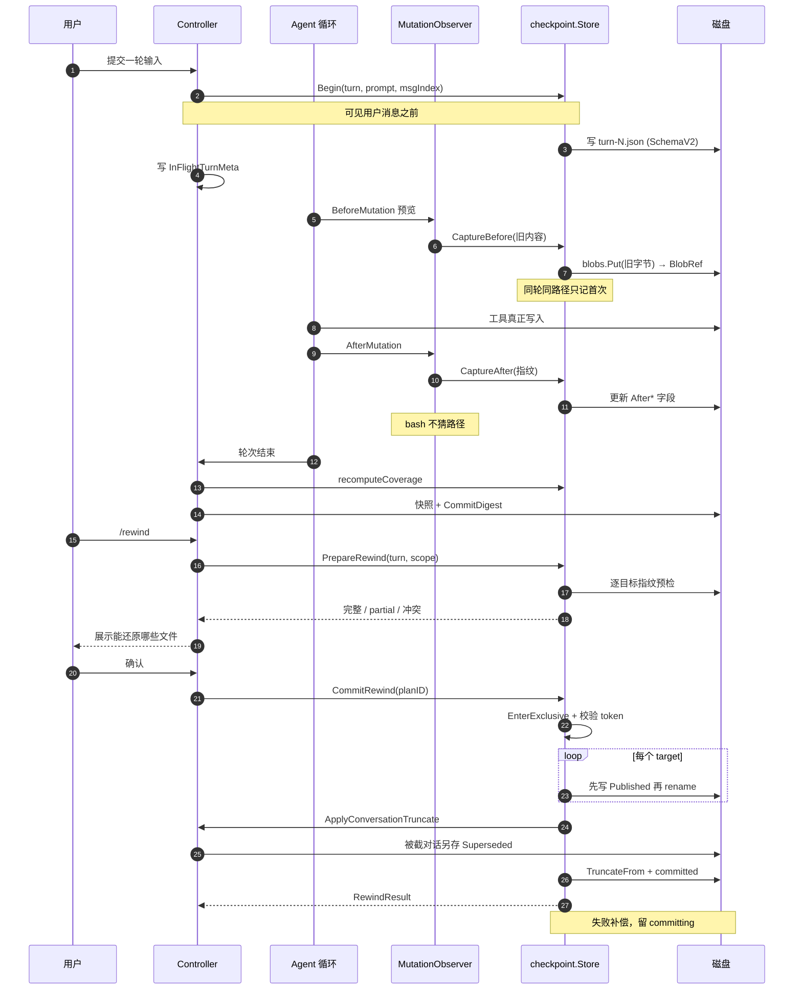

# 会话状态机：一条正向主线、两类回边与两条不可逆边

> 本解读按 **ai-agent** 类规格产出，属 DeepSeek-Reasonix 深度解读的子文档；共 13 篇，解读基线 `v2.37.0`（`e17ef45e3`）。正文所有 `文件:行号` 引用均为 Reasonix 仓库相对路径，点开即可核对。相关篇章见 [README.md](README.md)。

## 在系统中的角色：三个互相冲突的消费者

去掉这一层，Reasonix 就退化成"一个会改文件的聊天窗口"：模型改了盘上的字节，宿主持有一份说不清来源的对话，进程一死两边都不知道对方停在哪。`internal/state/` 这一族包的职责，正是把"什么算状态、谁能改、怎么回来"从提示词里搬进宿主代码。README 承诺的 Rewind 只是它最表层的一个用户可见出口。

[README.md:74-74]()
<!-- anchor: - **Rewind.** A file is saved before it changes, so you can rewind by conversati -->

这一层有三个消费者，它们的诉求互相冲突，这才是它复杂度的真正来源：**恢复**要能在断电后重建一个可信起点，**回滚**要能在一个未知的当前磁盘上还原一个已知的过去，**审计**要能回答"这一次运行到底发生了什么"。三者对持久化的要求不同——恢复要原子替换，审计要只追加不删，回滚要保留全文。所以它不是一个存储，而是几个存储加上它们之间的仲裁规则。

本篇的边界：只谈**会话生命周期与检查点 / rewind 语义**（状态、时机、事务、覆盖率、恢复）。表、字段、索引、迁移的物理布局与实体关系归 [data-model.md](data-model.md)，本文只在耦合点处交叉引用。

## 根因：模型能写的文件是无限的，宿主能观察到的写入是有限的

根本问题是范围不对称。`write_file` / `edit_file` 这类写工具实现了 `Previewer` 接口，能在不落盘的情况下算出"它将要改成什么"，因此宿主可以在改动发生前拿到旧内容。

[internal/contract/tool/tool.go:55-62]()
<!-- anchor: // Previewer is an optional capability a writer Tool may implement: given the … Preview(ctx context.Context, args json.RawMessage) (diff.Change, error) -->

而 `bash` 没有这个能力：它的目标集合在运行前不可知。宿主能做的只有两件事——**如实记账**"这里有个我看不见的缺口"，以及**拒绝把这种不确定性伪装成成功**。README 那句话的后半句因此不是免责声明，而是实现约束的投影："Only files its edit tools changed are covered, not what a shell command did"。它的代码依据是 bash 分支根本不进入捕获路径，只写入一条覆盖率缺口记录。

[internal/runtime/agent/path_effect.go:333-336]()
<!-- anchor: // Non-previewable writers: record a coverage gap (do not guess paths). … obs.RecordGap(checkpoint.CoverageGap{Reason: checkpoint.GapBashSideEffect, Tool: -->

同一处 `default` 分支把"无法声明本地写路径的 MCP / 其他写工具"记为 `GapMCPExternal`。也就是说，"不追踪"在这里是一种**被记录的状态**，而不是被忽略的失败：缺口有类型、有工具名、有说明，会被带回到用户的确认框里。

[internal/runtime/agent/path_effect.go:338-340]()
<!-- anchor: // MCP or other writers without Previewer. … obs.RecordGap(checkpoint.CoverageGap{Reason: checkpoint.GapMCPExternal, Tool: to -->

## 状态机总览：先看边的性质，再看每条边的机制

本项目这一关注面的核心结构是**一个带回边的状态机**。正向主线是"会话 → 轮次 → 变更"的推进；在这条主线之外还有四类方向相反的边，它们的性质完全不同，混在一起看就会退化成"检查点功能 + rewind 功能"的罗列。四类边分别是：

- **正向边**（灰细实线）：会话取得所有权、轮次推进、变更被捕获、事务提交，都是单向前进；
- **可反复走的回边**（暖色粗曲线）：崩溃恢复补偿、rewind 回到历史轮次、并发写者冲突后分叉。它们可以被走很多次，每次都是一笔新事务，但每次都要付代价（多一份 superseded 转录、消耗一次 undo 槽、加深 recovery 分叉链）；
- **只能走一次的回边**（红虚线）：`undo`。撤销槽是单槽，且会被任何新变更失效，所以这条边在"下一次 mutation 之后"就不存在了；
- **不可逆的边**（灰粗线 + 双圈终点）：载荷过期（`R7`）与未来版本闸门拒绝（`S4`）。它们没有返回箭头——不是"暂时不能返回"，而是信息已经不在盘上、或者本构建根本无权读写。

图前先说清它是什么：这是一张**状态机图**，不是流程图。它要回答的问题是——一个会话从"待建"到"终态"会经过哪些状态，哪几条边方向相反，其中哪几条可以反复走、哪几条只能走一次，以及哪两条边走完就回不来。

读这张图要看四件事。第一，**三条泳道不是三个模块，而是同一次运行的三个视角**：左栏是会话的所有权与格式（`S0`–`S3`），中栏是轮次内发生的事情（`T0`–`T6`），右栏是 rewind 事务自己的生命周期（`R0`–`R8`）；`S2 → T0` 与 `S2 → R0` 两条边把它们接在一起，说明"轮次"和"事务"都挂在同一个已拥有的会话上。第二，**回边全部是暖色的**，而且分成三种走法：`R3 → T1` 的 rewind 可以从历史里的任意一轮重新开一笔事务（因此可以走很多次），`R2 → R6 → R5` 的崩溃恢复每启动一次就走一次（`R6` 的自环就是"还没补偿完，下次启动再来"），`R4 → R3` 的 undo 是红虚线，因为槽只有一格。第三，**两个双圈盒是终点**：`S4` 由版本闸门进入（读写双双拒绝），`R7` 由检查点过期进入（元数据还在、载荷不可恢复），两条边都没有回头箭头。第四，**右栏大部分节点没有出口**（`R5`、`R7`、`R8`），这不是画漏了，而是它们本来就代表"已经落定的状态"：补偿完成、载荷损失、等待用户裁决。

这张图省略掉的东西在正文里补齐：`T3` 在同一轮里的自环（同一路径只在首次触碰时进 blob）、每条覆盖率缺口各自的写入点，以及各状态的进入条件、持久化载体与冲突分类——它们留在下面各节的正文里，图上只保留编号加短名。另外两处读图时需要注意：`S4` 除了 `T0 → S4` 这条版本闸门边，还接受来自 `S3` 的 1.x 导入路径（同样是拒绝，同样没有返回箭头）；`T2 → T5` 的跨进程分叉在图上只画了虚线、没有在边上写标签，它的语义写在"崩溃恢复"一节的冲突级层。

## 正向主线之一：会话的生命周期（S0–S3），以及被拒的 S4

一个会话在磁盘上先是"待建"，然后必须**取得写权限**才能成为真源。这一步不是打开文件，而是跨进程租约：`<id>.jsonl.lease.lock` 是 OS 文件锁，`<id>.jsonl.lease.json` 是给人看的信息（PID、hostname、writer id、持有时间）。拿不到锁时行为**分叉**而不是统一拒绝——`Attach`（可能只读）降级为只读附着，`Rebind`（准备写）向上报错。

[internal/session/control/session_lease_keeper.go:65-69]()
<!-- anchor: // Attach points the keeper at path and reports whether it may write. A session … // without. Callers about to write want Rebind, where read-only is no answer. -->

所以"打开同一会话的第二个进程"会发生什么，是可以精确回答的：它能读到完整会话，但没有任何写权限；它不会静默覆盖第一个进程的数据（`Session` 上绑定的 `SessionWriteAuthority` 会让保存硬失败），也认不出"这是我自己上次没释放的残留"以外的锁——`reclaimOwnSessionLease` 只回收**本进程自己**留下的条目，且以 OS 锁为仲裁：信息说别人持有就尊重，信息损坏但锁是自由的才当作残留。

[internal/session/control/session_lease_keeper.go:104-115]()
<!-- anchor: // releasing, whose stranded owner entry then refuses every later bind while … return nil, cause -->

兼容路径上还留着一条历史痕迹：旧式 save lock `<id>.jsonl.lock` 现在是"兼容锁"，等待**限时 5 秒**并带 25ms 轮询。注释解释了为什么不能无限等：租约本应挡住竞争者，但 CLI / legacy 写者和卡住的进程仍可能占着这个旧锁文件，无限等待会把 UI 卡死，并让会话租约（以及 WebView）永远不释放。

[internal/state/sessionstore/save.go:46-57]()
<!-- anchor: maxSessionBasenameBytes = 224 … sessionFileLockWait         = 5 * time.Second -->

`S3` 是另一条进入"已拥有"的路：把别的代际的会话**导入**成当前格式。v0.x 导入由**标记文件**闸门控制，跑一次就留下标记，且**从不修改 legacy 文件**。

[internal/state/sessionstore/migrate.go:68-75]()
<!-- anchor: // MigrateLegacySessions imports v0.x event-log sessions (<name>.events.jsonl un … func MigrateLegacySessions(srcDir, globalDest string, projectDir func(workspaceR -->

1.x 的 `sessions-v4` 会话则是**惰性 + 可刷新**导入：只在会话列表真的把路径交给 `PrepareSessionPath` 时才导入，并记录 `ImportSource{Line, LogSize, Digest}`；下次打开时若 1.x 那边的 log 变大了而这份副本没被继续过，就重新导入覆盖。

[internal/state/sessionstore/session_v4_import.go:65-89]()
<!-- anchor: // PrepareSessionPath makes a path a session list offered openable: a 1.x v4 … return err -->

导入失败不用宽泛错误，而是**类型化 skip 原因**，让上层按码决策而不是匹配字符串。

[internal/state/sessionstore/migrate_skip.go:12-22]()
<!-- anchor: // SkipReason is the typed class of a session an import could not bring over. … SkipCopyFailed        SkipReason = "copy_failed" -->

1.x 那侧的读取器把"只读"讲到毫不含糊：不取锁、不写缓存、从不截断残尾，因为 1.x 拥有那个根下的每一个字节。

[internal/state/sessionv4/doc.go:1-9]()
<!-- anchor: // Package sessionv4 reads the session store Reasonix 1.x writes from 1.38.8: … // is simply not there yet. A conversation is the fold of its message events — -->

它的帧格式是 `codec = "reasonix.session.linear/v4"`、`schemaVersion = 4`、12 字节帧头 + magic `RX4F` + zstd，revision 只允许 0–3，超出即 `ErrUnsupported`。

[internal/state/sessionv4/frames.go:17-30]()
<!-- anchor: const ( … // know, so reading on would misread it. -->

[internal/state/sessionv4/session.go:40-56]()
<!-- anchor: // Open reads a session directory's manifest. Revisions 0 to 3 share one frame … if err := json.Unmarshal(raw, &m); err != nil { -->

**"不认识的版本就拒绝"**是这里的默认姿态，不是尽力解析。这条姿态在 `S4` 上有一个更硬的形态：如果事件日志的 schema 高于本构建支持的上限，**读取与保存双双拒绝**（见下文"不可逆边"一节）。

## 正向主线之二：轮次与变更（T0–T6）

### 检查点在哪一刻打开

**每个用户轮一个检查点**，且打开点在"可见用户消息落库之前"。这个顺序不是随意的：它决定了 `MsgIndex` 边界指向哪条消息，从而决定对话 rewind 截到哪里。

[internal/session/control/checkpoint.go:111-113]()
<!-- anchor: // beginCheckpoint opens a rewind checkpoint before the visible user message is … // the corresponding optimistic frontend item without positional guessing. -->

`Store.Begin` 同时终结上一轮并开启当前轮，把 `SchemaVersion: SchemaV2`、`turn`、`prompt`、`MsgIndex` 写进去，然后立即持久化并跑一次 GC。

[internal/state/checkpoint/checkpoint.go:308-310]()
<!-- anchor: // Begin opens a checkpoint for a new user turn, finalizing the previous one. Th … func (s *Store) Begin(turn int, prompt string, msgIndex int) { -->

前端也是这么对应的：`CheckpointTurnsByMessageIndex` 把消息下标映射回 turn，而不是让前端自己数用户气泡，因为合成 / 隐藏的 user-role 消息会让计数发散。于是"rewind 锚点是轮、作用域是该轮及以后的路径集合、每个路径回到它的轮内首触状态"这句话，在前后端是同一套边界。

[internal/session/control/checkpoint.go:182-199]()
<!-- anchor: // turnsByMessageIndex returns message-log index -> checkpoint turn over live … // boundary returns the recorded turn-start message index, if any. -->

### 保存的是什么：轮内首触的全量 preimage

不是 diff，是**全量旧内容**；落盘时按 SHA-256 内容寻址存 blob，同时在元数据里保留 `Content` / `BlobRef` / `SHA256`。保留内联 `Content` 的理由写在持久化函数里：旧版本 Reasonix 不认 `BlobRef`，而 `Content == nil` 对它们意味着"这个文件原本不存在"——省略内联内容会让**同时在跑的旧二进制把文件删掉**。

[internal/state/checkpoint/checkpoint.go:625-628]()
<!-- anchor: // Keep inline Content even when BlobRef is present. Previous Reasonix builds … wire := *c -->

每个路径在**同一轮内只快照第一次触碰**，因为第一次触碰时的内容才是"这一轮的起点"；后续编辑不需要再记，还原时用最早的那份。

[internal/state/checkpoint/checkpoint.go:411-414]()
<!-- anchor: if s.cur == nil || s.seen[pathKey] { … s.seen[pathKey] = true -->

捕获有两个入口：`Previewer` 路径（有 `OldText`，编码稳定，记为 `CapturePreviewer`）与 `BeforeMutation` 路径（Lstat + 读盘，记为 `CaptureBeforeMutation`）。优先走 `Previewer` 不是性能考虑，而是**编码保真**：`OldText` 已经是解码后的文本，直接 `Digest(OldText)` 在有非 UTF-8 文件时会算错，所以代码在磁盘可读时优先用磁盘原始字节重算 SHA 并进 blob，把解码文本留在 `Content` 里做 API 兼容。

[internal/state/checkpoint/observer.go:224-232]()
<!-- anchor: // BeforeMutationFromChange is the Previewer-compatible path: uses OldText when … Source:        CapturePreviewer, -->

这里还有一个精心处理的细节：如果最后那次捕获没有写后指纹，代码会**清掉**旧的 ownership 证明而不是沿用（注释："Missing final identity deliberately clears an older proof instead of authorizing an unsafe restore"）。宁可判成冲突，也不拿一个可能过期的指纹去授权覆盖。

轮次结束时 `recomputeCoverageLocked` 把这一轮折成覆盖率状态：只要有文件 revision 就是 `hasFiles`，否则在"无文件且无缺口"与"无文件但有缺口"两种情况下都返回 `CoverageNone`——前者是真的没改文件，后者是改了但一条都没捕获到。这个分支让 `CoverageNone` 承载了两种不同的现实，是本篇唯一一处承认的语义模糊。

[internal/state/checkpoint/transaction.go:1330-1351]()
<!-- anchor: legacy = true … return CoverageNone, gaps, false, false -->

### 一次 rewind 前后的端到端时序

下面这张时序图把"轮次内捕获"和"事后 rewind"接起来，回答一个具体的工程问题：**旧内容到底是在哪一刻、由谁、以什么形式落到盘上的，以及它在 rewind 时被谁重新读出来**。它同时说明了本项目的两条纪律——捕获发生在写入之前（所以它是 preimage 而不是事后推测），而 rewind 的提交必须先在 barrier 内复核预览指纹。

读这张图要看三处不对称。第一，**捕获是两条轨**：`BeforeMutation` 拿旧内容，`AfterMutation` 只记写后指纹，两者合起来才构成"这一轮对该路径做过什么"的可判定证据；bash 那条轨只有一条 `RecordGap`，没有内容也没有路径。第二，**意图位先于副作用**：`Published` 在 rename 之前落盘，`CommitDigest` 在最终快照之前落盘——恢复侧因此能把"我可能已经做了"当成持久事实来读，而不是靠观察副作用反推。第三，**失败路径也有名字**：补偿失败后 manifest 留在 `committing`，`RewindResult` 不是终点，`RewindPlan` 只是一个待确认的提案。

## 回边一：rewind——回到的是未来某个新开的 T1（可反复走）

`/rewind` 不是"把对话倒回去"，而是一笔**带意图日志和补偿的事务**。新旧两个入口的分界正是"用户有没有看过缺口"：旧的一次性 `Rewind` 接口在覆盖不全时直接返回 `ErrRewindCoverageConfirmationRequired`，新接口拆成 prepare / commit 两段，让前端先展示计划再让用户按下去。

[internal/frontend/serve/rewind.go:12-14]()
<!-- anchor: // A rewind is two calls when the plan needs consent: POST /rewind refuses a … // the plan the user saw. The CLI picker has always worked this way. -->

确认的判据是显式的：只要范围涉及文件、`CanFiles` 为真，且 coverage 是 partial 或存在**任何** gap，就必须确认。

[internal/session/control/rewind.go:17-27]()
<!-- anchor: // ErrRewindCoverageConfirmationRequired is returned by the compatibility … return wantsFiles && plan.CanFiles && (plan.Coverage == checkpoint.CoverageParti -->

事务自己的状态机是 `prepared → committing → committed`，另有 `aborted` 与 `undone`。`R3`（committed）之所以在图上是一个"可撤销"状态而不是终点，就是因为 `undone` 是它的合法后继。

[internal/state/checkpoint/types.go:220-228]()
<!-- anchor: // TransactionState is the durable lifecycle of a rewind transaction. … TxUndone     TransactionState = "undone" -->

### 事务、意图位与逆序补偿

三个机制决定了这笔事务在崩溃面前是可判定的：

1. **`Published` 是先于 rename 落盘的意图位**。崩溃恰好发生在 rename 之前时，恢复侧要能保守地检查这个 target，而不是把它当成"没发布过"而漏掉补偿。

[internal/state/checkpoint/transaction.go:658-666]()
<!-- anchor: err = s.failTransaction(tx, tx.Targets, stages, err) … err = s.failTransaction(tx, tx.Targets[:i+1], stages, err) -->

2. **发布用同目录 temp + backup + rename**。temp 与 backup 是目标文件的同级兄弟（`transactionSiblingPaths`），因此永不跨文件系统；`publishTarget` 先把目标 rename 到 `.bak`，再把 `.tmp` rename 就位。

[internal/state/checkpoint/transaction.go:849-887]()
<!-- anchor: func (s *Store) publishTarget(t *TransactionTarget) error { … return nil -->

3. **补偿是逆序的，并且按指纹判断"到底走到哪一步"**：如果当前盘面已经等于 forward 镜像，说明发布没发生，补偿是 no-op；如果目标缺失但 backup 在、且 forward 指纹匹配，说明死在第一次 rename 之后，就把 backup 移回去；如果盘面既不是 forward 也不是 restore 镜像，**不覆盖**，而是写一份 `.reasonix-recovery-<sha8>` 副本并报错。

[internal/state/checkpoint/transaction.go:890-1000]()
<!-- anchor: func (s *Store) compensatePublished(targets []TransactionTarget, stages []FileSt … err = nil -->

**顺序也是语义**：文件先发布，对话后截断，检查点最后删；任一步失败就把已经改变的那一侧全部拉回原状，所以 `both` 范围不会留下"文件已回滚而对话未回滚"的中间态。

[internal/session/control/rewind.go:266-269]()
<!-- anchor: // Rewind is the compatibility wrapper used by CLI and existing desktop paths. … // compensation on failure. -->

"预览 → 确认 → 提交"之间的一致性窗口由两个 token 共同把守：计划里的 `WorkspaceToken` 与当前 generation 比对（不匹配即 `stale_plan`），以及 `ValidatePlanSessionRevision` 把 plan 绑到控制器的会话 revision。

[internal/session/control/rewind.go:160-162]()
<!-- anchor: if err := store.ValidatePlanSessionRevision(planID, atomic.LoadInt64(&c.sessionR … return checkpoint.RewindResult{OK: false, Error: err.Error(), Conflicts: []check -->

[internal/state/checkpoint/transaction.go:197-213]()
<!-- anchor: if plan.Scope == RewindCode || plan.Scope == RewindBoth { … return RewindResult{OK: false, Error: err.Error(), Conflicts: conflicts, Coverag -->

generation 计数器的存在理由是不依赖挂钟时间：每次排他释放都自增，于是"prepare 时拿到的 token"就能回答"我预览之后有没有人写过"。这个 barrier 被刻意设计成独立于 `App.mu` / Controller 锁，这样文件 I/O 永不发生在那些互斥量之下。

[internal/state/checkpoint/barrier.go:9-16]()
<!-- anchor: // MutationBarrier provides exclusive workspace mutation access for rewind … mu        sync.Mutex -->

### 对话 rewind 会留下"被顶掉的版本"，而且是整文件

对话 rewind 不是丢弃被截掉的对话，而是先把它**另存为一个完整会话文件**（带 `BranchMeta{Superseded: true, ParentID: ...}`），再把主会话重写。

[internal/state/sessionstore/versions.go:24-26]()
<!-- anchor: // SaveSupersededVersion keeps msgs, the conversation a rewind is about to cut, … func SaveSupersededVersion(parentPath string, msgs []provider.Message) (string,  -->

这些版本不出现在会话列表里，其生命周期绑定父会话：父会话被删时它们一起被删。反向操作也做了对称处理——undo 一笔 rewind 会把"只剩一份副本"的那个版本删掉，否则同一段对话会出现两次。

[internal/state/sessionstore/versions.go:78-91]()
<!-- anchor: // for a caller removing it: a version nobody lists must not outlive its parent. … func DropVersionMatching(parentPath string, msgs []provider.Message) error { -->

**这是磁盘开销的主要来源**：rewind 一次对话 = 多一份完整转录文件。它不是快照去重的问题，而是设计上选择了"整文件副本"换取"版本可以像普通会话一样打开"。

### 单文件还原：不按轮，按路径

除了按轮的 rewind，还有一条独立路径 `PrepareFileRevert` / `CommitFileRevert`：把**一个文件**还原到它在整个会话中最早的 preimage，而不动轮次与对话。三处语义差异值得单独记下。

其一，**冲突不阻止，但要显式裁决**。与批量 rewind 不同，单文件有冲突时 `CanFiles` 仍为 true、`DisabledReason` 是 "conflict requires explicit resolution"，由用户在 `ResolveKeepCurrent`（什么都不做，返回成功）与 `ResolveOverwriteCheckpoint`（覆盖）之间选。

[internal/state/checkpoint/file_revert.go:159-175]()
<!-- anchor: func filePlanVerdict(plan RewindPlan, resolution ConflictResolution) (*RewindRes … return &RewindResult{OK: false, Error: err.Error(), Conflicts: plan.Conflicts},  -->

其二，**legacy 会被做成"不可提交"**，而不是"可提交但危险"：这种情况把 `plan.PlanID` 清空并置 `Legacy/CoverageLegacy`，于是后续 `takeFilePlan` 必然找不到计划——**用空 ID 让提交在结构上不可能**，比"请勿提交"的约定更难被误用。

[internal/state/checkpoint/file_revert.go:47-56]()
<!-- anchor: if rev.AfterExisted == nil && rev.AfterSHA256 == "" { … return plan, nil -->

其三，**预览指纹在 barrier 内被复核**：计划里存 `previewFingerprint`，提交时 `verifyWorkspaceUnchanged` 重新指纹并用 `sameFingerprint` 比对（含 nlink / symlink / mode / size / sha），不匹配就要求重新预览。这是"预览 → 确认"窗口在**单文件**尺度上的实现，与批量路径的 `WorkspaceToken` 是同一思想的两种粒度。

[internal/state/checkpoint/file_revert.go:180-203]()
<!-- anchor: func (s *Store) verifyWorkspaceUnchanged(pp preparedPlan) (*RewindResult, error) … return nil, nil -->

## rewind 不会回滚什么：把能力上限做成可查询状态

这是本篇认为最值得借鉴的一处手法。**边界不是"尽力而为"，而是枚举出来、带类型、会被返回给用户的**：`Coverage` 有 `complete` / `partial` / `none` / `legacy` 四态，`CoverageGap` 有 12 种具名原因，每条 gap 还带工具名、路径与说明。

[internal/state/checkpoint/types.go:22-46]()
<!-- anchor: CoverageLegacy   Coverage = "legacy" … GapExpiredPayload   = "expired_file_payload" -->

12 种原因按写入点分成三组，这正好说明缺口不是一个兜底分支而是一族状态：

- **非可预览写者**：`bash_side_effect`（shell 改的东西，README 明说的边界）、`hook_write`（PreToolUse / PostToolUse hook 可能写了工具没声明的路径）、`mcp_external`（不实现 `Previewer` 又不声明写路径的写工具）。

[internal/runtime/agent/execute_one.go:610-610]()
<!-- anchor: a.svc.mutationObserver.RecordGap(checkpoint.CoverageGap{Reason: checkpoint.GapHo -->

- **捕获阶段就失败的路径**：`outside_workspace` / `symlink` / `hardlink` / `unreadable` / `oversized` / `capture_failed`。

[internal/state/checkpoint/capture.go:59-131]()
<!-- anchor: reason := GapOutsideWorkspace … Reason: GapOversized, -->

- **时间与代际造成的缺口**：`background_writer_cross_turn`（新轮开始时上一轮的后台写者还活着）、`legacy_unverified`（v1 检查点无法证明后来的手工编辑可被覆盖）、`expired_file_payload`（内容已被 GC，只剩元数据）。

[internal/state/checkpoint/observer.go:273-273]()
<!-- anchor: Reason: GapBackgroundWriter, -->

[internal/state/checkpoint/checkpoint.go:288-294]()
<!-- anchor: if g.Reason == GapLegacyUnverified { … c.CoverageGaps = append(c.CoverageGaps, CoverageGap{Reason: GapLegacyUnverified, -->

[internal/state/checkpoint/checkpoint.go:752-766]()
<!-- anchor: func (s *Store) expirePayloadLocked(c *Checkpoint) error { … expired.CoverageGaps = append(expired.CoverageGaps, CoverageGap{Reason: GapExpir -->

`legacy` 与 `expired` 是**硬闸门**：`PrepareRewind` 直接把 `CanFiles` 置 false 并附上 `ConflictCoverageLegacy` / `ConflictExpired`，不是警告而是拒绝。

[internal/state/checkpoint/transaction.go:106-118]()
<!-- anchor: } else if cov == CoverageNone { … plan.DisabledReason = "legacy checkpoint cannot verify later manual edits" -->

`partial` 是**软闸门**：能还原，但必须用户显式确认。这条规则的实现方式也值得注意——它不是提示文案，而是一个可被测试的谓词。

[internal/session/control/rewind.go:17-27]()
<!-- anchor: // ErrRewindCoverageConfirmationRequired is returned by the compatibility … return wantsFiles && plan.CanFiles && (plan.Coverage == checkpoint.CoverageParti -->

还有一类**没写进 README 但代码里很硬的边界**：活跃后台写者。只要 `activeWriters` 非空，`PrepareRewind` 直接把文件与对话两侧都置为不可用（`DisabledReason: "active background writer"`），因为后台写者会在 rewind 期间继续改盘；活跃写者状态是每次 prepare 前从 mutation observer 刷新进 store 的。

[internal/session/control/rewind.go:126-127]()
<!-- anchor: if obs := c.mutationObserver; obs != nil { … store.SetActiveWriters(obs.ActiveWriters()) -->

**为什么要把能力上限做成可查询状态，而不是静默失败**——三条理由都能在本项目里找到依据。其一，"判断必须读结构、不能读措辞"是全局纪律，而"这次还原覆盖了多少"就是一个结构问题，用一句"可能没完全回滚"回答等于把判断权推回给用户。其二，"模型会编造失败原因，失败归因是宿主拥有的状态"：如果 rewind 覆盖了一部分文件后告诉用户"已回滚"，用户会基于一个错误的世界模型继续工作，而这个错误的世界模型正是宿主制造的。其三，**唯一可行动的表述是"哪些路径能还原、哪些不能、为什么"**——用户据此才能决定"接受"还是"换一条路（例如手工 git stash）"。代价也同样明确：多一次确认交互、`RewindPlan` / `RewindResult` 各有十几个字段、补偿阶段要区分"发布前崩溃"与"发布后崩溃"，以及上文提到的 `CoverageNone` 二义性。

### 不可逆边（一）：载荷过期把"删除"换成了"信息损失"

检查点保留策略是**硬编码常量**：最新 100 个"有文件载荷"的检查点、blob 总量 1 GiB、单文件捕获上限 32 MiB。

[internal/state/checkpoint/types.go:292-296]()
<!-- anchor: // Default retention for file payloads. … DefaultMaxFileBytes      = 32 << 20 // 32 MiB per file capture -->

[internal/state/checkpoint/checkpoint.go:161-162]()
<!-- anchor: retainN:      DefaultRetainCheckpoints, … blobQuota:    DefaultBlobQuotaBytes, -->

GC 从最老的开始：超过 `retainN` 的检查点走 `expirePayloadLocked`，blob 超配额时同样从最老的开始；两个循环都跳过 `protectTurns` 里的轮次，因为那些轮次被活跃事务或 undo 槽持有——否则一次尚未 undo 的 rewind 会被自己的清理逻辑弄成不可逆。

[internal/state/checkpoint/checkpoint.go:651-669]()
<!-- anchor: // gcLocked drops file payloads for old checkpoints beyond retainN / blobQuota. … if len(withFiles) > s.retainN { -->

[internal/state/checkpoint/checkpoint.go:147-148]()
<!-- anchor: // protectTurns prevents GC of these turn payloads (active tx / last undo). … protectTurns map[int]bool -->

blob 的存活集合由**检查点 + 事务清单共同**决定：mark 集合包含所有检查点的 `BlobRef`、`lastUndo` 的 restore / forward blob、以及 `ckpt/tx/*.json` 里所有未完成事务的 blob 引用。这是典型的"GC 根多来源"问题，也是为什么事务清单必须落盘、且 GC 必须在元数据持久化**之后**才扫。

[internal/state/checkpoint/checkpoint.go:710-712]()
<!-- anchor: func (s *Store) pruneBlobsLocked() { … return -->

这里的取舍是：**过期是不可逆的信息损失，不是删除**。`expirePayloadLocked` 保留元数据、把 payload 清空、并新增一条 `expired_file_payload` 缺口，于是 picker 仍然列出这一轮，但 rewind 会被硬拒。用户看到的是"这里曾经有过一个还原点，现在已经还原不了了"，而不是"这一轮从没改过文件"。

[internal/state/checkpoint/checkpoint.go:752-770]()
<!-- anchor: func (s *Store) expirePayloadLocked(c *Checkpoint) error { … if s.dir != "" { -->

这就是图上 `R3 → R7` 那条**没有返回箭头**的边：`R7` 不是"暂时不可用"，而是元数据仍在、payload 不可恢复的终点。

### 保留策略的欠账：没有配置面，文档也没有依据

100 / 1 GiB / 32 MiB 三个数**全部是硬编码常量**，`store` 上没有任何 setter 入口（除测试外），运行期也不存在读配置再传进 `checkpoint.New` 的路径。

[internal/contract/config/preserve.go:1-3]()
<!-- anchor: // preserve.go — saving the user config by rewriting only the keys a save … // this build does not decode, or a value it reads differently, is not its to dr -->

[docs/CHECKPOINTS.md:76-77]() 声称保留期是 "prune with the session (default ~30 days, configurable)"，但这句话在本版本代码里**没有依据**：v2.37.0 的配置层里唯一带 checkpoint 字样的键是 `[agent] checkpoint_ceiling_ratio`，它管的是"自动折叠结果要小于窗口的多少比例"，与文件检查点保留策略无关。
<!-- anchor: - **Retention**: prune with the session (default ~30 days, configurable), to bou … disk from full-content snapshots. -->

[internal/contract/config/config.go:1121-1123]()
<!-- anchor: // CheckpointCeilingRatio is how small an automatic fold's result must be, … CheckpointCeilingRatio float64 `toml:"checkpoint_ceiling_ratio"` -->

1.x 用户配置里确实存在过一个 `[checkpoints]` 段（`retain_turns` / `blob_quota_bytes`），但它现在只是被**当作不认识的键原样保留**：`preserve` 机制明确写着"这个构建不解码、或读法不同的键，不归它丢弃"，而配置测试正是拿这个段做不丢键的样本。

[internal/contract/config/testdata/user_config_1x_v1.39.5.toml:124-126]()
<!-- anchor: [checkpoints] … blob_quota_bytes = 536870912 -->

[internal/contract/config/preserve_test.go:99-101]()
<!-- anchor: checkpoints, _ := tree["checkpoints"].(map[string]any) … t.Fatalf("[checkpoints] lost: %v", tree["checkpoints"]) -->

也就是说，用户即使在 1.x 的配置里写过保留策略，它在本版本**既不生效也不报错**——这比"没有配置项"更难察觉，属于欠账而不是刻意的设计选择。另外，100 这个数字数的是"有文件载荷的检查点"个数，**不是天数**，所以它随使用频率而非日历时间变化。

## 回边二：undo——只能走一次的第二笔事务

`undo` 不是内存里的撤销栈，而是**对称的第二笔事务**：`UndoRewind` 先校验盘面仍等于上次 rewind 的 restore 镜像（否则拒绝，理由 `manual_edit`），再构造一笔 `kind: "undo"` 的逆向事务，把 forward 镜像作为 restore 目标、把 restore 镜像作为 forward 目标，并带上 `ParentTransaction`。

[internal/state/checkpoint/transaction.go:237-360]()
<!-- anchor: func (s *Store) UndoRewind(transactionID string, applier ConversationApplier) (R … // For undo of conversation: restore forward conversation and checkpoints. -->

它之所以在图上画成红虚线，是因为**槽只有一格，且会被任何新变更失效**：新一轮开始会清空 `lastUndo`，任何新捕获也会清空它。

[internal/state/checkpoint/checkpoint.go:332-334]()
<!-- anchor: // Bounds returns turn → MsgIndex over all checkpoints (persisted + current), so … // resumed session's checkpoints from disk. -->

[internal/state/checkpoint/checkpoint.go:520-526]()
<!-- anchor: updated = true … return -->

这是一个典型的"用代价换确定性"的决定：允许多级 undo 需要保存一条 undo 链以及每个中间盘面，而项目选择的是"只保证退一步"，换来的是补偿逻辑只需处理相邻两笔事务，且 undo 的合法性检查有唯一的比较基准（上次 rewind 的 restore 镜像）。代价是用户在 rewind 之后只要再跑一个编辑工具，undo 就永久消失了——所以图上那条边画的是虚线：它不是被禁用，而是**已经不存在**。

## 回边三：崩溃恢复——每次启动幂等重试（R2 → R6 → R5，R6 自环）

### 先分清"recovery"在这个仓库里的四种含义

读代码时必须把它们分开，否则会把某一条恢复的结论错误地套到另一条上：

1. **会话转录恢复**（`internal/state/sessionstore`）——进程 / 断电后重建对话与写基线；
2. **rewind 事务恢复**（`internal/state/checkpoint`）——崩溃时把一笔未完成还原收尾或补偿；
3. **Auto Guard / crash 恢复**（`internal/runtime/recovery`、`<id>.recovery.json`）——运行中检测失败模式并给模型一次性指引，与持久化语义无关；
4. **安装布局与卡住的更新**（`docs/RECOVERY.md`）。

第 4 项与本篇关注面**同名但无事**：该文档讲的是安装布局、`current.json`、pending update 的丢弃，以及"Reasonix no longer ships a product `reasonix-guard` recovery shell"。

[docs/RECOVERY.md:3-5]()
<!-- anchor: Reasonix no longer ships a product `reasonix-guard` recovery shell. Crash … next launch into a global Safe Mode. -->

[docs/RECOVERY.md:41-50]()
<!-- anchor: If an older client is stuck on a pending update or Safe Mode loop: … `reasonix-guard` that only migrates the flat layout into `current.json` and -->

它**完全不涉及会话崩溃恢复**——会话持久化的语义只存在于代码里。把它当作"崩溃 / 断电后的恢复步骤"来读，会得到错误结论，这是文档与关注面之间一处明显的错配。

### 转录级：追加日志 + 兼容检查点 + 尾巴修复

会话保存在**两个层次**上同时防半写。`.jsonl` 兼容检查点走 temp + fsync + rename："Write to a sibling tmp file then rename, so a crash mid-write can't leave a partial JSONL that won't reload."

[internal/state/sessionstore/save.go:451-453]()
<!-- anchor: // Write to a sibling tmp file then rename, so a crash mid-write can't … // against power loss — it is the fallback when the event log is damaged. -->

原生事件日志则是**追加 + 容错重放 + 尾部修复**。重放器在第一条解析失败或链断的记录处停止，返回"到此为止的合法前缀"并标记 `damaged`，让写者自愈；但**不支持的 schema 版本与未知事件类型是硬错误**，因为那意味着更新的写者拥有这个日志，截断它就等于丢那个写者的数据。

[internal/state/sessionstore/session_events.go:198-202]()
<!-- anchor: // replaySessionEventLog decodes an event log tolerantly: decoding stops at the … // owns this log, and truncating it would discard that writer's data. -->

自愈动作在每次保存前发生：若日志是本构建的原生日志且非空，先修尾再写新记录，避免残尾被埋在新记录下面导致重放**永远**停在那里；修复前会检查索引里的 `LogSize` 是否等于当前大小，相等就跳过。

[internal/state/sessionstore/save.go:277-284]()
<!-- anchor: // Drop any torn tail a crashed or disk-full append left behind before … ownedRewrite := mode == sessionSaveRewrite || mode == sessionSaveRewriteCompact -->

**最关键的恢复决策在这里**：截断残尾之前，先把将要被丢弃的字节另存为 `<id>.events.jsonl.damaged` 取证副本。理由注释写得很直白：残尾通常只是半条记录，但重放也可能停在一条"被埋掉的、乱序或不可解码"的记录上（例如两个运行时交错追加同一个日志），此时截断会静默且永久地丢掉它之后**包括完整轮次在内**的所有内容。

[internal/state/sessionstore/session_events.go:547-554]()
<!-- anchor: // Salvage the bytes the truncation below discards. A torn tail is usually … // tails in the first place. -->

这个 sidecar 必须**不以 `.jsonl` 结尾**，否则旧二进制扫描会话目录时会把损坏字节当成一个独立会话复活——"命名即契约"在本项目里反复出现。

[internal/state/store/session.go:162-166]()
<!-- anchor: // SessionEventLogDamaged is the salvage sidecar for event-log bytes that tail … // damaged bytes as a phantom session. -->

真源选择上，加载优先事件日志，但要求它"至少有一条可解码记录"；占着日志路径的异种文件（legacy 导入残留）会被忽略并回退到 `.jsonl`。

[internal/state/sessionstore/session_events.go:459-465]()
<!-- anchor: // loadSessionMessages returns the session transcript, preferring the event log … func loadSessionMessages(sessionPath string) (msgs []provider.Message, fromEvent -->

### 轮次级：in-flight 标记与"是否真的没提交"

会话级半写的第二层防护是**轮次标记**。一轮开始时写入 `InFlightTurnMeta`，它不只记起始消息下标，还绑定起始 revision / digest，并预留一个 `CommitDigest`。

[internal/state/sessionstore/branch.go:105-119]()
<!-- anchor: type InFlightTurnMeta struct { … CommitDigest string `json:"commit_digest,omitempty"` -->

`CommitDigest` 的用法是这道防线最精妙的地方：它在**最终快照之前**写入。于是恢复时若盘上正好是这份转录，就能断定"快照已提交，只是标记没清掉"，**不需要任何消息恢复**；反之才需要处理未完成的轮次。也就是说它把"崩溃"分成了两个可判定的情形，而不是靠时间戳猜。

与之配套的还有两处"更早落盘"的机制：**用户消息一落地就持久化**（因为下一次保存是自动保存 tick 或轮次结束，没有这一步，这两者之间的 kill 会让 prompt 只存在于内存里；保存失败只记日志、不拒绝这一轮），以及**轮次运行期间的周期性自动保存**（默认 30 秒，可注入缩短），使 SSH 断线 / 强退最多丢一个 tick 而不是整个长轮。

[internal/session/control/session_snapshot.go:65-68]()
<!-- anchor: // SaveAdmittedMessage implements agent.AdmissionSaver. The next save is the … func (c *Controller) SaveAdmittedMessage(context.Context) { -->

[internal/session/control/session_snapshot.go:77-97]()
<!-- anchor: // autosaveWhileRunning snapshots the session periodically while a turn runs, … // even when a later sidecar update failed. Callers that guard a crash marker -->

### 回边四：冲突级——不覆盖、不丢弃，而是另存一支

当保存冲突（另一个运行时写了更新的转录）时，本进程**不覆盖也不丢弃**，而是把内存里的转录另存为一个 recovery branch，名字默认叫 "Recovered unsaved changes from stale runtime"。

[internal/state/sessionstore/save.go:129-129]()
<!-- anchor: const RecoveryBranchDefaultName = "Recovered unsaved changes from stale runtime" -->

代价是分叉会累积，所以配套了三件事。**深度上限**：正常会话可以分叉一次（depth 1），最多再分叉两次，再往上"分叉只会增加会话文件而不会收敛"。**可回收性判定**：只有当分叉**没有保存任何父会话里不存在的内容**时才能自动回收，判据是读两份转录而不是信列表元数据（"stale metadata must never authorize hiding, migration skipping, bulk trash, or permanent purge"）。**宽限期 + 回收站**：24 小时（首启动 15 分钟）静默期后才回收，且走 `.trash/` 暂存而不是 unlink，每步有 `.recovery-trash-pending.json` 这类带后续动作的标记。

[internal/state/sessionstore/save.go:71-79]()
<!-- anchor: ErrSessionRecoveryDepthExceeded = errors.New("session recovery chain depth excee … const SessionRecoveryMaxDepth = 3 -->

[internal/state/sessionstore/recovery_gc.go:76-84]()
<!-- anchor: // never authorize hiding, migration skipping, bulk trash, or permanent purge. … return recoveryBranchCoveredByParent(path, parentDir, meta) -->

[internal/state/sessionstore/recovery_gc.go:17-32]()
<!-- anchor: // Recovery-branch garbage collection. Conflict recovery forks a copy of the … const RecoveryGCStartupGracePeriod = 15 * time.Minute -->

这就是图上 `T2 ⇢ T5` 那条虚线暖色边：它跨进程发生，所以既不是纯正向也不是"再来一次就好"，而是**把两支都留下**。

### rewind 事务级：manifest + 意图位 + 补偿（R6 自环）

崩溃时未完成的 rewind 由启动扫描处理，判据是事务 manifest 的 `State`：

- `prepared` —— **从未发布**，删除 publish temp 并标记 `aborted`（安全丢弃）；
- `committing` —— 先恢复 forward 转录 / 检查点，再补偿已发布的文件；**任一侧失败就把 manifest 留在 `committing`**，让下一次启动幂等重试；
- `conversation` 类事务在控制器装好会话之前**故意推迟**，因为补偿需要 `ConversationApplier`。

[internal/state/checkpoint/transaction.go:1096-1099]()
<!-- anchor: // RecoverTransactions scans for incomplete file-only transactions. Conversation … func (s *Store) RecoverTransactions() []string { -->

[internal/state/checkpoint/transaction.go:1103-1108]()
<!-- anchor: // RecoverTransactionsWithApplier finishes startup recovery after the resumed … func (s *Store) RecoverTransactionsWithApplier(applier ConversationApplier) []st -->

"manifest 留在 `committing`" 是这套恢复唯一的**未完成态**，也是它最值钱的地方：它不是"尽力补偿后忘记"，而是把"我还欠一次补偿"这件事本身变成持久状态。控制器在会话恢复后调用 `RecoverTransactionsWithApplier` 收尾。

[internal/session/control/rewind.go:341-347]()
<!-- anchor: func (c *Controller) recoverCheckpointTransactions() { … slog.Info("controller: checkpoint transaction recovery", "result", note) -->

图上 `R6` 的自环（每次启动幂等重试）与 `R2 → R6 → R5` 这条可反复走的回边，就是这个持久未完成态的直接形状：**崩溃恢复没有"失败"这个终态，只有"还没补偿完"**。

### 一条从崩溃到可用会话的最小路径

把上面几节串起来，本项目的恢复顺序是确定的，每一步都有一个可核对的判据：

1. 进程启动扫描会话目录：`reconcileSessionDir` 先做 sidecar 对账，再回收"没有任何用户消息"的空会话（走宿主的删除通道，宿主用回收站就进回收站）。

[internal/state/sessionstore/empty_session_gc.go:16-32]()
<!-- anchor: // reconcileSessionDir runs the directory-wide passes: sidecar reconciliation, … errs = append(errs, fmt.Errorf("%s: %w", path, err)) -->

2. 目标会话尝试取租约 → 拿不到就只读附着。
3. `LoadSession` → `PrepareSessionPath`（1.x v4 惰性导入）→ `loadSessionMessages`（优先事件日志、容错重放、损坏则回退 `.jsonl`）。
4. 规范化修复（空的 tool-call 名、悬空 `tool_calls`、半流式参数）→ 标记 `normalizedDirty`，下次保存顺带落盘。

[internal/state/sessionstore/save.go:1394-1420]()
<!-- anchor: func loadSessionUnlocked(path string) (*Session, error) { … s.Messages = normalized -->

5. 检查 in-flight 标记：`CommitDigest` 匹配则只清标记；否则按标记边界处理未完成轮次。
6. 重建检查点：`checkpoint.New(dir, root)` 加载 `turn-N.json`，`RecoverTransactions()` 处理文件类事务；控制器随后用 `RecoverTransactionsWithApplier` 收尾对话类事务。

[internal/state/checkpoint/checkpoint.go:154-170]()
<!-- anchor: func New(dir, root string) *Store { … return s -->

7. 控制器 `rebindCheckpoints` 用 `NextTurn()` / `Bounds()` 重建轮次计数与边界，并重新接线 mutation observer。

[internal/session/control/checkpoint.go:46-59]()
<!-- anchor: // the workspace root used to guard restore writes. Called on construction and … m.mu.Unlock() -->

8. 下次保存时先 `repairSessionEventLogTail`，再按 CAS 判定是 no-op / 追加 / 全量重写。

## 与"恢复"相邻、但不属于恢复的两件事

这两件事很容易被误读成"恢复的可信基础"或"恢复的另一种实现"，实际上它们回答的是别的问题。把它们混进恢复路径，会得出错误结论。

### 可信状态：回答"工作区有没有被模型边界之外的东西改过"

`observation` 取的是带 host policy 的工作区快照（前缀树 + 内容寻址节点），文件用 **stamp（size + mtime + ctime + inode + dev）** 而不是哈希字节来识别——因为 ctime 无法从用户态设置，任何写入都会显形，代价是"写入相同字节"也算变化；内容摘要只给结论点到的路径，而不是每个文件。

[internal/state/observation/doc.go:1-14]()
<!-- anchor: // Package observation takes WorkspaceSnapshots under a host-owned Policy … // never read: whatever the model can write cannot narrow what is observed. -->

`trustedstate` 是它的落盘层：内容寻址对象 + 每条流一条记录链 + 一个 head 文件。它的包注释对**能力边界**的表述在任何项目里都算诚实：**一条链本身什么都不能证明**——能写这个 store 的人可以重写每条记录、重算每个摘要、装一个新 head，结果照样验得过。它能说的只是"相对本进程已经观察过的那个 head，历史没有变"。而"这个 head 是否在模型够不到的地方"不是 store 能知道的，所以**由调用方传入 `IntegrityLevel`**（`host_protected` / `tamper_evident_only`），且每条记录都带着它写入时的级别。

[internal/state/trustedstate/doc.go:1-16]()
<!-- anchor: // Package trustedstate is Trusted Host State (docs/design/TRUSTED_EXECUTION.md … // rename so a crash leaves either the old head or the new one. -->

半写防护在这里是"对象不可变 + 非替换硬链接发布 + head 用 rename 替换"，所以崩溃只会留下旧 head 或新 head，两者都可解释。使用侧是 `runtime/agent` 的 turn 起点快照：快照在**第一个模型请求飞行期间**采集，并在任何工具运行之前被等待完成，因此"这一轮做过什么"不会落进它被比较的基线里。

[internal/runtime/agent/turn_snapshot.go:13-50]()
<!-- anchor: // turnSnapshot is the workspace as the turn found it, taken while the first … select { -->

必须强调：**这套机制不参与会话转录的恢复，也不参与 rewind**。它服务于证据与合同（`evidence_seal.go`、`task_contract.go`），是与 rewind 平行的另一条审计线。

### 执行记录三件套：为什么是三个而不是一个

`execjournal`（`<id>.execution.jsonl`）、`execgraph`、`trajectory` 三者的差别不是"粒度"，而是**耐久性契约、读者和敏感度**都不同。

`execjournal` 是**耐久性断言**：它的存在理由写在包注释第一段——转录是"一轮结束时"才追加的，所以在一个 turn 内死掉的进程会把它整个带走，请求、派发以及它开出的每一个子项全都从未落到任何地方，"a probe measured as neither interrupted nor lost but simply absent"。

[internal/state/execjournal/doc.go:1-27]()
<!-- anchor: // Package execjournal is the durable record that a delegated execution existed. … // could not know. -->

它的状态集合是 `open / queued / started / settled`，而 **`Interrupted` 从不被写入**，是从"有未结条目 + 本进程没有活着的所有者"推导出来的——因为垂死的进程无法写下它不可能知道的事。这条"派生状态不落盘"的规则，与检查点的 `Coverage` 是同一个思路：**别把推断结果写成事实**。写入上它也是 "durable before observable"：每条记录 `f.Sync()` 之后才返回。

[internal/state/execjournal/journal.go:368-387]()
<!-- anchor: func appendRecord(sessionPath string, rec record) error { … return f.Sync() -->

`execgraph` 是**重算，不是恢复**。它把两份耐久事实（执行日志 + 子代理存储）折成与实时图相同的词汇，但明确不重建两个状态：所有者消失时正在 running / waiting 的执行**不会**被画回 running 或 queued——"a graph that showed either would be describing work nobody is doing"；它们回来时只有身份与拓扑，没有状态，并被单独命名为中断。

[internal/state/execgraph/doc.go:1-18]()
<!-- anchor: // Package execgraph rebuilds a run graph from durable facts. … // are named separately as interruptions. -->

包注释还明确了它的纯度要求："Nothing here reads a file, emits an event, or knows what an agent or a provider is"——输入是调用方已加载的读模型，输出是一个值。这让它可以被单元测试穷举，也是它敢宣称"重算而非恢复"的前提。

`trajectory` 则是**给人离线看的**：把一次 run 的类型化事件流按 `eventwire` 契约追加成 JSONL，包含 prompt、工具参数、reasoning，所以包注释直接警告 "the file is as sensitive as a session transcript"。它的消费者是 CLI 侧的 run sink 与能力版本清单，并带有 `RunHeader`（system prompt、工具 schema、prefix hash、能力版本集合），使"两次 run 为什么不同"可以按字段比较而不是靠猜。

[internal/state/trajectory/recorder.go:1-4]()
<!-- anchor: // Package trajectory appends a run's typed event stream to a JSONL file so a … // arguments, reasoning) — the file is as sensitive as a session transcript. -->

**为什么不是一个**：合并它们会强迫三个互相冲突的约束同时成立——审计日志要求只追加且保留全部内容（含敏感文本），运行图要求能从残缺事实重建出**不撒谎**的拓扑，崩溃日志要求"在可见之前就落盘"且写入量极小。前者的敏感度不能降，后者的写入延迟不能涨。三者拆开后各自的契约都变得可陈述、可测试；代价是**同一件事会在三处留下痕迹**，需要一个明确的仲裁者（`Turn` 身份、`Execution` id）来对齐——`execjournal` 的 `Opening.ID` 注释正是为此存在："the same one the run graph draws it by, so a later reader joins the two without matching two naming schemes."

**`trajectory` 与前端回放不是一回事**。前端重开会话时重建轨迹面板读的是 `<id>.wire.jsonl`（外加记录被容量上限拒掉的帧的元数据，因为"一段前缀本身不会说明它是前缀"）。

[internal/state/store/session.go:139-142]()
<!-- anchor: // SessionWireLog is the frontend event-frame log (<id>.wire.jsonl) that lets a … // resurrects it as a phantom session. -->

因此本项目的"回放"有两条独立通道：**模型侧 / 审计侧**的 `trajectory`（CLI，含内容，离线分析）与 **UI 侧**的 `wire.jsonl`（重启后重建界面卡片）。把这两者混为一谈，会在调查"界面显示了什么 vs 模型收到了什么"时产生误判——而这两个问题的答案在这里是分开存的。

## 不可逆边（二）：版本闸门拒绝（T0 → S4）

会话格式**没有"不可逆迁移"**，但有一个**更硬的未来版本闸门**：如果事件日志的 schema 高于本构建支持的上限，**读取与保存双双拒绝**——读会报"this build supports up to N"，写也会拒绝，而不是用自己的旧 schema 覆盖新日志。

[internal/state/sessionstore/session_dag_read.go:360-367]()
<!-- anchor: func probeRefusesSave(path string, probe sessionEventLogProbe, msgs []provider.M … return fmt.Errorf("%w: %s", ErrSessionLogForeign, path) -->

拒绝的原因被区分得很细：`futureSchema` 报错拒绝；1.x 的 DAG 日志且内容与当前转录相同则返回 `ErrSessionLogUnchanged`（什么都不用做）；内容不同则返回 `ErrSessionLogForeign`。

[internal/state/sessionstore/session_dag_read.go:26-26]()
<!-- anchor: var ErrSessionLogForeign = errors.New("session event log is written by Reasonix  -->

schema 3 是"镜像外置到 blob"的那一代，注释说明了为什么必须拒绝而不是降级加载：旧构建读不懂它，若把消息加载进来（丢掉图片）再保存回去，**就等于把损失写实**。

[internal/state/sessionstore/session_events.go:23-25]()
<!-- anchor: // sessionEventImageBlobsSchemaVersion stamps a record whose images live in … // messages without their images and saving that loss back. -->

这就是图上 `T0 → S4` 那条没有返回箭头的边：标注"拒绝，而非降级"——因为**降级加载会把不可逆的损失伪装成一次成功的打开**。

### 四代格式与它们的关系

| 代际 | 形态 | 在本版本的角色 |
|---|---|---|
| v0.x | `<name>.events.jsonl` 类型化事件流 + `<name>.meta.json` sidecar | 一次性导入来源 |
| v1+（当前） | `<id>.jsonl` 消息日志 + `<id>.events.jsonl` 原生追加日志（schema 1 / 3） | 唯一真源与写目标 |
| 1.x `sessions-v4` | 目录 + `manifest.json` + `events.frames`（zstd + 帧校验） | **只读**，按需导入副本 |
| 投影 schema | SQLite（history / usage catalog） | 版本变更即报废重建 |

一个会话的转录有**两份表示**且权威性不同：`<id>.events.jsonl` 是追加型事件日志，是 authoritative；`<id>.jsonl` 保留为兼容检查点与随机读模型。这个分层写在 `Session.Save` 的契约注释里。

[internal/state/sessionstore/save.go:147-152]()
<!-- anchor: // Save persists the session using the normal CAS-protected snapshot protocol. … // checkpoint also serves as the random-read model for history paging. -->

关键点是"权威性可以转移"：`<id>.events.jsonl` 只在**存在且可重放**时才是真源，此时 `.jsonl` 是兼容锚点；一旦原生日志损坏或不存在，`.jsonl` 立刻回退为真源。两条路径都能独立开出一个会话，这是可恢复性的基础；代价是两者可能不一致，于是必须有一套 CAS 规则来决定谁能覆盖谁。

[internal/state/sessionstore/session_events.go:459-465]()
<!-- anchor: // loadSessionMessages returns the session transcript, preferring the event log … func loadSessionMessages(sessionPath string) (msgs []provider.Message, fromEvent -->

`internal/state/store` 是磁盘布局的唯一权威，它自己的 doc 说明了目的：路径约定曾经散落在 runtime/agent、tools/jobs、session/control、frontend/acp 四处各写一遍，改一次布局要全仓搜索。

[internal/state/store/session.go:1-14]()
<!-- anchor: // Package store is the single authority for reasonix's on-disk persistence … // ~/.reasonix tree) and the desktop root unification land in later slices. -->

真源与投影的分界在 sidecar 枚举里有明确表述——列出的是"删会话必须一起删"的集合，注释还点明了漏掉的后果："the event log is the authoritative transcript, so leaving it behind both leaks the 'deleted' conversation and lets LoadSession resurrect it"。

[internal/state/store/session.go:356-380]()
<!-- anchor: func SessionSidecarFiles(sessionPath string) []string { … // they fail on their own contents and get skipped, which is how spilled output -->

而投影的存在理由被 `projectiondb` 的包注释讲得最干脆："Business data must remain authoritative outside the database: callers are expected to be able to discard and rebuild every database opened here."

[internal/state/projectiondb/projectiondb.go:1-3]()
<!-- anchor: // Package projectiondb owns the lifecycle of disposable SQLite projections. … // expected to be able to discard and rebuild every database opened here. -->

`usagecatalog` 把这个契约推到极致：**投影的 schema 版本不是一个迁移点，而是一个报废点**——版本号变了就重建，不做迁移，因为每一列都能从 JSONL 重放。

[internal/state/usagecatalog/catalog.go:26-27]()
<!-- anchor: // SchemaVersion names the projection file, so a bump retires the old one … // rather than migrating it: every column here is replayable from the JSONL. -->

这是本篇愿意单独拎出来的一个决策：**同一个系统里，canonical 数据需要真正的迁移，投影数据只需要版本号**。省掉的是投影迁移代码与"迁移一半失败"的状态空间，代价是每次 schema 变更都要重建索引（一次全量扫描），以及投影不可作为任何判断的唯一依据。

### 迁移：一次性、带标记、只拷贝不改源

v0.x 导入由**标记文件**闸门控制，跑一次就留下标记，且**从不修改 legacy 文件**——标记不是一个而是好几个（`.legacy-imported`、`.legacy-imported.v2-routed`、`.legacy-imported.v3-jsonl`…）。注释解释了为什么：早期导入把会话留在了扁平目录里，如果只用一个标记，后来的"重新归位"通道会被这个标记永久挡住。**代价是标记的语义变成了"哪一趟导入已经跑过"，而不是"这个源已处理"**——每加一趟导入就多一个标记，这是可累积的技术债。

[internal/state/sessionstore/migrate.go:68-75]()
<!-- anchor: // MigrateLegacySessions imports v0.x event-log sessions (<name>.events.jsonl un … func MigrateLegacySessions(srcDir, globalDest string, projectDir func(workspaceR -->

这个设计的风险在于：v0.x 导入是一次性的、且源文件不改——这意味着**源目录是唯一的退路**。如果用户在导入完成后把旧目录删了，而导入结果又有问题，就没有第二次机会；标记文件还会让"源还在"这个事实失效（同一标记下不会重跑）。缓解手段是"导入不删源、不移动源"，把回滚责任交给用户的文件系统而不是代码。

真正的"不可逆点"不在会话格式，而在**根目录迁移**（`internal/state/storage`）：搬一个 root 是 copy → verify → commit → reclaim，`Committed` 之前可以放弃并留在原数据上，`Committed` 之后配置已经指向副本，只能往前重试。

[internal/state/storage/move.go:21-24]()
<!-- anchor: // Phase is where a move got to. The order is the guarantee: everything before … // already points at the copy. -->

把它和会话格式放在一起看，能看出这个项目的取向：**格式演进尽量做成"新旧都能读、旧的可导入"的软演进；而一旦涉及数据搬家，就明确划一条只能前进的分界线并把日志落盘**。

## 并发与所有权：四层互斥，加一个私有临时目录

四层互斥的粒度与作用域各不相同，这是本篇认为最容易被低估的一块。

**第一层：`workspacelease`——跨会话、按写范围互斥。** 它解决的不是"两个进程打开同一会话"，而是"**两个会话（可能属于两个项目、两个进程）都要写同一个工作区**"。读者保持并发，未知写范围直接主张整个工作区；claim 一直持有到所有参与的 run 结束，这样另一个会话就不能在"本轮的验证阶段"覆盖本轮早先做的改动——唯一的例外是用户等待期间（Yield）。

[internal/state/workspacelease/lease.go:1-5]()
<!-- anchor: // Package workspacelease excludes overlapping write extents across sessions. … // while the session waits on a person (Yield). -->

`Owner` 是一个 Delivery 会话内的**可重入**租约，root agent 与它的所有子代理共享同一个 `Owner`；不同会话即便共享工作区也必须用不同 `Owner`。

[internal/state/workspacelease/lease.go:73-79]()
<!-- anchor: holder func() string … waiting       bool -->

等待是**带静默期的**：争夺通常只有毫秒级，汇报第一次等待会在屏幕上留下一条"谁都没真等过"的永久记录，所以 `waitNoticeGrace` 之内的等待根本不报告，报告出来的一定成对（`WaitBegan` / `WaitAcquired` / `WaitAbandoned`），不会留下一个说"正在等待"而其实早结束的状态。

[internal/state/workspacelease/lease.go:24-60]()
<!-- anchor: const retryInterval = 75 * time.Millisecond … // WaitNotice receives both ends of a reported wait. It must return quickly and -->

**第二层：`MutationBarrier`——进程内、rewind 与写者互斥。** 它在图上是 `R2` 那个节点的隐含前提：写者进入 `EnterWrite` / `ExitWrite`，rewind 在**整个 prepare + commit 临界区**持有 `EnterExclusive`，而 generation 计数器让"预览时的 token"可以在提交前被复核。它被刻意设计成独立于 `App.mu` / Controller 锁，这样文件 I/O 永不发生在那些互斥量之下。

**第三层：会话租约——跨进程。** 它决定了 `S1` 与 `S2` 的分叉：拿不到租约时 `Attach` 降级为只读附着（"租约保护的是写回，不是读"），`Rebind` 则向上报错并由 `SessionInUseMessage` 负责措辞。

[internal/session/control/session_lease_keeper.go:65-69]()
<!-- anchor: // Attach points the keeper at path and reports whether it may write. A session … // without. Callers about to write want Rebind, where read-only is no answer. -->

**第四层：`sessioninbox`——不是互斥，是持久指令队列。** 每个会话一个 `<id>.inbox/`，只有 manifest（元数据）加每项一个 `PromptEnvelope` blob，带 revision 与幂等回执。包注释划清了它与提示词的边界："Frontends admit work through control.Controller; this package never enters provider prompts."

[internal/state/sessioninbox/doc.go:1-5]()
<!-- anchor: // Package sessioninbox is the durable session-level instruction queue. … // through control.Controller; this package never enters provider prompts. -->

它的操作顺序里藏着崩溃语义：删一项是**先删元数据再删 blob**，注释明说 "crash may leave orphan"——孤儿 blob 是浪费，孤儿元数据才是错误。

[internal/state/sessioninbox/ops.go:9-10]()
<!-- anchor: func (s *Store) DeleteItem(id string) error { … return s.removeItemInState(id, isPendingState, DispositionDeleted) -->

它还是本地唯一能表达"这条用户输入在跨进程 / 跨前端边界上排过队"的地方：`StateSteerAccepted` 的取消要求调用方**先在执行器的队列里丢掉它**，再删持久记录，理由写得很清楚——"that drop is what proves nothing was ever on its way to the model"。

[internal/state/sessioninbox/ops.go:13-18]()
<!-- anchor: // CancelAcceptedSteer removes guidance a running turn accepted and has not read … return s.removeItemInState(id, func(st InboxState) bool { return st == StateStee -->

**补充一个不与上述四层并列、但同样是所有权的例子：`sessiontemp`。** 它刻意对模型和用户不可见（不加设置、不加工具参数、不加提示面），`/new`、`/clear`、resume 到别的会话、切换分支都会轮换到新一代；最后一个 Controller owner 释放后 Manager **不可逆地封存**，让迟到的工具 goroutine 无法重建一个没有所有者的代——"directory/lock leak" 正是它要防的东西。

[internal/state/sessiontemp/manager.go:1-9]()
<!-- anchor: // Package sessiontemp provides a logical-session private temporary directory … // to a fresh generation. -->

## 关键设计决策

### 决策一：转录用"追加日志 + 兼容检查点"双表示，而不是单一 SQLite

**选择**：`<id>.events.jsonl` 是权威，`.jsonl` 是兼容锚点与随机读模型，另外维护可丢弃的 SQLite 投影给检索用。

**为什么**：追加型日志让"崩溃点"是明确的字节偏移，尾部修复是局部操作；`.jsonl` 让旧版本、外部工具以及日志损坏时的回退路径都还有一个完整的人类可读转录；投影解决"要按内容检索几万个会话"，但不必成为真源。

**放弃的替代方案**：单一 SQLite。写入变成事务，半写天然消失，查询也统一。但会失去三件事——外部工具（`grep`、编辑器）无法直接读会话；旧版本 Reasonix 无法再打开同一目录；一次 schema 升级就变成不可逆迁移（而本项目对不可逆迁移的处理方式，正是把它划成"只能前进"的一类并落盘日志）。

**代价**（诚实清单）：① 真源可以**转移**，所以必须有一套 CAS 规则，`snapshotWriteDecision` 里的 `upToDate` / `appendFrom` / `appendOnly` 三态判定与 `ErrSessionSnapshotConflict` 系列就是这个复杂度的账单。

[internal/state/sessionstore/save.go:113-117]()
<!-- anchor: revision   int64 … // repairLog is set when the on-disk event log was damaged (torn tail with -->

[internal/state/sessionstore/save.go:60-60]()
<!-- anchor: ErrSessionSnapshotConflict  = errors.New("session snapshot conflicts with newer  -->

② 日志会涨，于是需要二级维护规则：`sessionEventLogFoldBytes` 128 MiB 触发折叠、`sessionEventReplayMaxBytes` 512 MiB 是重放上限、`sessionEventLogCompactFactor` 为 4× 存活转录大小、`sessionEventLogCompactFloor` 为 256 KiB（短会话不付维护成本）。

[internal/state/sessionstore/session_events.go:29-53]()
<!-- anchor: // sessionEventReplayMaxBytes caps decoder input before encoding/json can … sessionEventLogCompactFactor = int64(4) -->

③ 两份表示可能不一致，于是有"决定性校验"与 recovery branch 分叉（见回边四）。这一切都是"可被外部世界理解"换来的。

### 决策二：rewind 用"全量 preimage + 内容寻址 blob + 补偿事务"，而不是 git 或 diff 链

**选择**：不碰 `.git/`（在非 git 目录也工作），每个路径每轮存**轮首全量内容**，按 SHA-256 寻址去重，还原走 prepare / commit / compensate，另配 undo 事务与单文件 revert。

**为什么**：preimage 的**到达时间**决定了方案。宿主只能在"工具即将写"这一刻知道旧内容，此时它既没有 git 仓库保证，也无法信任工作树的 git 状态（用户可能有未提交改动、可能根本没 git）。全量存是最少假设的方案，而内容寻址把"同一个文件被多轮、多个分支触碰"的重复压掉。

**放弃的替代方案**：① git-backed 模式——它在文档里被明确写成"a possible Phase 2 ... explicitly out of scope here"，属于本轮不做而不是不能做；② 反向 diff 链——省磁盘，但**恢复一个点需要按序重放所有 patch**，而每个 patch 依赖的中间态可能已经被用户手工改坏，一旦链条中任一环对不上，整个 rewind 就变成"部分应用"，而这正是 `RestoreCode` 注释里明确说要避免的（"Unlike the pre-v2 loop, a mid-way error does not leave a half-applied restore"）；③ 只存"我们改过什么"而不存内容。

[docs/CHECKPOINTS.md:36-37]()
<!-- anchor: An optional **git-backed mode** (v1's `auto-git-rollback`) is a possible Phase 2 … for users who want git-level safety; it is explicitly out of scope here. -->

[internal/state/checkpoint/checkpoint.go:913-920]()
<!-- anchor: // RestoreCode reverts the workspace to its state at the start of turn `fromTurn … // restore. -->

**代价**：磁盘（全量 + superseded 版本整文件）；`Content` 为了旧二进制兼容仍然内联进 JSON，所以元数据文件本身不小；冲突面大——因为还原是覆盖操作，必须对每个文件做指纹预检，于是有了 `manual_edit` / `deleted_and_recreated` / `mode_change` / `missing_payload` 这一整套冲突分类，以及单文件级别的"保留当前 / 强制覆盖"二选一交互。

[internal/state/checkpoint/types.go:144-149]()
<!-- anchor: ConflictManualEdit      = "manual_edit" … ConflictMissingPayload  = "missing_payload" -->

### 决策三：把"看不见的写入"做成显式状态，而不是静默尽力而为

**选择**：`Coverage` 四态 + 12 种 `CoverageGap`，写入点分散在捕获失败、hook、bash、MCP、后台写者、过期、legacy 各分支；`partial` 强制用户确认，`legacy` / `expired` 直接拒绝，活跃后台写者连对话侧一起拒。

**为什么**：这直接对应本项目最核心的一条原则——"判断必须读结构，不能读措辞"，以及"模型会编造失败原因，所以失败归因是宿主拥有的状态"。如果 rewind 在覆盖了一部分文件后告诉用户"已回滚"，用户就会基于一个错误的世界模型继续工作；而如果宿主只说"可能没完全回滚"，用户无法据此决策。**唯一可行动的表述是"哪些路径能还原、哪些不能、为什么"**。

**放弃的替代方案**：① 静默尽力而为——不追踪 bash 的副作用，也不把它做成可见状态；② 用启发式猜测 bash 的目标（解析 AST 提取参数）——本项目在别处确实用 shell AST 做结构判断，但在**这里**选择不猜，理由是 "bash side effects are not path-tracked"：猜错会生成一个看似完整实则错误的还原点。本篇不做对方项目（Claude Code 等）的事实断言，只说明本项目选择了"记录而非猜测"这一侧。

[internal/runtime/agent/path_effect.go:336-336]()
<!-- anchor: obs.RecordGap(checkpoint.CoverageGap{Reason: checkpoint.GapBashSideEffect, Tool: -->

**代价**：交互摩擦（多一次确认对话框，`/rewind` 的旧单发入口在有 gap 时直接报错）；状态空间扩大（`RewindPlan` / `RewindResult` 各有十几个字段，`TransactionState` 五态，补偿阶段要区分"发布前崩溃"与"发布后崩溃"）；以及前文点明的那一处**真实的语义模糊**——同一轮里"改了文件但捕获失败"与"根本没改文件"都可能是 `CoverageNone`，此时用户看到的是一个既没文件可还原、又有缺口的轮次。

## 亮点与已知边界

### 值得借鉴的五处

1. **"意图位先于副作用"**：`Published` 在 rename 之前落盘，`CommitDigest` 在最终快照之前落盘，`InFlightTurnMeta` 在轮次开始落盘。三处是同一个模式——**把"我可能已经做了"写成持久事实，而不是靠副作用是否可见来推断**。这让崩溃恢复从"猜测"变成"判定"。

2. **未完成态本身是持久状态**：rewind 事务失败后 manifest 留在 `committing`，而不是"补偿过就算完"；检查点过期保留元数据并新增 `expired_file_payload` gap，而不是删除记录。**信息损失被记录成状态，而不是消失**。

3. **"派生状态不落盘"**：`execjournal` 的 `Interrupted`、`execgraph` 的 interrupted 拓扑都从"有未结条目且无活所有者"推导，避免垂死进程写下它不可能知道的事；检查点的 `Coverage` 也是"从证据重算"而不是"由写者上报"。

4. **阈值化的人机提示**：`waitNoticeGrace`（租约争夺静默期）、`RecoveryGCGracePeriod`（回收宽限期）、`sessionEventLogCompactFloor`（短会话不付维护成本）。这些都是"不为正确性牺牲体验"的具体工程。

5. **命名即契约**：`.damaged` 不能以 `.jsonl` 结尾、`v4-` 前缀、`expired/` 放在旧版本不会扫描的子目录——多处注释解释"旧二进制会怎么看这个文件名"。

### 已知边界与欠账

1. **`bash` 的副作用永远不可回滚**。README 已声明，代码侧只保证记账（`GapBashSideEffect`）。这不是"刻意的设计选择"，而是**能力上限**：宿主无法在命令运行前知道它写什么。

[internal/runtime/agent/path_effect.go:333-336]()
<!-- anchor: // Non-previewable writers: record a coverage gap (do not guess paths). … obs.RecordGap(checkpoint.CoverageGap{Reason: checkpoint.GapBashSideEffect, Tool: -->

2. **检查点保留策略不可配置，且文档没有依据**。`docs/CHECKPOINTS.md` 声称 "default ~30 days, configurable"，但代码里 `DefaultRetainCheckpoints = 100` / `DefaultBlobQuotaBytes = 1 GiB` / `DefaultMaxFileBytes = 32 MiB` 全是常量，`store` 上没有对外 setter，v2.37.0 的配置层也不解析 `[checkpoints]`（1.x 配置里同名的段只被当作不认识的字面量保留）。另外，100 数的是"有文件载荷的检查点"个数，不是天数。

[internal/state/checkpoint/types.go:292-296]()
<!-- anchor: // Default retention for file payloads. … DefaultMaxFileBytes      = 32 << 20 // 32 MiB per file capture -->

3. **`sessionstore` 的 superseded 版本没有独立保留期**。它跟着父会话走，父会话在就一直在；一次大对话反复 rewind 会产生多份完整转录，且没有配额。

4. **v0.x 导入是一次性的**：源目录是唯一退路，导入后不重跑。`docs/MIGRATING.md` 讲的是从 1.x 线搬到 2.x 线的应用级迁移（两条发布线共享什么、什么不延续），**不是会话格式迁移**，不要拿它当导入语义的依据。

[docs/MIGRATING.md:8-10]()
<!-- anchor: # Moving from Reasonix 1.x to 2.x … ## Purpose -->

5. **两个运行时交错追加同一事件日志**是已知会造成"乱序 / 不可解码记录被埋"的场景（`session_events.go` 的注释直接点名）。租约正常时不发生，但兼容锁路径与旧写者让这条路径仍然可达。

6. **`docs/CHECKPOINTS.md` 的现状描述与 v2.37.0 实现有代差**。文档的数据模型仍是三字段的 `FileSnap{Path, Content}`，检查点打开时机写作"a checkpoint opens when a turn starts (`Controller.Send` / `runTurn`)"，布局写作"one JSON per checkpoint plus a small index"；而实现是 SchemaV2：内容寻址 blob、写后指纹、覆盖率缺口、prepare / commit / undo 事务、`MutationBarrier`、`expired/` 目录、legacy 拒绝、coverage 强制确认。文档的 Phase 声明（"Phase 1 + 2 implemented"）在方向上正确，但**数据模型与语义细节已全面过期**。

[docs/CHECKPOINTS.md:55-57]()
<!-- anchor: type FileSnap struct { … Content *string // nil → file did not exist at the anchor (restore deletes it) -->

[docs/CHECKPOINTS.md:41-42]()
<!-- anchor: - **One checkpoint per user turn.** A checkpoint opens when a turn starts … (`Controller.Send` / `runTurn`), labelled with the user prompt. -->

[docs/CHECKPOINTS.md:70-73]()
<!-- anchor: - **Sidecar to the session**, under `config.SessionDir()`: `<session-id>.ckpt/` … (`sessionstore.Session.Save`) so the session format is unchanged. -->

[docs/CHECKPOINTS.md:10-10]()
<!-- anchor: Status: **Phase 1 + 2 implemented** — snapshot store, capture seam, the Esc-Esc  -->

7. **`docs/RECOVERY.md` 与"崩溃后恢复会话"无关**（见"四种 recovery"一节）。它不应被当作会话恢复的权威依据，而会话持久化语义目前**只存在于代码里**。

8. **`trajectory` 与 `wire.jsonl` 是两条独立的回放通道**，内容与用途不同；文档中没有一处把它们的边界写清楚。调查"界面显示了什么 vs 模型收到了什么"时，必须记住这两个答案存在不同的文件里。
